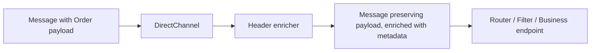

# Header Enricher Transformer

In the **Spring Integration Core (`SPRING_INTEGRATION_CORE`)** module, a header enricher is a transformer dedicated to adding or replacing `Message` metadata. This component helps downstream endpoints route messages, choose processing policies, or correlate messages without modifying the business data in the payload.

This lesson belongs to the **Transformer** chapter and focuses on setting headers via static values, SpEL, and Java DSL, while clarifying overwrite rules, `null` handling, errors, and testing. The examples use Java 17 and the Spring Integration 6.3 API as a reference; your project should manage library versions consistently through its existing dependency configuration.

## 1. Objectives and Prerequisites

After this lesson, you will be able to:

- Distinguish business data in the payload from flow-control metadata in headers.
- Create a header enricher endpoint using Java DSL and read equivalent XML configuration.
- Choose policies for preserving existing values, overwriting, or removing headers.
- Avoid depending on declaration order among headers inside the same enricher.
- Write tests for the payload, output headers, input immutability, and error scenarios.

You should already know `Message<T>`, `MessageChannel`, `DirectChannel`, `QueueChannel`, and how to declare an `IntegrationFlow`. No additional protocol adapters are needed to practice this material.

## 2. What Does a Header Enricher Change?

A message has two parts:

```text
Message<Order>
├── payload: Order
└── headers: Map<String, Object>
```

Example of an order that needs to be routed to a regional warehouse:

```text
Input
  payload = Order("ORD-1001", "south", 6500000)
  headers = { requestId: "req-007" }

Output after enrichment
  payload = same Order object as input
  headers = {
    requestId: "req-007",
    sourceSystem: "order-api",
    orderId: "ORD-1001",
    region: "SOUTH",
    warehouse: "WH-HCM",
    highValue: true
  }
```

System headers such as `id` and `timestamp` are omitted in the illustration. A header enricher preserves the payload and any headers outside its update scope, then creates the result via a message builder. It does not mutate the input message's header map directly. That map is read-only; calling `message.getHeaders().put(...)` throws `UnsupportedOperationException`. However, the payload object itself or objects stored in headers may still be mutable. Thus, message immutability does not mean every nested object has been deep-copied. See [Message and MessageHeaders](https://docs.spring.io/spring-integration/reference/6.3/message.html).



A header enricher is a transformer. In a flow, it becomes an endpoint that processes messages from an input channel and emits results to the next step. It does not persist messages, spawn worker threads, or send requests to external systems on its own. Channels and endpoint configurations determine how messages are delivered and executed.

### Choosing the Right Component

| Need | Suitable component | Example |
| --- | --- | --- |
| Add metadata, keep payload | Header enricher | Add `warehouse` so a router selects the warehouse |
| Convert the payload | Payload transformer | Convert JSON into `Order` |
| Supplement payload data from a lookup source | Payload/content enricher | Look up customer profile and attach it to the order |
| Remove selected headers | Header filter | Drop `internalNote` before leaving the boundary |
| Choose a path based on metadata | Router | Read `warehouse` and forward to the matching channel |
| Accept or discard the entire message | Message filter | Accept only orders with a valid status |

Spring Integration Core provides both a header enricher and a payload enricher; the two components solve data enrichment at two different places. Header enricher configuration supports static values, expressions, and bean methods. See [Content Enricher — Header Enricher](https://docs.spring.io/spring-integration/reference/6.3/content-enrichment.html#header-enricher).

Choosing between a header and the payload is also a data contract decision. If `customerTier` is data that must be persisted in the business record and shared long-term with other systems, place it in the appropriate payload model. If it is only temporary routing state within the current flow, a header may be the cleaner choice.

## 3. Complete Java DSL Example: Tagging Order Metadata

The example uses `spring-integration-core` with compatible Spring dependencies. The test section below requires JUnit Jupiter. Neither Spring Boot nor a broker is needed. If your application already uses Spring Boot, let its dependency management select compatible Spring versions.

Business rules for the example:

- `sourceSystem` defaults to `order-api` when the message does not already carry source info.
- `orderId`, `region`, `warehouse`, and `highValue` are computed from a payload already trusted by the flow.
- Existing values for those four recomputed headers must be replaced.
- Valid regions are `NORTH`, `CENTRAL`, and `SOUTH`; any other input must raise an error.

```java
package example.integration;

import java.util.Locale;

import org.springframework.context.annotation.Bean;
import org.springframework.context.annotation.Configuration;
import org.springframework.integration.channel.DirectChannel;
import org.springframework.integration.channel.QueueChannel;
import org.springframework.integration.config.EnableIntegration;
import org.springframework.integration.dsl.IntegrationFlow;
import org.springframework.messaging.MessageChannel;

@Configuration
@EnableIntegration
public class OrderEnrichmentConfig {

    public record Order(String orderId, String region, long totalVnd) {
    }

    @Bean
    public MessageChannel orderInput() {
        return new DirectChannel();
    }

    @Bean
    public QueueChannel enrichedOrders() {
        return new QueueChannel();
    }

    @Bean
    public IntegrationFlow orderHeaderFlow() {
        return IntegrationFlow.from("orderInput")
                .enrichHeaders(h -> h
                        .defaultOverwrite(false)
                        .header("sourceSystem", "order-api")
                        .<Order>headerFunction(
                                "orderId",
                                m -> m.getPayload().orderId(),
                                true)
                        .<Order>headerFunction(
                                "region",
                                m -> normalizeRegion(m.getPayload().region()),
                                true)
                        .<Order>headerFunction(
                                "warehouse",
                                m -> warehouseFor(m.getPayload().region()),
                                true)
                        .<Order>headerFunction(
                                "highValue",
                                m -> m.getPayload().totalVnd() >= 5_000_000L,
                                true))
                .channel("enrichedOrders")
                .get();
    }

    private static String normalizeRegion(String value) {
        if (value == null || value.isBlank()) {
            throw new IllegalArgumentException("region must not be blank");
        }

        String normalized = value.strip().toUpperCase(Locale.ROOT);
        return switch (normalized) {
            case "NORTH", "CENTRAL", "SOUTH" -> normalized;
            default -> throw new IllegalArgumentException(
                    "Unsupported region: " + value);
        };
    }

    private static String warehouseFor(String region) {
        return switch (normalizeRegion(region)) {
            case "NORTH" -> "WH-HN";
            case "CENTRAL" -> "WH-DN";
            case "SOUTH" -> "WH-HCM";
            default -> throw new IllegalStateException("Unexpected region");
        };
    }
}
```

`@EnableIntegration` registers the Integration infrastructure when using plain Spring configuration. `IntegrationFlow.from("orderInput")` receives messages from the declared channel. `enrichHeaders(...)` adds the header transformation step; `channel("enrichedOrders")` routes the result to a queue where it can be received and inspected.

`headerFunction` receives a `Message<P>`, so the lambda can access both payload and headers. The `.<Order>headerFunction(...)` syntax explicitly specifies the payload type for the compiler. The trailing `true` argument sets the per-header overwrite flag. These are APIs in [HeaderEnricherSpec](https://docs.spring.io/spring-integration/api/org/springframework/integration/dsl/HeaderEnricherSpec.html).

Here, `warehouseFor(...)` reads the region from the payload rather than reading the `region` header declared just above it. This intentionally avoids dependencies between two calculations inside the same enricher.

The trailing `QueueChannel` merely buffers results for a receiver. Processing from `orderInput` until placing the result on the queue still runs on the thread calling `send(...)`, because the input is a `DirectChannel` and there is no asynchronous execution handoff. The example needs no poller because no endpoint is declared to consume from `enrichedOrders`.

## 4. Three Ways to Determine Header Values

### 4.1. Static Values: `header`

```java
.enrichHeaders(h -> h
        .header("sourceSystem", "order-api")
        .header("schemaVersion", 2)
        .header("auditEnabled", true))
```

The values above have types `String`, `Integer`, and `Boolean`, respectively. Headers do not have to be strings.

Values passed to `header(...)` are evaluated when the configuration is constructed. The snippet below creates one UUID and reuses that same value across every message enriched by the step:

```java
// Unsuitable if each message needs a new processing ID.
.header("processingId", java.util.UUID.randomUUID().toString())
```

If you want to compute a value per message, use a callback:

```java
.<Object>headerFunction(
        "processingId",
        m -> java.util.UUID.randomUUID().toString(),
        true)
```

Generating a fresh random ID per invocation is only suitable for identifying a single execution attempt. For idempotency/deduplication, choose a stable key from the business entity or source event; generating a new UUID on every retry defeats duplicate detection.

### 4.2. SpEL Expressions: `headerExpression`

```java
.enrichHeaders(h -> h
        .headerExpression("orderId", "payload.orderId()", true)
        .headerExpression("highValue", "payload.totalVnd() >= 5000000", true)
        .headerExpression(
                "requestedBy",
                "headers['requestedBy'] ?: 'system'"))
```

The evaluation context root exposes `payload` and `headers`. The last expression uses the Elvis operator to take the existing value or a fallback when evaluated. Under the default non-overwriting policy, an already present `requestedBy` header is preserved without re-evaluating the expression.

Distinguish static values from expressions:

```java
.header("orderId", "payload.orderId()")            // Literal string.
.headerExpression("orderId", "payload.orderId()") // Result of invoking accessor.
```

Short expressions keep configuration readable. For multi-branch rules, move the logic into a Java method so it is easy to name, test, and maintain. SpEL can also call beans, such as `@warehousePolicy.warehouseFor(payload.region())`, when a `warehousePolicy` bean is registered and the method is accessible. See [SpEL and POJO support for header enricher](https://docs.spring.io/spring-integration/reference/6.3/content-enrichment.html#spel-support).

### 4.3. Java Functions: `headerFunction`

```java
.enrichHeaders(h -> h
        .<OrderEnrichmentConfig.Order>headerFunction(
                "routingKey",
                m -> m.getPayload().orderId() + ":"
                        + m.getHeaders().get("tenantId", String.class),
                true))
```

The callback reads a header from the input message. This example assumes `tenantId` has already been validated and is required prior to enrichment. If it is absent, string concatenation produces a `"null"` suffix; the application should validate the input contract rather than accepting a broken routing key.

Lambdas should be short, avoid mutating the payload, and hold no mutable state shared across messages. When computing a header requires a remote lookup, extract it into a service step with proper timeouts, error handling, and retry strategy. The enricher executes the value-computing function directly, so a slow call inside the function slows down the message-processing step.

## 5. Overwrite Rules: Determining Header Ownership

By default, a header enricher **does not replace an existing header**. There are two configuration levels:

1. `defaultOverwrite(...)`: global policy for headers without an explicit per-header setting.
2. Per-declaration `overwrite` argument: individual policy, taking precedence over the global policy.

Example:

```java
.enrichHeaders(h -> h
        .defaultOverwrite(true)
        .header("sourceSystem", "order-api", false)
        .header("schemaVersion", 2)
        .headerExpression("orderId", "payload.orderId()", true))
```

If the input already carries the corresponding headers:

| Header | Effective policy | Result |
| --- | --- | --- |
| `sourceSystem` | Individual: `false` | Keeps the upstream-supplied source |
| `schemaVersion` | Global: `true` | Replaced with integer `2` |
| `orderId` | Individual: `true` | Recomputed from payload |

If the header does not exist yet and the computed value is non-`null`, the enricher adds the header even when overwrite is `false`.

| Header present on input? | Effective overwrite? | Is new value computed? |
| --- | --- | --- |
| No | `false` | Yes |
| No | `true` | Yes |
| Yes | `false` | No; keeps existing value |
| Yes | `true` | Yes |

Skipping evaluation when a header already exists and overwrite is disallowed can mask a data error: you might think a function always runs to validate the payload, while in fact it is skipped. Put validation in an explicit validation step if it is mandatory for every message. This conditional evaluation rule is shown in [HeaderEnricher 6.3 source](https://github.com/spring-projects/spring-integration/blob/v6.3.0/spring-integration-core/src/main/java/org/springframework/integration/transformer/HeaderEnricher.java).

In a trusted internal flow, preserving an existing `sourceSystem` helps retain the original source. At an external ingestion point, if a header must reflect an identity established by your system, overwrite it from a trusted source. Overwrite authority should follow whoever owns the meaning of the header.

## 6. `null` Values: Skip or Remove?

`shouldSkipNulls` defaults to `true`. When a header declaration is evaluated and returns `null`:

- `shouldSkipNulls(true)`: do not apply that result.
- `shouldSkipNulls(false)`: treat `null` as removing the header.

Configuring `null` does not create a header with a `null` value for downstream steps to read. See [HeaderEnricher.setShouldSkipNulls](https://docs.spring.io/spring-integration/api/org/springframework/integration/transformer/HeaderEnricher.html#setShouldSkipNulls(boolean)).

You must consider overwrite permission at the same time:

| Input header | Overwrite | `shouldSkipNulls` | Result if calculation returns `null` |
| --- | --- | --- | --- |
| Absent | Any | `true` | Header remains absent |
| Absent | Any | `false` | Header remains absent |
| Present | `false` | Any | Calculation not run; old value kept |
| Present | `true` | `true` | Old value kept |
| Present | `true` | `false` | Header removed |

Example actively removing `legacyRoute`:

```java
.enrichHeaders(h -> h
        .shouldSkipNulls(false)
        .headerExpression("legacyRoute", "null", true))
```

The `true` argument here allows modifying an existing header. If you omit it while the global policy remains `false`, the old header will not be removed.

If the sole goal is removing known header names, a clearer expression is:

```java
.headerFilter("legacyRoute", "internalNote")
```

A header filter removes selected headers, whereas a message filter decides whether to keep the whole message. See [Header Filter](https://docs.spring.io/spring-integration/reference/transformer.html#header-filter).

One practical note: empty string `""` and whitespace-only strings are non-`null` values. `shouldSkipNulls` does not normalize or validate them for you.

## 7. Calculations in the Same Enricher Read the Input Message

Do not treat the order of `header(...)`, `headerExpression(...)`, or `headerFunction(...)` calls inside the same enricher as sequential assignments on a mutating message. Processors receive the original input message; a header just added to the builder does not become input to the next processor.

Suppose the input message has `region = NORTH`:

```java
.enrichHeaders(h -> h
        .header("region", "SOUTH", true)
        .headerExpression(
                "warehouse",
                "headers['region'] == 'SOUTH' ? 'WH-HCM' : 'WH-OTHER'",
                true))
```

The result has `region = SOUTH` but `warehouse = WH-OTHER`, because the expression reads `region = NORTH` from the original message. Reordering the two declarations is not a fix. This follows from how `transform(...)` passes the message to each processor in [HeaderEnricher](https://github.com/spring-projects/spring-integration/blob/v6.3.0/spring-integration-core/src/main/java/org/springframework/integration/transformer/HeaderEnricher.java).

If a later step must read the normalized header, split into two enrichers:

```java
.enrichHeaders(h -> h
        .header("region", "SOUTH", true))
.enrichHeaders(h -> h
        .headerExpression(
                "warehouse",
                "headers['region'] == 'SOUTH' ? 'WH-HCM' : 'WH-OTHER'",
                true))
```

Or compute each value independently from the same source, such as the payload in the order example. When multiple headers share an expensive lookup result, perform the lookup once in a dedicated step and reuse the result; do not repeat the service call per header.

## 8. Equivalent XML Configuration

The declaration below is an alternative to the Java configuration. It uses the same `OrderEnrichmentConfig.Order` payload type, adds the source header, and computes two headers from the payload. This is a simplified business XML example and does not include all region/warehouse rules from the Java flow.

```xml
<?xml version="1.0" encoding="UTF-8"?>
<beans xmlns="http://www.springframework.org/schema/beans"
       xmlns:xsi="http://www.w3.org/2001/XMLSchema-instance"
       xmlns:int="http://www.springframework.org/schema/integration"
       xsi:schemaLocation="
           http://www.springframework.org/schema/beans
           https://www.springframework.org/schema/beans/spring-beans.xsd
           http://www.springframework.org/schema/integration
           https://www.springframework.org/schema/integration/spring-integration.xsd">

    <int:channel id="orderInput"/>

    <int:channel id="enrichedOrders">
        <int:queue/>
    </int:channel>

    <int:header-enricher id="orderHeaderEnricher"
                         input-channel="orderInput"
                         output-channel="enrichedOrders"
                         default-overwrite="false"
                         should-skip-nulls="true">
        <int:header name="sourceSystem"
                    value="order-api"/>
        <int:header name="orderId"
                    expression="payload.orderId()"
                    overwrite="true"/>
        <int:header name="highValue"
                    expression="payload.totalVnd() &gt;= 5000000"
                    overwrite="true"/>
    </int:header-enricher>
</beans>
```

In XML, `value` denotes a literal value, `expression` is SpEL, and `ref` can reference a bean; combining `ref` with `method` tells the framework to call that method to compute the value. The `>` character is written as `&gt;` inside the XML expression above. These configuration options are described in [Header Enricher](https://docs.spring.io/spring-integration/reference/content-enrichment.html#header-enricher).

| Meaning | Java DSL | XML |
| --- | --- | --- |
| Global overwrite policy | `defaultOverwrite(false)` | `default-overwrite="false"` |
| Skip `null` policy | `shouldSkipNulls(true)` | `should-skip-nulls="true"` |
| Literal value | `header("sourceSystem", "order-api")` | `<int:header name="sourceSystem" value="order-api"/>` |
| Value from SpEL | `headerExpression("orderId", "payload.orderId()", true)` | `expression="payload.orderId()" overwrite="true"` |
| Per-header overwrite | Individual `true` or `false` argument | Individual `overwrite` attribute |

Load only one of the two configurations for this example. Loading both Java and XML with the same beans/channels can cause bean conflicts or create unintended duplicate consumers.

## 9. Business Headers vs. Framework Control Headers

You can invent custom headers like `warehouse`, but certain names already carry infrastructure meaning:

| Header | Role | Points to remember during enrichment |
| --- | --- | --- |
| `replyChannel` | Reply destination when an endpoint resolves where to respond | A gateway may have set the reply path for the current call |
| `errorChannel` | Error destination when error publishing uses this header | A matching error channel and consumer must exist |
| `correlationId` | Links related messages | Default aggregators use it to determine groups |
| `sequenceNumber`, `sequenceSize` | Ordering and group size info | May have been set by a splitter or branching flow |
| `priority` | Message priority | Affects ordering when using supporting channels such as `PriorityChannel` |

Standard header types and semantics are documented in [Message headers](https://docs.spring.io/spring-integration/reference/message.html). Preserve control headers set by a gateway, splitter, or preceding endpoint unless the flow intentionally alters that contract.

Do not use `MessageHeaders.ID` as a stable business identifier across transformations. `id` and `timestamp` are framework-managed read-only headers; with the default message builder, configuring them in an enricher is rejected at initialization. If you need cross-step identification, use `requestId`, `eventId`, or a dedicated business key. See [Read-only Headers](https://docs.spring.io/spring-integration/reference/6.3/message.html#read-only-headers).

### Interaction with Gateways

In a request/reply flow, overwriting `replyChannel` can send the reply elsewhere and leave the caller waiting until timeout. Preserve this header when the goal is only to add business metadata.

When you need to serialize a message whose `replyChannel` or `errorChannel` is a channel object, the DSL provides `headerChannelsToString()` to register the channel in `HeaderChannelRegistry` and store a string reference. The registry is an in-context mapping mechanism with a lifecycle and expiration; that string does not automatically turn a channel into an address reachable across two separate JVMs. See [Header Channel Registry](https://docs.spring.io/spring-integration/reference/content-enrichment.html#header-channel-registry).

### Interaction with Aggregators

If a splitter assigned the same `correlationId` to all parts of a request, setting a separate random UUID on each part before the aggregator will split them into separate groups. Preserve this header whenever you do not intend to change grouping strategy.

Conversely, the same `orderId` appearing across multiple independent runs is not necessarily a sufficiently distinct group key. Choose the correlation key according to the business group scope rather than copying whatever header happens to be convenient. Default grouping is described in [AggregatingMessageHandler — CorrelationStrategy](https://docs.spring.io/spring-integration/reference/aggregator.html).

## 10. Using Enriched Headers for Routing

In the Java example, `warehouse` is normalized from the order's region. A downstream router can simply inspect this header rather than duplicating warehouse selection rules.

The snippet below replaces `.channel("enrichedOrders")` at the end of the flow; the channels `northOrders`, `centralOrders`, and `southOrders` must be declared before running:

```java
.route("headers['warehouse']", r -> r
        .channelMapping("WH-HN", "northOrders")
        .channelMapping("WH-DN", "centralOrders")
        .channelMapping("WH-HCM", "southOrders"))
```

The separation of responsibilities is:

```text
Order payload
    → validate / normalize data
    → header enricher determines warehouse
    → router maps warehouse to channel
    → warehouse processing endpoint
```

This is a design choice for the example: the warehouse derivation policy lives in the enrichment step, while the router expresses the path. If warehouse selection grows into complex business logic pulling data from multiple services, extract it into a dedicated service and have the enricher attach the resulting decision.

Computing `warehouse` before the router does not guarantee the header automatically crosses HTTP, Kafka, AMQP, or JMS. At application boundaries, adapters and header mappers decide which fields are transmitted and how types are converted. Outbound contract design must explicitly specify allowed header names, types, and boundary mappings.

## 11. Where Are Errors in the Enrichment Step Handled?

Enrichment can fail when:

- The payload has a different type or structure than expected by the expression/lambda.
- Required data is missing, such as a blank `region`.
- An expression calls an invalid method or a business method throws an exception.
- A header-computing function calls a lookup source and that source fails.

In the main flow using `DirectChannel`, processing errors are thrown back to the `send(...)` caller, typically wrapped in a messaging exception containing the root cause. Merely adding an `errorChannel` header does not make a synchronous `send(...)` call automatically publish errors as messages on that channel.

When executed via a poller or asynchronous executor with an appropriate error handler, errors can be wrapped into an `ErrorMessage` and sent to an error channel. Gateways also have their own error-handling configuration. Identify where errors are raised and where they are caught based on how the flow executes. See [Error Handling](https://docs.spring.io/spring-integration/docs/6.1.x/reference/html/error-handling.html).

If enrichment is mandatory for the router to operate correctly, do not catch all exceptions and fall back to a default warehouse. For instance, an `UNKNOWN` region should be rejected or routed to a dead-letter/error path per business design.

If a header is purely supplemental, such as a reporting tag, tolerating its absence may be acceptable. In that case, define clearly:

1. Whether absence is represented by omitting the header or setting a default value.
2. Whether downstream steps may continue when the header is missing.
3. When the calculation returns `null`, whether an old value should be kept or removed.

Default `null` skipping can preserve a stale old value. That is why you should evaluate both `overwrite` and `shouldSkipNulls` when designing fallbacks.

## 12. Testing Flow Behavior

The JUnit 5 examples below use `OrderEnrichmentConfig` from section 3 unchanged. Place the test class in the same `example.integration` package. A plain Spring context creates the channels, endpoints, and flow; no server or broker needs to be started.

Three behaviors to verify first are: correct enrichment output, correct overwrite policy, and invalid data causing the enrichment step to fail.

```java
package example.integration;

import org.junit.jupiter.api.Test;

import org.springframework.context.annotation.AnnotationConfigApplicationContext;
import org.springframework.integration.channel.QueueChannel;
import org.springframework.messaging.Message;
import org.springframework.messaging.MessageChannel;
import org.springframework.messaging.MessagingException;
import org.springframework.messaging.support.MessageBuilder;

import static org.junit.jupiter.api.Assertions.*;

class OrderHeaderEnrichmentTest {

    @Test
    void enrichesHeadersAndKeepsOriginalPayload() {
        try (var context = new AnnotationConfigApplicationContext(
                OrderEnrichmentConfig.class)) {

            MessageChannel input = context.getBean(
                    "orderInput", MessageChannel.class);
            QueueChannel output = context.getBean(
                    "enrichedOrders", QueueChannel.class);

            var order = new OrderEnrichmentConfig.Order(
                    "ORD-1001", "south", 6_500_000L);

            Message<OrderEnrichmentConfig.Order> original =
                    MessageBuilder.withPayload(order)
                            .setHeader("requestId", "req-007")
                            .build();

            assertTrue(input.send(original));

            Message<?> enriched = output.receive(1_000);
            assertNotNull(enriched);

            assertSame(order, enriched.getPayload());
            assertEquals("order-api",
                    enriched.getHeaders().get("sourceSystem"));
            assertEquals("ORD-1001",
                    enriched.getHeaders().get("orderId"));
            assertEquals("SOUTH",
                    enriched.getHeaders().get("region"));
            assertEquals("WH-HCM",
                    enriched.getHeaders().get("warehouse"));
            assertEquals(Boolean.TRUE,
                    enriched.getHeaders().get("highValue"));
            assertEquals("req-007",
                    enriched.getHeaders().get("requestId"));

            assertFalse(original.getHeaders().containsKey("warehouse"));
            assertFalse(original.getHeaders().containsKey("region"));
            assertEquals("south", order.region());
        }
    }

    @Test
    void preservesSourceAndRecomputesOwnedHeaders() {
        try (var context = new AnnotationConfigApplicationContext(
                OrderEnrichmentConfig.class)) {

            MessageChannel input = context.getBean(
                    "orderInput", MessageChannel.class);
            QueueChannel output = context.getBean(
                    "enrichedOrders", QueueChannel.class);

            var order = new OrderEnrichmentConfig.Order(
                    "ORD-1002", " SOUTH ", 200_000L);

            Message<OrderEnrichmentConfig.Order> original =
                    MessageBuilder.withPayload(order)
                            .setHeader("sourceSystem", "partner-api")
                            .setHeader("orderId", "OLD-ID")
                            .setHeader("region", "NORTH")
                            .setHeader("warehouse", "WH-HN")
                            .setHeader("highValue", true)
                            .build();

            assertTrue(input.send(original));

            Message<?> enriched = output.receive(1_000);
            assertNotNull(enriched);

            assertEquals("partner-api",
                    enriched.getHeaders().get("sourceSystem"));
            assertEquals("ORD-1002",
                    enriched.getHeaders().get("orderId"));
            assertEquals("SOUTH",
                    enriched.getHeaders().get("region"));
            assertEquals("WH-HCM",
                    enriched.getHeaders().get("warehouse"));
            assertEquals(Boolean.FALSE,
                    enriched.getHeaders().get("highValue"));

            assertEquals("OLD-ID",
                    original.getHeaders().get("orderId"));
            assertEquals("NORTH",
                    original.getHeaders().get("region"));
            assertEquals("WH-HN",
                    original.getHeaders().get("warehouse"));
        }
    }

    @Test
    void rejectsUnsupportedRegionWithoutPublishingOutput() {
        try (var context = new AnnotationConfigApplicationContext(
                OrderEnrichmentConfig.class)) {

            MessageChannel input = context.getBean(
                    "orderInput", MessageChannel.class);
            QueueChannel output = context.getBean(
                    "enrichedOrders", QueueChannel.class);

            var order = new OrderEnrichmentConfig.Order(
                    "ORD-1003", "UNKNOWN", 200_000L);

            Message<OrderEnrichmentConfig.Order> original =
                    MessageBuilder.withPayload(order)
                            .setHeader("warehouse", "WH-HCM")
                            .build();

            assertThrows(MessagingException.class,
                    () -> input.send(original));

            assertNull(output.receive(0));
        }
    }
}
```

The third test deliberately includes an existing `warehouse` header. Because payload-derived headers are configured with overwrite enabled, invalid data still fails the flow; the old value is not used to bypass recomputation.

`assertSame(order, enriched.getPayload())` verifies the header enricher's contract of preserving the payload reference. Checking headers on `original` confirms the input was not mutated. Do not compare the entire headers map as the sole assertion because framework-managed system headers differ.

### Additional Cases to Cover When Changing Policies

| Case | Expectation to verify |
| --- | --- |
| Header already exists, no overwrite | Keeps old value; callback does not run |
| Header already exists, overwrite | New value replaces old value |
| Callback returns `null`, skip nulls default | Keeps old value |
| Callback returns `null`, overwrite allowed and skip nulls off | Header is removed |
| Two calculations in same enricher depend on each other | Later calculation still reads the input message's header |
| Two sequential enrichers | Second step sees the first step's output header |
| `highValue` value | Has type `Boolean`, not string `"true"` |

The rows in this table represent additional test requirements for each configuration variant; they are not yet exhaustively covered by the three illustrative tests above.

## 13. Common Design Mistakes

| Symptom | Common cause | Fix |
| --- | --- | --- |
| New header does not replace old value | Default is no overwrite | Enable `overwrite` explicitly for flow-owned headers |
| Set `shouldSkipNulls(false)` but header is not removed | Old header is not allowed to be overwritten | Allow overwrite or use a header filter |
| Downstream receives literal `"payload.orderId()"` | Used `header` instead of `headerExpression` | Choose the expression-evaluating API |
| Dependent header has wrong value | Reading a header declared in the same enricher | Split into two steps or read from the same original source |
| All messages share the same UUID | UUID computed once during flow construction | Use a callback if the ID must be generated per message |
| Gateway waits until timeout | `replyChannel` overwritten or dropped | Preserve reply path and verify request/reply contract |
| Aggregator fails to complete group | `correlationId` or sequence header altered | Preserve group metadata unless changing grouping strategy |
| Header disappears across broker | Mapper or protocol does not forward that header | Configure header mapping and types on the adapter |
| Added `errorChannel` yet error still throws to caller | Current flow runs synchronously over `DirectChannel` | Catch at the caller or configure error handling at the right boundary |

An enrichment function may run on multiple threads if the flow is invoked concurrently or uses asynchronous channels. Use immutable objects for shared data and keep header functions free of per-message mutable state. Extract I/O or heavy computations into dedicated endpoints when you need execution timeouts, retries, and error observability.

## 14. Designing the Header Contract Before Scaling the Flow

For each header, record four decisions: data type, value source, who owns replacement rights, and how absence is represented. Example contract for the order flow:

| Header | Type | Source | When already present |
| --- | --- | --- | --- |
| `sourceSystem` | `String` | Upstream internal source or default `order-api` | Keep |
| `orderId` | `String` | `payload.orderId()` | Recompute |
| `region` | Normalized `String` | `payload.region()` | Recompute |
| `warehouse` | `String` | Warehouse policy from region in payload | Recompute |
| `highValue` | `Boolean` | Comparing total amount against threshold | Recompute |
| `requestId` | `String` | Request ingestion step | Preserve across enrichment |

Place enrichers before the endpoints that consume the metadata. Keep calculations inside the same step independent of each other; use multiple steps if dependencies exist. Define overwrite and `null` rules clearly so a stale header never accidentally drives a new business decision. These choices allow routers, filters, gateways, and aggregators to collaborate under a clear message contract.
