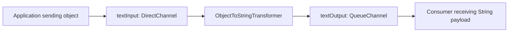

# Object to String

In the **Transformer** chapter of module `SPRING_INTEGRATION_CORE`, this lesson shows how to convert a message payload into a `String` using `ObjectToStringTransformer`. The goal is to place the conversion step properly in a message flow, understand the actual output, and test both the data and its accompanying metadata.

The examples use Java 17 and the Spring Integration 6.x Java DSL style. They require only the core components; no broker, database, or file adapter is needed to observe the results.

## 1. Problem: Sender Has an Object, Receiver Needs Text

Suppose an order processing system emits an object describing status. A downstream step only accepts text to display or record a line of internal information:

```text
Input:  OrderSummary("DH-1042", "PAID")
Output:   "orderId=DH-1042;status=PAID"
```

We place a transformer between the two sides so the producer does not have to convert to `String` manually before sending the message.



In this flow, channels transport messages while the transformer determines the output payload value. This is a concrete application of the Message Translator pattern: adapting data representations to connect components with different requirements.

After this lesson, you should be able to do three things:

- Predict the string output for ordinary objects, `char[]`, and `byte[]`.
- Declare the endpoint using Java DSL and connect it to a channel or gateway.
- Spot cases that require a dedicated formatter or serializer instead of relying on `toString()`.

## 2. Conversion Rules of `ObjectToStringTransformer`

The transformer builds a string payload based on the input data type:

| Input payload | How the string is produced | Example output |
| --- | --- | --- |
| Ordinary object | Calls `payload.toString()` | `Integer.valueOf(42)` becomes `"42"` |
| `String` | Uses the string's `toString()` result | `"Đã nhận"` keeps the content `"Đã nhận"` |
| `char[]` | Builds a string from the array characters | `new char[] {'O', 'K'}` becomes `"OK"` |
| `byte[]` | Decodes the byte array using the configured charset | UTF-8 bytes of `"Đã nhận"` become `"Đã nhận"` |

The default charset is UTF-8. Those are two special-cased paths for character arrays and byte arrays; they do not use the array's default `toString()`. This rule is documented in the [ObjectToStringTransformer Javadoc](https://docs.spring.io/spring-integration/api/org/springframework/integration/transformer/ObjectToStringTransformer.html).

The decision to settle before picking this component is: **does the consumer actually want the object's `toString()` representation?** A value of type `String` alone does not prove the content satisfies the data contract.

For example, the two strings below are both valid Java strings, yet serve different contracts:

```text
orderId=DH-1042;status=PAID
{"orderId":"DH-1042","status":"PAID"}
```

If a partner requires JSON, choose an approach that produces JSON with an explicit schema and serialization rules. Do not treat `toString()` output as JSON simply because it has become a string.

## 3. Output Message and Headers

The transformer operates at the message level:

```text
Message<OrderSummary>
    payload: OrderSummary(...)
    headers: businessTraceId, correlationId, replyChannel, ...
                      |
                      v
Message<String>
    payload: "orderId=DH-1042;status=PAID"
    headers: propagated metadata per message-building mechanism
```

With default configuration, the resulting payload is placed in the output message and input headers are copied. You can inspect this mechanism in [AbstractTransformer source](https://raw.githubusercontent.com/spring-projects/spring-integration/v6.5.4/spring-integration-core/src/main/java/org/springframework/integration/transformer/AbstractTransformer.java).

Do not use the message `id` as a business key across the flow. A rebuilt message receives its own identifier; `timestamp` also reflects when the message was built. Two timestamps can be equal if creation occurs within the same millisecond. When you need to track an order across multiple endpoints, use a business header like `businessTraceId` or a correlation header. See [Message and MessageHeaders Model](https://docs.spring.io/spring-integration/reference/message.html).

Copying headers does not mean the transformer understands and adjusts every piece of metadata. For example, if the input carries `contentType=application/json` while `toString()` produces text shaped like `orderId=...`, update headers at an appropriate step. `ObjectToStringTransformer` is not a content-contract manager for the entire flow.

## 4. Preparing an Object with Observable Output

The following example intentionally defines `toString()` so the illustrative output is deterministic. Place the Java classes in this lesson in the same `example.integration.text` package if assembling a practice project.

```java
package example.integration.text;

public record OrderSummary(String orderId, String status) {

    @Override
    public String toString() {
        return "orderId=" + orderId + ";status=" + status;
    }
}
```

The object:

```java
new OrderSummary("DH-1042", "PAID")
```

produces the string:

```text
orderId=DH-1042;status=PAID
```

This format is for the practice exercise. If a string becomes a long-lived exchange protocol, extract a formatter separate from `toString()` and specify how delimiters, empty values, dates, decimals, and format versions are handled. For instance, an `orderId` containing `;` makes the simple concatenation above hard to parse back.

## 5. Complete Configuration Using Java DSL

### 5.1. Required Dependencies

The example requires `org.springframework.integration:spring-integration-core`; the test section uses JUnit Jupiter. Use the dependency versions managed consistently by your project. The snippets below are standalone examples for learning the component and do not require altering an existing module build configuration.

### 5.2. Flow from `DirectChannel` to `QueueChannel`

```java
package example.integration.text;

import java.nio.charset.StandardCharsets;

import org.springframework.beans.factory.annotation.Qualifier;
import org.springframework.context.annotation.Bean;
import org.springframework.context.annotation.Configuration;
import org.springframework.integration.channel.DirectChannel;
import org.springframework.integration.channel.QueueChannel;
import org.springframework.integration.config.EnableIntegration;
import org.springframework.integration.dsl.IntegrationFlow;
import org.springframework.integration.dsl.Transformers;
import org.springframework.messaging.MessageChannel;

@Configuration
@EnableIntegration
public class ObjectToStringFlowConfig {

    @Bean
    public MessageChannel textInput() {
        return new DirectChannel();
    }

    @Bean
    public QueueChannel textOutput() {
        return new QueueChannel();
    }

    @Bean
    public IntegrationFlow objectToStringFlow(
            @Qualifier("textInput") MessageChannel input,
            @Qualifier("textOutput") QueueChannel output) {

        return IntegrationFlow.from(input)
                .transform(Transformers.objectToString(
                        StandardCharsets.UTF_8.name()))
                .channel(output)
                .get();
    }
}
```

`Transformers.objectToString()` creates a transformer using the default charset; the overload accepting a `String` lets you specify a charset name. In the example, passing `StandardCharsets.UTF_8.name()` makes the configuration explicit. See [Transformers API](https://docs.spring.io/spring-integration/api/org/springframework/integration/dsl/Transformers.html).

The parts of the configuration coordinate as follows:

1. `textInput` receives messages sent by the application.
2. `.transform(...)` registers an endpoint processing messages from that channel.
3. The converted payload is sent to `textOutput`.
4. Practice code reads messages using `receive(...)` to observe the result.

The trailing queue holds results for manual reads or assertions. No poller is needed when test code calls `receive()` directly. If you later attach an automatic consuming endpoint to the `QueueChannel`, configure a suitable polling mechanism.

### 5.3. Sending and Reading a Message

The snippet below can be placed in a runner method, with matching imports:

```java
import org.springframework.context.annotation.AnnotationConfigApplicationContext;
import org.springframework.integration.channel.QueueChannel;
import org.springframework.messaging.Message;
import org.springframework.messaging.MessageChannel;
import org.springframework.messaging.support.MessageBuilder;

try (var context = new AnnotationConfigApplicationContext(
        ObjectToStringFlowConfig.class)) {

    MessageChannel input = context.getBean("textInput", MessageChannel.class);
    QueueChannel output = context.getBean("textOutput", QueueChannel.class);

    Message<OrderSummary> request = MessageBuilder
            .withPayload(new OrderSummary("DH-1042", "PAID"))
            .setHeader("businessTraceId", "trace-1042")
            .build();

    input.send(request);

    Message<?> reply = output.receive(1_000);
    if (reply == null) {
        throw new IllegalStateException("No transformation result received");
    }

    System.out.println(reply.getPayload());
    System.out.println(reply.getHeaders().get("businessTraceId"));
}
```

Expected output:

```text
orderId=DH-1042;status=PAID
trace-1042
```

`input.send(...)` reports whether the send operation succeeded or failed; its boolean return value is not the resulting string. To obtain the string, receive the message on the output or use a request/reply gateway.

## 6. Using a Gateway to Expose a `String`-Returning API

When the application only wants to call a method and receive the result, you can expose an interface:

```java
package example.integration.text;

import org.springframework.integration.annotation.MessagingGateway;

@MessagingGateway(defaultRequestChannel = "renderInput")
public interface TextGateway {

    String render(Object payload);
}
```

Dedicated configuration for the request/reply variant:

```java
package example.integration.text;

import org.springframework.context.annotation.Bean;
import org.springframework.context.annotation.Configuration;
import org.springframework.context.annotation.Import;
import org.springframework.integration.config.EnableIntegration;
import org.springframework.integration.dsl.IntegrationFlow;
import org.springframework.integration.dsl.Transformers;

@Configuration
@EnableIntegration
@Import(TextGateway.class)
public class TextGatewayConfig {

    @Bean
    public IntegrationFlow renderFlow() {
        return IntegrationFlow.from("renderInput")
                .transform(Transformers.objectToString())
                .get();
    }
}
```

Once the context loads `TextGatewayConfig`, you can retrieve the `TextGateway` bean and invoke it:

```java
String text = gateway.render(new OrderSummary("DH-1042", "PAID"));
// text = "orderId=DH-1042;status=PAID"
```

The gateway creates a temporary reply channel and places that information in a header. The transformer at the end of the flow declares no output channel, so it sends the result back via the reply mechanism. In Spring Integration 6.x, `@Import` can register an interface annotated with `@MessagingGateway`; another option is `@IntegrationComponentScan`. This mechanism is described in [Messaging Gateways documentation](https://docs.spring.io/spring-integration/reference/gateway.html).

This variant takes input on `renderInput` and replies directly to the gateway call. If you design a request/reply flow that ends at a queue with no consumer forwarding the reply, the call may never receive the expected response. Clarify who receives the final message before appending more channels.

## 7. Declaring via Annotation or XML

The two approaches below are alternatives to the Java DSL configuration in section 5. Choose only one endpoint registration approach for the same exercise to avoid unintended competing consumers on `textInput`.

### 7.1. Bean with `@Transformer`

Inside a configuration class with `@EnableIntegration` and the required channel beans:

```java
import org.springframework.context.annotation.Bean;
import org.springframework.integration.annotation.Transformer;
import org.springframework.integration.transformer.ObjectToStringTransformer;

@Bean
@Transformer(inputChannel = "textInput", outputChannel = "textOutput")
public ObjectToStringTransformer objectToStringTransformer() {
    return new ObjectToStringTransformer("UTF-8");
}
```

The bean supplies the conversion logic; the annotation declares how that logic is bound to channels. You do not need to write an intermediate wrapper method just to call `Object.toString()`.

### 7.2. XML Namespace

```xml
<?xml version="1.0" encoding="UTF-8"?>
<beans xmlns="http://www.springframework.org/schema/beans"
       xmlns:xsi="http://www.w3.org/2001/XMLSchema-instance"
       xmlns:int="http://www.springframework.org/schema/integration"
       xsi:schemaLocation="
         http://www.springframework.org/schema/beans
         https://www.springframework.org/schema/beans/spring-beans.xsd
         http://www.springframework.org/schema/integration
         https://www.springframework.org/schema/integration/spring-integration.xsd">

    <int:channel id="textInput"/>

    <int:channel id="textOutput">
        <int:queue/>
    </int:channel>

    <int:object-to-string-transformer
            id="orderTextTransformer"
            input-channel="textInput"
            output-channel="textOutput"
            charset="UTF-8"/>
</beans>
```

The `object-to-string-transformer` element directly expresses the conversion type and involved channels. You can cross-check the configuration syntax in the [Object-to-String section of Spring Integration 6.5 docs](https://docs.spring.io/spring-integration/reference/6.5/transformer.html#_object_to_string_transformer).

## 8. Charset: Distinguishing Bytes, Characters, and Strings

### 8.1. Charset Applied When Input Is `byte[]`

Bytes do not inherently carry metadata saying whether they were encoded as UTF-8, ISO-8859-1, or another encoding. The transformer configuration must match the producer that generated the bytes.

Example of a source sending ISO-8859-1 bytes for the word `café`:

```java
import java.nio.charset.StandardCharsets;

import org.springframework.integration.transformer.ObjectToStringTransformer;
import org.springframework.messaging.Message;
import org.springframework.messaging.support.GenericMessage;

byte[] bytes = "café".getBytes(StandardCharsets.ISO_8859_1);

var transformer = new ObjectToStringTransformer(
        StandardCharsets.ISO_8859_1.name());

Message<?> result = transformer.transform(new GenericMessage<>(bytes));
// result.getPayload().equals("café")
```

`char[]` already contains characters, so it needs no byte-decoding step. For a `String` payload that was already misdecoded earlier, changing the charset on the transformer will not recover the original data: the component only sees the current string. The difference between `byte[]` and `char[]` constructors is documented in [Java String API](https://docs.oracle.com/en/java/javase/21/docs/api/java.base/java/lang/String.html).

### 8.2. Input Charset and Output Encoding Are Two Separate Decisions

```text
byte[] from source system
          |
          | decode with source charset
          v
       String
          |
          | encode with destination charset
          v
byte[] written to file or sent over network
```

For example, a source may send ISO-8859-1 while the destination file requires UTF-8. The transformer performs the first step; the later write or send step must configure the matching output encoding. A Java `String` is not a pre-encoded UTF-8 byte buffer ready for transmission.

### 8.3. Not Automatically Picking Charset from Headers

An `ObjectToStringTransformer` instance retains the charset configured at construction. It does not automatically read a header named `sourceCharset`, nor infer a charset from `contentType`. How configuration is held and how conversion branches execute can be inspected in [ObjectToStringTransformer source](https://raw.githubusercontent.com/spring-projects/spring-integration/v6.5.4/spring-integration-core/src/main/java/org/springframework/integration/transformer/ObjectToStringTransformer.java).

If the contract genuinely allows each message to use a different charset, you can use an expression transformer. The snippet below is a Java DSL replacement for the fixed transformation step, assuming the payload is always `byte[]` and the header has already been validated:

```java
.transform("new java.lang.String(payload, headers['sourceCharset'])")
```

You should define which charsets are accepted and how a missing header is handled. When multiple validation branches or fallback rules are needed, a dedicated Java transformer is easier to read and test than a long expression.

## 9. Data Types Easily Misunderstood

### 9.1. Arrays Other Than `byte[]` and `char[]`

`int[]`, `String[]`, and `Object[]` follow the ordinary `toString()` branch. Their elements are not automatically joined into a readable list.

Example:

```java
int[] values = {10, 20};
String text = values.toString();
// Form like "[I@..."; the part after @ is not fixed.
```

If you want `"[10, 20]"`, use an explicit formatting step:

```java
import java.util.Arrays;

// Configuration snippet inside an IntegrationFlow:
.transform(int[].class, values -> Arrays.toString(values))
```

### 9.2. `Map`, Collections, and Business Objects

A map may yield a string like `{orderId=DH-1042, status=PAID}`. That `=` syntax is not JSON. Nor should you rely on display order if the collection makes no ordering guarantee.

For business objects, modifying `toString()` for debugging can unintentionally alter what gets sent to consumers. When a consumer needs a stable protocol, use a dedicated formatter or a JSON transformer and test that format as a contract.

### 9.3. `File`, `InputStream`, and Binary Data

Choose the component according to the content you want to obtain:

| Actual need | Appropriate approach |
| --- | --- |
| Read text contents of a file | Use a file-to-string transformer with the appropriate charset |
| Read an `InputStream` into a string | Use a stream transformer, such as `Transformers.fromStream("UTF-8")` |
| Transmit an object as JSON | Use a JSON transformer and configure an appropriate mapper |
| Represent images/PDFs in a text field | Use Base64 per the receiving system's contract |
| Build a business line with escaping rules | Write a dedicated formatter/transformer |

Calling `toString()` on a `File` object does not read the file's contents. Likewise, calling it on a stream does not consume the stream to extract text. Selecting the component here stems from the operation required: reading a resource, decoding bytes, or formatting an object are distinct steps.

Do not decode image or PDF bytes as UTF-8 instead of Base64. Text decoding aims to recover characters; Base64 aims to represent arbitrary bytes as recoverable text.

## 10. When You Need to Reject Invalid Bytes

`ObjectToStringTransformer` is not a comprehensive validator for external text data. Beyond picking the right charset, some flows require rejecting malformed byte sequences right at the system boundary.

You can write a strict decoder using `CharsetDecoder` with `CodingErrorAction.REPORT` and invoke it from a transformer:

```java
package example.integration.text;

import java.nio.ByteBuffer;
import java.nio.charset.CharacterCodingException;
import java.nio.charset.CodingErrorAction;
import java.nio.charset.StandardCharsets;

public final class StrictUtf8Decoder {

    private StrictUtf8Decoder() {
    }

    public static String decode(byte[] bytes) {
        var decoder = StandardCharsets.UTF_8.newDecoder()
                .onMalformedInput(CodingErrorAction.REPORT)
                .onUnmappableCharacter(CodingErrorAction.REPORT);

        try {
            return decoder.decode(ByteBuffer.wrap(bytes)).toString();
        }
        catch (CharacterCodingException ex) {
            throw new IllegalArgumentException(
                    "Payload must be valid UTF-8 text", ex);
        }
    }
}
```

Corresponding Java DSL snippet:

```java
.transform(byte[].class, StrictUtf8Decoder::decode)
```

For example, `new byte[] {(byte) 0xC3, 0x28}` is not a valid UTF-8 sequence and will be rejected by this decoder. A fresh decoder is created per call, avoiding sharing a stateful decoder across threads. Error reporting and thread-safety notes are specified in the [CharsetDecoder API](https://docs.oracle.com/en/java/javase/21/docs/api/java.base/java/nio/charset/CharsetDecoder.html).

This is a variant for input-validation requirements. Use the built-in transformer when its existing conversion behavior already satisfies the flow's contract.

## 11. Handling Errors at the Right Execution Boundary

Potential causes to check when converting objects to strings include:

- The object's `toString()` throws an exception.
- The configured charset name is unsupported.
- A custom formatter or strict decoder rejects the input.
- A step after the transformer rejects the newly produced content.

Content errors such as a wrong charset sometimes still produce a `String`. Therefore, tests that only verify the payload type will miss corrupted string output.

In the flow using `DirectChannel` in section 5, the handler executes on the thread sending the message. Transformation failures can propagate back to the `send(...)` call. Do not assume that adding an `errorChannel` header automatically redirects synchronous failures into another flow.

When switching to an `ExecutorChannel` or a poller-driven endpoint, design error handling for asynchronous execution: error info can be published as an `ErrorMessage` to the configured error channel. Gateways also have their own error-routing options. The differences between these execution boundaries are explained in the [Error Handling documentation](https://docs.spring.io/spring-integration/reference/error-handling.html).

Do not return `null` from transformation logic to mean "drop the message". If a message should not proceed, use a filter and specify an appropriate discard/error flow. A message payload should carry a value; blocking messages and changing representation should be expressed as explicit steps.

## 12. Component Testing: Content, Charset, and Headers

The tests below are suggested practice code. They use JUnit Jupiter and the `OrderSummary` class from section 4.

```java
package example.integration.text;

import java.nio.charset.StandardCharsets;

import org.junit.jupiter.api.Test;

import org.springframework.integration.IntegrationMessageHeaderAccessor;
import org.springframework.integration.channel.QueueChannel;
import org.springframework.integration.transformer.MessageTransformationException;
import org.springframework.integration.transformer.ObjectToStringTransformer;
import org.springframework.messaging.Message;
import org.springframework.messaging.support.GenericMessage;
import org.springframework.messaging.support.MessageBuilder;

import static org.junit.jupiter.api.Assertions.assertEquals;
import static org.junit.jupiter.api.Assertions.assertInstanceOf;
import static org.junit.jupiter.api.Assertions.assertNotEquals;
import static org.junit.jupiter.api.Assertions.assertSame;
import static org.junit.jupiter.api.Assertions.assertThrows;

class ObjectToStringTransformerTest {

    @Test
    void convertsBusinessObjectAndPreservesRelevantHeaders() {
        var replyChannel = new QueueChannel();
        Message<OrderSummary> request = MessageBuilder
                .withPayload(new OrderSummary("DH-1042", "PAID"))
                .setHeader("businessTraceId", "trace-1042")
                .setHeader(IntegrationMessageHeaderAccessor.CORRELATION_ID,
                        "order-group-1042")
                .setReplyChannel(replyChannel)
                .build();

        Message<?> result = new ObjectToStringTransformer().transform(request);

        assertInstanceOf(String.class, result.getPayload());
        assertEquals("orderId=DH-1042;status=PAID", result.getPayload());
        assertEquals("trace-1042",
                result.getHeaders().get("businessTraceId"));
        assertEquals("order-group-1042", result.getHeaders().get(
                IntegrationMessageHeaderAccessor.CORRELATION_ID));
        assertSame(replyChannel, result.getHeaders().getReplyChannel());
        assertNotEquals(request.getHeaders().getId(),
                result.getHeaders().getId());
    }

    @Test
    void decodesUtf8ByDefault() {
        byte[] bytes = "Đơn hàng đã nhận".getBytes(StandardCharsets.UTF_8);

        Message<?> result = new ObjectToStringTransformer()
                .transform(new GenericMessage<>(bytes));

        assertEquals("Đơn hàng đã nhận", result.getPayload());
    }

    @Test
    void decodesTheConfiguredCharset() {
        byte[] bytes = "café".getBytes(StandardCharsets.ISO_8859_1);
        var transformer = new ObjectToStringTransformer("ISO-8859-1");

        Message<?> result = transformer.transform(new GenericMessage<>(bytes));

        assertEquals("café", result.getPayload());
    }

    @Test
    void convertsCharacterArrayContents() {
        char[] characters = "Đã nhận".toCharArray();

        Message<?> result = new ObjectToStringTransformer()
                .transform(new GenericMessage<>(characters));

        assertEquals("Đã nhận", result.getPayload());
    }

    @Test
    void keepsExistingStringContent() {
        Message<?> result = new ObjectToStringTransformer()
                .transform(new GenericMessage<>("Đã nhận"));

        assertEquals("Đã nhận", result.getPayload());
    }

    @Test
    void reportsAnExceptionFromToString() {
        var request = new GenericMessage<>(new BrokenPayload());
        var transformer = new ObjectToStringTransformer();

        MessageTransformationException error = assertThrows(
                MessageTransformationException.class,
                () -> transformer.transform(request));

        assertSame(request, error.getFailedMessage());
        assertInstanceOf(IllegalStateException.class, error.getCause());
    }

    private static final class BrokenPayload {

        @Override
        public String toString() {
            throw new IllegalStateException("Unable to format payload");
        }
    }
}
```

Vietnamese test strings help avoid testing only with ASCII, because many charset bugs never surface when data contains only `A-Z`, digits, and simple punctuation. The test using ISO-8859-1 verifies that the configured charset actually takes effect; `é` is a character representable in that encoding.

Do not compare two header maps in full with `assertEquals`: the output message has its own identity and timestamp headers. Choose assertions for the guarantees you need, such as preserving `businessTraceId`, correlation headers, and reply channel. Nor should you require the output timestamp to be strictly greater than the input timestamp.

## 13. Flow Testing: Verifying Endpoints Are Wired to the Right Channels

The unit tests above only call the component directly. Another test is needed to catch misnamed channels, unregistered flow beans, or an endpoint not wired to the input.

```java
package example.integration.text;

import java.nio.charset.StandardCharsets;

import org.junit.jupiter.api.Test;

import org.springframework.context.annotation.AnnotationConfigApplicationContext;
import org.springframework.integration.channel.QueueChannel;
import org.springframework.messaging.Message;
import org.springframework.messaging.MessageChannel;
import org.springframework.messaging.support.MessageBuilder;

import static org.junit.jupiter.api.Assertions.assertEquals;
import static org.junit.jupiter.api.Assertions.assertInstanceOf;
import static org.junit.jupiter.api.Assertions.assertNotNull;
import static org.junit.jupiter.api.Assertions.assertTrue;

class ObjectToStringFlowTest {

    @Test
    void routesConvertedTextToTheOutputChannel() {
        try (var context = new AnnotationConfigApplicationContext(
                ObjectToStringFlowConfig.class)) {

            MessageChannel input = context.getBean(
                    "textInput", MessageChannel.class);
            QueueChannel output = context.getBean(
                    "textOutput", QueueChannel.class);

            Message<byte[]> request = MessageBuilder
                    .withPayload("Đã nhận đơn".getBytes(StandardCharsets.UTF_8))
                    .setHeader("businessTraceId", "trace-flow-01")
                    .build();

            assertTrue(input.send(request));

            Message<?> result = output.receive(1_000);
            assertNotNull(result);
            assertInstanceOf(String.class, result.getPayload());
            assertEquals("Đã nhận đơn", result.getPayload());
            assertEquals("trace-flow-01",
                    result.getHeaders().get("businessTraceId"));
        }
    }
}
```

A bounded timeout ensures the test stops if no message arrives. With this synchronous flow, there is no need to add `Thread.sleep()` waiting for the transformer to finish.

If you implement the gateway variant, add a direct assertion on `TextGateway.render(...)` to confirm the string actually returns to the caller. If you use the strict decoder, add tests for valid bytes, invalid UTF-8 bytes, and the expected error-handling behavior at the flow boundary.

## 14. Choosing Where to Place Conversion in a Business Flow

Suppose a real flow has the following sequence:

```text
OrderSummary
    -> validate order is eligible for export
    -> route by status
    -> render string for output
    -> send to text consumer
```

Keep the object during steps that need to inspect business fields. If you convert to a string too early, a downstream router may have to parse text back apart just to read `status`, increasing coupling to string formatting.

Similarly, when an aggregator is present, decide whether the aggregated output is an object, a collection, or final text. `ObjectToStringTransformer` does not automatically assemble a collection into a multi-line report according to business rules. Build report text with a dedicated formatting step when requirements specify line ordering, headers, or totals.

When you only need to inspect data for debugging, you can attach a logging endpoint or wire tap without changing the flow's main payload. Choosing object-to-string should stem from the downstream consumer's contract.

Key takeaways when applying this lesson:

- Choose the built-in transformer when `toString()` output or character/byte contents already match the output requirement.
- Determine the charset from the producer's contract and verify with accented/non-ASCII data.
- Preserve tracking and reply headers, and adjust content metadata if needed.
- Use a dedicated formatter or serializer when the output represents a stable protocol.
- Test both the component and the message path through the flow.
