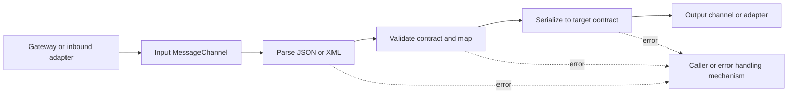

# XML or JSON Transformation

In the **Transformer** chapter of the **SPRING_INTEGRATION_CORE** module, XML or JSON transformation is how you connect two components with different data contracts. One system may send JSON using partner-specific field names while the accounting system expects an internal order model; another system may still exchange XML with its own namespaces and versions.

This lesson focuses on placing transformation steps inside an `IntegrationFlow`: defining the input payload, producing the output payload, preserving required orchestration metadata, and routing errors to the right place. The examples use **Java 17+, Spring Integration 6.5.x, and Jackson 2** under the `com.fasterxml.jackson` package. These serve as the API baseline for the examples; when applying them in your application, align library versions via your application's BOM or dependency management.

## 1. Expected Outcomes

After this lesson, you will be able to:

- Distinguish serialization/deserialization, structural changes, and business-meaning mapping.
- Use `JsonToObjectTransformer` and `ObjectToJsonTransformer` in Java DSL.
- Use `XsltPayloadTransformer` to transform XML between two contracts with namespaces.
- Choose OXM when converting XML to Java objects or vice versa.
- Determine payload types, `contentType`, type headers, and error paths.
- Design tests around meaningful data instead of brittle string comparisons.

You should already know `Message<T>` with payload and headers, the role of `MessageChannel`, and how to declare an `IntegrationFlow` as a `@Bean`.

## 2. Define the Contract Before Choosing a Transformer

### 2.1. Three Kinds of Changes Often Confused

| Change type | Example | Decision required |
|---|---|---|
| Representation | JSON `String` → Java object | Java type, deserialization rules, invalid input handling |
| Structure | XML `purchase/number` → XML `order/orderId` | Element names, namespaces, attribute placement |
| Business meaning | `quantity × unit_price` → `totalAmount` | Units, currency, rounding, missing values |

Turning JSON into a `Map` only solves representation. It does not specify whether `price` is unit price or total price, whether amounts are in dollars or cents, or what an empty array means.

At every transformation boundary, write down a contract like:

```text
Input:
  payload = String containing partner JSON, schema order.v1
  quantity = positive integer
  unit_price = non-negative decimal

Output:
  payload = String containing JSON per internal contract order.v2
  totalAmount = quantity × unit_price
  request traceId continues along with the message

On error:
  do not fabricate a default order
  raise an error traceable back to the request
```

A transformer must produce a valid result for each message it receives. Do not use `return null` to filter data out; if you want to accept or drop messages conditionally, use a filter. Java DSL expresses a transformer endpoint with `.transform(...)`. [Transformer Documentation](https://docs.spring.io/spring-integration/reference/6.5/transformer.html)

### 2.2. Position in the Integration Flow



A gateway is a convenient entry point for business calls. Channels connect endpoints. Each transformer owns data conversion at a specific step. A router can select the contract version or partner before entering the corresponding transformation branch.

A transformer does not need to know how to send HTTP requests, write files, or call an accounting system. Keeping those concerns separate makes it possible to test transformations with in-memory messages.

## 3. Libraries and Tool Selection

The examples assume your application manages compatible dependency versions.

| Need | Primary dependency or API |
|---|---|
| Messages, channels, Java DSL, and JSON transformers | `org.springframework.integration:spring-integration-core` |
| JSON via Jackson 2 | `com.fasterxml.jackson.core:jackson-databind` |
| XSLT and Spring Integration XML transformers | `org.springframework.integration:spring-integration-xml` |
| XML ↔ Java mapping via Spring OXM | `org.springframework:spring-oxm`; add JAXB API/runtime if choosing JAXB |
| JUnit 5 test examples | `org.junit.jupiter:junit-jupiter` |

You can process XML payloads in Java DSL without using XML to configure beans. Conversely, using XML bean configuration does not mean your application's payloads must be XML.

The `Transformers.fromJson(...)` and `Transformers.toJson(...)` factories offer concise syntax for JSON transformers. Declaring transformers as beans is convenient when you need to configure a mapper, enforce a type policy, or reuse configuration explicitly. [Transformers API](https://docs.spring.io/spring-integration/docs/6.5.0/api/org/springframework/integration/dsl/Transformers.html)

## 4. JSON: Deserialize, Map, Then Serialize

### 4.1. Order Scenario

The partner sends:

```json
{
  "order_id": "A-100",
  "customer_id": "C-17",
  "quantity": 2,
  "unit_price": 125000.50,
  "currency": "VND"
}
```

Desired data output:

```json
{
  "orderId": "A-100",
  "customerId": "C-17",
  "totalAmount": 250001.00,
  "currency": "VND"
}
```

The design comprises three independent steps:

```text
String JSON
  → PartnerOrder
  → OrderRequested
  → String JSON
```

`PartnerOrder` represents the input contract. `OrderRequested` represents what the consumer needs. Separating these two types allows renaming fields and computing the total amount without leaking the partner's conventions into downstream components.

### 4.2. Complete Java DSL Configuration

The snippet below is the contents of a Java class named `JsonOrderFlowConfiguration`. The records are nested inside the class so learners can follow the entire model in one place.

```java
import java.math.BigDecimal;

import com.fasterxml.jackson.annotation.JsonProperty;
import com.fasterxml.jackson.databind.DeserializationFeature;
import com.fasterxml.jackson.databind.MapperFeature;
import com.fasterxml.jackson.databind.json.JsonMapper;

import org.springframework.context.annotation.Bean;
import org.springframework.context.annotation.Configuration;
import org.springframework.core.ResolvableType;
import org.springframework.integration.config.EnableIntegration;
import org.springframework.integration.dsl.IntegrationFlow;
import org.springframework.integration.expression.FunctionExpression;
import org.springframework.integration.json.JsonToObjectTransformer;
import org.springframework.integration.json.ObjectToJsonTransformer;
import org.springframework.integration.mapping.support.JsonHeaders;
import org.springframework.integration.support.json.Jackson2JsonObjectMapper;
import org.springframework.messaging.Message;

@Configuration
@EnableIntegration
public class JsonOrderFlowConfiguration {

    public record PartnerOrder(
            @JsonProperty("order_id") String orderId,
            @JsonProperty("customer_id") String customerId,
            Integer quantity,
            @JsonProperty("unit_price") BigDecimal unitPrice,
            String currency) {
    }

    public record OrderRequested(
            String orderId,
            String customerId,
            BigDecimal totalAmount,
            String currency) {
    }

    @Bean
    Jackson2JsonObjectMapper orderJsonMapper() {
        JsonMapper jackson = JsonMapper.builder()
                .enable(DeserializationFeature.FAIL_ON_UNKNOWN_PROPERTIES)
                .enable(DeserializationFeature.FAIL_ON_TRAILING_TOKENS)
                .disable(DeserializationFeature.ACCEPT_FLOAT_AS_INT)
                .disable(MapperFeature.ALLOW_COERCION_OF_SCALARS)
                .build();

        return new Jackson2JsonObjectMapper(jackson);
    }

    @Bean
    JsonToObjectTransformer partnerOrderReader(
            Jackson2JsonObjectMapper orderJsonMapper) {

        ResolvableType fixedType =
                ResolvableType.forClass(PartnerOrder.class);

        JsonToObjectTransformer reader =
                new JsonToObjectTransformer(fixedType, orderJsonMapper);

        // Input contract is decided by the application, not read from headers.
        reader.setValueTypeExpression(
                new FunctionExpression<Message<?>>(message -> fixedType));

        return reader;
    }

    @Bean
    ObjectToJsonTransformer orderJsonWriter(
            Jackson2JsonObjectMapper orderJsonMapper) {

        ObjectToJsonTransformer writer = new ObjectToJsonTransformer(
                orderJsonMapper,
                ObjectToJsonTransformer.ResultType.STRING);

        writer.setContentType("application/json");
        return writer;
    }

    @Bean
    IntegrationFlow partnerJsonFlow(
            JsonToObjectTransformer partnerOrderReader,
            ObjectToJsonTransformer orderJsonWriter) {

        return IntegrationFlow.from("partnerJsonIn")
                .transform(partnerOrderReader)
                .transform(PartnerOrder.class,
                        JsonOrderFlowConfiguration::toCanonical)
                .transform(orderJsonWriter)
                .headerFilter(JsonHeaders.HEADERS.toArray(String[]::new))
                .get();
    }

    private static OrderRequested toCanonical(PartnerOrder input) {
        if (input.orderId() == null || input.orderId().isBlank()) {
            throw new IllegalArgumentException("Missing order_id");
        }
        if (input.customerId() == null || input.customerId().isBlank()) {
            throw new IllegalArgumentException("Missing customer_id");
        }
        if (input.quantity() == null || input.quantity() <= 0) {
            throw new IllegalArgumentException("quantity must be greater than 0");
        }
        if (input.unitPrice() == null || input.unitPrice().signum() < 0) {
            throw new IllegalArgumentException("invalid unit_price");
        }
        if (input.currency() == null
                || !input.currency().matches("[A-Z]{3}")) {
            throw new IllegalArgumentException("currency must be 3 uppercase letters");
        }

        BigDecimal total = input.unitPrice()
                .multiply(BigDecimal.valueOf(input.quantity()));

        return new OrderRequested(
                input.orderId(),
                input.customerId(),
                total,
                input.currency());
    }
}
```

In the example:

- `@JsonProperty` maps external field names to Java properties.
- `Integer` lets us detect a missing or `null` `quantity` before business checks.
- `BigDecimal` expresses currency multiplication in the sample model.
- The `currency` check only validates three uppercase letters syntactically. Supported currencies and rounding policies must be defined per business rules.
- The mapper is configured upfront before use. Never mutate mapper configuration per message.

Failing on unknown properties is a contract choice for this example. For integrations that must tolerate partners adding fields, you can pick a different policy, but define and test it explicitly. The framework's default mapper configuration and an application-supplied mapper may differ. [Jackson2JsonObjectMapper API](https://docs.spring.io/spring-integration/docs/6.5.0/api/org/springframework/integration/support/json/Jackson2JsonObjectMapper.html)

`FunctionExpression` wraps a Java lambda into an `Expression`. Here the lambda always returns the fixed type, preventing senders from choosing which Java class gets deserialized. [FunctionExpression API](https://docs.spring.io/spring-integration/docs/6.5.0/api/org/springframework/integration/expression/FunctionExpression.html)

### 4.3. Invoking the Flow and Receiving Output

The flow does not declare a fixed output channel at the final step. When invoked via request/reply, the result is sent to the request's `replyChannel`. In the section 10 tests, `MessagingTemplate` creates and manages this reply path.

If sending directly via `inputChannel.send(message)`, either supply a `replyChannel` or configure an output channel on the flow. Do not interpret `send` returning `true` as proof that JSON converted successfully per business rules.

When switching to a one-way flow feeding an outbound adapter, you can add:

```java
// Place right before .get() on the flow when choosing a fixed output:
.channel("canonicalJsonOut")
```

The `canonicalJsonOut` channel must be connected to an appropriate consumer. The snippet above is an alternative configuration to the example's request/reply style.

### 4.4. JSON Arrays and Generic Types

A target of `List.class` describes only the container; it does not capture the desired element type. For a JSON array of orders, declare a `ResolvableType`:

```java
ResolvableType ordersType = ResolvableType.forClassWithGenerics(
        java.util.List.class,
        JsonOrderFlowConfiguration.PartnerOrder.class);

JsonToObjectTransformer batchReader =
        new JsonToObjectTransformer(ordersType, orderJsonMapper);

batchReader.setValueTypeExpression(
        new FunctionExpression<Message<?>>(message -> ordersType));
```

This is an additional configuration snippet placed where `orderJsonMapper` and the main example's imports are available. After reading, map each element in the list. If you want to process each order independently, consider a splitter followed by an aggregator, while defining ordering and how an individual failing element is handled.

`JsonToObjectTransformer` accepts either `Class<?>` or `ResolvableType`. By default, type resolution may consult JSON type headers before falling back to the configured type. Therefore, merely passing `PartnerOrder.class` to the constructor does not fully express a header-trust policy. [JsonToObjectTransformer API](https://docs.spring.io/spring-integration/docs/6.5.0/api/org/springframework/integration/json/JsonToObjectTransformer.html)

## 5. JSON Payloads and Headers Must Be Managed Separately

### 5.1. Choosing the Output Form

| `ResultType` | Payload after conversion | Use case |
|---|---|---|
| `STRING` | `String` containing JSON | Text-accepting adapters or consumers |
| `BYTES` | `byte[]` | Consumers contracted to receive bytes |
| `NODE` | Mapper's JSON tree, `JsonNode` for Jackson 2 | Further in-memory JSON tree manipulation needed |

A `JsonNode` is not a JSON string. Before handing off to a transport protocol, clarify which component serializes it. `ObjectToJsonTransformer` also adds type metadata for the source object to message headers. [ObjectToJsonTransformer API](https://docs.spring.io/spring-integration/docs/6.5.0/api/org/springframework/integration/json/ObjectToJsonTransformer.html)

If the contract requires UTF-8 bytes, you can output `STRING` and convert to bytes explicitly:

```java
.transform(String.class,
        json -> json.getBytes(java.nio.charset.StandardCharsets.UTF_8))
```

Place this step after JSON serialization. A Java `String` is not yet wire bytes; setting `charset=UTF-8` in a header does not automatically alter an adapter's encoding.

### 5.2. Avoiding Double Serialization

Payload already containing JSON:

```text
{"orderId":"A-100"}
```

If this string is treated as a Java value to serialize again, the result can become a JSON string literal:

```json
"{\"orderId\":\"A-100\"}"
```

That is different from a JSON object. The same bug happens when the flow already serialized to JSON and an HTTP client or message converter serializes the string again under a mismatched configuration.

Practice rule: designate **a single place responsible for producing the outbound representation**. If an adapter already serializes from a POJO, do not add an extra transformer just because the wire format is JSON.

### 5.3. Operational Headers and Type Headers

| Group | Example | How to handle |
|---|---|---|
| Tracing | `traceId`, business request ID | Preserve across mappings while still the same request |
| Internal routing | `replyChannel`, `errorChannel` | Keep while needed in-flow; expose to protocols only via explicit mapping policy |
| Internal JSON types | `JsonHeaders.TYPE_ID`, `RESOLVABLE_TYPE` | Trust only controlled sources; usually strip at public boundaries |
| Representation metadata | `MessageHeaders.CONTENT_TYPE` | Update to match the actual output |
| Framework message identity | `id`, `timestamp` | Never use to replace an order ID or stable trace ID |

`JsonHeaders.HEADERS` collects the JSON type header names defined by the framework. The main example uses this set to strip Java type information from results heading toward an integration boundary. [JsonHeaders API](https://docs.spring.io/spring-integration/docs/6.5.0/api/org/springframework/integration/mapping/support/JsonHeaders.html)

Stripping Java type headers does not replace an outbound header-mapping policy. A gateway or adapter must still emit only headers accepted by the protocol and partner.

In the 6.5 branch, `ObjectToJsonTransformer` does not necessarily overwrite an already-existing `contentType` by default. The example calls `setContentType("application/json")` to set the output's content type explicitly, avoiding carrying over a stale description from a differently formatted input. [ObjectToJsonTransformer 6.5.0 source](https://github.com/spring-projects/spring-integration/blob/v6.5.0/spring-integration-core/src/main/java/org/springframework/integration/json/ObjectToJsonTransformer.java)

Replacing the payload with a new object does not mean objects inside the old payload were deep-copied. For mutable JSON trees, DOMs, or collections, avoid mutating an object shared across multiple branches.

## 6. XML: Using XSLT to Transform Document Contracts

### 6.1. Source Data and Target Data

Another partner sends a precomputed total amount:

```xml
<p:purchase xmlns:p="urn:partner:orders:v1">
    <p:number>A-100</p:number>
    <p:client>C-17</p:client>
    <p:amount currency="VND">250001.00</p:amount>
</p:purchase>
```

Target XML contract:

```xml
<o:order xmlns:o="urn:company:orders:v2">
    <o:orderId>A-100</o:orderId>
    <o:customerId>C-17</o:customerId>
    <o:totalAmount>250001.00</o:totalAmount>
    <o:currency>VND</o:currency>
</o:order>
```

Here element names, currency placement, and namespaces all change. XSLT fits well because both sides have well-defined XML contracts.

Do not use regular expressions to rename tags: XML also involves namespaces, attributes, entities, nested elements, and escaping rules.

### 6.2. XSLT 1.0 Stylesheet

When practicing the XML example, place the stylesheet below at `src/main/resources/xslt/order-v1-to-v2.xsl` in your application:

```xml
<?xml version="1.0" encoding="UTF-8"?>
<xsl:stylesheet version="1.0"
        xmlns:xsl="http://www.w3.org/1999/XSL/Transform"
        xmlns:p="urn:partner:orders:v1"
        xmlns:o="urn:company:orders:v2"
        exclude-result-prefixes="p">

    <xsl:output method="xml"
                omit-xml-declaration="yes"
                encoding="UTF-8"/>

    <xsl:template match="/">
        <xsl:if test="not(p:purchase)">
            <xsl:message terminate="yes">
                Unsupported purchase root or namespace
            </xsl:message>
        </xsl:if>

        <o:order>
            <o:orderId>
                <xsl:value-of select="p:purchase/p:number"/>
            </o:orderId>
            <o:customerId>
                <xsl:value-of select="p:purchase/p:client"/>
            </o:customerId>
            <o:totalAmount>
                <xsl:value-of select="p:purchase/p:amount"/>
            </o:totalAmount>
            <o:currency>
                <xsl:value-of select="p:purchase/p:amount/@currency"/>
            </o:currency>
        </o:order>
    </xsl:template>
</xsl:stylesheet>
```

The prefix `p` in XPath binds to the namespace URI, regardless of whether the partner uses prefix `p` or `src`. For XML using a default namespace, elements still belong to that namespace; an unprefixed XPath `purchase/number` does not automatically match that namespace.

The stylesheet checks the root element to avoid producing an empty order if the wrong document arrives. It does not yet perform full validation of required fields or numeric validity. Those belong to validation steps and the business contract.

The XSLT above only copies the string representation of the total amount. Do not casually replace `BigDecimal` monetary arithmetic with XSLT 1.0 floating-point math.

### 6.3. Parsing XML and Compiling Stylesheets with Explicit Configuration

The helper class below uses the JDK's default JAXP implementation. The example rejects DOCTYPE declarations and external resource resolution, suited to the self-contained stylesheet above.

```java
import java.io.IOException;
import java.io.InputStream;
import java.io.StringReader;

import javax.xml.XMLConstants;
import javax.xml.parsers.DocumentBuilderFactory;
import javax.xml.parsers.ParserConfigurationException;
import javax.xml.transform.Templates;
import javax.xml.transform.TransformerFactory;
import javax.xml.transform.stream.StreamSource;

import org.springframework.core.io.Resource;
import org.w3c.dom.Document;
import org.xml.sax.InputSource;
import org.xml.sax.SAXException;

public final class SecureXmlSupport {

    private SecureXmlSupport() {
    }

    public static Document parse(String xml) {
        try {
            DocumentBuilderFactory factory =
                    DocumentBuilderFactory.newDefaultInstance();

            factory.setNamespaceAware(true);
            factory.setXIncludeAware(false);
            factory.setFeature(
                    XMLConstants.FEATURE_SECURE_PROCESSING, true);
            factory.setFeature(
                    "http://apache.org/xml/features/disallow-doctype-decl",
                    true);
            factory.setFeature(
                    "http://xml.org/sax/features/external-general-entities",
                    false);
            factory.setFeature(
                    "http://xml.org/sax/features/external-parameter-entities",
                    false);
            factory.setAttribute(XMLConstants.ACCESS_EXTERNAL_DTD, "");
            factory.setAttribute(XMLConstants.ACCESS_EXTERNAL_SCHEMA, "");

            return factory.newDocumentBuilder().parse(
                    new InputSource(new StringReader(xml)));
        }
        catch (ParserConfigurationException | SAXException | IOException ex) {
            throw new IllegalArgumentException(
                    "Invalid XML or rejected by parser policy",
                    ex);
        }
    }

    public static Templates compile(Resource stylesheet) throws Exception {
        TransformerFactory factory =
                TransformerFactory.newDefaultInstance();

        factory.setFeature(XMLConstants.FEATURE_SECURE_PROCESSING, true);
        factory.setAttribute(XMLConstants.ACCESS_EXTERNAL_DTD, "");
        factory.setAttribute(XMLConstants.ACCESS_EXTERNAL_STYLESHEET, "");

        try (InputStream input = stylesheet.getInputStream()) {
            return factory.newTemplates(new StreamSource(input));
        }
    }
}
```

`DocumentBuilderFactory` creates a DOM parser; enabling namespace awareness must happen before parsing. The example creates a fresh parser per call to avoid sharing parser state across messages. [DocumentBuilderFactory API](https://docs.oracle.com/en/java/javase/17/docs/api/java.xml/javax/xml/parsers/DocumentBuilderFactory.html)

`TransformerFactory.newTemplates(...)` compiles the stylesheet. The `ACCESS_EXTERNAL_*` attributes must be configured on the respective processor; restrictions on the XML parser do not automatically restrict XSLT from accessing external resources. [TransformerFactory API](https://docs.oracle.com/en/java/javase/17/docs/api/java.xml/javax/xml/transform/TransformerFactory.html)

Do not catch protective configuration errors and ignore them to continue processing. If using another XML provider, verify which features the provider supports and apply an equivalent policy.

### 6.4. Wiring XSLT into an IntegrationFlow

The following configuration class uses the stylesheet and helper just shown:

```java
import javax.xml.transform.Templates;

import org.springframework.context.annotation.Bean;
import org.springframework.context.annotation.Configuration;
import org.springframework.core.io.ClassPathResource;
import org.springframework.integration.config.EnableIntegration;
import org.springframework.integration.dsl.IntegrationFlow;
import org.springframework.integration.xml.transformer.ResultToStringTransformer;
import org.springframework.integration.xml.transformer.XsltPayloadTransformer;
import org.springframework.messaging.MessageHeaders;

@Configuration
@EnableIntegration
public class XmlOrderFlowConfiguration {

    @Bean
    XsltPayloadTransformer xmlOrderTransformer() throws Exception {
        Templates templates = SecureXmlSupport.compile(
                new ClassPathResource("xslt/order-v1-to-v2.xsl"));

        XsltPayloadTransformer transformer = new XsltPayloadTransformer(
                templates,
                new ResultToStringTransformer());

        transformer.setAlwaysUseResultFactory(true);
        return transformer;
    }

    @Bean
    IntegrationFlow partnerXmlFlow(
            XsltPayloadTransformer xmlOrderTransformer) {

        return IntegrationFlow.from("partnerXmlIn")
                .transform(String.class, SecureXmlSupport::parse)
                .transform(xmlOrderTransformer)
                .enrichHeaders(headers -> headers.header(
                        MessageHeaders.CONTENT_TYPE,
                        "application/xml",
                        true))
                .get();
    }
}
```

The payload contract of this flow is:

```text
Source XML String
  → Document parsed with application policy
  → Target XML String
```

Setting `setAlwaysUseResultFactory(true)` together with `ResultToStringTransformer` makes the string target explicit. With defaults, a `String` input typically yields a `String` output, a `Document` input yields a `Document` output, and a `Source` goes through the `ResultFactory` mechanism. Do not assume every XML transformer returns a `String`. [XsltPayloadTransformer API](https://docs.spring.io/spring-integration/docs/6.5.0/api/org/springframework/integration/xml/transformer/XsltPayloadTransformer.html)

The stylesheet is compiled when creating the bean. `Templates` can be shared concurrently across threads; each transformation needs its own `Transformer` instance. Using Spring Integration's transformer avoids accidentally sharing a single `javax.xml.transform.Transformer` across requests. [Templates API](https://docs.oracle.com/en/java/javase/17/docs/api/java.xml/javax/xml/transform/Templates.html)

## 7. When to Use OXM Instead of XSLT?

XSLT excels at converting XML into another XML document. If subsequent steps need Java processing, you can use the model:

```text
XML Document
  → UnmarshallingTransformer
  → Java DTO
  → business mapping
  → Target Java DTO
  → MarshallingTransformer
  → XML
```

| Component | Responsibility |
|---|---|
| `UnmarshallingTransformer` | Delegates XML to a Spring OXM `Unmarshaller` to create objects |
| `MarshallingTransformer` | Delegates objects to a Spring OXM `Marshaller` to produce XML |
| `Jaxb2Marshaller` | An implementation capable of serving both OXM roles |
| `ResultToStringTransformer` | Converts XML results to strings when marshalling configuration needs string output |

By default, `MarshallingTransformer` produces a DOM `DomResult`. When another output type is needed, configure an appropriate `ResultFactory` or `ResultTransformer`. [Spring Integration XML Transformation](https://docs.spring.io/spring-integration/reference/6.5/xml/transformation.html)

If choosing JAXB, DTOs must map accurately to the root element, namespaces, child elements, and attributes of the XML contract. On Java 17, declare compatible JAXB API/runtime dependencies rather than assuming JAXB is bundled in the JDK.

Spring OXM clearly separates `Marshaller` for Java → XML and `Unmarshaller` for XML → Java; a `Jaxb2Marshaller` bean can be configured with bound classes or a context path. [Spring OXM Documentation](https://docs.spring.io/spring-framework/reference/6.2/data-access/oxm.html)

Do not assume JAXB DTOs and JSON DTOs must share the same class. Two contracts may differ in field names, monetary representation, or release cadence. Design internal models around application semantics, then map explicitly at each boundary.

## 8. XML ↔ JSON Conversion Requires Explicit Mapping Decisions

No universal conversion automatically infers all XML semantics when emitting JSON.

| XML characteristic | Question for the JSON contract |
|---|---|
| `<amount currency="VND">250001.00</amount>` | Use an object `{value, currency}` or two separate fields? |
| One or many `item` elements | Always an array or varying by item count? |
| Namespaces | Strip, keep URI, or encode a schema field? |
| `<name/>`, missing `name`, `xsi:nil` | Empty string, omitted field, or `null`? |
| Text interleaved with elements | Must ordering and mixed content be preserved? |
| Code `00125` | Keep as string or convert to number and lose leading zeros? |

For orders, an easy-to-control option is:

```text
Partner XML or JSON
  → Source contract DTO
  → Application OrderRequested
  → Target contract DTO
  → Outbound XML or JSON
```

If the XML source from section 6 is chosen, `amount` is already the total amount. If the JSON source from section 4 is chosen, quantity must be multiplied by unit price. Both can produce the same `OrderRequested`, yet their inbound mappings differ.

Validation should also be layered by level:

1. **Syntax:** whether the parser can read the JSON/XML.
2. **Structure:** required fields, data types, namespaces, schema version.
3. **Business:** total amount, supported currencies, valid customer ID.

Successful deserialization does not prove all three levels are valid. Syntactically valid XML produced by XSLT does not prove the document conforms to the consumer's XSD either. When using XSD or JSON Schema, place validation against the chosen contract version.

## 9. Error Handling and Operational Limits

### 9.1. Errors Must Preserve Root Cause

| Situation | Appropriate handling |
|---|---|
| Unclosed JSON brace, malformed XML | Log input data error; do not retry identical payload indefinitely |
| Unparseable numeric field, unsupported namespace | Report contract violation with version and trace ID |
| `quantity <= 0` or missing order ID | Report validation/business error |
| Unreadable or uncompilable stylesheet | Fail at bean initialization so configuration can be fixed |
| Partner not yet on new schema | Route by permitted version or send to exception handling flow |
| Downstream consumer temporarily unavailable | Consider retry at the corresponding communication step |

Do not catch all exceptions and return `{}` or an empty order. That turns a transformation failure into seemingly valid data and destroys the failure reason.

### 9.2. Synchronous and Asynchronous

In a flow running over `DirectChannel`, errors can propagate up the call stack to the caller. Sending via a channel or `MessagingTemplate` does not automatically convert every exception into a message on `errorChannel`.

When a consumer runs asynchronously via an executor or poller, the corresponding error-handling mechanism can publish an `ErrorMessage`; `errorChannel` in headers takes precedence when resolving the target error channel, falling back to the default error channel. Gateways also have their own error-handling configuration. Therefore, design error paths according to the actual invocation model. [Error Handling Documentation](https://docs.spring.io/spring-integration/reference/6.5/error-handling.html)

When logging errors, useful fields include `traceId`, source/target contract IDs, order ID if readable, and error category. Avoid dumping entire payloads containing personal data into standard logs. If failed messages must be retained for replay, store them with access controls and retention limits.

### 9.3. Resource Limits and Parser Hardening

External JSON/XML must have size limits enforced right at ingestion. Configure depth and token-length limits per your parser; note that DOMs and JSON trees consume significantly more memory than raw text size.

For XML, XXE and entity expansion can lead to external resource reads or resource exhaustion. Guard both the data parser and the stylesheet processor, including `document()`, `xsl:include`, and `xsl:import` if enabled by the application. The section 6 example explicitly blocks external access and only compiles application-supplied stylesheets. [Oracle JAXP Security Guide](https://docs.oracle.com/en/java/javase/17/security/java-api-xml-processing-jaxp-security-guide.html)

For JSON, keep target type resolution under application control; never let untrusted input specify arbitrary Java class names. If polymorphism is needed, map a finite set of business type codes to permitted DTOs.

## 10. Contract-Driven Testing

### 10.1. JUnit 5 Example for the JSON Flow

The test snippet below uses the configuration class from section 4 without needing an HTTP server or broker. It checks business arithmetic, payload types, tracing, and the policy of ignoring sender-supplied target type headers.

```java
import java.math.BigDecimal;

import com.fasterxml.jackson.databind.JsonNode;
import com.fasterxml.jackson.databind.json.JsonMapper;

import org.junit.jupiter.api.Test;
import org.springframework.context.annotation.AnnotationConfigApplicationContext;
import org.springframework.integration.core.MessagingTemplate;
import org.springframework.integration.mapping.support.JsonHeaders;
import org.springframework.messaging.Message;
import org.springframework.messaging.MessageChannel;
import org.springframework.messaging.MessageHeaders;
import org.springframework.messaging.MessagingException;
import org.springframework.messaging.support.MessageBuilder;

import static org.junit.jupiter.api.Assertions.*;

class JsonOrderFlowTest {

    @Test
    void transformsOrderAndKeepsTheBoundaryContract() throws Exception {
        try (var context = new AnnotationConfigApplicationContext(
                JsonOrderFlowConfiguration.class)) {

            MessageChannel input = context.getBean(
                    "partnerJsonIn", MessageChannel.class);

            MessagingTemplate template = new MessagingTemplate();
            template.setReceiveTimeout(1000);

            Message<String> request = MessageBuilder.withPayload("""
                    {
                      "order_id": "A-100",
                      "customer_id": "C-17",
                      "quantity": 2,
                      "unit_price": 125000.50,
                      "currency": "VND"
                    }
                    """)
                    .setHeader("traceId", "trace-demo-01")
                    .setHeader(JsonHeaders.TYPE_ID, String.class)
                    .build();

            Message<?> reply = template.sendAndReceive(input, request);

            assertNotNull(reply);
            assertInstanceOf(String.class, reply.getPayload());

            JsonNode result = JsonMapper.builder().build()
                    .readTree((String) reply.getPayload());

            assertEquals("A-100", result.path("orderId").asText());
            assertEquals("C-17", result.path("customerId").asText());
            assertEquals("VND", result.path("currency").asText());
            assertEquals(0, new BigDecimal("250001.00").compareTo(
                    result.path("totalAmount").decimalValue()));

            assertEquals("trace-demo-01",
                    reply.getHeaders().get("traceId"));
            assertEquals("application/json",
                    reply.getHeaders().get(MessageHeaders.CONTENT_TYPE));

            assertTrue(JsonHeaders.HEADERS.stream()
                    .noneMatch(reply.getHeaders()::containsKey));
        }
    }

    @Test
    void rejectsMalformedJson() {
        try (var context = new AnnotationConfigApplicationContext(
                JsonOrderFlowConfiguration.class)) {

            MessageChannel input = context.getBean(
                    "partnerJsonIn", MessageChannel.class);

            MessagingTemplate template = new MessagingTemplate();
            template.setReceiveTimeout(1000);

            Message<String> request = MessageBuilder
                    .withPayload("{broken")
                    .build();

            assertThrows(MessagingException.class,
                    () -> template.sendAndReceive(input, request));
        }
    }
}
```

The example compares `BigDecimal` using `compareTo` because `250001.0` and `250001.00` represent the same monetary value. If the contract mandates an exact decimal scale, add a separate assertion for that rule.

These two tests illustrate the happy path and a syntax error; they do not represent an application's full test suite.

### 10.2. Scenarios to Add

| Category | Test data | What to observe |
|---|---|---|
| JSON missing data | Missing `quantity`, missing `order_id` | Error with clear cause; no default business values fabricated |
| JSON wrong type | `quantity` as an object or decimal number | Deserialization policy actually enforced |
| Contract evolution | New field or unsupported schema version | Output matches chosen compatibility policy |
| Text encoding | Vietnamese characters, quotes, `&` character | No character corruption, proper escaping on output |
| Generics | Empty array and multi-order array | Element types accurate, not inferred from first element |
| XML namespaces | Same URI with different prefix; different URI | Different prefix still works; wrong namespace rejected |
| Invalid XML | Mismatched closing tag, wrong root element | Does not emit an empty target document pretending success |
| XML with DOCTYPE | DTD declaration in input | Parser rejects input per example policy |
| Output boundary | Inspect payload and headers | Exact `String`/`byte[]`/`Document` and content type |
| Concurrency | Multiple messages with distinct order IDs | No cross-request data or state leakage |

For the XML flow, send a request/reply message to `partnerXmlIn` similarly to the JSON example. Parse the result with a namespace-aware parser and assert namespace URI, local name, and field values. Do not treat prefix differences, attribute ordering, or indentation as business failures.

If the contract mandates element ordering or signed XML payloads, add explicit tests for those requirements. Do not assume that parsing two documents into DOM trees proves every representation difference is harmless.

## 11. Extended Practice

Carry out the following in your learning application:

1. Add a `discount` field to the source JSON contract. Decide clearly whether it is an amount or a percentage, then update the DTO and mapping.
2. Add a second source XML version with its own namespace. Use a router to select the branch before applying the corresponding stylesheet.
3. Have both JSON and XML converge onto the same `OrderRequested`, then serialize once right before sending to the consumer.
4. Add tests for invalid quantity, wrong namespace, and Vietnamese text. Observe exceptions in the synchronous model before introducing asynchronous processing.

Completion criteria: you can explain the payload type at every channel, where contract validation happens, where business calculations live, which component performs final serialization, and the path taken by a failing message.

## 12. Key Takeaways

- Start from the data contract and field semantics, then choose JSON transformers, XSLT, or OXM.
- JSON commonly passes through DTOs to make types and mappings explicit; never let untrusted headers choose Java classes.
- XSLT requires accurate namespaces and explicit result-type configuration.
- Representation headers must match the output; Java type headers and orchestration headers must be controlled at boundaries.
- Transformation, validation, and delivery are separate responsibilities that can be tested independently.
