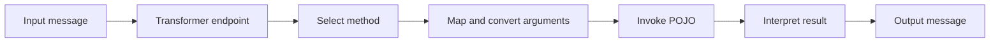

# Transformer Method Mapping

## 1. Objectives and Scope

In the **SPRING_INTEGRATION_CORE** module, the **Transformer** chapter explains how to transform messages between integration steps. This lesson focuses on **method mapping**: how Spring Integration binds a `Message<?>` to a Java method, extracts data for each parameter, and uses the return value to construct the output message.

Imagine a system receiving orders from multiple sources. The payload carries product, quantity, and unit price; headers carry tenant ID and priority. The transformation method must receive the right data to construct an order-processing command. A mapping mistake can prevent business code from even being called, even when the Java method itself is completely sound.

After this lesson, you will be able to:

- Choose method signatures accepting the payload, individual headers, all headers, or `Message<T>`.
- Distinguish method selection, parameter mapping, and type conversion.
- Configure the same POJO via Java DSL, annotations, or XML.
- Decide when to return a payload versus returning `Message<T>`.
- Spot ambiguous signatures and verify mappings through a real flow.

The main examples use Java 17 and the Spring Integration 6.x Java DSL API. The project requires the `spring-integration-core` dependency; the test snippets use JUnit Jupiter. Manage dependency versions consistently via your project's BOM. The examples do not require Spring Boot, a broker, or a database.

## 2. Where Does Method Mapping Happen?

A POJO does not read channels or create consumers itself. The endpoint receives a message and hands it off to a handler. For a transformer invoking a method, `MethodInvokingTransformer` adapts the message to the Java method. See [MethodInvokingTransformer Javadoc](https://docs.spring.io/spring-integration/api/org/springframework/integration/transformer/MethodInvokingTransformer.html).



To analyze a configuration, ask three separate questions:

| Question | Example in the order flow |
| --- | --- |
| Which method is invoked? | `orderMapper.toCommand` |
| Where does each argument come from? | `draft` from payload, `tenantId` from header |
| What does the return value mean? | `OrderCommand` becomes the output payload |

Names like `transform`, `map`, `convert`, or `toCommand` communicate developer intent. In the snippet below, the method name is declared explicitly so readers see the target:

```java
.transform(orderMapper, "toCommand")
```

Mapping a message to a method is different from property mapping between two DTOs. A DTO mapper code generator can be called inside `toCommand`, but it does not replace header extraction or channel wiring.

## 3. Receiving the Payload with a Simple Signature

An unannotated parameter such as `String` receives the payload; it can also be marked with `@Payload`. A parameter of type `Message` receives the message. See [Message Mapping Rules and Conventions](https://docs.spring.io/spring-integration/reference/configuration/message-mapping-rules.html).

```java
import java.util.Locale;
import org.springframework.messaging.handler.annotation.Payload;

public class SkuMapper {

    public String normalize(String rawSku) {
        return rawSku.strip().toUpperCase(Locale.ROOT);
    }

    public String normalizeExplicit(@Payload String rawSku) {
        return rawSku.strip().toUpperCase(Locale.ROOT);
    }
}
```

Example data:

```text
Input payload:    "  kb-01  "
Method:           normalize(String rawSku)
rawSku argument:  "  kb-01  "
Output payload:   "KB-01"
```

`@Payload` makes the data source immediately visible at the signature. When there is only a single simple parameter, omitting the annotation is concise and readable. When adding headers or handling a `Map` payload, explicit annotations make the contract easier to read.

Use annotations from Spring Messaging:

```java
import org.springframework.messaging.handler.annotation.Payload;
import org.springframework.messaging.handler.annotation.Header;
import org.springframework.messaging.handler.annotation.Headers;
```

HTTP annotations such as `@RequestBody` and `@RequestParam` describe web controller contracts. Do not use them to specify parameter sources for a transformer.

## 4. Reading Data from Headers

### 4.1. Required and Optional Headers

`@Header` binds a parameter to a header and is required by default. `required = false` permits missing values; `defaultValue` supplies a fallback value. See [Header Javadoc](https://docs.spring.io/spring-framework/docs/6.1.x/javadoc-api/org/springframework/messaging/handler/annotation/Header.html).

```java
import org.springframework.messaging.handler.annotation.Header;
import org.springframework.messaging.handler.annotation.Payload;

public class LabeledSkuMapper {

    public String label(
            @Payload String sku,
            @Header("tenantId") String tenantId,
            @Header(value = "priority", required = false) Integer priority) {

        int effectivePriority = priority == null ? 0 : priority;
        return tenantId + ":" + sku + ":P" + effectivePriority;
    }
}
```

In the example contract:

| Message component | Argument | Business meaning |
| --- | --- | --- |
| Payload `"KB-01"` | `sku` | Normalized product SKU |
| Header `tenantId = "shop-a"` | `tenantId` | Tenant owning the data |
| Header `priority = 3` | `priority` | Priority specified by sender |
| Missing header `priority` | `priority = null` | Mapper defaults to priority `0` |

Choose `Integer` for an optional header to represent absence. If choosing primitive `int`, provide an appropriate fallback value. Beyond mere presence, `tenantId` still requires business validation: a whitespace-only string is not a valid tenant.

A variant using a default value in the signature:

```java
public String label(
        @Payload String sku,
        @Header("tenantId") String tenantId,
        @Header(value = "priority", defaultValue = "0") int priority) {

    return tenantId + ":" + sku + ":P" + priority;
}
```

Pick only one variant of `label` for an example. Do not place both variants side by side and let the flow decide which signature represents the business contract.

### 4.2. Receiving All Headers

Use `@Headers` when the mapper needs a collection of metadata rather than a few fixed values. See [Annotation Support](https://docs.spring.io/spring-integration/reference/configuration/annotations.html).

```java
import java.util.Map;
import org.springframework.messaging.handler.annotation.Headers;
import org.springframework.messaging.handler.annotation.Payload;

public class AuditTextMapper {

    public String describe(
            @Payload String sku,
            @Headers Map<String, Object> headers) {

        Object traceId = headers.get("traceId");
        return "sku=" + sku + ", traceId=" + traceId;
    }
}
```

With three known headers, three named parameters are usually easier to validate than a map. With an open-ended metadata set, `@Headers` may make more sense. Choose based on the data contract instead of forcing every transformer into the same signature shape.

Do not mutate input metadata via `headers.put(...)`. To change output metadata, use a header enricher or build the resulting `Message`. The example above selects only `traceId` for observability rather than serializing the entire headers map into the description string.

## 5. `Map` Payloads and Mapping Part of a Payload

A `Map` can represent either business data or headers. When both appear, use `@Payload` and `@Headers` to clarify sources instead of relying on parameter order. See [mapping rules](https://docs.spring.io/spring-integration/reference/configuration/message-mapping-rules.html).

```java
import java.util.Map;
import org.springframework.messaging.handler.annotation.Headers;
import org.springframework.messaging.handler.annotation.Payload;

public class DocumentMapper {

    public Map<String, Object> toCommand(
            @Payload Map<String, Object> document,
            @Headers Map<String, Object> headers) {

        Object sku = document.get("sku");
        Object tenantId = headers.get("tenantId");
        if (!(sku instanceof String skuText) || skuText.isBlank()) {
            throw new IllegalArgumentException("sku must be a non-empty string");
        }
        if (!(tenantId instanceof String tenantText) || tenantText.isBlank()) {
            throw new IllegalArgumentException("invalid tenantId");
        }
        return Map.of("sku", skuText, "tenantId", tenantText);
    }
}
```

`document.get("tenantId")` and `headers.get("tenantId")` are two separate sources. If the sender puts tenant inside the payload, the mapper still expects metadata per the chosen contract. Identical key names do not synchronize payloads and headers.

The returned `Map.of(...)` is a new payload. Do not treat returning a `Map` as a way to implicitly update headers. When you need a complete message, return `Message`. See [MethodInvokingTransformer](https://docs.spring.io/spring-integration/api/org/springframework/integration/transformer/MethodInvokingTransformer.html).

If you only need a single field, you can use an expression inside `@Payload`:

```java
import org.springframework.messaging.handler.annotation.Header;
import org.springframework.messaging.handler.annotation.Payload;

public class SkuFieldMapper {

    public String tenantSku(
            @Payload("['sku']") String sku,
            @Header("tenantId") String tenantId) {

        return tenantId + ":" + sku;
    }
}
```

For a payload `Map.of("sku", "KB-01")`, the expression `['sku']` reads the `sku` key. The root evaluation context of `@Payload` is the payload. See [Payload Javadoc](https://docs.spring.io/spring-framework/docs/6.1.21/javadoc-api/org/springframework/messaging/handler/annotation/Payload.html).

Short expressions are great for selecting a stable field. If you need to validate multiple fields, apply defaults, and construct a business object, a method taking a DTO is usually easier to read and test than a long expression.

## 6. Method Selection and Avoiding Ambiguous Signatures

### 6.1. Specifying the Method Name

Java DSL lets you pass an object and method name via `transform(Object, String)`. See [BaseIntegrationFlowDefinition Javadoc](https://docs.spring.io/spring-integration/docs/6.4.x/api/org/springframework/integration/dsl/BaseIntegrationFlowDefinition.html).

```java
.transform(orderMapper, "toCommand")
```

An explicit name narrows the candidate methods. If the class has multiple `toCommand` overloads, the string name alone does not pinpoint a single Java signature. For a flow entry point, provide one public method with a clear role.

Example of readable signature design:

```java
public OrderCommand fromDraft(OrderDraft draft) { /* ... */ }
public OrderCommand fromLegacyText(String text) { /* ... */ }
```

Each flow selects its corresponding method. If input comes in multiple business variants, a router can direct them to separate transformation branches, each with a concrete input contract.

### 6.2. Every Parameter Needs an Unambiguous Source

The signature below does not state where the second string comes from:

```java
// Signature to avoid in a POJO-invoking transformer.
public String combine(String sku, String tenantId) { /* ... */ }
```

Declare the sources directly:

```java
public String combine(
        @Payload String sku,
        @Header("tenantId") String tenantId) {

    return tenantId + ":" + sku;
}
```

Multiple unannotated parameters make mapping ambiguous. See [Message Mapping Rules and Conventions](https://docs.spring.io/spring-integration/reference/configuration/message-mapping-rules.html).

When reading errors, distinguish:

- **Failed to select a method:** check the configured name and overloads.
- **Failed to resolve arguments:** check annotations, required headers, and data types.
- **Method ran and threw an error:** check business conditions inside the mapper.

Do not conclude every failure is a conversion problem. Adding a converter for `String` will not fix a two-parameter signature that lacks explicit parameter sources.

### 6.3. Lambdas and POJO Method Mapping

If only the payload is needed, Java DSL can accept a function with an explicit input type:

```java
.transform(String.class, text -> text.strip())
```

For a POJO with multiple parameters drawn from payload and headers, use the object-invoking form:

```java
.transform(orderMapper, "toCommand")
```

In the second form, the framework resolves each argument from its annotations. Do not mechanically convert it into a single-parameter lambda and expect annotations on another method to supply the missing arguments automatically.

The `/* ... */` blocks only illustrate signatures. The next example provides complete method bodies.

## 7. Complete Example Using Java DSL

### 7.1. Message Contract

The flow receives an order draft and produces a processing command:

```text
ordersIn
  -> orderMapper.toCommand(payload, tenantId, priority)
  -> ordersOut
```

| Data | Sample value |
| --- | --- |
| Input payload | `OrderDraft("O-100", "KB-01", 2, 125000)` |
| Required header | `tenantId = "shop-a"` |
| Optional header | `priority = 3` |
| Observed header | `traceId = "trace-100"` |
| Output payload | `OrderCommand` with total amount `250000`, tenant `shop-a` |

Example rules: positive quantity; non-negative unit price; non-blank order ID, SKU, and tenant. If priority is absent, use `0`.

### 7.2. Configuration and Mapper

In your practice project, save the snippet below as `OrderFlowConfig.java`. The records and mapper are nested classes so the example fits cleanly in a single source file.

```java
import java.math.BigDecimal;
import java.util.Objects;

import org.springframework.context.annotation.Bean;
import org.springframework.context.annotation.Configuration;
import org.springframework.integration.channel.DirectChannel;
import org.springframework.integration.channel.QueueChannel;
import org.springframework.integration.config.EnableIntegration;
import org.springframework.integration.dsl.IntegrationFlow;
import org.springframework.messaging.handler.annotation.Header;
import org.springframework.messaging.handler.annotation.Payload;

@Configuration
@EnableIntegration
public class OrderFlowConfig {

    public record OrderDraft(
            String orderId,
            String sku,
            int quantity,
            BigDecimal unitPrice) {
    }

    public record OrderCommand(
            String orderId,
            String tenantId,
            String sku,
            int quantity,
            BigDecimal totalAmount,
            int priority) {
    }

    public static class OrderMapper {

        public OrderCommand toCommand(
                @Payload OrderDraft draft,
                @Header("tenantId") String tenantId,
                @Header(value = "priority", required = false)
                Integer priority) {

            Objects.requireNonNull(draft, "draft must not be null");
            requireText(draft.orderId(), "orderId");
            requireText(draft.sku(), "sku");
            requireText(tenantId, "tenantId");

            if (draft.quantity() <= 0) {
                throw new IllegalArgumentException("quantity must be positive");
            }
            if (draft.unitPrice() == null
                    || draft.unitPrice().signum() < 0) {
                throw new IllegalArgumentException(
                        "unitPrice must have a non-negative value");
            }

            BigDecimal total = draft.unitPrice()
                    .multiply(BigDecimal.valueOf(draft.quantity()));
            int effectivePriority = priority == null ? 0 : priority;

            return new OrderCommand(
                    draft.orderId(),
                    tenantId,
                    draft.sku(),
                    draft.quantity(),
                    total,
                    effectivePriority);
        }

        private static void requireText(String value, String field) {
            if (value == null || value.isBlank()) {
                throw new IllegalArgumentException(
                        field + " must not be empty");
            }
        }
    }

    @Bean
    public DirectChannel ordersIn() {
        return new DirectChannel();
    }

    @Bean
    public QueueChannel ordersOut() {
        return new QueueChannel();
    }

    @Bean
    public OrderMapper orderMapper() {
        return new OrderMapper();
    }

    @Bean
    public IntegrationFlow orderFlow(OrderMapper orderMapper) {
        return IntegrationFlow.from("ordersIn")
                .transform(orderMapper, "toCommand",
                        endpoint -> endpoint.id("orderDraftToCommand"))
                .channel("ordersOut")
                .get();
    }
}
```

The mapper has no `@Transformer`: Java DSL already specified `.transform(...)` and the method name. Nor does the mapper access channels; it accepts data and returns a result.

`ordersIn` uses a `DirectChannel` to demonstrate synchronous invocation. `ordersOut` is a `QueueChannel` so tests can actively pull messages. No poller is needed for a queue read only by test `receive` calls; a poller is needed when an endpoint automatically consumes from a queue.

### 7.3. Tracing One Mapping Execution

For a message carrying draft `O-100`, the argument sources are:

```text
Parameter draft     <- message.getPayload()
Parameter tenantId  <- message.getHeaders().get("tenantId")
Parameter priority  <- message.getHeaders().get("priority")
```

The mapper creates a new `OrderCommand`. The draft still describes the initial input; downstream steps work with the command containing tenant and total amount. This design avoids mutating an object that another branch might still use.

In a larger flow, you can place a filter before this step to drop out-of-scope requests, a router after this step to branch by tenant, or forward to an aggregator by group key. Method mapping remains responsible solely for receiving and converting one message.

## 8. Configuration via Annotation or XML

The two approaches below replace the Java DSL flow in section 7. Pick one approach when practicing; do not register an extra endpoint on the same `ordersIn` channel merely to try another declaration style.

### 8.1. Endpoint via Annotation

```java
import org.springframework.integration.annotation.Transformer;
import org.springframework.messaging.handler.annotation.Header;
import org.springframework.messaging.handler.annotation.Payload;
import org.springframework.stereotype.Component;

@Component
public class AnnotatedOrderTransformer {

    private final OrderFlowConfig.OrderMapper mapper;

    public AnnotatedOrderTransformer(OrderFlowConfig.OrderMapper mapper) {
        this.mapper = mapper;
    }

    @Transformer(inputChannel = "ordersIn", outputChannel = "ordersOut")
    public OrderFlowConfig.OrderCommand map(
            @Payload OrderFlowConfig.OrderDraft draft,
            @Header("tenantId") String tenantId,
            @Header(value = "priority", required = false) Integer priority) {

        return mapper.toCommand(draft, tenantId, priority);
    }
}
```

The application must register this component, the mapper, and the channels, and enable the Integration infrastructure. With manual configuration, use `@EnableIntegration` and component scanning or register the corresponding beans. An annotation on an unmanaged object does not automatically register it into the flow. See [Annotation Support](https://docs.spring.io/spring-integration/reference/configuration/annotations.html).

Mapping happens at the `map` method invoked by the endpoint. The `mapper.toCommand(...)` call inside is a plain Java call; all three arguments are passed explicitly.

### 8.2. Endpoint via XML

The snippet below is the endpoint configuration, assuming `ordersIn`, `ordersOut`, and the `orderMapper` bean are already declared:

```xml
<beans xmlns="http://www.springframework.org/schema/beans"
       xmlns:xsi="http://www.w3.org/2001/XMLSchema-instance"
       xmlns:int="http://www.springframework.org/schema/integration"
       xsi:schemaLocation="
           http://www.springframework.org/schema/beans
           https://www.springframework.org/schema/beans/spring-beans.xsd
           http://www.springframework.org/schema/integration
           https://www.springframework.org/schema/integration/spring-integration.xsd">

    <int:transformer id="orderDraftToCommand"
                     input-channel="ordersIn"
                     output-channel="ordersOut"
                     ref="orderMapper"
                     method="toCommand"/>
</beans>
```

`ref` selects the bean, `method` selects the method name, and the two channels define wiring. POJO parameters are still mapped according to signature and annotations. See [Transformer: XML and Annotation Configuration](https://docs.spring.io/spring-integration/reference/transformer.html).

When switching configuration styles, keep the test inputs `OrderDraft`, `tenantId`, and `priority` unchanged. That way, the only change you observe is how the endpoint is registered.

## 9. Return a Payload or Return a Message?

### 9.1. Return a Payload When Only Transforming Data

Under default configuration, when a transformer returns a payload, input headers are propagated to the result message. When returning a complete `Message`, application code is responsible for output headers. See [Message: Header Propagation](https://docs.spring.io/spring-integration/reference/message.html).

In the order example, returning `OrderCommand` was chosen because the mapper computes only business data. `traceId` exists for flow observability and does not need to become a parameter of total-amount calculation.

### 9.2. Return a Message to Control Metadata

This example preserves input headers and adds a normalization flag:

```java
import java.util.Locale;
import org.springframework.messaging.Message;
import org.springframework.messaging.support.MessageBuilder;

public class MessageAwareSkuMapper {

    public Message<String> normalize(Message<String> input) {
        String normalized = input.getPayload()
                .strip()
                .toUpperCase(Locale.ROOT);

        return MessageBuilder.withPayload(normalized)
                .copyHeaders(input.getHeaders())
                .setHeader("normalized", true)
                .build();
    }
}
```

If you omit `copyHeaders(...)`, identify which headers downstream steps still need and add them explicitly. For instance, losing `traceId` hinders tracing; losing group keys breaks aggregators; losing `replyChannel` can break gateway reply flows.

`id` and `timestamp` are infrastructure-managed; copying headers does not preserve the original message identity. Nor does a new message automatically deep-copy the payload. See [Message and MessageBuilder](https://docs.spring.io/spring-integration/reference/message.html).

At external system boundaries, select metadata according to the transport contract. This example copies headers to illustrate a mapper's role in an internal flow.

## 10. Return Contract: Do Not Use `null` to Drop Messages

A transformer requires a transformation result; `null` causes `MessageTransformationException`. `void` does not satisfy the result contract. To drop messages conditionally, use a filter; for operations allowed to return no reply, see service activator. See [Transformer Return Rules](https://docs.spring.io/spring-integration/reference/transformer.html).

Example to avoid:

```java
public String normalize(String text) {
    if (text.isBlank()) {
        return null;
    }
    return text.strip();
}
```

A clearer way to express the acceptance condition:

```java
IntegrationFlow.from("skuIn")
        .filter(String.class, text -> !text.isBlank())
        .transform(String.class, text -> text.strip())
        .channel("skuOut")
        .get();
```

The example keeps only non-blank strings and normalizes them. In a real application, decide where discarded messages go if tracking or business feedback is needed.

A `List<OrderCommand>` returned from a mapper is still a single payload. To emit each element as a separate message, design a splitter; to combine multiple messages, use an aggregator. Make those decisions visible in the flow rather than hiding them inside a method named `transform`.

## 11. Type Conversion and Limits to Understand

Mapping and conversion answer two distinct questions:

| Mechanism | Question |
| --- | --- |
| Mapping | Is the argument taken from the payload or a header? |
| Conversion | Can the extracted value be converted to the parameter type? |
| Business logic | Is the properly typed value valid under order rules? |

Spring Integration supports conversion during method invocation, including `integrationConversionService` and message converters depending on the invocation path. Whether conversion works depends on configuration and registered converters; do not assume every JSON string automatically converts into a DTO. See [Message Endpoints: Payload Type Conversion and Content Type Conversion](https://docs.spring.io/spring-integration/reference/endpoint.html).

In the main example, sending an actual `OrderDraft` and an `Integer` `priority` header keeps the focus on mapping. Only after the contract works should you try a string priority or JSON payload and explicitly verify conversion rules.

When multiple input formats exist, normalize them in visible flow steps. For example, convert a JSON document into `OrderDraft` and then call `toCommand`; on failure, you can tell a document-parsing error apart from a business error.

Do not use conversion to mask design issues. A missing `tenantId` header must be supplied by the producer or handled per contract, not papered over by changing the parameter type to `Object`.

## 12. Testing at the Right Mapping Layer

Calling `mapper.toCommand(draft, "shop-a", 3)` directly only tests Java logic. To verify the framework extracts headers properly, handles optional headers, and routes results to the channel, send a `Message` through the flow.

Place the class below in the same package as `OrderFlowConfig`. Each test creates its own context for an independent output queue.

```java
import java.math.BigDecimal;

import org.junit.jupiter.api.Test;
import org.springframework.context.annotation.AnnotationConfigApplicationContext;
import org.springframework.integration.channel.DirectChannel;
import org.springframework.integration.channel.QueueChannel;
import org.springframework.messaging.Message;
import org.springframework.messaging.MessagingException;
import org.springframework.messaging.support.MessageBuilder;

import static org.junit.jupiter.api.Assertions.*;

class OrderFlowConfigTest {

    @Test
    void mapsPayloadAndHeaders() {
        try (var context = new AnnotationConfigApplicationContext(
                OrderFlowConfig.class)) {

            var input = context.getBean("ordersIn", DirectChannel.class);
            var output = context.getBean("ordersOut", QueueChannel.class);
            var draft = new OrderFlowConfig.OrderDraft(
                    "O-100", "KB-01", 2, new BigDecimal("125000"));

            Message<?> request = MessageBuilder.withPayload(draft)
                    .setHeader("tenantId", "shop-a")
                    .setHeader("priority", 3)
                    .setHeader("traceId", "trace-100")
                    .build();

            assertTrue(input.send(request));
            Message<?> reply = output.receive(1000);
            assertNotNull(reply);

            var command = assertInstanceOf(
                    OrderFlowConfig.OrderCommand.class, reply.getPayload());
            assertEquals("O-100", command.orderId());
            assertEquals("shop-a", command.tenantId());
            assertEquals("KB-01", command.sku());
            assertEquals(2, command.quantity());
            assertEquals(0, new BigDecimal("250000")
                    .compareTo(command.totalAmount()));
            assertEquals(3, command.priority());
            assertEquals("trace-100", reply.getHeaders().get("traceId"));
        }
    }

    @Test
    void usesDefaultWhenOptionalPriorityIsMissing() {
        try (var context = new AnnotationConfigApplicationContext(
                OrderFlowConfig.class)) {

            var input = context.getBean("ordersIn", DirectChannel.class);
            var output = context.getBean("ordersOut", QueueChannel.class);
            var draft = new OrderFlowConfig.OrderDraft(
                    "O-101", "MS-02", 1, new BigDecimal("80000"));

            assertTrue(input.send(MessageBuilder.withPayload(draft)
                    .setHeader("tenantId", "shop-a")
                    .build()));

            Message<?> reply = output.receive(1000);
            assertNotNull(reply);
            var command = assertInstanceOf(
                    OrderFlowConfig.OrderCommand.class, reply.getPayload());
            assertEquals(0, command.priority());
        }
    }

    @Test
    void rejectsMissingRequiredTenantHeader() {
        try (var context = new AnnotationConfigApplicationContext(
                OrderFlowConfig.class)) {

            var input = context.getBean("ordersIn", DirectChannel.class);
            var output = context.getBean("ordersOut", QueueChannel.class);
            var draft = new OrderFlowConfig.OrderDraft(
                    "O-102", "KB-01", 1, new BigDecimal("125000"));
            Message<?> request = MessageBuilder.withPayload(draft).build();

            assertThrows(MessagingException.class, () -> input.send(request));
            assertNull(output.receive(0));
        }
    }
}
```

Assertions focus on observable behavior: converted data, headers, missing optional headers, and missing required headers. Do not couple tests to full exception message strings or internal class names.

`receive(1000)` bounds the result wait time. `receive(0)` immediately checks that the queue is empty when synchronous processing fails.

This is illustrative test code to run in a practice project. The guide does not claim these snippets have been compiled or executed here.

## 13. Mapping Errors and Exception Paths

With `DirectChannel`, the handler runs on the sender's thread; exceptions propagate back to the `send` call. Routing errors via `errorChannel` depends on execution boundaries and error-publishing mechanisms. See [Error Handling](https://docs.spring.io/spring-integration/reference/error-handling.html).

Use real requests to reproduce failures. The table below suggests diagnostic steps for this lesson's examples:

| Symptom | Check first | Resolution |
| --- | --- | --- |
| Missing `tenantId` | Request headers | Fix the producer or redefine the optional contract |
| Cannot resolve `toCommand` | Passed bean, overloads | Pick distinct names, reduce ambiguous entry points |
| `priority` not received | Key name, value type | Send `Integer` per contract, check conversion separately |
| Error before mapper logs | Per-parameter mapping | Check annotations and required headers |
| Wrong total amount | `OrderDraft`, arithmetic | Unit-test business logic independently |
| `traceId` lost after another step | Step building its own `Message` | Check header-preservation policy |
| Nothing arrives at `ordersOut` | Output wiring, exception from `send` | Verify flow registration, inspect root error |

Inspect the `cause` chain to find the root issue while keeping order ID or trace ID in diagnostic context. For data missing a tenant, retrying the unchanged message will not supply the missing tenant; fix the data or route it to an appropriate branch.

If you change `ordersIn` to a queue or move processing onto an executor, redesign tests and exception observation to match the new mechanism. The synchronous `send` assertions in section 12 do not carry over unchanged to asynchronous flows.

## 14. Practice Exercises and Completion Criteria

Use section 7's example as a starting point:

1. Send a valid draft with `tenantId`, `priority`, and `traceId`; verify the output values.
2. Omit `priority`; verify priority `0`.
3. Omit `tenantId`; verify no `OrderCommand` is created and the synchronous sender receives an error.
4. Change the payload to a `Map` and write a separate mapper using `@Payload Map` and `@Headers Map`.
5. Write a variant returning `Message<OrderCommand>`; preserve `traceId` and add a `mappedBy` header.
6. Compare the header-preserving variant with a variant that builds a message from only the payload; explain the impact on downstream steps.

In step 5, give the method its own name and update `.transform(...)` accordingly. Do not register multiple competing transformers on `ordersIn` when your goal is comparing each version's behavior.

You are done when you can point to the source of every parameter, explain how the return value is interpreted, and prove the contract with messages sent through the flow. Readable transformer signatures typically have a strongly typed payload, a small set of explicitly named headers, and deterministic results for every accepted input.

## 15. References

- [Spring Integration: Transformer](https://docs.spring.io/spring-integration/reference/transformer.html) — POJO transformer configuration and return contracts.
- [Message Mapping Rules and Conventions](https://docs.spring.io/spring-integration/reference/configuration/message-mapping-rules.html) — argument resolution and ambiguous cases.
- [Annotation Support](https://docs.spring.io/spring-integration/reference/configuration/annotations.html) — annotated endpoints and parameters.
- [BaseIntegrationFlowDefinition, 6.4 line](https://docs.spring.io/spring-integration/docs/6.4.x/api/org/springframework/integration/dsl/BaseIntegrationFlowDefinition.html) — `transform` overloads in Java DSL.
- [Message](https://docs.spring.io/spring-integration/reference/message.html) — headers and header propagation policies.
- [Message Endpoints](https://docs.spring.io/spring-integration/reference/endpoint.html) — conversion during message processing.
- [Error Handling](https://docs.spring.io/spring-integration/reference/error-handling.html) — synchronous and asynchronous errors.
