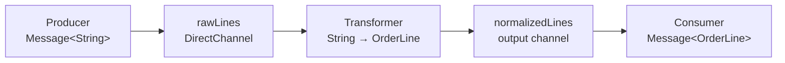

# Transformer with Output Channel

In the **Transformer** chapter of module **SPRING_INTEGRATION_CORE**, this lesson explains how to deliver transformation results to the next step of a message flow. The focus is on the relationship between `Message`, transformer endpoints, `MessageChannel`, `replyChannel`, and Java DSL.

A function converting a string into an object may return the right value yet the flow still fails if the endpoint cannot resolve where to send the result. Therefore, when designing a transformer, define both the output data contract and the channel receiving that data.

The examples use Java 17 and the Spring Integration 6.5 API. The core dependency is `org.springframework.integration:spring-integration-core`; the test examples use JUnit Jupiter. In a Spring Boot application, you can use `spring-boot-starter-integration` and let your application's dependency management align versions. Snippets explicitly marked as alternatives should be chosen individually to avoid registering two endpoints competing on the same input.

## 1. What Role Does the Output Channel Play?

Consider a system ingesting order lines in text form:

```text
Input:   " sku-42 , 2 "
Output:  OrderLine[sku=SKU-42, quantity=2]
```

The transformer is responsible for converting the data representation. The output channel is where the endpoint sends the `Message` containing the result after a successful transformation.



In the diagram, `normalizedLines` is both the transformer's output channel and potentially the input channel of the next endpoint. The label "output" describes the channel's role relative to a specific endpoint.

| Component | Responsibility in the example |
| --- | --- |
| Producer | Creates the message containing the input string |
| Input channel | Delivers the message to the transformer endpoint |
| Transformation logic | Normalizes the SKU, parses quantity, and creates `OrderLine` |
| Transformer endpoint | Calls transformation logic, builds the output message, and sends it onward |
| Output channel | Receives the transformed message |
| Consumer | Processes the `OrderLine` data contract |

The transformation function should focus on data. Connecting steps is expressed through endpoint and channel configuration, allowing you to change flow topology without rewriting string-parsing logic.

Spring Integration lets you declare transformers using annotations, XML, or the `.transform()` operator in Java DSL. [Transformer Reference](https://docs.spring.io/spring-integration/reference/6.5/transformer.html).

## 2. Distinguishing Function Return Values from Message Sending Results

The two statements below have different meanings:

```java
OrderLine line = OrderLine.parse("sku-42,2");
boolean accepted = inputChannel.send(message);
```

The first statement invokes a Java function and receives the resulting object. The second sends a `Message` to a channel; the `boolean` indicates whether sending succeeded per the channel's contract, and does not contain the transformed payload.

When using a transformer endpoint, the path is:

1. The endpoint receives a message from the input channel.
2. The endpoint invokes the transformation function.
3. The result is used to construct the output message.
4. The endpoint resolves the destination channel.
5. The endpoint sends the output message to that channel.

To obtain the result, the caller must receive from an output channel supporting `receive()`, use `MessagingTemplate` for request–reply, or call a messaging gateway. Do not cast the return value of `send()` into a business object.

## 3. How Does an Endpoint Determine Where to Send Output?

For a standard flow without a routing slip, the rules apply in order:

1. If the endpoint has a configured output channel, send to that channel.
2. If no output channel is set, look for `replyChannel` in the input message's headers.
3. If the input has no reply address and the return value is a `Message`, the resulting message's `replyChannel` may be used.
4. If no destination can be resolved, sending the result fails.

`replyChannel` may hold a `MessageChannel` object or a channel name as a `String`. Channel names must resolve in the application context. Missing destinations or unresolvable names can lead to `DestinationResolutionException`; the exception observed by the caller may be wrapped in another messaging exception. [Reply Channel Selection Rules](https://docs.spring.io/spring-integration/reference/6.5/service-activator.html).

| Endpoint output channel | Input `replyChannel` | Output destination in a standard flow |
| --- | --- | --- |
| `normalizedLines` | None | `normalizedLines` |
| `normalizedLines` | `callerReplies` | `normalizedLines` |
| Not configured | `callerReplies` object | That channel object |
| Not configured | Name `"callerReplies"` | Channel resolved by name |
| Not configured | None | Uses address on the result if applicable; otherwise fails |

An arbitrary header named `outputChannel` does not replace the endpoint's output channel property. To pick branches based on data, use a router or appropriate routing mechanism.

Configuring an output channel alongside a `replyChannel` header does not send twice either. When both exist, it sends first to the configured output channel. An endpoint later at the end of the flow can still use `replyChannel` to return the final response to the caller.

## 4. Complete Java DSL Example

### 4.1. Data Contract and Flow Configuration

Place the following code in `TransformerOutputConfiguration.java`. The example requires only a Spring context, Spring Integration core, and their transitive dependencies; it does not depend on a web server or message broker.

```java
package example.transformer;

import java.util.Locale;

import org.springframework.context.annotation.Bean;
import org.springframework.context.annotation.Configuration;
import org.springframework.integration.channel.DirectChannel;
import org.springframework.integration.channel.QueueChannel;
import org.springframework.integration.config.EnableIntegration;
import org.springframework.integration.dsl.IntegrationFlow;

@Configuration
@EnableIntegration
public class TransformerOutputConfiguration {

    public record OrderLine(String sku, int quantity) {

        public static OrderLine parse(String raw) {
            if (raw == null || raw.isBlank()) {
                throw new IllegalArgumentException(
                        "Order line must not be blank");
            }

            String[] fields = raw.split(",", -1);
            if (fields.length != 2) {
                throw new IllegalArgumentException(
                        "Format must be sku,quantity");
            }

            String sku = fields[0].trim().toUpperCase(Locale.ROOT);
            if (sku.isBlank()) {
                throw new IllegalArgumentException(
                        "SKU must not be blank");
            }

            final int quantity;
            try {
                quantity = Integer.parseInt(fields[1].trim());
            }
            catch (NumberFormatException ex) {
                throw new IllegalArgumentException(
                        "Quantity must be an integer", ex);
            }

            if (quantity <= 0) {
                throw new IllegalArgumentException(
                        "Quantity must be greater than 0");
            }

            return new OrderLine(sku, quantity);
        }
    }

    @Bean
    public DirectChannel rawLines() {
        return new DirectChannel();
    }

    @Bean
    public QueueChannel normalizedLines() {
        return new QueueChannel(100);
    }

    @Bean
    public IntegrationFlow normalizeLineFlow(
            DirectChannel rawLines,
            QueueChannel normalizedLines) {

        return IntegrationFlow.from(rawLines)
                .transform(String.class, OrderLine::parse)
                .channel(normalizedLines)
                .get();
    }
}
```

The flow makes concrete design choices:

- `rawLines` is the input subscribed to by the transformer; sending directly triggers processing.
- `.transform(String.class, OrderLine::parse)` accepts a `String` payload and returns an `OrderLine` payload.
- `.channel(normalizedLines)` connects the transformer's output to the declared channel bean.
- `QueueChannel(100)` holds results so the example can receive manually and bounds pending messages.

The input format here is a simple protocol with exactly two comma-separated fields; it does not support quoted CSV or commas inside SKUs.

### 4.2. Sending Input and Reading Output

Place the snippet below in `TransformerOutputDemo.java`, in the same package as the configuration:

```java
package example.transformer;

import org.springframework.context.annotation.AnnotationConfigApplicationContext;
import org.springframework.integration.channel.DirectChannel;
import org.springframework.integration.channel.QueueChannel;
import org.springframework.messaging.Message;
import org.springframework.messaging.support.MessageBuilder;

public class TransformerOutputDemo {

    public static void main(String[] args) {
        try (var context = new AnnotationConfigApplicationContext(
                TransformerOutputConfiguration.class)) {

            DirectChannel input =
                    context.getBean("rawLines", DirectChannel.class);
            QueueChannel output =
                    context.getBean("normalizedLines", QueueChannel.class);

            Message<String> request = MessageBuilder
                    .withPayload(" sku-42 , 2 ")
                    .setHeader("traceId", "trace-010")
                    .build();

            if (!input.send(request)) {
                throw new IllegalStateException(
                        "Failed to send input message");
            }

            Message<?> result = output.receive(1_000);
            if (result == null) {
                throw new IllegalStateException(
                        "No result received within wait timeout");
            }

            System.out.println(result.getPayload());
            System.out.println(result.getHeaders().get("traceId"));
        }
    }
}
```

Expected output:

```text
OrderLine[sku=SKU-42, quantity=2]
trace-010
```

The application receives the `Message` from the output channel before reading its payload. The `1_000` argument to `receive()` is the receive timeout in milliseconds.

In this example, no poller is needed on the output channel because the program actively calls `receive()`. If you replace manual receiving with a consuming endpoint reading from `QueueChannel`, that endpoint needs a poller.

## 5. How Java DSL Connects Output Channels

Two consecutive steps can be written as:

```java
@Bean
public IntegrationFlow displayLineFlow() {
    return IntegrationFlow.from("displayInput")
            .transform(String.class,
                    TransformerOutputConfiguration.OrderLine::parse)
            .handle(System.out::println)
            .get();
}
```

The DSL creates an internal connection between the transformer and the next handler. In the default configuration of this chaining style, endpoints are wired with `DirectChannel`; naming every intermediate channel is not mandatory. [DSL Basics](https://docs.spring.io/spring-integration/reference/6.5/dsl/java-basics.html).

When an explicit connection point is needed, use a named channel or channel bean:

```java
.transform(String.class, OrderLine::parse)
.channel(normalizedLines)
```

Named channels are useful when you want to attach interceptors, bridge another flow, observe messages, or mark a boundary between two data contracts.

Read `.channel(...)` by position. If a channel follows a transformer, it receives the transformer's output. If a channel precedes a transformer, it supplies messages to the transformer. An endpoint following a queue-backed channel needs suitable polling configuration.

In particular, ending a flow right after `.transform(...)` does not mean automatically discarding the result. If the DSL does not wire the endpoint to an output channel or next step, the endpoint still needs to resolve a valid reply destination.

## 6. Declaring via Annotation and XML

### 6.1. `@Transformer` Annotation

You can replace the `normalizeLineFlow` bean in section 4 with a POJO bean:

```java
package example.transformer;

import org.springframework.integration.annotation.Transformer;

public class LineNormalizer {

    @Transformer(
            inputChannel = "rawLines",
            outputChannel = "normalizedLines")
    public TransformerOutputConfiguration.OrderLine normalize(String raw) {
        return TransformerOutputConfiguration.OrderLine.parse(raw);
    }
}
```

Register the POJO in the configuration class annotated with `@EnableIntegration`:

```java
@Bean
public LineNormalizer lineNormalizer() {
    return new LineNormalizer();
}
```

Keep the two channel beans `rawLines` and `normalizedLines`; remove the old flow bean when choosing this option. Keeping both registers two endpoints on `rawLines`, so the flow would no longer match a single-transformer example.

### 6.2. Equivalent XML

The XML snippet below uses namespace prefix `int` for Spring Integration and `beans` for Spring Beans inside a configuration document with namespaces declared:

```xml
<int:channel id="rawLines"/>

<int:channel id="normalizedLines">
    <int:queue capacity="100"/>
</int:channel>

<beans:bean id="lineNormalizer"
            class="example.transformer.LineNormalizer"/>

<int:transformer id="normalizeLineEndpoint"
                 input-channel="rawLines"
                 output-channel="normalizedLines"
                 ref="lineNormalizer"
                 method="normalize"/>
```

This is the XML endpoint declaration option. If reusing an annotated POJO, make sure annotation processing does not simultaneously create a second endpoint for the same method. A clean choice is using a plain POJO containing only `normalize` without the annotation when configuring purely in XML.

All three configuration styles express the same relationship: receive from `rawLines`, transform the payload, send the result to `normalizedLines`. There is no need to embed `send()` calls inside the `normalize` method.

## 7. Fixed Output Channel vs. Reply Address

### 7.1. Both Output Channel and `replyChannel` Present

With section 4's configuration, you can send a message carrying a reply address:

```java
QueueChannel callerReplies = new QueueChannel();

Message<String> request = MessageBuilder
        .withPayload("sku-42,2")
        .setReplyChannel(callerReplies)
        .build();

input.send(request);

Message<?> normalized = output.receive(1_000);
Message<?> directReply = callerReplies.receive(0);
```

Expected results:

- `normalized` has payload `OrderLine[sku=SKU-42, quantity=2]`.
- `directReply` is `null`, because the transformer sent the result to the fixed output channel.

`callerReplies` is a channel object placed directly in the header, so it does not need bean registration just for name resolution. If setting a channel name as a string, the application must provide the corresponding channel bean.

This example shows that adding `replyChannel` does not make the transformer bypass its configured output step.

### 7.2. Flow-Ending Transformer Using `replyChannel`

A standalone flow can let output be governed by the reply address:

```java
@Bean
public IntegrationFlow replyOnlyFlow() {
    return IntegrationFlow.from("replyOnlyInput")
            .transform(String.class,
                    TransformerOutputConfiguration.OrderLine::parse)
            .get();
}
```

Once that flow is registered in an `@EnableIntegration` configuration:

```java
MessageChannel replyInput =
        context.getBean("replyOnlyInput", MessageChannel.class);

QueueChannel replies = new QueueChannel();

Message<String> request = MessageBuilder
        .withPayload("sku-42,2")
        .setReplyChannel(replies)
        .build();

replyInput.send(request);
Message<?> response = replies.receive(1_000);
```

`response` contains `OrderLine`. This caller snippet also requires importing `org.springframework.messaging.MessageChannel`. It does not use the previous example's `normalizedLines` channel.

If you send directly to `replyOnlyInput` without a reply address, the parsing function may succeed yet the endpoint will fail when sending the result.

## 8. Connecting via a Messaging Gateway

A gateway lets business code invoke a Java method while the integration layer handles message exchange. For methods with a return value, the gateway normally creates a temporary reply channel and sets it in the `replyChannel` header. [Messaging Gateways](https://docs.spring.io/spring-integration/reference/6.5/gateway.html).

Example interface in package `example.transformer`:

```java
package example.transformer;

import org.springframework.integration.annotation.MessagingGateway;

@MessagingGateway(
        defaultRequestChannel = "gatewayInput",
        defaultReplyTimeout = "2000")
public interface OrderGateway {

    String submit(String raw);
}
```

Standalone configuration below reuses `OrderLine` from section 4:

```java
package example.transformer;

import org.springframework.context.annotation.Bean;
import org.springframework.context.annotation.Configuration;
import org.springframework.integration.annotation.IntegrationComponentScan;
import org.springframework.integration.channel.DirectChannel;
import org.springframework.integration.config.EnableIntegration;
import org.springframework.integration.dsl.IntegrationFlow;

import example.transformer.TransformerOutputConfiguration.OrderLine;

@Configuration
@EnableIntegration
@IntegrationComponentScan(basePackageClasses = OrderGateway.class)
public class GatewayOutputConfiguration {

    @Bean
    public DirectChannel gatewayNormalizedLines() {
        return new DirectChannel();
    }

    @Bean
    public IntegrationFlow gatewayOrderFlow(
            DirectChannel gatewayNormalizedLines) {

        return IntegrationFlow.from("gatewayInput")
                .transform(String.class, OrderLine::parse)
                .channel(gatewayNormalizedLines)
                .handle(OrderLine.class, (line, headers) ->
                        "ACCEPTED " + line.sku() + " x" + line.quantity())
                .get();
    }
}
```

When the context is created from `GatewayOutputConfiguration.class`:

```java
OrderGateway gateway = context.getBean(OrderGateway.class);
String result = gateway.submit("sku-42,2");
// result: "ACCEPTED SKU-42 x2"
```

Path of a single invocation:

```text
OrderGateway.submit(...)
  → gatewayInput
  → Transformer: String to OrderLine
  → gatewayNormalizedLines
  → Service Activator: OrderLine to confirmation String
  → temporary replyChannel
  → result returned from submit(...)
```

The transformer sends to `gatewayNormalizedLines` because it has an explicit output connection. The final handler returns a string and has no further output channel, so it uses the reply address carried with the message.

If you wire a transformer into a queue with no consumer producing a reply, the gateway will not automatically poll that queue for results. Complete the reply path and configure timeouts. In a synchronous flow over `DirectChannel`, reply timeout does not act as an execution deadline or cancel an actively running handler.

## 9. Output Payload and Headers

### 9.1. When the Method Returns a Payload

In `OrderLine::parse`, the return type is `OrderLine`. The framework uses that result as the output message payload and propagates headers per the endpoint's mechanism.

With section 4's default configuration, the application header `traceId` is preserved so consumers can still correlate results with the original request. Do not require "all headers must be identical" when checking context preservation: `id` and `timestamp` are message metadata, not stable business identifiers across a flow.

When you need a durable correlation key, set a business header such as `traceId` or `orderId`. When a flow uses splitters or aggregators, understand correlation and sequence headers before modifying them.

### 9.2. When Returning a `Message`

If a transformer needs to add metadata, it can return a `Message<OrderLine>`:

```java
public Message<TransformerOutputConfiguration.OrderLine> normalizeMessage(
        Message<String> input) {

    var line =
            TransformerOutputConfiguration.OrderLine.parse(input.getPayload());

    return MessageBuilder.withPayload(line)
            .copyHeaders(input.getHeaders())
            .setHeader("normalizationVersion", "v1")
            .build();
}
```

This method can be invoked by an endpoint using method-reference configuration. Additional required imports are `org.springframework.messaging.Message` and `org.springframework.messaging.support.MessageBuilder`.

Returning a `Message` lets you specify both payload and headers. Where the endpoint sends it still follows the output channel configuration and destination resolution rules. Do not manually call `normalizedLines.send(...)` inside the method and also return the same result, as the endpoint will send the return value too and potentially emit two messages.

Under standard handling, a `Message` return value may still have missing request headers filled in depending on the handler's header-propagation policy. Thus, merely omitting `copyHeaders(...)` when constructing the result is not a guaranteed way to strip headers from the entire flow. [Output Handling and Header Propagation Source](https://github.com/spring-projects/spring-integration/blob/6.5.x/spring-integration-core/src/main/java/org/springframework/integration/handler/AbstractMessageProducingHandler.java).

## 10. Choosing the Output Channel Type by Consumption Model

| Channel type | How results are received | Considerations |
| --- | --- | --- |
| `DirectChannel` | Invokes subscriber on sender thread | Requires a registered consumer; execution is synchronous by default |
| `QueueChannel` | Consumer calls `receive()` or endpoint uses poller | Buffered; sending to the queue does not prove business work is complete |
| `ExecutorChannel` | Dispatches via `TaskExecutor` | Must consider thread boundaries, error paths, and executor sizing |
| `PublishSubscribeChannel` | Broadcasts to subscribers | Use when multiple branches must receive the message |

`DirectChannel` has no `receive()` method. Conversely, a standard `QueueChannel` can buffer messages even when no consumer is waiting yet. The default queue holds data in memory; durability requirements call for a message store or suitable broker infrastructure. [MessageChannel Implementations](https://docs.spring.io/spring-integration/reference/6.5/channel/implementations.html).

### 10.1. Making the Queue the Input of the Next Endpoint

To automatically print section 4's results, you can add the following flow bean to the configuration:

```java
@Bean
public IntegrationFlow consumeNormalizedLines(
        QueueChannel normalizedLines) {

    return IntegrationFlow.from(normalizedLines)
            .handle(System.out::println,
                    endpoint -> endpoint.poller(
                            Pollers.fixedDelay(100)
                                    .maxMessagesPerPoll(10)))
            .get();
}
```

This snippet requires importing `org.springframework.integration.dsl.Pollers`. The poller triggers pulling messages from the queue and invoking the handler. Do not enable this consumer simultaneously in tests that receive manually, or both sides will compete for the same messages.

### 10.2. Avoiding Misconceptions About Broadcasting

Attaching two consumers to a `DirectChannel` does not make each message run through two sequential steps. That channel has point-to-point semantics; the dispatcher picks one consumer and may apply failover per configuration.

For sequential processing, chain endpoint A through a channel to endpoint B. For two branches to both receive the result, use `PublishSubscribeChannel` or configure branching in the DSL. To pick one branch based on payload or headers, use a router.

## 11. Errors Related to Transformer Output

### 11.1. Transformation Logic Returns `null`

A transformer must produce a valid result. Returning `null` is not how you skip data; it leads to a transformation error. If the requirement is dropping invalid messages, express it with a filter and an appropriate discard or rejection policy. [Transformer Contract](https://docs.spring.io/spring-integration/reference/6.5/transformer.html).

In the example, `"sku-42,0"` causes `parse` to throw an exception. There is no valid `OrderLine` to send to the output channel.

### 11.2. Missing Destination Channel

The symptom may be an error citing a missing output channel or `replyChannel`. Check whether the endpoint has a downstream connection and whether the input message carries a reply address.

The fix depends on the flow's purpose:

- Want to process further: configure an output channel and matching consumer.
- Want to reply to the caller: complete the request–reply wiring.
- Intentionally terminate after discarding results: configure `nullChannel` explicitly.

Do not leave the output channel blank to mean "don't care about the result."

### 11.3. Destination Channel Exists, Yet Has No Consumer

If the output is a `DirectChannel` with no subscribers, sending can fail with a delivery or dispatch error. Having the right channel bean name is not enough; the consuming endpoint must be registered and active.

With a `QueueChannel`, a similar gap may simply cause queued messages to pile up. This is why you must observe both send outcomes and consumption progress.

### 11.4. Consumer Rejects the New Payload Type

If the transformer returns `OrderLine` while the consumer still declares a method accepting only the old input type, the flow may fail at consumer invocation or type conversion.

Treat the output channel as a contract boundary: channel name, payload type, and required headers must match the receiving endpoint.

### 11.5. Output Queue Is Full

With a bounded queue, sending may block waiting for space. Output send timeout, when configured on the handler, controls how long the send waits according to the channel type.

The receive wait in `output.receive(1_000)` does not configure the transformer's send timeout. Likewise, a send timeout on the input channel does not become an execution deadline for an entire synchronous handler chain.

If a queue fills up, evaluate producer rate, consumer throughput, and flow-control policies. Immediate retries do not create extra queue capacity.

### 11.6. Confusing the Success Channel with the Error Channel

The output channel carries successful results. A transformer throwing an exception does not automatically manufacture a business error payload and send it to that same channel.

With `DirectChannel` and direct `send()` calls, exceptions propagate back to the sender. Setting an `errorChannel` header does not automatically turn that synchronous call into asynchronous error handling. For tasks run by a Spring Integration poller or executor, the corresponding error-handling mechanism can publish an `ErrorMessage` to an error channel. [Error Handling](https://docs.spring.io/spring-integration/reference/6.5/error-handling.html).

When investigating failures, determine whether the failure happened inside the transformation function, while sending the output, or inside the consumer. A failed input send alone is not enough to conclude the transformation logic is wrong.

## 12. Testing the Output Contract

Testing `parse` verifies data conversion. To test the output channel, start the integration flow and send a real `Message` through the input channel.

The code below uses section 4's configuration as-is, without adding a polling consumer on `normalizedLines`. Place the class in `TransformerOutputConfigurationTest.java`:

```java
package example.transformer;

import org.junit.jupiter.api.AfterEach;
import org.junit.jupiter.api.BeforeEach;
import org.junit.jupiter.api.Test;

import org.springframework.context.annotation.AnnotationConfigApplicationContext;
import org.springframework.integration.channel.DirectChannel;
import org.springframework.integration.channel.QueueChannel;
import org.springframework.messaging.Message;
import org.springframework.messaging.MessagingException;
import org.springframework.messaging.support.MessageBuilder;

import example.transformer.TransformerOutputConfiguration.OrderLine;

import static org.junit.jupiter.api.Assertions.*;

class TransformerOutputConfigurationTest {

    private AnnotationConfigApplicationContext context;
    private DirectChannel input;
    private QueueChannel output;

    @BeforeEach
    void setUp() {
        context = new AnnotationConfigApplicationContext(
                TransformerOutputConfiguration.class);
        input = context.getBean("rawLines", DirectChannel.class);
        output = context.getBean("normalizedLines", QueueChannel.class);
    }

    @AfterEach
    void tearDown() {
        if (context != null) {
            context.close();
        }
    }

    @Test
    void sendsTransformedPayloadAndTraceHeaderToOutput() {
        Message<String> request = MessageBuilder
                .withPayload(" sku-42 , 2 ")
                .setHeader("traceId", "trace-010")
                .build();

        assertTrue(input.send(request));

        Message<?> result = output.receive(1_000);
        assertNotNull(result);
        assertEquals(new OrderLine("SKU-42", 2), result.getPayload());
        assertEquals("trace-010", result.getHeaders().get("traceId"));
        assertNull(output.receive(0));
    }

    @Test
    void configuredOutputTakesPriorityOverReplyHeader() {
        QueueChannel callerReplies = new QueueChannel();

        Message<String> request = MessageBuilder
                .withPayload("sku-42,2")
                .setReplyChannel(callerReplies)
                .build();

        assertTrue(input.send(request));

        Message<?> result = output.receive(1_000);
        assertNotNull(result);
        assertEquals(new OrderLine("SKU-42", 2), result.getPayload());
        assertNull(callerReplies.receive(0));
    }

    @Test
    void invalidInputProducesNoSuccessfulOutput() {
        Message<String> request = MessageBuilder
                .withPayload("sku-42,0")
                .build();

        assertThrows(MessagingException.class,
                () -> input.send(request));
        assertNull(output.receive(0));
    }
}
```

The three tests verify distinct behaviors: data and context arrive at the expected output; fixed channel configuration takes priority; invalid input does not appear on the success channel.

`receive(0)` works here because the path to the output queue runs synchronously over `DirectChannel` and the send call has already finished. When switching to an executor or poller, wait with bounded timeouts suited to asynchronous behavior; do not retain synchronous timing assumptions.

These test snippets are illustrative code for learners to practice in a project with matching dependencies; this guide does not claim they have been executed in the module environment.

## 13. Applying to Flow Design

Before adding a transformer to a real flow, define the contract immediately downstream of the transformation step. For the order-line ingestion example, the contract might be:

```text
Channel: normalizedLines
Payload: OrderLine
Conditions: sku trimmed and uppercased; quantity > 0
Context: preserve traceId when provided on input
Invalid input: raise error, do not send success result
Consumption: manual receive or endpoint with poller
```

From that contract, choosing subsequent components becomes clear. Business consumers receive `OrderLine`; a router can branch by SKU; a filter decides acceptance or rejection; a splitter creates multiple messages when breaking apart a composite structure; an aggregator groups results in a separate step.

The output channel is the junction enabling those components to collaborate. The transformer stays responsible for converting data into the representation agreed upon by the next step, while flow configuration expresses routing, consumption style, and how callers receive replies.
