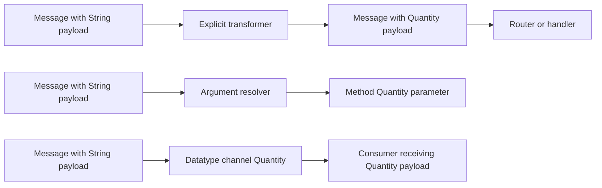

# Transformer and Type Conversion

## 1. Objectives and Context

In the **Transformer** chapter of module **SPRING_INTEGRATION_CORE**, this lesson focuses on bringing a payload to the right data type at the boundary between processing components. The topic ties directly to flow design using `Message`, `MessageChannel`, endpoints, and Java DSL: a consumer should only receive data formats permitted by its contract.

After this lesson, you will be able to:

- Distinguish a transformer endpoint from type conversion during method invocation.
- Use `.transform(...)`, `.convert(...)`, and `@IntegrationConverter` for their intended purposes.
- Choose between `Converter`, `ConversionService`, and `MessageConverter`.
- Recognize how conversions affect payloads, headers, gateways, routers, and aggregators.
- Design tests for valid data, malformed inputs, and missing-converter errors.

The running scenario receives an item quantity as a string, such as `" 12 "`, and constructs a domain value `Quantity(12)`. The example rule is that quantity must be a positive integer within the `int` range. Thousands separators, decimal points, and blank strings are rejected.

The examples use Java 17 or higher and the Java DSL API available in Spring Integration 6.x. Pick dependency versions according to your application's BOM; this lesson does not require altering the module's dependencies or build layout.

## 2. Changing Data Types vs. Transforming Messages

Consider two tasks:

```text
"12" -> Integer.valueOf(12)
PartnerOrder -> InternalOrder
```

The first task changes how a single value is represented. The second may rename fields, normalize units, combine values, and establish a new domain contract. Both can appear inside a transformer, yet their scope and semantics differ.

| Concept | Focus | Example |
| --- | --- | --- |
| Type conversion | Convert a value from a source type to a target type | `String -> Quantity` |
| Transformation | Produce data matching the output contract of a flow step | `PartnerOrder -> InternalOrder` |
| Parsing | Interpret the syntax of a representation | Parsing an integer string or a JSON document |
| Validation | Check acceptance conditions | Positive quantity, existing SKU |
| Serialization | Create a representation for storage or transport | DTO to JSON or `byte[]` |

A transformer may invoke a parser and enforce invariants to build a valid object. However, a decision such as "what is the maximum quantity this customer is allowed to buy" usually belongs in a business step because it requires context beyond a type conversion.

A transformer is an endpoint representing a data-changing step in a flow. It can receive the payload or the entire message; its result must be valid and never `null`. When you want to drop messages conditionally, use a filter. See [Spring Integration: Transformer](https://docs.spring.io/spring-integration/reference/transformer.html).

## 3. Where Does Conversion Happen?

Do not assume a single mechanism converts every payload across the system.



The three branches in the diagram are three independent options, not mandatory stages of the same pipeline.

| Location | What gets converted? | What to observe |
| --- | --- | --- |
| Explicit transformer | Input data to build the endpoint's output | Downstream message carries the transformed payload |
| Method parameter conversion | Value passed into a handler parameter | Method is invoked with the right type; original message is not automatically altered |
| Datatype channel | Payload before the channel delivers the message to a consumer | Channel's consumer receives an accepted type |
| Specific adapter or gateway | Data at the protocol or invocation boundary | Depends on that component's contract and converters |

For method-invocation mechanisms, Spring Integration uses `integrationConversionService` for runtime type conversion. A `conversionService` bean serves a distinct role when configuring beans; do not assume the two names refer to the same bean. See [Payload Type Conversion](https://docs.spring.io/spring-integration/reference/endpoint.html#payload-type-conversion).

A design consequence: if multiple downstream steps need `Quantity`, create `Quantity` at one clear boundary. If only a single local parameter needs that type, converting upon method invocation may suffice.

## 4. Choosing the Right API

### 4.1. `Converter<S, T>`

`org.springframework.core.convert.converter.Converter<S, T>` describes a source-and-target type pair. Its `convert(S source)` method does not receive the full message or headers.

A sensible example is converting `String` to `Quantity` by the same rule everywhere. Keep the implementation free of mutable state so it can be shared safely across concurrent flows.

`ConverterFactory` suits a family of target types; `GenericConverter` suits multiple type pairs or when `TypeDescriptor` metadata is required. Do not reach for those complex SPIs for a single simple type pair. See [Spring Framework: Spring Type Conversion](https://docs.spring.io/spring-framework/reference/core/validation/convert.html).

### 4.2. `ConversionService`

`ConversionService` is the API for finding and executing converters:

```java
ConversionService service = ...;
boolean supported = service.canConvert(String.class, Quantity.class);
Quantity quantity = service.convert("12", Quantity.class);
```

The snippet illustrates the API; the complete example below provides an actual service and `Quantity` type.

`canConvert(...)` checks whether conversion between types is supported. It does not inspect and validate every input value. Having a `String -> Quantity` path still does not make `"abc"` a valid quantity. For collections, supporting collection conversion does not guarantee every element converts cleanly either. See [Javadoc: ConversionService](https://docs.spring.io/spring-framework/docs/current/javadoc-api/org/springframework/core/convert/ConversionService.html).

### 4.3. `MessageConverter`

`org.springframework.messaging.converter.MessageConverter` works on messages and can use metadata such as `contentType`. It is a better fit when content format determines how the payload is read.

| Need | Starting choice |
| --- | --- |
| Quantity string under one fixed contract | `Converter<String, Quantity>` |
| Convert partner DTO to internal DTO in a flow | Transformer invoking a dedicated mapper |
| Read content based on `contentType` and target type | `MessageConverter` on the relevant component |
| Same `String` type, yet two partners use two different syntaxes | Two clearly named transformers or parsers |
| Normalize based on a `partnerId` header | Transformer accepting `Message<?>` or a header parameter |

Do not put partner-specific branching inside a global `String -> Quantity` converter and try to fetch headers through a shared variable or `ThreadLocal`. That contract cannot accurately represent the conversion's context.

## 5. Complete Example: One Converter, Two Ways to Convert

### 5.1. Data Contract

In the example:

- `"12"` and `" 12 "` produce `Quantity(12)`.
- `"0012"` also produces `Quantity(12)`; leading zero formatting is not preserved.
- `"0"`, `"-3"`, `"1.5"`, `"1,000"`, and blank strings are rejected.
- Values outside the `int` range are rejected.
- No database lookup or network call occurs inside the converter.

Accepting leading zeros is a decision of this example. If data is an identifier such as `"0012"`, converting it to a number can destroy its meaning; in that case, use a dedicated identifier type.

### 5.2. Java Configuration

This is a standalone configuration class in package `example.integration`. Place it in an appropriate source set of your application when practicing. The classpath needs `spring-integration-core`; the test code below needs JUnit Jupiter.

```java
package example.integration;

import org.springframework.context.annotation.Bean;
import org.springframework.context.annotation.Configuration;
import org.springframework.core.convert.converter.Converter;
import org.springframework.integration.channel.DirectChannel;
import org.springframework.integration.channel.QueueChannel;
import org.springframework.integration.config.EnableIntegration;
import org.springframework.integration.config.IntegrationConverter;
import org.springframework.integration.dsl.IntegrationFlow;

@Configuration
@EnableIntegration
public class QuantityIntegrationConfig {

    public record Quantity(int units) {

        public Quantity {
            if (units <= 0) {
                throw new IllegalArgumentException(
                        "Quantity must be greater than zero");
            }
        }
    }

    public static final class StringToQuantityConverter
            implements Converter<String, Quantity> {

        @Override
        public Quantity convert(String source) {
            String text = source.strip();

            if (!text.matches("[0-9]+")) {
                throw new IllegalArgumentException(
                        "Quantity must contain decimal digits only");
            }

            final int units;
            try {
                units = Integer.parseInt(text);
            }
            catch (NumberFormatException ex) {
                throw new IllegalArgumentException(
                        "Quantity is outside the int range", ex);
            }

            return new Quantity(units);
        }
    }

    @Bean
    @IntegrationConverter
    public StringToQuantityConverter quantityConverter() {
        return new StringToQuantityConverter();
    }

    @Bean("quantity.explicit.in")
    public DirectChannel explicitInput() {
        return new DirectChannel();
    }

    @Bean("quantity.convert.in")
    public DirectChannel convertInput() {
        return new DirectChannel();
    }

    @Bean("quantity.explicit.out")
    public QueueChannel explicitOutput() {
        return new QueueChannel(10);
    }

    @Bean("quantity.convert.out")
    public QueueChannel convertOutput() {
        return new QueueChannel(10);
    }

    @Bean
    public IntegrationFlow explicitQuantityFlow(
            StringToQuantityConverter quantityConverter) {

        return IntegrationFlow
                .from("quantity.explicit.in")
                .transform(String.class, quantityConverter::convert)
                .channel("quantity.explicit.out")
                .get();
    }

    @Bean
    public IntegrationFlow convertedQuantityFlow() {
        return IntegrationFlow
                .from("quantity.convert.in")
                .convert(Quantity.class)
                .channel("quantity.convert.out")
                .get();
    }
}
```

Both inputs are `DirectChannel`, each with one transformer consumer. Both outputs are `QueueChannel` so the exercise can actively call `receive(...)`. Reading the output queue directly in tests requires no poller.

Each queue has a capacity of 10 messages, sufficient for the example. In a real application, size capacity, timeouts, and consumers according to throughput; do not treat this practice configuration as production tuning.

### 5.3. Flow Calling the Converter Directly

In `explicitQuantityFlow`, the method reference `quantityConverter::convert` is the explicitly specified transformation. This step's logic does not need to search a registry for `StringToQuantityConverter` to pick a conversion.

```text
GenericMessage<String>(" 12 ")
    -> calls StringToQuantityConverter.convert(...)
    -> Message<Quantity>(Quantity(12))
    -> quantity.explicit.out
```

This style is helpful when the conversion contract belongs to one specific flow or you want readers to see immediately which implementation gets called.

### 5.4. Flow Converting via the Registry

In `convertedQuantityFlow`, `.convert(Quantity.class)` specifies the **output payload type**. Spring Integration uses the runtime conversion infrastructure to convert the payload to that type.

`@IntegrationConverter` registers the converter bean with `integrationConversionService`. The annotation resides in package `org.springframework.integration.config`; it can be placed on a `@Bean` method or a managed bean class. See [Javadoc: IntegrationConverter](https://docs.spring.io/spring-integration/api/org/springframework/integration/config/IntegrationConverter.html).

```text
GenericMessage<String>(" 12 ")
    -> convert to target type Quantity
    -> select registered String -> Quantity converter
    -> Message<Quantity>(Quantity(12))
    -> quantity.convert.out
```

A bean merely implementing `Converter` does not automatically mean "registered for Spring Integration" in all configurations. Registration must go through the appropriate mechanism, such as `@IntegrationConverter` in the example.

You can remove the annotation from the example to observe the difference, but do not generalize that every type pair fails: built-in converters or other conversion paths may still exist. Always test the exact type pair you care about.

### 5.5. Observing Execution with a Minimal Context

The snippet below can be placed in a `main` method; use the imports shown here in full:

```java
import example.integration.QuantityIntegrationConfig;
import org.springframework.context.annotation.AnnotationConfigApplicationContext;
import org.springframework.integration.channel.QueueChannel;
import org.springframework.messaging.Message;
import org.springframework.messaging.MessageChannel;
import org.springframework.messaging.support.MessageBuilder;

// Place inside main(String[] args):
try (var context = new AnnotationConfigApplicationContext(
        QuantityIntegrationConfig.class)) {

    MessageChannel input = context.getBean(
            "quantity.convert.in", MessageChannel.class);

    QueueChannel output = context.getBean(
            "quantity.convert.out", QueueChannel.class);

    Message<String> request = MessageBuilder.withPayload(" 12 ")
            .setHeader("traceId", "trace-quantity-001")
            .build();

    if (!input.send(request, 1_000)) {
        throw new IllegalStateException("Input message was not accepted");
    }

    Message<?> result = output.receive(1_000);
    if (result == null) {
        throw new IllegalStateException("No converted message");
    }

    System.out.println(result.getPayload());
    System.out.println(result.getHeaders().get("traceId"));
    System.out.println(request.getPayload().getClass().getSimpleName());
}
```

Expected output:

```text
Quantity[units=12]
trace-quantity-001
String
```

The last line lets you verify that the input message still holds a `String` payload. The converted result is emitted in the transformer's output message.

## 6. Distinguishing Input Type and Output Type in Java DSL

The two statements below have different meanings:

```java
.transform(Quantity.class, quantity -> quantity.units())
```

```java
.convert(Quantity.class)
```

In `.transform(Class<P>, GenericTransformer<P, T>)`, the `Class<P>` argument is the **expected input type** of the transformation function. The framework may attempt to convert the payload to that type before invoking the lambda. In the first statement, the lambda receives `Quantity` and returns `Integer` via boxing of `int`.

In `.convert(Quantity.class)`, the passed type is the **target type** of the conversion step. See the overloads in [Javadoc: BaseIntegrationFlowDefinition](https://docs.spring.io/spring-integration/docs/6.4.x/api/org/springframework/integration/dsl/BaseIntegrationFlowDefinition.html).

Example to read carefully:

```java
return IntegrationFlow.from("quantity.some.in")
        .transform(QuantityIntegrationConfig.Quantity.class,
                quantity -> "units=" + quantity.units())
        .channel("quantity.some.out")
        .get();
```

This is an illustrative configuration snippet requiring matching input/output declarations when used. If a `String` arrives, a suitable converter must produce `Quantity` before the lambda runs. The output payload is again a `String`, such as `"units=12"`.

Therefore, do not misread `.transform(Quantity.class, ...)` as "the output is guaranteed to be `Quantity`." The output contract is determined by the function's return value.

When the goal is making the normalization boundary explicit, you can write two steps:

```java
.convert(QuantityIntegrationConfig.Quantity.class)
.transform(QuantityIntegrationConfig.Quantity.class,
        quantity -> "units=" + quantity.units())
```

The first step produces the domain value; the second produces the text representation. That separation helps when naming endpoints, monitoring, or categorizing errors per step.

## 7. Parameter Conversion Without Mutating the Source Message

Suppose a handler accepts a `Quantity` parameter:

```java
public final class QuantityFormatter {

    public String format(QuantityIntegrationConfig.Quantity quantity) {
        return "units=" + quantity.units();
    }
}
```

When configuring handler method invocation and the source payload differs from the parameter type, the infrastructure can convert the value for the call if a suitable converter exists. However, that is not equivalent to replacing the source message's payload across all branches.

A scenario prone to confusion is broadcasting the same message to two branches:

```text
                  +-> Branch A: handler receives Quantity
Message<String> --|
                  +-> Branch B: observes original String payload
```

In branch A, the parameter may be `Quantity`; branch B can still receive the `String` payload. If the contract for all downstream processing is `Quantity`, placing a transformer before the branch point expresses the intent more clearly.

Gateways can also perform mapping or conversion at the call boundary. A gateway method's return type alone is not enough to conclude every message inside the flow has a payload of that same type. When designing, document both the gateway contract and the message contract between endpoints.

## 8. Datatype Channels Are Another Kind of Boundary

A channel can declare the payload types it accepts:

```java
@Bean("quantity.typed")
public DirectChannel typedQuantityChannel() {
    DirectChannel channel = new DirectChannel();
    channel.setDatatypes(QuantityIntegrationConfig.Quantity.class);
    return channel;
}
```

This is an optional configuration choice, not part of the two complete flows in section 5.

If the payload is already compatible with the datatype, the channel delivers it. Otherwise, the datatype channel infrastructure attempts conversion using configured converters; lacking conversion capability or invalid data raises an error. To test sending through a `DirectChannel`, a consumer must be subscribed, or you will get a missing-subscriber error rather than the expected conversion error.

Datatype accepts types assignable to the declared type. Declaring `Number.class` also accepts `Integer` or `Double`, so it does not mean "integers only." See [Datatype Channel Configuration](https://docs.spring.io/spring-integration/reference/channel/configuration.html#channel-datatype-channel).

Choose the representation based on the contract's intent:

- Use a transformer when you want the normalization step visible on the flow diagram.
- Use a datatype channel when the channel itself must enforce a type boundary for every producer.
- If using both, define each one's responsibility clearly so conversion rules do not scatter.

## 9. Payloads, Headers, and Conversion Context

A message has a payload and headers. Message structure forbids swapping the payload via a setter; that does not make a mutable payload object deeply immutable.

Under default configuration, when a transformer returns only a payload, input headers propagate to the result via the framework's mechanism. When a transformer returns a full `Message`, application code is responsible for building the complete output message. `id` and `timestamp` are infrastructure-managed metadata; use correlation or trace headers to connect processing steps. See [Message and Header Propagation](https://docs.spring.io/spring-integration/reference/message.html#message-header-propagation).

Example of a function receiving the whole message and explicitly keeping required headers:

```java
import org.springframework.messaging.Message;
import org.springframework.messaging.support.MessageBuilder;

public static Message<QuantityIntegrationConfig.Quantity> convertMessage(
        Message<String> source,
        QuantityIntegrationConfig.StringToQuantityConverter converter) {

    QuantityIntegrationConfig.Quantity quantity =
            converter.convert(source.getPayload());

    return MessageBuilder.withPayload(quantity)
            .copyHeaders(source.getHeaders())
            .setHeader("quantityFormat", "positive-int")
            .build();
}
```

This is an illustrative helper function, not a self-registering endpoint. `copyHeaders(...)` preserves copyable headers such as `traceId`, `replyChannel`, `errorChannel`, and sequence info if present. Do not use this example to try keeping the source message's `id` unchanged.

With aggregators, dropping `correlationId`, `sequenceNumber`, or `sequenceSize` can prevent a group from completing as expected. With gateways, dropping `replyChannel` can prevent the reply from returning to the right place. Therefore, testing a conversion contract must also verify headers the flow relies on.

If converting from text to an object changes the meaning of `contentType`, establish an explicit metadata policy. Leaving `contentType=text/plain` on a domain object payload and letting a downstream component interpret it as text data can cause unexpected behavior.

## 10. JSON and `contentType` Are Not Universal Type Conversion

The string `"{\"units\":12}"` remains a `String` until a component actually parses that content. Setting `contentType=application/json` merely supplies metadata; it does not automatically turn every message on every channel into a Java object.

`MessageConverter`-based conversion during parameter resolution also depends on registered converters, format libraries, and the invocation mechanism. That mechanism differs from class-to-class conversion via `ConversionService`; SpEL invocation paths do not share the full `MessageConverter` content-type conversion capabilities of method argument resolvers. See [Content Type Conversion](https://docs.spring.io/spring-integration/reference/endpoint.html#content-type-conversion).

When designing a flow receiving JSON orders, you can separate boundaries like this:

```text
JSON data
    -> parse syntax into PartnerOrder
    -> transformer maps to InternalOrder
    -> filter/router applies processing policy
    -> service activator executes business logic
```

Four steps make it possible to distinguish:

- Syntactically broken JSON.
- Valid JSON that does not match the DTO structure.
- Structurally valid DTO that cannot build a valid domain value.
- Valid domain value that fails a business rule.

Do not use a DTO's `toString()` as a substitute for a JSON serializer when you need a data contract to transmit to another system.

## 11. Generics and Collections: Matching Container Type Is Not Enough

Suppose a consumer expects `List<Quantity>`. At runtime, a `List` value cannot prove via `List.class` alone that every element is a `Quantity`.

```text
["2", "3", "abc"]
```

This is a valid container list containing an element that cannot convert to a quantity. Settle the policy upfront:

| Policy | Behavior |
| --- | --- |
| All-or-nothing | One bad element fails the entire batch |
| Per-item processing | Split, convert each message, then route outcomes |
| Structured result | Each item carries a success status or error code |

Custom example for the all-or-nothing policy:

```java
import java.util.ArrayList;
import java.util.List;

public static List<QuantityIntegrationConfig.Quantity> convertBatch(
        List<?> values,
        QuantityIntegrationConfig.StringToQuantityConverter converter) {

    var converted = new ArrayList<QuantityIntegrationConfig.Quantity>(
            values.size());

    for (int index = 0; index < values.size(); index++) {
        Object value = values.get(index);
        if (!(value instanceof String text)) {
            throw new IllegalArgumentException(
                    "Expected String at index " + index);
        }

        try {
            converted.add(converter.convert(text));
        }
        catch (IllegalArgumentException ex) {
            throw new IllegalArgumentException(
                    "Invalid quantity at index " + index, ex);
        }
    }

    return List.copyOf(converted);
}
```

This function sends no messages downstream until the entire list completes. Nor does it make external side effects atomic; avoid putting database writes or network calls inside a conversion loop.

When using a splitter followed by an aggregator to permit partial success, define both how failing items are represented and when the group releases. Simply discarding failing items can leave an aggregator relying on the original sequence size waiting indefinitely.

## 12. Handling Errors by Origin

### 12.1. Error Categories to Distinguish

| Error category | Example | Resolution |
| --- | --- | --- |
| No conversion path | `SomeDto -> Quantity` lacks a converter | Fix configuration or contract |
| Malformed value | `"abc"`, `"1,000"` | Return data error or route to error flow |
| Out-of-domain value | `"0"` or exceeding `int` limits | Apply explicit rejection rules |
| Wrong format metadata | JSON content labeled as another type | Normalize contract at the adapter |
| Downstream delivery failure | Output channel has no consumer | Inspect topology; do not blame the converter |

In the example, the converter throws `IllegalArgumentException`. Running through an endpoint, the error may be wrapped in a messaging or conversion exception. Diagnose using the cause chain and the involved endpoint; do not couple logic to an exact framework error message string.

### 12.2. Synchronous and Asynchronous

With a standard `DirectChannel`, the handler runs on the caller's thread so exceptions can unwind to the `send(...)` call. Merely adding an `errorChannel` header does not route synchronous errors to that channel automatically.

With asynchronous tasks managed by Spring Integration infrastructure, the error-handling mechanism can publish an `ErrorMessage`, preferring the `errorChannel` header before falling back to the global error channel. Gateways or advices can supply dedicated error paths. See [Spring Integration: Error Handling](https://docs.spring.io/spring-integration/reference/error-handling.html).

In section 5's two flows, conversion errors happen synchronously before the message reaches the output queue. Having a `QueueChannel` as output does not make the preceding transformer asynchronous.

### 12.3. Operational Policy of the Example

For input `"abc"`, retrying repeatedly with the same converter will never make it valid. Classify data errors, attach stable error codes, and allow data correction or replay per application workflow.

A useful error record contains `traceId`, endpoint name, source/target type pair, and a code such as `INVALID_QUANTITY`. Bound logged data per system policy; for parsing errors, logging the entire business message is usually unnecessary to see which step failed.

Avoid sending an error `String` onto the same success channel contracted to carry `Quantity` payloads. Use a dedicated error flow or a structured result type agreed upon by downstream consumers.

## 13. Testing the Conversion Contract

Code in this section provides examples for learners to run in a project with suitable dependencies. This guide does not assert that these tests have been executed in the current workspace.

### 13.1. Testing the Converter as a Java Function

```java
package example.integration;

import org.junit.jupiter.api.Test;

import static org.junit.jupiter.api.Assertions.assertEquals;
import static org.junit.jupiter.api.Assertions.assertThrows;

class StringToQuantityConverterTest {

    private final QuantityIntegrationConfig.StringToQuantityConverter converter =
            new QuantityIntegrationConfig.StringToQuantityConverter();

    @Test
    void stripsWhitespaceAndCreatesQuantity() {
        assertEquals(
                new QuantityIntegrationConfig.Quantity(12),
                converter.convert(" 12 "));
    }

    @Test
    void rejectsMalformedAndOutOfRangeValues() {
        for (String value : new String[] {
                "", " ", "abc", "-3", "1.5", "1,000", "0", "2147483648"
        }) {
            assertThrows(
                    IllegalArgumentException.class,
                    () -> converter.convert(value),
                    "Must reject: " + value);
        }
    }

    @Test
    void acceptsUpperIntBoundary() {
        assertEquals(
                new QuantityIntegrationConfig.Quantity(Integer.MAX_VALUE),
                converter.convert("2147483647"));
    }
}
```

These tests verify syntax, whitespace trimming, the positive-number invariant, and boundary values. If the contract changes to accept a plus sign or thousands separators, update both the policy and expected results.

### 13.2. Testing Both Endpoints and the Registry

Testing the converter directly does not prove `@IntegrationConverter` was registered. You need a test going through `.convert(Quantity.class)` inside a Spring context.

```java
package example.integration;

import org.junit.jupiter.api.Test;
import org.springframework.context.annotation.AnnotationConfigApplicationContext;
import org.springframework.core.convert.ConversionService;
import org.springframework.integration.channel.QueueChannel;
import org.springframework.messaging.Message;
import org.springframework.messaging.MessageChannel;
import org.springframework.messaging.MessagingException;
import org.springframework.messaging.support.MessageBuilder;

import static org.junit.jupiter.api.Assertions.assertEquals;
import static org.junit.jupiter.api.Assertions.assertNotNull;
import static org.junit.jupiter.api.Assertions.assertNull;
import static org.junit.jupiter.api.Assertions.assertThrows;
import static org.junit.jupiter.api.Assertions.assertTrue;

class QuantityFlowTest {

    @Test
    void bothFlowsProduceQuantityAndKeepTraceId() {
        try (var context = new AnnotationConfigApplicationContext(
                QuantityIntegrationConfig.class)) {

            for (String mode : new String[] {"explicit", "convert"}) {
                MessageChannel input = context.getBean(
                        "quantity." + mode + ".in", MessageChannel.class);

                QueueChannel output = context.getBean(
                        "quantity." + mode + ".out", QueueChannel.class);

                Message<String> request = MessageBuilder.withPayload(" 12 ")
                        .setHeader("traceId", "trace-" + mode)
                        .build();

                assertTrue(input.send(request, 1_000));

                Message<?> result = output.receive(1_000);
                assertNotNull(result);
                assertEquals(
                        new QuantityIntegrationConfig.Quantity(12),
                        result.getPayload());
                assertEquals(
                        "trace-" + mode,
                        result.getHeaders().get("traceId"));
                assertEquals(" 12 ", request.getPayload());
            }
        }
    }

    @Test
    void conversionSupportDoesNotGuaranteeValidInput() {
        try (var context = new AnnotationConfigApplicationContext(
                QuantityIntegrationConfig.class)) {

            ConversionService service = context.getBean(
                    "integrationConversionService", ConversionService.class);

            assertTrue(service.canConvert(
                    String.class, QuantityIntegrationConfig.Quantity.class));

            MessageChannel input = context.getBean(
                    "quantity.convert.in", MessageChannel.class);

            QueueChannel output = context.getBean(
                    "quantity.convert.out", QueueChannel.class);

            assertThrows(
                    MessagingException.class,
                    () -> input.send(
                            MessageBuilder.withPayload("abc").build(), 1_000));

            assertNull(output.receive(0));
        }
    }
}
```

Each test creates its own context and closes it upon completion. Receiving messages uses bounded timeouts to avoid hanging indefinitely when a flow is misconfigured.

The flow tests check the contract: target payload, trace header, and no success output emitted when conversion fails. They do not depend on exact full error message text or specific wrapper exception class names.

### 13.3. Extending Tests Along Real Boundaries

When applying this pattern in an application, add tests matching your system's properties:

| Boundary | What to prove |
| --- | --- |
| Datatype channel | Incompatible types are rejected or properly converted before reaching the consumer |
| Message-returning transformer | Headers required by gateways and aggregators are preserved |
| Synchronous gateway | Errors are returned or mapped per gateway contract |
| Poller or executor | Errors reach the error flow and do not appear on the success flow |
| Batch | All-or-nothing or per-item policy executes consistently |
| Multiple producers | All producers conform to a single format contract |

You do not need `@SpringIntegrationTest` in every test. A minimal context like the example suffices to verify registry wiring and both flows; bring in specialized test infrastructure only when mocking endpoints or managing complex lifecycles.

## 14. Design Decisions Prone to Bugs

### Registering Overly Broad Converters

A `String -> Integer` converter using a "strip all commas" rule can turn `"1,5"` into `15` even if the producer meant `1.5`. Do not solve locale differences with a global rule omitted from the contract.

A target type like `Quantity`, `OrderId`, or `MoneyAmount` conveys intent better than a primitive wrapper. When two sources have two syntaxes, normalize each source before entering the shared contract.

### Casting Instead of Converting

```java
Integer value = (Integer) (Object) "12";
```

The cast above does not parse the string; it fails because the runtime object is still a `String`. Call an appropriate parser or converter. Avoid fixing compiler errors with repeated casts through `Object` because they erase compile-time type safety.

### Swallowing Errors and Substituting Defaults

Returning `Quantity(1)` when parsing fails can create orders with a bogus yet seemingly valid quantity. Only use default values when business rules specify them explicitly, along with a way to tell defaults apart from producer-supplied data.

### Using `null` to Drop Messages

A transformer is not the place to return `null` as a successful outcome. When conditional rejection is required, use a filter or model a structured result. When input cannot be interpreted, raise an explicit conversion error.

### Mixing Conversion with Side Effects

A converter that calls a fee-calculation API and then builds a DTO is hard to test and unpredictable under retries. Separate value construction from the service activator step performing side effects. That way, conversions can be re-run without accidentally repeating external actions.

## 15. Guided Practice

Use the configuration in section 5 to observe the following:

1. Send the same value `" 12 "` into both flows and compare payload, `traceId`, and the original message.
2. Replace the input with `"abc"`, observe the exception at `send(...)`, and confirm the output queue has no result.
3. Keep the converter as a plain bean while removing `@IntegrationConverter`; compare a direct converter call against the flow using `.convert(...)` for `String -> Quantity`.
4. Add a datatype channel and a simple consumer; test both a producer sending `String` and a producer sending `Quantity`.
5. Test the batch `["2", "3", "abc"]`; pick and state an all-or-nothing or per-item policy before implementing.

Your findings should explain **where conversion happens**, **the output contract of that step**, and **where errors go**. When those three elements are clear, transformers can combine with routers, filters, gateways, and aggregators without data types becoming an implicit assumption between components.
