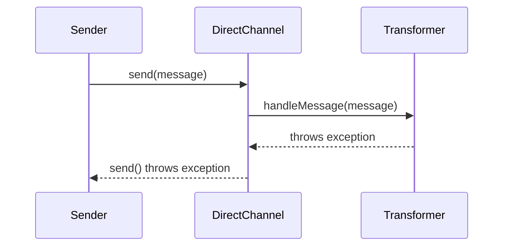
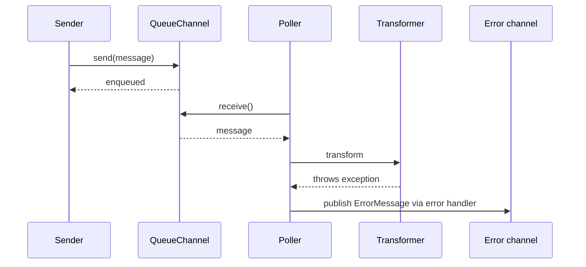

# Transformer Exception

In Spring Integration Core, a transformer converts a message's data representation into one usable by the next step. When transformation fails, the flow must preserve the failing message, the root cause, and the next handling decision. Merely logging a line and moving on usually leaves the sender unaware of how far the data got.

This lesson belongs to the **Transformer** chapter of module **SPRING_INTEGRATION_CORE**. The focus is recognizing transformation errors, understanding how exceptions travel across a `MessageChannel`, designing error branches, and testing with Java DSL. The examples use Java 17+, Spring Integration 6.5.x, and JUnit Jupiter; dependency versions must be managed consistently with your Spring project. The retry section for the 6.5 line uses Spring Retry; verify APIs when targeting a different Spring Integration line.

## 1. Transformer Contract When an Error Occurs

Consider a system receiving orders in string form:

```text
ORD-42|125000
```

The transformer must produce an order with ID `ORD-42` and amount `125000`. If the string looks like `ORD-42|abc`, the transformer cannot build a valid amount. This error must be expressed via an exception or an explicit failure result type designed across the entire flow.

Do not turn a malformed order into an order with amount zero just to keep the flow moving. That destroys the distinction between "transformed successfully" and "could not parse input data."

Nor does a transformer use `null` to mean "drop this message." The endpoint's contract demands a transformation result; when you want to drop messages conditionally, use a filter and define how discarded messages are handled. The exact exception class thrown on returning `null` also depends on execution path and version, so do not treat that exception name as a business contract. See [transformer return rules](https://docs.spring.io/spring-integration/reference/transformer.html#page-title).

Scenarios can be categorized as follows:

| Scenario | Example in the order flow | Initial handling direction |
|---|---|---|
| Cannot parse input representation | `amount = "abc"` | Report data error and retain record for reconciliation |
| Does not meet target data contract | Missing order ID, non-positive amount | Classify as contract error; usually do not retry unchanged |
| Missing reference data | Currency code absent from lookup table | Determine whether input data is wrong or lookup table is stale |
| Transient dependency failure | Lookup service stops responding | Bounded retry if the operation is safe to repeat |
| Programming or configuration bug | Accessing nonexistent property, wrong method selected | Alert and fix implementation |
| Sending result fails | Output channel cannot accept result | Inspect delivery step even though transformation finished |

This table is a classification aid for flow design. You cannot deduce a retry policy solely from the fact that an error occurred near a transformer.

## 2. Identifying `MessageTransformationException`

`MessageTransformationException` is the exception dedicated to message transformation failures and directly extends `MessagingException`. Two properties to inspect are:

- `getFailedMessage()`: the message attached to the failure point, if the exception captured it.
- `getCause()`: the underlying cause preserved when wrapping lower-level exceptions.

Constructors may accept both message and cause, yet constructors taking only a description also exist. Therefore, error-handling code must tolerate `failedMessage` being absent. See [MessageTransformationException API](https://docs.spring.io/spring-integration/api/org/springframework/integration/transformer/MessageTransformationException.html).

An illustrative cause chain might look like:

```text
MessageTransformationException
  -> exception when invoking the transformation function
     -> InvalidOrderMessageException
        -> NumberFormatException
```

The number of wrapper layers is not always identical. It depends on built-in transformers, POJO methods, lambdas, method-invocation mechanisms, and components surrounding the endpoint.

In `MessageTransformingHandler` in the 6.5 line, errors from the transformer delegate are wrapped in `MessageTransformationException`, unless the error itself is already a `MessageTransformationException`. This explains why a domain exception thrown by your conversion function can sit deeper in the cause chain. See [MessageTransformingHandler 6.5.0 source](https://github.com/spring-projects/spring-integration/blob/v6.5.0/spring-integration-core/src/main/java/org/springframework/integration/transformer/MessageTransformingHandler.java).

When classifying errors, search for the target exception type across the entire cause chain. Grabbing only the innermost root cause can lose the domain exception carrying a meaningful error code: in the example above, `NumberFormatException` says number parsing failed, whereas `InvalidOrderMessageException` identifies the field and order error category.

## 3. Why Does the Same Transformer Have Two Error Paths?

How an exception travels depends on where the transformer runs and which component manages that invocation.

### 3.1. Synchronous Flow Over `DirectChannel`

When the sender calls `send()` on a `DirectChannel` and the transformer executes immediately on the same thread, exceptions can unwind directly up the call stack to the sender.



There is no asynchronous boundary in this diagram. The sender must catch errors at the appropriate application boundary or let them propagate to the layer responsible for handling them.

Merely adding an `errorChannel` header to the message does not cause a plain `DirectChannel.send()` call to publish errors to that channel automatically. There must be an error-catching and publishing mechanism, such as an async task error handler, a configured advice, or a gateway with its own error policy. See [Error Handling](https://docs.spring.io/spring-integration/reference/error-handling.html).

### 3.2. `QueueChannel` with a Poller

With a typical poller configuration, the sender puts the message into a `QueueChannel`, while the poller pulls the message and invokes the transformer inside a scheduled task.



`QueueChannel` itself only stores and hands out messages. The poller together with its error handler establishes the error path in this example. If you write a manual `receive()` loop and call a handler yourself, your application is responsible for catching and routing errors.

With an `ExecutorChannel` executing on another thread via an executor, handler errors likewise cannot unwind onto the original sender's call stack. When using custom executors or schedulers, ensure they are wired to the desired error-publishing mechanism. `MessagePublishingErrorHandler` is an implementation responsible for sending an `ErrorMessage` to a `MessageChannel`; see [MessagePublishingErrorHandler API](https://docs.spring.io/spring-integration/api/org/springframework/integration/channel/MessagePublishingErrorHandler.html).

### 3.3. Gateways Are a Distinct Boundary

A messaging gateway can catch synchronous flow errors and route them to a configured error channel. If the gateway must return a result, the error branch needs a response policy: return a compatible failure result type, throw an appropriate error, or time out per configuration.

Do not treat an error flow that merely logs and ends as a complete business response for every gateway. Return type, error channel configuration, and reply handling govern what callers observe. See [messaging gateway error handling](https://docs.spring.io/spring-integration/reference/gateway.html).

## 4. What Data Does an `ErrorMessage` Carry?

`ErrorMessage` is a `Message` whose payload is a `Throwable`. It is distinct from the input message that carried the order string.

| Target | Data to read |
|---|---|
| `errorMessage.getPayload()` | The exception from the failed processing attempt |
| `MessagingException.getFailedMessage()` | The message at the failure point, if captured |
| `errorMessage.getOriginalMessage()` | The original message supplied by the error message strategy, possibly absent |
| Headers of the failing message | Correlation ID, data source, or metadata attached by the application |

`failedMessage` and `originalMessage` may differ if the flow transformed the message before a downstream step failed. Do not assume `ErrorMessage` headers are a full copy of business headers. When you need a correlation ID, read it from the message whose role you verified. See [ErrorMessage API](https://docs.spring.io/spring-framework/docs/current/javadoc-api/org/springframework/messaging/support/ErrorMessage.html).

When the standard error-publishing mechanism resolves the destination channel, the `MessageHeaders.ERROR_CHANNEL` header on the message being processed takes priority; otherwise, the error handler uses its default channel, typically the global `errorChannel` bean. A poller can also be configured with its own default error channel. See [error channel selection rules](https://docs.spring.io/spring-integration/reference/error-handling.html).

This header can hold an in-app `MessageChannel` reference or a channel name resolved by the framework. Channel object references fit single-process internal examples; do not design an outbound JSON protocol by serializing that object.

## 5. Example: A Transformer with Explicit Domain Exceptions

The example's input convention is `orderId|amount`. This is a simple delimited format for the lesson, not a general-purpose CSV parser.

Place the following class in `OrderParser.java`:

```java
package example.integration;

import java.math.BigDecimal;

public final class OrderParser {

    private OrderParser() {
    }

    public record Order(String orderId, BigDecimal amount) {
    }

    public static final class InvalidOrderMessageException
            extends IllegalArgumentException {

        private final String reasonCode;

        public InvalidOrderMessageException(
                String reasonCode, String description) {
            super(description);
            this.reasonCode = reasonCode;
        }

        public InvalidOrderMessageException(
                String reasonCode, String description, Throwable cause) {
            super(description, cause);
            this.reasonCode = reasonCode;
        }

        public String reasonCode() {
            return this.reasonCode;
        }
    }

    public static Order parse(String raw) {
        String[] fields = raw.split("\\|", -1);

        if (fields.length != 2 || fields[0].isBlank()) {
            throw new InvalidOrderMessageException(
                    "ORDER_FORMAT",
                    "Input must contain orderId and amount");
        }

        BigDecimal amount;
        try {
            amount = new BigDecimal(fields[1].trim());
        }
        catch (NumberFormatException cause) {
            throw new InvalidOrderMessageException(
                    "ORDER_AMOUNT_FORMAT",
                    "amount must be a valid decimal number",
                    cause);
        }

        if (amount.signum() <= 0) {
            throw new InvalidOrderMessageException(
                    "ORDER_AMOUNT_RANGE",
                    "amount must be greater than 0");
        }

        return new Order(fields[0].trim(), amount);
    }
}
```

The `parse` function has no dependency on messaging APIs. That makes it easy to unit-test transformation rules directly, and then test how endpoints and channels surface errors.

Some expected results:

| Input | Result |
|---|---|
| `ORD-42\|125000` | `Order("ORD-42", 125000)` |
| `ORD-42\|abc` | `ORDER_AMOUNT_FORMAT`, with number-parsing cause |
| `ORD-42\|-1` | `ORDER_AMOUNT_RANGE` |
| `\|125000` | `ORDER_FORMAT` |
| `ORD-42` | `ORDER_FORMAT` |

Here, checking for a positive amount is part of the example's target data contract. In a real system, decisions like credit approval or payment authorization belong in a separate business step. Maintaining that boundary keeps the transformer focused on data conversion.

Do not include the entire raw input in the exception message. A stable reason code and failing field description are usually enough for classification; the raw record should be stored where proper access controls and retention limits apply.

## 6. Java DSL Configuration for Both Execution Modes

Place the configuration below in `OrderFlowConfig.java`, in the same package as `OrderParser`:

```java
package example.integration;

import org.springframework.context.annotation.Bean;
import org.springframework.context.annotation.Configuration;
import org.springframework.integration.channel.DirectChannel;
import org.springframework.integration.channel.QueueChannel;
import org.springframework.integration.config.EnableIntegration;
import org.springframework.integration.dsl.IntegrationFlow;
import org.springframework.integration.dsl.Pollers;

@Configuration
@EnableIntegration
public class OrderFlowConfig {

    @Bean
    public DirectChannel syncOrderInput() {
        return new DirectChannel();
    }

    @Bean
    public QueueChannel asyncOrderInput() {
        return new QueueChannel(100);
    }

    @Bean
    public QueueChannel parsedOrders() {
        return new QueueChannel(100);
    }

    @Bean
    public QueueChannel transformErrors() {
        return new QueueChannel(100);
    }

    @Bean
    public IntegrationFlow syncOrderFlow() {
        return IntegrationFlow.from(syncOrderInput())
                .transform(
                        String.class,
                        OrderParser::parse,
                        endpoint -> endpoint.id("syncOrderTransformer"))
                .channel(parsedOrders())
                .get();
    }

    @Bean
    public IntegrationFlow asyncOrderFlow() {
        return IntegrationFlow
                .from(
                        asyncOrderInput(),
                        endpoint -> endpoint.poller(
                                Pollers.fixedDelay(50)
                                        .maxMessagesPerPoll(10)))
                .transform(
                        String.class,
                        OrderParser::parse,
                        endpoint -> endpoint.id("asyncOrderTransformer"))
                .channel(parsedOrders())
                .get();
    }
}
```

This configuration uses the same conversion function so learners can observe the effect of channels and pollers. `parsedOrders` and `transformErrors` are queues actively read in tests; they do not have automatic business consumers yet.

Java DSL uses `.transform(...)` to add a transformer endpoint. Specifying `String.class` states the payload type expected by the function, while the endpoint ID helps tie errors back to configuration. See [transformers in Java DSL](https://docs.spring.io/spring-integration/reference/6.5/dsl/java-transformers.html).

`@EnableIntegration` enables the Integration infrastructure for the plain Spring application context in the example. When running in an application with existing configuration, merge bean definitions into the existing setup and avoid duplicate bean declarations.

To send a message with a custom error channel in the same application:

```java
import org.springframework.messaging.Message;
import org.springframework.messaging.MessageHeaders;
import org.springframework.messaging.support.MessageBuilder;

// input and errors are the asyncOrderInput and transformErrors beans.
Message<String> request = MessageBuilder
        .withPayload("ORD-42|abc")
        .setHeader("correlationId", "import-2026-11-19-42")
        .setHeader(MessageHeaders.ERROR_CHANNEL, errors)
        .build();

boolean accepted = input.send(request, 1_000);
```

With `asyncOrderInput`, `accepted == true` tells you the channel accepted the message into its queue. It does not prove the transformer processed it successfully.

If you want the poller to have its own default error channel even for messages lacking an `errorChannel` header, replace the corresponding poller configuration with:

```java
endpoint -> endpoint.poller(
        Pollers.fixedDelay(50)
                .maxMessagesPerPoll(10)
                .errorChannel("transformErrors"))
```

This is a replacement for the `asyncOrderInput` consumer in the example, not an additional competing consumer on the same input queue. The main configuration above sets the header on each request to test error-channel resolution.

## 7. Reading and Classifying Errors Without Losing Context

The helper class below locates the domain exception and failing message by walking the cause chain. Place it in `ErrorInspection.java` in the same package:

```java
package example.integration;

import org.springframework.messaging.Message;
import org.springframework.messaging.MessagingException;

public final class ErrorInspection {

    private ErrorInspection() {
    }

    public static <T extends Throwable> T findCause(
            Throwable failure, Class<T> expectedType) {

        Throwable current = failure;
        while (current != null) {
            if (expectedType.isInstance(current)) {
                return expectedType.cast(current);
            }
            current = current.getCause();
        }
        return null;
    }

    public static Message<?> findFailedMessage(Throwable failure) {
        Throwable current = failure;
        while (current != null) {
            if (current instanceof MessagingException messaging
                    && messaging.getFailedMessage() != null) {
                return messaging.getFailedMessage();
            }
            current = current.getCause();
        }
        return null;
    }
}
```

These functions assume a normal acyclic cause chain. If you encounter untrusted exception implementations, maintain a visited set to prevent infinite loops.

Upon receiving an `ErrorMessage`, a consumer can extract information as follows:

```java
import org.springframework.messaging.Message;
import org.springframework.messaging.support.ErrorMessage;

// errorMessage is the ErrorMessage just received by the consumer.
Throwable failure = errorMessage.getPayload();

OrderParser.InvalidOrderMessageException invalid =
        ErrorInspection.findCause(
                failure,
                OrderParser.InvalidOrderMessageException.class);

Message<?> failed = ErrorInspection.findFailedMessage(failure);
Message<?> contextMessage = failed != null
        ? failed
        : errorMessage.getOriginalMessage();

Object correlationId = contextMessage == null
        ? null
        : contextMessage.getHeaders().get("correlationId");

String category = invalid == null
        ? "UNEXPECTED_TRANSFORM_FAILURE"
        : invalid.reasonCode();
```

This extraction snippet does not replay the message or mark the record handled yet. Using `category` and the extracted context, the application must apply an explicit policy:

- Data contract error: store in quarantine, record the reason code, and notify the data-correction workflow.
- Recognized transient error: retry with limits or route to managed reprocessing.
- Unclassified error: preserve context and alert operators rather than assuming bad input data.

You can use a router to send error categories to corresponding channels. If using the built-in `ErrorMessageExceptionTypeRouter`, configure it by exception types and verify how the router inspects the cause chain; do not substitute string matching on `exception.getMessage()`.

The terminal point of an error branch must be a concrete action, such as saving a quarantined record or returning a failure response to the caller. A queue without a consumer is just a waiting room. In the example, `transformErrors` is an in-memory queue that does not guarantee durability if the process stops.

## 8. Choosing Retry, Quarantine, or Failure Result

### 8.1. Retry Only Helps When the Next Attempt Can Differ

The string `ORD-42|abc` still cannot be parsed as a number if sent again unchanged. Retrying this case repeatedly only increases cost and delays fixing the data.

Conversely, if a transformer must look up reference data and the lookup service is temporarily unavailable, a subsequent attempt may succeed. In that case, settle these decisions:

| Decision | Example policy |
|---|---|
| Retryable error type | Dedicated exception for transient lookup failures |
| Retry budget | Maximum three attempts, including the initial call |
| Delay interval | Backoff and bounded request timeout |
| Exhausted attempts | Emit final error or route to downstream recovery |
| Side effects | Avoid creating duplicate records across retries |
| Retry ownership | Coordinate endpoint retries with upstream redelivery |

This is an illustrative policy, not a default across all framework versions.

`RequestHandlerRetryAdvice` lets you attach a retry policy to a message handler. On Spring Integration 6.5, the advice uses Spring Retry's `RetryTemplate`; configure retryable exception types, attempt limits, backoff, and recovery appropriately. If exceptions are wrapped in multiple layers, configure the retry classifier to traverse the cause chain. See [Spring Integration 6.5 Retry Advice](https://docs.spring.io/spring-integration/reference/6.5/handler-advice/classes.html#retry-advice).

Attaching a configured advice to a transformer endpoint looks like:

```java
// parserWithLookup and retryAdvice are already configured beans.
// This snippet illustrates where to attach the advice; it does not replace OrderParser above.
.transform(
        String.class,
        parserWithLookup::parse,
        endpoint -> endpoint.advice(retryAdvice))
```

Scoping the advice to the handler that needs retries avoids repeating earlier steps. Even so, verify whether the error occurs inside the advised scope or while sending the result onward; do not assume an advice on a transformer wraps the whole flow.

Recovery must also match the output contract. If recovery only sends an `ErrorMessage` and returns nothing, do not assume the transformer produced a valid `Order`. For gateways expecting a reply, test both exhausted retries and terminal error paths.

### 8.2. Quarantine Must Support Controlled Repair and Replay

A quarantine store can retain the reason code, correlation ID, source identifier, timestamp, and data needed for correction. Depending on the system, raw data may be stored by reference rather than copied wholesale into logs.

Reprocessing workflows should track whether a record was corrected, who corrected it, and how many attempts have occurred. Immediately sending a failing record straight back to input without changing conditions risks an infinite loop.

A `transformErrors` channel does not automatically create a broker dead-letter queue. Durability, acknowledgments, and DLQ routing must be designed per adapter or message source.

### 8.3. When Data Errors Are an Expected Business Outcome

For batch ingestion jobs, invalid records may be a routine outcome. You can design the transformer to always return an explicit result type, such as `ParseResult` with `Accepted` and `Rejected` variants, and then use a router to split the two branches.

If choosing this approach, the output contract is `ParseResult` from the start. Do not mix `Order` and an `"ERROR"` string on the same channel and leave consumers guessing the payload type. Unexpected technical exceptions still need a dedicated error path.

## 9. Testing Channel and Endpoint Behavior

Testing `OrderParser.parse()` alone is not enough to prove the error flow works. You also need to verify how the endpoint wraps exceptions and where callers observe errors.

The tests below use `spring-integration-core`, Spring Context, and `junit-jupiter` in a project with managed dependency versions. They create a plain Spring application context using section 6's configuration and section 7's helper. Place the class in `OrderFlowTest.java` in the same package.

```java
package example.integration;

import java.math.BigDecimal;

import org.junit.jupiter.api.Test;
import org.springframework.context.annotation.AnnotationConfigApplicationContext;
import org.springframework.integration.channel.DirectChannel;
import org.springframework.integration.channel.QueueChannel;
import org.springframework.integration.transformer.MessageTransformationException;
import org.springframework.messaging.Message;
import org.springframework.messaging.MessageHeaders;
import org.springframework.messaging.support.ErrorMessage;
import org.springframework.messaging.support.MessageBuilder;

import static org.junit.jupiter.api.Assertions.*;

class OrderFlowTest {

    @Test
    void validOrderProducesDomainPayload() {
        try (var context =
                     new AnnotationConfigApplicationContext(
                             OrderFlowConfig.class)) {

            var input = context.getBean(
                    "syncOrderInput", DirectChannel.class);
            var output = context.getBean(
                    "parsedOrders", QueueChannel.class);

            Message<String> request = MessageBuilder
                    .withPayload("ORD-42|125000")
                    .setHeader("correlationId", "case-success")
                    .build();

            assertTrue(input.send(request, 1_000));

            Message<?> reply = output.receive(0);
            assertNotNull(reply);
            assertEquals(
                    new OrderParser.Order(
                            "ORD-42", new BigDecimal("125000")),
                    reply.getPayload());
            assertEquals(
                    "case-success",
                    reply.getHeaders().get("correlationId"));
        }
    }

    @Test
    void directChannelPropagatesErrorToSender() {
        try (var context =
                     new AnnotationConfigApplicationContext(
                             OrderFlowConfig.class)) {

            var input = context.getBean(
                    "syncOrderInput", DirectChannel.class);
            var output = context.getBean(
                    "parsedOrders", QueueChannel.class);
            var errors = context.getBean(
                    "transformErrors", QueueChannel.class);

            Message<String> request = MessageBuilder
                    .withPayload("ORD-42|abc")
                    .setHeader("correlationId", "case-direct-error")
                    .setHeader(MessageHeaders.ERROR_CHANNEL, errors)
                    .build();

            MessageTransformationException failure = assertThrows(
                    MessageTransformationException.class,
                    () -> input.send(request, 1_000));

            var invalid = ErrorInspection.findCause(
                    failure,
                    OrderParser.InvalidOrderMessageException.class);

            assertNotNull(invalid);
            assertEquals("ORDER_AMOUNT_FORMAT", invalid.reasonCode());
            assertEquals(request, failure.getFailedMessage());
            assertNull(output.receive(0));
            assertNull(errors.receive(0));
        }
    }

    @Test
    void pollerPublishesErrorToRequestErrorChannel() {
        try (var context =
                     new AnnotationConfigApplicationContext(
                             OrderFlowConfig.class)) {

            var input = context.getBean(
                    "asyncOrderInput", QueueChannel.class);
            var output = context.getBean(
                    "parsedOrders", QueueChannel.class);
            var errors = context.getBean(
                    "transformErrors", QueueChannel.class);

            Message<String> request = MessageBuilder
                    .withPayload("ORD-42|abc")
                    .setHeader("correlationId", "case-poller-error")
                    .setHeader(MessageHeaders.ERROR_CHANNEL, errors)
                    .build();

            assertTrue(input.send(request, 1_000));

            Message<?> received = errors.receive(2_000);
            ErrorMessage error = assertInstanceOf(
                    ErrorMessage.class, received);

            var invalid = ErrorInspection.findCause(
                    error.getPayload(),
                    OrderParser.InvalidOrderMessageException.class);

            assertNotNull(invalid);
            assertEquals("ORDER_AMOUNT_FORMAT", invalid.reasonCode());

            Message<?> failed = ErrorInspection.findFailedMessage(
                    error.getPayload());

            assertNotNull(failed);
            assertEquals(request, failed);
            assertEquals(
                    "case-poller-error",
                    failed.getHeaders().get("correlationId"));
            assertNull(output.receive(0));
        }
    }
}
```

The three tests establish three distinct observations:

1. Valid input produces the target payload and preserves the business correlation ID.
2. On the example's `DirectChannel` path, errors propagate back to `send()`; having an `errorChannel` header alone does not send messages to the error queue.
3. On the poller path, the sender receives a successful enqueue result, and the failure later arrives as an `ErrorMessage` on the specified channel.

`receive(2_000)` waits with a bound for asynchronous processing, avoiding arbitrary guessed sleep durations. `receive(0)` on the synchronous path immediately inspects the queue after the call completes. Each test creates its own context to avoid message leakage across cases and closes it to release the scheduler.

When adding retries to an application, add tests for non-retryable errors, success after a transient failure, exhausted retries, and recovery outputs. Count actual invocation attempts rather than only checking for a retry log entry.

## 10. Common Design Mistakes

| Practice | Consequence | Adjustment |
|---|---|---|
| `catch (Exception)` and return a default value | Bad messages can proceed as if valid | Throw a causal exception or return an explicit failure result type |
| Return `null` to drop a message | Violates the transformer's output contract | Use a filter or explicit result and router |
| Inspect only the outermost exception class name | All errors collapse into one bucket | Walk the cause chain and read domain reason codes |
| Catch errors only on enqueue to infer processing status | Subsequent processing errors go unseen | Monitor error branches or design explicit feedback |
| Retry every transformation error | Bad data is reprocessed uselessly | Retry only recoverable error categories |
| Throw a new exception without setting `cause` | Loses root cause needed for investigation and classification | Preserve the original cause when wrapping exceptions |
| Log full payloads and headers | Risks data exposure and bloats logs | Log reason codes, identifiers, and permitted fields |
| Error flow fails and routes back to itself | Creates error loops or masks the original failure | Provide a terminal path and handle errors in the error consumer |

When diagnosing a specific failure, start with which endpoint failed, which message is attached to the exception, and which component manages execution. Only then decide where to fix it: input data, transformation logic, channel configuration, or recovery policy.

## 11. Extended Practice Exercises

Use the lesson's configuration and classes to make these independent changes:

1. Send `ORD-42|-1` and verify the error is classified as `ORDER_AMOUNT_RANGE` while no message arrives at `parsedOrders`.
2. Configure `.errorChannel("transformErrors")` on the poller, omit the error header from the request, and verify the poller's default error channel still receives `ErrorMessage`.
3. After step 2's change, create another `QueueChannel` in a test and set that object in the `errorChannel` header; verify the error goes to the request's channel instead of the default channel.
4. Add a step after the transformer that intentionally fails. Compare the payload in `failedMessage` against the original input to see how the message at the failure point changed.
5. Replace in-memory error storage with a consumer persisting quarantine records containing correlation ID, reason code, and replay status. Test what happens when the quarantine consumer itself fails.

Completion criteria: you can observe the full path of both succeeding and failing messages, classify root causes, and never treat invalid data as a valid transformation outcome.
