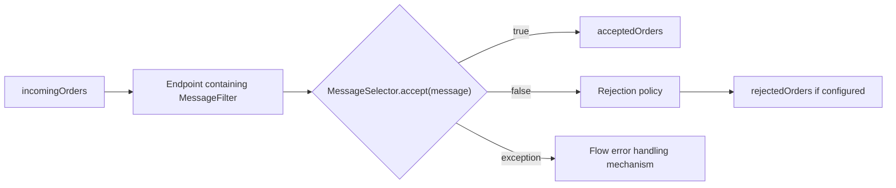

# MessageSelector

## 1. Objectives and position in the message flow

In the **SPRING_INTEGRATION_CORE** module, the **Filter** chapter introduces how to decide whether a message proceeds. This lesson focuses on `MessageSelector`: where the selection condition is expressed, combined with `MessageFilter` to form a processing step in a Spring Integration flow.

After this lesson, you can:

- Write conditions based on payload and headers without unsafe casting.
- Distinguish the responsibilities of a selector, a filter, and a channel.
- Attach a selector in Java DSL and choose how rejected messages are handled.
- Test rules in isolation and test message routing paths.
- Recognize the impact of filters on gateways, retries, and aggregators.

Running scenario: only forward an order to the next processing step when the order belongs to an enabled tenant, has status `READY`, and has a total meeting the minimum threshold. Orders that fail the condition go to a separate channel so they can be tracked.

Examples use Java 17 syntax and Spring Integration 6.x APIs, cross-checked against the 6.5 API contract. If your application uses Spring Boot, let the Boot version's BOM manage compatible dependencies. This lesson does not require changing your project's library versions.

## 2. The MessageSelector contract

`MessageSelector` belongs to the `org.springframework.integration.core` package. It is a functional interface extending `GenericSelector<Message<?>>`, with the method:

```java
boolean accept(Message<?> message);
```

The input is the entire `Message`, so the condition can read both `getPayload()` and `getHeaders()`. The return value is the selection decision, not an output payload. The contract and lambda support are described in the [MessageSelector Javadoc](https://docs.spring.io/spring-integration/docs/6.5.0/api/org/springframework/integration/core/MessageSelector.html).

Example of a selector checking only a single header:

```java
import org.springframework.integration.core.MessageSelector;

MessageSelector tenantAOnly =
        message -> "tenant-a".equals(message.getHeaders().get("tenantId"));
```

Calling `"tenant-a".equals(...)` safely handles the case where the header does not exist. If the value is a number instead of a string, the condition also returns `false`.

One distinction to make right away:

| Evaluation result | Meaning |
| --- | --- |
| `true` | The message is accepted according to the condition |
| `false` | The message was evaluated and failed the condition |
| Throws an exception | Evaluation failed; there is no normal selection result |

For example, an order not yet in `READY` status may be an expected rejection case. By contrast, a failure calling the tenant policy service is a technical failure. Converting all exceptions into `false` makes these two situations hard to tell apart in operations.

A selector has no method to return a rejection reason. If you need a result containing `accepted`, `reasonCode`, and additional information, you should design a dedicated business evaluation step and then use that result to filter or route.

## 3. What are the selector, filter, and channel responsible for?

A standalone selector is a Java object used to evaluate a condition. Declaring it as a bean does not automatically filter any messages.

`MessageFilter` is the message handler that uses the selector's decision. The endpoint wrapping the handler connects it to the input channel; the output channel and rejection configuration determine where messages go next. This division of responsibility is explained in the [Filter documentation](https://docs.spring.io/spring-integration/reference/6.5/filter.html).



The diagram depicts logical responsibilities. The selector does not send directly to `acceptedOrders` or `rejectedOrders`.

| Component | Question to resolve |
| --- | --- |
| `Message` | Which payload and headers are being processed? |
| `MessageSelector` | Does the message meet the condition? |
| `MessageFilter` | How is that decision used to forward or handle rejection? |
| Endpoint | How is the handler connected, triggered, and consuming input? |
| `MessageChannel` | How are messages transmitted, dispatched, or buffered? |

Three common design choices:

- **Filter**: only eligible orders continue a process.
- **Router**: each type of order goes into an appropriate process, such as international vs. domestic orders.
- **Transformer**: converts the order representation into another data shape.

Do not modify order data inside a selector to make it eligible. When you need to normalize currency, status, or data structures, perform that step before selection.

## 4. Define the rules clearly before writing code

Assume the application has already normalized orders into `OrderCommand`, totals use the same currency, and the `tenantId` header was populated at a trusted integration boundary.

Rules for the example:

1. Payload must be an `OrderCommand`.
2. The `tenantId` header must be a string belonging to the set of enabled tenants.
3. `orderId` must be non-blank.
4. Status must be exactly `READY`.
5. `total` must not be missing and must be greater than or equal to `100000`.

| Input | Expected result | Deciding condition |
| --- | --- | --- |
| Valid tenant, `READY`, total `100000` | Accept | Meets exact threshold |
| Valid tenant, `READY`, total `99999.99` | Reject | Below threshold |
| Valid tenant, `DRAFT`, total `200000` | Reject | Status not eligible |
| Missing `tenantId` | Reject | Tenant unidentified |
| `tenantId` is a number | Reject | Wrong header type |
| Payload is an unconverted JSON string | Reject | Payload contract mismatch |
| Total is missing | Reject | Insufficient data to evaluate threshold |

This is the policy for the example, not mandatory behavior for every application. Another system might treat a wrong payload type as an error to report immediately rather than a normal rejection case.

Headers used for tenant selection also need a trusted source. Merely checking that a tenant name is in a set does not replace authentication and authorization.

## 5. Complete example using Java DSL

### 5.1. Configuration, payload, and selector

The example below can be placed in a single Java file named `OrderFilterConfig.java`. The payload and selector are declared nested inside the configuration class so the example is self-contained.

The main dependency is `spring-integration-core`. In a Boot application, you can use `spring-boot-starter-integration`. The testing section later uses JUnit Jupiter; the example creates the application context directly so Spring Test annotations are not needed.

```java
package example.integration;

import java.math.BigDecimal;
import java.util.Objects;
import java.util.Set;

import org.springframework.beans.factory.annotation.Qualifier;
import org.springframework.context.annotation.Bean;
import org.springframework.context.annotation.Configuration;
import org.springframework.integration.channel.DirectChannel;
import org.springframework.integration.channel.QueueChannel;
import org.springframework.integration.config.EnableIntegration;
import org.springframework.integration.core.MessageSelector;
import org.springframework.integration.dsl.IntegrationFlow;
import org.springframework.messaging.Message;
import org.springframework.messaging.MessageChannel;

@Configuration
@EnableIntegration
public class OrderFilterConfig {

    public record OrderCommand(
            String orderId,
            BigDecimal total,
            String state) {
    }

    public static final class OrderEligibilitySelector
            implements MessageSelector {

        private final Set<String> enabledTenants;
        private final BigDecimal minimumTotal;

        public OrderEligibilitySelector(
                Set<String> enabledTenants,
                BigDecimal minimumTotal) {

            this.enabledTenants = Set.copyOf(enabledTenants);
            this.minimumTotal = Objects.requireNonNull(minimumTotal);

            if (minimumTotal.signum() < 0) {
                throw new IllegalArgumentException(
                        "minimumTotal must not be negative");
            }
        }

        @Override
        public boolean accept(Message<?> message) {
            if (!(message.getPayload() instanceof OrderCommand order)) {
                return false;
            }

            Object tenantHeader = message.getHeaders().get("tenantId");
            if (!(tenantHeader instanceof String tenantId)
                    || !enabledTenants.contains(tenantId)) {
                return false;
            }

            return order.orderId() != null
                    && !order.orderId().isBlank()
                    && "READY".equals(order.state())
                    && order.total() != null
                    && order.total().compareTo(minimumTotal) >= 0;
        }
    }

    @Bean
    public MessageSelector orderEligibilitySelector() {
        return new OrderEligibilitySelector(
                Set.of("tenant-a", "tenant-b"),
                new BigDecimal("100000"));
    }

    @Bean
    public DirectChannel incomingOrders() {
        return new DirectChannel();
    }

    @Bean
    public QueueChannel acceptedOrders() {
        return new QueueChannel(100);
    }

    @Bean
    public QueueChannel rejectedOrders() {
        return new QueueChannel(100);
    }

    @Bean
    public IntegrationFlow orderEligibilityFlow(
            @Qualifier("incomingOrders") MessageChannel input,
            @Qualifier("acceptedOrders") QueueChannel accepted,
            @Qualifier("rejectedOrders") QueueChannel rejected,
            @Qualifier("orderEligibilitySelector") MessageSelector selector) {

        return IntegrationFlow.from(input)
                .filter(selector, "accept",
                        endpoint -> endpoint
                                .id("orderEligibilityFilter")
                                .discardChannel(rejected)
                                .throwExceptionOnRejection(false))
                .channel(accepted)
                .get();
    }
}
```

Here, `.filter(selector, "accept", ...)` specifies the target object and method to invoke. Because the `accept` signature takes `Message<?>`, the method can read both payload and headers. Overloads for object/method, typed payload, and expressions are described in the [Java DSL API](https://docs.spring.io/spring-integration/docs/6.5.0/api/org/springframework/integration/dsl/BaseIntegrationFlowDefinition.html).

### 5.2. Why is the code structured this way?

`instanceof OrderCommand order` checks the type before reading data. It lets the selector enforce the "reject on wrong type" policy instead of producing a `ClassCastException`.

The header is retrieved as `Object` and then checked with `instanceof String`. This makes the intent clear for handling both missing headers and wrong header types.

`BigDecimal.compareTo()` expresses numeric value comparison. For a monetary threshold, both `100000` and `100000.00` must be accepted. Using `equals()` factors scale into the comparison and fails to express a greater-than-or-equal condition properly.

The tenant set is copied via `Set.copyOf()`, and configuration fields are `final`. The example selector retains no counters or state from prior invocations. This makes sharing the object across multiple executions easier to reason about.

`acceptedOrders` and `rejectedOrders` are `QueueChannel` instances so learners can read messages back from each branch. In this flow, the filter runs on the thread sending to `DirectChannel`; placing a message onto an output queue does not make the preceding selection step asynchronous.

The queues have bounded capacity. In a real application, you need consumers and suitable send/wait policies; this example sends only a small number of messages and reads them immediately in tests. In-memory queues are not durable storage.

### 5.3. What does an accepted message retain?

The selector does not return a new `OrderCommand` object. The filter lets messages meeting the condition continue through the main branch. The payload and business headers such as `tenantId`, `correlationId`, or trace IDs must be preserved for downstream processing.

If you need to add `decisionReason`, create a dedicated evaluation step or header enricher. You cannot mutate headers by calling `put()` directly on `MessageHeaders`.

You should also avoid mutating mutable objects inside the payload. Although `Message` has an immutable wrapper, that does not automatically make objects referenced by the payload immutable.

## 6. MessageSelector and other condition forms

### 6.1. Payload-only condition

If you only need to check the order status, you can write a short DSL snippet:

```java
.filter(OrderFilterConfig.OrderCommand.class,
        order -> "READY".equals(order.state()))
```

The lambda parameter in this snippet is `OrderCommand`. It does not have `getHeaders()`.

The overload with a `Class` parameter helps the DSL determine the expected data type; conversion mechanisms may be applied when appropriate. Therefore, do not treat this overload as a guarantee that a mismatched payload type is always converted into a `false` outcome. If your policy is to check the type and soft-reject, express that in a `MessageSelector` as in the main example.

### 6.2. Condition needing the entire Message

You can write a lambda taking a message and assign an explicit target type:

```java
MessageSelector selector = message ->
        "tenant-a".equals(message.getHeaders().get("tenantId"));
```

Then attach this object to the filter using the object/method overload as in the full example. Avoid relying on the parameter name `message` to infer that every lambda in `filter()` receives a `Message`; the overload signature and target type determine the actual argument.

### 6.3. Predicates that are not MessageSelector

| Type | Method | Input |
| --- | --- | --- |
| `MessageSelector` | `accept(Message<?> message)` | Entire message |
| `GenericSelector<T>` | `accept(T value)` | Typed as `T` |
| Java `Predicate<T>` | `test(T value)` | Typed as `T` |

A lambda can match multiple functional interfaces. However, a variable already typed as `Predicate<Message<?>>` does not automatically become a `MessageSelector`. Create an adapter with a method reference:

```java
import java.util.function.Predicate;
import org.springframework.integration.core.MessageSelector;
import org.springframework.messaging.Message;

Predicate<Message<?>> tenantRule =
        message -> "tenant-a".equals(message.getHeaders().get("tenantId"));

MessageSelector selector = tenantRule::test;
```

`MessageSelector` also does not directly provide `Predicate`'s `and()`, `or()`, and `negate()` methods. You can combine `accept()` calls with Java operators or deliberately use `Predicate` in the rule layer and adapt it to a selector at the integration boundary.

### 6.4. POJO and SpEL

A business object with a boolean-returning method can also be adapted by the DSL into a filter condition via method invocation. `MethodInvokingSelector` is the implementation for that; see the [MethodInvokingSelector Javadoc](https://docs.spring.io/spring-integration/api/org/springframework/integration/filter/MethodInvokingSelector.html).

For very short header conditions, you can use SpEL:

```java
.filter("headers['tenantId'] == 'tenant-a'")
```

`ExpressionEvaluatingSelector` is an implementation that evaluates an expression to a boolean result; see the [ExpressionEvaluatingSelector Javadoc](https://docs.spring.io/spring-integration/api/org/springframework/integration/filter/ExpressionEvaluatingSelector.html).

For examples with multiple conditions, named Java classes make it easier to name rules and write tests. Avoid cramming a long decision tree into a SpEL string just to save lines of configuration.

## 7. Composing selectors and reusing rules

Suppose there are two independent rules: valid tenant and order in ready state.

```java
MessageSelector tenantAllowed = message ->
        "tenant-a".equals(message.getHeaders().get("tenantId"));

MessageSelector orderReady = message ->
        message.getPayload()
                instanceof OrderFilterConfig.OrderCommand order
                && "READY".equals(order.state());

MessageSelector eligible = message ->
        tenantAllowed.accept(message) && orderReady.accept(message);
```

The `&&` operator short-circuits: if the tenant is invalid, `orderReady` is not invoked in this expression. Cheap conditions that can be determined directly from the message are generally good candidates to place first.

The framework also provides `MessageSelectorChain`, which supports a list of selectors and a voting strategy. If you use that component, explicitly configure the appropriate strategy; the default strategy is `ALL`. Details are in the [MessageSelectorChain Javadoc](https://docs.spring.io/spring-integration/docs/6.5.0/api/org/springframework/integration/selector/MessageSelectorChain.html).

When you only need to check payload types, `PayloadTypeSelector` can replace writing a custom class. This component checks assignability against accepted types, per the [PayloadTypeSelector Javadoc](https://docs.spring.io/spring-integration/docs/6.5.0/api/org/springframework/integration/selector/PayloadTypeSelector.html).

Splitting rules is useful when rules have clear domain names or are reused. For a simple comparison used in one place, an inline lambda can be easier to read than a chain of many tiny classes.

## 8. What happens when accept returns false?

A `false` result is only the input to the filter's rejection policy. The two primary options are `discardChannel` and `throwExceptionOnRejection`.

| Discard channel present? | Throw exception on rejection? | Behavior |
| --- | --- | --- |
| No | `false` | Not sent to main branch; message is dropped from the flow |
| Yes | `false` | Sent to discard channel |
| No | `true` | Throws `MessageRejectedException` |
| Yes | `true` | Sent to discard channel and then throws `MessageRejectedException`, if sending completes normally |

Enabling `throwExceptionOnRejection` still applies even when a discard channel is declared. Do not assume these two options are mutually exclusive. The contract is stated in the [MessageFilter Javadoc](https://docs.spring.io/spring-integration/api/org/springframework/integration/filter/MessageFilter.html).

For the order example, rejecting for not meeting the threshold is an expected outcome, so use:

```java
.discardChannel(rejected)
.throwExceptionOnRejection(false)
```

If reaching the filter with invalid data is a contract violation that should fail the call, you can use:

```java
.throwExceptionOnRejection(true)
```

These options belong to the DSL endpoint configuration via [FilterEndpointSpec](https://docs.spring.io/spring-integration/api/org/springframework/integration/dsl/FilterEndpointSpec.html).

Since Spring Integration 6.1, rejecting without a discard channel and without throwing an exception logs a warning. If you want to intentionally drop messages without emitting this warning, you can configure discard to the `nullChannel` bean. This behavior is documented in the [Filter documentation](https://docs.spring.io/spring-integration/reference/6.5/filter.html).

A discard channel needs an appropriate consumer:

- For a `QueueChannel`, a consumer reading the queue or a polling endpoint is needed.
- For a `DirectChannel`, a handler subscribed to receive messages is needed.
- When persistence for reconciliation is needed, the consumer must write to an appropriate store.

Naming a channel `rejectedOrders` does not automatically create durable persistence or a dead-letter queue. If sending to the discard branch fails or its consumer throws an exception, that is a separate error that must be handled.

## 9. Exceptions, retry, and gateway contracts

### 9.1. An exception in a selector is not a normal rejection

An example that is wrong in business semantics:

```java
@Override
public boolean accept(Message<?> message) {
    try {
        return remotePolicyAllows(message);
    }
    catch (RuntimeException ex) {
        return false;
    }
}
```

This snippet only illustrates what to avoid; `remotePolicyAllows` represents a call to an external dependency. If the policy service is failing, returning `false` can forfeit retry opportunities and turn an infrastructure failure into a business rejection outcome.

A more controllable design is to fetch policy data in an earlier step, apply timeouts/retries at that access step, and let the selector read the result already attached to the message. Only turn an error into a rejection if that is an explicitly defined fallback policy.

### 9.2. discardChannel and errorChannel are different

`discardChannel` receives messages that fail the condition. `errorChannel` serves the error-handling mechanism and normally receives `ErrorMessage`.

In a synchronous flow over a `DirectChannel`, exceptions can propagate back to the caller of `send()`. With asynchronous consumers managed by the framework, such as a poller or executor, errors are typically routed through the error-handling mechanism; the error channel is determined from headers or corresponding configuration. You cannot merely add an `errorChannel` header and assume every synchronous call will automatically emit errors to that channel. See the [Error Handling documentation](https://docs.spring.io/spring-integration/reference/error-handling.html).

### 9.3. Retries must be tied to a changeable cause

An order below the minimum amount will still be rejected if retried with the same data and same policy. Automatic retries for this kind of outcome only increase load.

In particular, when combining a discard channel with `throwExceptionOnRejection(true)`, a retry advice wrapping the step can cause the discard branch to execute multiple times. If the discard consumer writes audit logs or sends notifications, design idempotency matching the redelivery semantics of the entire flow.

### 9.4. Gateways expect a response

If a gateway returns a result but the request is filtered out before a reply-producing step, the caller may wait until timeout or indefinitely depending on configuration. Having successfully sent to the discard channel does not mean the gateway received a reply. The [Messaging Gateways](https://docs.spring.io/spring-integration/reference/gateway.html) documentation describes how filters can break the reply path.

You can design one of these contracts:

- A one-way gateway if the caller only dispatches work.
- Rejection raises a clear error for the gateway to handle per its error policy.
- The rejection-handling branch produces a business result and returns it along the proper reply path.

Configuring a finite `replyTimeout` bounds the reply-waiting phase. It does not automatically interrupt a selector or handler running synchronously and blocking on the same thread.

The lesson's `acceptedOrders/rejectedOrders` flow is a one-way classification example for observing both branches; it is not yet a complete request-reply flow for a gateway.

## 10. Testing the selector in isolation

Testing rules does not require starting Spring. You only need to instantiate the selector, build a message, and check the result.

JUnit Jupiter example, in the same package as the configuration:

```java
package example.integration;

import java.math.BigDecimal;
import java.util.Set;

import org.junit.jupiter.api.Test;
import org.springframework.integration.core.MessageSelector;
import org.springframework.messaging.Message;
import org.springframework.messaging.support.MessageBuilder;

import static org.junit.jupiter.api.Assertions.assertFalse;
import static org.junit.jupiter.api.Assertions.assertTrue;

class OrderEligibilitySelectorTest {

    private final MessageSelector selector =
            new OrderFilterConfig.OrderEligibilitySelector(
                    Set.of("tenant-a"),
                    new BigDecimal("100000"));

    @Test
    void acceptsAmountAtThresholdDespiteDifferentScale() {
        assertTrue(selector.accept(
                message("tenant-a", "100000.00", "READY")));
    }

    @Test
    void rejectsAmountBelowThreshold() {
        assertFalse(selector.accept(
                message("tenant-a", "99999.99", "READY")));
    }

    @Test
    void rejectsUnknownTenantAndWrongState() {
        assertFalse(selector.accept(
                message("tenant-x", "200000", "READY")));

        assertFalse(selector.accept(
                message("tenant-a", "200000", "DRAFT")));
    }

    @Test
    void rejectsMissingOrIncorrectHeaderType() {
        Message<?> noTenant = MessageBuilder.withPayload(
                new OrderFilterConfig.OrderCommand(
                        "O-001", new BigDecimal("200000"), "READY"))
                .build();

        assertFalse(selector.accept(noTenant));

        assertFalse(selector.accept(
                message(123, "200000", "READY")));
    }

    @Test
    void rejectsUnexpectedPayloadType() {
        Message<?> raw = MessageBuilder
                .withPayload("raw-order-data")
                .setHeader("tenantId", "tenant-a")
                .build();

        assertFalse(selector.accept(raw));
    }

    @Test
    void rejectsMissingBusinessData() {
        Message<?> invalid = MessageBuilder.withPayload(
                new OrderFilterConfig.OrderCommand(" ", null, "READY"))
                .setHeader("tenantId", "tenant-a")
                .build();

        assertFalse(selector.accept(invalid));
    }

    private Message<?> message(
            Object tenantId,
            String amount,
            String state) {

        return MessageBuilder.withPayload(
                new OrderFilterConfig.OrderCommand(
                        "O-001", new BigDecimal(amount), state))
                .setHeader("tenantId", tenantId)
                .build();
    }
}
```

Boundary cases help clarify the contract: exact threshold, different scale, wrong header type, and unexpected payload. These are cases often missed if you only test one valid order.

The `rejectsMissingBusinessData` case is an example of rejecting incomplete data. If you need to verify each condition independently, add a separate case with a blank `orderId` but valid `total`, and then a case with a missing `total` but valid `orderId`.

The test snippets in this lesson are instructional code, not a report of having been run against a repository build.

## 11. Testing the MessageFilter routing path

A selector returning the right boolean is not enough to prove the channel configuration is right. You need to verify that a message is sent to the right output and does not also appear on the other branch.

The following example creates a context from `OrderFilterConfig`, sends to `DirectChannel`, and reads both queues:

```java
package example.integration;

import java.math.BigDecimal;

import org.junit.jupiter.api.Test;
import org.springframework.context.annotation.AnnotationConfigApplicationContext;
import org.springframework.integration.channel.QueueChannel;
import org.springframework.messaging.Message;
import org.springframework.messaging.MessageChannel;
import org.springframework.messaging.support.MessageBuilder;

import static org.junit.jupiter.api.Assertions.assertEquals;
import static org.junit.jupiter.api.Assertions.assertNotNull;
import static org.junit.jupiter.api.Assertions.assertNull;
import static org.junit.jupiter.api.Assertions.assertTrue;

class OrderFilterFlowTest {

    @Test
    void sendsEachMessageToItsExpectedBranch() {
        try (var context = new AnnotationConfigApplicationContext(
                OrderFilterConfig.class)) {

            MessageChannel input = context.getBean(
                    "incomingOrders", MessageChannel.class);
            QueueChannel accepted = context.getBean(
                    "acceptedOrders", QueueChannel.class);
            QueueChannel rejected = context.getBean(
                    "rejectedOrders", QueueChannel.class);

            Message<?> eligible = orderMessage(
                    "O-100", "tenant-a", "150000", "trace-100");

            assertTrue(input.send(eligible));

            Message<?> passed = accepted.receive(0);
            assertNotNull(passed);
            assertEquals(eligible.getPayload(), passed.getPayload());
            assertEquals(
                    "tenant-a", passed.getHeaders().get("tenantId"));
            assertEquals(
                    "trace-100", passed.getHeaders().get("traceId"));
            assertNull(rejected.receive(0));

            Message<?> ineligible = orderMessage(
                    "O-101", "tenant-a", "50000", "trace-101");

            assertTrue(input.send(ineligible));

            Message<?> discarded = rejected.receive(0);
            assertNotNull(discarded);
            assertEquals(
                    ineligible.getPayload(), discarded.getPayload());
            assertEquals(
                    "trace-101", discarded.getHeaders().get("traceId"));

            assertNull(accepted.receive(0));
            assertNull(rejected.receive(0));
        }
    }

    private Message<?> orderMessage(
            String orderId,
            String tenantId,
            String amount,
            String traceId) {

        return MessageBuilder.withPayload(
                new OrderFilterConfig.OrderCommand(
                        orderId, new BigDecimal(amount), "READY"))
                .setHeader("tenantId", tenantId)
                .setHeader("traceId", traceId)
                .build();
    }
}
```

Because the input is a `DirectChannel` with no executor in between, when `send()` returns normally, the filter step and delivery to the queue have already happened in this example. `receive(0)` checks immediately without needing `Thread.sleep()`.

When switching to an `ExecutorChannel` or a polling consumer, tests need bounded waiting appropriate to an asynchronous model. In that case, do not assume the queue must contain the message immediately after the sender returns.

`input.send(...)` returning `true` is not the business boolean from `accept()`. In the example, both accepted and rejected messages can be sent successfully to the input; you must check the target channels to observe the selection result.

For larger flows, Spring Integration provides additional mocking tools and endpoint testing support in the [Testing Support documentation](https://docs.spring.io/spring-integration/reference/testing.html). This example uses a small context so learners can directly see the wiring between selector, filter, and channels.

## 12. Design points when scaling to larger flows

### 12.1. Sharing selectors and concurrent processing

A selector bean may be invoked from multiple threads if the flow configuration allows it. The interface itself provides no locking and does not guarantee thread safety for data you manage.

For rule-checking logic like the example, keep configuration immutable and avoid writing per-message state into fields. If the tenant list needs dynamic updates, define a mechanism to safely publish a new configuration snapshot.

Network calls or database queries inside `accept()` also make processing latency dependent on external systems. Separating the data-access step lets you place timeouts, retries, and latency measurements in the right place.

### 12.2. Multiple filters on the same channel

If multiple consumers need to inspect the same message to make independent selections, use an appropriate publish-subscribe model. Subscribing multiple filters to a `DirectChannel` does not create broadcast semantics: that channel dispatches point-to-point. See channel type distinctions in the [Configuring Message Channels documentation](https://docs.spring.io/spring-integration/reference/channel/configuration.html).

For example, a single order message might be evaluated independently by both a shipping workflow and an analytics workflow. This differs from requiring exactly one of two workflows to receive the order; the latter is usually a better fit for a router.

### 12.3. Filters placed before an aggregator

Suppose a splitter produces five parts and attaches `sequenceSize = 5`. A filter drops two parts, leaving three parts going into the aggregator. If the completion condition still waits for all five parts, the group may not release as expected.

You must redesign the filter placement, the release strategy, or compensating messages so the aggregator has sufficient information about dropped parts. The [Aggregator](https://docs.spring.io/spring-integration/reference/aggregator.html) documentation directly addresses cases where a filter causes sequence members to be missing.

This is why a selector condition that is locally correct can still prevent an entire workflow from completing.

### 12.4. Monitoring decisions

A system needs to know not only how many errors occurred, but also how many messages did not proceed. For the order problem, observe:

- Counts entering, accepted, and rejected.
- Evaluation latency as rules become complex.
- Trace IDs to correlate a message with a processing attempt.
- Rejection reasons if the business requires explanations.

Because `MessageSelector` returns a boolean, structured reasons should be produced in a dedicated evaluation step or using an agreed decision model. Avoid re-evaluating a policy that may change just to guess why a previous run rejected a message.

## 13. Common pitfalls and how to spot them

| Symptom | Possible cause | Resolution |
| --- | --- | --- |
| Lambda cannot read headers | Lambda is receiving the payload | Choose an overload that explicitly takes `Message` |
| `ClassCastException` on differing input types | Direct cast of payload | Check type or normalize before the filter |
| Invalid orders vanish from the flow | No destination configured for rejection branch | Choose discard, error, or intentional drop |
| Gateway waits a long time after rejection | No reply from the rejection branch | Complete the response contract |
| Rejection audit appears multiple times | Retry or redelivery re-runs the discard branch | Use a business key for deduplication |
| Multiple filters do not all receive the same message | Using a point-to-point channel | Re-check the dispatch model |
| Aggregator holds an incomplete group | Filter dropped sequence members | Adjust the completion strategy |
| Order with total `100000.00` mishandled | Wrong semantic money comparison | Use `compareTo()` for threshold checks |
| Policy service failure treated as rejection | Catching broadly and returning `false` | Separate evaluation failures from business outcomes |

When implementing a selector, state clearly the acceptance condition, how missing data is handled, and the destination for each outcome. Testing the condition separately verifies the rule; testing the flow verifies that messages actually take the right branch.
