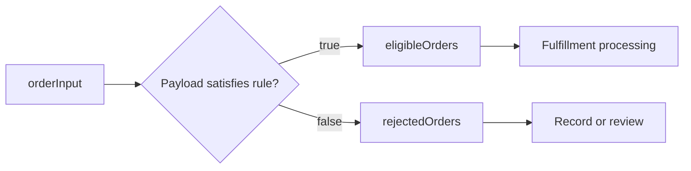

# Payload-based Filtering

## Objectives and scope

In the **Filter** chapter of the `SPRING_INTEGRATION_CORE` module, this lesson shows how to decide whether a message proceeds based on **payload content**. The goal is to wire business rules with `Message`, `MessageChannel`, and endpoints using Java DSL, while clearly defining what happens to messages that fail the condition.

After this lesson, you can:

- Write filter conditions for payloads with specific data types.
- Separate business rules from flow configuration for independent testing.
- Configure the accepted branch, rejected branch, and exception-throwing policy.
- Distinguish payload filtering from data transformation, routing, and filtering elements of a collection.
- Test boundary conditions, message contents, and where messages are delivered.

Examples use Java `record` and Java 17+ syntax. Choose a JDK compatible with your project's Spring version. Illustrative classes are placed in package `example.integration.filter`; the application needs `spring-integration-core` with a compatible Spring Context. Tests use JUnit Jupiter, including parameterized test support. You can let Spring Boot manage dependency versions through your project's BOM.

## 1. What does a filter decide?

A `Message<Order>` consists of an `Order` payload and headers such as a trace ID or reply information. The payload holds business data; headers hold message metadata. These are two distinct parts of the same message. [Message documentation](https://docs.spring.io/spring-integration/reference/message.html).

For payload-based filtering, the rule has the form:

```text
accept(payload) -> true or false
```

`true` allows the message to continue; `false` rejects the message at the filter point. The boolean result is the endpoint's decision, not the output payload. When accepted, the filter forwards the input message rather than creating a new business payload. [MessageFilter documentation](https://docs.spring.io/spring-integration/api/org/springframework/integration/filter/MessageFilter.html).



In this example, both branches have clear destinations. The business decision is "whether the order is eligible to enter the fulfillment flow". An order rejected here may still be valid data for another system.

### Distinguishing from nearby components

| Need | Suitable component | Example |
| --- | --- | --- |
| Let through or block an entire message | Filter | Accept only confirmed orders |
| Change payload content or type | Transformer | Convert JSON to `Order` |
| Choose a processing destination by classification result | Router | Split orders by shipping region |
| Split one message into multiple messages | Splitter | Split a list of orders into individual orders |
| Combine multiple messages into one result | Aggregator | Combine processing results of order line items |

Filter supports `discardChannel` so it can create two processing paths based on a boolean condition. When a problem has multiple business destination groups, a router usually expresses intent more clearly. [Filter documentation](https://docs.spring.io/spring-integration/reference/filter.html).

## 2. Scenario: admitting orders into the fulfillment flow

Suppose the system receives orders from multiple sources. The automated fulfillment flow only processes orders that simultaneously satisfy:

1. Non-blank order ID and customer ID.
2. Status is `CONFIRMED`.
3. Currency is `VND`.
4. Total amount is `100000` or greater, inclusive of the threshold.

These are illustrative rules for the lesson. Monetary thresholds, statuses, and supported currencies must follow the real application's business contract.

### 2.1. Payload model

Illustrative content for `Order.java`:

```java
package example.integration.filter;

import java.math.BigDecimal;

public record Order(
        String id,
        String customerId,
        Status status,
        BigDecimal total,
        String currency) {

    public enum Status {
        CREATED,
        CONFIRMED,
        CANCELLED
    }
}
```

`record` gives the example stable data as it passes through endpoints. All fields in this model have immutable value types. If a payload also contained a `List` or a mutable object, using `record` would not automatically make those nested objects immutable.

`total` uses `BigDecimal`. Threshold checks must be based on numeric value, so use `compareTo` and avoid `equals` to express "equal to threshold": `100000` and `100000.00` have the same numeric value but different scales.

### 2.2. Business rule independent of Spring

Illustrative content for `FulfillmentPolicy.java`:

```java
package example.integration.filter;

import java.math.BigDecimal;

public final class FulfillmentPolicy {

    private static final BigDecimal MIN_TOTAL =
            new BigDecimal("100000");

    public boolean accept(Order order) {
        return order != null
                && hasText(order.id())
                && hasText(order.customerId())
                && order.status() == Order.Status.CONFIRMED
                && "VND".equals(order.currency())
                && order.total() != null
                && order.total().compareTo(MIN_TOTAL) >= 0;
    }

    private boolean hasText(String value) {
        return value != null && !value.isBlank();
    }
}
```

The method only reads data and returns a result. It does not write to a database, send emails, change order status, or mutate the payload. Consequently, the same input always yields the same decision in this rule version.

Condition ordering leverages `&&` short-circuiting: reading properties only after checking the object, and comparing numbers only after confirming `total` exists. The policy here treats missing required fields as ineligible and returns `false`.

The `order != null` check allows the method to be called directly from Java. With standard `GenericMessage` and `MessageBuilder`, the payload itself cannot be `null`; fields inside the payload can still be missing.

Several decisions should be documented as a contract before implementation:

| Data | Decision in the example |
| --- | --- |
| `total = 100000` | Accept if other fields are valid |
| `total = 100000.00` | Accept as the same numeric value |
| `total = 99999.99` | Reject |
| `total = null` | Reject |
| `status = CREATED` | Reject because unconfirmed |
| `currency = "vnd"` | Reject because contract requires `VND` |
| Customer ID with whitespace only | Reject |

If you want to accept lowercase currency codes, normalize intentionally before filtering or update the rule and add corresponding test cases.

## 3. Flow configuration using Java DSL

Illustrative content for `OrderFilterConfiguration.java`:

```java
package example.integration.filter;

import org.springframework.beans.factory.annotation.Qualifier;
import org.springframework.context.annotation.Bean;
import org.springframework.context.annotation.Configuration;
import org.springframework.integration.channel.DirectChannel;
import org.springframework.integration.channel.QueueChannel;
import org.springframework.integration.config.EnableIntegration;
import org.springframework.integration.dsl.IntegrationFlow;

@Configuration(proxyBeanMethods = false)
@EnableIntegration
public class OrderFilterConfiguration {

    @Bean
    public DirectChannel orderInput() {
        return new DirectChannel();
    }

    @Bean
    public QueueChannel eligibleOrders() {
        return new QueueChannel();
    }

    @Bean
    public QueueChannel rejectedOrders() {
        return new QueueChannel();
    }

    @Bean
    public FulfillmentPolicy fulfillmentPolicy() {
        return new FulfillmentPolicy();
    }

    @Bean
    public IntegrationFlow orderEligibilityFlow(
            @Qualifier("orderInput") DirectChannel input,
            @Qualifier("eligibleOrders") QueueChannel accepted,
            @Qualifier("rejectedOrders") QueueChannel rejected,
            FulfillmentPolicy policy) {

        return IntegrationFlow.from(input)
                .filter(
                        Order.class,
                        policy::accept,
                        endpoint -> endpoint
                                .id("filterOrdersByPayload")
                                .discardChannel(rejected)
                                .throwExceptionOnRejection(false))
                .channel(accepted)
                .get();
    }
}
```

`Order.class` declares the expected input type of the payload-receiving function. `policy::accept` supplies the filter condition; the endpoint configuration lambda specifies how rejections are handled. The overload taking `Class<P>` may also attempt to convert the input to the expected type when needed. [Java DSL API](https://docs.spring.io/spring-integration/api/org/springframework/integration/dsl/BaseIntegrationFlowDefinition.html).

In this configuration:

- `orderInput` is where producers send messages.
- The `filterOrdersByPayload` endpoint invokes the rule once per message execution.
- The accepted branch goes to `eligibleOrders`.
- The rejected branch goes to `rejectedOrders`, without throwing an exception for a `false` decision.

The two `QueueChannel` beans are in-memory message destinations for easy observation. They do not consume data on their own and are not durable queues. The example reads them directly from tests; if you wire an endpoint to consume via polling, configure an appropriate poller. [MessageChannel implementations](https://docs.spring.io/spring-integration/reference/channel/implementations.html).

The configuration uses bean parameters and `@Qualifier` to distinguish two beans of the same `QueueChannel` type. Do not call `@Bean` methods directly when `proxyBeanMethods = false` is set.

### 3.1. Tracing a message through the flow

You can send a message after initializing the Spring context:

```java
Order order = new Order(
        "ORD-001",
        "CUS-01",
        Order.Status.CONFIRMED,
        new java.math.BigDecimal("150000"),
        "VND");

org.springframework.messaging.Message<Order> message =
        org.springframework.messaging.support.MessageBuilder
                .withPayload(order)
                .setHeader("traceId", "trace-001")
                .build();

// input, accepted, and rejected are channel beans retrieved from the context.
boolean sent = input.send(message);
org.springframework.messaging.Message<?> result = accepted.receive(0);
```

`150000 >= 100000`, status, and required fields are all valid, so a message appears in `eligibleOrders`. If you change the total to `50000`, the message appears in `rejectedOrders`.

**Do not use `sent` as the business result.** With the current configuration, a message rejected by the filter and successfully routed to the discard branch can still make `input.send(message)` return `true`. To know whether it was accepted or rejected, observe the destination channel or design a dedicated result message.

## 4. Typed payload is not synonymous with type validation

There are two different questions:

- "Invoke the rule that accepts an `Order`."
- "Is the payload actually an `Order`?"

Configuring `.filter(Order.class, policy::accept, ...)` addresses the first question. It is not a guarantee that every other type is routed to `discardChannel`. The invocation mechanism may attempt conversion; if conversion or binding fails before the function returns a result, that is a processing error. [Java DSL API on expectedType](https://docs.spring.io/spring-integration/api/org/springframework/integration/dsl/BaseIntegrationFlowDefinition.html).

For example, suppose the input is still a JSON string:

```json
{"id":"ORD-001","customerId":"CUS-01","status":"CONFIRMED","total":150000,"currency":"VND"}
```

This string does not automatically become an `Order` merely because the filter configuration specifies `Order.class`. If the system receives JSON, define the decoding step and decoding error policy first:

```text
JSON -> transformer/decoder -> Order -> payload filter -> further processing
```

When you need to safely reject any wrong payload type via the boolean decision itself, you can use a `MessageSelector` for explicit type checking:

```java
org.springframework.integration.core.MessageSelector selector =
        message -> message.getPayload() instanceof Order order
                && policy.accept(order);
```

Then use this selector instead of the class-based filter in the flow configuration:

```java
return IntegrationFlow.from(input)
        .filter(selector, endpoint -> endpoint
                .id("filterOrdersByPayload")
                .discardChannel(rejected))
        .channel(accepted)
        .get();
```

This is an **alternative** to the flow bean in section 3. Activate only one option on the same input. Creating another flow subscribed to the same `DirectChannel` does not mean both filters will receive every message; that channel type dispatches point-to-point.

The selector receives the entire `Message<?>`, though the rule in the example still relies solely on `message.getPayload()`. Keeping the same payload while changing `traceId` will not change the decision. When a condition starts reading headers, it becomes a combined payload-and-metadata rule; name it so that intent is clear.

## 5. Choosing a policy for rejected messages

`false` needs a concrete business meaning. It may mean "not yet eligible", "out of processing scope", or "data requires review". Not every case should become an exception.

### 5.1. Four configuration combinations

| `discardChannel` present | `throwExceptionOnRejection` | When selector returns `false` |
| --- | --- | --- |
| No | `false` | Not forwarded; message is dropped at this endpoint |
| Yes | `false` | Sent to discard channel |
| No | `true` | Throws `MessageRejectedException` |
| Yes | `true` | Sent to discard channel and then throws rejection exception if sending completes |

The default value of `throwExceptionOnRejection` is `false`; configuring a discard channel does not disable exception throwing. Errors occurring while sending to discard can still fail the processing step. [FilterEndpointSpec API](https://docs.spring.io/spring-integration/api/org/springframework/integration/dsl/FilterEndpointSpec.html).

When there is no discard channel and no exception throwing, since Spring Integration 6.1 the filter logs a warning for dropped messages. If you intentionally want to drop without that warning, you can configure `nullChannel` as the discard channel. [Filter documentation](https://docs.spring.io/spring-integration/reference/filter.html).

In the lesson's fulfillment scenario, `discardChannel(rejected)` fits because operations needs visibility into unaccepted orders. For flows that keep only signals of interest and accept dropping the rest, a drop policy can be reasonable once necessary operational metrics are in place.

### 5.2. Business rejection vs. technical error

| Situation | Interpretation | Suggested handling |
| --- | --- | --- |
| Newly created, unconfirmed order | Fails flow rule | Return `false`, record on discard branch |
| Total below threshold | Fails flow rule | Return `false` |
| Missing field deemed invalid by contract | Decision determinable from data | Return `false` or pass through a separate validation step |
| Function accidentally calls method on `null` field | Rule execution bug | Fix condition, add tests |
| Failed to decode JSON | Error before business evaluation step | Handle at decoding step |
| External service timed out | Cannot complete evaluation | Apply dedicated technical error policy |

Exceptions thrown by a selector are not automatically converted into a `false` decision. `discardChannel` handles messages rejected by the selector; it does not act as a catch-all for technical errors. Do not `catch (Exception)` and return `false` for all errors: doing so easily misclassifies system failures as business outcomes.

Keep predicates read-only, short to compute, and deterministic. If you must call an external service to determine a condition, perform an enrichment step beforehand with its own timeout and error policy; the filter then reads the result already attached to the data.

## 6. Relationship with errorChannel and gateway

### 6.1. A discard message is not an ErrorMessage

`rejectedOrders` in this lesson receives rejected business messages with an `Order` payload. It differs from a channel dedicated to `ErrorMessage` whose payload is an exception.

With a synchronous flow using `DirectChannel`, processing exceptions usually propagate back to the thread calling `send()`. Simply setting an `errorChannel` header does not automatically redirect all errors of a direct send to the error channel. When executors, polling, or gateways are involved, check the error-handling mechanism of that component. [Error handling documentation](https://docs.spring.io/spring-integration/reference/error-handling.html).

Example changing the filter configuration so rejection becomes an error:

```java
.filter(Order.class, policy::accept,
        endpoint -> endpoint.throwExceptionOnRejection(true))
```

This replaces the filter step in the flow rather than adding a second filter. If a producer calls directly via `DirectChannel`, the caller must account for receiving a processing exception instead of a business boolean result.

### 6.2. Gateway awaiting a reply

Suppose an application has a gateway receiving an `Order` and waiting for a fulfillment result. If the filter drops the message without producing a reply, the gateway may wait until reply timeout. Sending to a discard queue solely for later inspection does not automatically return a result to the gateway. [Messaging Gateways documentation](https://docs.spring.io/spring-integration/reference/gateway.html).

You can choose one of these contracts:

1. **One-way send:** the caller submits the request and tracks status through another mechanism.
2. **Rejection via error:** enable `throwExceptionOnRejection(true)` and design the gateway's error handling.
3. **Return a business result for all cases:** use an appropriate processing branch, often with a router, to build a result like `ACCEPTED` or `REJECTED` and send it to the reply channel.

`replyTimeout` bounds the waiting time for a reply once control returns to the gateway; it does not automatically interrupt a slow handler running synchronously on the same thread. Configure timeouts on the corresponding I/O operations. [Gateway behavior on no response](https://docs.spring.io/spring-integration/reference/gateway.html#gateway-no-response).

The flow in section 3 is a one-way ingestion example with two observation queues, not yet a complete request-reply contract.

## 7. Equivalent annotation-based style

When you want to declare the endpoint directly on a business method, you can use `@Filter`. This is an alternative implementation for the same rule; do not register it concurrently with the DSL flow in section 3 on the same `orderInput`.

```java
package example.integration.filter;

import org.springframework.integration.annotation.Filter;
import org.springframework.stereotype.Component;

@Component
public class OrderEligibilityEndpoint {

    private final FulfillmentPolicy policy;

    public OrderEligibilityEndpoint(FulfillmentPolicy policy) {
        this.policy = policy;
    }

    @Filter(
            inputChannel = "orderInput",
            outputChannel = "eligibleOrders",
            discardChannel = "rejectedOrders",
            throwExceptionOnRejection = "false")
    public boolean accept(Order order) {
        return policy.accept(order);
    }
}
```

Keep the channel and policy beans, enable Integration infrastructure, and ensure the component is registered via component scan or an appropriate import. The `Order` parameter is the payload passed into the method; the return type of a filter method must be `boolean` or `Boolean`. The `throwExceptionOnRejection` attribute on the annotation takes a string, so the example uses `"false"`. [Filter annotation API](https://docs.spring.io/spring-integration/api/org/springframework/integration/annotation/Filter.html).

Prefer `boolean` for simple rules so you do not introduce an extra `null` case with `Boolean`.

## 8. Testing from rules to message flows

The goal of testing is to prove **the decision is right** and **the message reaches the right place**. Simply checking that the application starts or that `send()` returns `true` is not enough.

### 8.1. Testing the rule without Spring

Example of a test checking the exact threshold value with a different scale:

```java
package example.integration.filter;

import java.math.BigDecimal;
import org.junit.jupiter.api.Test;

import static org.junit.jupiter.api.Assertions.assertTrue;

class FulfillmentPolicyTest {

    @Test
    void acceptsThresholdRegardlessOfScale() {
        FulfillmentPolicy policy = new FulfillmentPolicy();
        Order order = new Order(
                "ORD-001", "CUS-01", Order.Status.CONFIRMED,
                new BigDecimal("100000.00"), "VND");

        assertTrue(policy.accept(order));
    }
}
```

Other test cases should vary one condition at a time. For instance, to test status `CREATED`, keep the order ID, customer ID, currency, and total valid. This pinpoints exactly which condition flips the decision to `false`.

### 8.2. Testing both branches of the Java DSL flow

Illustrative content for `OrderFilterFlowTest.java` using the configuration from section 3:

```java
package example.integration.filter;

import java.math.BigDecimal;
import java.util.stream.Stream;

import org.junit.jupiter.params.ParameterizedTest;
import org.junit.jupiter.params.provider.Arguments;
import org.junit.jupiter.params.provider.MethodSource;
import org.springframework.context.annotation.AnnotationConfigApplicationContext;
import org.springframework.integration.channel.DirectChannel;
import org.springframework.integration.channel.QueueChannel;
import org.springframework.messaging.Message;
import org.springframework.messaging.support.MessageBuilder;

import static org.junit.jupiter.api.Assertions.*;

class OrderFilterFlowTest {

    static Stream<Arguments> orders() {
        return Stream.of(
                Arguments.of("above threshold",
                        order("150000", Order.Status.CONFIRMED, "VND"), true),
                Arguments.of("at threshold",
                        order("100000", Order.Status.CONFIRMED, "VND"), true),
                Arguments.of("same value, different scale",
                        order("100000.00", Order.Status.CONFIRMED, "VND"), true),
                Arguments.of("below threshold",
                        order("99999.99", Order.Status.CONFIRMED, "VND"), false),
                Arguments.of("unconfirmed",
                        order("150000", Order.Status.CREATED, "VND"), false),
                Arguments.of("wrong currency",
                        order("150000", Order.Status.CONFIRMED, "USD"), false),
                Arguments.of("missing total",
                        order(null, Order.Status.CONFIRMED, "VND"), false),
                Arguments.of("missing status",
                        order("150000", null, "VND"), false),
                Arguments.of("customer ID with whitespace only",
                        new Order("ORD-001", "   ", Order.Status.CONFIRMED,
                                new BigDecimal("150000"), "VND"), false));
    }

    private static Order order(
            String total, Order.Status status, String currency) {
        return new Order(
                "ORD-001", "CUS-01", status,
                total == null ? null : new BigDecimal(total), currency);
    }

    @ParameterizedTest(name = "{0}")
    @MethodSource("orders")
    void sendsOriginalMessageToExpectedChannel(
            String scenario, Order payload, boolean expectedAccepted) {

        try (var context = new AnnotationConfigApplicationContext(
                OrderFilterConfiguration.class)) {

            DirectChannel input =
                    context.getBean("orderInput", DirectChannel.class);
            QueueChannel accepted =
                    context.getBean("eligibleOrders", QueueChannel.class);
            QueueChannel rejected =
                    context.getBean("rejectedOrders", QueueChannel.class);

            Message<Order> original = MessageBuilder.withPayload(payload)
                    .setHeader("traceId", "trace-test")
                    .build();

            // true here confirms successful send, even for rejected cases.
            assertTrue(input.send(original));

            QueueChannel target = expectedAccepted ? accepted : rejected;
            QueueChannel other = expectedAccepted ? rejected : accepted;
            Message<?> actual = target.receive(0);

            assertNotNull(actual, scenario);
            assertSame(original, actual);
            assertEquals("trace-test", actual.getHeaders().get("traceId"));
            assertNull(other.receive(0));
            assertNull(target.receive(0));
        }
    }
}
```

Each run creates a fresh context so queues do not retain data from previous cases. Because the input is a `DirectChannel`, once `send()` completes normally, the decision and delivery to the queue have already happened on the same thread. Thus `receive(0)` suffices for this configuration; no `Thread.sleep()` is needed.

`assertSame` confirms that the exact original message is forwarded to the destination in the example's default setup. Checking headers catches accidentally replacing the message with a new instance missing metadata. The remaining two queue checks verify the message did not go down the wrong branch and was not duplicated at this endpoint.

When changing the configuration to use an executor or polling, update tests to wait for results with a bounded timeout; do not keep assuming all processing has finished right after `send()`.

### 8.3. Scenarios to verify when extending

| Change | What to verify |
| --- | --- |
| Enable throwing on rejection | Caller receives an appropriate error; accepted branch has no message |
| Both discard and exception enabled | Discard destination receives the message before caller observes the error, if discard send succeeds |
| Use type-checking selector | Wrong-type payload is rejected according to the chosen policy |
| Add decoding step | Malformed JSON goes through decoding error handling, not confused with below-threshold orders |
| Add gateway awaiting reply | Both accepted and rejected cases have a result or error per contract |
| Change trace header | Decision remains identical if the rule reads only payload |

The test snippets in this lesson are code to put into a practice project; they do not claim to have been executed in the reader's environment.

## 9. Payload is a list: filter the message or filter each element?

Suppose the payload has type `List<Order>`. A filter receiving a list still makes **one decision for the entire message**.

```text
Message<List<Order>>
    -> filter condition "has at least one eligible order"
    -> if true: forward the entire original list
```

Ineligible orders remain inside the output list if the filter lets the message pass. To get the right behavior, first choose the unit of processing:

- **Want a new list containing only valid orders:** use a transformer to build a new list with `stream().filter(policy::accept).toList()`; then optionally filter out messages with an empty list.
- **Want each order to go through its own flow:** use a splitter before the filter; if reassembly is needed, design an aggregator after processing steps.

With a splitter-then-filter-then-aggregator approach, review the group release condition. If a group is expected to contain all initial items but some messages are dropped before the aggregator, the group may never reach full count. Clearly define how expected item counts are computed, result messages for dropped items, or an appropriate group completion policy. This is a consequence of choosing the processing unit and should not be solved merely by increasing timeouts.

## 10. Common design mistakes

### 10.1. Mutating payload inside the predicate

```java
// Avoid: filtering decision mixed with business state change.
// order.setStatus(PROCESSING);
// return order.getTotal().compareTo(minTotal) >= 0;
```

If you want to normalize currency, recalculate totals, or transition status, place that operation in an appropriate transformer or service activator. The predicate only expresses the acceptance criterion.

### 10.2. Attaching unconditional retry to rejection

An order with a total of `50000` will not reach the `100000` threshold just by retrying the same data. Retrying an ineligible outcome can create a loop making no progress. Only apply retries when the cause is capable of changing, such as a transient failure in a dependent service, and place the retry on the step where that error actually occurs.

### 10.3. Using the discard channel as unbounded storage

`QueueChannel` in the example is for learning and testing. In production, the rejection branch needs appropriate consumers, capacity policies, and retention periods. If data must survive restarts, choose durable persistence instead of expecting an in-memory queue to do that job.

### 10.4. Just logging and losing diagnosability

For the order example, you can log order ID, rule ID, and outcome. Avoid dumping full customer data into logs. If exact reasons are needed, a boolean-returning function cannot carry that information out; evaluate first into a result containing `accepted`, `reasonCode`, `ruleVersion`, and then route or filter based on that result.

Do not re-evaluate a rule that depends on external data in the discard branch just to guess the reason: two evaluations can return different results. Recording the decision at the moment of evaluation is much easier to trace.

### 10.5. Losing track of rejection rates

Monitor the counts of incoming, accepted, rejected, and errored messages. A spike in rejection rate after a threshold update may reflect a business change; a spike after a schema change may reflect a data bug. Attaching the rule version to decision records helps distinguish these two cases.

Do not use `orderId` or `customerId` as metric labels with unbounded cardinality. Those values are better suited for controlled logs or traces.

## 11. Hands-on practice

Extend the example in this order:

1. Keep existing test cases and add cases for missing order ID, missing customer ID, negative total, and lowercase currency.
2. Make the monetary threshold a configuration parameter of `FulfillmentPolicy`; explicitly decide what the application should do when the configured threshold is invalid.
3. Replace the class-based filter with a type-checking selector; send a string payload to verify it enters the rejected branch.
4. Enable throwing an exception on rejection; observe the difference between the error on the producer side and the message in the discard channel.
5. Design an `EligibilityResult` carrying a reason code, then choose either a filter or a router according to the desired output contract.

What you should demonstrate: eligible orders pass through with the whole message intact; non-matching orders have a defined destination; technical errors are not masked as business decisions; callers awaiting a reply have a clear completion path.