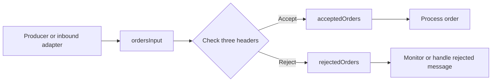

# Header-based Filtering

In the **SPRING_INTEGRATION_CORE** module, header-based filtering decides whether a `Message<?>` continues through an integration flow based on metadata, without needing to read payload structure. This lesson belongs to the **Filter** chapter, connecting `Message`, `MessageChannel`, endpoints, and Java DSL with an order-event ingestion scenario.

After this lesson, you will be able to define a header contract, write filter conditions in Java and SpEL, choose how to handle discarded messages, and build tests for both accepted and rejected branches.

## 1. Scenario: admitting only the right event type from a supported tenant

An application receives order events from multiple sources. The current processing flow serves only tenant `tenant-a`, processes only `ORDER_CREATED` events, and does not accept test data.

The payload may be a JSON string, a DTO, or an event object. The admission decision requires only the following three headers:

| Header | Data type in `MessageHeaders` | Acceptance condition |
| --- | --- | --- |
| `app_tenantId` | `String` | Equal to `tenant-a` |
| `app_eventType` | `String` | Equal to `ORDER_CREATED` |
| `app_test` | `Boolean` | Equal to `Boolean.FALSE` |

In this example's contract, all three headers are required. A missing header, wrong type, or wrong value leads to rejection. Specifically, the string `"false"` is not equivalent to the Boolean value `false`.



In the hands-on example, `acceptedOrders` and `rejectedOrders` are `QueueChannel` instances for easy observation. They are in-memory queues; sending to these channels does not mean durable storage or business completion.

## 2. How does header-based filtering work?

A `Message` consists of a payload and headers. A filter uses a boolean-returning condition to decide whether to forward the message. With `MessageSelector`, the entry point is `boolean accept(Message<?> message)`. Returning `true` allows forwarding; `false` triggers the rejection policy. A filter does not use the boolean result as a new payload. This is the mechanism of the [Message Filter in Spring Integration](https://docs.spring.io/spring-integration/reference/filter.html).

In the flow under discussion, the filter reads metadata and preserves the business content. For instance, two messages with identical payloads but different `app_tenantId` values can go down two different branches.

Three operations must be distinguished:

| Need | Suitable component | Desired outcome |
| --- | --- | --- |
| Forward a message if headers satisfy a condition | Message Filter | Accept or reject the entire message |
| Remove certain headers from a message | `HeaderFilter`, often via `.headerFilter(...)` | Message continues with a modified header set |
| Choose different destinations by header | Router | Route to a channel according to routing rules |

For example, "remove internal headers before sending externally" differs from "drop messages with invalid headers". Do not use header removal as a substitute for an admission condition.

## 3. Defining the header contract before writing conditions

### 3.1. Headers are typed Java values

`MessageHeaders` provides values as `Object`. Headers in internal messages can be `String`, `Boolean`, `Integer`, or other types; do not assume every header is a string like data read directly from HTTP. The headers map structure itself is normally read-only, though an object placed as a value may still have mutable state. See the [Message and headers model](https://docs.spring.io/spring-integration/reference/message.html).

Custom header names are also part of the contract. In this example, `app_tenantId` and `app_TenantId` are two different keys. Use the exact same names and types across producer, adapter, filter, and tests.

Decision table for the lesson's requirements:

| `app_tenantId` | `app_eventType` | `app_test` | Outcome |
| --- | --- | --- | --- |
| `"tenant-a"` | `"ORDER_CREATED"` | `Boolean.FALSE` | Accept |
| `"tenant-b"` | `"ORDER_CREATED"` | `Boolean.FALSE` | Reject: different tenant |
| `"tenant-a"` | `"ORDER_CANCELLED"` | `Boolean.FALSE` | Reject: different event type |
| `"tenant-a"` | `"ORDER_CREATED"` | `Boolean.TRUE` | Reject: test data |
| `"tenant-a"` | `"ORDER_CREATED"` | String `"false"` | Reject: wrong type |
| Any required header missing | Any | Any | Reject |

This is an application-defined policy. Spring Integration does not automatically infer that a missing `app_test` means real production data.

### 3.2. Distinguishing missing headers from wrong header types

You can read a value directly:

```java
Object tenant = message.getHeaders().get("app_tenantId");
boolean supportedTenant = "tenant-a".equals(tenant);

Object test = message.getHeaders().get("app_test");
boolean productionEvent = Boolean.FALSE.equals(test);
```

This comparison handles both `null` when a header is missing and wrong types. In particular, `Boolean.FALSE.equals(test)` accepts only Boolean `false`.

Conversely, the following expression will also accept messages missing `app_test`:

```java
boolean productionEvent = !Boolean.TRUE.equals(test);
```

The reason is that `Boolean.TRUE.equals(null)` evaluates to `false`, which is then negated to `true`. This expression is only appropriate when the contract truly allows the test flag to be absent.

The API also supports typed reads:

```java
String tenant = message.getHeaders().get("app_tenantId", String.class);
```

With this read, a missing header returns `null`, while a value not matching the requested type can throw `IllegalArgumentException`. This API does not automatically convert an `Integer` into a `String`. If you want wrong-type data classified as a normal rejection, check types or compare safely instead of relying on casting. Details are in the [MessageHeaders Javadoc](https://docs.spring.io/spring-framework/docs/current/javadoc-api/org/springframework/messaging/MessageHeaders.html).

### 3.3. Normalizing at the ingestion boundary

If a source sends `app_test` as a string, a mapping step to the internal contract is needed before the filter. In that case, accept strictly the two input values `"true"` and `"false"`, and create the corresponding Boolean value.

Do not use `Boolean.parseBoolean(...)` as validation: many non-`"true"` strings also return `false`. For example, `"flase"` could accidentally be treated as a real event if you only call that method.

Normalization should clearly distinguish:

- Valid source values that can be converted.
- Missing values for which the contract permits a default.
- Missing or invalid values that must go to the invalid-data handling branch.

If you need to add computed metadata, use a message-building step or a header enricher before the filter. Spring Integration provides [Header Enricher](https://docs.spring.io/spring-integration/reference/content-enrichment.html#header-enricher) to add headers; overwrite options must match trusted data sources.

## 4. Writing the policy in Java

The examples below use Java 17+ and Spring Integration 6.5.x Java DSL API. The project needs `org.springframework.integration:spring-integration-core`; tests use JUnit Jupiter. Use the version managed by your project's BOM if your project already has a compatible BOM.

A standalone policy class keeps header names and rules in one place:

```java
package example.integration;

import org.springframework.messaging.Message;

public final class OrderHeaderPolicy {

    public static final String TENANT_ID = "app_tenantId";
    public static final String EVENT_TYPE = "app_eventType";
    public static final String TEST_EVENT = "app_test";

    public boolean accept(Message<?> message) {
        var headers = message.getHeaders();
        return "tenant-a".equals(headers.get(TENANT_ID))
                && "ORDER_CREATED".equals(headers.get(EVENT_TYPE))
                && Boolean.FALSE.equals(headers.get(TEST_EVENT));
    }
}
```

These three comparisons are intentionally strict about data types. The payload is not read because the lesson's admission rule depends solely on headers.

The policy should run quickly and cause no side effects such as deducting inventory or recording payment. A message may be processed again when the system retries or redelivers from the source. If a condition requires an external lookup, consider enriching the data in a separate step with explicit timeouts and error policies.

## 5. Attaching the policy in Java DSL

The following configuration declares the input and both result channels completely:

```java
package example.integration;

import org.springframework.context.annotation.Bean;
import org.springframework.context.annotation.Configuration;
import org.springframework.integration.channel.DirectChannel;
import org.springframework.integration.channel.QueueChannel;
import org.springframework.integration.config.EnableIntegration;
import org.springframework.integration.dsl.IntegrationFlow;
import org.springframework.messaging.Message;

@Configuration(proxyBeanMethods = false)
@EnableIntegration
public class HeaderFilterConfiguration {

    @Bean
    public DirectChannel ordersInput() {
        return new DirectChannel();
    }

    @Bean
    public QueueChannel acceptedOrders() {
        return new QueueChannel();
    }

    @Bean
    public QueueChannel rejectedOrders() {
        return new QueueChannel();
    }

    @Bean
    public OrderHeaderPolicy orderHeaderPolicy() {
        return new OrderHeaderPolicy();
    }

    @Bean
    public IntegrationFlow orderHeaderFlow(OrderHeaderPolicy policy) {
        return IntegrationFlow.from("ordersInput")
                .filter(Message.class,
                        message -> policy.accept(message),
                        endpoint -> endpoint
                                .id("orderHeaderFilter")
                                .discardChannel("rejectedOrders")
                                .throwExceptionOnRejection(false))
                .channel("acceptedOrders")
                .get();
    }
}
```

Here, `Message.class` instructs the lambda to receive the entire message so it can read headers. With filter overloads taking a payload lambda, the lambda parameter defaults to inspecting the payload; do not simply name the parameter `message` and assume it is `Message<?>`. Overloads taking an explicit type are described in the [Java DSL API 6.5.4](https://docs.spring.io/spring-integration/docs/6.5.4/api/org/springframework/integration/dsl/BaseIntegrationFlowDefinition.html).

`orderHeaderFilter` is the endpoint name for identification in configuration and flow observability. It is not the name of the output channel. `.channel("acceptedOrders")` specifies where messages passing the condition are delivered.

Example creating and sending a valid message, given a `context` variable pointing to the application context containing the configuration above:

```java
import org.springframework.messaging.Message;
import org.springframework.messaging.MessageChannel;
import org.springframework.messaging.support.MessageBuilder;

Message<String> order = MessageBuilder
        .withPayload("{\"orderId\":\"O-1001\"}")
        .setHeader(OrderHeaderPolicy.TENANT_ID, "tenant-a")
        .setHeader(OrderHeaderPolicy.EVENT_TYPE, "ORDER_CREATED")
        .setHeader(OrderHeaderPolicy.TEST_EVENT, Boolean.FALSE)
        .build();

MessageChannel input = context.getBean("ordersInput", MessageChannel.class);
input.send(order);
```

In a real application, the output of an inbound adapter or gateway can connect to `ordersInput`. The filter still receives a `Message` and applies the same contract, regardless of whether the original source is HTTP, a broker, or an internal task.

## 6. Expressing conditions with SpEL

### 6.1. Using expressions for simple rules

Within Spring Integration's expression context, `headers` and `payload` can be accessed from the message. The form `headers['header_name']` clearly expresses lookup by key. See [SpEL in Spring Integration](https://docs.spring.io/spring-integration/reference/spel.html).

Example filtering only tenant and event type:

```java
@Bean
public IntegrationFlow simpleHeaderExpressionFlow() {
    return IntegrationFlow.from("ordersInput")
            .filter("headers['app_tenantId'] == 'tenant-a' "
                            + "and headers['app_eventType'] == 'ORDER_CREATED'",
                    endpoint -> endpoint.discardChannel("rejectedOrders"))
            .channel("acceptedOrders")
            .get();
}
```

This snippet only illustrates syntax and does not check `app_test`. To express the full contract with explicit type checks:

```java
@Bean
public IntegrationFlow strictHeaderExpressionFlow() {
    String expression =
            "headers['app_tenantId'] instanceof T(java.lang.String) "
            + "and headers['app_tenantId'] == 'tenant-a' "
            + "and headers['app_eventType'] instanceof T(java.lang.String) "
            + "and headers['app_eventType'] == 'ORDER_CREATED' "
            + "and headers['app_test'] instanceof T(java.lang.Boolean) "
            + "and headers['app_test'] == false";

    return IntegrationFlow.from("ordersInput")
            .filter(expression,
                    endpoint -> endpoint.discardChannel("rejectedOrders"))
            .channel("acceptedOrders")
            .get();
}
```

The `instanceof` check expresses the contract's type requirement and avoids relying on expression type coercion expectations. For the input cases in the decision table, this condition is designed to produce the same results as `OrderHeaderPolicy`.

The flows in this section are alternatives to `orderHeaderFlow`. Register only one option in the application context when practicing. Multiple subscribers attached to the same `DirectChannel` do not create a sequential filter chain; they can distribute messages across subscribers.

### 6.2. When should you move from SpEL to Java?

When an expression begins accumulating multiple type checks, normalization, allowlists, or multiple business branches, a Java class is usually easier to read and test. You can use SpEL to call the policy bean instead of duplicating logic:

```java
.filter("@orderHeaderPolicy.accept(#root)",
        endpoint -> endpoint.discardChannel("rejectedOrders"))
```

At this filter position, `#root` is the message being evaluated. The bean named `orderHeaderPolicy` was declared in the configuration above.

Expressions are configuration controlled by the application. Never concatenate a SpEL snippet supplied by an external caller into an executed condition.

## 7. Choosing a policy for discarded messages

A filter condition only answers whether a message is eligible. You must also define what happens when the result is `false`.

| `discardChannel` | `throwExceptionOnRejection` | Behavior on rejection |
| --- | --- | --- |
| Absent | `false` | Not forwarded to output and no branch receives rejected messages |
| Present | `false` | Sends message to discard channel |
| Absent | `true` | Throws `MessageRejectedException` |
| Present | `true` | Sends to discard channel and then throws exception if send completes normally |

The default value of `throwExceptionOnRejection` is `false`; by default there is also no discard channel. Both settings take effect independently, per the [FilterEndpointSpec Javadoc](https://docs.spring.io/spring-integration/api/org/springframework/integration/dsl/FilterEndpointSpec.html).

For the order-event problem, rejecting another tenant or test events is an expected outcome. Routing to `rejectedOrders` enables observation and further handling without turning every rejected case into a technical error.

If you choose to drop messages without a discard channel, ensure it is an intentional policy and appropriate observability metrics still exist. A message that does not reach the output does not automatically appear in `errorChannel`.

### 7.1. Rejection and evaluation error are two different situations

Consider two cases:

- Policy returns `false` because the tenant is unsupported: apply the rejection policy.
- Policy throws an exception due to a bad cast, or SpEL calls a method on a missing value: this is a processing error; it does not automatically become `false` to go to the discard channel.

In a synchronous flow using `DirectChannel`, exceptions can propagate to the sender. With an asynchronous boundary or poller, emitting an `ErrorMessage` depends on the error-handling mechanism of the corresponding endpoint and infrastructure. Setting the `errorChannel` header alone does not make every synchronous `send()` automatically convert exceptions into error messages. See [Error Handling](https://docs.spring.io/spring-integration/reference/error-handling.html).

If both discard and exception are enabled, account for retries: actions recorded in the discard branch may repeat when execution is retried. A predicate that is always false due to an unsupported tenant generally cannot be fixed by retrying the same data.

### 7.2. A discard channel needs a consumption strategy

`rejectedOrders` in this lesson is a `QueueChannel` for testing. In an application, attach a consumer to record, store, or classify rejected messages. An in-memory queue without a consumer can accumulate data and does not preserve data across restarts.

Because a filter returns a boolean, it does not automatically attach a specific rejection reason. If you need statistics by `MISSING_TENANT`, `UNSUPPORTED_TENANT`, or `TEST_EVENT`, build a classification step before the filter and place the result in an internal header. Another option is to use a router when the core requirement is multiple business-meaningful branches.

## 8. Considerations when calling via a gateway

A request–reply gateway normally waits for a result. If a filter drops the request and the discard branch only stores or logs it, the caller has not received a business reply. The caller may receive `null`, time out, or get an exception depending on the gateway signature and configuration.

Therefore, before placing a filter in a gateway's path, explicitly choose a contract:

- A one-way gateway when the caller only needs to submit events and does not wait for a result.
- A structured rejection response if the caller needs to know why the request was not processed.
- An intentional exception if the rejected case is considered an error under the service contract.

Do not use the boolean return value of `MessageChannel.send(...)` as proof that the filter accepted the business event. In this lesson's flow, a send can succeed while the message is routed to `rejectedOrders`.

## 9. Testing against the header contract and channel outcomes

At least two layers of behavior should be verified: whether the input rule produces the right decision, and whether the flow routes messages to the right channel. Cases with missing headers, wrong types, and wrong values are especially valuable because they are easy to miss when testing only valid cases.

The following JUnit Jupiter class uses `AnnotationConfigApplicationContext` directly, requiring neither Spring Boot startup nor a broker connection:

```java
package example.integration;

import java.util.List;

import org.junit.jupiter.api.Test;
import org.springframework.context.annotation.AnnotationConfigApplicationContext;
import org.springframework.integration.channel.QueueChannel;
import org.springframework.messaging.Message;
import org.springframework.messaging.MessageChannel;
import org.springframework.messaging.support.MessageBuilder;

import static org.junit.jupiter.api.Assertions.*;

class HeaderFilterFlowTest {

    private static MessageBuilder<String> validOrder() {
        return MessageBuilder.withPayload("order:O-1001")
                .setHeader(OrderHeaderPolicy.TENANT_ID, "tenant-a")
                .setHeader(OrderHeaderPolicy.EVENT_TYPE, "ORDER_CREATED")
                .setHeader(OrderHeaderPolicy.TEST_EVENT, Boolean.FALSE);
    }

    @Test
    void acceptsValidHeadersAndPreservesBusinessData() {
        try (var context = new AnnotationConfigApplicationContext(
                HeaderFilterConfiguration.class)) {
            var input = context.getBean("ordersInput", MessageChannel.class);
            var accepted = context.getBean("acceptedOrders", QueueChannel.class);
            var rejected = context.getBean("rejectedOrders", QueueChannel.class);

            Message<String> original = validOrder().build();
            assertTrue(input.send(original));

            Message<?> result = accepted.receive(0);
            assertNotNull(result);
            assertEquals(original.getPayload(), result.getPayload());
            assertEquals("tenant-a",
                    result.getHeaders().get(OrderHeaderPolicy.TENANT_ID));
            assertEquals("ORDER_CREATED",
                    result.getHeaders().get(OrderHeaderPolicy.EVENT_TYPE));
            assertEquals(Boolean.FALSE,
                    result.getHeaders().get(OrderHeaderPolicy.TEST_EVENT));
            assertNull(rejected.receive(0));
            assertNull(accepted.receive(0));
        }
    }

    @Test
    void rejectsMissingWrongTypeAndUnsupportedHeaders() {
        List<Message<String>> rejectedMessages = List.of(
                validOrder()
                        .removeHeader(OrderHeaderPolicy.TENANT_ID).build(),
                validOrder()
                        .removeHeader(OrderHeaderPolicy.EVENT_TYPE).build(),
                validOrder()
                        .removeHeader(OrderHeaderPolicy.TEST_EVENT).build(),
                validOrder()
                        .setHeader(OrderHeaderPolicy.TENANT_ID, "tenant-b").build(),
                validOrder()
                        .setHeader(OrderHeaderPolicy.TENANT_ID, 123).build(),
                validOrder()
                        .setHeader(OrderHeaderPolicy.EVENT_TYPE, "ORDER_CANCELLED")
                        .build(),
                validOrder()
                        .setHeader(OrderHeaderPolicy.TEST_EVENT, Boolean.TRUE)
                        .build(),
                validOrder()
                        .setHeader(OrderHeaderPolicy.TEST_EVENT, "false").build());

        try (var context = new AnnotationConfigApplicationContext(
                HeaderFilterConfiguration.class)) {
            var input = context.getBean("ordersInput", MessageChannel.class);
            var accepted = context.getBean("acceptedOrders", QueueChannel.class);
            var rejected = context.getBean("rejectedOrders", QueueChannel.class);

            for (Message<String> message : rejectedMessages) {
                assertTrue(input.send(message));
                assertNull(accepted.receive(0));

                Message<?> result = rejected.receive(0);
                assertNotNull(result);
                assertEquals(message.getPayload(), result.getPayload());
                assertEquals(message.getHeaders(), result.getHeaders());
                assertNull(rejected.receive(0));
            }
        }
    }

    @Test
    void policyUsesHeadersIndependentlyOfPayloadType() {
        var policy = new OrderHeaderPolicy();
        Message<Integer> numericPayload = MessageBuilder.withPayload(42)
                .setHeader(OrderHeaderPolicy.TENANT_ID, "tenant-a")
                .setHeader(OrderHeaderPolicy.EVENT_TYPE, "ORDER_CREATED")
                .setHeader(OrderHeaderPolicy.TEST_EVENT, Boolean.FALSE)
                .build();

        assertTrue(policy.accept(numericPayload));
    }
}
```

`receive(0)` does not wait because `ordersInput` uses `DirectChannel`: when `send()` returns normally, delivery to the result queue in this configuration has already occurred. If you switch to an `ExecutorChannel`, use a bounded timeout or an appropriate awaiting utility, and verify asynchronous behavior rather than keeping synchronous assumptions.

The rejection test case also intentionally asserts that `input.send(...)` returns `true`. What is verified is that the message arrives at the expected outcome branch, rather than inferring business decisions from the return value of the send operation.

When replacing the Java policy with SpEL, run the same contract dataset against the alternative configuration to catch differences in types and missing values. If `throwExceptionOnRejection(true)` is enabled, add tests catching the exception and checking discard behavior per the new configuration.

## 10. Diagnosing common failures

| Symptom | Possibilities to check | How to handle |
| --- | --- | --- |
| Messages are always rejected | Different header name, wrong value type, or stripped by adapter | Inspect metadata immediately before the filter and compare against contract |
| Data missing `app_test` still passes through | Using `!Boolean.TRUE.equals(value)` | Use `Boolean.FALSE.equals(value)` if the header is required |
| Value `"false"` is rejected | Producer sent a string instead of a Boolean | Normalize at the boundary or fix producer to match contract |
| Exception thrown instead of routing to discard | Predicate or expression failed during evaluation | Distinguish ineligible data from bugs in evaluation logic |
| Some messages skip the expected filter | Multiple flows subscribed to the same input `DirectChannel` | Register only the needed configuration or redesign topology |
| Gateway waits a long time after rejection | No reply on the rejection branch | Design a reply, exception, or one-way gateway |
| Discard branch memory grows | `QueueChannel` lacks a consumer or proper bounds | Add a consumer and storage mechanism per operational requirements |

When diagnosing, prefer logging endpoint name, message ID, event type, acceptance decision, and reason code if present. Avoid logging raw payloads or all headers because they may contain personal data or credentials. When collecting metrics, avoid using high-cardinality values like message IDs as labels.

Headers related to tenant or access permissions are only meaningful when set by a trusted source. An external producer self-declaring `app_tenantId = tenant-a` is not proof of authorization. The system must authenticate the source and bind identity to tenant before the business filtering step.

## 11. Consolidation practice

Extend the policy to accept only `app_schemaVersion` of type `Integer` and equal to `1`.

1. Add the header name to `OrderHeaderPolicy` and update the input contract.
2. Add the condition requiring both the right type and the right value to the policy.
3. Construct messages with values `1`, `"1"`, `2`, and without the header.
4. Verify that only `Integer.valueOf(1)` is accepted when the original three headers are valid.
5. If you have a SpEL variant, test it with the same cases.

Next, try turning `app_test` into an optional header with the rule "missing means false". Before modifying code, update the decision table and identify which test cases must change expectations. This exercise shows that the policy for missing data is a business decision that must be explicitly documented.