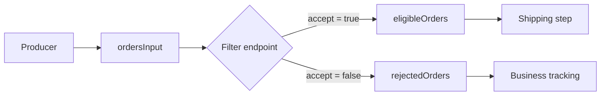

# Filter Endpoint

In the **SPRING_INTEGRATION_CORE** module, the filter endpoint is where a condition is applied to decide whether a message continues in the flow. This lesson belongs to the **Filter** chapter, connecting knowledge of `Message`, `MessageChannel`, and endpoints with Java DSL configuration, rejection handling, error handling, and testing an integration flow.

After this lesson, you can place a filter at the right spot in a flow, choose how messages are consumed, declare a rejection branch, and verify behavior of both branches. The running example ingests order events before forwarding them to a shipping step.

## 1. The problem: which orders should proceed?

Suppose the system receives `OrderPlaced` events from multiple sources. The shipping step only admits orders that simultaneously satisfy three conditions:

- Total amount in Vietnamese Dong is greater than `0`.
- Currency code is `VND`.
- The order has not been cancelled.

Orders failing the conditions are routed to a business tracking channel. They are still events the system received; being unsuitable for the shipping step is not enough to conclude that infrastructure is failing.



A filter makes a yes/no decision for a single forward path. A router fits better when choosing among multiple destinations such as domestic shipping, international shipping, and in-store pickup. The discard branch lets a filter express an additional processing path for a `false` outcome. [Filter documentation](https://docs.spring.io/spring-integration/reference/filter.html).

In this example, the total amount condition is solely a rule of the shipping flow. It does not replace event format validation, sender authentication, or data integrity checks at the system boundary.

## 2. What makes up a filter endpoint?

Distinguish the selection condition, the handler that executes the condition, and the endpoint that connects the handler to channels.

| Component | Responsibility | Example in this lesson |
|---|---|---|
| Input channel | Receives messages from the previous step | `ordersInput` |
| Selector | Returns the acceptance decision | `isEligible(order)` |
| `MessageFilter` | Invokes selector and enforces forward/reject policy | Handler created by DSL |
| Consumer endpoint | Binds handler to message reception, manages lifecycle | `orderEligibilityFilter` endpoint |
| Output channel | Receives accepted messages | `eligibleOrders` |
| Discard channel | Receives rejected messages, if configured | `rejectedOrders` |

`MessageFilter` delegates selection to a `MessageSelector`. The selector contract is `boolean accept(Message<?> message)`. The boolean result controls routing; it does not become the output payload. [MessageFilter Javadoc](https://docs.spring.io/spring-integration/api/org/springframework/integration/filter/MessageFilter.html), [MessageSelector Javadoc](https://docs.spring.io/spring-integration/api/org/springframework/integration/core/MessageSelector.html).

Consumer endpoints have two key forms:

- With a `SubscribableChannel`, such as `DirectChannel`, the framework uses event-driven reception, typically `EventDrivenConsumer`.
- With a `PollableChannel`, such as `QueueChannel`, the framework uses `PollingConsumer` to fetch messages on a schedule.

Thus, simply instantiating `new MessageFilter(selector)` does not create an endpoint actively listening to a channel. Wiring and lifecycle configuration are needed; Java DSL and annotations handle this part. [Message Endpoints documentation](https://docs.spring.io/spring-integration/reference/endpoint.html).

A selector should answer a business question clearly. Updating shipping status, recording payment, or sending emails should live in downstream endpoints. Organizing it this way lets you re-run filter conditions without accidentally repeating side effects.

## 3. Complete configuration using Java DSL

Examples use Java 17+ and the `IntegrationFlow.from(...)` Java DSL API. The practice environment needs `spring-integration-core` along with compatible Spring Context components. The tests below use JUnit Jupiter. If your project uses Spring Boot, you can use the integration and test starters from your project's managed dependency set; do not arbitrarily mix Spring versions across libraries.

Save the following illustrative class in package `example.integration` of a practice project:

```java
package example.integration;

import org.springframework.beans.factory.annotation.Qualifier;
import org.springframework.context.annotation.Bean;
import org.springframework.context.annotation.Configuration;
import org.springframework.integration.channel.DirectChannel;
import org.springframework.integration.channel.QueueChannel;
import org.springframework.integration.config.EnableIntegration;
import org.springframework.integration.dsl.IntegrationFlow;
import org.springframework.messaging.MessageChannel;

@Configuration
@EnableIntegration
public class OrderFilterConfig {

    public record OrderPlaced(
            String orderId,
            long totalInDong,
            String currency,
            boolean cancelled) {
    }

    @Bean
    public DirectChannel ordersInput() {
        return new DirectChannel();
    }

    @Bean
    public QueueChannel eligibleOrders() {
        return new QueueChannel(100);
    }

    @Bean
    public QueueChannel rejectedOrders() {
        return new QueueChannel(100);
    }

    @Bean
    public IntegrationFlow eligibleOrdersFlow(
            @Qualifier("ordersInput") MessageChannel input) {

        return IntegrationFlow.from(input)
                .filter(OrderPlaced.class,
                        OrderFilterConfig::isEligible,
                        endpoint -> endpoint
                                .id("orderEligibilityFilter")
                                .discardChannel("rejectedOrders")
                                .throwExceptionOnRejection(false))
                .channel("eligibleOrders")
                .get();
    }

    public static boolean isEligible(OrderPlaced order) {
        return order.totalInDong() > 0
                && "VND".equals(order.currency())
                && !order.cancelled();
    }
}
```

The three arguments of `.filter(...)` serve distinct purposes:

1. `OrderPlaced.class` declares the payload type the condition accepts.
2. `OrderFilterConfig::isEligible` provides the payload filtering condition.
3. `endpoint -> ...` configures the endpoint and rejection policy.

When the context starts, the DSL creates and wires the actual integration beans. `IntegrationFlow` is the configuration descriptor; messages are processed by the registered channels, handlers, and consumer endpoints. [DSL Basics documentation](https://docs.spring.io/spring-integration/reference/dsl/java-basics.html).

The `.channel("eligibleOrders")` line is the destination for the accepted branch. `discardChannel("rejectedOrders")` is the destination for the rejected branch. The name `orderEligibilityFilter` identifies the endpoint for operational monitoring or lifecycle control.

### Trying to send an event

The snippet below goes inside a method of a runner class in the same package, after importing `AnnotationConfigApplicationContext` and `MessageBuilder`:

```java
try (var context = new AnnotationConfigApplicationContext(
        OrderFilterConfig.class)) {

    var input = context.getBean("ordersInput", MessageChannel.class);
    var accepted = context.getBean("eligibleOrders", QueueChannel.class);
    var rejected = context.getBean("rejectedOrders", QueueChannel.class);

    var order = new OrderFilterConfig.OrderPlaced(
            "ORD-101", 250_000, "VND", false);

    var message = MessageBuilder.withPayload(order)
            .setHeader("traceId", "trace-101")
            .build();

    boolean delivered = input.send(message);
    System.out.println(delivered);          // true
    System.out.println(accepted.receive(0)); // Message containing ORD-101
    System.out.println(rejected.receive(0)); // null
}
```

`MessageChannel` and `QueueChannel` are from the same packages as in the configuration class. The two additional imports are:

```java
import org.springframework.context.annotation.AnnotationConfigApplicationContext;
import org.springframework.integration.support.MessageBuilder;
```

In this example, the input is a `DirectChannel`: the selector executes on the thread calling `send()`. Both output channels are queues so results can be pulled manually with `receive(0)`. They do not yet have shipping consumers or business tracking consumers. [MessageChannel implementations documentation](https://docs.spring.io/spring-integration/reference/channel/implementations.html).

A bounded queue of `100` gives concrete capacity for the exercise. When there is no consumer and the queue fills up, subsequent sends may block. In production, you must design consumption capacity, timeouts, and persistence; a standard `QueueChannel` stores messages in memory.

## 4. Condition reading payload or the whole Message?

The following expression receives the **payload**:

```java
.filter(OrderPlaced.class, OrderFilterConfig::isEligible)
```

If the condition also depends on headers, use `MessageSelector` to state explicitly that the input is a `Message<?>`. For instance, replace the body of the `eligibleOrdersFlow` bean with the following and import `org.springframework.integration.core.MessageSelector`:

```java
MessageSelector selector = message ->
        message.getPayload() instanceof OrderPlaced order
                && isEligible(order)
                && "partner-a".equals(
                        message.getHeaders().get("source"));

return IntegrationFlow.from(input)
        .filter(selector, endpoint -> endpoint
                .id("orderEligibilityFilter")
                .discardChannel("rejectedOrders"))
        .channel("eligibleOrders")
        .get();
```

The `input` variable, `OrderPlaced` type, and `isEligible` method remain as in the main configuration. This is an alternative to the previous filter, not an additional consumer attached to `ordersInput`.

With the new rule, a missing `source` header or a value other than `partner-a` leads to rejection. Producers wanting messages to pass must set the header accordingly:

```java
MessageBuilder.withPayload(order)
        .setHeader("source", "partner-a")
        .setHeader("traceId", "trace-101")
        .build();
```

`MessageSelector` allows reading both payload and headers through a single object. Assigning the lambda to this type also avoids the misconception that a plain payload lambda automatically receives a `Message`. [MessageSelector Javadoc](https://docs.spring.io/spring-integration/api/org/springframework/integration/core/MessageSelector.html), [notes on lambdas in Java DSL](https://docs.spring.io/spring-integration/reference/dsl/java-basics.html).

A filter does not automatically normalize `vnd` to `VND` or attach a rejection reason. When such changes are needed, place a transformer or header enricher explicitly in the flow. In this example, forwarded messages continue carrying the order data and `traceId` header, rather than a boolean representing the decision.

## 5. Choosing a policy for false outcomes

The two key options are `discardChannel` and `throwExceptionOnRejection`.

| Discard channel present? | `throwExceptionOnRejection` | Behavior when selector returns `false` |
|---|---|---|
| No | `false` | Not forwarded and no rejection exception thrown |
| Yes | `false` | Sends the original message to the discard channel |
| No | `true` | Throws `MessageRejectedException` |
| Yes | `true` | Sends to the discard channel, then throws `MessageRejectedException` if sending completes normally |

The default value of the flag is `false`. Having a discard channel does not disable the exception flag. If sending to the discard channel itself fails, the send error can also interrupt processing. [FilterEndpointSpec Javadoc](https://docs.spring.io/spring-integration/api/org/springframework/integration/dsl/FilterEndpointSpec.html).

Since Spring Integration 6.1, dropping a message with neither a discard channel nor exception throwing logs a warning. When the intent is to ignore completely, you can declare `.discardChannel("nullChannel")` to use the framework's `NullChannel`. [Filter configuration documentation](https://docs.spring.io/spring-integration/reference/filter.html).

The choice in this lesson is `discardChannel` with `false`: a cancelled order needs a place for tracking, without failing the send operation. Conversely, a flow whose contract requires every message to be valid can set the flag to `true` so callers observe the violation.

An easily overlooked detail is that `input.send(message)` can still return `true` when the selector returns `false`. In the main configuration, the send was handled successfully by the endpoint routing the message to `rejectedOrders`. To know the business outcome, read the appropriate branch or design a dedicated business reply.

### Discard vs. error handling

`discardChannel` receives messages rejected by the condition. An `ErrorMessage` used in error handling normally has an exception as its payload. If the selector itself throws an exception—for instance, due to an external service failure—that is not equivalent to the selector returning `false`. [MessageFilter Javadoc](https://docs.spring.io/spring-integration/api/org/springframework/integration/filter/MessageFilter.html), [Error Handling documentation](https://docs.spring.io/spring-integration/reference/error-handling.html).

With the lesson's `DirectChannel` input, exceptions from synchronous processing propagate back to the caller of `send()`. Setting an `errorChannel` header alone does not make all synchronous errors turn into error messages automatically. For asynchronous tasks or scheduled pollers managed by the framework, error reporting can emit an `ErrorMessage` to the appropriate error channel. [Error Handling documentation](https://docs.spring.io/spring-integration/reference/error-handling.html).

If both discard and exception throwing are enabled, consider redelivery: tracking actions on the discard branch may already have executed before the caller receives the error. A retry might record duplicate orders. This design requires a business key or deduplication strategy aligned with the source system.

## 6. Expressing the endpoint with an annotation

When the rule belongs to a method on a business bean, you can use `@Filter`. The example below is an alternative to the DSL `eligibleOrdersFlow` bean in the main configuration; keep the channel beans and `@EnableIntegration`.

```java
@org.springframework.integration.annotation.Filter(
        inputChannel = "ordersInput",
        outputChannel = "eligibleOrders",
        discardChannel = "rejectedOrders",
        throwExceptionOnRejection = "false")
public boolean acceptOrder(OrderPlaced order) {
    return isEligible(order);
}
```

Because the method is placed inside a registered `@Configuration` class, the framework can detect the annotation on that bean. If you move the method to a separate policy class, that class must also be registered as a Spring bean.

The annotated method receives either the payload or `Message<?>` and returns `boolean`/`Boolean`. Annotation attributes such as `throwExceptionOnRejection` take strings, unlike the Java DSL call which takes a boolean. [@Filter Javadoc](https://docs.spring.io/spring-integration/api/org/springframework/integration/annotation/Filter.html).

Do not keep both the annotation consumer and the DSL consumer on `ordersInput` simultaneously if your goal is to replace the configuration style. `DirectChannel` has point-to-point semantics; multiple subscribers can split messages between them. Listening to the same channel does not mean the two conditions run sequentially. [DirectChannel documentation](https://docs.spring.io/spring-integration/reference/channel/implementations.html).

## 7. When input becomes a QueueChannel

Suppose the producer needs to push events onto an internal queue and return to other work. You can replace the `ordersInput` bean with:

```java
@Bean
public QueueChannel ordersInput() {
    return new QueueChannel(100);
}
```

The flow bean still accepts input via `MessageChannel`. However, the endpoint needs a poller, declared locally or via default poller configuration. For example, replace the flow configuration with:

```java
@Bean
public IntegrationFlow eligibleOrdersFlow(
        @Qualifier("ordersInput") MessageChannel input) {

    return IntegrationFlow.from(input)
            .filter(OrderPlaced.class,
                    OrderFilterConfig::isEligible,
                    endpoint -> endpoint
                            .id("orderEligibilityFilter")
                            .poller(Pollers.fixedDelay(
                                            Duration.ofMillis(100))
                                    .maxMessagesPerPoll(10))
                            .discardChannel("rejectedOrders"))
            .channel("eligibleOrders")
            .get();
}
```

Additional imports are `java.time.Duration` and `org.springframework.integration.dsl.Pollers`. `fixedDelay` sets the interval between poll cycles, and `maxMessagesPerPoll(10)` caps how many messages are fetched per poll. The poller belongs to the endpoint consuming from input, not to the selector. [Java DSL Pollers documentation](https://docs.spring.io/spring-integration/reference/dsl/java-pollers.html).

Unlike the synchronous example, succeeding to send to the queue does not mean the selector has run yet. When testing this variant, wait for results with a bounded timeout, such as `receive(2_000)`, rather than checking immediately with `receive(0)`.

Endpoints also have a lifecycle. For example, `.autoStartup(false)` prevents the consumer from starting automatically when the context initializes. With a `DirectChannel` having only that consumer, sending while the consumer is stopped can fail with no subscribers. With an input queue, messages can wait up to queue capacity. Therefore, distinguish an unstarted endpoint from a filter condition actively rejecting messages. [Message Endpoints documentation](https://docs.spring.io/spring-integration/reference/endpoint.html).

## 8. Placing a filter in a flow with a gateway

The main example is a one-way flow: output goes to queues for downstream processing. If you swap the producer for a gateway with a return-value method, the new contract requires the flow to produce a reply.

A filter rejecting a message does not automatically generate a result like `REJECTED`. If no endpoint replies on that branch, the gateway may receive no response and have to act per its reply-waiting configuration. Choose explicitly among these approaches: use a one-way gateway for events, turn the rejection branch into a business reply, or use an exception when rejection is a contract violation. [Messaging Gateways documentation](https://docs.spring.io/spring-integration/reference/gateway.html).

Even the accepted branch of the main configuration is not yet a complete request-reply flow: messages stop at `eligibleOrders`, with no consumer returning a result to the gateway. Adding a gateway at the front of the flow does not automatically supply this missing processing step.

If the requirement is to return an `OrderDecision` with both status and reason, a business method creating a decision object followed by a router selecting branches usually expresses the contract more clearly than using a boolean for everything.

## 9. Testing endpoint behavior

Testing `isEligible()` in isolation verifies the rule. Testing through channels also confirms the endpoint is registered, output/discard channels are wired properly, and application headers travel with the message.

The two tests below use the synchronous Java DSL configuration from section 3, not the variants in sections 4, 6, or 7. Each test opens its own context so queue data does not leak between tests. You can use JUnit Jupiter with a Spring Context without mocking endpoints; Spring Integration also provides testing support modules when you need to replace part of a flow. [Testing support documentation](https://docs.spring.io/spring-integration/reference/testing.html).

```java
package example.integration;

import org.junit.jupiter.api.Test;
import org.springframework.context.annotation.AnnotationConfigApplicationContext;
import org.springframework.integration.channel.QueueChannel;
import org.springframework.integration.support.MessageBuilder;
import org.springframework.messaging.Message;
import org.springframework.messaging.MessageChannel;

import static org.junit.jupiter.api.Assertions.*;

class OrderFilterEndpointTest {

    @Test
    void forwardsEligibleOrderWithTraceHeader() {
        try (var context = new AnnotationConfigApplicationContext(
                OrderFilterConfig.class)) {

            var input = context.getBean("ordersInput", MessageChannel.class);
            var accepted = context.getBean("eligibleOrders", QueueChannel.class);
            var rejected = context.getBean("rejectedOrders", QueueChannel.class);
            var order = new OrderFilterConfig.OrderPlaced(
                    "ORD-101", 250_000, "VND", false);
            Message<?> original = MessageBuilder.withPayload(order)
                    .setHeader("traceId", "trace-101")
                    .build();

            assertTrue(input.send(original));

            Message<?> result = accepted.receive(0);
            assertNotNull(result);
            assertEquals(order, result.getPayload());
            assertEquals("trace-101", result.getHeaders().get("traceId"));
            assertNull(accepted.receive(0));
            assertNull(rejected.receive(0));
        }
    }

    @Test
    void sendsCancelledOrderToDiscardChannel() {
        try (var context = new AnnotationConfigApplicationContext(
                OrderFilterConfig.class)) {

            var input = context.getBean("ordersInput", MessageChannel.class);
            var accepted = context.getBean("eligibleOrders", QueueChannel.class);
            var rejected = context.getBean("rejectedOrders", QueueChannel.class);
            var order = new OrderFilterConfig.OrderPlaced(
                    "ORD-102", 250_000, "VND", true);
            Message<?> original = MessageBuilder.withPayload(order)
                    .setHeader("traceId", "trace-102")
                    .build();

            assertTrue(input.send(original));

            assertNull(accepted.receive(0));
            Message<?> result = rejected.receive(0);
            assertNotNull(result);
            assertEquals(order, result.getPayload());
            assertEquals("trace-102", result.getHeaders().get("traceId"));
            assertNull(rejected.receive(0));
        }
    }
}
```

Assertions on both channels express the business outcome much more clearly than asserting that `send()` returns `true`. With this `DirectChannel` configuration, once `send()` returns normally, the filter has finished processing, so a non-blocking read is appropriate.

When expanding the test suite for a project, add boundary data and verify the chosen policy:

| Situation | Observation to verify |
|---|---|
| `totalInDong = 0` or negative | Appears only on the discard branch |
| Currency other than `VND` or `null` | Does not reach the shipping step |
| Missing `source` header when using selector variant | Rejected according to sender source rule |
| Selector throws an exception | Handled as an error, distinct from boolean `false` |
| Enable `throwExceptionOnRejection(true)` with DirectChannel | Send call receives rejection error |
| Use input QueueChannel | Wait for result within a bounded timeout, check the other branch too |

Do not add `Thread.sleep()` to the two synchronous tests. For flows with pollers or executors, await the condition/result within a bounded timeout to avoid machine-speed flakiness.

## 10. Diagnosing when a flow does not behave as expected

| Symptom | Points to check |
|---|---|
| `send()` succeeds but output is empty | Check the discard channel; verify whether data satisfies the condition |
| Input queue keeps messages indefinitely | Is a poller configured, and has the endpoint started? |
| No subscribers on DirectChannel | Did the context register the flow/annotated bean, and is the endpoint running? |
| Messages sometimes follow one rule, sometimes another | Are multiple consumers attached to the same point-to-point input? |
| Cancelled orders appear in the error flow | Is throwing on rejection enabled; is that the intended business policy? |
| Rejection tracking recorded multiple times | Did it send to discard, throw an exception, and get retried by the source system? |
| Gateway waits for a reply | Do both accepted and rejected branches have a way to complete the reply contract? |

When applying this to a real flow, determine in order: acceptance condition, input channel type, path for `true` outcomes, policy for `false` outcomes, and then exception handling. From there you can test each boundary with sample messages and observe the right channels.

In the order example, the endpoint enforces a concrete contract: eligible orders go into the shipping queue, remaining orders go to the tracking queue, and execution errors are handled by the flow's error mechanism. This contract serves as the foundation for connecting filters with transformers, routers, or downstream business endpoints while keeping every step testable.