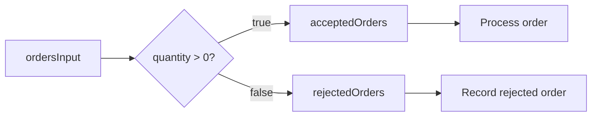

# Discard Channel in Spring Integration Filter

In the **SPRING_INTEGRATION_CORE** module, the **Filter** chapter progresses from deciding whether to accept a message to handling rejected messages. This lesson focuses on the **discard channel**: the branch receiving messages that do not pass the filter, so the application can track, store, or process them according to business rules.

The running example is an order ingestion flow. Orders with a positive quantity go to the main processing step; orders with an invalid quantity take a separate branch. Through this example, we connect the core components: `Message`, `MessageChannel`, endpoints, Java DSL, error handling, and testing.

## 1. Learning objectives

After this lesson, you can:

- Configure a discard channel for a filter using Java DSL.
- Explain the relationship between `discardChannel` and `throwExceptionOnRejection`.
- Choose synchronous or queued processing for rejected messages.
- Distinguish business rejection from execution errors and gateway replies.
- Test both the accepted branch and the rejected branch.

## 2. What is a discard channel?

A filter calls a selector to decide whether a message should continue. When the selector returns `false`, the discard channel is the destination that receives the rejected message if configured. The name "discard" describes removing the message from the main flow; that branch can still perform useful work. [Filter documentation](https://docs.spring.io/spring-integration/reference/filter.html)



In the example design:

- `ordersInput` receives incoming messages.
- The filter is the endpoint applying the quantity rule.
- `acceptedOrders` is the main flow output.
- `rejectedOrders` serves as the discard channel.

A discard channel is **a channel's role in a filter configuration**, not a specialized channel class. Therefore, deciding "where rejected orders go" and deciding "how that branch runs" must be designed together.

One suitable use is storing invalid orders for operators to inspect. If the business requirement is classifying orders across multiple shipping regions, payment methods, or priority tiers, a router usually expresses intent more clearly than a chain of filters.

## 3. Behavior when the selector returns false

Two settings must be viewed together: the discard destination and the `throwExceptionOnRejection` flag:

| Selector result | Discard channel | Throw exception flag | Behavior |
| --- | --- | --- | --- |
| `true` | Any | Any | Continues on the main branch |
| `false` | None | `false` | No output message |
| `false` | Present | `false` | Sends message to the discard branch |
| `false` | None | `true` | Throws `MessageRejectedException` |
| `false` | Present | `true` | Sends to discard, then throws `MessageRejectedException` |

The default value of the exception flag is `false`. Having a discard channel does not disable this flag. The ordering in the last row assumes the discard send completes normally; if that send itself fails, a send error or consumer error may surface first. [MessageFilter API](https://docs.spring.io/spring-integration/api/org/springframework/integration/filter/MessageFilter.html)

In the order problem, choose configuration according to contract:

- Invalid orders are an expected business outcome: usually record on discard and do not throw.
- Caller must immediately observe rejection via an exception: consider enabling the exception flag.
- Both record and report an error: account for the caller possibly resending the same order.

Do not interpret "no exception" as "order accepted". Those are two different signals.

## 4. Complete Java DSL example

### 4.1. Requirements

The example uses Java 17, Spring Integration 6.x, and JUnit Jupiter for tests. The application requires the `org.springframework.integration:spring-integration-core` dependency; the Spring version should be governed by your project's BOM or dependency management configuration.

Spring Boot is not required to bootstrap the example. `AnnotationConfigApplicationContext` will be used in the test section to create and close the context.

### 4.2. Flow configuration

Save the class below as `OrderFilterConfiguration.java` in package `example.integration` when practicing:

```java
package example.integration;

import org.springframework.context.annotation.Bean;
import org.springframework.context.annotation.Configuration;
import org.springframework.integration.channel.DirectChannel;
import org.springframework.integration.channel.QueueChannel;
import org.springframework.integration.config.EnableIntegration;
import org.springframework.integration.dsl.IntegrationFlow;

@Configuration
@EnableIntegration
public class OrderFilterConfiguration {

    public record Order(String orderId, int quantity) {
    }

    @Bean
    public DirectChannel ordersInput() {
        return new DirectChannel();
    }

    @Bean
    public QueueChannel acceptedOrders() {
        return new QueueChannel(100);
    }

    @Bean
    public QueueChannel rejectedOrders() {
        return new QueueChannel(100);
    }

    @Bean
    public IntegrationFlow orderValidationFlow() {
        return IntegrationFlow.from(ordersInput())
                .filter(
                        Order.class,
                        order -> order.quantity() > 0,
                        spec -> spec
                                .id("positiveQuantityFilter")
                                .discardChannel(rejectedOrders())
                                .throwExceptionOnRejection(false))
                .channel(acceptedOrders())
                .get();
    }
}
```

Here, the two `QueueChannel` instances are observation destinations so the example can pull each outcome for verification. They do not yet represent long-term business storage.

Java DSL allows `discardChannel(...)` to take either a `MessageChannel` instance or a bean name. With naming, the corresponding configuration is `discardChannel("rejectedOrders")`. Additionally, `discardFlow(...)` lets you declare a processing subflow directly instead of a shared channel. [FilterEndpointSpec API](https://docs.spring.io/spring-integration/api/org/springframework/integration/dsl/FilterEndpointSpec.html)

### 4.3. Interpreting two sends

With payload `new Order("ORD-101", 2)`, the condition is true. The message appears in `acceptedOrders`; no copy is sent to `rejectedOrders`.

With payload `new Order("ORD-102", 0)`, the condition is false. The message appears in `rejectedOrders`; it does not appear at the main output.

The example deliberately checks only quantity. If you need to validate order ID and additional fields as well, define clear rules before expanding the selector. A filter with too many conditions makes it hard for operators to know precisely why an order was rejected.

## 5. Testing both branches with real messages

The tests below use the same package as the configuration class. They verify message destination, payload, and trace headers rather than only checking the predicate's boolean return value.

```java
package example.integration;

import org.junit.jupiter.api.Test;
import org.springframework.context.annotation.AnnotationConfigApplicationContext;
import org.springframework.integration.channel.DirectChannel;
import org.springframework.integration.channel.QueueChannel;
import org.springframework.messaging.Message;
import org.springframework.messaging.support.MessageBuilder;

import static org.junit.jupiter.api.Assertions.*;

class OrderFilterConfigurationTest {

    @Test
    void validOrderGoesOnlyToAcceptedChannel() {
        try (var context = new AnnotationConfigApplicationContext(
                OrderFilterConfiguration.class)) {

            var input = context.getBean("ordersInput", DirectChannel.class);
            var accepted = context.getBean("acceptedOrders", QueueChannel.class);
            var rejected = context.getBean("rejectedOrders", QueueChannel.class);

            var order = new OrderFilterConfiguration.Order("ORD-101", 2);
            Message<?> request = MessageBuilder.withPayload(order)
                    .setHeader("traceId", "trace-accepted")
                    .build();

            assertTrue(input.send(request, 1_000));

            Message<?> result = accepted.receive(1_000);
            assertNotNull(result);
            assertEquals(order, result.getPayload());
            assertEquals("trace-accepted", result.getHeaders().get("traceId"));
            assertNull(rejected.receive(0));
        }
    }

    @Test
    void invalidOrderGoesOnlyToDiscardChannel() {
        try (var context = new AnnotationConfigApplicationContext(
                OrderFilterConfiguration.class)) {

            var input = context.getBean("ordersInput", DirectChannel.class);
            var accepted = context.getBean("acceptedOrders", QueueChannel.class);
            var rejected = context.getBean("rejectedOrders", QueueChannel.class);

            var order = new OrderFilterConfiguration.Order("ORD-102", 0);
            Message<?> request = MessageBuilder.withPayload(order)
                    .setHeader("traceId", "trace-rejected")
                    .build();

            assertTrue(input.send(request, 1_000));

            Message<?> result = rejected.receive(1_000);
            assertNotNull(result);
            assertEquals(order, result.getPayload());
            assertEquals(request.getHeaders().getId(),
                    result.getHeaders().getId());
            assertEquals("trace-rejected", result.getHeaders().get("traceId"));
            assertNull(accepted.receive(0));
        }
    }
}
```

Each test creates a fresh context so no messages remain from previous tests. In this configuration, the filter is invoked via `DirectChannel`; placing the message onto the target queue finishes before `send` returns. Hence checking the opposite queue with `receive(0)` is meaningful here.

A `true` value from `input.send(...)` appears in both tests. That illustrates that successful delivery to the endpoint does not mean the message was accepted by the selector.

### 5.1. Testing discard combined with throwing an exception

The following standalone test can be placed in another test class in the same package:

```java
package example.integration;

import org.junit.jupiter.api.Test;
import org.springframework.integration.MessageRejectedException;
import org.springframework.integration.channel.QueueChannel;
import org.springframework.integration.filter.MessageFilter;
import org.springframework.messaging.Message;
import org.springframework.messaging.support.MessageBuilder;

import static org.junit.jupiter.api.Assertions.*;

class DiscardAndRejectTest {

    @Test
    void sendsToDiscardBeforeThrowingRejection() {
        var discarded = new QueueChannel(10);
        var filter = new MessageFilter(message -> false);
        filter.setDiscardChannel(discarded);
        filter.setThrowExceptionOnRejection(true);
        filter.afterPropertiesSet();

        Message<?> request = MessageBuilder
                .withPayload("invalid-order")
                .build();

        MessageRejectedException error = assertThrows(
                MessageRejectedException.class,
                () -> filter.handleMessage(request));

        Message<?> discardedMessage = discarded.receive(0);
        assertNotNull(discardedMessage);
        assertEquals(request.getPayload(), discardedMessage.getPayload());
        assertEquals(request.getHeaders().getId(),
                discardedMessage.getHeaders().getId());
        assertEquals(request, error.getFailedMessage());
    }
}
```

This test isolates `MessageFilter` behavior without starting the full application. It does not prove that consumer side effects will survive rollback in a real transaction; transactions and storage mechanisms must be tested separately according to deployment configuration.

## 6. Reading rejected messages and recording reasons

The discard consumer receives the rejected message, not an `ErrorMessage` by default. In the example, the payload is still `Order`, and the `traceId` header links back to the original send.

The application should define a structured rejection record. For example:

```java
public record RejectedOrder(
        String orderId,
        String reasonCode,
        String traceId) {
}
```

With a filter checking only quantity as in the example, the discard branch can construct the record:

```java
var order = (OrderFilterConfiguration.Order) message.getPayload();

var rejection = new RejectedOrder(
        order.orderId(),
        "NON_POSITIVE_QUANTITY",
        message.getHeaders().get("traceId", String.class));
```

The `message` variable above is the parameter the discard consumer is processing. `RejectedOrder` is an application-defined model; the filter does not generate this `reasonCode` field automatically.

If a selector has multiple conditions, a single `false` does not carry enough information to explain each cause. In that case, you can place a transformer before the filter to produce an evaluation result containing the original data, validity flag, and reason code. The filter simply reads the flag; the discard branch uses the computed reason code.

This structure also avoids having the consumer re-evaluate rules against external data that may have changed. For example, inventory balance read a second time could differ from when the selector decided.

When practicing, start with three pieces of information: order ID, reason code, and trace ID. Add more data to the record only if it helps lookup or reprocessing.

## 7. Choosing a channel for the discard branch

Basic channel behaviors to distinguish:

| Channel type | Key characteristic |
| --- | --- |
| `DirectChannel` | Invokes consumer on the sender's thread |
| `QueueChannel` | Enqueues messages for later retrieval |
| `ExecutorChannel` | Hands work off to an executor |
| `PublishSubscribeChannel` | Broadcasts to subscribers |
| `nullChannel` | Consumes and discards the message |

A bounded `QueueChannel` can block senders when full; send timeouts must be considered. In-memory queues are not durable across restarts. `DirectChannel` does not broadcast simultaneously to multiple consumers. [Message Channel Implementations](https://docs.spring.io/spring-integration/reference/channel/implementations.html)

Applying this to the order problem:

- Use `DirectChannel` if the recording step is small and must complete before returning control to the caller.
- Use a queue if you want to decouple ingestion speed from rejected-record processing speed.
- Use publish-subscribe if both an analytics component and a rejection-handling component must receive every event.
- Use `nullChannel` when the requirement is truly to drop the message and rejection-rate observability is already established.

In the example in section 4, there is no background consumer yet for `rejectedOrders`. The test calls `receive` directly. In an application, if you choose an endpoint reading from a `QueueChannel`, configure an appropriate poller and processing rate.

For data that must be recoverable after incidents, design requirements should specify durable persistence, retention period, and replay procedures. Merely naming a queue `rejectedOrders` does not meet those requirements.

Also note: the timeout passed to `input.send(...)` in the test is not an overall deadline for all downstream consumers, I/O calls, and subsequent sends.

## 8. Distinguishing discard channel from errorChannel

Three distinct situations require separate handling:

| Situation | Nature | Example |
| --- | --- | --- |
| Selector returns `false` | Rejected by rule | Order quantity is 0 |
| Selector throws an exception | Could not execute check | Condition-checking service failed |
| Discard branch consumer throws an exception | Could not complete rejection handling | Record store unreachable |

The error-handling mechanism can wrap an exception into an `ErrorMessage`; its payload is then the error. In a synchronous flow over `DirectChannel`, exceptions typically propagate back to the caller. For asynchronous processing, an error-routing mechanism via messages is required per endpoint or gateway configuration. Not every exception automatically shows up on the global `errorChannel`. [Error Handling](https://docs.spring.io/spring-integration/reference/error-handling.html)

A suitable design for the example:

1. Orders with invalid quantity go to `rejectedOrders`.
2. That branch constructs a `RejectedOrder` record.
3. If persistence fails, the storage failure itself follows the technical error policy.
4. Rejected orders and recording failures are counted by two separate metrics.

Do not configure the discard channel to be the global `errorChannel` if consumers expect `ErrorMessage`. Doing so easily creates a payload contract conflict: one side sends `Order`, while the other reads exceptions.

## 9. Retry, advice, and duplicate handling

By default, the discard action and rejection exception throwing sit inside the filter's request-handler advice scope. If there is a retry advice and a synchronous downstream discard consumer throws an exception, the whole step may be retried. `discardWithinAdvice(false)` moves the discard action and rejection exception outside that advice scope. [Advising Filters](https://docs.spring.io/spring-integration/reference/handler-advice/advising-filters.html)

A scenario to analyze before adding retries:

1. On the first attempt, order `ORD-102` is rejected and recorded in the tracking system.
2. A subsequent step within the same retry scope fails.
3. Retry re-executes the recording step.
4. The system ends up with two records for the same event if deduplication is missing.

In this case, you can choose a unique key based on event ID and rule code. If an order is fixed and resubmitted validly, the new event ID must be distinguishable from the prior submission; using only `orderId` as the key could mistakenly block a valid update.

Illustrative configuration given an existing advice bean named `validationAdvice`:

```java
.filter(
        OrderFilterConfiguration.Order.class,
        order -> order.quantity() > 0,
        spec -> spec
                .discardChannel("rejectedOrders")
                .advice(validationAdvice)
                .discardWithinAdvice(false))
```

This replaces the filter snippet rather than being a standalone configuration. You must provide `validationAdvice` of type `org.aopalliance.aop.Advice` when integrating.

Setting `discardWithinAdvice(false)` does not eliminate all possibilities of duplicate delivery. The caller, broker, or an outer advice wrapping this scope may still re-run the flow. If the discard branch only puts into a queue, errors from a consumer running later are not automatically handled by the filter's retry advice either.

The guiding rule is: a retry must be capable of changing the outcome. Resending an order with quantity 0 without changing the data usually just produces the exact same rejection again.

## 10. Discard in a flow with a gateway

A gateway with a return value expects an appropriate reply. If a request is blocked by a filter and the discard branch only records it, the gateway may wait until timeout. Storing a rejected message does not automatically generate a business reply. [Messaging Gateways](https://docs.spring.io/spring-integration/reference/gateway.html)

Suppose the API requires:

```text
submit(order) -> OrderResult
```

You should explicitly define a result such as:

```java
public record OrderResult(
        String orderId,
        String status,
        String reasonCode) {
}
```

You can pick one of these designs:

| Desired contract | Organization |
| --- | --- |
| Send event, do not wait for business result | One-way gateway or asynchronous input |
| Return acceptance or rejection result | Both branches construct `OrderResult` and route to the reply destination |
| Signal rejection via exception | Enable exception flag and align how the gateway propagates or maps errors |

If using the discard branch to build a rejection response, explicitly wire the result back to the reply channel and preserve needed correlation info. A DSL branch ending in a log-only handler does not satisfy a contract returning `OrderResult`.

The example in section 4 sends messages and observes two queues; it is not yet a complete request-reply flow for a gateway. When switching to a gateway, redesign the reply path for both valid and rejected orders.

## 11. Impact of placing a filter before an aggregator

An aggregator typically waits for a group of messages to meet a condition before emitting a result. With the default sequence-based strategy, filtering out an element after a splitter can leave the group short compared to `sequenceSize`. [Aggregator](https://docs.spring.io/spring-integration/reference/aggregator.html)

An example traced from this model:

```text
A group of 3 order lines
  -> splitter produces 3 messages, sequenceSize = 3
  -> filter sends the second line to discard
  -> main branch aggregator receives only 2 messages
```

The discard branch recorded the invalid line, yet the main group is still missing an item. Recording rejections and completing aggregation are two tasks that must be coordinated.

Some design directions:

- Validate the whole order before splitting lines, if the rule applies to the entire order.
- Include both valid and invalid outcomes in the result set to be aggregated.
- Use a release strategy and timeout policy matching a partial-processing contract.

Do not arbitrarily mutate `sequenceSize` on the remaining messages. In a three-line example, the system needs a reliable way to know which results the group should wait for.

## 12. Observing and operating the discard branch

For the order flow, operational questions should have concrete answers:

| Question | Data to track |
| --- | --- |
| How many orders are rejected? | Counters by rule code |
| Is the rejection rate spiking unusually? | Rejection count relative to check count over the same window |
| Is the recording branch falling behind? | Queue depth and message age |
| Where is a specific submission? | Event ID, `orderId`, `traceId` |
| Once data is fixed, how is it reprocessed? | Resubmission process and new event identification |

Define whether counters measure **attempts** or **unique events**. When retries occur, these two numbers diverge. For example, one order retried three times is not necessarily three distinct business orders.

Spring Integration does not automatically generate a complete audit model, reason codes, and replay workflow from `discardChannel` configuration alone. Those parts belong to application design.

A useful extended exercise is replacing the test's queue read with a consumer that writes `RejectedOrder`, and then observing what happens when that consumer cannot keep up with the rejection rate.

## 13. Common issues and how to check them

| Symptom | What to inspect |
| --- | --- |
| No orders appear on the main branch | Is the selector rejecting them; is the discard branch receiving them? |
| Discard configured, yet caller still gets an error | Exception flag, discard send failure, or consumer exception |
| Rejection queue grows continuously | Consumer, poller, processing speed, and capacity policy |
| Multiple records for the same event | Retries across all layers and deduplication keys |
| Gateway waits long on invalid orders | Does the rejection branch return the proper reply? |
| Aggregator never completes groups | Count of dropped items and release condition |
| `errorChannel` handler reads wrong type | Is a business payload being sent directly to the error channel? |

When diagnosing, trace one event ID from input to final destination. Looking only at `send`'s return value or only at input logs is not enough to determine which branch an order took.

## 14. Self-practice

Use the configuration in section 4 and tests in section 5 to perform these steps in order:

1. Send orders with quantities `1`, `0`, and `-1`; confirm exactly one branch receives each order.
2. Add a `sourceSystem` header; verify the discard branch can still read this header.
3. Enable `throwExceptionOnRejection(true)`; verify the rejected order still reaches discard when the send succeeds.
4. Replace the discard branch with a synchronous consumer that can throw; distinguish consumer errors from the selector's `false` outcome.
5. Propose an `OrderResult` contract for a gateway and sketch the reply path for both branches.

What you should be able to explain is **where rejected orders are handled, what signal the caller observes, and what happens if the rejection-handling branch fails**.