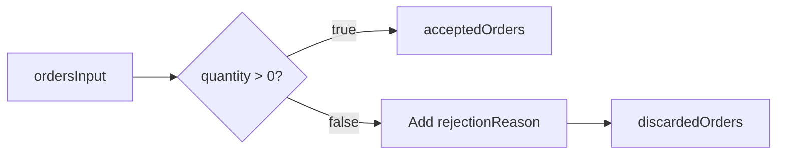

# Discard Flow in Spring Integration

In the **Filter** chapter of the **SPRING_INTEGRATION_CORE** module, a discard flow is a processing branch dedicated to messages that fail the filter condition. Instead of merely stopping the message, we can store the rejection reason, record a business event, or forward the data for separate handling.

This lesson focuses on coordinating `Message`, `MessageChannel`, the filter endpoint, and Java DSL to design this branch. The running example ingests orders: positive quantities are accepted; zero or negative quantities go into separate order rejection handling.

## 1. What does a discard flow solve?

Suppose the system receives three orders:

| Order ID | Quantity | Business requirement |
| --- | ---: | --- |
| ORD-101 | 3 | Allow further processing |
| ORD-102 | 0 | Reject and record reason |
| ORD-103 | -2 | Reject and record reason |

A filter only needs to decide acceptance or rejection. In Spring Integration, if the selector returns `true`, the message is forwarded via the normal output; if it returns `false`, the message is rejected and the discard policy is applied. [Filter documentation](https://docs.spring.io/spring-integration/reference/filter.html).

A discard flow expresses the requirement "reject and record reason" as a structured branch:



In this example, `discardedOrders` receives rejected orders for inspection or later handling. It does not automatically become a broker dead-letter queue. If a messaging broker queue is required, add the corresponding adapter and persistence policy.

A discard flow fits when "not proceeding" is still a business outcome that must be tracked: out-of-scope data, ineligible transactions, or detected duplicate events.

## 2. Selector, discard channel, and discard flow

Three concepts have distinct roles:

| Component | Responsibility |
| --- | --- |
| Selector | Evaluates the condition to accept a message |
| Discard channel | Specifies the channel receiving rejected messages |
| Discard flow | Describes the rejection branch's processing steps inline in the DSL configuration |

`discardFlow(IntegrationFlow)` is an alternative to `discardChannel(...)` on `FilterEndpointSpec`. For a given filter, choose one way to configure the rejection branch. [FilterEndpointSpec API](https://docs.spring.io/spring-integration/api/org/springframework/integration/dsl/FilterEndpointSpec.html).

Do not think of a discard flow like a `catch` block: it runs when the selector returns `false`. If the selector fails to evaluate the data and throws an exception, handling follows the error mechanism; the discard branch is not automatically invoked to replace that error. [MessageFilter API](https://docs.spring.io/spring-integration/api/org/springframework/integration/filter/MessageFilter.html).

The rejection branch receives the filtered-out message, not an `ErrorMessage` by default. Nor does the filter automatically generate business reason codes. With the rule "quantity must be positive", the application can set `rejectionReason=NON_POSITIVE_QUANTITY`; when multiple rules exist, an explicit evaluation result model is needed.

## 3. Complete Java DSL example

The example uses `IntegrationFlow.from(...)` syntax from Spring Integration 6+ and Java records. The project needs `spring-integration-core`, Spring Context, and a JDK compatible with the Spring version in use. If using Spring Boot, you can bring in the integration dependencies via `spring-boot-starter-integration` and let the project's dependency management decide versions.

To focus on the discard flow, assume the input payload is already an `Order` and `orderId` was checked at the ingestion boundary. This lesson filters solely by `quantity`.

```java
package example.integration;

import org.springframework.beans.factory.annotation.Qualifier;
import org.springframework.context.annotation.Bean;
import org.springframework.context.annotation.Configuration;
import org.springframework.integration.annotation.EnableIntegration;
import org.springframework.integration.channel.DirectChannel;
import org.springframework.integration.channel.QueueChannel;
import org.springframework.integration.dsl.IntegrationFlow;
import org.springframework.messaging.MessageChannel;

@Configuration(proxyBeanMethods = false)
@EnableIntegration
public class OrderDiscardConfiguration {

    public record Order(String orderId, int quantity) {
    }

    @Bean
    public MessageChannel ordersInput() {
        return new DirectChannel();
    }

    @Bean
    public QueueChannel acceptedOrders() {
        return new QueueChannel(100);
    }

    @Bean
    public QueueChannel discardedOrders() {
        return new QueueChannel(100);
    }

    @Bean
    public IntegrationFlow orderFlow(
            @Qualifier("ordersInput") MessageChannel input,
            @Qualifier("acceptedOrders") QueueChannel accepted,
            @Qualifier("discardedOrders") QueueChannel discarded) {

        return IntegrationFlow.from(input)
                .filter(Order.class,
                        order -> order.quantity() > 0,
                        endpoint -> endpoint
                                .id("positiveQuantityFilter")
                                .throwExceptionOnRejection(false)
                                .discardFlow(rejected -> rejected
                                        .enrichHeaders(headers -> headers.header(
                                                "rejectionReason",
                                                "NON_POSITIVE_QUANTITY"))
                                        .channel(discarded)))
                .channel(accepted)
                .get();
    }
}
```

Trace the configuration along an order's path:

1. `ordersInput` receives `Message<Order>`.
2. The filter checks the quantity.
3. If valid, the message proceeds to `acceptedOrders`.
4. If rejected, the `rejected` branch adds the reason header and sends to `discardedOrders`.

The `.channel(accepted)` line after the filter belongs to the accepted branch. The discard branch does not return to that line automatically. Therefore, storing a rejected order does not turn it into a valid order.

Java DSL supports subflows to describe branches right inside the configuration; the framework creates the necessary wiring between the filter and the discard branch. You do not need to name an intermediate channel manually in the example above. [Sub-flows support documentation](https://docs.spring.io/spring-integration/reference/dsl/java-subflows.html).

The two `QueueChannel` beans at the end serve to observe results. The exercise pulls messages via `receive(...)`, so no poller is needed. When replacing manual reads with an endpoint consuming from the queue, configure a polling mechanism for that endpoint.

### Which message is retained?

The rejected message still has the `Order` payload. The branch only adds the `rejectionReason` header so downstream handlers still know which order and data were rejected.

A custom header like `requestId` is useful for correlating inputs and outcomes. Do not rely on the assumption that "every message's technical ID always stays identical" when designing tracing: creating new messages across processing steps can change the ID. In this example, the correlation key is the application-assigned `requestId`.

## 4. Testing both branches of the example

The two tests below use JUnit Jupiter. Place them in the same package as the configuration in the previous section. Each test creates a separate application context so queues do not retain results from other tests.

```java
package example.integration;

import org.junit.jupiter.api.Test;
import org.springframework.context.annotation.AnnotationConfigApplicationContext;
import org.springframework.integration.channel.QueueChannel;
import org.springframework.messaging.Message;
import org.springframework.messaging.MessageChannel;
import org.springframework.messaging.support.MessageBuilder;

import example.integration.OrderDiscardConfiguration.Order;

import static org.junit.jupiter.api.Assertions.*;

class OrderDiscardFlowTest {

    @Test
    void forwardsAcceptedOrderOnly() {
        try (var context = new AnnotationConfigApplicationContext(
                OrderDiscardConfiguration.class)) {

            var input = context.getBean("ordersInput", MessageChannel.class);
            var accepted = context.getBean("acceptedOrders", QueueChannel.class);
            var discarded = context.getBean("discardedOrders", QueueChannel.class);

            var order = new Order("ORD-101", 3);
            var request = MessageBuilder.withPayload(order)
                    .setHeader("requestId", "REQ-101")
                    .build();

            assertTrue(input.send(request, 1000));

            Message<?> result = accepted.receive(1000);
            assertNotNull(result);
            assertEquals(order, result.getPayload());
            assertEquals("REQ-101", result.getHeaders().get("requestId"));
            assertNull(result.getHeaders().get("rejectionReason"));
            assertNull(discarded.receive(0));
        }
    }

    @Test
    void capturesRejectedOrderWithReason() {
        try (var context = new AnnotationConfigApplicationContext(
                OrderDiscardConfiguration.class)) {

            var input = context.getBean("ordersInput", MessageChannel.class);
            var accepted = context.getBean("acceptedOrders", QueueChannel.class);
            var discarded = context.getBean("discardedOrders", QueueChannel.class);

            var order = new Order("ORD-102", 0);
            var request = MessageBuilder.withPayload(order)
                    .setHeader("requestId", "REQ-102")
                    .build();

            assertTrue(input.send(request, 1000));

            Message<?> result = discarded.receive(1000);
            assertNotNull(result);
            assertEquals(order, result.getPayload());
            assertEquals("REQ-102", result.getHeaders().get("requestId"));
            assertEquals("NON_POSITIVE_QUANTITY",
                    result.getHeaders().get("rejectionReason"));
            assertNull(accepted.receive(0));
        }
    }
}
```

Each test checks both where a message must appear and where it must be absent. Checking only "logged rejection" does not prove a rejected order did not leak into the accepted branch.

`input.send(...)` succeeding in the second test does not mean the order was accepted by business rules. With this configuration, the filter handled the rejection outcome and successfully sent it to the discard branch.

These test snippets are practice code for learners; reading the article does not mean they have been executed in a project.

## 5. Choosing discardFlow vs. discardChannel

Use `discardFlow` when the branch is short and tightly coupled to the filter condition. The current example does only two things: add a reason and send to the rejected-orders destination.

When multiple filters need to share a single destination, a named discard channel establishes a clearer configuration boundary. The example below is an alternative to the filter part in `orderFlow`:

```java
.filter(Order.class,
        order -> order.quantity() > 0,
        endpoint -> endpoint
                .throwExceptionOnRejection(false)
                .discardChannel("rejectedOrders"))
.channel(accepted)
```

Define a separate flow in the same configuration class:

```java
@Bean
public IntegrationFlow rejectedOrdersFlow(
        @Qualifier("discardedOrders") QueueChannel discarded) {

    return IntegrationFlow.from("rejectedOrders")
            .enrichHeaders(headers -> headers.header(
                    "rejectionReason",
                    "NON_POSITIVE_QUANTITY"))
            .channel(discarded)
            .get();
}
```

In this alternative, `rejectedOrders` is the input to the dedicated rejection-handling flow; `discardedOrders` remains the queue receiving final results.

The fixed reason code above only fits when every message entering the flow was rejected by the same quantity rule. If shared across multiple filters, each source must provide the right reason code before sending to the shared channel, or send an object containing the evaluation result.

## 6. Ending a discard flow intentionally

A rejection branch can terminate in one of the following ways:

| Ending | Design meaning |
| --- | --- |
| Send to a queue | Retain the message for another consumer to pick up |
| Call a non-replying handler | Complete a task such as recording the rejection |
| Send to `nullChannel` | Intentionally drop the message after needed steps |
| Send a result to the reply channel | Return a rejection reply per the designed contract |

If you only need to log and drop the message, you can replace the branch in the example with the snippet below. When placed inside `OrderDiscardConfiguration`, `Order` refers to the record declared in section 3.

```java
.discardFlow(rejected -> rejected
        .log(org.springframework.integration.handler.LoggingHandler.Level.INFO,
                "orders.rejected",
                message -> "Rejected orderId="
                        + ((Order) message.getPayload()).orderId()
                        + ", reason=NON_POSITIVE_QUANTITY")
        .nullChannel())
```

Since Spring Integration 6.0, `.log()` at the end of a flow behaves consistently with being mid-flow; do not treat it as a one-way terminating step. For a branch that only logs and drops, `.nullChannel()` explicitly marks the end and avoids further processing under reply mechanics. [Operator log() documentation](https://docs.spring.io/spring-integration/reference/dsl/java-log.html).

Transforming the payload in the rejection branch should also have a clear purpose. If converting `Order` into a rejection record for storage, keep the order ID, reason code, and trace ID. There is no need to carry full customer data into a log meant solely for counting rejected orders.

## 7. Relationship with throwExceptionOnRejection

`throwExceptionOnRejection` controls whether the filter raises an error when the selector returns `false`.

| Selector | Discard branch present | throwExceptionOnRejection | Result |
| --- | --- | --- | --- |
| `true` | Yes or no | Any | Goes to normal output |
| `false` | No | `false` | Dropped from normal path |
| `false` | Yes | `false` | Sent to discard branch |
| `false` | No | `true` | Throws `MessageRejectedException` |
| `false` | Yes | `true` | Executes discard, then throws rejection exception if discard did not fail first |

By default this flag is `false`. Configuring a discard channel does not disable the exception flag. [FilterEndpointSpec API](https://docs.spring.io/spring-integration/api/org/springframework/integration/dsl/FilterEndpointSpec.html).

For the requirement "an invalid order is a normal business outcome", the example chooses `false`. If the contract requires callers to receive a rejection error, consider `true` and the entry point's error handling.

When there is neither a discard channel nor exception throwing on rejection, the message does not continue. Since version 6.1, the filter logs a warning for this case; you can configure `nullChannel` as the discard channel to indicate an intentional drop. [Filter documentation](https://docs.spring.io/spring-integration/reference/filter.html).

Do not enable exception throwing merely to gather metrics. For instance, an order with zero quantity does not become valid when immediately resent with the same data; unconditional retries only increase load.

## 8. Distinguishing business rejection from processing errors

These two situations need different policies:

| Situation | Example | Handling direction |
| --- | --- | --- |
| Fails condition | `quantity == 0` | Record business rejection |
| Cannot complete processing step | Rejection record store disconnected | Apply chosen error, retry, or recovery policy |

If the recording step in the discard flow throws an exception, `throwExceptionOnRejection(false)` does not swallow that exception. This flag only controls exceptions raised due to the filter's rejection decision.

How the caller observes errors depends on the path:

- With `DirectChannel`, the handler runs on the sender's thread, so exceptions can propagate back to the caller.
- Across an asynchronous boundary, errors occur in downstream execution tasks. Spring Integration's error mechanism can create an `ErrorMessage`, preferring the channel from the `errorChannel` header, and falling back to the global error channel as configured. [Error Handling documentation](https://docs.spring.io/spring-integration/reference/error-handling.html).

Therefore, an `errorChannel` header does not automatically turn every exception from a synchronous `send` call into an error message. Identify which endpoint, executor, or poller is responsible for error handling.

In the order design, you can separate two operational codes: `NON_POSITIVE_QUANTITY` for rejected data and `REJECTION_STORE_UNAVAILABLE` for failing to save the rejection outcome. These two codes lead to two different operator actions.

## 9. A request-reply gateway needs a clear result

Suppose a gateway has a method returning `OrderResult`. The valid branch produces a result, while the rejection branch only logs and ends. The caller then gets no business reply from the rejection branch and may wait until reply timeout.

Completing the discard flow does not automatically create an `OrderResult`. Choose an appropriate contract:

- If only accepting commands, a gateway returning `void` expresses one-way communication. That does not by itself make processing asynchronous.
- If the caller needs to know the outcome, design a properly typed rejection reply, such as `OrderResult(orderId, REJECTED, reason)`, and ensure it is sent to the reply channel.
- If the contract uses exceptions, combine the rejection policy with the gateway's error handling configuration.

The gateway uses the reply channel and timeout to wait for a response; the final behavior when no reply arrives also depends on gateway configuration. [Messaging Gateways documentation](https://docs.spring.io/spring-integration/reference/gateway.html).

The queue example in section 3 serves to observe two outputs, not yet a reply-returning gateway design. Do not tack on a method returning `OrderResult` to that example and expect queues to reply automatically.

Also control data types: if the final handler of the rejection branch returns a string `"saved"`, that string must not accidentally become the reply to a gateway expecting a business result object.

## 10. Queues, execution threads, and persistence

The name "flow" only describes processing structure. It does not create dedicated threads on its own.

`DirectChannel` calls the consumer on the sender's thread. `QueueChannel` holds messages for a consumer to receive later; queues live in memory by default. When data must survive application restarts, choose durable storage configuration or connect to a suitable messaging system. [Message Channel Implementations documentation](https://docs.spring.io/spring-integration/reference/channel/implementations.html).

In the example:

- Condition evaluation and header enrichment occur before `send` finishes.
- The two queues only hold results in the application context's memory.
- No consumer automatically processes orders in the queues yet.

For a real system, answer three design questions:

1. Must rejected orders survive application restarts?
2. When the rejection store is slow or full, should ingestion wait, fail, or spill to fallback storage?
3. If the same message is reprocessed, may the rejection record appear multiple times?

The answers dictate storage choices, queue bounds, and deduplication keys. One option for a business record is `orderId + validationRuleVersion`, if business rules confirm this pair uniquely identifies an evaluation worth storing.

Sending a message to a queue does not by itself prove the rejection record was committed to a database. If atomicity across two resources is required, design transactions or corresponding delivery guarantees.

## 11. Retry advice can encompass the discard branch

When advice is attached to a filter, advice scope is important to understand. By default, the discard action and rejection exception fall within the advice scope; errors in a synchronous discard branch can trigger retries. Configuring `discardWithinAdvice(false)` moves the discard action and rejection exception outside the filter's advice scope. [Advising Filters documentation](https://docs.spring.io/spring-integration/reference/handler-advice/advising-filters.html).

Example showing configuration placement, not a complete retry configuration:

```java
.filter(Order.class,
        order -> order.quantity() > 0,
        endpoint -> endpoint
                .discardWithinAdvice(false)
                .discardFlow(rejected -> rejected
                        .channel("discardedOrders")))
```

In this snippet, if no advice is attached, toggling the flag does not create retries by itself. When retries are present, identify precisely which operation needs retrying.

For example, sending a rejection notification succeeding while audit logging fails can lead to sending duplicate notifications if the whole branch reruns. Designing idempotent result persistence or placing retry around the specific recoverable operation yields more predictable behavior.

The `discardWithinAdvice` flag is not a system-wide transaction switch, nor does it propagate transactions across thread boundaries.

## 12. Extended practice

Use the configuration in section 3 as a starting point:

1. Add a negative-quantity test case and verify the reason header.
2. Replace the rejected-orders receiver with a handler that stores a record containing order ID, reason, and `requestId`.
3. Simulate the storage handler throwing an exception to observe how the caller receives the error on the synchronous path.
4. If the business requires a reply, design a shared `OrderResult` type for both accepted and rejected outcomes, then define the return path for each branch.

When scaling to multiple rules, you can evaluate the data once into a `ValidationResult` containing status and reason code. The filter decides based on the evaluated status, while the discard flow persists that result. This avoids having the selector and rejection branch recompute rules differently.

Completion criteria for the exercise: valid orders appear only on the accepted branch; invalid orders carry an explicit reason; technical errors have a defined handling path; every request-reply contract has an ending the caller understands.