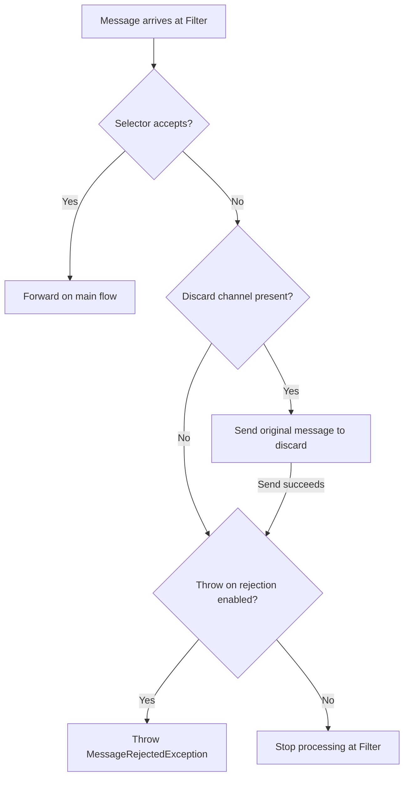

# throw-exception-on-rejection: Raising an Error When a Filter Rejects a Message

In Spring Integration, a Filter can reject a message because a business condition is not met. The `throw-exception-on-rejection` attribute decides whether that rejection outcome becomes an exception. This is an important choice when designing the contract between the sender, the filter endpoint, and the error-handling flow.

This lesson belongs to the **Filter** chapter of the **SPRING_INTEGRATION_CORE** module. It focuses on configuring rejection policies, observing outcomes through `MessageChannel`, handling errors at gateways, and testing flows with Java DSL.

## 1. Filter result and rejection policy

A Filter uses a selector to decide whether a message proceeds on the main flow. Returning `true` from the selector allows forwarding; returning `false` triggers the rejection policy. The Filter forwards the accepted message rather than using the boolean result as the output payload. See the [Filter documentation](https://docs.spring.io/spring-integration/reference/filter.html).

Ways to set the same option:

| Configuration style | Syntax |
| --- | --- |
| XML | `throw-exception-on-rejection="true"` |
| Java DSL | `.throwExceptionOnRejection(true)` |
| `MessageFilter` instance | `setThrowExceptionOnRejection(true)` |
| `@Filter` annotation | `throwExceptionOnRejection = "true"` |

The default value is `false`. When `true` is selected and the selector returns `false`, `MessageFilter` throws `org.springframework.integration.MessageRejectedException`. This option does not change the message acceptance criteria. The setter contract is described in the [MessageFilter Javadoc](https://docs.spring.io/spring-integration/api/org/springframework/integration/filter/MessageFilter.html#setThrowExceptionOnRejection(boolean)).

Running business example: the system receives order placement requests and allows only positive quantities. For a direct order placement command, a quantity of `0` must be reported back to the caller. For an event stream interested only in valid orders, the same filter condition might lead to skipping or routing to a tracking branch.

Two decisions should be separated clearly in design:

1. **Selector:** which orders are allowed to proceed?
2. **Rejection policy:** should an ineligible order be dropped, routed to another branch, or raise an error?

## 2. Relationship with discard-channel

`discardChannel` receives the original rejected message. The exception flag still applies when a discard channel is configured: if sending to the discard channel succeeds, the Filter still throws the exception when the flag is `true`. This behavior is stated in the [FilterEndpointSpec Javadoc](https://docs.spring.io/spring-integration/api/org/springframework/integration/dsl/FilterEndpointSpec.html).

In the table below, assume the selector, output channel, and discard branch operate normally without advice interference:

| Selector | Exception flag | Discard channel | Outcome at Filter |
| --- | --- | --- | --- |
| `true` | Any | Present or absent | Message proceeds on the main flow |
| `false` | `false` | Absent | Message processing stops at the Filter |
| `false` | `false` | Present | Sends original message to discard; no rejection exception |
| `false` | `true` | Absent | Throws `MessageRejectedException` |
| `false` | `true` | Present | Sends to discard first, then throws `MessageRejectedException` |

The decision flow can be represented as follows:



The diagram shows the normal order of execution and does not depict errors thrown while sending to discard. In the source code, sending to discard precedes constructing `MessageRejectedException`; if that send throws an error, the observed exception may be a send error or a discard-branch processing error. See the [MessageFilter source code, version 6.5.0](https://github.com/spring-projects/spring-integration/blob/v6.5.0/spring-integration-core/src/main/java/org/springframework/integration/filter/MessageFilter.java).

Since Spring Integration 6.1, rejecting with flag `false` and no discard channel also logs a warning. If the intent is to drop the message without this warning, you can use `nullChannel` as the discard channel. `nullChannel` does not disable the exception flag when that flag is `true`. Details of this logging change are in [Filter configuration](https://docs.spring.io/spring-integration/reference/filter.html#filter-namespace).

## 3. Standalone runnable Java DSL example

The example below uses Java 17+ and the `IntegrationFlow.from(...)` Java DSL API from Spring Integration 6.x+. You need `spring-integration-core` with compatible Spring dependencies, or an application already using the Spring Boot Integration starter. Use the versions managed by your project; this lesson does not require changing your current project's dependencies.

`ordersInput` is a `DirectChannel` with one filter endpoint. Two `QueueChannel` instances allow observing the accepted and rejected branches without declaring separate consumers for the target channels.

```java
import org.springframework.context.annotation.AnnotationConfigApplicationContext;
import org.springframework.context.annotation.Bean;
import org.springframework.context.annotation.Configuration;
import org.springframework.integration.MessageRejectedException;
import org.springframework.integration.channel.DirectChannel;
import org.springframework.integration.channel.QueueChannel;
import org.springframework.integration.config.EnableIntegration;
import org.springframework.integration.dsl.IntegrationFlow;
import org.springframework.messaging.Message;
import org.springframework.messaging.support.MessageBuilder;

@Configuration
@EnableIntegration
public class FilterRejectionExample {

    public record Order(String id, int quantity) {
    }

    @Bean
    public DirectChannel ordersInput() {
        return new DirectChannel();
    }

    @Bean
    public QueueChannel acceptedOrders() {
        return new QueueChannel();
    }

    @Bean
    public QueueChannel rejectedOrders() {
        return new QueueChannel();
    }

    @Bean
    public IntegrationFlow orderValidationFlow() {
        return IntegrationFlow.from("ordersInput")
                .<Order>filter(
                        order -> order.quantity() > 0,
                        endpoint -> endpoint
                                .id("positiveQuantityFilter")
                                .discardChannel("rejectedOrders")
                                .throwExceptionOnRejection(true))
                .channel("acceptedOrders")
                .get();
    }

    public static void main(String[] args) {
        try (var context = new AnnotationConfigApplicationContext(
                FilterRejectionExample.class)) {

            DirectChannel input = context.getBean(
                    "ordersInput", DirectChannel.class);
            QueueChannel accepted = context.getBean(
                    "acceptedOrders", QueueChannel.class);
            QueueChannel rejected = context.getBean(
                    "rejectedOrders", QueueChannel.class);

            Message<Order> valid = MessageBuilder
                    .withPayload(new Order("ORD-101", 2))
                    .setHeader("correlationId", "REQ-101")
                    .build();

            input.send(valid);
            System.out.println("accepted=" + (accepted.receive(0) != null));

            Message<Order> invalid = MessageBuilder
                    .withPayload(new Order("ORD-102", 0))
                    .setHeader("correlationId", "REQ-102")
                    .build();

            try {
                input.send(invalid);
            }
            catch (MessageRejectedException ex) {
                System.out.println("rejected=" + ex.getClass().getSimpleName());
                System.out.println("sameFailedMessage="
                        + (ex.getFailedMessage() == invalid));
            }

            System.out.println("discarded=" + (rejected.receive(0) != null));
            System.out.println("extraAccepted=" + (accepted.receive(0) != null));
        }
    }
}
```

Expected business output, ignoring framework logs:

```text
accepted=true
rejected=MessageRejectedException
sameFailedMessage=true
discarded=true
extraAccepted=false
```

Key points to read in the flow:

- The predicate receives an `Order` payload; `false` is the rejection decision.
- The `endpoint` configurator sets the policy for the Filter created by the DSL. The `.filter(...)` method only builds the flow; errors arise when an actual message passes through the endpoint.
- `rejectedOrders` receives the original message, not an `ErrorMessage` created by the Filter.
- `acceptedOrders` does not receive the invalid order, even though the discard branch ran.

This example deliberately uses in-memory queues to observe outcomes. Retrieving a message from the discard queue does not demonstrate that an external storage system persisted it successfully.

## 4. Equivalent XML and annotation configuration

### 4.1. XML

This is an alternative configuration for the Java DSL flow above, using the Spring Integration namespace and SpEL. Do not load two configurations with the same channel names into one application context simultaneously.

```xml
<?xml version="1.0" encoding="UTF-8"?>
<beans xmlns="http://www.springframework.org/schema/beans"
       xmlns:xsi="http://www.w3.org/2001/XMLSchema-instance"
       xmlns:int="http://www.springframework.org/schema/integration"
       xsi:schemaLocation="
           http://www.springframework.org/schema/beans
           https://www.springframework.org/schema/beans/spring-beans.xsd
           http://www.springframework.org/schema/integration
           https://www.springframework.org/schema/integration/spring-integration.xsd">

    <int:channel id="ordersInput"/>

    <int:channel id="acceptedOrders">
        <int:queue/>
    </int:channel>

    <int:channel id="rejectedOrders">
        <int:queue/>
    </int:channel>

    <int:filter id="positiveQuantityFilter"
                input-channel="ordersInput"
                output-channel="acceptedOrders"
                expression="payload.quantity &gt; 0"
                discard-channel="rejectedOrders"
                throw-exception-on-rejection="true"/>
</beans>
```

When the payload is `Order`, the expression checks quantity, and `throw-exception-on-rejection` selects the behavior when the expression evaluates to `false`. You can omit `discard-channel` if you only need to report an error without a branch receiving rejected messages. The official documentation covers XML syntax in [Filter](https://docs.spring.io/spring-integration/reference/filter.html).

### 4.2. Annotation

The standalone example below filters out blank strings. It assumes the application context has Integration enabled, component scanning configured, and channels `textInput`, `acceptedText`, and `rejectedText` already defined:

```java
import org.springframework.integration.annotation.Filter;
import org.springframework.stereotype.Component;

@Component
public class TextAdmissionPolicy {

    @Filter(
            inputChannel = "textInput",
            outputChannel = "acceptedText",
            discardChannel = "rejectedText",
            throwExceptionOnRejection = "true")
    public boolean accept(String payload) {
        return !payload.isBlank();
    }
}
```

The annotation attribute has type `String`, so the syntax is `"true"`. It also supports property placeholders, such as `throwExceptionOnRejection = "${app.filter.throw-on-rejection:true}"`. This configures that specific endpoint, not a global flag applied automatically to every Filter. See [@Filter Javadoc](https://docs.spring.io/spring-integration/api/org/springframework/integration/annotation/Filter.html).

## 5. Do not equate send's return value with the business outcome

`MessageChannel.send(...)` returns a boolean for the send operation. Do not treat it as the Filter predicate's result.

With a `DirectChannel` having only the Filter as subscriber and no advice altering the outcome:

| Situation | What the sender observes |
| --- | --- |
| Selector accepts, output receives normally | `send(...)` can complete with `true` |
| Selector rejects, exception flag is `false` | `send(...)` can still complete with `true` |
| Selector rejects, exception flag is `true` | Calling `send(...)` throws an exception instead of returning a boolean |

Interpretation for the order placement example: `true` may only mean the message was handed to the endpoint, and the endpoint handled it by discarding it. If the contract requires the caller to know whether the order was accepted, design an explicit reply or choose an appropriate exception-throwing policy.

The result also depends on the dispatcher. A `DirectChannel` with multiple subscribers can perform failover when one handler throws an exception, depending on configuration. When verifying a Filter's behavior, use a single receiving endpoint on the input channel as in the example, or explicitly specify the failover policy. See [DirectChannel configuration](https://docs.spring.io/spring-integration/reference/channel/configuration.html#channel-configuration-directchannel).

## 6. Who receives the error depends on execution thread boundaries

### 6.1. DirectChannel: errors propagate along the call stack

In the Java DSL example, the Filter runs on the thread calling `input.send(...)`. Thus the sender can catch `MessageRejectedException` right at this call. Adding an `errorChannel` header to the message does not automatically turn every synchronous exception into an error message sent to that channel. Synchronous and asynchronous error propagation are distinguished in [Error Handling](https://docs.spring.io/spring-integration/reference/error-handling.html).

`MessageRejectedException` extends `MessageHandlingException` and provides `getFailedMessage()` via `MessagingException`. You can use the failed message to extract a correlation ID; do not rely on the full exception message string as a business error code. See [MessageRejectedException Javadoc](https://docs.spring.io/spring-integration/api/org/springframework/integration/MessageRejectedException.html).

```java
try {
    input.send(invalid);
}
catch (MessageRejectedException ex) {
    Message<?> failed = ex.getFailedMessage();
    Object correlationId = failed == null
            ? null
            : failed.getHeaders().get("correlationId");

    System.out.println("ORDER_REJECTED, correlationId=" + correlationId);
}
```

In more complex topologies, an intermediate layer may wrap the exception. When classifying errors, walk the cause chain instead of assuming the outermost exception is always `MessageRejectedException`.

### 6.2. ExecutorChannel or poller-driven consumers

When execution moves onto a worker thread, a `try/catch` around the initial send cannot catch errors thrown later in the worker via ordinary Java exception unwinding. With Spring Integration's standard error handling, errors are wrapped in an `ErrorMessage`, sent to the `errorChannel` header if present, or to the default error channel. Poller-driven consumers also have mechanisms for publishing errors from polling tasks. See [Error Handling](https://docs.spring.io/spring-integration/reference/error-handling.html).

Therefore, in asynchronous designs, define where errors are received alongside where accepted messages are received. You cannot conclude an order succeeded simply because handing the message to an executor or queue succeeded.

Example of an error-observing handler, registered separately in an Integration-enabled configuration that has an `orderErrors` channel bean:

```java
import org.springframework.integration.annotation.ServiceActivator;
import org.springframework.integration.MessageRejectedException;
import org.springframework.messaging.MessagingException;
import org.springframework.messaging.support.ErrorMessage;
import org.springframework.stereotype.Component;

@Component
public class OrderErrorObserver {

    @ServiceActivator(inputChannel = "orderErrors")
    public void observe(ErrorMessage error) {
        Throwable current = error.getPayload();
        MessageRejectedException rejection = null;

        while (current != null) {
            if (current instanceof MessageRejectedException rejected) {
                rejection = rejected;
                break;
            }
            current = current.getCause();
        }

        if (rejection != null) {
            System.out.println("ORDER_REJECTED");
            return;
        }

        throw new MessagingException(
                error, "Unexpected order processing failure", error.getPayload());
    }
}
```

When using this handler with a Spring Integration-managed worker flow, the sender can call `.setErrorChannelName("orderErrors")` on `MessageBuilder`. Defining `OrderErrorObserver` alone does not create an async boundary or replace the error handler configuration of a custom executor.

The illustrative handler treats rejection as handled once recorded. In a real application, printing can be replaced with persisting state or publishing an event. For other errors, the example does not silently treat them as business rejections; it rethrows them so they can be observed and handled per system policy.

### 6.3. Discard and error channels carry different data

| Path | Data received | Typical purpose |
| --- | --- | --- |
| Filter's `discardChannel` | Rejected business message | Store ineligible requests, business tracking |
| Error channel from error publishing | `ErrorMessage`, payload is an exception | Error classification, alerting, recovery |

Both paths can appear for a single request if the Filter has both a discard channel and exception throwing enabled. When both record the rejection event, use a correlation ID or request ID to avoid double-counting one business outcome.

## 7. A gateway needs an explicit response contract

Consider a gateway returning an order processing result:

```java
import org.springframework.integration.annotation.MessagingGateway;

@MessagingGateway(defaultRequestChannel = "submitOrder")
public interface OrderGateway {
    String submit(FilterRejectionExample.Order order);
}
```

The gateway must be registered via your application's appropriate scanning/import mechanism. For standalone configurations, `@IntegrationComponentScan` on the configuration class can discover this interface.

An alternative request-reply flow, placed inside a configuration class with `@Bean` and `@EnableIntegration`:

```java
@Bean
public IntegrationFlow submitOrderFlow() {
    return IntegrationFlow.from("submitOrder")
            .<FilterRejectionExample.Order>filter(
                    order -> order.quantity() > 0,
                    endpoint -> endpoint.throwExceptionOnRejection(true))
            .<FilterRejectionExample.Order, String>transform(
                    order -> "ACCEPTED:" + order.id())
            .get();
}
```

For valid orders, the transformer builds the reply string. For invalid orders, the Filter throws before the transformer. Do not terminate the final output at a queue with no consumer if you intend to use the reply channel supplied by the gateway.

If the exception flag is `false`, the message can stop at the Filter without producing a reply; a gateway with a non-`void` return type must then obey its reply-waiting and timeout settings. Throwing an exception signals rejection early in a synchronous flow when no error catching and conversion is configured. A gateway can also configure an error channel to convert errors into another result. These scenarios are described in [Messaging Gateways](https://docs.spring.io/spring-integration/reference/gateway.html).

If rejection is a common outcome that clients need to read as data, design an `OrderResult` reply containing status code and reason. A router with reply-producing branches usually fits better than dropping the message in a Filter and forcing clients to infer rejection from timeouts.

## 8. Selector returning false differs from selector throwing an exception

The `throwExceptionOnRejection` flag applies to the Filter's rejection decision. It is not a mechanism that wraps every error inside the selector into a `MessageRejectedException`.

For example:

```java
order -> order.quantity() > 0
```

A quantity of `0` yields `false`; the rejection policy applies.

By contrast:

```java
order -> inventoryClient.isOrderAdmissible(order.id())
```

If `inventoryClient` throws a connection error, the selector never produced a boolean decision. That is an execution error during evaluation. It may be wrapped by message-handling infrastructure, but it does not automatically become a rejection error from the flag above. This distinction is also visible in the [MessageFilter source code](https://github.com/spring-projects/spring-integration/blob/v6.5.0/spring-integration-core/src/main/java/org/springframework/integration/filter/MessageFilter.java): selector evaluation occurs before rejection handling.

From a design standpoint, keep filter conditions easy to understand and minimize side effects. If calling an external system is required, clearly distinguish three cases: accepted, rejected by data, and undecidable due to infrastructure failure.

## 9. Retry, advice, and transactions

By default, the discard action and rejection exception sit inside the Filter's advice scope. Consequently, a retry advice can see `MessageRejectedException`. The `discardWithinAdvice(false)` option moves discard handling and rejection exception throwing after the advice chain. This is a separate option, not a way to disable rejection. See [Advising Filters](https://docs.spring.io/spring-integration/reference/handler-advice/advising-filters.html).

Applying this to the order example:

- Resubmitting an order with quantity `0` usually cannot fix the data. Classify this rejection as non-retryable rather than repeating it under a generic transient-error retry policy.
- When retry wraps discard, each attempt can repeat the step that records the rejected order. If audit persistence is required, design recording to be idempotent by request ID.
- `discardWithinAdvice(false)` only changes the scope of the Filter's request-handler advice. It does not remove an outer transaction wrapping the entire call.

Throwing `MessageRejectedException` also does not automatically create a transaction, roll back all changes, or return the message to a broker. Rollback, acknowledgment, and redelivery outcomes depend on the transaction manager, inbound adapter, listener container, and storage mechanism in use.

For example, if the discard branch already sent an HTTP request before the Filter threw the exception, a caller's database transaction cannot automatically undo that HTTP call. When reliable rejection tracking is needed, identify which resources participate in the same transaction and which side effects need separate reliability guarantees.

## 10. Testing observable behavior

Tests must demonstrate both message routing and the outcome on the sender side. Checking only that the selector returns `false` is not enough to confirm the endpoint is configured to throw an exception.

The two JUnit 5 tests below use the `FilterRejectionExample` configuration from section 3 as-is. They do not require Spring Boot or `spring-integration-test`; the additional dependency is JUnit Jupiter. Each test opens its own context so queues do not retain messages from prior tests.

```java
import org.junit.jupiter.api.Test;
import org.springframework.context.annotation.AnnotationConfigApplicationContext;
import org.springframework.integration.MessageRejectedException;
import org.springframework.integration.channel.DirectChannel;
import org.springframework.integration.channel.QueueChannel;
import org.springframework.messaging.Message;
import org.springframework.messaging.support.MessageBuilder;

import static org.junit.jupiter.api.Assertions.*;

class FilterRejectionExampleTest {

    @Test
    void acceptedOrderReachesOnlyMainOutput() {
        try (var context = new AnnotationConfigApplicationContext(
                FilterRejectionExample.class)) {
            DirectChannel input = context.getBean(
                    "ordersInput", DirectChannel.class);
            QueueChannel accepted = context.getBean(
                    "acceptedOrders", QueueChannel.class);
            QueueChannel rejected = context.getBean(
                    "rejectedOrders", QueueChannel.class);

            Message<FilterRejectionExample.Order> message = MessageBuilder
                    .withPayload(new FilterRejectionExample.Order("ORD-201", 3))
                    .build();

            assertDoesNotThrow(() -> input.send(message));
            assertSame(message, accepted.receive(0));
            assertNull(rejected.receive(0));
        }
    }

    @Test
    void rejectedOrderIsDiscardedBeforeExceptionReturnsToSender() {
        try (var context = new AnnotationConfigApplicationContext(
                FilterRejectionExample.class)) {
            DirectChannel input = context.getBean(
                    "ordersInput", DirectChannel.class);
            QueueChannel accepted = context.getBean(
                    "acceptedOrders", QueueChannel.class);
            QueueChannel rejected = context.getBean(
                    "rejectedOrders", QueueChannel.class);

            Message<FilterRejectionExample.Order> message = MessageBuilder
                    .withPayload(new FilterRejectionExample.Order("ORD-202", 0))
                    .setHeader("correlationId", "REQ-202")
                    .build();

            MessageRejectedException exception = assertThrows(
                    MessageRejectedException.class,
                    () -> input.send(message));

            assertSame(message, exception.getFailedMessage());
            assertSame(message, rejected.receive(0));
            assertNull(accepted.receive(0));
            assertNull(rejected.receive(0));
        }
    }
}
```

`receive(0)` is appropriate here because the input is synchronous: once `send(...)` returns or throws, the Filter has already completed sending to the queue. If you switch to an executor or poller, wait with a bounded timeout on the observation channel instead of using an immediate check and assuming the worker has already run.

When extending an application's test suite, add cases reflecting the real contract:

| Situation | Outcome to verify |
| --- | --- |
| Reject, flag `false`, no discard | No message at output, no rejection error to sender |
| Reject, flag `true`, no discard | Rejection error raised, no message at output |
| Discard branch throws error | Discard branch error observed per topology, not assumed to always be rejection |
| Asynchronous processing | Error reaches the right error channel, main output does not receive rejected message |
| Request-reply gateway | Valid order receives reply; rejected order obeys chosen error contract |
| Retry or recovery advice present | Discard write count and final outcome match policy, with no unexpected duplicate records |

## 11. Choosing a policy according to message semantics

| Context | Suggested policy | Reason |
| --- | --- | --- |
| Direct order command needing a result | Enable throwing, or produce an explicit rejection reply | Caller needs a clear outcome |
| Event outside area of interest | Disable throwing; use discard or `nullChannel` as needed | Not every filtered event is a failure |
| Invalid request needing storage for investigation | Discard to recorder; decide exception flag per input contract | Recording needs and error-reporting needs are separate decisions |
| Rejected event at risk of infinite redelivery by source | Design terminal error policy at adapter/container | Filter flag alone does not stop redelivery loops |

The choices above are design suggestions for the example and must be cross-checked against the sender's contract. A rejection may be a normal outcome for an event stream yet an input error for a synchronous API.

In operational monitoring, record which endpoint rejected, the correlation ID, and the cause category. A boolean-only predicate does not provide detailed reason codes on its own; if multiple reasons are needed, add an evaluation step before the Filter or use a structured business result. Avoid logging full payloads when only a request ID is needed for lookup.

## 12. Common misconceptions

- **Having a discard channel means no errors anymore:** a `true` flag still makes the Filter throw after a successful discard send.
- **Flag `false` means all errors are ignored:** selector execution errors, output send errors, and discard branch errors can still happen.
- **`send(...)` returning `true` means the order was accepted:** delivery status does not replace business outcome.
- **Filter throwing always puts an `ErrorMessage` on global `errorChannel`:** you must consider execution threads, gateways, and topology error handlers.
- **Enabling the flag suffices to guarantee rollback or zero message loss:** you must also account for transactional resources and actual send/receive mechanics.
- **A reply-returning gateway can drop messages without deciding on the response:** explicitly design the error, rejection result, or timeout.

The core point of `throw-exception-on-rejection` is turning a do-not-proceed decision into an error signal at the Filter. To use it properly, decide simultaneously where rejected messages go, where errors are observed, and what the caller must receive.