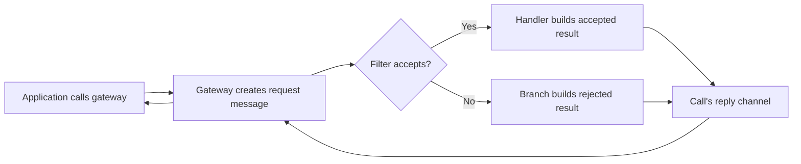

# Filter in a Request-Reply Flow

## 1. Objectives and use case

In the `SPRING_INTEGRATION_CORE` module, a filter is the endpoint that decides whether a `Message` proceeds along the main flow. When placed after a gateway with a return value, this decision also affects whether the application's call completes according to contract.

Suppose a service accepts order validation requests:

```java
OrderReply reply = orderGateway.evaluate(new OrderRequest("OD-101", 250));
```

The application expects an accepted result, a rejected result with a reason, or a defined exception. If the filter simply drops requests whose quantity exceeds the limit, the application may wait until timeout without knowing the request was rejected right at the start.

After this lesson, learners can:

- Explain the difference between a selector result, a forwarded message, and the reply the caller receives.
- Design the policy for the rejected branch in a request-reply flow.
- Use `throwExceptionOnRejection`, `discardChannel`, `discardFlow`, and gateway timeouts in their proper roles.
- Preserve the return path via `replyChannel` when producing a business reply.
- Write tests for accepted, rejected, and missing-reply scenarios.

Examples use Java DSL, Java records, and APIs from Spring Integration 6.x/7.x. Choose compatible JDK, Spring Framework, and Spring Integration versions in your application. The `errorOnTimeout` option is noted separately because it is only available on `@MessagingGateway` since Spring Integration 6.2. This lesson does not depend on a specific default framework timeout value.

## 2. The request-reply contract across a filter

### 2.1. Three distinct questions

A filter is often described by a boolean condition, but analyzing request-reply requires separating three questions:

| Question | Answering component | Example |
|---|---|---|
| Is the message accepted? | Filter selector | `request.quantity() <= 100` |
| Where is the message processed? | Main output or discard branch | Downstream check branch or rejection-result branch |
| What does the caller receive? | Reply-producing endpoint, error mechanism, and gateway | `OrderReply`, exception, or timeout |

A `false` value from the selector is only a decision not to forward the message to the main output. It does not become a `false` payload returned to the gateway. Likewise, `true` permits the message to continue; it is not yet the final business acceptance result.

A filter forwards accepted messages; it does not automatically turn a request into a response. A predicate can also throw an exception due to execution errors; that situation differs from the predicate executing normally and returning `false`. Message selection and rejection mechanics are described in [Spring Integration — Filter](https://docs.spring.io/spring-integration/reference/filter.html).

### 2.2. The return path

With a typical gateway, an invocation creates a request message carrying the return path in the `replyChannel` header. The final reply-capable endpoint forwards its result along that path when no explicit output channel is specified.



The discard branch does not automatically rejoin endpoints located after the filter on the main flow. If you want that branch to reply to the caller, place a reply-producing endpoint on the branch itself and preserve the appropriate return path. If both branches need a shared post-processing step, explicitly connect them to a shared channel.

The gateway supports per-call temporary reply channels, so you do not need to create a shared queue manually just to receive responses. This mechanism and reply-channel configurations are covered in [Messaging Gateways — Setting the Default Reply Channel](https://docs.spring.io/spring-integration/reference/gateway.html#gateway-default-reply-channel).

### 2.3. Design invariant

For an API expecting a reply, we can state a design-level invariant:

> Every accepted request must have exactly one outcome for the caller: a contract-compliant reply or an error propagated according to the defined policy.

This is an application design requirement, not an exactly-once processing guarantee provided by the filter. Retries, fan-out, transactions, and network failures can still cause duplicate processing or late replies.

When reviewing a flow diagram, trace both the `true` path and the `false` path all the way to where a reply is produced or an error is propagated. A branch that ends at a logging operation does not yet satisfy this invariant.

## 3. Choosing a policy for rejected messages

### 3.1. Behavior table

The table below assumes the request is sent through a gateway with an object return type and no custom error flow transforming errors:

| Configuration when selector returns `false` | Where does the message go? | What the caller observes |
|---|---|---|
| No discard, `throwExceptionOnRejection(false)` | Does not continue on main output | No reply; gateway waits per configuration |
| `throwExceptionOnRejection(true)` | Filter raises rejection exception | Error can propagate to caller via the flow's error mechanism |
| Discard only logs/writes audit | Goes to discard branch, which produces no reply | Still no reply |
| Discard builds response and preserves return path | Goes to discard branch and sends response | Caller receives business rejection result |
| Discard points to `nullChannel` | Message is consumed and dropped | Still no reply |

When there is no discard channel and exception throwing is disabled, versions from 6.1 onward may log a warning when rejecting a message. A log warning does not produce a response for a waiting call. See the concrete behavior of [MessageFilter](https://docs.spring.io/spring-integration/api/org/springframework/integration/filter/MessageFilter.html).

### 3.2. When to return a rejection result?

Use a business response when failing the condition is an expected outcome that the caller needs to distinguish clearly. Examples: quantity exceeds the order acceptance limit, product is out of service scope, or request must move to another workflow.

A structured response helps UIs display reasons and helps callers decide whether to adjust data. Do not force callers to infer from a timeout that "it must have been rejected".

### 3.3. When to throw an error?

Use an error when the API contract forbids that input from entering the flow, or when missing a required condition counts as a violation. Distinguish rejection errors from infrastructure failures so callers do not retry a request that will always be rejected by the same rule.

### 3.4. When is having no reply acceptable?

Choose this behavior only when the contract genuinely permits no response. For instance, a `void` gateway serving a one-way notification flow or an API that explicitly documents a "no result" possibility.

Changing the gateway return type from `OrderReply` to `void` is a business contract change, not a purely technical timeout fix. This lesson focuses on cases where the caller needs to know the processing decision.

## 4. Complete example: returning a result on both branches

### 4.1. Rules of the example

The service checks whether the quantity is in the range 1 to 100:

- Within range: return `accepted = true`.
- Outside range: return `accepted = false` and a reason code.
- Both outcomes must preserve `orderId` so the caller can correlate them.

The example checks only the quantity policy; it does not place orders, reserve inventory, or process payment. This lets us observe the filter's role in request-reply in isolation.

Place the following classes in the same package `example.integration.filterreply`, each `public` type in its own Java file. The application needs Spring Integration Core; tests need Spring Test and JUnit Jupiter. If using Spring Boot, you can use the integration and test starters per your application's dependency management.

### 4.2. Data types

```java
package example.integration.filterreply;

public record OrderRequest(String orderId, int quantity) {
}
```

```java
package example.integration.filterreply;

public record OrderReply(String orderId, boolean accepted, String reason) {
}
```

The reply record expresses the decision clearly. An `accepted = false` response is still a valid reply, completely different from no message being returned.

### 4.3. Gateway

```java
package example.integration.filterreply;

import org.springframework.integration.annotation.MessagingGateway;

@MessagingGateway(
        defaultRequestChannel = "orderRequests",
        defaultRequestTimeout = "1000",
        defaultReplyTimeout = "1000")
public interface OrderGateway {

    OrderReply evaluate(OrderRequest request);
}
```

Timeouts are declared in milliseconds and are illustrative values. Do not infer that total call duration is always at most one second; the timeout section below explains this bound.

Because the gateway is an interface, it must be registered by the gateway scanning mechanism. `@IntegrationComponentScan` serves this purpose in plain Java configuration. See the [MessagingGateway API](https://docs.spring.io/spring-integration/api/org/springframework/integration/annotation/MessagingGateway.html).

### 4.4. Java DSL configuration

```java
package example.integration.filterreply;

import org.springframework.context.annotation.Bean;
import org.springframework.context.annotation.Configuration;
import org.springframework.integration.annotation.IntegrationComponentScan;
import org.springframework.integration.channel.DirectChannel;
import org.springframework.integration.config.EnableIntegration;
import org.springframework.integration.dsl.IntegrationFlow;
import org.springframework.messaging.MessageChannel;

@Configuration
@EnableIntegration
@IntegrationComponentScan(basePackageClasses = OrderGateway.class)
public class OrderFlowConfiguration {

    @Bean
    public MessageChannel orderRequests() {
        return new DirectChannel();
    }

    @Bean
    public IntegrationFlow orderFlow() {
        return IntegrationFlow.from("orderRequests")
                .filter(OrderRequest.class,
                        request -> request.quantity() > 0
                                && request.quantity() <= 100,
                        filter -> filter
                                .id("quantityPolicyFilter")
                                .throwExceptionOnRejection(false)
                                .discardFlow(rejected -> rejected
                                        .handle(OrderRequest.class,
                                                (request, headers) ->
                                                        new OrderReply(
                                                                request.orderId(),
                                                                false,
                                                                "QUANTITY_OUT_OF_POLICY"),
                                                endpoint -> endpoint
                                                        .requiresReply(true))))
                .handle(OrderRequest.class,
                        (request, headers) -> new OrderReply(
                                request.orderId(),
                                true,
                                "ACCEPTED"),
                        endpoint -> endpoint.requiresReply(true))
                .get();
    }
}
```

`discardFlow` defines the branch handling rejected messages. The API also allows using `discardChannel` if you need to split the branch into a separate flow. Do not use both approaches simultaneously to express the same discard path. Refer to [FilterEndpointSpec](https://docs.spring.io/spring-integration/api/org/springframework/integration/dsl/FilterEndpointSpec.html).

### 4.5. Tracing an invocation

With `new OrderRequest("OD-101", 3)`:

1. The gateway creates a request message containing the payload and call headers.
2. The filter returns `true`, forwarding the request to the main handler.
3. The handler returns the payload `OrderReply("OD-101", true, "ACCEPTED")`.
4. The endpoint sends the response along the request's reply path; the gateway returns the payload to the application.

With `new OrderRequest("OD-102", 250)`:

1. The filter returns `false`, so the main handler is not invoked.
2. The discard branch receives the request and produces `OrderReply("OD-102", false, "QUANTITY_OUT_OF_POLICY")`.
3. The discard branch's reply returns to the gateway.
4. Downstream of the filter, no accepted request runs on the main branch.

The handler in the discard branch returns a plain object; Spring Integration's endpoint takes care of wrapping the reply message and preserving headers by default. This configuration has no step removing headers or altering the return path.

Note carefully that the response from the discard branch goes back to the gateway; it does not loop back to the acceptance handler after the filter. If you add a response-formatting step after the main handler, that step will not automatically execute for rejection responses.

## 5. Variant: rejecting with an exception

When the contract requires an error instead of an `accepted = false` response, you can replace the `orderFlow()` bean above with the following variant. Keep the gateway, channel, and gateway registration configuration unchanged; use only one flow version for the same request channel.

```java
@Bean
public IntegrationFlow orderFlow() {
    return IntegrationFlow.from("orderRequests")
            .filter(OrderRequest.class,
                    request -> request.quantity() > 0
                            && request.quantity() <= 100,
                    filter -> filter
                            .id("quantityPolicyFilter")
                            .throwExceptionOnRejection(true))
            .handle(OrderRequest.class,
                    (request, headers) -> new OrderReply(
                            request.orderId(),
                            true,
                            "ACCEPTED"),
                    endpoint -> endpoint.requiresReply(true))
            .get();
}
```

When the selector returns `false`, the filter throws `org.springframework.integration.MessageRejectedException`. With an example using `DirectChannel` and no custom gateway error flow declared, the error propagates to the caller; account for possible exception wrapping when inspecting the cause chain. Verifying that the main handler does not run remains an essential check.

Setting `throwExceptionOnRejection(true)` does not mean every error is a rejection error. If the predicate accesses invalid data and throws a `NullPointerException`, that is a predicate execution bug. Only map an error to a rejection code when you identify the exact type and context.

### 5.1. Discard audit combined with throwing an exception

You can both route rejected requests to an audit discard channel and enable throwing an exception. Per the API, after sending to discard, the filter still throws the rejection exception; the two settings are not mutually exclusive.

In this design, the audit branch should only record information and not simultaneously produce a business response. If the discard branch already returned a result and then the filter threw an exception, the call could carry two conflicting completion signals. Ordering and flow boundaries also make diagnosis harder.

Moreover, synchronous auditing can be slow or fail before the call finishes. If auditing is a durable side effect or involves retries, design idempotency around a business identifier. A rejected message does not automatically guarantee once-only auditing.

### 5.2. Do not mechanically retry rejection errors

Suppose the limit is always 100 and the request has quantity 250. Resending the same request repeatedly will repeat the same decision. The caller must fix the request or switch workflows, not merely increase retry counts.

If limit changes depend on external state, state clearly under which conditions retries are allowed. At that point, the retry decision belongs to the business contract and the whole flow's error policy, not inside the filter's boolean value.

## 6. Which part of the flow does `requiresReply` protect?

In the example, both the main handler and the discard-branch handler have:

```java
endpoint -> endpoint.requiresReply(true)
```

This configuration requires that endpoint to produce a reply; when the handler returns `null` in violation of the contract, an error such as `ReplyRequiredException` surfaces earlier than waiting for the gateway timeout. This is a check at a reply-capable endpoint, not a check across the entire integration graph.

Therefore:

- Placing `requiresReply(true)` on a handler after the filter does not protect requests dropped by the filter, because that handler is never invoked.
- This setting does not generate a rejection response by itself.
- It does not detect or interrupt a handler running indefinitely without returning.
- If an endpoint has its own explicit output channel, producing output there does not prove the gateway received the response along the right path.

A filter is also a reply-producing handler and may inherit configuration, but for selector rejections, express the policy via `throwExceptionOnRejection` or a reply-producing discard branch. Do not enable `requiresReply(true)` on the filter itself in the reply-producing discard variant: the filter's main output does not produce a result on rejection, even though the discard branch replies on its own.

The role of this flag is defined in [AbstractReplyProducingMessageHandler](https://docs.spring.io/spring-integration/api/org/springframework/integration/handler/AbstractReplyProducingMessageHandler.html).

## 7. Timeouts do not replace business replies

### 7.1. Two different phases

| Configuration | Bounded phase | Must not be interpreted as |
|---|---|---|
| `defaultRequestTimeout` | Waiting to send the request when the channel supports blocking sends, e.g., full queue | Limit on entire business processing |
| `defaultReplyTimeout` | Waiting for a response at the gateway after the send step returns control | Mechanism that cancels a running handler |
| Downstream client I/O timeout | Waiting on network operations performed by that client | Filter rejection decision |

If the filter drops the request and the send completes normally, the gateway starts waiting, yet no response arrives. With an object-returning gateway like the example, when timeout expires and error-on-timeout is not enabled, the result is typically `null`.

`null` carries no information about why no response arrived. It can stem from a filter dropping the message, a handler returning `null`, a branch ending at a `void` consumer, or a response arriving too late. Do not map all of these cases to "order not allowed".

### 7.2. The `DirectChannel` case

`DirectChannel` hands execution to the subscriber on the sender's thread. In the example with no asynchronous handoff, the gateway call must pass through the handler before the send step finishes.

If a handler takes five seconds, `defaultReplyTimeout = "1000"` does not interrupt the handler after one second. If the handler already produced a reply before returning, the gateway can receive the result as soon as control returns, even though the total call took over one second.

This is why HTTP client, JDBC driver, or downstream service timeouts are needed where I/O actually executes. Increasing or decreasing the gateway's reply timeout cannot substitute for bounds on those operations. Execution boundaries of channel types are described in [Message Channel Implementations](https://docs.spring.io/spring-integration/reference/channel/implementations.html).

### 7.3. When an asynchronous boundary exists

If the request crosses an `ExecutorChannel`, or is later processed by a poller-driven consumer on a `QueueChannel`, the send can return to the gateway before business processing finishes. At that point, the reply timeout can expire while the worker is still running.

A timeout on the caller does not automatically recall a sent request or roll back worker side effects. When retries are permitted, use appropriate request/idempotency keys and account for late responses.

Observable call duration can be estimated as:

```text
Call duration = time before send returns + time waiting for reply
```

This is a model for analyzing phases, not a formula for setting SLAs by adding two timeout values together. Sending through a synchronous channel can encompass the entire handler execution time.

### 7.4. Turning timeouts into explicit errors

Since Spring Integration 6.2, you can use:

```java
@MessagingGateway(
        defaultRequestChannel = "orderRequests",
        defaultRequestTimeout = "1000",
        defaultReplyTimeout = "1000",
        errorOnTimeout = true)
public interface OrderGateway {

    OrderReply evaluate(OrderRequest request);
}
```

This option ensures the caller receives a timeout error instead of `null` when waiting for a reply fails; if a custom error channel exists, the error also follows the error flow's handling policy. It does not turn a rejected request into a business response, nor does it cancel a synchronous handler.

The application still needs three distinct outcomes: an accepted response, a rejected response with a reason, and a technical/timeout error. Refer to official scenarios in [Gateway Behavior When No Response Arrives](https://docs.spring.io/spring-integration/reference/gateway.html#gateway-no-response).

## 8. Discard channel, reply channel, and error channel

### 8.1. Three paths with distinct meanings

| Path | Typical message carried | Purpose |
|---|---|---|
| Main output | Request accepted by filter | Continue normal processing flow |
| Discard channel/flow | Original request rejected by selector | Handle rejection, audit, or build rejection reply |
| Error channel | `ErrorMessage` wrapping an error | Handle exceptions and apply error policy |

`discardChannel` is not `errorChannel`. Returning `false` from a selector only raises an exception if the filter policy or related step actually does so. Conversely, an I/O error in the main handler does not automatically become a request on the discard branch.

### 8.2. Do not lose the return path

When producing a response via a standard endpoint and returning a POJO, the framework packages the reply and propagates headers per configuration. If you use a custom handler that builds and sends messages manually, proactively preserve the request's reply path and avoid accidental overrides.

Common design mistakes:

- Stripping `replyChannel` when cleaning headers before the final branch replies.
- Configuring a fixed output channel pointing to an audit channel instead of returning to the gateway.
- Manually building a reply message in custom code and sending it without retaining call context.
- Sending a response directly from custom code while also returning another payload for the endpoint to emit a second response.

Prefer returning payloads from handlers as in the main example when low-level message control is unnecessary. If a shared output is needed for both branches, represent the shared channel in the diagram and identify the final endpoint replying to the caller.

### 8.3. Synchronous errors and asynchronous errors

With synchronous processing, exceptions can unwind the call stack back to the sender. Beyond an asynchronous boundary, the error mechanism must convey error details via messages; you cannot rely on a worker's `throw` directly unwinding the caller's stack.

Spring Integration dispatches `ErrorMessage` based on error context and error channels. If you configure a gateway error flow to convert errors into responses, that flow must build a reply of the right type and matching the request context. A consumer that merely logs the error and ends does not ensure the caller receives a response.

Do not assume every error goes to a global bean named `errorChannel`; check headers, the asynchronous component's error handler, and the specific gateway configuration. See [Spring Integration — Error Handling](https://docs.spring.io/spring-integration/reference/error-handling.html).

## 9. Testing contracts through the gateway

### 9.1. Why testing the predicate alone is insufficient

A unit test for the quantity expression proves the rule is right, but it does not prove the discard branch replies to the gateway properly. A wiring mistake can still leave callers timing out even when the predicate runs accurately.

Request-reply testing must go from the gateway method to observable outcomes. For the main example, test at minimum valid quantity, over-limit quantity, zero, and the exact upper boundary.

### 9.2. Testing the example where both branches return a result

Place the test in the same package as the example's types:

```java
package example.integration.filterreply;

import org.junit.jupiter.api.Test;
import org.springframework.beans.factory.annotation.Autowired;
import org.springframework.test.context.junit.jupiter.SpringJUnitConfig;

import static org.junit.jupiter.api.Assertions.assertEquals;
import static org.junit.jupiter.api.Assertions.assertFalse;
import static org.junit.jupiter.api.Assertions.assertNotNull;
import static org.junit.jupiter.api.Assertions.assertTrue;

@SpringJUnitConfig(OrderFlowConfiguration.class)
class OrderRequestReplyTest {

    @Autowired
    private OrderGateway gateway;

    @Test
    void returnsAcceptedReplyForQuantityWithinPolicy() {
        OrderReply reply = gateway.evaluate(new OrderRequest("OD-201", 4));

        assertNotNull(reply);
        assertEquals("OD-201", reply.orderId());
        assertTrue(reply.accepted());
        assertEquals("ACCEPTED", reply.reason());
    }

    @Test
    void returnsRejectedReplyInsteadOfLosingTheResponse() {
        OrderReply reply = gateway.evaluate(new OrderRequest("OD-202", 250));

        assertNotNull(reply);
        assertEquals("OD-202", reply.orderId());
        assertFalse(reply.accepted());
        assertEquals("QUANTITY_OUT_OF_POLICY", reply.reason());
    }

    @Test
    void rejectsZeroQuantity() {
        OrderReply reply = gateway.evaluate(new OrderRequest("OD-203", 0));

        assertNotNull(reply);
        assertFalse(reply.accepted());
        assertEquals("QUANTITY_OUT_OF_POLICY", reply.reason());
    }

    @Test
    void acceptsTheUpperBoundary() {
        OrderReply reply = gateway.evaluate(new OrderRequest("OD-204", 100));

        assertNotNull(reply);
        assertTrue(reply.accepted());
    }
}
```

These tests verify both content and response delivery. Do not assert that requests must complete within a few milliseconds on every machine; that is an environment-sensitive timing check and does not directly prove correct wiring.

If the main handler has side effects such as persisting an order, add a mock or counter at the business boundary to confirm rejected requests do not invoke that handler. When running two concurrent calls, verify each `orderId` receives its own response to catch improper shared reply-channel designs.

### 9.3. Test matrix for variants

| Scenario | Outcome to verify |
|---|---|
| Request passes filter | Reply has expected type, ID, and data |
| Request rejected, discard builds reply | Rejection result returned; main handler does not run |
| Request rejected, throws exception | Cause chain contains rejection error; main business logic does not run |
| Predicate throws exception | Execution error distinguished from selector `false` decision |
| Discard only logs | Gateway waits until bounded timeout per chosen policy |
| Main handler returns `null` with `requiresReply(true)` | Missing-reply error detected at the handler |
| Asynchronous processing and late reply | Caller times out; worker is not treated as cancelled |
| Retry after timeout | Side effects protected by application idempotency |

When testing intentional missing-reply cases, use a short but finite reply timeout in test configuration so failures do not hang the test suite. When using the exception-throwing variant, use a separate test configuration replacing the flow; do not register both the reply-returning flow and the exception-throwing flow as competing subscribers on the same `DirectChannel`.

## 10. Misleading fixes

### 10.1. "There is a discard channel, so the caller will get a reply"

A discard channel only specifies where rejected requests are sent. Verify whether the consumer on that channel builds a response and routes it back to the right call.

An audit-only branch may fulfill its audit goal while still leaving the caller without a result. The fix is to explicitly choose a business response or an error, and complete the corresponding branch.

### 10.2. "Wiring `nullChannel` gets rid of errors"

`nullChannel` is a message sink. It can suit a one-way flow needing to discard notifications, yet it does not produce a response for a gateway method waiting for a return value.

Using it on a request-reply discard branch only makes dropping the message explicit in configuration; the response contract problem remains.

### 10.3. "Lowering the timeout will fix the filter"

Lowering timeouts helps callers notice missing results sooner in certain situations. It provides no rejection reason code and does not restore a broken return path.

With a consistent wiring bug, every rejected request still hits timeout—only faster than before. You must fix the `false` branch of the flow.

### 10.4. "Enabling `requiresReply` at the end of the flow is enough"

Requests dropped by the filter never reach the final endpoint. This flag only affects messages that the endpoint actually processes. You must design an outcome for the discard branch or enable exception throwing on the filter.

### 10.5. "Use publish-subscribe to run both processing and replying"

If multiple subscribers build replies for the same request, the caller may receive results that violate design intent. Fan-out requires a result-gathering policy or a single branch responsible for replying.

For a simple boolean rule, a filter with a discard branch is expressive enough. If there are multiple business outcomes and branches need to converge, a router usually expresses those states more clearly. If multiple branches must all contribute results, design a correlation and aggregation mechanism rather than expecting the gateway to merge them automatically.

## 11. Diagnosing a request that hits timeout

You can trace in this order:

1. **Did the request enter the filter?** Observe request ID and endpoint; distinguish failed send from rejection.
2. **What did the selector return?** Record the `true`/`false` decision and rule code; check whether an exception occurred inside the predicate.
3. **Which branch actually executed?** Rejected requests must enter the discard branch or raise an error per configuration.
4. **Did the final endpoint produce output?** Check whether the handler returned an object, returned `null`, or is a `void` consumer.
5. **Where was the output sent?** Inspect explicit output channels, `replyChannel`, and any header-filtering steps.
6. **Did execution switch threads?** If so, check error flows and reply timing relative to caller timeout.
7. **Are multiple places replying?** Check fan-out, custom sends, and retries for duplicate or late responses.

For operational observability, the application can track accepted request counts, rejected counts by reason code, technical errors, timeouts, and reply wait times. Separating these groups prevents a surge in timeouts from masking a missing-reply bug.

Use business IDs/request IDs in logs instead of relying solely on `MessageHeaders.ID`, as new messages can get new IDs. Do not use the `replyChannel` header as a business identifier. Metric labels should have bounded cardinality, such as policy codes; per-order IDs belong in logs or traces.

## 12. Hands-on exercises

Starting from the example where both branches return a response:

1. Add tests for quantities `-1`, `1`, `100`, and `101`; verify results match the same policy.
2. Replace `discardFlow` with `discardChannel("rejectedOrderRequests")` plus a separate flow producing `OrderReply`; preserve the exact outcome observed by the caller.
3. Change the discard branch to log-only and observe the gateway timing out with a bounded test timeout. Then restore the reply-producing branch.
4. Switch to the `throwExceptionOnRejection(true)` variant in a separate context and verify the rejection exception type.
5. Have the main handler conditionally return `null` to observe the role of `requiresReply(true)`; do not confuse that scenario with the filter rejecting a request.
6. If adding an `ExecutorChannel`, explicitly define the error channel, how errors propagate back to the gateway, and behavior when a response arrives after timeout.

The goal is to be able to trace a request's complete path in every case, including the final outcome the caller receives. Looking only at the predicate or a "message rejected" log is not enough to confirm a request-reply flow is complete.