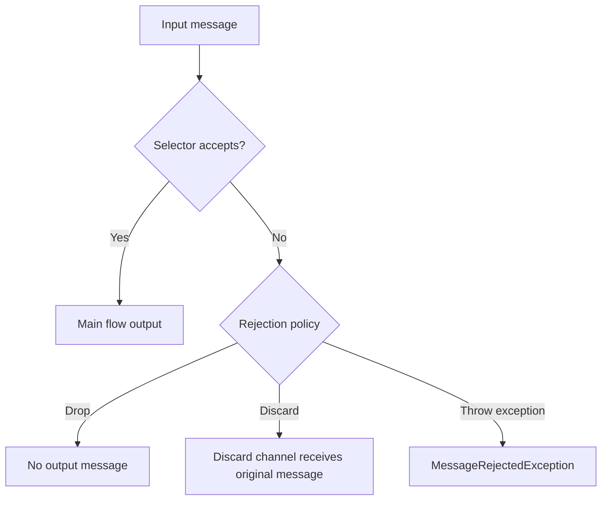

# Filter and Null Output

## 1. Understanding correctly when a filter has no output

In Spring Integration, **a filter decides whether a message proceeds on the main flow**. The filter uses a selector to evaluate a condition:

- Selector returns `true`: the filter lets the input message proceed.
- Selector returns `false`: the filter rejects the message; subsequent handling depends on the discard channel and exception-throwing configuration.

If a message is rejected and the filter does not throw an exception, the filter produces no reply for the main flow. At the implementation level of a reply-producing handler, this situation is represented by a `null` processing result. In this lesson, that is what **null output** means.

The key point to keep clear is: **null output is not a message with a `null` payload**. It represents the absence of an output message on the main branch.

A filter takes one message and produces **zero or one message on the main flow**:

```text
                         selector = true
                    ┌──────────────────────> message proceeds
input message ─────> filter
                    └──────────────────────> no reply on the main flow
                         selector = false
```

This model helps design the right contract between the filter, `MessageChannel`, downstream endpoints, and gateways calling into the system. It is especially important when the caller is awaiting a reply or when an aggregator sits downstream of the filter.

## 2. Distinguishing the meanings of `null`

### 2.1. A `null` payload is not how rejected messages are represented

A valid `Message<?>` in Spring Messaging requires a non-`null` payload. Therefore, do not represent rejection by creating a message like this:

```java
// Invalid: payload must not be null.
MessageBuilder.withPayload(null).build();
```

By contrast, the following values are still real payloads:

```java
MessageBuilder.withPayload("").build();
MessageBuilder.withPayload(List.of()).build();
MessageBuilder.withPayload(Optional.empty()).build();
```

An empty string, an empty list, and `Optional.empty()` are all non-`null` objects. Whether they are accepted is the selector's decision. A payload being "empty" in a business sense does not automatically cause a filter to drop the message.

### 2.2. Selectors decide with a boolean

A filter's selector must make an accept or reject decision. It does not produce an output payload:

```java
.filter(String.class, text -> !text.isBlank())
```

In this example:

- `"READY"` yields `true`.
- `"   "` yields `false`.
- The filter does not replace the whitespace string with `null`.
- Nor does the filter automatically `trim()` the accepted string.

Do not return `null` from a predicate to signal rejection. The selector API returns `boolean`; if intermediate logic uses `Boolean` and returns `null`, converting to `boolean` can cause an unboxing error. That is an execution error, not a normal rejection decision.

### 2.3. No message arrives at the downstream endpoint

If a filter drops a message, the next endpoint is not called with a `null` argument; that endpoint is simply not called for this message.

```java
.filter(String.class, text -> !text.isBlank())
.transform(String.class, String::trim)
```

For input `"   "`, the transformer does not run. For input `"  READY  "`, the filter accepts the original string and then the transformer produces payload `"READY"`.

This distinction explains why adding a downstream step after the filter to "catch null" will not handle rejected messages:

```java
.filter(String.class, text -> !text.isBlank())
.handle(message -> {
    // This block only runs when the filter accepted the message.
    // It is not invoked to notify that the filter just dropped a message.
});
```

## 3. Three ways to handle selector rejection

When the selector returns `false`, configuration options determine how the rejected message is observed and handled.

| Configuration | Outcome on main flow | Handling of rejected message |
|---|---|---|
| No discard channel; `throwExceptionOnRejection=false` | No reply | Processing ends at the filter |
| Discard channel present; `throwExceptionOnRejection=false` | No reply from main branch | Original message is sent to discard channel |
| `throwExceptionOnRejection=true` | No normal accepted outcome | Throws `MessageRejectedException` |

By default, `throwExceptionOnRejection` is `false`. Thus, if no discard path is configured, a rejected message can terminate at the filter without raising an exception.



The diagram shows three common design options. The discard channel and exception throwing are independent options; do not infer from the diagram that the API forces them to be mutually exclusive. Examples in this lesson use each policy separately to clarify behavior.

### 3.1. When is dropping a valid outcome?

Dropping is appropriate when the flow's contract permits an input to produce no result, such as:

- Skipping events outside a subscriber's processing scope.
- Blocking records that fail preconditions before downstream work runs.
- Ignoring notifications that require no business action.

However, a filter does not automatically detect duplicates or remember state. If a condition depends on processing history, the selector or a dedicated component must supply that mechanism.

### 3.2. Discard channel provides a separate processing path

A discard channel routes rejected messages to a place for recording reasons, collecting statistics, or separate handling. The message sent there is the original business message; it does not automatically become an `ErrorMessage`.

A selector only returns a decision. If you need to store specific reasons such as `MISSING_CUSTOMER`, `EMPTY_TEXT`, or `UNSUPPORTED_REGION`, design an extra classification step or a structured business result. Do not assume the filter automatically attaches a rejection-reason header.

### 3.3. Throwing an exception changes the flow's contract

With `throwExceptionOnRejection=true`, rejection becomes a processing error in the form of `MessageRejectedException`.

This is the right choice when the input violates a mandatory condition and the caller must receive an error. It also affects retries, rollbacks, and endpoint error handling. A message that consistently violates the same condition will usually keep getting rejected on retry unless data or state changes.

## 4. Java DSL example: separating valid and rejected messages

The example below uses Java 17, Spring Integration 6 Java DSL, and three channels:

- `text.input`: receives input strings via `DirectChannel`.
- `text.accepted`: holds accepted messages via `QueueChannel`.
- `text.rejected`: holds rejected messages via `QueueChannel`.

The application needs `spring-integration-core` and Spring Context on the classpath. This is a standalone illustrative configuration and does not require a gateway.

```java
import org.springframework.context.annotation.Bean;
import org.springframework.context.annotation.Configuration;
import org.springframework.integration.channel.DirectChannel;
import org.springframework.integration.channel.QueueChannel;
import org.springframework.integration.config.EnableIntegration;
import org.springframework.integration.dsl.IntegrationFlow;
import org.springframework.messaging.MessageChannel;

@Configuration
@EnableIntegration
public class FilterNullOutputConfig {

    @Bean(name = "text.input")
    public MessageChannel textInput() {
        return new DirectChannel();
    }

    @Bean(name = "text.accepted")
    public QueueChannel textAccepted() {
        return new QueueChannel();
    }

    @Bean(name = "text.rejected")
    public QueueChannel textRejected() {
        return new QueueChannel();
    }

    @Bean
    public IntegrationFlow nonBlankTextFlow() {
        return IntegrationFlow.from("text.input")
                .filter(
                        String.class,
                        text -> !text.isBlank(),
                        endpoint -> endpoint
                                .discardChannel("text.rejected")
                                .throwExceptionOnRejection(false))
                .channel("text.accepted")
                .get();
    }
}
```

Expected behavior:

| Input payload | Selector | `text.accepted` | `text.rejected` |
|---|---|---|---|
| `"READY"` | `true` | Receives `"READY"` | Receives nothing |
| `"  READY  "` | `true` | Receives `"  READY  "` | Receives nothing |
| `"   "` | `false` | Receives nothing | Receives `"   "` |
| `""` | `false` | Receives nothing | Receives `""` |

The filter preserves the payload of accepted messages. Declaring `String.class` in the DSL states the input type used when calling the selector; it is not a content normalization step.

In this example, both output channels are queues, so both branches can be observed separately via `receive()`. A queue does not create a processing subscriber automatically; a separate consumer is needed for real downstream work.

## 5. Testing: assert absence of output, do not look for null payloads

A useful test must prove two different things:

1. Valid messages enter the accepted channel and do not enter the discard channel.
2. Rejected messages do not appear on the accepted channel, yet are present on the discard channel if configured.

The JUnit Jupiter example below uses `FilterNullOutputConfig` from the previous section and Spring Test. The queues start empty; this is a single test method checking both branches sequentially.

```java
import org.junit.jupiter.api.Test;
import org.junit.jupiter.api.extension.ExtendWith;
import org.springframework.beans.factory.annotation.Autowired;
import org.springframework.beans.factory.annotation.Qualifier;
import org.springframework.integration.channel.QueueChannel;
import org.springframework.messaging.Message;
import org.springframework.messaging.MessageChannel;
import org.springframework.messaging.support.MessageBuilder;
import org.springframework.test.context.ContextConfiguration;
import org.springframework.test.context.junit.jupiter.SpringExtension;

import static org.junit.jupiter.api.Assertions.assertEquals;
import static org.junit.jupiter.api.Assertions.assertNotNull;
import static org.junit.jupiter.api.Assertions.assertNull;
import static org.junit.jupiter.api.Assertions.assertTrue;

@ExtendWith(SpringExtension.class)
@ContextConfiguration(classes = FilterNullOutputConfig.class)
class FilterNullOutputTest {

    @Autowired
    @Qualifier("text.input")
    private MessageChannel input;

    @Autowired
    @Qualifier("text.accepted")
    private QueueChannel accepted;

    @Autowired
    @Qualifier("text.rejected")
    private QueueChannel rejected;

    @Test
    void shouldSeparateAcceptedAndRejectedMessages() {
        boolean sentValid = input.send(
                MessageBuilder.withPayload("READY").build());

        assertTrue(sentValid);

        Message<?> acceptedMessage = accepted.receive(0);
        assertNotNull(acceptedMessage);
        assertEquals("READY", acceptedMessage.getPayload());
        assertNull(rejected.receive(0));

        boolean sentBlank = input.send(
                MessageBuilder.withPayload("   ").build());

        assertTrue(sentBlank);
        assertNull(accepted.receive(0));

        Message<?> rejectedMessage = rejected.receive(0);
        assertNotNull(rejectedMessage);
        assertEquals("   ", rejectedMessage.getPayload());
    }
}
```

`receive(0)` does not wait: it returns an available message or `null` if the queue is currently empty. The `null` value here is the result of the receive operation, not a message's payload.

This immediate check works because `DirectChannel` invokes the filter synchronously and delivery to the queue has completed by the time `input.send(...)` returns. With an executor or asynchronous consumer, use a bounded timeout or an appropriate test synchronization mechanism; an immediate queue read might return empty simply because work has not finished yet.

### Why does `send()` return `true` even when the message is rejected?

In the configuration above, the channel delivered the message to the handler and the handler finished processing it according to the configured policy. The return value of `MessageChannel.send()` is not the selector's result and does not prove the business logic accepted the message.

Do not use code like this to infer business status:

```java
boolean acceptedByBusinessRule = input.send(message);
```

If the sender needs to know the business decision, provide an explicit reply or a result-tracking mechanism designed into the system's contract.

## 6. Choosing between dropping and throwing an exception in DSL

The snippets below are alternative configurations for the `.filter(...)` step, not filters to chain sequentially in the same flow.

### 6.1. Only drop rejected messages

```java
.filter(String.class, text -> !text.isBlank())
```

When the selector returns `false`, no message proceeds and no discard channel receives the message. A handler downstream of the filter cannot handle this case to produce a rejection reply.

### 6.2. Send rejected messages to a separate branch

```java
.filter(
        String.class,
        text -> !text.isBlank(),
        endpoint -> endpoint.discardChannel("text.rejected"))
```

Here, the main branch still has no output for rejected messages. The discard channel creates an alternative processing path, usable for observation or additional business handling.

The discard channel's consumer is still an active execution component. If sending to that channel fails or a synchronous consumer throws, the filter call itself can fail. "Rejected without actively throwing an exception" does not guarantee every operation on the discard path succeeds.

### 6.3. Treat rejection as a call error

```java
.filter(
        String.class,
        text -> !text.isBlank(),
        endpoint -> endpoint.throwExceptionOnRejection(true))
```

In a flow using `DirectChannel`, exceptions from processing can propagate back to the message-sending call. A gateway or surrounding error-handling components can transform how the error is presented to the caller.

Choose the policy based on the flow's contract:

| Need | Design approach |
|---|---|
| An event can be ignored without a reply | Filter can end processing on rejection |
| Rejected messages must be retained for separate handling | Configure a discard channel and matching consumer |
| Input violates a mandatory rule and caller must get an error | Enable `throwExceptionOnRejection` and design error path |
| Caller always needs an acceptance or rejection result | Return an explicit business outcome for both cases |

## 7. Impact on a messaging gateway awaiting a reply

### 7.1. A synchronous flow can still finish with no reply

Consider a gateway with a method returning `String`:

```java
import org.springframework.integration.annotation.MessagingGateway;

@MessagingGateway(
        defaultRequestChannel = "text.rpc",
        defaultReplyTimeout = "1000")
public interface TextGateway {

    String accept(String text);
}
```

This gateway must be registered by integration component scanning, such as `@IntegrationComponentScan`. The example sets a reply timeout of `1000` milliseconds so waiting is bounded; do not rely on default timeouts.

A corresponding flow could be:

```java
@Bean
public IntegrationFlow textRpcFlow() {
    return IntegrationFlow.from("text.rpc")
            .filter(String.class, text -> !text.isBlank())
            .transform(String.class, text -> "ACCEPTED: " + text)
            .get();
}
```

In this flow, output is not pinned to a result queue. For accepted messages, the transformer's result can be sent back to the `replyChannel` supplied by the gateway.

- Input `"READY"`: the transformer produces reply `"ACCEPTED: READY"`.
- Input `"   "`: the filter drops the message, the transformer does not run, and the main branch produces no reply.

The gateway does not receive a reply carrying a `null` payload when the filter rejects. It has no reply to receive. With a synchronous gateway returning a reference type as in the example, when the timeout expires with no reply, the result can be `null`. Do not interpret that result as a business reply meaning "rejected" unless the contract explicitly defines it that way.

Increasing the reply timeout only extends the wait; it does not conjure the missing reply. If no consumer is registered, or a consumer executes slowly, those are separate causes to distinguish from a filter intentionally dropping the message.

### 7.2. A discard channel does not automatically complete request-reply

A discard channel used to log or hold messages in a queue does not automatically send a reply to the gateway. In the example with `text.rejected` as a `QueueChannel`, the message simply sits in the queue until consumed.

You can design a discard flow that builds a rejection reply using the message's reply information. However, that response must be explicitly configured and tested behavior. Do not assume that merely declaring `discardChannel(...)` means the gateway will receive an answer.

### 7.3. Always needing an answer: return an explicit business result

If the method means "evaluate and return a decision", you can use a transformer to produce a result for every type-valid input:

```java
public record TextDecision(
        boolean accepted,
        String reason,
        String original) {
}
```

```java
@Bean
public IntegrationFlow textDecisionFlow() {
    return IntegrationFlow.from("text.decision")
            .transform(String.class, text -> {
                boolean accepted = !text.isBlank();
                String reason = accepted ? "ACCEPTED" : "EMPTY_TEXT";
                return new TextDecision(accepted, reason, text);
            })
            .get();
}
```

A gateway using this flow must send to `text.decision` and declare return type `TextDecision`. A `TextDecision(false, "EMPTY_TEXT", "   ")` is a real business result, distinct from having no reply.

If the two branches require different processing, a router is also a good choice: route to an accepted branch and a rejected branch while ensuring both branches produce a reply matching the gateway contract.

## 8. `requiresReply` and `throwExceptionOnRejection` solve two different problems

These two settings are often confused because both can turn a no-result situation into an error:

| Setting | Condition expressed |
|---|---|
| Filter's `throwExceptionOnRejection` | Whether selector rejection is an error |
| Reply-producing handler's `requiresReply` | Whether the handler is required to produce a reply |

In the reply-producing handler mechanism, if `requiresReply` is enabled and processing returns `null`, Spring Integration can throw `ReplyRequiredException`. It reports that the reply-required contract was violated.

For a filter, if the goal is to explicitly signal selector rejection, `throwExceptionOnRejection` expresses that policy accurately. If the filter is allowed to drop messages, forcing the filter to produce a reply contradicts the chosen drop behavior.

Do not treat `requiresReply` as a configuration to emit an empty message or automatically turn rejected messages into an alternative result. When an alternative result is needed, construct it in an explicit processing branch.

## 9. Null output, discard, and error flow

### 9.1. Normal rejection does not automatically create an `ErrorMessage`

If the selector returns `false` and the filter is not configured to throw an exception, there is no error merely because the main branch has no output. Hence declaring an `errorChannel` does not automatically route every dropped message there.

```text
selector = false + no exception thrown
    -> normal filter decision

selector throws exception or filter throws rejection error
    -> processing error to be handled by the flow's infrastructure
```

For example, a selector reading reference data and hitting a database access error is a different situation from a selector reading successfully and deciding to reject. Do not convert all technical errors to `false`, because doing so hides the root cause and turns an error-handling event into a normal drop.

### 9.2. Discard channel and error channel have different roles

| Characteristic | Discard channel | Error channel |
|---|---|---|
| Purpose | Handle messages that fail the condition | Handle execution errors |
| Typical message received | Original rejected message | `ErrorMessage` containing exception details when infrastructure converts errors to messages |
| Automatically receives when selector returns `false`? | Only when configured as discard channel | Not solely because selector returned `false` |
| Needs a suitable consumer? | Yes | Yes |

Do not point a discard channel to a flow that expects only `ErrorMessage` and expect the filter to wrap the business message into an exception automatically.

### 9.3. How errors travel back depends on execution boundaries

With synchronous flows over `DirectChannel`, exceptions usually unwind along the call stack sending the message. When a poller or executor is involved, errors can be converted into `ErrorMessage` via the error-handling mechanism configured for that infrastructure.

Therefore, when enabling `throwExceptionOnRejection`, determine where the exception will be handled. Do not assume a channel named `errorChannel` always receives every error across all execution models.

## 10. Filter before an aggregator: missing output can prevent group completion

Suppose a splitter creates five messages and attaches group metadata with an expected size of five. Then a filter drops one message:

```text
Splitter: 5 messages
    -> Filter: accepts 4, drops 1
    -> Aggregator: receives only 4 messages
```

If the aggregator's group completion condition relies on receiving all five elements, the group has not yet met the release condition. A dropped message does not leave behind a "null message" for the aggregator to count in its place.

Design approaches to consider:

- Filter data before the splitting step or before determining the expected element count, if business logic permits.
- Redesign the release condition around business information that is actually available.
- Use timeout and incomplete-group handling policies per system requirements.
- If every item requires an outcome, produce an accepted or rejected result for each item so the aggregation flow receives complete information.

Do not manually overwrite `sequenceSize` with a guessed number without fully accounting for the group's items and concurrency effects. What must be solved is the group completion contract once messages can be dropped.

## 11. Diagnosing a "send succeeded but no result appeared" flow

Inspect along the message's actual path:

1. **Determine what the selector returned.** For a specific payload, does the condition truly accept or reject the message per rule?
2. **Determine the rejection policy.** Is there a discard channel or exception throwing? If neither exists, seeing no output may be the configured behavior.
3. **Observe the main branch and discard branch separately.** Seeing no message on the main branch is not enough to conclude the message vanished due to a bug.
4. **Distinguish missing output from execution errors.** Wrong input type, errors inside the selector, errors sending to the discard channel, and errors in downstream endpoints are distinct cases.
5. **Check the caller's contract.** Is a gateway waiting for a reply? Does the rejection branch produce a reply or simply stop processing?
6. **Check how results are consumed.** Has the queue been read, is the consumer active, and are there asynchronous boundaries in the flow?
7. **Check components depending on message counts.** Is an aggregator or counter expecting the messages that were dropped?

When setting up observability, count inputs, accepted messages, rejected messages, and errors separately. Counting only messages passing through the output cannot distinguish "dropped by rule" from "still processing" or "failed with error".

For a completed single execution with no retries, message duplication, or errors, each input message to the filter falls into one of two decisions: accepted or rejected. When retries or redeliveries occur, selector evaluation counts can exceed unique business message counts; counters should be defined accordingly.

## 12. Principles to apply

- Use a filter when the flow allows inputs that produce no message on the main branch.
- Understand `null output` as no reply, not a `Message` containing a `null` payload.
- Use a discard channel when a dedicated processing path is needed for rejected messages.
- Use the exception-throwing policy when rejection must be represented as a call error.
- Return an explicit business outcome when a gateway always needs to know the decision.
- Test for message presence or absence on the right channels, taking synchronous vs. asynchronous execution into account.
- Revisit counting and group-completion contracts whenever placing a filter before an aggregator.