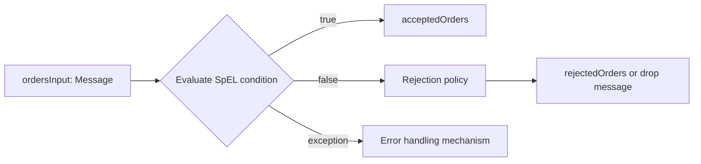

# Filter with SpEL

## 1. Objectives and position in the integration flow

In the **SPRING_INTEGRATION_CORE** module, the **Filter** chapter focuses on deciding whether a message is eligible to proceed. This lesson uses Spring Expression Language (SpEL) to express that decision with concise conditions over payload, headers, and business beans.

After this lesson, you can:

- Write expressions producing a Boolean result for a filter.
- Read `payload`, `headers`, and bean references properly in the message context.
- Configure the same condition using Java DSL or XML.
- Design the path for discarded messages and distinguish them from execution errors.
- Verify boundary conditions, missing data, and data preservation across a filter.

It is assumed you already know that `Message<?>` consists of payload and headers, `MessageChannel` transports messages, and an endpoint executes a processing step. Examples use the Java DSL API with `IntegrationFlow.from(...)` and require no external adapters. When integrating into an application, use a compatible Spring version set managed by your project or Spring Boot.

Running scenario: a system ingests orders from multiple sources. The web order processing branch accepts only orders in `READY` status, meeting a minimum total amount, and explicitly marked as production data. Orders failing the conditions go into an observation queue.

## 2. How a Filter turns an expression result into a decision

Conceptually, a filter performs:

```text
accept(message) = evaluate(expression, message)

true  -> forward message to the next branch
false -> apply rejection policy
error -> apply the flow's error handling mechanism
```

The filter does not take `true` or `false` as the output payload. It uses that result to decide whether to forward the input message. Therefore, an order passing through a filter remains an order. See definitions and configuration in [Spring Integration — Filter](https://docs.spring.io/spring-integration/reference/filter.html).



Starting example:

```spel
headers['source'] == 'WEB'
```

This condition checks only the sender source. It does not rename headers, normalize casing, or validate order structure.

Distinguish three ways expressions are used in a flow:

| Component | Question to answer | Example intent |
| --- | --- | --- |
| Filter | May this message proceed? | Accept only web orders |
| Router | Where should this message go? | Split orders by region |
| Transformer | What shape should output data take? | Convert JSON to an order object |

This is also the basis for choosing the right endpoint: if the primary need is transforming data, place a transformer before the filter; if there are multiple peer business branches, express them with a router.

## 3. Evaluation context: the root is Message

In a SpEL-based filter, start from the message. `payload` and `headers` are properties of the root `Message` object; `@beanName` references a bean in the application context. Spring Integration provides accessors and a bean resolver for this context. Refer to [Spring Integration — SpEL](https://docs.spring.io/spring-integration/reference/spel.html).

| Syntax | Interpretation | Usage condition |
| --- | --- | --- |
| `payload` | Entire payload | Actual data type is known |
| `payload.status` | `status` property of a JavaBean payload | Matching getter exists |
| `payload['status']` | Value by key in a Map payload | Payload is actually a Map |
| `headers['source']` | `source` header | Value may be absent |
| `headers['x-correlation-id']` | Header with hyphens | Use brackets to avoid subtraction operator ambiguity |
| `#root.payload` | Payload via the root object | Useful when explicitness is needed |
| `@orderPolicy.accept(payload)` | Invoke method on bean `orderPolicy` | Bean and method must exist |

### 3.1. Distinguishing JavaBean, Map, and JSON string

With a JavaBean payload having `getStatus()`, you can use:

```spel
payload.status == 'READY'
```

With a `Map<String, Object>` payload, express key lookup explicitly:

```spel
payload['status'] == 'READY'
```

With a string payload:

```json
{"status":"READY","totalMinor":150000}
```

that is still a `String`. Do not assume `payload.status` automatically parses JSON. A clear layout is:

```text
JSON String
  -> transformer parses JSON into Map/DTO
  -> normalize data types
  -> SpEL filter
  -> business processing
```

If a project actively configures custom JSON property accessors, access behavior can differ. This lesson uses a Map so it does not depend on such configuration.

### 3.2. Do not prepend # to property names automatically

In this example, `payload` is a property of the root object, not a SpEL variable registered by the application. So use `payload`, not `#payload` by default.

Similarly, `@orderPolicy` is a bean reference; `#orderPolicy` is a variable lookup. The two notations do not mean the same thing.

## 4. Data contract before writing conditions

A concise expression is reliable only when incoming data has a clear contract. The order example uses this contract:

| Location | Name | Type | Meaning |
| --- | --- | --- | --- |
| Payload Map | `id` | String | Order ID |
| Payload Map | `status` | String | Only `READY` is admitted |
| Payload Map | `totalMinor` | Long | Total amount in smallest currency unit |
| Header | `source` | String | Must equal `WEB` |
| Header | `testMode` | Boolean | Must equal `false` |
| Header | `correlationId` | String | Correlates messages across steps |

The illustrative threshold is `100000` minor currency units. This is simulated data for the lesson; when applying in practice, align units and currencies.

Conventions for handling missing data:

- Missing `status`, `totalMinor`, `source`, or `testMode`: ineligible.
- Field present with wrong type: must be blocked or normalized in a preceding step.
- Missing `correlationId`: does not affect the condition in the example, though it reduces traceability.

Do not use the string `"false"` in place of Boolean `false`. Nor rely on SpEL type coercion as a substitute for a data contract. In particular, data from HTTP or JSON must be normalized before evaluating conditions.

Complete condition:

```spel
payload['status'] == 'READY'
and payload['totalMinor'] != null
and payload['totalMinor'] ge 100000
and headers['source'] == 'WEB'
and headers['testMode'] == false
```

It reads as five sequential checks:

1. The order is ready.
2. Total amount is present.
3. Total amount meets the threshold.
4. Sender source matches the web branch.
5. Header confirms this is production data.

The condition uses `and` to short-circuit when the left side is false. The `!= null` check precedes the numeric comparison so business intent is clear.

## 5. Operators you should use

SpEL supports comparison and logical operators, including textual forms suited for embedding in XML. See [Spring Framework — Operators](https://docs.spring.io/spring-framework/reference/core/expressions/language-ref/operators.html).

| Purpose | Example |
| --- | --- |
| Equal / not equal | `payload['status'] eq 'READY'`, `headers['source'] ne 'BATCH'` |
| Meets threshold | `payload['totalMinor'] ge 100000` |
| Below threshold | `payload['totalMinor'] lt 100000` |
| Combining conditions | `A and B`, `A or B`, `not A` |
| Prefix check | `headers['source'] != null and headers['source'].startsWith('WEB')` |
| String pattern check | `payload['id'] != null and payload['id'] matches 'ORD-[0-9]+'` |

When combining `and` with `or`, use parentheses to express policy:

```spel
(headers['source'] == 'WEB' or headers['source'] == 'MOBILE')
and payload['status'] == 'READY'
```

Do not force readers to deduce operator precedence to know whether a source can bypass the status condition.

### 5.1. Missing headers and default values

Suppose `testMode` is absent. The main expression:

```spel
headers['testMode'] == false
```

fails the condition because a missing value does not equal Boolean `false`.

If another system deliberately treats a missing header as production data, that policy can be written as:

```spel
(headers['testMode'] ?: false) == false
```

This is a different policy. Change the expression only when business requirements explicitly specify how to handle missing data; do not add defaults merely to avoid errors.

### 5.2. Safe navigation does not replace a Boolean decision

With a JavaBean payload having `customer` and `getActive()`, for example:

```spel
payload.customer?.active == true
```

If `customer` is absent, safe navigation returns `null`, and the comparison evaluates to `false`. Writing only `payload.customer?.active` could return `null` and fail the selector's explicit Boolean contract.

In a property chain, guard every potentially null step, such as:

```spel
payload.customer?.address?.country == 'VN'
```

Safe navigation guards that specific property access; it does not short-circuit the rest of the expression or fix misspelled property names. See [Spring Framework — Safe Navigation Operator](https://docs.spring.io/spring-framework/reference/core/expressions/language-ref/operator-safe-navigation.html).

## 6. Flow configuration using Java DSL

The example requires `spring-integration-core` and compatible Spring dependencies. If using Spring Boot, you can use the Integration starter under Boot's version management. No Kafka, RabbitMQ, or external server is needed for this flow.

Create the following configuration class in package `example.integration`:

```java
package example.integration;

import org.springframework.context.annotation.Bean;
import org.springframework.context.annotation.Configuration;
import org.springframework.integration.channel.DirectChannel;
import org.springframework.integration.channel.QueueChannel;
import org.springframework.integration.config.EnableIntegration;
import org.springframework.integration.dsl.IntegrationFlow;
import org.springframework.messaging.MessageChannel;

@Configuration
@EnableIntegration
public class OrderFilterConfig {

    static final String ELIGIBLE_ORDER =
            "payload['status'] == 'READY'"
            + " and payload['totalMinor'] != null"
            + " and payload['totalMinor'] ge 100000"
            + " and headers['source'] == 'WEB'"
            + " and headers['testMode'] == false";

    @Bean
    public MessageChannel ordersInput() {
        return new DirectChannel();
    }

    @Bean
    public QueueChannel acceptedOrders() {
        return new QueueChannel(100);
    }

    @Bean
    public QueueChannel rejectedOrders() {
        return new QueueChannel(100);
    }

    @Bean
    public IntegrationFlow orderFilterFlow() {
        return IntegrationFlow.from("ordersInput")
                .filter(ELIGIBLE_ORDER, endpoint -> endpoint
                        .id("webOrderFilter")
                        .discardChannel("rejectedOrders")
                        .throwExceptionOnRejection(false))
                .channel("acceptedOrders")
                .get();
    }
}
```

In this configuration:

- `ordersInput` is a `DirectChannel`: the filter runs on the thread calling `send`.
- `ELIGIBLE_ORDER` describes the condition, while endpoint configuration specifies how messages are admitted and rejected.
- `id("webOrderFilter")` sets the endpoint identifier for easier configuration lookup.
- `acceptedOrders` and `rejectedOrders` are two `QueueChannel` instances so the exercise can actively pull outcomes.
- Capacity 100 is solely for the example. In practice, you need consumers and suitable timeout policies to prevent full queues from blocking sends.

The `filter(String, Consumer<FilterEndpointSpec>)` overload accepts a SpEL string and endpoint customization; see [Java DSL — BaseIntegrationFlowDefinition](https://docs.spring.io/spring-integration/api/org/springframework/integration/dsl/BaseIntegrationFlowDefinition.html).

Declaring `@EnableIntegration` allows the example to run in a standard Spring application context. In an environment that already auto-configures Integration, integrate using your project's existing setup.

### 6.1. Building and sending a message

The following snippet shows a method body in an application that has obtained the `ordersInput` bean:

```java
Map<String, Object> order = new HashMap<>();
order.put("id", "ORD-101");
order.put("status", "READY");
order.put("totalMinor", 150000L);

Message<Map<String, Object>> request =
        MessageBuilder.withPayload(order)
                .setHeader("source", "WEB")
                .setHeader("testMode", false)
                .setHeader("correlationId", "checkout-101")
                .build();

ordersInput.send(request, 1000);
```

Imports for the sending snippet:

```java
import java.util.HashMap;
import java.util.Map;

import org.springframework.messaging.Message;
import org.springframework.messaging.support.MessageBuilder;
```

Order `ORD-101` satisfies all five conditions, so it ends up in `acceptedOrders`. If you change `totalMinor` to `99999L`, the order goes into `rejectedOrders`.

The return value of `MessageChannel.send(...)` reflects message delivery under the channel contract. Do not treat it as the business outcome "order accepted by the filter". With a non-throwing discard policy, a successful send can still route to `rejectedOrders`.

## 7. Equivalent XML configuration

Java DSL and the XML below are two alternatives. Do not load both into the same context when they declare duplicate bean names.

```xml
<?xml version="1.0" encoding="UTF-8"?>
<beans xmlns="http://www.springframework.org/schema/beans"
       xmlns:xsi="http://www.w3.org/2001/XMLSchema-instance"
       xmlns:int="http://www.springframework.org/schema/integration"
       xsi:schemaLocation="
         http://www.springframework.org/schema/beans
         https://www.springframework.org/schema/beans/spring-beans.xsd
         http://www.springframework.org/schema/integration
         https://www.springframework.org/schema/integration/spring-integration.xsd">

    <int:channel id="ordersInput"/>

    <int:channel id="acceptedOrders">
        <int:queue capacity="100"/>
    </int:channel>

    <int:channel id="rejectedOrders">
        <int:queue capacity="100"/>
    </int:channel>

    <int:filter id="webOrderFilter"
                input-channel="ordersInput"
                output-channel="acceptedOrders"
                discard-channel="rejectedOrders"
                throw-exception-on-rejection="false"
                expression="payload['status'] == 'READY'
                    and payload['totalMinor'] != null
                    and payload['totalMinor'] ge 100000
                    and headers['source'] == 'WEB'
                    and headers['testMode'] == false"/>
</beans>
```

Using `ge`, `lt`, and `and` in XML avoids characters that need escaping such as `<` or `&`. Double quotes wrap XML attributes; single quotes wrap string literals inside SpEL.

### 7.1. Distinguishing three evaluation times

| Notation | Role | Example |
| --- | --- | --- |
| Filter's `expression="..."` | Expression evaluated per Message | `expression="headers['source'] == 'WEB'"` |
| `${...}` | Property placeholder resolved by Spring config | `expression="payload['totalMinor'] ge ${orders.min-total-minor}"` |
| `#{...}` | Spring container expression inside config values | Reading a bean property when initializing config |

Do not wrap the entire filter condition in `#{...}` just because it is SpEL. In the `expression` attribute, the condition string is already used by the filter as a per-message expression. Wrapping it wrongly can make the container evaluate the expression before any Message arrives.

A property placeholder example requires configuration that actually resolves `${orders.min-total-minor}`, and the value must be a valid number. In the main Java DSL example, the condition uses a constant so learners stay focused on filter semantics.

## 8. Moving complex rules into a bean

SpEL fits short comparisons and condition combinations. When a rule has multiple branches, requires strict type checking, or is shared across multiple flows, move the business logic into a plain Java class.

For example, the following class replaces the status and total checks:

```java
package example.integration;

import java.util.Map;

public final class OrderPolicy {

    private final long minTotalMinor;

    public OrderPolicy(long minTotalMinor) {
        this.minTotalMinor = minTotalMinor;
    }

    public boolean accept(Map<String, Object> order) {
        Object amount = order.get("totalMinor");
        return "READY".equals(order.get("status"))
                && amount instanceof Long
                && ((Long) amount) >= minTotalMinor;
    }
}
```

Add this bean to `OrderFilterConfig`:

```java
@Bean
public OrderPolicy orderPolicy() {
    return new OrderPolicy(100000L);
}
```

Then replace the condition string in `filter(...)` with:

```spel
headers['source'] == 'WEB'
and headers['testMode'] == false
and @orderPolicy.accept(payload)
```

In this variant, the `instanceof Long` check deliberately makes wrong-typed totals return `false`. That is a design decision of `OrderPolicy`, not a general guarantee of all SpEL expressions. The flow still assumes the payload is a Map.

Another approach is passing the entire Message if the rule also needs headers:

```spel
@messagePolicy.accept(#root)
```

In that case, the bean method should accept `Message<?>` and return `boolean`. Do not confuse `#root` (the Message) with `payload` (the business object).

Rules for choosing an implementation style:

| Rule form | Appropriate expression style |
| --- | --- |
| One to a few readable comparisons | Inline SpEL |
| Shared business logic, multiple branches, or needing dedicated unit tests | Java bean returning boolean |
| Selecting among multiple destinations based on classification | Router |
| Reading DB or calling API to enrich data | Dedicated processing step before the filter |

Strive to keep predicates free of side effects. For instance, do not deduct inventory, record payments, or send emails inside `accept`. When a flow is retried or a message redelivered, those operations could repeat even though the filter is meant only for deciding.

## 9. Message rejection and evaluation errors are two different situations

### 9.1. Expression returns false

For structurally valid data that fails the condition, the endpoint policy determines the next step:

| Discard channel | throwExceptionOnRejection | Behavior when selector returns false |
| --- | --- | --- |
| Absent | `false` | Not forwarded to output |
| Present | `false` | Sends rejected message to discard channel |
| Absent | `true` | Throws `MessageRejectedException` |
| Present | `true` | Sends to discard channel, then throws rejection error if send completes |

Having a discard channel does not disable the exception flag. See the [MessageFilter API](https://docs.spring.io/spring-integration/api/org/springframework/integration/filter/MessageFilter.html).

Since Spring Integration 6.1, having neither a discard channel nor exception throwing on rejection logs a warning for dropped messages. If intending to drop completely, you can select `nullChannel` as the discard channel; treat this as an intentional policy, not a way to hide data errors. Logging behavior is described in the [Filter documentation](https://docs.spring.io/spring-integration/reference/filter.html).

The main configuration chooses `rejectedOrders` and `false` because "not part of the target web order group" is a normal business outcome. If the system defines every order sent here as strictly required to pass the rule, throwing an error may be more suitable.

### 9.2. Expression fails to evaluate

Error examples:

```spel
payload['totalMinor'].unknownMethod() > 0
```

```spel
@missingPolicy.accept(payload)
```

These are not `false` results. They are expression access or execution errors. Do not expect `discardChannel` to receive these cases automatically.

`ExpressionEvaluatingSelector` requires the evaluation result to be a Boolean. Write a comparison or boolean-returning method instead of merely returning an object like `payload` or a nullable value. See the [ExpressionEvaluatingSelector API](https://docs.spring.io/spring-integration/api/org/springframework/integration/filter/ExpressionEvaluatingSelector.html).

Syntax errors usually surface when parsing the expression during configuration. Errors depending on payload, data types, or invoked beans may surface only when a message is processed. Successful context startup does not prove all inputs will run without error.

### 9.3. Where are errors observed?

In the example using `DirectChannel`, processing errors propagate back to the caller of `send`. Merely adding an `errorChannel` header does not automatically convert all synchronous errors into error messages.

If the filter is invoked by a poller or Spring Integration asynchronous mechanism, the corresponding error handler can wrap the exception into an `ErrorMessage` and send it to an error channel. Inspect the execution boundary and specific configuration. See [Spring Integration — Error Handling](https://docs.spring.io/spring-integration/reference/error-handling.html).

### 9.4. Considerations when placed after a gateway or before an aggregator

With a request-reply gateway, a dropped message can leave the caller without its expected response. Specifying a discard channel does not automatically build a business reply. Design one of these approaches: return an explicit rejection result, raise an exception per the gateway contract, or use a one-way method if appropriate.

If a filter sits between a splitter and an aggregator, account for dropped items when defining the group release condition. For instance, if an order splits into three parts and only two pass the filter, a "wait for all three" rule will need a policy for missing parts. This is a consequence of flow design; editing the SpEL expression alone will not resolve group completion conditions.

## 10. Verifying expressions with concrete data

Before looking at test code, write a decision table. For every row below, assume unspecified fields still satisfy the contract in section 4.

| Situation | Distinct value | Expected outcome |
| --- | --- | --- |
| Just below threshold | `totalMinor = 99999L` | rejectedOrders |
| At threshold | `totalMinor = 100000L` | acceptedOrders |
| Above threshold | `totalMinor = 100001L` | acceptedOrders |
| Not ready | `status = 'DRAFT'` | rejectedOrders |
| Different source | `source = 'BATCH'` | rejectedOrders |
| Test data | `testMode = true` | rejectedOrders |
| Missing production confirmation | No `testMode` | rejectedOrders |
| Missing total amount | No `totalMinor` | rejectedOrders |
| Wrong payload shape | String payload instead of Map | Evaluation error, not treated as false |

This table is especially helpful when someone edits the expression from `ge` to `gt`, or adds a default for a header. Both look like small edits yet alter the set of admitted messages.

### 10.1. Testing the Spring flow with JUnit Jupiter

The example below uses `OrderFilterConfig` from section 6. In addition to flow dependencies, tests need `spring-test` and JUnit Jupiter, including the parameterized-test support module. The project must also configure the test runner to use JUnit Platform.

Place the test class in the same `example.integration` package:

```java
package example.integration;

import java.util.HashMap;
import java.util.Map;

import org.junit.jupiter.api.Test;
import org.junit.jupiter.params.ParameterizedTest;
import org.junit.jupiter.params.provider.CsvSource;
import org.springframework.beans.factory.annotation.Autowired;
import org.springframework.beans.factory.annotation.Qualifier;
import org.springframework.integration.channel.QueueChannel;
import org.springframework.messaging.Message;
import org.springframework.messaging.MessageChannel;
import org.springframework.messaging.MessagingException;
import org.springframework.messaging.support.MessageBuilder;
import org.springframework.test.context.junit.jupiter.SpringJUnitConfig;

import static org.junit.jupiter.api.Assertions.*;

@SpringJUnitConfig(OrderFilterConfig.class)
class OrderFilterTest {

    @Autowired
    @Qualifier("ordersInput")
    MessageChannel input;

    @Autowired
    @Qualifier("acceptedOrders")
    QueueChannel accepted;

    @Autowired
    @Qualifier("rejectedOrders")
    QueueChannel rejected;

    @ParameterizedTest
    @CsvSource({
        "99999, false",
        "100000, true",
        "100001, true"
    })
    void routesAtAmountBoundary(long amount, boolean shouldAccept) {
        Message<Map<String, Object>> request = order(amount);

        assertTrue(input.send(request, 1000));

        QueueChannel expected = shouldAccept ? accepted : rejected;
        QueueChannel other = shouldAccept ? rejected : accepted;
        Message<?> result = expected.receive(1000);

        assertNotNull(result);
        assertEquals(request.getPayload(), result.getPayload());
        assertEquals("checkout-101",
                result.getHeaders().get("correlationId"));
        assertNull(other.receive(0));
    }

    @Test
    void rejectsAnOrderWithoutTotal() {
        Map<String, Object> payload =
                new HashMap<>(order(150000L).getPayload());
        payload.remove("totalMinor");

        Message<?> request = MessageBuilder.withPayload(payload)
                .setHeader("source", "WEB")
                .setHeader("testMode", false)
                .build();

        assertTrue(input.send(request, 1000));
        assertNotNull(rejected.receive(1000));
        assertNull(accepted.receive(0));
    }

    @Test
    void rejectsAnOrderWithoutTestMode() {
        Message<?> request = MessageBuilder.fromMessage(order(150000L))
                .removeHeader("testMode")
                .build();

        assertTrue(input.send(request, 1000));
        assertNotNull(rejected.receive(1000));
        assertNull(accepted.receive(0));
    }

    @Test
    void invalidPayloadCausesAnErrorInsteadOfDiscard() {
        Message<?> request = MessageBuilder.withPayload("not-a-map")
                .setHeader("source", "WEB")
                .setHeader("testMode", false)
                .build();

        assertThrows(MessagingException.class,
                () -> input.send(request, 1000));

        assertNull(accepted.receive(0));
        assertNull(rejected.receive(0));
    }

    private static Message<Map<String, Object>> order(long amount) {
        Map<String, Object> payload = new HashMap<>();
        payload.put("id", "ORD-101");
        payload.put("status", "READY");
        payload.put("totalMinor", amount);

        return MessageBuilder.withPayload(payload)
                .setHeader("source", "WEB")
                .setHeader("testMode", false)
                .setHeader("correlationId", "checkout-101")
                .build();
    }
}
```

The test group verifies three categories of behavior:

1. **Business conditions:** checks just below, at, and above the threshold.
2. **Missing data:** missing total amount and required header do not slip through.
3. **Execution errors:** a contract-violating payload is not silently turned into a normal rejection.

The tests also inspect payload and correlation headers to confirm the filter acts as a selection step, not a transformer. Do not assert exact exception message strings, as they may vary across versions.

When adding these tests to a project, use dependencies and a test runner compatible with your project's Spring version set.

### 10.2. Why test through the application context?

A standalone test using `SpelExpressionParser` can be useful to try operators, yet it does not fully replace flow testing:

- The flow's context holds the bean resolver and accessors configured by Spring Integration.
- The filter's output, discard, and exception policies must be verified together.
- Calling `@orderPolicy` requires a real or test bean inside the context.
- Changing channel types can alter where exceptions are observed.

Therefore, when testing expressions that reference beans or headers, include at least one test running through the configured endpoint. If business logic is extracted to `OrderPolicy`, you can add plain Java unit tests for that class's business branches.

## 11. Diagnosing common failures

| Symptom | Cause to check | Intentional fix |
| --- | --- | --- |
| SpEL parse error on startup | Missing quotes, parentheses, or operator | Split expression into readable conditions |
| Cannot read status | Payload is a JSON String or wrong property name | Check payload type, add transformer before filter |
| At-threshold order rejected | Used `gt` instead of `ge` | Clarify inclusive vs. exclusive threshold |
| Order missing header still accepted | Added default that violates policy | Cross-check missing-data rule |
| Comparison works sometimes, fails others | Inconsistent numeric or Boolean types | Normalize data before filter |
| Policy bean not found | Wrong bean name or unregistered in context | Check name after `@` |
| Discard enabled, yet caller still sees error | Throw-on-rejection flag enabled or discard flow fails | Check rejection policy and discard path errors separately |
| Gateway waits without result | Message dropped with no business reply | Explicitly design rejection reply or exception |
| Aggregator never completes | Filter dropped part of the group's messages | Reconcile release strategy and dropped items |

When debugging, capture at minimum: endpoint name, payload type, headers involved in the condition, and the exception's root cause. There is no need to log full payloads if they contain sensitive information; order ID and correlation ID are usually enough for correlation.

Separate statistics into three groups:

- Accepted message count.
- Rule-rejected message count.
- Failed evaluation or execution count.

For instance, many orders with `source = BATCH` may be normal behavior. Many errors accessing `totalMinor` after a deployment suggest the data contract just changed. Lumping both into a single "discard" number loses the signal needed to fix the system.

## 12. Implementation principles

### 12.1. Keep expressions focused on selection

Place normalization in a transformer or dedicated processing step. For example, if `source` can arrive as `web`, `Web`, and `WEB`, explicitly decide on normalization before writing comparison conditions.

If an expression grows so long that it is hard to tell why an order was rejected, split the rule into named steps or move it into a policy bean. A filter returning false does not automatically generate detailed user-facing reasons; requirements to report multiple validation errors should be designed using a dedicated validation result.

### 12.2. Keep data in the Message and expressions on the application side

Do not concatenate part of an expression from a header value controlled by the sender:

```text
Avoid: "payload['status'] == '" + statusFromRequest + "'"
Prefer: compare Message data using an expression defined by the application
```

For example, if the system has a trusted internal configuration header:

```spel
payload['status'] == headers['expectedStatus']
```

This is merely a way to express a data comparison. Never use an `expectedStatus` freely set by an external caller to dictate application policy. For fixed rules like `READY` status, keep the fixed value in configuration or in the policy bean.

SpEL can invoke methods and beans. Thus, accepting an entire expression from a request is not equivalent to accepting an ordinary data field.

### 12.3. Consider cost and repeatability

Conditions should be cheap, predictable, and avoid mutating state. If external data is required, fetch it in a step with appropriate timeouts, retries, and observability, then let the filter inspect the already-fetched result.

Put expression constants where they are easy to cross-reference with tests. Do not re-parse a SpEL string inside a lambda on every message when the DSL already provides `filter(String)`.

For rejected messages, the discard path must also be operated properly: with consumers, queue bounds, and handling for failed sends. A message not entering the main output does not mean the remaining path cannot fail.

## 13. Consolidation practice

Keep the order configuration from section 6 and perform these steps in order:

1. Change the sender source from `WEB` to `BATCH`; confirm the message arrives in `rejectedOrders`.
2. Allow both `WEB` and `MOBILE` while keeping the `READY` requirement; use parentheses to group the source condition.
3. Test three totals: `99999L`, `100000L`, `100001L`; explain why the exact threshold is accepted.
4. Remove the `testMode` header; compare the outcome against the policy requiring explicit production-data confirmation.
5. Move status and total checks into `OrderPolicy`; keep the flow behavior tests.
6. In a separate practice configuration, enable `throwExceptionOnRejection(true)` alongside the discard channel; observe both the rejected message and the exception on the synchronous caller side.

Completion criterion: explain whether a message goes to output, discard, or error based on data and configuration, without inferring acceptance solely from `send` returning true.

## 14. Key takeaways

A SpEL-based filter is a decision point in a message flow. Its effectiveness depends on three parts designed together: an input data contract, a clear Boolean expression, and a policy for handling unaccepted messages.

In the order example, SpEL describes only the selection condition. Channels move messages to the next step, the endpoint enforces the rejection policy, and the error mechanism handles cases where evaluation or execution fails. This division of responsibility lets you extend the flow with gateways, transformers, routers, or aggregators while still understanding every decision.