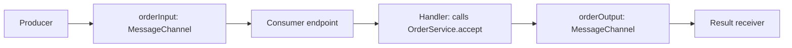
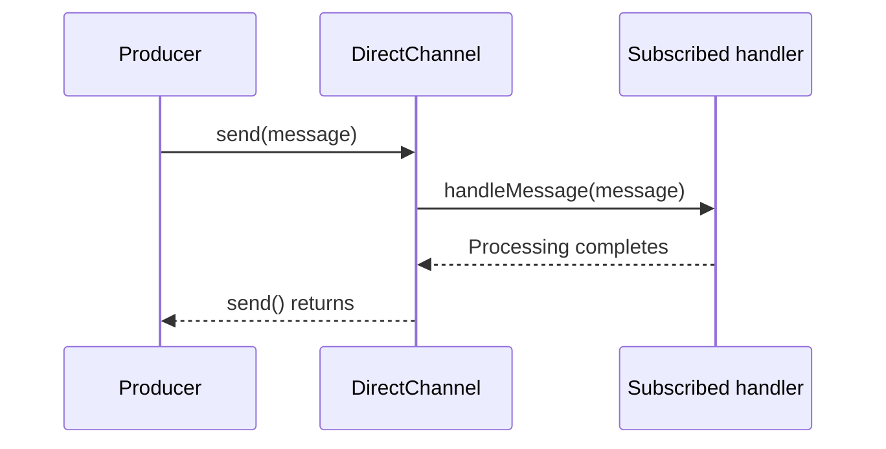
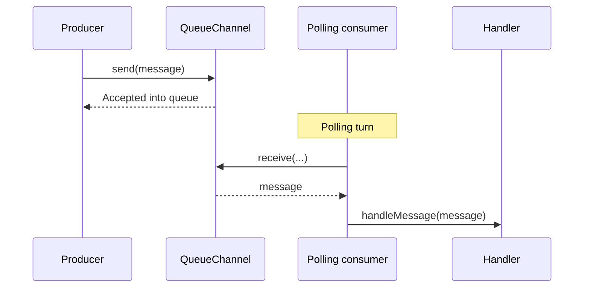

# Message endpoints in a flow

## 1. Objectives and scope

In the **Message flow model** chapter of the **SPRING_INTEGRATION_CORE** module, this lesson explains how a processing component is wired into a message flow. After this lesson, you should be able to read a flow and identify:

- Which channel delivers messages into an endpoint.
- Whether the endpoint receives messages via subscription or polling.
- Which handler executes the logic and whether it produces an output.
- Where results, errors, and starting/stopping the endpoint are handled.

Examples use Java 17 or later and the Spring Integration 6.x Java DSL API, with `IntegrationFlow.from(...)`. The practice project requires `spring-integration-core` along with compatible Spring dependencies; testing requires JUnit Jupiter. Dependency versions should be managed consistently by the project's BOM or Spring Boot.

This lesson focuses on endpoint structure in core. Transformers, routers, filters, and aggregators appear to illustrate each step's role; the algorithms and in-depth configuration of each pattern are covered separately.

## 2. Where does an endpoint sit in the message flow model?

Suppose an application receives order requests. An `OrderService` object can validate an order and return an acceptance receipt. However, merely registering that object as a Spring bean does not answer: who receives the message, where it comes from, and when the method is called?

A message endpoint is responsible for attaching a processing component to the messaging infrastructure. For a typical consumer, distinguish three layers:

| Component | Question it answers | Example in the order flow |
| --- | --- | --- |
| `Message` | What data and context are being transferred? | Payload is `Order`, header contains `traceId` |
| `MessageChannel` | Where is the message transported? | `orderInput`, `orderOutput` |
| Endpoint and its handler | How is the message received and what is processed? | Consumer invokes `OrderService.accept(...)` |

A more detailed diagram:



In business diagrams, people often merge the endpoint and handler into a single "Accept order" box. In configuration and troubleshooting, separating them helps pinpoint responsibilities accurately.

Endpoint in this lesson is a messaging concept, not necessarily an HTTP URL. A transformer between two channels is also a processing step in the flow even though it opens no network port. The [Message Endpoints](https://docs.spring.io/spring-integration/reference/6.5/endpoint.html) documentation describes an endpoint as the component that connects messaging components to channels.

### Endpoints do not replace business services

For example:

```java
public Receipt accept(Order order) {
    // Validate and accept the order.
}
```

The method above describes business logic. Endpoint configuration adds the integration context:

```text
Receive from orderInput
    -> call accept(payload)
    -> send result to orderOutput
```

This allows testing order-acceptance logic independently of how messages enter the system.

## 3. Handler and consumer endpoint are two distinct roles

At the infrastructure level, a handler has the following basic contract:

```java
package org.springframework.messaging;

public interface MessageHandler {
    void handleMessage(Message<?> message);
}
```

The `void` return type here does not mean every step in a flow cannot return a result. A framework-provided handler can invoke a POJO method, take its return value, and send a new message to the next channel.

For a typical consumer endpoint:

- **Handler** performs the operation: transform, filter, route, invoke a service, or aggregate messages.
- **Consumer endpoint** manages receiving messages and passing them to the handler.
- **Output channel** is where a reply-producing handler sends its result.

You usually write a POJO or lambda and let the DSL build the wiring. There is no need to implement `MessageHandler`, `EventDrivenConsumer`, or `PollingConsumer` yourself just to call a service.

For example, the DSL can invoke a method on a bean:

```java
.handle(orderService, "accept")
```

Or use a lambda that handles payload and headers:

```java
.handle(String.class, (payload, headers) ->
        payload.strip().toUpperCase(java.util.Locale.ROOT))
```

Both styles are supported by `.handle()`; using lambdas and `GenericHandler` is explained in [Service Activators and the .handle() method](https://docs.spring.io/spring-integration/reference/6.5/dsl/java-handle.html).

When reading configuration, distinguish the names of the flow, channel, endpoint, and service. Renaming the `orderService` bean does not mean you renamed the endpoint that receives messages.

## 4. Common endpoint roles

Verbs in the Java DSL represent different processing patterns. The table below illustrates them using an order-intake system:

| Role | Common representation | Work in the example |
| --- | --- | --- |
| Transformer | `.transform(...)` | Normalize product SKU before validating the order |
| Filter | `.filter(...)` | Allow only eligible orders to continue |
| Router | `.route(...)` | Route orders to the appropriate warehouse |
| Splitter | `.split(...)` | Split an order into line items |
| Aggregator | `.aggregate(...)` | Combine processing results of line items |
| Service activator | `.handle(...)` | Invoke the order-acceptance service |
| Bridge | `.bridge(...)` | Connect two channels without adding business logic |
| Channel adapter | Inbound or outbound adapter | Bring data from a source into the flow or send it to a target |
| Gateway | Messaging gateway or protocol gateway | Connect a request-reply interaction to messaging |

The EIP names corresponding to DSL verbs are listed in [DSL Basics](https://docs.spring.io/spring-integration/reference/6.5/dsl/java-basics.html).

Not every input message produces exactly one output message. For example, an invalid order may stop at a filter; a splitter may produce multiple line-item messages; an aggregation step may have to wait for other lines. When designing a step, state explicitly the condition under which an output is produced instead of assuming "after calling it, execution moves on."

### Endpoints at system boundaries

An inbound adapter can create messages from an external source; an outbound adapter sends data to a target. Specifically, a polling inbound adapter typically uses `SourcePollingChannelAdapter` to read a `MessageSource`. This differs from `PollingConsumer`, which reads messages already inside a channel. Adapters that receive callbacks or listeners from a protocol do not necessarily use polling. See [Channel Adapter](https://docs.spring.io/spring-integration/reference/channel-adapter.html).

Therefore, "every endpoint reads from an input channel" only fits the consumer group under discussion, not an all-encompassing definition of every endpoint.

## 5. Two ways a consumer endpoint receives messages

### 5.1. Event-driven consumer

With `SubscribableChannel`, the framework subscribes the handler to the channel. When the channel dispatches a message, the handler is invoked without a poller periodically checking.



`DirectChannel` is commonly used for processing segments on the sender's thread. Event-driven describes how messages are received; synchronous or asynchronous execution also depends on the channel and executor.

### 5.2. Polling consumer

With `PollableChannel`, such as `QueueChannel`, messages are placed into a queue. The consumer endpoint needs a poller to retrieve messages and then invoke the handler.



The two consumer types and their dependence on channel type are presented in [Message Endpoints](https://docs.spring.io/spring-integration/reference/6.5/endpoint.html).

| Input channel | Typical consumer reception mechanism | Requires poller? | Thread executing processing |
| --- | --- | --- | --- |
| `DirectChannel` | Subscription | No | Usually the thread calling `send()` |
| `ExecutorChannel` | Subscription | No | Usually the configured executor; also consider task rejection policy |
| `QueueChannel` | Polling | Yes, explicit or default poller | Polling task thread or executor assigned to the poller |

Channel dispatch and buffering characteristics are described in [Message Channel Implementations](https://docs.spring.io/spring-integration/reference/channel/implementations.html).

**Design implication:** changing `DirectChannel` to `QueueChannel` changes execution timing and how errors are received. This is a behavioral change to the flow, even though the business method stays the same.

## 6. Complete example: order-acceptance endpoint

### 6.1. Requirements

A message containing an `Order` enters `orderInput`. The service validates the quantity and product SKU, then creates a `Receipt`. The result goes into `orderOutput` so the caller or test can retrieve it.

```text
orderInput: DirectChannel
    -> acceptOrderEndpoint
         handler calls OrderService.accept(Order)
    -> orderOutput: QueueChannel
```

The input uses `DirectChannel`, so the receiving endpoint needs no poller. The output is a queue, but in this example the receiver actively calls `receive()`; no downstream consumer endpoint needs to be configured there.

### 6.2. Java configuration

Place the following code in `example/OrderEndpointConfig.java` of the practice project:

```java
package example;

import java.util.Locale;

import org.springframework.beans.factory.annotation.Qualifier;
import org.springframework.context.annotation.Bean;
import org.springframework.context.annotation.Configuration;
import org.springframework.integration.channel.DirectChannel;
import org.springframework.integration.channel.QueueChannel;
import org.springframework.integration.config.EnableIntegration;
import org.springframework.integration.dsl.IntegrationFlow;

@Configuration(proxyBeanMethods = false)
@EnableIntegration
public class OrderEndpointConfig {

    public record Order(String orderId, String sku, int quantity) {
    }

    public record Receipt(
            String orderId,
            String normalizedSku,
            int quantity,
            String status) {
    }

    public static class OrderService {

        public Receipt accept(Order order) {
            if (order.quantity() <= 0) {
                throw new IllegalArgumentException(
                        "Quantity must be greater than 0");
            }
            if (order.sku() == null || order.sku().isBlank()) {
                throw new IllegalArgumentException(
                        "Product SKU must not be blank");
            }

            return new Receipt(
                    order.orderId(),
                    order.sku().strip().toUpperCase(Locale.ROOT),
                    order.quantity(),
                    "ACCEPTED");
        }
    }

    @Bean
    public DirectChannel orderInput() {
        return new DirectChannel();
    }

    @Bean
    public QueueChannel orderOutput() {
        return new QueueChannel(10);
    }

    @Bean
    public OrderService orderService() {
        return new OrderService();
    }

    @Bean
    public IntegrationFlow orderFlow(
            @Qualifier("orderInput") DirectChannel input,
            @Qualifier("orderOutput") QueueChannel output,
            OrderService service) {

        return IntegrationFlow.from(input)
                .handle(service, "accept",
                        endpoint -> endpoint
                                .id("acceptOrderEndpoint")
                                .requiresReply(true))
                .channel(output)
                .get();
    }
}
```

This is a core example using a Spring context directly, without relying on Spring Boot auto-configuration of the infrastructure. `@EnableIntegration` enables the integration infrastructure required in this configuration.

### 6.3. Reading each part of the flow

- `IntegrationFlow.from(input)` selects the starting channel.
- `.handle(service, "accept", ...)` declares a service activator invoking the business method.
- `.id("acceptOrderEndpoint")` assigns an identifier to the consumer endpoint.
- `.requiresReply(true)` requires this call to produce a non-`null` result.
- `.channel(output)` connects the result to `orderOutput`.
- `.get()` completes the flow definition.

The builders collect components for Spring to register as beans. This DSL chain executes when building the configuration; as each message arrives, the registered components process the message. See [Java DSL](https://docs.spring.io/spring-integration/reference/6.5/dsl.html).

In the example, there are four identifiers worth distinguishing:

| Identifier | Object or role |
| --- | --- |
| `orderFlow` | Bean describing the set of components in the flow |
| `orderInput` | Input channel |
| `acceptOrderEndpoint` | Consumer endpoint configured by the DSL |
| `orderService` | Bean containing the business method |

### 6.4. Sending a message and retrieving the result

The following code can be placed in `example/OrderEndpointDemo.java`:

```java
package example;

import org.springframework.context.annotation.AnnotationConfigApplicationContext;
import org.springframework.integration.channel.QueueChannel;
import org.springframework.messaging.Message;
import org.springframework.messaging.MessageChannel;
import org.springframework.messaging.support.MessageBuilder;

public class OrderEndpointDemo {

    public static void main(String[] args) {
        try (var context = new AnnotationConfigApplicationContext(
                OrderEndpointConfig.class)) {

            MessageChannel input = context.getBean(
                    "orderInput", MessageChannel.class);
            QueueChannel output = context.getBean(
                    "orderOutput", QueueChannel.class);

            Message<OrderEndpointConfig.Order> request =
                    MessageBuilder.withPayload(
                            new OrderEndpointConfig.Order(
                                    "ORD-42", " book-01 ", 2))
                            .setHeader("traceId", "trace-42")
                            .build();

            if (!input.send(request, 1_000)) {
                throw new IllegalStateException(
                        "Failed to send request");
            }

            Message<?> reply = output.receive(1_000);
            if (reply == null) {
                throw new IllegalStateException(
                        "No result received");
            }

            System.out.println(reply.getPayload());
            System.out.println(reply.getHeaders().get("traceId"));
        }
    }
}
```

Expected output:

```text
Receipt[orderId=ORD-42, normalizedSku=BOOK-01, quantity=2, status=ACCEPTED]
trace-42
```

This is the expected output to verify against during practice. The point to observe is that the new payload has type `Receipt`, while `traceId` still correlates back to the original request.

In this specific flow, execution runs synchronously from `orderInput` until the result is enqueued into `orderOutput`. The timeout parameter on `send()` is not a runtime limit on `OrderService.accept()`; it does not automatically interrupt a long-running business call.

## 7. Where do results from an endpoint go?

For a service activator that produces a reply, the common cases are:

| Scenario | Behavior to understand |
| --- | --- |
| Explicit output channel configured | Result is sent to the output channel |
| No output channel, request has `replyChannel` | Uses the reply address in the header |
| Request has no reply address, returned `Message` has `replyChannel` | Reply address on the returned message can be used |
| Result exists but destination cannot be determined | Throws an error resolving reply destination |
| Method returns `void` or `null` | By default produces no reply |
| `requiresReply(true)` but returns `null` | Throws `ReplyRequiredException` |

Reply rules, payload-to-POJO parameter mapping, and header copying for service activators are described in [Service Activator](https://docs.spring.io/spring-integration/reference/service-activator.html).

The order example specifies an explicit output channel, so setting `replyChannel` manually is unnecessary. With a request-reply gateway, the reply address header is typically the mechanism that routes the result back to the initial caller.

### A final step returning void does not automatically forward the old message

Consider the idea:

```text
orderInput -> save order history using void method -> send email
```

If the history-saving step is configured as a service activator and only returns `void`, there is no automatic reply to trigger the email-sending step. In design, choose one of the appropriate approaches explicitly:

- Have that step return the object needed by the next step.
- Split history recording into a side branch if business rules allow.
- Use an operation with an appropriate forwarding contract.

Similarly, when a filter rejects an order, a request-reply caller needs a way to receive a rejection response or a defined timeout. "No output" can be a valid business decision, but it must stay consistent with the caller's contract.

## 8. Switching input to QueueChannel: where does the poller go?

Suppose order intake needs to be decoupled from the sender thread. In `OrderEndpointConfig`, replace the `orderInput` bean and the `orderFlow` method from section 6 with the version below; add the `orderErrors` bean. Keep `orderOutput`, `OrderService`, and the two records unchanged.

Add these imports:

```java
import java.time.Duration;

import org.springframework.integration.dsl.Pollers;
```

Replacement and additional methods:

```java
@Bean
public QueueChannel orderInput() {
    return new QueueChannel(100);
}

@Bean
public QueueChannel orderErrors() {
    return new QueueChannel(10);
}

@Bean
public IntegrationFlow orderFlow(
        @Qualifier("orderInput") QueueChannel input,
        @Qualifier("orderOutput") QueueChannel output,
        OrderService service) {

    return IntegrationFlow.from(input)
            .handle(service, "accept",
                    endpoint -> endpoint
                            .id("acceptOrderEndpoint")
                            .requiresReply(true)
                            .poller(Pollers.fixedDelay(
                                            Duration.ofMillis(200))
                                    .maxMessagesPerPoll(5)
                                    .receiveTimeout(0)
                                    .errorChannel("orderErrors")))
            .channel(output)
            .get();
}
```

This is a **replacement configuration**; do not register it concurrently with the previous version sharing the same bean names.

The poller is placed on the endpoint consuming `orderInput`. It is not attached to the queue as a shared business schedule across all consumers.

### Meaning of the configuration

| Property | Meaning in the example |
| --- | --- |
| `fixedDelay(200 ms)` | In this setup without a dedicated executor, waits about 200 ms after the previous polling task finishes before running the next turn |
| `maxMessagesPerPoll(5)` | In one turn, pulls and processes at most 5 messages, potentially finishing early when no messages remain |
| `receiveTimeout(0)` | Each receive does not wait further if the queue is currently empty |
| `errorChannel("orderErrors")` | Sets the error destination channel for this polling task |

The poller configuration API is described in [PollerSpec](https://docs.spring.io/spring-integration/api/org/springframework/integration/dsl/PollerSpec.html).

The number 5 does not create 5 threads and does not turn the payload into a list of 5 elements. In the example, a single polling task passes messages one by one to the handler. Parallel processing requires designing an executor or multiple consumers and assessing service concurrency safety.

If each order takes 40 ms and the queue always has enough data, one turn processing 5 orders takes roughly 200 ms. Adding the 200 ms pause gives a simple estimate of 5 orders per 400 ms, or about 12.5 orders/second. This is an illustration based on the example's assumptions, ignoring overhead and scheduling jitter; it is not a framework throughput guarantee.

### Why is the old configuration no longer enough?

With `DirectChannel`, the endpoint subscribes to receive messages. With a queue, subscription is not how data is retrieved. The endpoint needs either its own poller configuration or a valid default poller in the context. Without either, the application may fail when initializing the endpoint.

Furthermore, a successful `send()` into a queue only confirms the message was accepted by the queue. It does not confirm that `accept(...)` ran or that the order was accepted.

Default queues store messages in memory; configure an appropriate message store if persistence is required. Do not infer that "in the queue" means "will automatically recover after process termination." See [Configuring Message Channels](https://docs.spring.io/spring-integration/reference/channel/configuration.html).

## 9. Error handling depends on execution boundaries

### 9.1. Synchronous flow through DirectChannel

In the original configuration, if quantity is 0, the service throws `IllegalArgumentException`. The error is typically wrapped in a messaging exception and propagated back to the `input.send(...)` call.

The caller can catch the error there:

```java
try {
    input.send(MessageBuilder.withPayload(
            new OrderEndpointConfig.Order(
                    "ORD-BAD", "BOOK-01", 0))
            .build());
}
catch (org.springframework.messaging.MessagingException ex) {
    // Decide response or log error at the call boundary.
}
```

### 9.2. Flow through queue and poller

In the queue configuration, errors occur inside the polling task after the sender has already placed the message into the queue. A `try/catch` around `send()` cannot catch business errors raised later in that task.

Spring Integration provides a mechanism to publish `ErrorMessage` instances for errors from asynchronous tasks and pollers. When using the default mechanism, a message's `errorChannel` header takes precedence over the default error channel; the poller configuration in the example explicitly sets `orderErrors` as the error destination. Synchronous and asynchronous behaviors are explained in [Error Handling](https://docs.spring.io/spring-integration/reference/error-handling.html).

To observe the queue example, you can retrieve errors with:

```java
QueueChannel errors = context.getBean(
        "orderErrors", QueueChannel.class);

Message<?> errorMessage = errors.receive(2_000);
if (errorMessage != null) {
    Throwable failure = (Throwable) errorMessage.getPayload();
    System.out.println(failure.getMessage());
}
```

This snippet uses `Message` and `QueueChannel` imports like the demo program. It is a manual observation technique; a continuously running application needs a consumer on the error channel.

To trace failed orders, useful details include order ID, `traceId`, the failing endpoint, and root cause. When the error payload is a `MessagingException`, you can inspect `getFailedMessage()` while handling the case where that value is absent.

Sending an error to a channel does not automatically retry or put the message back into the queue. Retry, recovery, and failed-order auditing policies are additional design decisions for the flow.

## 10. Endpoint lifecycle and identity

Endpoints have their lifecycle managed by Spring. Endpoints based on `AbstractEndpoint` support start, stop, and the `autoStartup` property; by default this property is `true`. See [AbstractEndpoint](https://docs.spring.io/spring-integration/api/org/springframework/integration/endpoint/AbstractEndpoint.html).

In the example, the name `acceptOrderEndpoint` is set explicitly so this component can be looked up and controlled:

```java
org.springframework.context.Lifecycle endpoint =
        context.getBean(
                "acceptOrderEndpoint",
                org.springframework.context.Lifecycle.class);

endpoint.stop();
// Observe the system when the endpoint no longer receives new messages.

endpoint.start();
```

This is a demonstration operation on an initialized context, not guidance to stop an endpoint in the middle of a business transaction.

Several consequences to anticipate:

- If an endpoint is the sole subscriber of a `DirectChannel` and is stopped, sending to that channel may fail due to no subscribers.
- If a queue consumer is stopped, messages can continue piling up in the queue until capacity is exhausted.
- Stopping an endpoint does not clear messages already in channels or undo side effects already performed.

You can use `.autoStartup(false)` in endpoint configuration when you want to call `start()` explicitly. `.id(...)` sets the endpoint identifier; it does not rename channels or business beans. The corresponding API is described in [ConsumerEndpointSpec](https://docs.spring.io/spring-integration/api/org/springframework/integration/dsl/ConsumerEndpointSpec.html) and [EndpointSpec](https://docs.spring.io/spring-integration/api/org/springframework/integration/dsl/EndpointSpec.html).

Functional naming such as `acceptOrderEndpoint` helps correlate logs and configuration. Names like `step2` easily lose meaning when a flow branches or steps are inserted.

## 11. Testing the endpoint contract

Plain Java service tests answer "which receipt does a valid order produce?" Flow tests also need to answer "does the message pass through the right channels, produce output, and preserve required context?"

The two JUnit Jupiter tests below use **the original DirectChannel configuration in section 6**. Place them in `example/OrderEndpointTest.java` of the test sources:

```java
package example;

import org.junit.jupiter.api.Test;
import org.springframework.context.annotation.AnnotationConfigApplicationContext;
import org.springframework.integration.channel.QueueChannel;
import org.springframework.messaging.Message;
import org.springframework.messaging.MessageChannel;
import org.springframework.messaging.MessagingException;
import org.springframework.messaging.support.MessageBuilder;

import static org.junit.jupiter.api.Assertions.*;

class OrderEndpointTest {

    @Test
    void validOrderProducesReceiptAndPreservesTraceId() {
        try (var context = new AnnotationConfigApplicationContext(
                OrderEndpointConfig.class)) {

            MessageChannel input = context.getBean(
                    "orderInput", MessageChannel.class);
            QueueChannel output = context.getBean(
                    "orderOutput", QueueChannel.class);

            boolean sent = input.send(
                    MessageBuilder.withPayload(
                            new OrderEndpointConfig.Order(
                                    "ORD-42", " book-01 ", 2))
                            .setHeader("traceId", "trace-42")
                            .build(),
                    1_000);

            assertTrue(sent);

            Message<?> reply = output.receive(1_000);
            assertNotNull(reply);

            var receipt = assertInstanceOf(
                    OrderEndpointConfig.Receipt.class,
                    reply.getPayload());

            assertEquals("ORD-42", receipt.orderId());
            assertEquals("BOOK-01", receipt.normalizedSku());
            assertEquals(2, receipt.quantity());
            assertEquals("ACCEPTED", receipt.status());
            assertEquals(
                    "trace-42", reply.getHeaders().get("traceId"));
            assertNull(output.receive(0));
        }
    }

    @Test
    void invalidOrderFailsAtTheSynchronousSendBoundary() {
        try (var context = new AnnotationConfigApplicationContext(
                OrderEndpointConfig.class)) {

            MessageChannel input = context.getBean(
                    "orderInput", MessageChannel.class);
            QueueChannel output = context.getBean(
                    "orderOutput", QueueChannel.class);

            assertThrows(MessagingException.class, () ->
                    input.send(MessageBuilder.withPayload(
                            new OrderEndpointConfig.Order(
                                    "ORD-BAD", "BOOK-01", 0))
                            .build()));

            assertNull(output.receive(0));
        }
    }
}
```

The assertions express the expected contract of the example. When switching to the queue configuration in section 8, the error test must also change: assert that sending to input succeeds, then receive the error from `orderErrors`. Do not keep asserting that "`send()` must throw the business error."

For asynchronous processing, calling `receive(timeout)` on an observable channel gives the test an explicit wait condition. A fixed `Thread.sleep(...)` does not tell you which step has finished.

## 12. Diagnosing when messages stop moving

Identify which boundary the message stopped at before changing business logic:

| Symptom | Hypothesis to check | Direct check |
| --- | --- | --- |
| Sending to direct channel fails with no subscribers | Endpoint not registered, stopped, or wired to wrong input | Check channel names, endpoint bean, and running state |
| Queue has data but service is never called | Consumer lacks a poller or is not started | Check poller configuration and endpoint lifecycle |
| Service ran but next step stays silent | Method returned `null`/`void`, message was filtered, or output went elsewhere | Check output contract and downstream channel |
| Output exists but reply-destination error occurs | No output channel or suitable reply address | Check output configuration and `replyChannel` |
| Sender sees no error even though order failed | Processing moved to a poller or executor | Inspect the error channel for that processing segment |
| Flow runs but queued message count grows | Processing rate is slower than arrival rate or consumer is stopped | Compare intake/output rates, handler duration, and queue depth |
| One of several handlers receives unexpected messages | Competing consumers on the same point-to-point channel | Inspect topology; use publish-subscribe if broadcasting is intended |

For the order example, a concrete observation sequence is:

```text
Was ORD-42 sent to orderInput?
    -> Is acceptOrderEndpoint running?
    -> Was OrderService.accept invoked?
    -> Is there a Receipt in orderOutput?
    -> If not, is there an error at the synchronous boundary or in orderErrors?
```

Each step narrows the investigation scope. Seeing the `orderService` bean in the context is not enough to prove the endpoint is wired to the input channel.

## 13. Reinforcement exercises

Perform these sequentially in the practice project:

1. With the original configuration, send a valid order and verify `Receipt`, `traceId`, and that no extra output is produced.
2. Send an order with quantity 0; confirm the error surfaces at the synchronous call and no receipt is created.
3. Replace the input with a queue per section 8; resend the invalid order and observe `orderErrors`.
4. Stop `acceptOrderEndpoint`, send a valid message into the queue, and then restart the endpoint to observe the message being processed afterward.
5. Extract SKU normalization into a transformer placed before the service; identify the channel and endpoint of each step on the new diagram.

In step 5, if using an input queue, the poller belongs to the first consumer reading the queue. Subsequent steps connected via direct channels receive messages by subscription. When changing topology, verify where the poller sits rather than leaving it on the service activator out of habit.

A flow design can be summarized concisely with four pieces of information per step: **input, reception mechanism, processing, and output or error**. For the order-acceptance endpoint:

```text
Input: orderInput
Reception mechanism: subscription for DirectChannel; polling for QueueChannel
Processing: OrderService.accept(Order)
Output: Receipt to orderOutput
Errors: returned to sender in synchronous setup;
        observed via orderErrors in the poller setup above
```
