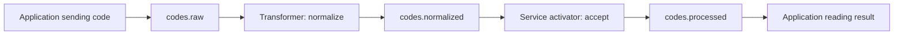

# Input channels and output channels

In the **Message flow model** chapter of the **SPRING_INTEGRATION_CORE** module, input channels and output channels describe how a message travels through each endpoint. Understanding these two roles is the foundation for connecting transformers, service activators, filters, routers, or aggregators into an observable and testable processing flow.

This lesson focuses on the question: **where does an endpoint receive a message from, and where does the endpoint's result go next?** The examples use an order-code normalization flow, then expand to request-reply handling and queue-based processing.

## 1. Learning outcomes

After this lesson, you can:

- Identify the input channel and output channel of each step on a flow diagram.
- Distinguish a channel's role from its implementation type, such as `DirectChannel` or `QueueChannel`.
- Wire endpoints using Java DSL and read equivalent annotation-based configuration.
- Explain the relationship between a configured output channel and the `replyChannel` header.
- Predict behavior when a consumer, poller, or reply destination is missing.
- Design tests spanning from an input channel to messages on an output channel.

## 2. Two roles defined per endpoint

Consider an order-code intake flow:



For the normalization endpoint, `codes.raw` is the input channel and `codes.normalized` is the output channel. For the acceptance endpoint, `codes.normalized` is the input channel; `codes.processed` is the output channel.

| Component under consideration | Input channel | Output channel | Work performed |
| --- | --- | --- | --- |
| Normalization transformer | `codes.raw` | `codes.normalized` | Trim whitespace and convert to uppercase |
| Acceptance service activator | `codes.normalized` | `codes.processed` | Produce acceptance result |

**One channel can simultaneously be the output of the preceding endpoint and the input of the following endpoint.** There is no need to create two separate channels just to call one input and the other output.

Names like `inputChannel`, `outputChannel`, or `codes.normalized` are bean names or configuration references. They do not create specialized Java classes named `InputChannel` or `OutputChannel`.

An effective way to read a diagram is to put your finger on one endpoint and answer in turn:

1. Through which edge does a message reach this endpoint?
2. What transformation or business logic does the endpoint perform?
3. Does the endpoint produce a result?
4. If it produces a result, which edge carries that result to the next step?

Only then move to the next endpoint. This reading technique avoids confusing flow-wide names with each channel's local role.

## 3. Channels transport, endpoints process

At the interface level, `MessageChannel` provides the send operation. `PollableChannel` adds active receive operations; `SubscribableChannel` allows registering a handler to be invoked when a message arrives. How consumption works therefore depends on the interface the channel implements. See [The MessageChannel Interface](https://docs.spring.io/spring-integration/reference/channel/interfaces.html).

```java
// Main signatures, omitting the interface declarations.
boolean send(Message<?> message);
boolean send(Message<?> message, long timeout);

// Available on PollableChannel.
Message<?> receive();
Message<?> receive(long timeout);
```

The timeout parameter in these operations is in milliseconds. When sending cannot succeed within the timeout, send may return `false`; delivery or processing failures can also throw exceptions. When a timed receive finds no message, the result is `null`.

Most importantly: the `boolean` returned by `send()` is not a business outcome. An outcome like `ACCEPTED:ORD-42` lives inside a forwarded message or a reply returned via request–reply.

The following example only checks that the send was accepted:

```java
Message<String> request = MessageBuilder
        .withPayload("  ord-42  ")
        .setHeader("traceId", "trace-42")
        .build();

boolean sent = inputChannel.send(request, 1_000);
if (!sent) {
    throw new IllegalStateException("Failed to send request within timeout");
}
```

To assess whether business processing completed, the application must define an appropriate observation point: a gateway reply, a message on an output channel, or persisted business state. Observing only the `sent` variable misses work executed after the send moment.

## 4. Input/output roles are independent of delivery mechanics

Input/output describes a channel's position in the flow. Channel type describes how messages are delivered at that position.

| Channel type | Primary delivery mechanism | Illustrative scenario |
| --- | --- | --- |
| `DirectChannel` | Invokes one subscriber on the sender's thread | Two sequential processing steps in the same call |
| `QueueChannel` | Buffers messages for a consumer to pull | Downstream step picks up work from a queue |
| `ExecutorChannel` | Dispatches handler invocation via an executor | Decouples processing from the sender thread, depending on executor |
| `PublishSubscribeChannel` | Broadcasts to subscribers | Notifies multiple parties of an event |

These delivery characteristics are described in [Message Channel Implementations](https://docs.spring.io/spring-integration/reference/channel/implementations.html).

With `DirectChannel`, having multiple subscribers does not mean each subscriber gets a copy; dispatching uses load balancing and failover. When designing two tasks that must both receive an event, express the broadcast requirement explicitly. See [DirectChannel API](https://docs.spring.io/spring-integration/api/org/springframework/integration/channel/DirectChannel.html).

For example, after normalizing an order code:

- If only the acceptance step needs the result, a point-to-point channel is a straightforward choice.
- If both auditing and notification must see the accepted event, a broadcast branch is needed.
- If the acceptance step runs slowly, consider a queue, capacity bounds, and timeouts.

The name `codes.output` does not make a channel asynchronous. Nor does the name `codes.input` guarantee a queue is present.

## 5. Java DSL example: two endpoints, three channels

### 5.1. Assumptions for reading the example

The example uses Java 17 or later, `spring-integration-core`, and compatible Spring dependencies. Later tests use JUnit Jupiter. If the project uses Spring Boot, let the project BOM manage versions; if using plain Spring, align Spring versions before assembling the code.

The configuration below uses `@EnableIntegration` and `AnnotationConfigApplicationContext`, so it does not rely on Spring Boot auto-configuration. Each `public` class in this lesson belongs in its own Java file when placed into a practice project; the lesson does not require modifying existing build configuration.

### 5.2. Flow configuration

```java
import java.util.Locale;

import org.springframework.beans.factory.annotation.Qualifier;
import org.springframework.context.annotation.Bean;
import org.springframework.context.annotation.Configuration;
import org.springframework.integration.channel.DirectChannel;
import org.springframework.integration.channel.QueueChannel;
import org.springframework.integration.config.EnableIntegration;
import org.springframework.integration.dsl.IntegrationFlow;
import org.springframework.messaging.MessageChannel;

@Configuration
@EnableIntegration
public class CodeFlowConfig {

    @Bean(name = "codes.raw")
    public MessageChannel rawCodes() {
        return new DirectChannel();
    }

    @Bean(name = "codes.normalized")
    public MessageChannel normalizedCodes() {
        return new DirectChannel();
    }

    @Bean(name = "codes.processed")
    public QueueChannel processedCodes() {
        return new QueueChannel(20);
    }

    @Bean
    public IntegrationFlow codeFlow(
            @Qualifier("codes.raw") MessageChannel raw,
            @Qualifier("codes.normalized") MessageChannel normalized,
            @Qualifier("codes.processed") QueueChannel processed) {

        return IntegrationFlow.from(raw)
                .transform(String.class,
                        payload -> payload.strip().toUpperCase(Locale.ROOT))
                .channel(normalized)
                .handle(String.class,
                        (payload, headers) -> "ACCEPTED:" + payload)
                .channel(processed)
                .get();
    }
}
```

Java DSL builds and registers channels, handlers, and endpoints in the Spring context. It still configures Spring Integration's messaging model. See [Java DSL](https://docs.spring.io/spring-integration/reference/dsl.html).

### 5.3. Reading the configuration by entry and exit ports

In the example:

- `IntegrationFlow.from(raw)` specifies the flow entry point; the next transformer consumes from `raw`.
- `.channel(normalized)` places a handoff channel after the transformer and before the service activator.
- `.handle(...)` invokes the acceptance logic via a service activator.
- `.channel(processed)` sets the destination for acceptance results.
- `.get()` completes building the flow definition object.

If `.channel(normalized)` is omitted, the DSL can link endpoints using an auto-generated internal channel. Named channels are useful when you want a clear boundary between flows or a stable observation point. See [Message Channels in Java DSL](https://docs.spring.io/spring-integration/reference/dsl/java-channels.html).

Avoid creating many named channels merely because each DSL statement looks like a separate step. Name channels at architecturally meaningful points, such as "normalized," "pending," or "completed."

### 5.4. Tracing a message

With input payload `"  ord-42  "`:

| Stage | Observed payload | Next receiver |
| --- | --- | --- |
| Sent to `codes.raw` | `"  ord-42  "` | Transformer |
| After normalization, via `codes.normalized` | `"ORD-42"` | Service activator |
| After acceptance, into `codes.processed` | `"ACCEPTED:ORD-42"` | Consumer reading queue |

These are the expected values from the sample code. The transformer produces the normalized content; the service activator produces the acceptance content. Naming channels only identifies where those contents are handed off.

In this flow, the final consumer is the application or test calling `receive()` directly. No endpoint automatically consumes `codes.processed`, so no poller is needed on this terminal queue.

## 6. Reading the same wiring with annotations

Annotation configuration typically declares channel names directly on processing methods:

```java
import java.util.Locale;

import org.springframework.integration.annotation.ServiceActivator;

public class CodeEndpoints {

    @ServiceActivator(
            inputChannel = "codes.raw",
            outputChannel = "codes.normalized")
    public String normalize(String raw) {
        return raw.strip().toUpperCase(Locale.ROOT);
    }

    @ServiceActivator(
            inputChannel = "codes.normalized",
            outputChannel = "codes.processed")
    public String accept(String normalized) {
        return "ACCEPTED:" + normalized;
    }
}
```

To use this variant, keep the three channel beans and `@EnableIntegration` from the previous example, remove the `codeFlow` bean, and register `CodeEndpoints` as a bean:

```java
@Bean
public CodeEndpoints codeEndpoints() {
    return new CodeEndpoints();
}
```

These are two alternative representations. Do not register both `codeFlow` and `CodeEndpoints` simultaneously for the same exercise: doing so attaches consumers from both configurations to the existing channels, making outcomes depend on dispatch behavior.

The `inputChannel` and `outputChannel` attributes on the annotation are bean names to be resolved. You can cross-check the configuration style at [Service Activator](https://docs.spring.io/spring-integration/reference/service-activator.html).

## 7. Output channel and `replyChannel`: next destination vs. reply destination

The output channel configured on an endpoint answers: **where should this step's result go?** The `replyChannel` header on a message carries a per-request reply address.

For a service activator producing a non-`null` result, the basic destination resolution order is:

1. Use the configured output channel.
2. If none is configured, check the request's `replyChannel` header.
3. If the request lacks that header and the result is a `Message`, `replyChannel` on the result message can be checked.
4. If no suitable destination exists, throw a destination-resolution error.

The `replyChannel` value can be a `MessageChannel` instance or a channel name. See the rules at [Service Activator — reply destination](https://docs.spring.io/spring-integration/reference/service-activator.html).

### 7.1. Building a flow that relies on the reply address

The two beans below can be added to `CodeFlowConfig`. They form a separate flow using a different channel from the initial example:

```java
@Bean(name = "codes.requests")
public MessageChannel codeRequests() {
    return new DirectChannel();
}

@Bean
public IntegrationFlow requestReplyFlow(
        @Qualifier("codes.requests") MessageChannel requests) {

    return IntegrationFlow.from(requests)
            .handle(String.class,
                    (payload, headers) -> "LOOKUP:" + payload)
            .get();
}
```

Here there is no `.channel(...)` after `.handle(...)`. The sender provides the reply destination via header:

```java
import org.springframework.messaging.Message;
import org.springframework.messaging.MessageHeaders;
import org.springframework.messaging.support.MessageBuilder;

QueueChannel replies = new QueueChannel(1);
Message<String> request = MessageBuilder.withPayload("ORD-42")
        .setHeader(MessageHeaders.REPLY_CHANNEL, replies)
        .build();

boolean sent = requests.send(request, 1_000);
if (!sent) {
    throw new IllegalStateException("Failed to send lookup request");
}

Message<?> response = replies.receive(1_000);
if (response == null) {
    throw new IllegalStateException("No lookup response received");
}

System.out.println(response.getPayload()); // Expected: LOOKUP:ORD-42
```

The `requests` variable in the call snippet is the `codes.requests` bean retrieved from the context. `replies` is a temporary queue for this single demonstration call, so it needs neither a bean name nor a poller; the caller itself retrieves the result with `receive()`.

### 7.2. What happens if both destinations are present?

Suppose the request carries `replyChannel = replies`, while the lookup endpoint is configured as:

```java
return IntegrationFlow.from(requests)
        .handle(String.class,
                (payload, headers) -> "LOOKUP:" + payload)
        .channel(processed)
        .get();
```

In this variant, `processed` is the output queue injected into the flow bean. The result goes there first; a duplicate is not automatically sent to `replies`. If no endpoint reads `processed` and forwards the reply onward, `replies.receive(...)` will time out.

This is a common explanation for the symptom: "the handler returned a value, yet the caller still received no reply." Inspect the destination after the handler and check whether the flow actually continues back to the reply address.

### 7.3. When using a messaging gateway

A gateway turns a method call into a request message and usually prepares a temporary reply channel. The final endpoint can return the result to that address; the caller receives the outcome as the method's return value. Hardcoding the final output channel to a queue without a consumer can break the reply path. See [Messaging Gateways](https://docs.spring.io/spring-integration/reference/gateway.html).

In exercises, a temporary queue makes the reply path visible. When designing a business API, a gateway typically spares callers from constructing messages manually and managing wait logic.

## 8. Distinguishing no result, discarded result, and missing destination

Not every endpoint emits a new message. A logging step or status update may finish after performing its side effect.

With a service activator, a method returning `void` or `null` can finish by default without sending a reply. When `requiresReply` is enabled, producing no result becomes a `ReplyRequiredException`. That option enforces producing a result; it does not supply a destination. See [AbstractReplyProducingMessageHandler API](https://docs.spring.io/spring-integration/api/org/springframework/integration/handler/AbstractReplyProducingMessageHandler.html).

Three intentions should be expressed differently in design:

| Intention | Expression | Question to check |
| --- | --- | --- |
| Only perform a side effect | Handler ends with `void` | Is the caller waiting for a reply? |
| Result exists but is intentionally dropped | Send result to `nullChannel` | Is this a result the business needs to retain? |
| Want to forward the result | Configure destination or use reply address | Does the destination exist and have an appropriate consumer? |

`nullChannel` is a special channel provided by the framework to receive and discard messages. Routing to it clearly expresses an intention to terminate unwanted outputs. See [Special Channels](https://docs.spring.io/spring-integration/reference/channel/special-channels.html).

Do not use `nullChannel` merely to hide errors on a request that ought to receive a response. For a lookup request, "order not found" should usually be represented by an explicit business result rather than accidentally returning `null` and leaving the caller waiting.

## 9. Switching an endpoint's input to a queue: what else is needed?

In the initial example, the service activator receives from `codes.normalized`, currently a `DirectChannel`. If you switch this channel to a `QueueChannel`, sending only places the message in the queue. An endpoint consuming from a `PollableChannel` needs a poller configured on the endpoint or a default poller applying to it. See [Poller — Polling Consumer](https://docs.spring.io/spring-integration/reference/polling-consumer.html).

Replace the `normalizedCodes` bean in `CodeFlowConfig`:

```java
@Bean(name = "codes.normalized")
public MessageChannel normalizedCodes() {
    return new QueueChannel(100);
}
```

Then replace the flow-building section with the snippet below, adding the import `org.springframework.integration.dsl.Pollers`:

```java
return IntegrationFlow.from(raw)
        .transform(String.class,
                payload -> payload.strip().toUpperCase(Locale.ROOT))
        .channel(normalized)
        .handle(String.class,
                (payload, headers) -> "ACCEPTED:" + payload,
                endpoint -> endpoint.poller(
                        Pollers.fixedDelay(100).maxMessagesPerPoll(10)))
        .channel(processed)
        .get();
```

The poller is attached to the `.handle(...)` endpoint because this endpoint consumes from `normalized`. Do not attach it to the transformer receiving from `raw`, which remains a `DirectChannel`.

In this variant:

- The transformer can finish on the sender's thread and place its result into the intermediate queue.
- The acceptance endpoint runs when the poller fetches the message.
- The sender can resume its own work before the acceptance result appears.
- Assumptions about thread-bound transactions and exception catching must be revisited across the queue boundary.

A standard `QueueChannel` stores messages in memory by default; having a queue does not automatically guarantee data survives process shutdown. Choose an appropriate backing store if business requirements demand durability. See [Message Channel Implementations — queue storage](https://docs.spring.io/spring-integration/reference/channel/implementations.html).

## 10. Distinguishing three timeouts

Even though they are all timeouts, different wait durations guard different operations:

| Operation | What is being waited for? | Example |
| --- | --- | --- |
| `channel.send(message, timeout)` | Channel accepts the send according to its mechanics | Queue has available space |
| `queue.receive(timeout)` | A message becomes available to receive | Acceptance result arrived in the queue |
| Waiting for gateway reply | A response for the call arrives | Lookup returns result to caller |

Do not interpret `raw.send(message, 1_000)` as "all business logic must finish within one second." With `DirectChannel`, the handler runs on the sender's thread; this parameter is not a mechanism that forcibly aborts a long-running business method. With a queue, a successful send also does not prove the consumer has processed the message.

You can observe queue pressure with a small example independent of a Spring context:

```java
QueueChannel pending = new QueueChannel(1);

boolean first = pending.send(
        MessageBuilder.withPayload("ORD-42").build(), 0);
boolean second = pending.send(
        MessageBuilder.withPayload("ORD-43").build(), 0);

// Expected: first == true; second == false because no one has consumed ORD-42 yet.
Message<?> firstMessage = pending.receive(0);
Message<?> noMessage = pending.receive(0);
// Expected: firstMessage contains ORD-42; noMessage == null.
```

Bounded queues expose situations where consumers fall behind. Without practical bounds, memory can become the bottleneck absorbing load. See [QueueChannel API](https://docs.spring.io/spring-integration/api/org/springframework/integration/channel/QueueChannel.html).

## 11. Result path and error path

An output channel carries processing results by design. `errorChannel` serves the error-handling flow; it does not replace the output channel.

In a synchronous chain over `DirectChannel`, exceptions from a handler normally propagate back to the send call. In asynchronous tasks managed by Spring Integration, such as a poller, errors can be wrapped in an `ErrorMessage` and routed to the destination in the `errorChannel` header, or to the default error channel when that header is absent. See [Error Handling](https://docs.spring.io/spring-integration/reference/error-handling.html).

The design for the order example should specify clearly:

- Accepted results are observed on `codes.processed`.
- Invalid data is rejected according to a chosen business contract.
- Technical processing failures are observed via exceptions or error flows matching the execution model.

Adding an `errorChannel` header does not automatically convert every exception on the same thread into an error message. When diagnosing, identify whether the failing step runs on the sender thread, a poller thread, or which executor.

## 12. Testing the path from input to output

Tests should verify the contract at channel boundaries: an input message produces the required content and metadata at the output. For the original `CodeFlowConfig`, the following JUnit test can be used:

```java
import org.junit.jupiter.api.Test;
import org.springframework.context.annotation.AnnotationConfigApplicationContext;
import org.springframework.integration.channel.QueueChannel;
import org.springframework.messaging.Message;
import org.springframework.messaging.MessageChannel;
import org.springframework.messaging.support.MessageBuilder;

import static org.junit.jupiter.api.Assertions.assertEquals;
import static org.junit.jupiter.api.Assertions.assertNotNull;
import static org.junit.jupiter.api.Assertions.assertNull;
import static org.junit.jupiter.api.Assertions.assertTrue;

class CodeFlowTest {

    @Test
    void sendsNormalizedCodeToProcessedChannel() {
        try (var context =
                     new AnnotationConfigApplicationContext(CodeFlowConfig.class)) {

            MessageChannel input = context.getBean(
                    "codes.raw", MessageChannel.class);
            QueueChannel output = context.getBean(
                    "codes.processed", QueueChannel.class);

            Message<String> request = MessageBuilder
                    .withPayload("  ord-42  ")
                    .setHeader("traceId", "trace-42")
                    .build();

            assertTrue(input.send(request, 1_000));

            Message<?> result = output.receive(1_000);
            assertNotNull(result);
            assertEquals("ACCEPTED:ORD-42", result.getPayload());
            assertEquals("trace-42", result.getHeaders().get("traceId"));
            assertNull(output.receive(0));
        }
    }
}
```

This test verifies three meaningful properties for the example: the data is normalized and then accepted, the tracking header reaches the output, and the queue holds no extra message right after the first receive in this synchronous flow.

When using the poller variant, you can still wait for the message using `receive(timeout)`. There is no need to add `Thread.sleep()` to guess processing timing. However, an immediate empty-queue check does not prove that no leftover messages will arrive later from an asynchronous flow.

The code blocks and expected values in this lesson are practical guidance; this article does not claim the tests were executed in the workspace.

## 13. Diagnosing from symptoms

| Symptom | What to check | Resolution |
| --- | --- | --- |
| Sending to `DirectChannel` reports no subscribers | Is the endpoint registered, started, and using the right bean? | Verify consumer configuration and channel name |
| Intermediate queue grows but no output appears | Does the endpoint reading the queue have a poller? | Attach a poller to the right consuming endpoint |
| Handler runs but reports reply destination not found | Does the handler produce a result while lacking a destination? | Configure an output channel or reply address |
| Caller waits indefinitely despite message in output queue | Is that queue connected back to the reply path? | Trace the path from handler output to caller |
| Two functions receive messages alternately | Using a point-to-point channel for two subscribers? | Choose a broadcast structure if both must receive |
| `send()` returns before result is visible | Does the flow have an intermediate queue or executor? | Observe at an appropriate business completion point |
| Full queue causes send to block or return `false` | Is the consumer keeping up and is timeout appropriate? | Address load, bounds, and send-failure handling |
| Flow loses reply metadata | Did a step construct a new message and drop headers? | Check header-copying policy at that step |

Diagnostic sequencing should follow one concrete message. Record the input channel name, the endpoint that just ran, the expected payload, and the output channel. Only then inspect threads, consumers, and timeouts at the broken segment.

Avoid attaching an extra consumer to a point-to-point channel just to inspect data: an observer consumer can steal work from the business consumer. For observability needs, choose a monitoring mechanism that does not alter delivery semantics.

## 14. Connections to other integration patterns

The input/output model remains useful when adding more complex endpoints:

| Endpoint | Question to ask when drawing the path |
| --- | --- |
| Transformer | Which step receives the transformed content? |
| Filter | Where do accepted messages go, and how are discarded messages handled? |
| Router | Which output branches can be selected? |
| Aggregator | When is a group result ready to be sent onward? |
| Gateway | Where does the request enter, and along which path does the reply return to the caller? |

Do not infer from simple diagrams that every endpoint always produces one output per input. When expanding the exercises, document continuation conditions, no-output cases, multiple branches, or waiting for a group of messages.

## 15. Reinforcement exercises

### Exercise A: name roles accurately

Redraw the initial flow, then label `codes.normalized` from each endpoint's perspective.

**Result to explain:** this channel is the output of the normalization step and the input of the acceptance step. The two labels do not conflict because they are assigned relative to two different endpoints.

### Exercise B: observe output precedence

Use the `codes.requests` flow, create a temporary `replies` queue, and send a request with `replyChannel`. Next, configure the handler's output to another queue without attaching any further consumer.

**Result to observe:** the configured output queue receives the lookup content; the caller's temporary queue receives no reply within the timeout. Explain this using the actual path, not merely by the fact that the handler has a `return` statement.

### Exercise C: insert a queue between two steps

Change `codes.normalized` to `QueueChannel(100)` and add a poller to the acceptance endpoint. Use a test with `receive(timeout)` to wait for the result.

**Result to explain:** sending into the queue and business completion are two separate milestones. Also distinguish an intermediate queue requiring a polling endpoint from a terminal queue read directly by the test.

### Exercise D: define the termination contract

Suppose the acceptance step only saves state and needs to return no data. Write down the caller's contract before choosing a `void` handler, an acknowledgment reply, or routing results to `nullChannel`.

**Success criterion:** the chosen termination must align with whether the caller expects a response; never let a request requiring a result end silently.

## 16. Takeaways when designing flows

Before each endpoint, identify the channel delivering work to it and its reception mechanism. After each endpoint, determine whether a result is produced and who consumes it. At the caller boundary, draw the reply path and error path explicitly if they are part of the contract.

Read this way, a message flow diagram captures both routing and responsibility: channels transport messages, endpoints perform a processing step, and gateways connect the flow to business invocations.
