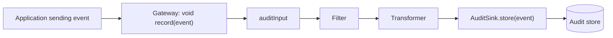
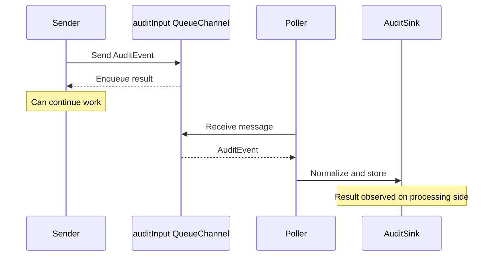

# One-way flow

## 1. Objectives and context

In the **Message flow model** chapter of the **SPRING_INTEGRATION_CORE** module, a one-way flow is a pattern where a sender sends a message to perform work without receiving a business result message back from that send operation.

This lesson uses an order audit-event intake scenario: the application sends an event, the flow normalizes the data, and then delivers it to storage. Through this scenario, you will:

- Combine `Message`, `MessageChannel`, endpoints, and a gateway into a one-way flow.
- Use Java DSL to filter, transform, and terminate a flow with a side-effecting task.
- Distinguish a no-reply contract from synchronous or asynchronous execution.
- Identify the meaning of a successful send, processing errors, and business outcomes.
- Test side effects, filtered-out data, and full-queue situations.

The examples use Java 17 and the Spring Integration 6.5 API. They demonstrate the processing model within a Spring application; no external broker or storage system is required. The primary dependency is `org.springframework.integration:spring-integration-core`; tests use JUnit Jupiter. The project should manage compatible Spring versions, for example through a BOM suited to the application.

## 2. What does a one-way flow define?

### 2.1. Message exchange contract

A one-way flow's contract can be expressed as:

```text
Sender → input message → processing steps → side effect
```

The side effect might be writing a record, sending an email, updating an index, or forwarding a message to another system. This contract does not require a reply containing a business result back to the sender.



A flow with multiple endpoints can still be one-way. Just because a transformer produces data for the next endpoint does not mean it returns a result to the gateway caller. What decides this is the contract at the boundary between the sender and the flow.

If completed work is later published via an `AuditStored` event, the application has added a separate result-notification channel. When that notification must be linked back to the original request, you must design a correlation key and a job-tracking lifecycle.

### 2.2. No reply still has technical outcomes

A Java method always finishes by returning control or throwing an exception. With a gateway returning `void`, the application receives no business value from the flow, yet the call can still encounter send errors or synchronous processing errors.

Similarly, the `boolean` value returned by `MessageChannel.send(...)` describes the send outcome according to the channel implementation. It is not a business reply. The API allows `true`, `false`, and exceptions depending on the situation. [Javadoc MessageChannel](https://docs.spring.io/spring-framework/docs/current/javadoc-api/org/springframework/messaging/MessageChannel.html).

Therefore, separate three questions:

| Question | Example evidence |
| --- | --- |
| Was the message sent into the channel? | `send` returns `true` |
| Did the target endpoint perform the work? | Sink records the event or throws an error |
| Is the outcome durable and recoverable? | Transaction committed, data exists in durable storage |

A signal on an upper row does not automatically prove the rows below it.

## 3. Participating components

### 3.1. Message: data and context

A `Message<T>` carries payload and headers. For an audit event:

| Component | Illustrative content | Purpose |
| --- | --- | --- |
| Payload | `AuditEvent` | Business data to process |
| Custom `traceId` header | `trace-order-42` | Correlate logs across steps |
| `errorChannel` header | Error channel name or reference | Specify error handling path when the corresponding mechanism applies |
| `replyChannel` header | May be present depending on how it is sent | Messaging infrastructure reply address |

Do not determine whether a flow is one-way by checking if a `replyChannel` header exists. For a `void` gateway, since Spring Integration 5.4 the framework can set this header to `nullChannel` when the sender did not provide one. The purpose is to discard any reply that might appear downstream, matching the gateway contract. [Messaging Gateways — reply channel](https://docs.spring.io/spring-integration/reference/6.5/gateway.html#gateway-default-reply-channel).

In business design, maintain a dedicated `eventId` and preserve it when resending the same event. Do not use creating a new `Message` to define a new business action: a retry attempt can still represent the same original work.

### 3.2. Channel: connections and execution boundaries

`DirectChannel` invokes subscribers on the sender's thread. `QueueChannel` provides a buffer for a consumer to pull messages. `ExecutorChannel` hands off dispatching to an executor. Channel choice affects when the call returns and how errors are observed. [Message Channel Implementations](https://docs.spring.io/spring-integration/reference/6.5/channel/implementations.html).

In the audit example, if the storage endpoint runs on the same thread, storage speed directly affects the send call. Once an asynchronous boundary is introduced, the application must observe work after acceptance time.

### 3.3. Endpoint: each processing step

Java DSL operators map to familiar endpoints: `filter` selects messages, `transform` transforms data, and `handle` invokes a service activator. The DSL builds and wires components in the Spring context; declaring an `IntegrationFlow` is not by itself sending a message. [DSL Basics](https://docs.spring.io/spring-integration/reference/6.5/dsl/java-basics.html).

In the audit flow:

1. The gateway converts a Java call into a message.
2. The channel delivers the message to the filter.
3. The filter keeps events with valid actions according to the example rules.
4. The transformer normalizes the payload.
5. The service activator invokes the sink to store the event and ends the flow.

## 4. One-way and threading model are two separate decisions

The table below describes a flow ending at a sink that returns no reply:

| Entry point | When the sender can continue | Additional things to monitor |
| --- | --- | --- |
| `DirectChannel`, entire flow on same thread | After the synchronous call chain finishes | Errors can surface directly at the send call |
| `QueueChannel` with poller-driven consumer | After the message is placed into the queue | Whether the consumer runs and processes successfully |
| `ExecutorChannel` with thread pool | After the task is accepted by the executor per configuration | Whether tasks finish and whether the pool overflows |

With `DirectChannel`, `void record(event)` can still block for 500 ms if the sink takes 500 ms to write data. The gateway is not waiting for a reply, yet the calling thread is still executing the endpoints. [Javadoc DirectChannel](https://docs.spring.io/spring-integration/api/org/springframework/integration/channel/DirectChannel.html).

With `ExecutorChannel`, inspect the executor configuration and task rejection policy. A policy such as `CallerRunsPolicy` can cause the sending thread to execute the work when the pool is full. Also, do not assume the sender's transaction automatically crosses the executor boundary. [Javadoc ExecutorChannel](https://docs.spring.io/spring-integration/api/org/springframework/integration/channel/ExecutorChannel.html), [ExecutorChannel in reference](https://docs.spring.io/spring-integration/reference/6.5/channel/implementations.html#executorchannel).

Two design consequences:

- Choose one-way because the sender does not need a reply under the current contract.
- Choose asynchronous execution when execution timing must be decoupled, paired with appropriate monitoring and load management.

If the caller needs to know immediately "whether it was saved successfully" to decide the next business step, consider request-reply or an explicit job-status tracking model.

## 5. Complete example: ingesting audit events with Java DSL

The baseline example runs synchronously to make the relationship among sending, processing, and side effects clear. Place the types below in the same package `example.integration.oneway`; place each `public` type in its own Java file when practicing.

### 5.1. Payload

```java
package example.integration.oneway;

import java.time.Instant;
import java.util.Objects;
import java.util.UUID;

public record AuditEvent(
        UUID eventId,
        String orderId,
        String action,
        Instant occurredAt) {

    public AuditEvent {
        Objects.requireNonNull(eventId, "eventId");
        Objects.requireNonNull(orderId, "orderId");
        Objects.requireNonNull(action, "action");
        Objects.requireNonNull(occurredAt, "occurredAt");
    }
}
```

`eventId` identifies the event. `occurredAt` is when the business event occurred, which can differ from processing time. All fields in this payload use immutable types, convenient when passing across threads.

### 5.2. One-way gateway

```java
package example.integration.oneway;

import org.springframework.integration.annotation.MessagingGateway;

@MessagingGateway(
        defaultRequestChannel = "auditInput",
        defaultRequestTimeout = "1000")
public interface AuditGateway {

    void record(AuditEvent event);
}
```

The `void` signature expresses that no business result is returned. `defaultRequestTimeout` configures the send wait duration where the channel applies it; it does not set an execution deadline for all endpoints. When the flow uses only `DirectChannel`, this setting does not automatically interrupt a slow write task. These attributes are described in [Javadoc MessagingGateway](https://docs.spring.io/spring-integration/api/org/springframework/integration/annotation/MessagingGateway.html).

### 5.3. Side-effecting sink

```java
package example.integration.oneway;

import java.util.List;
import java.util.concurrent.CopyOnWriteArrayList;

public class AuditSink {

    private final List<AuditEvent> events = new CopyOnWriteArrayList<>();

    public void store(AuditEvent event) {
        events.add(event);
    }

    public List<AuditEvent> snapshot() {
        return List.copyOf(events);
    }
}
```

`store` returns `void` and performs the side effect. This list only supports observation in this lesson; data is lost when the application stops and memory usage grows with event count. When replacing it with a database, add transactions, error handling, and appropriate deduplication rules.

### 5.4. Flow declaration

```java
package example.integration.oneway;

import java.util.Locale;

import org.springframework.beans.factory.annotation.Qualifier;
import org.springframework.context.annotation.Bean;
import org.springframework.context.annotation.Configuration;
import org.springframework.integration.annotation.IntegrationComponentScan;
import org.springframework.integration.channel.DirectChannel;
import org.springframework.integration.config.EnableIntegration;
import org.springframework.integration.dsl.IntegrationFlow;
import org.springframework.messaging.MessageChannel;

@Configuration(proxyBeanMethods = false)
@EnableIntegration
@IntegrationComponentScan(basePackageClasses = AuditGateway.class)
public class AuditFlowConfiguration {

    @Bean
    public MessageChannel auditInput() {
        return new DirectChannel();
    }

    @Bean
    public AuditSink auditSink() {
        return new AuditSink();
    }

    @Bean
    public IntegrationFlow auditFlow(
            @Qualifier("auditInput") MessageChannel auditInput,
            AuditSink auditSink) {

        return IntegrationFlow.from(auditInput)
                .filter(AuditEvent.class,
                        event -> !event.action().isBlank())
                .transform(AuditEvent.class, event -> new AuditEvent(
                        event.eventId(),
                        event.orderId().trim(),
                        event.action().trim().toUpperCase(Locale.ROOT),
                        event.occurredAt()))
                .handle(auditSink, "store")
                .get();
    }
}
```

`@IntegrationComponentScan` discovers `@MessagingGateway` interfaces and registers proxies. In a regular Spring application, gateway scanning must be configured explicitly; declaring the interface alone is not enough. [Javadoc MessagingGateway — scanning](https://docs.spring.io/spring-integration/api/org/springframework/integration/annotation/MessagingGateway.html).

The flow has two paths:

- Non-blank `action`: creates a normalized payload and then calls `AuditSink.store`.
- Whitespace-only `action`: stops at the filter with no new record added.

This rejection rule is only an illustrative decision. For audit data that must not be lost, design an observable error or rejection channel instead of silently dropping events.

The transformer returns a new `AuditEvent` to pass forward internally within the flow. The final sink produces no output, so no business result is returned to the gateway.

### 5.5. Sample invocation

```java
package example.integration.oneway;

import java.time.Instant;
import java.util.UUID;

import org.springframework.context.annotation.AnnotationConfigApplicationContext;

public class OneWayDemo {

    public static void main(String[] args) {
        try (var context = new AnnotationConfigApplicationContext(
                AuditFlowConfiguration.class)) {

            AuditGateway gateway = context.getBean(AuditGateway.class);
            AuditSink sink = context.getBean(AuditSink.class);

            gateway.record(new AuditEvent(
                    UUID.randomUUID(),
                    " ORDER-42 ",
                    " order_created ",
                    Instant.parse("2026-01-01T10:00:00Z")));

            System.out.println(sink.snapshot().get(0).orderId());
            System.out.println(sink.snapshot().get(0).action());
        }
    }
}
```

Expected output:

```text
ORDER-42
ORDER_CREATED
```

We can read the sink immediately after `record` in this example because the entire processing path runs synchronously. If the entry point is replaced with a polled queue, the two read statements right after sending could run before the sink receives the event.

## 6. Terminating the flow properly

### 6.1. Final handler with no output

The configuration:

```java
.handle(auditSink, "store")
```

ends at a service activator invoking a `void` method. This is a clear termination point for a task such as writing audit records.

Do not set `requiresReply(true)` on an endpoint designed not to produce a reply. That attribute forces the endpoint to produce a result and contradicts the sink's purpose.

### 6.2. Final handler that returns data

Suppose a library provides:

```java
public Receipt save(AuditEvent event) {
    // Store data and return acceptance info.
    return new Receipt(event.eventId());
}
```

A service activator returning a non-`null` value looks for where to send its output. When no output channel is configured, it can use the message's `replyChannel`; if no suitable destination exists, a destination resolution error can occur. [Service Activator — output and reply](https://docs.spring.io/spring-integration/reference/6.5/service-activator.html).

If the current contract does not use `Receipt`, the output can be terminated explicitly:

```java
@Bean
public IntegrationFlow saveAndDiscardFlow(
        ReceiptRepository repository) {

    return IntegrationFlow.from("receiptInput")
            .handle(repository, "save")
            .channel("nullChannel")
            .get();
}
```

This is a standalone variant: `ReceiptRepository` is an application service with a `save` method taking `AuditEvent` and returning `Receipt`. This snippet is not part of the minimal audit classes in section 5.

`nullChannel` is a special channel used to consume output that needs no further processing. Routing a value there creates neither storage proof nor retry behavior. [Special Channels](https://docs.spring.io/spring-integration/reference/6.5/channel/special-channels.html).

When the sink truly returns `void`, stop right at the sink. Adding another step after a non-reply-producing endpoint will not cause that step to execute.

### 6.3. Routers and aggregators do not automatically alter the contract

A router can direct events to different sinks depending on action type. An aggregator can batch multiple events before sending to a sink. Both can still live inside a one-way flow if the application requires no reply back at the send point.

When adding these endpoints, design the termination of every branch as well as cases where a group never meets release conditions. Internal outputs must have appropriate destinations.

## 7. Sending via MessageChannel instead of a gateway

A gateway is convenient when application services want to invoke a business interface. In integration code that needs direct control over headers, you can also send a `Message`:

```java
import java.time.Instant;
import java.util.UUID;

import org.springframework.messaging.Message;
import org.springframework.messaging.MessageChannel;
import org.springframework.messaging.support.MessageBuilder;

AuditEvent event = new AuditEvent(
        UUID.randomUUID(),
        "ORDER-42",
        "ORDER_CREATED",
        Instant.now());

Message<AuditEvent> message = MessageBuilder
        .withPayload(event)
        .setHeader("traceId", "trace-order-42")
        .build();

// auditInput is the MessageChannel bean retrieved from the Spring context.
boolean sent = auditInput.send(message, 500);

if (!sent) {
    throw new IllegalStateException("Failed to send audit event");
}
```

`500` is the send timeout in milliseconds. Receiving `false` differs from an exception: the code must handle both an unaccepted send and a thrown exception. This timeout is not an overall limit for total processing time. [MessageChannel.send](https://docs.spring.io/spring-framework/docs/current/javadoc-api/org/springframework/messaging/MessageChannel.html#send(org.springframework.messaging.Message,long)).

In the synchronous audit flow of section 5, a message may be sent successfully yet be dropped by the filter. Therefore, do not use `sent == true` as an assertion that the sink saved an event.

## 8. Asynchronous variant using QueueChannel

### 8.1. Placing an asynchronous boundary

To decouple intake from audit writing, replace the entry point with a queue and configure a poller-driven consumer:



The return arrow from the queue represents the technical outcome of the send operation, not a reply containing an audit result.

`QueueChannel` stores each message in a bounded or unbounded queue. Having a queue does not automatically create a consumer or a processing thread. [Javadoc QueueChannel](https://docs.spring.io/spring-integration/api/org/springframework/integration/channel/QueueChannel.html).

### 8.2. Replacing the channel bean and configuring the first consumer

In `AuditFlowConfiguration`, replace **the two beans** `auditInput` and `auditFlow` with the versions below; keep the remaining configuration:

```java
// Add imports:
// import org.springframework.integration.channel.QueueChannel;
// import org.springframework.integration.dsl.Pollers;

@Bean
public MessageChannel auditInput() {
    return new QueueChannel(100);
}

@Bean
public IntegrationFlow auditFlow(
        @Qualifier("auditInput") MessageChannel auditInput,
        AuditSink auditSink) {

    return IntegrationFlow.from(auditInput)
            .filter(AuditEvent.class,
                    event -> !event.action().isBlank(),
                    endpoint -> endpoint.poller(
                            Pollers.fixedDelay(100)
                                    .maxMessagesPerPoll(10)))
            .transform(AuditEvent.class, event -> new AuditEvent(
                    event.eventId(),
                    event.orderId().trim(),
                    event.action().trim().toUpperCase(Locale.ROOT),
                    event.occurredAt()))
            .handle(auditSink, "store")
            .get();
}
```

The filter is the first consumer of `auditInput`, so the poller is attached right on this endpoint. Subsequent steps continue running on the processing thread unless another execution boundary is added.

When an endpoint reads from a `PollableChannel` such as `QueueChannel`, Spring Integration uses a polling consumer. If no poller is declared on the endpoint, the application must have a suitable default poller. [Poller — Polling Consumer](https://docs.spring.io/spring-integration/reference/6.5/polling-consumer.html).

In the illustrative configuration:

- The queue holds up to 100 messages.
- Each poll fetches at most 10 messages.
- `fixedDelay(100)` sets the pause between runs using fixed-delay scheduling.

These numbers are choices for the example and should be tuned based on arrival rate and actual write latency.

### 8.3. Distinguishing buffering, durability, and overload

An in-memory queue helps absorb short bursts. It does not protect data if the process crashes suddenly. If crash recovery is required, choose a persistent message store or durable messaging system with corresponding delivery guarantees. [Message Channel Implementations — queue storage](https://docs.spring.io/spring-integration/reference/6.5/channel/implementations.html#queuechannel).

Operational calculation example: if intake averages 20 events/second while processing handles only 10 events/second, the backlog grows by roughly 10 events/second. With an initially empty 100-element queue, the system reaches capacity after about 10 seconds, assuming intake and processing rates stay constant.

At that point, choose an explicit behavior: wait for a bounded interval, reject so the sender can retry, slow intake, or switch to another buffering mechanism. Increasing queue size only delays saturation if sustained load exceeds processing capacity.

## 9. Error handling in a one-way flow

### 9.1. Errors before and after crossing threads

Distinguish errors at send time from errors in downstream processing tasks:

| Error location | Example | Where to observe |
| --- | --- | --- |
| Before message acceptance | Queue has no space within the wait timeout | Sender or gateway error handling |
| In a same-thread flow | Storage method throws an exception | Sending call stack, unless redirected elsewhere |
| In an asynchronous consumer | Poller fetches message and write fails | Error flow of the processing task |
| Inside the error flow itself | Failure store is also unreachable | Logs, metrics, and fallback recovery path |

In the default synchronous setup, exceptions can propagate to the caller. In asynchronous tasks, errors cannot automatically unwind an already finished call stack; Spring Integration infrastructure can wrap the error into an `ErrorMessage` and route it via the message's `errorChannel` header or the global `errorChannel`. [Error Handling](https://docs.spring.io/spring-integration/reference/6.5/error-handling.html).

An `errorChannel` header does not automatically catch every exception from every `MessageChannel.send` call. Behavior also depends on the gateway, poller, executor, and advice in use.

### 9.2. Configuring a dedicated error flow for the queue variant

For the variant in section 8, update the annotation on `AuditGateway`:

```java
@MessagingGateway(
        defaultRequestChannel = "auditInput",
        defaultRequestTimeout = "1000",
        errorChannel = "auditErrors")
public interface AuditGateway {

    void record(AuditEvent event);
}
```

Add these two beans to the configuration:

```java
// Add import:
// import org.springframework.messaging.MessageHandler;

@Bean
public MessageChannel auditErrors() {
    return new DirectChannel();
}

@Bean
public IntegrationFlow auditErrorFlow(
        @Qualifier("auditErrors") MessageChannel auditErrors) {

    return IntegrationFlow.from(auditErrors)
            .handle((MessageHandler) message -> {
                Throwable failure = (Throwable) message.getPayload();
                System.err.println(
                        "Audit processing failed: " + failure.getMessage());
            })
            .get();
}
```

With a `void` gateway configured with `errorChannel`, the error channel name is placed into the header for asynchronous processing to use. The error flow here ends with a `MessageHandler` that produces no reply. [Messaging Gateways — error handling](https://docs.spring.io/spring-integration/reference/6.5/gateway.html#gateway-error-handling).

When sending directly to a channel, the sender sets the header explicitly if it wants a dedicated error route:

```java
Message<AuditEvent> message = MessageBuilder
        .withPayload(event)
        .setErrorChannelName("auditErrors")
        .build();
```

Writing to `System.err` only illustrates how errors are received. A real implementation should preserve enough context for reprocessing, such as `eventId`, failing endpoint, root cause, and attempt count, while avoiding logging unnecessary sensitive data.

### 9.3. Error flows and retries are different mechanisms

Receiving an `ErrorMessage` does not automatically put the original message back into `auditInput`. If retries are desired, design the retry scope, conditions, and stop criteria explicitly.

A policy for audit might be:

1. Transient connection errors: bounded retry with backoff.
2. Data violating the contract: route to an error store for remediation.
3. Retries exhausted: record a durable failure and allow operational reprocessing.

In the in-memory queue variant of this lesson, do not assume a message already pulled from the queue will reappear if the handler fails.

When an error flow catches and handles an error without rethrowing, a synchronous gateway call may complete normally under that configuration. The application must distinguish an "error handled" signal from "audit stored."

## 10. Reliability of side effects

### 10.1. Defining completion milestones

Before putting a flow into production, write down the business completion milestones:

| Milestone | Meaning in the audit scenario |
| --- | --- |
| Accepted | System accepts responsibility under the intake contract |
| Processed | Handler executed logic without reporting an error |
| Persisted | Record committed to durable storage |
| Delivered | Target system acknowledged per the chosen protocol |

These milestones name application contracts, not a built-in state machine automatically provided when declaring an `IntegrationFlow`.

If an HTTP interface returns `202 Accepted` after enqueueing, the API semantics should reflect acceptance for processing. If clients need to poll progress, the application must issue a job ID and store corresponding status.

### 10.2. Preserving business keys on redelivery

Consider this sequence:

1. Consumer saves the audit event.
2. Process crashes before updating completion status.
3. Recovery mechanism resends the same event.
4. Consumer receives it a second time.

If every delivery inserts a new record, duplicates occur. One approach is placing a unique constraint on `eventId` and defining how duplicate keys are handled.

When a task performs multiple data updates, marking "processed" and performing the side effect need an appropriate transactional relationship. Marking first and writing afterward can drop work; writing first and marking afterward can repeat side effects after a crash.

If the side effect calls an external service, check whether that service supports an idempotency key or result reconciliation. Using `void` on a gateway does not bridge consistency gaps between independent systems.

### 10.3. Keeping alignment with the event-producing transaction

If updating an order and sending an audit event are two independent operations, the order might be saved while the event is never sent. When events must not be lost, one design pattern is saving business data and an outbox record in the same transaction, then having a process forward outbox entries into the processing flow.

This is a reliability decision surrounding the flow. A one-way flow by itself does not provide atomicity across a database, an in-memory queue, and external systems.

## 11. Testing a flow that returns no reply

### 11.1. Verifying side effects in the synchronous version

The test suite below uses the exact classes from section 5, before switching to the queue setup. Each test creates its own context so event lists are not shared.

```java
package example.integration.oneway;

import java.time.Instant;
import java.util.UUID;

import org.junit.jupiter.api.Test;
import org.springframework.context.annotation.AnnotationConfigApplicationContext;
import org.springframework.integration.channel.QueueChannel;
import org.springframework.messaging.Message;
import org.springframework.messaging.support.MessageBuilder;

import static org.junit.jupiter.api.Assertions.assertEquals;
import static org.junit.jupiter.api.Assertions.assertFalse;
import static org.junit.jupiter.api.Assertions.assertNotNull;
import static org.junit.jupiter.api.Assertions.assertTrue;

class OneWayFlowTest {

    @Test
    void recordsNormalizedEventBeforeSynchronousCallReturns() {
        try (var context = new AnnotationConfigApplicationContext(
                AuditFlowConfiguration.class)) {

            AuditGateway gateway = context.getBean(AuditGateway.class);
            AuditSink sink = context.getBean(AuditSink.class);

            UUID eventId = UUID.randomUUID();
            Instant occurredAt = Instant.parse("2026-01-01T10:00:00Z");

            gateway.record(new AuditEvent(
                    eventId, " ORDER-42 ", " order_created ", occurredAt));

            assertEquals(1, sink.snapshot().size());

            AuditEvent stored = sink.snapshot().get(0);
            assertEquals(eventId, stored.eventId());
            assertEquals("ORDER-42", stored.orderId());
            assertEquals("ORDER_CREATED", stored.action());
            assertEquals(occurredAt, stored.occurredAt());
        }
    }

    @Test
    void dropsEventWhenActionIsBlank() {
        try (var context = new AnnotationConfigApplicationContext(
                AuditFlowConfiguration.class)) {

            AuditGateway gateway = context.getBean(AuditGateway.class);
            AuditSink sink = context.getBean(AuditSink.class);

            gateway.record(new AuditEvent(
                    UUID.randomUUID(), "ORDER-42", "   ", Instant.now()));

            assertTrue(sink.snapshot().isEmpty());
        }
    }

    @Test
    void returnsFalseWhenBoundedQueueCannotAcceptAnotherMessage() {
        QueueChannel queue = new QueueChannel(1);

        Message<String> first =
                MessageBuilder.withPayload("first").build();
        Message<String> second =
                MessageBuilder.withPayload("second").build();

        assertTrue(queue.send(first, 0));
        assertFalse(queue.send(second, 0));

        Message<?> received = queue.receive(0);
        assertNotNull(received);
        assertEquals("first", received.getPayload());
    }
}
```

The first two tests verify the flow's business behavior: normalized data and rejection decisions. The final test checks queue intake capacity independently of a Spring context.

Do not weaken the first test to only asserting the gateway throws no exception: a call that does not throw does not prove the sink holds the right data.

### 11.2. Testing the asynchronous version

When switching to a queue, replace immediate inspection with waiting on a bounded signal, such as:

- A test sink pushing outcomes into a `BlockingQueue`; the test calls `poll` with a timeout.
- A test error handler pushing `ErrorMessage` into a queue for the test to receive and inspect.
- A `CountDownLatch` signaling that a task reached a specific checkpoint.

Example pattern for waiting on results:

```java
// observedEvents is a BlockingQueue<AuditEvent> populated by the test sink.
gateway.record(event);

AuditEvent processed = observedEvents.poll(
        2, java.util.concurrent.TimeUnit.SECONDS);

assertNotNull(processed);
assertEquals(event.eventId(), processed.eventId());
```

This snippet is a test synchronization pattern; `observedEvents` must be wired into a test sink. It is not a drop-in addition to the `AuditSink` from section 5 as-is.

Do not use a fixed `Thread.sleep` as proof of completion. For asynchronous error scenarios, tests should wait on the error path and assert both root cause and the associated event identity.

Scenarios to include as the application grows:

| Scenario | What to verify |
| --- | --- |
| Consumer writes successfully | Side effect matches the expected `eventId` |
| Data rejected by filter | No unexpected side effects occur |
| Full queue | Clear intake response occurs |
| Consumer throws exception | Error flow receives the failure |
| Redelivery of same event | Deduplication rule works |
| Stop and restart | Recovery behavior matches chosen storage |

## 12. Common design mistakes

| Misconception or configuration | Consequence | Fix |
| --- | --- | --- |
| Assuming a `void` gateway always returns immediately | Caller still blocks on synchronous endpoints | Define thread boundaries with channels and executors |
| Treating `send == true` as "persisted" | Message may only be queued or filtered out | Observe side effects and commit milestones |
| Switching to a queue without a consumer/poller | Messages pile up or endpoint fails to start | Attach a poller to the queue-reading consumer |
| Final endpoint returns data without an output target | Reply destination resolution error may occur | Route output where needed or to `nullChannel` |
| Adding an endpoint after a `void` sink | Downstream endpoint receives no output | Place required logic before the sink or change endpoint contract |
| Only wrapping an asynchronous call in `try/catch` | Misses errors thrown on worker threads | Configure an error flow and observation signals |
| Logging in an error flow and calling it retry | Message is never reprocessed | Define an explicit retry policy and dead-letter path |
| Using in-memory queues for zero-data-loss requirements | No data to recover after process crash | Design durable persistence per contract |
| Generating a new `eventId` on resend | Hard to recognize the same event | Preserve business keys across attempts |
| Sending concurrent events and assuming ordered completion | Side effects may occur out of expected order | Design concurrency level and per-key ordering rules |

## 13. Reinforcement exercises

Practice with the audit example:

1. Run the `DirectChannel` version and log thread names at the gateway call site and inside `AuditSink.store`.
2. Add an artificial delay to the sink, measure `record` call duration, and explain the result.
3. Switch to `QueueChannel` with a poller and use a timed signal to await results.
4. Make the sink throw an exception for a specific event and observe `auditErrors` in the asynchronous version.
5. Preserve `eventId` when resending and design a sink that avoids creating duplicate records.
6. Describe verbally which data can be lost if the process stops after enqueueing but before storage.

After this lesson, you should be able to read a flow and identify: the send point, thread handoff points, terminal endpoints, error handling path, and proof of business completion. That is the foundation for using one-way flows faithfully to contract when designing subsequent integration patterns.
