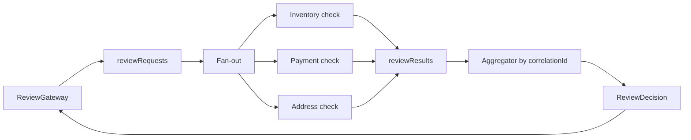

# Fan-out and fan-in

In the **Message flow model** chapter of the **SPRING_INTEGRATION_CORE** module, fan-out and fan-in help design a request that passes through multiple processing branches before producing a combined result. This is the foundation for flows such as order validation, fetching quotes from multiple vendors, or aggregating data from multiple systems.

This lesson uses `Message`, `MessageChannel`, endpoints, gateways, and Java DSL to build a complete flow. The focus is the contract across branches: which messages belong to the same request, when enough results have arrived, how to handle a missing branch, and who receives the final response.

## 1. Objectives and prerequisites

After this lesson, you can:

- Distinguish broadcasting a request to multiple branches from load-balancing across multiple consumers.
- Choose `PublishSubscribeChannel`, a recipient list, or a splitter based on data shape and target recipients.
- Design fan-in using an aggregator with clear correlation, release condition, and aggregation logic.
- Preserve headers during message transformations, place timeouts at the right layers, and handle late results.
- Read, implement, and test a Java DSL flow whose branches run on an executor.

You should know the structure of `Message<T>`, payloads and headers, the meaning of `DirectChannel`, and how to declare an `IntegrationFlow`. Examples use Java 17 or later with the modern Spring Integration Java DSL. When using Spring Boot, let the BOM of your Boot version manage compatible dependencies.

## 2. What shape do fan-out and fan-in describe?

**Fan-out** distributes a single input to multiple processing branches. Branches can receive the same data or different portions of the data, depending on the distributing component.

**Fan-in** brings branches back to a common receiving point. Two cases must be kept separate:

1. **Merging message streams:** multiple branches send to one channel, yet each message is still processed individually.
2. **Collecting results per request:** holding related results, waiting for a completion condition, and producing a combined outcome. This case requires a stateful component such as an aggregator.

Order validation example:



The `reviewResults` channel only brings results to the same endpoint. It is the **aggregator** that remembers arrived results and decides when to emit `ReviewDecision`.

A system publishing an `OrderCreated` event to email, analytics, and audit only needs fan-out if no combined response is required. Forcing those three tasks to wait for one another can introduce operational coupling the business does not need.

## 3. Choosing channels: multiple subscribers does not necessarily mean fan-out

| Component | Where is one message sent? | Role in the problem |
| --- | --- | --- |
| `DirectChannel` | One handler receives it per successful dispatch | Connects steps or distributes load across consumers, not broadcast |
| `ExecutorChannel` | One handler dispatched via an executor | Offloads a route onto another thread; does not duplicate sends |
| `QueueChannel` | One consumer pulls the message from the queue | Buffering and competing consumers |
| `PublishSubscribeChannel` | Broadcasts to subscribed handlers | Fan-out to multiple branches |
| Shared downstream channel after branches | Receives each message from each branch | Merges inputs for the next endpoint |
| Aggregator | Receives and stores multiple related messages | Combines results into an output per policy |

For example, three service activators subscribing to one `DirectChannel` do not mean every message passes through all three services. Point-to-point and publish-subscribe are two different delivery contracts. [Message Channel Implementations](https://docs.spring.io/spring-integration/reference/channel/implementations.html).

Also distinguish **logical fan-out** from **parallel execution**. A `PublishSubscribeChannel` without an executor invokes subscribers on the sending thread by default. To enable concurrent execution across branches, supply an executor or place appropriate asynchronous boundaries. Even with an executor, parallelism is not achieved if the pool only has one worker.

## 4. Ways to implement fan-out

### 4.1. Publish-subscribe: same request to multiple branches

Use `PublishSubscribeChannel` when multiple subscribers need the same input. In the order example, inventory, payment, and address all read the same `ReviewRequest`.

If branches will return to an aggregator using the default sequence strategy, enable `applySequence(true)`. The channel creates `Message` instances with distinct sequence headers, yet the payload may still be the same object reference. Therefore, payloads should be immutable or intentionally copied before a branch mutates data. [Configuring PublishSubscribeChannel](https://docs.spring.io/spring-integration/reference/channel/configuration.html).

Never assume a new message automatically means a deep copy of the entire payload.

### 4.2. Recipient list: selecting a set of branches per request

Use `RecipientListRouter` or the DSL `routeToRecipients(...)` when the recipient list should be expressed directly in configuration, optionally with per-recipient conditions. When using sequences for aggregation, enable `applySequence(true)` on the router. [RecipientListRouter documentation](https://docs.spring.io/spring-integration/reference/router/implementations.html#recipientlistrouter).

Example design decision:

| Order type | Branches selected before sending | Expected reply count |
| --- | --- | --- |
| Standard delivery | Inventory, payment, address | 3 |
| Store pickup | Inventory, payment | 2 |
| Digital goods | Payment, access-rights check | 2 |

If the branch set varies, the aggregator must also know the corresponding expected set. You cannot keep a hardcoded check requiring "all three branches must arrive" for every order type.

### 4.3. Splitter: multiple items from one payload

Use a splitter when the input is a structure that must be broken into elements, such as an order with 20 line items. Each child message carries one line item rather than the entire order review request.

Splitters support setting correlation and sequence headers on split outputs. For sources such as an `Iterator` whose size is unknown upfront, `sequenceSize` may be `0`; do not assume an aggregator can always infer completion automatically. [Splitter documentation](https://docs.spring.io/spring-integration/reference/splitter.html).

### 4.4. Scatter-gather: packaging both distribution and aggregation

`ScatterGatherHandler` combines multi-recipient distribution with an aggregator inside a single request-reply endpoint. This fits well when the business operation is "send to multiple targets and return one answer," such as selecting the best quote.

Branches typically reply via the `replyChannel` set by scatter-gather, or via a dedicated configured `gatherChannel`. Do not attach an arbitrary output channel that causes replies to bypass the gatherer. [Scatter-Gather documentation](https://docs.spring.io/spring-integration/reference/scatter-gather.html).

This lesson implements fan-out and the aggregator separately so you can clearly observe the distribution point, convergence point, and headers flowing through the pipeline.

## 5. Contract for aggregating the right results

### 5.1. Three independent questions

An aggregator must answer three questions:

| Question | Responsible component | Example |
| --- | --- | --- |
| Which results belong to the same group? | `CorrelationStrategy` | Same `correlationId` |
| Is the group ready to be released? | `ReleaseStrategy` | Results arrived from all required branches |
| How is the output constructed? | `MessageGroupProcessor` | Produce an approval or rejection decision |

By default, correlation relies on the `correlationId` header; release relies on sequence size. The aggregator stores group state in a message store while waiting. [Aggregator documentation](https://docs.spring.io/spring-integration/reference/aggregator.html).

**Release does not mean business success.** If all three branches replied, the group can be released even if payment was declined. The business outcome is decided by the aggregation logic.

### 5.2. Headers to track

| Header | Meaning |
| --- | --- |
| `correlationId` | Key for grouping results belonging to the same processing run |
| `sequenceNumber` | Position of the message in the sequence created at the split/fan-out point |
| `sequenceSize` | Expected message count for that sequence |
| `replyChannel` | Reply destination, typically created by the gateway |
| `errorChannel` | Error destination according to configured mechanisms |

In Java, correlation and sequence constants live in `IntegrationMessageHeaderAccessor`; `replyChannel` and `errorChannel` belong to `MessageHeaders`.

A hypothetical timeline with three branches:

```text
Original request: message id = M1

inventory -> correlationId=M1, sequenceNumber=1, sequenceSize=3
payment   -> correlationId=M1, sequenceNumber=2, sequenceSize=3
address   -> correlationId=M1, sequenceNumber=3, sequenceSize=3

Arrival order at aggregator: address -> inventory -> payment
Group M1:                    1/3        2/3          3/3 -> release result
```

`sequenceNumber` reflects position at the distribution point, not completion order. Use a business field like `branch` to identify the result type; never write logic assuming "the first element is always inventory."

### 5.3. Business key vs. execution-attempt key

One `orderId` can appear across multiple review runs: the customer edits the address, switches payment method, or resubmits the request. Grouping solely by `orderId` can mix results from different runs.

The example in this lesson relies on correlation established by `applySequence(true)` from the input message of each fan-out run. In a custom protocol, pass a distinct `requestId` or `reviewAttemptId` and agree on whether retries keep or regenerate that key.

If there are multiple tenants, operation types, or workflow versions, the key must distinguish those scopes as well. Reusing a single order ID is insufficient to uniquely identify a group.

### 5.4. Preserving headers across transformers and system boundaries

In the example below, transformers return a new payload and let the endpoint construct the reply message using the framework's header propagation mechanism. If you build messages manually in code, copy the required headers, for example:

```java
Message<BranchResult> reply = MessageBuilder
        .withPayload(result)
        .copyHeaders(requestMessage.getHeaders())
        .build();
```

This snippet uses `org.springframework.messaging.Message` and `org.springframework.messaging.support.MessageBuilder`; `result` is the branch result and `requestMessage` is the branch's input message. Do not blindly copy stale headers if you are intentionally starting a new correlation run.

When crossing HTTP or a broker, design how correlation, branch, deadline, and reply address map onto the protocol. An internal `replyChannel` object is not an address that can be transferred verbatim to another process.

## 6. Java DSL example: three-branch order validation

### 6.1. Business rules and dependencies

The flow accepts a request and checks three independent conditions:

- `INVENTORY`: requested quantity is available in stock.
- `PAYMENT`: payment has been authorized.
- `ADDRESS`: address is within a supported area.

The decision approves only when all three results arrive and all are `PASS`. If a timeout leaves a branch missing, the result must explicitly state `complete=false`, `approved=false`, and the `missing` set.

To keep the example focused on the message flow, the check inputs reside directly in the request. In a real application, replace each check with the corresponding service call; do not treat client-supplied flags as proof of real payment or inventory.

Minimum dependencies are `org.springframework.integration:spring-integration-core`, or `org.springframework.boot:spring-boot-starter-integration` when using Boot. The sample tests require JUnit Jupiter and Spring Test; `spring-boot-starter-test` covers this in Boot applications. No separate Java DSL module is required.

### 6.2. Gateway and response data types

Sample file `ReviewGateway.java`:

```java
package example.fanout;

import org.springframework.integration.annotation.MessagingGateway;

import example.fanout.ReviewFlowConfig.ReviewDecision;
import example.fanout.ReviewFlowConfig.ReviewRequest;

@MessagingGateway(
        defaultRequestChannel = "reviewRequests",
        defaultReplyTimeout = "3000")
public interface ReviewGateway {

    ReviewDecision review(ReviewRequest request);
}
```

The gateway gives callers a normal Java API. Replies are sent to the temporary reply channel attached in the header; the example does not need to declare a shared reply channel for all callers. [Messaging Gateways documentation](https://docs.spring.io/spring-integration/reference/gateway.html).

### 6.3. Configuring branches and the aggregator

Sample file `ReviewFlowConfig.java`:

```java
package example.fanout;

import java.util.EnumMap;
import java.util.EnumSet;
import java.util.Map;
import java.util.Objects;
import java.util.Set;
import java.util.logging.Logger;

import org.springframework.context.annotation.Bean;
import org.springframework.context.annotation.Configuration;
import org.springframework.integration.config.EnableIntegration;
import org.springframework.integration.annotation.IntegrationComponentScan;
import org.springframework.integration.dsl.IntegrationFlow;
import org.springframework.integration.store.MessageGroup;
import org.springframework.messaging.Message;
import org.springframework.scheduling.concurrent.ThreadPoolTaskExecutor;

@Configuration
@EnableIntegration
@IntegrationComponentScan(basePackageClasses = ReviewGateway.class)
public class ReviewFlowConfig {

    private static final Logger LOGGER =
            Logger.getLogger(ReviewFlowConfig.class.getName());

    public enum Branch {
        INVENTORY, PAYMENT, ADDRESS
    }

    public enum Status {
        PASS, FAIL, ERROR
    }

    public record ReviewRequest(
            String orderId,
            int quantity,
            int availableQuantity,
            boolean paymentAuthorized,
            boolean addressSupported) {

        public ReviewRequest {
            Objects.requireNonNull(orderId, "orderId");
            if (quantity <= 0 || availableQuantity < 0) {
                throw new IllegalArgumentException("Invalid quantity");
            }
        }
    }

    public record BranchResult(
            String orderId,
            Branch branch,
            Status status) {
    }

    public record ReviewDecision(
            String orderId,
            boolean complete,
            boolean approved,
            Map<Branch, BranchResult> results,
            Set<Branch> missing) {

        public ReviewDecision {
            results = Map.copyOf(results);
            missing = Set.copyOf(missing);
        }
    }

    @Bean
    public ThreadPoolTaskExecutor reviewExecutor() {
        ThreadPoolTaskExecutor executor = new ThreadPoolTaskExecutor();
        executor.setCorePoolSize(3);
        executor.setMaxPoolSize(3);
        executor.setQueueCapacity(100);
        executor.setThreadNamePrefix("review-");
        return executor;
    }

    @Bean
    public IntegrationFlow reviewFanOutFlow(
            ThreadPoolTaskExecutor reviewExecutor) {

        return IntegrationFlow.from("reviewRequests")
                .publishSubscribeChannel(reviewExecutor, subscribers -> subscribers
                        .applySequence(true)
                        .subscribe(flow -> flow
                                .transform(ReviewRequest.class, request -> result(
                                        request,
                                        Branch.INVENTORY,
                                        request.availableQuantity()
                                                >= request.quantity()))
                                .channel("reviewResults"))
                        .subscribe(flow -> flow
                                .transform(ReviewRequest.class, request -> result(
                                        request,
                                        Branch.PAYMENT,
                                        request.paymentAuthorized()))
                                .channel("reviewResults"))
                        .subscribe(flow -> flow
                                .transform(ReviewRequest.class, request -> result(
                                        request,
                                        Branch.ADDRESS,
                                        request.addressSupported()))
                                .channel("reviewResults")))
                .get();
    }

    @Bean
    public IntegrationFlow reviewFanInFlow() {
        return IntegrationFlow.from("reviewResults")
                .aggregate(aggregator -> aggregator
                        .outputProcessor(ReviewFlowConfig::decide)
                        .groupTimeout(2_000L)
                        .sendPartialResultOnExpiry(true)
                        .expireGroupsUponCompletion(false)
                        .expireGroupsUponTimeout(false)
                        .minimumTimeoutForEmptyGroups(60_000L)
                        .discardChannel("reviewDiscards"))
                .get();
    }

    @Bean
    public IntegrationFlow reviewDiscardFlow() {
        return IntegrationFlow.from("reviewDiscards")
                .handle(message -> LOGGER.warning(
                        "Discarded review result; messageId="
                                + message.getHeaders().getId()))
                .get();
    }

    private static BranchResult result(
            ReviewRequest request, Branch branch, boolean passed) {
        return new BranchResult(
                request.orderId(), branch, passed ? Status.PASS : Status.FAIL);
    }

    private static ReviewDecision decide(MessageGroup group) {
        Map<Branch, BranchResult> results = new EnumMap<>(Branch.class);
        String orderId = null;

        for (Message<?> message : group.getMessages()) {
            BranchResult result = (BranchResult) message.getPayload();
            if (orderId == null) {
                orderId = result.orderId();
            } else if (!orderId.equals(result.orderId())) {
                throw new IllegalStateException("Mixed orders in one group");
            }
            if (results.putIfAbsent(result.branch(), result) != null) {
                throw new IllegalStateException("Duplicate branch result");
            }
        }

        Set<Branch> missing = EnumSet.allOf(Branch.class);
        missing.removeAll(results.keySet());

        boolean complete = missing.isEmpty();
        boolean approved = complete && results.values().stream()
                .allMatch(result -> result.status() == Status.PASS);

        return new ReviewDecision(
                orderId, complete, approved, results, missing);
    }
}
```

`reviewRequests`, `reviewResults`, and `reviewDiscards` are registered as channels by the DSL as needed; no pollers are needed for these subscribable routes. `ThreadPoolTaskExecutor` is a Spring-managed lifecycle bean, so do not call `initialize()` manually inside the `@Bean` method.

This is an in-process example. It uses the default in-memory message store, a fixed branch set, and a contract where each branch emits at most one result. `Status.ERROR` is reserved for the error-handling extension in section 9; the three pure checks in the example only produce `PASS` or `FAIL`.

### 6.4. Reading the flow step by step

1. The gateway creates a message from `ReviewRequest` and attaches a reply address for the invocation.
2. The publish-subscribe point adds sequence headers and dispatches three subflows through the executor.
3. Each transformer builds an immutable `BranchResult` and sends it to `reviewResults`.
4. The aggregator groups by default correlation. With three valid replies, the sequence indicates the group is ready to release.
5. `decide(...)` builds a map by branch type, computes the missing set, and makes the business decision.
6. The aggregator's output returns to the gateway's `replyChannel`; the caller receives a `ReviewDecision`.
7. If a group is missing replies and the group timeout expires, the configuration allows aggregating the received partial results. The output still clearly indicates incomplete status.

Ending `reviewFanOutFlow` right after publish-subscribe is intentional: only the three declared subflows participate in the fan-out. When chaining additional DSL operators after a publish-subscribe point, read the topology carefully because the continuation can become a fourth subscriber and alter expected message counts.

### 6.5. Sample output

With request:

```java
ReviewRequest request = new ReviewRequest(
        "ORDER-42", 2, 10, true, true);
ReviewDecision decision = reviewGateway.review(request);
```

Meaningful output:

```text
orderId = ORDER-42
complete = true
approved = true
results.keys = {INVENTORY, PAYMENT, ADDRESS}
missing = {}
```

If `paymentAuthorized=false`, the output still has `complete=true`, yet `approved=false` and the `PAYMENT` result is `FAIL`. Completing collection and business approval are two distinct properties.

If only results from inventory and address arrive before the group times out, the output has `complete=false`, `approved=false`, `missing={PAYMENT}`. The example does not fabricate a dummy payment result to fill the gap.

The DSL methods for configuring the output processor and group policies are described in [AggregatorSpec](https://docs.spring.io/spring-integration/api/org/springframework/integration/dsl/AggregatorSpec.html) and [CorrelationHandlerSpec](https://docs.spring.io/spring-integration/api/org/springframework/integration/dsl/CorrelationHandlerSpec.html).

## 7. Release conditions must match branch contracts

### 7.1. Choosing a policy according to business rules

| Policy | When can it release? | What must be decided upfront? |
| --- | --- | --- |
| Wait for all | Expected branch set is complete | Does a failing branch return a status result? |
| Wait for quorum | Enough distinct branches meet threshold | Does that threshold genuinely justify making a decision? |
| First success | A suitable successful result arrives | How are still-running branches handled and cancelled? |
| Partial result | Deadline or stop condition is reached | How does output represent the missing parts? |
| Wait for mandatory subset | All critical branches arrived | Are late optional results updated or ignored? |

In order validation, a two-out-of-three quorum is not enough to approve if payment is mandatory. In quote selection, a single valid quote might suffice to return, depending on the service contract.

### 7.2. Counting messages is not equivalent to counting branches

With three branches, `group.size() == 3` is safe only when each branch is guaranteed to send at most one reply, there are no duplicates, and the branch set never changes. `SimpleSequenceSizeReleaseStrategy` counts group size against sequence size and does not check for duplicate sequence numbers by itself. [SimpleSequenceSizeReleaseStrategy API](https://docs.spring.io/spring-integration/api/org/springframework/integration/aggregator/SimpleSequenceSizeReleaseStrategy.html).

A dangerous scenario:

```text
Received: INVENTORY, INVENTORY due to retry, ADDRESS
Total messages: 3
Total distinct branches: 2
Missing: PAYMENT
```

The sample `decide(...)` actively rejects duplicates as a protocol violation. It is not a deduplication mechanism for systems with normal redeliveries.

If duplicates are permitted, handle idempotency before the aggregator or replace both the release condition and the aggregation rule. For example, releasing based on the set of branches:

```java
.releaseStrategy(group -> {
    Set<Branch> received = EnumSet.noneOf(Branch.class);
    for (Message<?> message : group.getMessages()) {
        BranchResult result = (BranchResult) message.getPayload();
        received.add(result.branch());
    }
    return received.containsAll(EnumSet.allOf(Branch.class));
})
```

This is a replacement configuration for the release part, using types from the earlier example. If applied, `decide(...)` must also be updated to handle duplicates according to the chosen policy; adding `releaseStrategy` alone does not make the code idempotent. When two replies for the same branch conflict, decide whether to keep the first, pick the newer version, or treat it as a data error.

With a dynamic branch set, replace `EnumSet.allOf(...)` with the expected set determined for that specific request run. Determine that set at the fan-out point rather than guessing from arrived replies.

## 8. Timeouts: at which layer, measured from when?

### 8.1. Different kinds of timeouts

| Timeout type | What does it control? | What does it not do automatically? |
| --- | --- | --- |
| Branch client timeout | Waiting to connect, read, or execute an outbound call | Aggregate replies already received |
| Channel send timeout | Waiting for acceptance when the channel has appropriate bounds | Wait for all handlers to finish |
| Aggregator `groupTimeout` | Forces processing of an incomplete group after the group idle wait | Cancel in-flight I/O calls |
| Scatter-gather `gatherTimeout` | How long the endpoint waits for the gathered result | Define quorum or business success on its own |
| Gateway reply timeout | Waiting for a reply once control can return to waiting | Clean up aggregator groups or roll back branches |

Do not configure a single timeout number and assume all resources are released. A workflow needs a caller wait limit, a group termination policy, and execution limits on each task.

### 8.2. `groupTimeout(2_000L)` in the example

A constant `groupTimeout` acts as an idle interval without new messages arriving for the group. When another message arrives while release conditions are still unmet, the timeout schedule is reset. Thus, it is not necessarily a two-second deadline measured from when the gateway received the request.

Reasoning example:

```text
0 ms:    request enters fan-out
100 ms:  INVENTORY arrives -> schedules timeout around 2100 ms
900 ms:  ADDRESS arrives   -> reschedules around 2900 ms
PAYMENT never arrives      -> group may release partial result around 2900 ms
```

Actual timing also depends on the scheduler and system load. Group scheduling, processing partial results, and post-timeout lifecycle are described in [Aggregator — Group Timeout](https://docs.spring.io/spring-integration/reference/aggregator.html#aggregator-and-group-timeout).

If an absolute deadline is required, establish a timestamp such as `deadlineEpochMs` at the start of the workflow and propagate it across branches. The function-based timeout API can return a `Date` representing an absolute expiration instant instead of repeatedly adding an interval. Do not confuse the time a group is created in the aggregator with the start time of the overall request. [groupTimeout API](https://docs.spring.io/spring-integration/api/org/springframework/integration/dsl/CorrelationHandlerSpec.html#groupTimeout(java.util.function.Function)).

**Zero replies is also a distinct case:** if no message has reached the aggregator yet, no group exists for `groupTimeout` to act upon. The gateway still needs its own timeout, and a system requiring a deterministic business timeout response may need to register the request upfront using an appropriate orchestration mechanism.

### 8.3. Reply timeout is not a mechanism to interrupt all downstream code

In a completely synchronous flow, the caller may still be executing inside a slow service; configuring a reply timeout does not interrupt that service. In our example, the executor provides the boundary so the calling thread can return to the gateway and wait for the reply.

When the reply wait expires, the gateway may return `null` under default receive behavior; do not assume a `ReviewDecision` is always returned. Choose the caller contract explicitly, such as handling `null` or configuring timeout-error reporting per your version's API. [Gateway Behavior When No Response Arrives](https://docs.spring.io/spring-integration/reference/gateway.html#gateway-behavior-no-response).

The 3000 ms gateway timeout and 2000 ms group timeout in the example merely illustrate two different layers. They do not guarantee every partial result arrives before the gateway deadline, because a group may be created late or rescheduled. For real SLAs, build a budget covering queuing, I/O, aggregation, and sending the reply.

### 8.4. Group completion, retaining markers, and late replies

Configuration example:

```text
expireGroupsUponCompletion(false)
expireGroupsUponTimeout(false)
minimumTimeoutForEmptyGroups(60000)
```

The goal is keeping a marker of completed groups for a period so late replies do not immediately open a brand-new aggregation group. `reviewDiscards` receives messages discarded during this window. Once the marker is purged, a message reusing the old correlation could open a new group; the 60-second retention is an illustrative choice to tune according to real latencies and retries.

If you choose to delete groups immediately upon completion, you must accept or prevent late messages from creating a new group. If you keep markers indefinitely, memory or the store keeps growing. Design both sides: anti-late-reply retention and state cleanup policy. [Group lifecycle management API](https://docs.spring.io/spring-integration/api/org/springframework/integration/aggregator/AbstractCorrelatingMessageHandler.html).

## 9. Branch errors or branches that emit no reply

### 9.1. A filter can leave the group incomplete

Suppose `applySequence` produces a sequence size of 3, yet a filter inside the address branch drops the message without producing a fallback reply. The aggregator receives at most two messages; the other two branches succeeding does not complete the group.

There are two appropriate designs, depending on business semantics:

- If a branch does not apply, determine that before fan-out and exclude the branch from the expected set.
- If a branch participated, return an explicit status result such as `NOT_APPLICABLE`, `FAIL`, or `ERROR`, per the group's contract.

Do not lower the expected count merely to mask a branch silently dropping messages.

### 9.2. Exceptions and business results are two different paths

In a same-thread flow, exceptions normally propagate via the call stack. When processing runs on an executor, the framework supports converting exceptions into an `ErrorMessage` sent to an appropriate error channel. Simply placing `try/catch` around `send(...)` is insufficient to capture failures occurring after asynchronous dispatch. [Error Handling documentation](https://docs.spring.io/spring-integration/reference/error-handling.html).

An error flow that only logs errors does not automatically produce the `BranchResult` the aggregator is waiting for. Choose one of these policies explicitly:

1. **Abort the request with an error:** propagate the failure back to the caller per the gateway contract and clean up incomplete group state.
2. **Collect per-branch status:** convert classified errors into `BranchResult(ERROR)` and send them to fan-in while preserving correlation and branch identity.
3. **Continue with partial results:** let the timeout policy emit an incomplete response while recording branch failures for operational tracing.

In the second approach, convert only infrastructure or business failures permitted by the contract; never catch `Throwable` wholesale and turn programming bugs into success responses. An `ERROR` result can complete the set of branch replies, yet it must still yield `approved=false` in the order example.

Retries should be bounded and fit inside the branch's time budget. After the group has returned a final decision, a still-running retry does not mean its result gets merged back into the old decision.

### 9.3. Branches with external side effects

Do not treat fan-out as an atomic transaction spanning every branch. For example, inventory reservation might succeed while payment capture fails; nor does a caller timeout automatically undo that inventory reservation.

If external state must be mutated, design idempotency for each operation, record progress, and define compensation or recovery rules. For read-only validation tasks, keeping branches side-effect-free makes the contract much easier to reason about.

## 10. Ordering, nested sequences, and duplicate results

### 10.1. Do not use arrival order as business order

A fast branch usually finishes first, yet there is no guarantee future runs preserve that order. Keying by `Branch` in the example keeps the algorithm order-independent.

If you need to retain individual messages and emit them ordered by `sequenceNumber`, consider a resequencer. A resequencer orders messages, whereas an aggregator produces a combined result. [Resequencer documentation](https://docs.spring.io/spring-integration/reference/resequencer.html).

### 10.2. Fan-out can be nested inside split-aggregate

For example, a batch containing multiple orders, each with three validation branches:

```text
Batch
  -> Splitter by order                           [outer sequence]
     -> Fan-out inventory, payment, address      [inner sequence]
        -> Aggregator for one order
     -> Aggregator for the entire batch
```

The two sequence levels represent two distinct contracts. The inner aggregator must close at the inner level so the outer aggregator can still recognize each part of the batch.

The framework provides sequence details and sequence-popping behavior for standard components; the `popSequence` property controls that handling. Do not manually strip all correlation and sequence headers right after aggregating the inner level. [popSequence API](https://docs.spring.io/spring-integration/api/org/springframework/integration/aggregator/AbstractCorrelatingMessageHandler.html#setPopSequence(boolean)).

If constructing messages manually or using custom correlation at each layer, draw out the key hierarchy before configuring. Using a single `orderId` for both batch and branches collapses this hierarchy.

### 10.3. Correlation does not replace idempotency

Correlation defines the group; idempotency defines whether two deliveries represent the same task or the same outcome.

A deduplication key might combine `reviewAttemptId + branch`, plus a result version if business rules allow updates. Sharing the same `correlationId` does not automatically merge two messages into one, and an aggregator releasing once does not guarantee each branch's side effects ran only once.

If an entire request is retried while reusing the same correlation while the old group is still marked complete, new replies may be treated as late arrivals. Distinguish retrying the same attempt from a new business evaluation.

## 11. Performance, memory, and transaction boundaries

### 11.1. Estimating processing time

With three independent branches, sufficient workers, and ignoring queueing time:

```text
Same-thread fan-out:
T approx. T_inventory + T_payment + T_address + T_aggregate

Potentially concurrent fan-out:
T approx. max(T_inventory, T_payment, T_address) + T_aggregate
```

This is an estimation model, not a framework guarantee. If all three branches contend on an exhausted connection pool, running on an executor can still be slower than expected.

### 11.2. Bounding task count and open groups

Each three-branch request can create three tasks. At 200 requests/second, the fan-out point can generate roughly 600 tasks/second before retries. In the example, the executor's queue capacity is measured in tasks, not orders.

If a request is rejected when enqueueing one branch, branches already accepted earlier may still proceed. Define an overload policy together with caller feedback and incomplete-group handling, rather than treating enqueueing as atomic across all three branches.

An estimate for open state is:

```text
Open groups approx. incoming request rate x average group lifetime
```

For instance, 200 requests/second with an average lifetime of 0.3 seconds yields around 60 open groups. When a stalled branch stretches lifetime to 5 seconds, that count can climb to roughly 1000 groups, not counting completed-group markers and queued tasks.

Monitor open group count, oldest group age, missing results per branch, discard rate, gateway timeouts, and executor health. Include request IDs in logs or traces for tracing; avoid using high-cardinality request IDs as metric labels.

### 11.3. Storing state and running multiple instances

An in-memory message store works well for learning and demos, yet loses state on process shutdown. If groups must survive restarts, choose a persistent `MessageGroupStore` and design how replies are received back. [Message Store documentation](https://docs.spring.io/spring-integration/reference/message-store.html).

Persisting groups does not resurrect the temporary reply channel of a Java call after a restart. For long-running recoverable workflows, you usually need a durable reply address, a result store, or a status-query mechanism.

When multiple instances participate, ensure replies with the same correlation reach the right aggregator; if sharing a store, also coordinate locking, transactions, and group expiration. Switching the store implementation alone is not enough to claim the entire flow has exactly-once guarantees.

### 11.4. Transactions do not automatically propagate across executors

A transaction bound to the sending thread does not automatically follow tasks running on an executor. If a branch needs a database transaction, place an appropriate transaction boundary on that branch itself; branches may commit independently. [ExecutorChannel and thread boundaries](https://docs.spring.io/spring-integration/reference/channel/configuration.html#executorchannel).

Therefore, never assume "gateway throws an error, so all branches rolled back." If cross-system consistency is required, that is an additional orchestration requirement that must be modeled explicitly.

## 12. Testing behaviors that determine correctness

### 12.1. Testing business approval and rejection

Sample test file using the types declared in the configuration:

```java
package example.fanout;

import org.junit.jupiter.api.Test;
import org.springframework.beans.factory.annotation.Autowired;
import org.springframework.test.context.junit.jupiter.SpringJUnitConfig;

import example.fanout.ReviewFlowConfig.Branch;
import example.fanout.ReviewFlowConfig.ReviewDecision;
import example.fanout.ReviewFlowConfig.ReviewRequest;
import example.fanout.ReviewFlowConfig.Status;

import static org.junit.jupiter.api.Assertions.assertEquals;
import static org.junit.jupiter.api.Assertions.assertFalse;
import static org.junit.jupiter.api.Assertions.assertNotNull;
import static org.junit.jupiter.api.Assertions.assertTrue;

@SpringJUnitConfig(ReviewFlowConfig.class)
class ReviewFlowTest {

    @Autowired
    ReviewGateway gateway;

    @Test
    void approvesOnlyWhenAllChecksPass() {
        ReviewDecision decision = gateway.review(
                new ReviewRequest("ORDER-42", 2, 10, true, true));

        assertNotNull(decision);
        assertEquals("ORDER-42", decision.orderId());
        assertTrue(decision.complete());
        assertTrue(decision.approved());
        assertEquals(3, decision.results().size());
        assertTrue(decision.missing().isEmpty());
    }

    @Test
    void completedCollectionCanStillRejectTheOrder() {
        ReviewDecision decision = gateway.review(
                new ReviewRequest("ORDER-43", 2, 10, false, true));

        assertNotNull(decision);
        assertTrue(decision.complete());
        assertFalse(decision.approved());
        assertEquals(Status.FAIL,
                decision.results().get(Branch.PAYMENT).status());
    }
}
```

These tests assert the output contract rather than a fixed completion order among branches. Spring Integration also provides tools to mock handlers and test flows when isolating external systems. [Testing Support](https://docs.spring.io/spring-integration/reference/testing.html).

### 12.2. Scenarios to add when bringing the flow into an application

| Scenario | How to set up the test condition | What to verify |
| --- | --- | --- |
| Reversed result order | Control branches with latches or test channels | Decision is invariant to arrival order |
| Two reviews with same `orderId` | Send two concurrent requests with different data | Result maps or replies are not mixed between callers |
| Missing branch | Stub one branch to emit no result | Partial result returned with accurate `missing`, if partial is contracted |
| Zero branches reply | Block all replies before the aggregator | Caller finishes per timeout; do not expect a nonexistent group timeout |
| Duplicate from same branch | Send two replies for the same branch | Rejected or deduplicated per policy |
| Reply arrives after group closes | Send result after release within marker retention window | Routed to discard; does not trigger a second decision |
| Executor overload | Constrain pool and queue in test configuration | Rejection policy is explicit; caller does not hang |
| Branch error | Stub returns classified error or throws exception | Routed to right error flow or `BranchResult(ERROR)` |

For asynchronous tests, use bounded timeouts on wait operations and establish happens-before ordering with latches or messages. Do not conclude correctness from a single `Thread.sleep(...)` and wall-clock timing.

The test snippets in this lesson are instructional code; they do not represent tests compiled or executed in the repository.

## 13. Common design mistakes

| Symptom | Common cause | Resolution |
| --- | --- | --- |
| Only one branch processes each request | Using point-to-point instead of broadcast | Choose publish-subscribe or recipient list |
| Branches do not run concurrently | Fan-out still runs on sender thread or pool is too small | Verify executor boundaries and actual capacity |
| Aggregator waits indefinitely | Wrong correlation, dropped headers, or missing replies | Check header contracts and every branch path |
| Group mixes multiple review runs | Correlation uses only order ID | Add a dedicated key per processing attempt |
| Approved without payment check | Counting messages instead of identifying branches | Use expected branch set and duplicate policy |
| Caller times out yet resources keep growing | Only configured gateway timeout | Add branch timeouts, group termination, and state cleanup |
| Second decision emitted from late reply | Group state purged too early | Retain markers long enough and handle late replies |
| Data corrupted across branches | Messages share a mutable payload | Use immutable payloads or intentional copies |
| An error prevents any combined reply | Error flow only logs | Explicitly choose abort with error, error status, or partial reply |

## 14. Extended practice

Start from the three-branch example and expand in this order:

1. Replace the payment check with a stub service returning `PASS`, `FAIL`, and classified infrastructure errors. Represent collectible errors using `Status.ERROR` while preserving correlation.
2. Create a store-pickup variant whose expected branch set includes only inventory and payment. Adjust both fan-out and the `missing` calculation.
3. Use a test channel or latch to prevent one branch from replying, then verify the partial response and the discard path when that reply arrives late.
4. Add an attempt identifier and deduplication for same-branch replies, then test two concurrent requests sharing the same order ID.
5. Define an absolute deadline from request intake; budget queue wait, client timeouts, aggregation, and reply delivery instead of merely raising the gateway timeout.

The outcome should cleanly demonstrate four distinct cases: complete and approved, complete and rejected, incomplete replies, and contracted errors. Only when each case has an explicit path does a fan-out/fan-in topology fully express the behavior callers can rely on.
