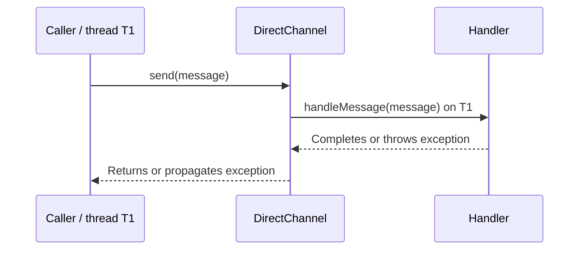
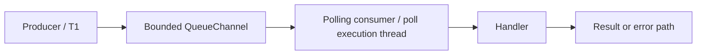
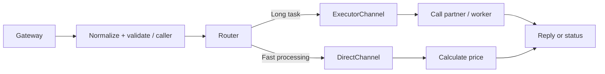

# Synchronous and asynchronous flows

## 1. Objectives and context

In the **Message flow model** chapter of the **SPRING_INTEGRATION_CORE** module, this lesson explains how messages move through endpoints under synchronous and asynchronous processing. The focus is the relationship among `Message`, `MessageChannel`, execution threads, and the result-return contract with the caller.

After this lesson, you can:

- Mark same-thread segments and work-handoff boundaries in a Java DSL flow.
- Choose `DirectChannel`, `ExecutorChannel`, or `QueueChannel` based on processing requirements.
- Distinguish a successful send, receiving a reply, and business completion.
- Design reply paths, error paths, timeouts, and load limits across asynchronous boundaries.
- Verify execution models with tests that use explicit synchronization.

The running example is an order-processing intake flow: normalizing data, validating, executing business logic, and recording outcomes. Transformers, filters, routers, and aggregators are all governed by this execution model, even though each endpoint performs a different function.

## 2. Three questions to keep separate

When calling a flow "synchronous" or "asynchronous," specify clearly what aspect you mean.

| Aspect | Question to answer | Example |
|---|---|---|
| Execution thread | Does the handler run on the sender's thread or get handed off to another thread? | `DirectChannel` vs. `ExecutorChannel` backed by a thread pool |
| Call contract | Does the caller need the result inline, via a future, or fire-and-forget? | `String process(...)`, `CompletableFuture<String> process(...)`, `void submit(...)` |
| Concurrency | Are multiple messages or branches processed simultaneously? | A single sequential worker vs. a multi-worker pool |

These three aspects combine independently. For example:

- A flow hands off work to a worker, yet the gateway returns `String`: the caller still waits for a response.
- A flow uses one worker and a queue: processing is decoupled from the producer, yet messages may still be processed one by one.
- Many requests enter a `DirectChannel` concurrently from multiple threads: each request runs on its sender thread, so the application still processes concurrently.
- A gateway returning `void` sends to a `DirectChannel`: no reply is needed, yet synchronous processing must still finish before the call returns.

Therefore, **asynchronous does not automatically mean parallel, non-blocking, or faster**. You must examine the channel, executor, endpoint, and gateway signature together.

## 3. Synchronous flow: continuing on the current call stack

### 3.1. Role of DirectChannel

`DirectChannel` invokes one subscriber per message directly on the sending thread. If subsequent endpoints are also connected by direct channels and do not spawn asynchronous tasks themselves, they continue on that same thread. This characteristic is documented in the [DirectChannel API](https://docs.spring.io/spring-integration/api/org/springframework/integration/channel/DirectChannel.html).

Example:

```text
thread http-17:
  caller
    -> input.send(message)
       -> transformer
          -> filter
             -> service activator
    <- send() returns
```

No new worker appears merely because a method is wrapped in a service activator. Likewise, chaining multiple steps in Java DSL does not automatically create multiple threads.



### 3.2. What does send() return?

`MessageChannel.send(...)` returns a `boolean`, not a business result. When request–reply is needed, use a gateway or an appropriate request–reply API.

For a synchronous chain ending at a business handler, `send()` returning normally indicates the call chain returned normally. Even so, inspect endpoint behavior:

- A filter can drop a message without throwing an error.
- A router can divert to a different branch than the caller expected.
- A handler may only record the request for another system to process later.
- A flow may contain an asynchronous boundary deeper downstream.

Thus, to confirm "the order completed," define an explicit business outcome; do not infer it from channel names or merely from `true`.

### 3.3. Strengths and costs

Synchronous execution fits short operations requiring immediate results: input validation, message normalization, price calculation, or a well-scoped sequence of data updates.

In exchange, the caller pays the full runtime cost of the synchronous segment. If a service makes a slow network call, the caller thread is held as well. Latency can propagate upstream to request-accepting resources.

A fast router or transformer does not need to be offloaded to a worker just to be called "asynchronous." Thread boundaries carry costs in scheduling, context switching, error coordination, and state observation.

## 4. Asynchronous flow: creating a work-handoff boundary

### 4.1. ExecutorChannel

`ExecutorChannel` delegates dispatching to an `Executor`. With an executor backed by a real thread pool, the handler typically runs on a worker rather than the sender thread. This channel type still preserves point-to-point semantics. See the [ExecutorChannel API](https://docs.spring.io/spring-integration/api/org/springframework/integration/channel/ExecutorChannel.html).

```text
thread http-17:
  validate -> ExecutorChannel.send(message) -> continue

thread order-worker-1:
  handler -> record result
```

Once accepted, the worker may begin either before or after `send()` returns. There is no guarantee a "sent" log line always appears before a "started processing" log line.

Actual behavior also depends on the executor. For instance, an executor that runs tasks directly on the calling thread creates no thread boundary like a thread pool does. If direct execution is desired, `DirectChannel` expresses the intent more clearly.

### 4.2. QueueChannel and polling consumers

`QueueChannel` buffers messages for a consumer to pull later. The queue itself creates no worker and never invokes handlers on its own. For an endpoint receiving from a queue, configure a poller or actively call `receive()`. Spring Integration uses `PollingConsumer` for endpoints connected to a `PollableChannel`; see the [Poller mechanism](https://docs.spring.io/spring-integration/reference/polling-consumer.html).



In a standard polling setup, the producer does not execute the handler. Still, if you call `receive()` yourself and then invoke the handler on the producer thread, you are explicitly creating a different execution model. Evaluate the entire consumption mechanism, not just the channel's class name.

### 4.3. Comparison by purpose

| Channel | How messages are delivered | Poller needed on consuming endpoint? | Typical meaning of a successful send |
|---|---|---|---|
| `DirectChannel` | Invokes one subscriber on the sender thread | No | Synchronous dispatch segment returned normally |
| `ExecutorChannel` with thread pool | Submits dispatch task to executor | No | Task accepted; business work may not be done yet |
| `QueueChannel` | Enqueues message into queue | Yes, when consumed by a polling endpoint | Message placed into the queue |
| `PublishSubscribeChannel` | Broadcasts to subscribers | No | Depends on execution configuration and subscribers |

Broadcast and asynchronous execution are two separate choices. A `PublishSubscribeChannel` without an executor usually invokes subscribers on the sender thread; adding an executor changes execution behavior. Queue-based channels also do not persist data by default. See [MessageChannel implementations](https://docs.spring.io/spring-integration/reference/channel/implementations.html).

## 5. Java DSL example: seeing thread boundaries

### 5.1. Prerequisites for using the example

Examples use Java 17 or later and the `IntegrationFlow.from(...)` API. The project needs `spring-integration-core`; when using Spring Boot, use the Integration starter per the project's dependency management. Do not add a separate Java DSL dependency for modern Spring Integration lines.

The snippet below is a standalone Spring configuration. It does not depend on controllers, databases, or another sample application. Save the class as `FlowExecutionConfig.java` in your practice project. Java DSL registers components when `IntegrationFlow` is declared as a bean; see the [Java DSL guide](https://docs.spring.io/spring-integration/reference/dsl.html).

```java
import java.util.concurrent.ThreadPoolExecutor;

import org.springframework.beans.factory.annotation.Qualifier;
import org.springframework.context.annotation.Bean;
import org.springframework.context.annotation.Configuration;
import org.springframework.integration.channel.DirectChannel;
import org.springframework.integration.channel.ExecutorChannel;
import org.springframework.integration.config.EnableIntegration;
import org.springframework.integration.dsl.IntegrationFlow;
import org.springframework.scheduling.concurrent.ThreadPoolTaskExecutor;

@Configuration
@EnableIntegration
public class FlowExecutionConfig {

    @Bean
    public DirectChannel syncInput() {
        return new DirectChannel();
    }

    @Bean
    public DirectChannel asyncInput() {
        return new DirectChannel();
    }

    @Bean
    public DirectChannel flowErrors() {
        return new DirectChannel();
    }

    @Bean
    public ThreadPoolTaskExecutor flowExecutor() {
        ThreadPoolTaskExecutor executor = new ThreadPoolTaskExecutor();
        executor.setCorePoolSize(2);
        executor.setMaxPoolSize(4);
        executor.setQueueCapacity(20);
        executor.setThreadNamePrefix("order-worker-");
        executor.setRejectedExecutionHandler(
                new ThreadPoolExecutor.AbortPolicy());
        executor.setWaitForTasksToCompleteOnShutdown(true);
        executor.setAwaitTerminationSeconds(10);
        return executor;
    }

    @Bean
    public ExecutorChannel asyncWork(
            @Qualifier("flowExecutor") ThreadPoolTaskExecutor executor) {
        return new ExecutorChannel(executor);
    }

    @Bean
    public IntegrationFlow synchronousFlow(
            @Qualifier("syncInput") DirectChannel input) {
        return IntegrationFlow.from(input)
                .transform(String.class, String::trim)
                .handle(String.class, (payload, headers) -> {
                    process("sync-handler", payload);
                    return null;
                })
                .get();
    }

    @Bean
    public IntegrationFlow asynchronousFlow(
            @Qualifier("asyncInput") DirectChannel input,
            @Qualifier("asyncWork") ExecutorChannel work) {
        return IntegrationFlow.from(input)
                .transform(String.class, text -> {
                    trace("before-handoff", text);
                    return text.trim();
                })
                .channel(work)
                .handle(String.class, (payload, headers) -> {
                    process("async-handler", payload);
                    return null;
                })
                .get();
    }

    @Bean
    public IntegrationFlow errorFlow(
            @Qualifier("flowErrors") DirectChannel errors) {
        return IntegrationFlow.from(errors)
                .handle(Throwable.class, (failure, headers) -> {
                    System.err.printf("[%s] failure: %s%n",
                            Thread.currentThread().getName(),
                            failure.getMessage());
                    return null;
                })
                .get();
    }

    private static void process(String stage, String payload) {
        trace(stage, payload);
        if ("FAIL".equals(payload)) {
            throw new IllegalArgumentException("Cannot process FAIL");
        }
    }

    private static void trace(String stage, String payload) {
        System.out.printf("[%s] %s: %s%n",
                Thread.currentThread().getName(), stage, payload);
    }
}
```

Spring manages the lifecycle of the `ThreadPoolTaskExecutor` bean; the example does not call `initialize()` manually or create a new pool per message.

### 5.2. Sending messages and reading logs

Use a separate console program to load the configuration:

```java
import org.springframework.context.annotation.AnnotationConfigApplicationContext;
import org.springframework.messaging.MessageChannel;
import org.springframework.messaging.support.MessageBuilder;

public class FlowExecutionDemo {

    public static void main(String[] args) {
        try (var context =
                new AnnotationConfigApplicationContext(FlowExecutionConfig.class)) {

            MessageChannel sync = context.getBean(
                    "syncInput", MessageChannel.class);
            MessageChannel async = context.getBean(
                    "asyncInput", MessageChannel.class);

            sync.send(MessageBuilder.withPayload("  order-101  ").build());
            System.out.println("sync send returned");

            async.send(MessageBuilder.withPayload("  order-102  ")
                    .setHeader("errorChannel", "flowErrors")
                    .build());
            System.out.println("async send returned");
        }
    }
}
```

How to read this:

- `sync-handler` runs on the `main` thread and appears before `sync send returned`.
- `before-handoff` also runs on `main`: this segment sits before `ExecutorChannel`.
- `async-handler` runs on a thread prefixed with `order-worker-`.
- Do not use the order of the last two log lines to infer the execution model; the worker may run very quickly.

Logs only aid observation. The tests in a later section prove the behavior independently of machine speed.

## 6. Adding QueueChannel: decoupling reception and processing time

Add the following imports to `FlowExecutionConfig`:

```java
import java.time.Duration;

import org.springframework.integration.channel.QueueChannel;
import org.springframework.integration.dsl.Pollers;
```

Add these two beans to the same configuration class:

```java
@Bean
public QueueChannel queuedInput() {
    return new QueueChannel(50);
}

@Bean
public IntegrationFlow queuedFlow(
        @Qualifier("queuedInput") QueueChannel input) {
    return IntegrationFlow.from(input)
            .handle(String.class, (payload, headers) -> {
                process("queue-handler", payload.trim());
                return null;
            }, endpoint -> endpoint.poller(
                    Pollers.fixedDelay(Duration.ofMillis(100))
                            .maxMessagesPerPoll(5)))
            .get();
}
```

The poller sits on the first endpoint reading from the queue. You do not add pollers to every subsequent endpoint if they are connected by subscribable channels.

This configuration caps each poll at up to five messages. `maxMessagesPerPoll(5)` **does not mean five threads**. `fixedDelay` defines the delay between trigger runs; it does not guarantee every message has exactly 100 ms processing latency. See the [Pollers API](https://docs.spring.io/spring-integration/api/org/springframework/integration/dsl/Pollers.html).

When a producer wants to bound how long it waits for free space:

```java
QueueChannel queue = context.getBean("queuedInput", QueueChannel.class);

boolean accepted = queue.send(
        MessageBuilder.withPayload("order-103")
                .setHeader("errorChannel", "flowErrors")
                .build(),
        200); // milliseconds

if (!accepted) {
    throw new IllegalStateException("Queue did not accept the message");
}
```

A queue with capacity 50 bounds the number of messages sitting in the queue, not the total number of requests currently in flight in the system. Count messages already dequeued and downstream resources as well.

If there is no consumer, sends can still succeed until the queue fills up. Therefore, monitor queue depth and polling endpoint health together. Capacity configuration and queue operations are described in the [QueueChannel API](https://docs.spring.io/spring-integration/api/org/springframework/integration/channel/QueueChannel.html).

## 7. Gateway: cross-thread processing while the caller can still wait

### 7.1. Three contract styles

| Method signature | Contract seen by caller | Additional considerations |
|---|---|---|
| `String process(String input)` | Expects a reply before returning a value | Reply path, timeouts, and error handling |
| `CompletableFuture<String> process(String input)` | Receives a future to track result later | Gateway async executor and future usage |
| `void submit(String input)` | Requires no business reply | Whether request channel hands off asynchronously |

A gateway uses `replyChannel` to link replies back to waiting calls. A flow running on a worker can still produce a reply for a synchronous gateway. With an async gateway backed by an executor, a `CompletableFuture` lets the caller obtain the result later. See [Messaging Gateways](https://docs.spring.io/spring-integration/reference/gateway.html).

### 7.2. Example: two gateway methods sharing one reply flow

The example below extends the configuration from section 5. Place the interface and configuration class below in the same practice package. The `OrderGateway` interface must be scanned with `@IntegrationComponentScan`; `@MessagingGateway` is not registered by standard component scanning alone. See the [MessagingGateway API](https://docs.spring.io/spring-integration/api/org/springframework/integration/annotation/MessagingGateway.html).

```java
import java.util.concurrent.CompletableFuture;

import org.springframework.integration.annotation.Gateway;
import org.springframework.integration.annotation.MessagingGateway;

@MessagingGateway(asyncExecutor = "gatewayExecutor")
public interface OrderGateway {

    @Gateway(requestChannel = "replyInput",
            requestTimeout = 1000, replyTimeout = 2000)
    String processAndWait(String input);

    @Gateway(requestChannel = "replyInput",
            requestTimeout = 1000, replyTimeout = 2000)
    CompletableFuture<String> processLater(String input);
}
```

```java
import java.util.Locale;
import java.util.concurrent.ThreadPoolExecutor;

import org.springframework.beans.factory.annotation.Qualifier;
import org.springframework.context.annotation.Bean;
import org.springframework.context.annotation.Configuration;
import org.springframework.context.annotation.Import;
import org.springframework.integration.channel.ExecutorChannel;
import org.springframework.integration.config.IntegrationComponentScan;
import org.springframework.integration.dsl.IntegrationFlow;
import org.springframework.scheduling.concurrent.ThreadPoolTaskExecutor;

@Configuration
@Import(FlowExecutionConfig.class)
@IntegrationComponentScan(basePackageClasses = OrderGateway.class)
public class GatewayExampleConfig {

    @Bean
    public ThreadPoolTaskExecutor gatewayExecutor() {
        ThreadPoolTaskExecutor executor = new ThreadPoolTaskExecutor();
        executor.setCorePoolSize(2);
        executor.setMaxPoolSize(2);
        executor.setQueueCapacity(10);
        executor.setThreadNamePrefix("gateway-worker-");
        executor.setRejectedExecutionHandler(
                new ThreadPoolExecutor.AbortPolicy());
        executor.setWaitForTasksToCompleteOnShutdown(true);
        executor.setAwaitTerminationSeconds(10);
        return executor;
    }

    @Bean
    public ExecutorChannel replyInput(
            @Qualifier("flowExecutor") ThreadPoolTaskExecutor executor) {
        return new ExecutorChannel(executor);
    }

    @Bean
    public IntegrationFlow replyFlow(
            @Qualifier("replyInput") ExecutorChannel input) {
        return IntegrationFlow.from(input)
                .transform(String.class,
                        text -> text.trim().toUpperCase(Locale.ROOT))
                .get();
    }
}
```

Invoking from a context loaded with `GatewayExampleConfig`:

```java
OrderGateway gateway = context.getBean(OrderGateway.class);

String first = gateway.processAndWait(" order-104 ");
// Caller waits for reply from flow running on flowExecutor.

var future = gateway.processLater(" order-105 ");
future.thenAccept(result -> System.out.println("Reply: " + result));
// Caller can do other work; keep the application alive to receive the result.
```

In this example, the gateway pool and handler pool are separate. If both shared one bounded pool, all gateway workers could end up waiting for replies while the reply-producing tasks sit queued in that exact same pool. Watch out for wait-dependency cycles when sharing executors.

Calling `future.get()` or `future.join()` immediately after receiving the future makes the caller block again. Nor does a future prove all underlying processing uses non-blocking I/O.

### 7.3. Request timeout and reply timeout

The two timeouts cover different scopes:

- **Request timeout**: wait duration to send a request into a channel if the send mechanism supports waiting, such as a full queue.
- **Reply timeout**: wait duration for the response message after sending the request in a request–reply exchange.

`@Gateway` timeout attributes are in milliseconds; see the [Gateway API](https://docs.spring.io/spring-integration/api/org/springframework/integration/annotation/Gateway.html).

Do not treat reply timeout as an overall deadline for all code. In an all-direct-channel chain, a slow handler running inline on the call stack can hold the call before the gateway even enters the reply-wait phase. These cases are analyzed in [Gateway Behavior When No Response Arrives](https://docs.spring.io/spring-integration/reference/gateway.html#gateway-behavior-no-response).

Timeouts also do not automatically cancel in-flight business work. For instance, the caller may time out while the worker still completes an order update. When retrying, include request identification and idempotency to avoid executing side effects twice.

If a filter drops the message, a router sends it to a dead-end branch, or a handler returns `null`, a request–reply gateway may receive no reply. Design an explicit rejection reply, throw an appropriate error, or use a one-way contract if the business operation has no response.

## 8. Error handling across thread boundaries

### 8.1. Errors in a synchronous segment

For `syncInput` in section 5:

```java
try {
    sync.send(MessageBuilder.withPayload("FAIL").build());
} catch (org.springframework.messaging.MessagingException exception) {
    System.err.println("Caller observed: " + exception.getMessage());
}
```

Exceptions from a handler may be wrapped by the framework in a messaging exception. When classifying errors, inspect the cause and failed message rather than checking only the message string.

### 8.2. Errors in a worker

A `try/catch` around `async.send(...)` can catch errors occurring during the send phase, such as the executor rejecting the task. It does not directly catch exceptions thrown later on an independent worker.

With Spring Integration's error-handling mechanism, errors in asynchronous tasks or pollers can be wrapped into an `ErrorMessage` whose payload is a `Throwable`. The preferred target is the message's `errorChannel` header; if absent, the global channel named `errorChannel` is used. See [Error Handling](https://docs.spring.io/spring-integration/reference/error-handling.html).

This example uses the dedicated `flowErrors` channel:

```java
async.send(MessageBuilder.withPayload("FAIL")
        .setHeader("errorChannel", "flowErrors")
        .build());
```

The handler in `errorFlow` records the failure on the error-handling path. Because `flowErrors` is a `DirectChannel`, the thread emitting the error message executes the error handler; the error path's own processing time and failure modes must also be considered.

### 8.3. Error paths must match the result contract

| Situation | Appropriate response strategy |
|---|---|
| One-way send, no direct result needed | Record failure status tied to request ID; retry or route to manual handling per policy |
| Gateway waiting for reply | Ensure errors flow back to request–reply, or have the error flow produce an explicit fallback result |
| Result needed in a future | Define how the future completes on success, failure, or timeout |
| Transient external system failure | Bound retries, use timeouts, and protect side effects with idempotency |

The error flow in section 5 ends with `return null`, fitting the one-way send example. Do not apply that log-only error path unchanged to a gateway expecting a result: the caller may keep waiting until timeout.

The gateway example in section 7 does not attach `errorChannel=flowErrors` and lets the gateway mechanism manage its own error path. If you override the error channel in request–reply, design both the error path and the result-return path.

Routing an error to a channel also does not automatically create retries, rollbacks, or an error-message store. Each behavior must be configured according to business requirements.

## 9. Transactions and context when switching threads

### 9.1. DirectChannel can preserve the same transaction scope

Suppose a Spring method invoked through a transactional proxy starts a transaction, then sends a message through a chain of direct channels to data operations participating in the same transaction:

```text
thread T1:
  start transaction
    -> update order record
    -> DirectChannel
       -> update inventory record
  commit or rollback per result and transaction rules
```

Running on the same thread allows operations to join the active transaction. It does not automatically force every resource into one shared transaction: you still need a transaction manager, compatible resources, and proper propagation.

### 9.2. Handoffs do not transfer transactions to workers

```text
thread T1, transaction A:
  update order
  -> hand off to executor
  continue and end transaction A

thread T2:
  process inventory
  may open independent transaction B
```

With standard thread-bound transactions, a worker does not automatically inherit transaction A. If T2 fails after A committed, that failure cannot automatically roll back A. A poller may also open its own transaction, which does not mean it continues the producer's transaction. See [Transaction Boundaries](https://docs.spring.io/spring-integration/reference/transactions.html#transaction-boundaries).

Risk also arises when the worker runs before the producer's transaction commits: data the worker needs to read may not yet be visible under the database's isolation level.

When data updates must be tied atomically to emitting durable processing requests, evaluate a transactional outbox, a transactional message store, or a suitable broker. Adding an in-memory queue does not solve atomicity across those two operations.

### 9.3. Other contexts

Logging MDC, security contexts, and custom `ThreadLocal` data must also be evaluated when switching threads. Never assume they are automatically propagated to workers.

An easily traceable design carries required values such as `requestId`, `orderId`, and `tenantId` in message headers according to application conventions. If execution contexts must be propagated, use propagation or task-decoration mechanisms designed for those contexts; never transfer an open transaction by copying thread-local state.

## 10. Load, buffer limits, and processing order

### 10.1. Asynchronous execution shifts where waiting happens

After adding an executor or queue, the producer may return sooner, yet the work does not vanish. If sustained intake exceeds processing capacity, queued messages accumulate.

An illustrative calculation, assuming each worker processes one message at a time:

```text
Average processing time: 200 ms/message
Worker count:            4
Ideal throughput:        4 / 0.2 = 20 messages/second

Intake rate:             50 messages/second
Backlog growth rate:     approx. 30 messages/second
```

This is an estimate under stated assumptions, not a Spring Integration benchmark. Network calls, contention, database connections, and tail latencies can make actual throughput lower.

Queues absorb only finite bursts. Increasing capacity does not make handlers faster.

### 10.2. Decide explicitly what happens when the system is full

| Mechanism | Options when capacity is exhausted |
|---|---|
| Bounded queue | Wait for a bounded duration, return `false` if unaccepted, and handle the outcome |
| Executor with bounded queue | Reject tasks per configured policy; caller handles intake failure |
| Run task on caller on overload | Caller slows down; thread behavior and latency shift |
| Persist for later processing | Design storage capacity, retries, quotas, and operations |

The example in section 5 uses `AbortPolicy` to surface rejections explicitly when the executor cannot accept work. `CallerRunsPolicy` can force the sending thread itself to execute the task when the pool saturates; then handlers are no longer guaranteed to run on workers. Never rely on that behavior to propagate transactions.

Do not assume `maxPoolSize=4` makes the pool immediately use four workers. Thread creation policy also depends on core size and queue state. Configure core size, max size, and queue capacity together; see [ThreadPoolTaskExecutor](https://docs.spring.io/spring-framework/docs/current/javadoc-api/org/springframework/scheduling/concurrent/ThreadPoolTaskExecutor.html).

"Backpressure" in this design refers to how producers react when downstream cannot keep up: wait, throttle, reject, or persist. Do not infer Reactive Streams demand signaling merely from the presence of an `ExecutorChannel`.

### 10.3. FIFO does not guarantee completion order

Suppose message A is pulled before B:

```text
worker-1: A -> slow service call --------> finishes A
worker-2:      B -> fast processing -> finishes B
```

Completion order can be B then A. If the same order follows `Created -> Paid -> Shipped`, arbitrary concurrent processing can corrupt state.

Design approaches to consider:

- Process sequentially with a single consumer when throughput allows.
- Partition by business key so events for the same order enter the same sequential pipeline.
- Validate version or state transitions before updating.
- Use resequencing when data and requirements allow, paired with policies for missing or late messages.

Merely adding `correlationId` does not enforce ordering. It helps link messages; execution ordering rules still need explicit design.

### 10.4. Memory, durability, and lifecycle

In-memory queues and executor task queues do not protect against data loss on abrupt process termination. `send()` completing after a handoff is not equivalent to a business confirmation that data is durably stored.

When data is critical, define clearly when "accepted" may be reported, where state is persisted, and how incomplete work is recovered.

During application shutdown, the wait time for task completion must fit within the deployment environment's termination grace period. The bounded shutdown wait in the example only supports graceful shutdown; it does not replace durable storage.

## 11. Testing the execution model

### 11.1. Verifying with latches and thread identity

The following JUnit Jupiter snippet tests three small properties without booting a full application context:

1. `DirectChannel` runs the handler on the sender thread before `send()` returns.
2. `ExecutorChannel` with a separate executor can return before the handler finishes.
3. A full queue rejects an immediate non-blocking send.

```java
import java.util.concurrent.CountDownLatch;
import java.util.concurrent.Executors;
import java.util.concurrent.TimeUnit;
import java.util.concurrent.atomic.AtomicBoolean;
import java.util.concurrent.atomic.AtomicReference;

import org.junit.jupiter.api.Test;
import org.springframework.integration.channel.DirectChannel;
import org.springframework.integration.channel.ExecutorChannel;
import org.springframework.integration.channel.QueueChannel;
import org.springframework.messaging.support.MessageBuilder;

import static org.junit.jupiter.api.Assertions.*;

class ChannelExecutionTest {

    @Test
    void directChannelCompletesOnSenderThread() {
        DirectChannel channel = new DirectChannel();
        Thread sender = Thread.currentThread();
        AtomicReference<Thread> handlerThread = new AtomicReference<>();
        AtomicBoolean completed = new AtomicBoolean();

        channel.subscribe(message -> {
            handlerThread.set(Thread.currentThread());
            completed.set(true);
        });

        boolean accepted = channel.send(
                MessageBuilder.withPayload("order-201").build());

        assertTrue(accepted);
        assertTrue(completed.get());
        assertSame(sender, handlerThread.get());
    }

    @Test
    void executorChannelReturnsBeforeHandlerCompletes() throws Exception {
        var executor = Executors.newSingleThreadExecutor();
        CountDownLatch entered = new CountDownLatch(1);
        CountDownLatch release = new CountDownLatch(1);
        CountDownLatch finished = new CountDownLatch(1);
        AtomicReference<Thread> handlerThread = new AtomicReference<>();
        Thread sender = Thread.currentThread();

        try {
            ExecutorChannel channel = new ExecutorChannel(executor);
            channel.subscribe(message -> {
                handlerThread.set(Thread.currentThread());
                entered.countDown();
                try {
                    release.await();
                } catch (InterruptedException exception) {
                    Thread.currentThread().interrupt();
                    throw new IllegalStateException(exception);
                } finally {
                    finished.countDown();
                }
            });

            assertTrue(channel.send(
                    MessageBuilder.withPayload("order-202").build()));

            assertTrue(entered.await(5, TimeUnit.SECONDS));
            assertNotSame(sender, handlerThread.get());
            assertEquals(1L, finished.getCount());

            release.countDown();
            assertTrue(finished.await(5, TimeUnit.SECONDS));
        } finally {
            release.countDown();
            executor.shutdownNow();
            executor.awaitTermination(5, TimeUnit.SECONDS);
        }
    }

    @Test
    void boundedQueueRejectsImmediateSendWhenFull() {
        QueueChannel queue = new QueueChannel(1);

        assertTrue(queue.send(
                MessageBuilder.withPayload("first").build(), 0));
        assertFalse(queue.send(
                MessageBuilder.withPayload("second").build(), 0));

        var received = queue.receive(0);
        assertNotNull(received);
        assertEquals("first", received.getPayload());
    }
}
```

The `release` latch holds the handler in an incomplete state until the test lets it proceed. The `await` timeout is a test wait bound, not an assumption that the system finishes within a fixed sleep.

These small tests verify dispatch mechanics and queuing. They do not yet verify error channels, gateways, or transactions inside a Spring context.

### 11.2. Integration tests to add in real applications

| Behavior to guarantee | How to test |
|---|---|
| Worker failure is recorded | Send a failing message in a context with an error flow; verify an error message arrives linked to the right request |
| Gateway returns reply | Verify correct replies both across an executor boundary and when processing succeeds very quickly |
| Missing reply | Create a non-replying branch, configure a finite timeout, and verify caller behavior |
| System saturation | Hold workers, fill the queue, and verify rejection or wait policy |
| Ordering requirements | Use multiple messages sharing a key with varied delays to verify side-effect order |
| Transaction split | Use a real test database and synchronize commit/failure timing between two threads |

Never rely on a test that merely does `Thread.sleep(100)` and asserts outcomes. It may pass on a fast machine and fail on CI without reflecting any business change.

## 12. Applying to transformers, routers, filters, and aggregators

Enterprise Integration Patterns describe an endpoint's job; channel choices and execution mechanisms determine which thread runs that job.

| Component | Impact of synchronous/asynchronous flow |
|---|---|
| Transformer | Runs on the current message-receiving thread unless logic or a channel boundary offloads work |
| Filter | Can terminate a branch; request–reply must handle cases producing no reply |
| Router | Each branch can have its own execution model depending on its target channel |
| Service activator | Service call can hold the current thread; account for processing duration and service timeouts |
| Aggregator | Holds and waits for release conditions; output may be emitted at a different time or thread than the group's first message |
| Gateway | Translates Java contracts into messaging interactions; return signature alone does not describe all downstream thread boundaries |

Example mixed flow:



When adding an aggregator for multiple partner responses, define the correlation key, release condition, group timeout, and late-response handling. Waiting for a full group of messages is an extra orchestration requirement; adding an executor does not solve it.

An asynchronous boundary placed after a filter also does not move the steps before it onto a worker. When reading a flow, mark each segment rather than applying a single label to the whole diagram.

## 13. Choosing a model for a concrete requirement

Suppose an application has two tasks:

- Validation and pricing: usually short; the user needs the result to proceed.
- Generating a report and sending email: may take long; the user can track status later.

A possible design:

```text
Pricing branch:
  request -> request–reply gateway -> DirectChannel -> calculate price -> reply

Reporting branch:
  request -> validate -> accept per storage policy
          -> background processing -> update status -> notify result
```

Decision criteria:

| Requirement | Design direction |
|---|---|
| Caller needs result and task is short | Keep flow synchronous if within latency budget |
| Long task, caller accepts tracking later | Hand off asynchronously, return request ID, and expose status |
| Producer has short traffic bursts | Bounded buffer, full-buffer policy, and queue metrics |
| Must not lose requests on restart | Durable persistence and recovery; not in-memory queues alone |
| Operations must roll back in one transaction | Maintain proper transaction scope; review thread and resource boundaries |
| Independent branches must run concurrently | Design fan-out, executors, and result collection if needed |
| Ordering must be preserved per entity | Partition by key, serialize processing, or check versions |

Report "accepted for processing" only after reaching the promised durability guarantee. If an API promises durable acceptance, merely submitting to an in-memory executor is insufficient.

## 14. Practice exercises

Carry these out in your own practice project:

1. Run `FlowExecutionDemo`, recording the threads of `sync-handler`, `before-handoff`, and `async-handler`.
2. Send payload `FAIL` to the synchronous branch and then to the asynchronous branch with `errorChannel=flowErrors`; explain the difference in where errors are observed.
3. Add `queuedFlow`, pause the polling endpoint, and verify the queue accepts messages while the handler has not run yet.
4. Run the three JUnit tests in section 11, then explain why the latch proves the "sent but not yet completed" state.
5. Use `OrderGateway` to compare `processAndWait` and `processLater`; identify where the caller blocks in each usage.
6. Design a filter branch rejecting orders and an explicit rejection result for the gateway, avoiding leaving the caller waiting until timeout.

The expected outcome is a diagram annotated with thread boundaries, reply contracts, and error paths. You should be able to explain three distinct milestones: **accepted**, **executed**, and **business outcome confirmed**.
