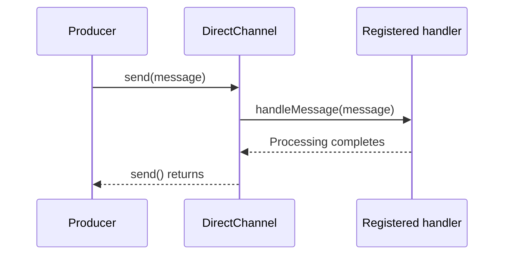
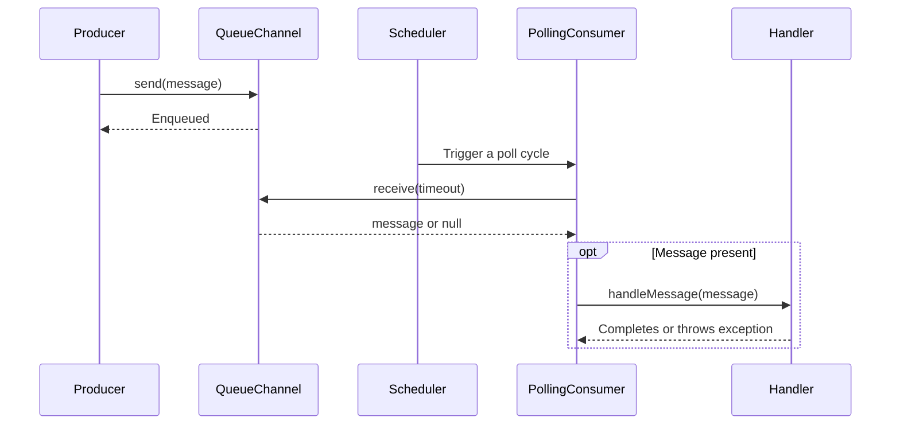
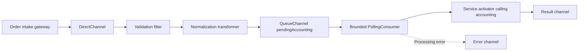

# Event-driven and polling consumers

## 1. Where this lesson fits

In the **Message flow model** chapter of the **SPRING_INTEGRATION_CORE** module, this lesson explains how an endpoint receives messages to execute its logic. This is the foundation for designing flows with `Message`, `MessageChannel`, endpoints, gateways, and Java DSL; the same transformer, router, filter, or service activator can be triggered in different ways.

After this lesson, you should be able to:

- Look at an input channel and determine whether a consumer receives messages by subscription or by polling.
- Draw the exact execution flow and identify when a producer is considered to have sent successfully.
- Place pollers on the right endpoints; distinguish polling schedule, receive timeout, and messages per poll.
- Choose a mechanism matching latency, buffering, resource limits, and error-handling requirements.
- Write tests that observe asynchronous outcomes using bounded timeouts.

The examples use Java 17 and Spring Integration 6.5 configuration style. This is an API reference point for explaining the lesson, not a requirement to upgrade a project's version. Tests use JUnit Jupiter and Spring Test. Examples are structured for practicing in a project with compatible dependencies; this lesson does not provide a build file.

## 2. What roles do Message, handler, and consumer endpoint play?

Suppose an application receives an order request:

```text
Message<Order>
    → input channel
    → consumer endpoint
    → order validation handler
    → output channel
```

Separate three responsibilities (plus the message itself):

| Component | Responsibility in the example |
| --- | --- |
| `Message<Order>` | Carries the order payload along with headers such as correlation ID |
| `MessageChannel` | Provides the mechanism to transport or store messages between components |
| Handler | Executes business logic: validate, transform, route, or invoke a service |
| Consumer endpoint | Connects the channel to the handler and manages how the handler is triggered |

The handler answers "how should the message be processed?". The consumer endpoint answers "how is the message received and when is the handler invoked?".

Under the standard imperative model in this lesson:

- Input is a `SubscribableChannel`: the framework can create an `EventDrivenConsumer`.
- Input is a `PollableChannel`: the framework can create a `PollingConsumer`, requiring an explicit or default poller.

You typically configure `.handle(...)`, `.transform(...)`, or `@ServiceActivator` rather than instantiating those two endpoint classes directly. The reception mechanism depends on the input channel type, not on whether the handler is called a transformer or a service activator. Reactive endpoints have their own mechanism and lie outside this comparison. See [Message Endpoints](https://docs.spring.io/spring-integration/reference/6.5/endpoint.html).

## 3. Event-driven consumer: channel triggers the handler

### 3.1. Subscription mechanism

An event-driven consumer registers a handler with a channel that supports subscription. When a message is sent to it, the channel dispatches the message to the handler according to the channel's policy.



The diagram above depicts `DirectChannel` and a synchronous handler. No periodic timer polls the channel to check whether a message is present.

The term "event-driven" describes how the consumer is triggered. The payload can be a `CreateOrder` command, a document, or an `OrderCreated` notification. You do not have to turn every payload into a domain event to use this consumer.

### 3.2. Event-driven does not automatically create new threads

With `DirectChannel`, the handler is invoked on the exact thread calling `send()`. If the handler takes 300 ms and there is no asynchronous handoff, the send call must wait for that processing.

An `ExecutorChannel` also supports subscription, yet can offload processing to an executor. `PublishSubscribeChannel` provides broadcast semantics and can use an executor. Thus, you must read channel configuration to deduce execution threads. These channel characteristics are described in [Message Channel Implementations](https://docs.spring.io/spring-integration/reference/6.5/channel/implementations.html).

The ordering example can be structured in two ways:

```text
request-thread
    → DirectChannel
    → validate quantity
    → create result
    → return to request-thread

request-thread
    → ExecutorChannel
    → hand off work
worker-thread
    → validate quantity
    → create result
```

Both can use event-driven consumers. They differ in the channel's execution policy.

### 3.3. Subscription does not mean broadcast

When a channel has multiple subscribed handlers, check the channel's semantics:

- `DirectChannel` dispatches point-to-point; not every subscriber receives a copy.
- `PublishSubscribeChannel` serves the need to broadcast to subscribers.

If business logic must both write an audit record and send an email for every order, merely subscribing two service activators to the same `DirectChannel` does not express that requirement properly. Design an explicit broadcast branch or routing instead.

## 4. Polling consumer: endpoint actively pulls messages

### 4.1. Reception mechanism

With `QueueChannel`, producers can put messages into the queue before consumers are ready to take them. A polling consumer is triggered on a schedule, calls `receive(timeout)`, and passes any retrieved message to the handler.



One poll cycle can receive multiple messages in succession, depending on `maxMessagesPerPoll`. If no message is received and `receive(...)` returns `null`, the receive loop for that cycle ends.

Distinguish three milestones:

1. Producer sends the message into the queue.
2. Consumer pulls the message from the queue.
3. Handler completes business processing.

These three milestones are not simultaneous. A producer receiving a successful send result at the first milestone does not prove business logic finished at the last milestone.

### 4.2. Who supplies the execution thread?

In a standard polling setup, the scheduler triggers the poll task. When no dedicated executor is configured on the poller, receiving and any synchronous downstream processing run on that poll task's execution thread.

If you add an executor to the poller or place an `ExecutorChannel` downstream, draw an additional thread boundary. Increasing scheduler thread count also does not automatically turn a single polling endpoint into multiple concurrent workers.

### 4.3. Polling does not mean durable storage

`QueueChannel` buffers in memory by default. If the process stops, do not rely on this queue to guarantee orders survive.

Separate two decisions:

- **Consumer activation:** subscription or polling?
- **Message durability:** in-memory, persistent message store, or suitable broker infrastructure?

An in-memory queue can help absorb a short burst of load, yet does not replace durable persistence for crash-recovery requirements.

## 5. Comparison across design boundaries

| Criterion | Event-driven with `DirectChannel` | Polling with `QueueChannel` |
| --- | --- | --- |
| Reception method | Channel invokes registered handler | Endpoint calls `receive(...)` via poller |
| Poller on consumer | Not needed | Requires explicit or default poller |
| Thread in baseline setup | Sending thread | Polling task execution thread |
| Message buffering | No channel buffer queue | Queue with configured capacity |
| When handler is slow | Send call blocks on synchronous processing | Queue may grow, then affect producer when full |
| When send succeeds | Synchronous chain returned, up to any handoff boundary | Message was accepted into the queue |
| Receiving handler errors | Exceptions can propagate to caller | Must observe polling task's error path |
| Intake throttling | Depends on caller and handler speed | Can tune trigger and messages per poll |
| Default persistence | Provides no persistence | Default queue is also non-persistent |

The second and third columns represent two concrete configurations. Do not generalize "same thread" to every event-driven consumer.

Example choices:

- Fast order validation needing immediate errors back to the caller: a synchronous chain over `DirectChannel` is usually straightforward to reason about.
- Receiving a burst of work and draining it gradually within one process: a bounded queue and polling may fit.
- Need asynchronous execution as soon as a message arrives: consider an executor-backed channel while designing resource limits.
- Need work to resume after application restart: add persistence and a recovery strategy before finalizing the architecture.

## 6. Reading poller configuration accurately

### 6.1. Independent parameters

| Parameter | Meaning | Should not be misread as |
| --- | --- | --- |
| `fixedDelay` | Pause after a triggered task finishes before the next run | Exact spacing between individual messages |
| `fixedRate` | Periodic cadence regardless of task completion pause | Guarantee of a new parallel worker every period |
| `cron` | Schedule via time expression | Cap on messages per cycle |
| `maxMessagesPerPoll` | Maximum messages received and processed in one poll cycle | Number of threads or list-valued payload size |
| `receiveTimeout` | Wait duration for a single receive from pollable channel | Timeout for the entire handler |
| `taskExecutor` | Executor running polling work when configured | Unbounded automatic resource scaling |

`fixedDelay` is simplest to interpret when the poller has no separate executor. Once an executor handoff is present, when the scheduled task finishes may differ from when all business work finishes. Re-evaluate concurrency and executor queues accordingly.

In the `@Poller` API, default `maxMessagesPerPoll` values differ: `PollingConsumer` uses `-1`, while polling inbound adapters use `1`; default `receiveTimeout` for a polling consumer is 1,000 ms. Specify finite, explicit values in learning examples. See [Poller API](https://www.springframework.org/spring-integration/docs/6.5.x/api/org/springframework/integration/annotation/Poller.html).

### 6.2. Example reading a configuration

```java
Pollers.fixedDelay(200)
        .maxMessagesPerPoll(5)
        .receiveTimeout(0)
```

With these numeric overloads, `200` and `0` are in milliseconds:

- After each poll task finishes, wait roughly 200 ms before the next cycle.
- Each cycle pulls at most 5 messages, processed sequentially when no separate executor is configured.
- If the queue is empty at receive time, return immediately.
- Does not guarantee processing 5 messages: there may be none or fewer available.

All five messages are still handed to the handler as individual invocations. If you want to process a list payload or group messages by correlation, design a batch or aggregator explicitly.

### 6.3. Receive timeout is not a mandatory sleep

Suppose `receiveTimeout = 1000` and the queue is currently empty. If a message arrives 30 ms later, the receive call can wake up and return it; it does not always wait a full second.

Conversely, `receiveTimeout = 0` makes the receive call return immediately when the queue is empty. A message arriving right afterward must wait for the next poll opportunity.

This creates a resource trade-off:

- A long timeout holds a thread waiting on receive, yet responds quickly when messages arrive during the wait.
- A 0 timeout with a short period creates many empty checks.
- A long period increases latency when a message just missed a receive attempt.

This is how to analyze flow latency; do not infer HTTP, JDBC, or business task timeouts from `receiveTimeout`.

### 6.4. Place the poller on the message-pulling endpoint

```text
input
  → transformer A
  → QueueChannel pending
  → service activator B
  → output
```

The poller belongs on endpoint B, because B reads from `pending`. Transformer A only sends into the queue, so it needs no poller just because its output is a queue.

If B sends into another queue and transformer C reads from that queue, C also needs a poller. Evaluate each endpoint's input channel individually rather than labeling an entire flow as polling.

## 7. Java DSL example: same business logic, two activation styles

### 7.1. Full configuration

The example has two inputs and two observation channels:

- `eventInput`: invokes the handler via `DirectChannel`.
- `queuedInput`: buffers up to 100 messages, drained by a polling consumer.
- `processed`: holds results for the practice program or tests to read.
- `orderErrors`: holds poller errors for observation.

Register the configuration below in a Spring application context. Java DSL is a way to declare channel, handler, and endpoint beans; it does not alter their runtime rules. See [Java DSL](https://docs.spring.io/spring-integration/reference/6.5/dsl.html).

```java
package example.integration;

import org.springframework.context.annotation.Bean;
import org.springframework.context.annotation.Configuration;
import org.springframework.integration.channel.DirectChannel;
import org.springframework.integration.channel.QueueChannel;
import org.springframework.integration.config.EnableIntegration;
import org.springframework.integration.dsl.IntegrationFlow;
import org.springframework.integration.dsl.Pollers;

@Configuration
@EnableIntegration
public class ConsumerModelsConfig {

    public record Order(String id, int quantity) {
    }

    public record Receipt(String orderId, String path, String threadName) {
    }

    @Bean
    public DirectChannel eventInput() {
        return new DirectChannel();
    }

    @Bean
    public QueueChannel queuedInput() {
        return new QueueChannel(100);
    }

    @Bean
    public QueueChannel processed() {
        return new QueueChannel(100);
    }

    @Bean
    public QueueChannel orderErrors() {
        return new QueueChannel(100);
    }

    @Bean
    public IntegrationFlow eventOrderFlow() {
        return IntegrationFlow.from("eventInput")
                .handle(Order.class,
                        (order, headers) -> process(order, "event"))
                .channel("processed")
                .get();
    }

    @Bean
    public IntegrationFlow queuedOrderFlow() {
        return IntegrationFlow.from("queuedInput")
                .handle(Order.class,
                        (order, headers) -> process(order, "poll"),
                        endpoint -> endpoint
                                .id("queuedOrderConsumer")
                                .poller(Pollers.fixedDelay(200)
                                        .maxMessagesPerPoll(5)
                                        .receiveTimeout(0)
                                        .errorChannel("orderErrors")))
                .channel("processed")
                .get();
    }

    private Receipt process(Order order, String path) {
        if (order.quantity() <= 0) {
            throw new IllegalArgumentException(
                    "Quantity must be greater than 0: " + order.id());
        }

        return new Receipt(
                order.id(),
                path,
                Thread.currentThread().getName());
    }
}
```

The poller sits on `.handle(...)` receiving from `queuedInput`. The handler of `eventOrderFlow` has no poller because it receives from `eventInput`, which is a `DirectChannel`.

The two observation queues have no consumer endpoint in this configuration. Tests read them directly via `receive(...)`, so there is no need to attach a poller just for them to exist. In a long-running application, add consumers for results and errors; otherwise, observation queues can fill up and stall the flow.

### 7.2. Sending messages and interpreting outcomes

Place the following snippet in a method where the corresponding beans are injected:

```java
Message<ConsumerModelsConfig.Order> message =
        MessageBuilder.withPayload(
                new ConsumerModelsConfig.Order("ORD-101", 2))
                .setHeader("correlationId", "checkout-101")
                .build();

boolean accepted = queuedInput.send(message, 100);

if (!accepted) {
    throw new IllegalStateException("Queue is full");
}
```

Required imports are `org.springframework.messaging.Message` and `org.springframework.messaging.support.MessageBuilder`.

The 100 ms timeout on `send` is the wait duration to insert into the queue when space is tight. It is independent of the consumer's `receiveTimeout`. If `accepted` is `true`, you can conclude the queue accepted the message, not that `process(...)` succeeded.

In this demo configuration, processing results are observed via messages in `processed`; polling errors are observed in `orderErrors`. A real business API needs a clear contract for immediate reply, deferred status lookup, or outcome notification.

### 7.3. What the example deliberately demonstrates

If you send the same valid order through `eventInput`, `Receipt.threadName` will be the sender's thread name. If sent through `queuedInput`, the thread name will be the polling task execution thread.

If you send quantity 0 through `eventInput`, the send call receives the exception from the synchronous processing chain. If sent through `queuedInput`, the send call may have already succeeded; the exception occurs later on the poller and is routed to the error path.

Having both flows call `process(...)` lets you observe pure activation differences without mixing in business differences.

## 8. Annotation representation and default pollers

### 8.1. Equivalent annotation for a queue-reading handler

If choosing annotation configuration instead of `queuedOrderFlow`, you can register the following bean via component scanning or `@Bean`:

```java
package example.integration;

import org.springframework.integration.annotation.Poller;
import org.springframework.integration.annotation.ServiceActivator;
import org.springframework.stereotype.Component;

@Component
public class QueuedOrderHandler {

    @ServiceActivator(
            inputChannel = "queuedInput",
            outputChannel = "processed",
            poller = @Poller(
                    fixedDelay = "200",
                    maxMessagesPerPoll = "5",
                    receiveTimeout = "0",
                    errorChannel = "orderErrors"))
    public ConsumerModelsConfig.Receipt handle(
            ConsumerModelsConfig.Order order) {

        if (order.quantity() <= 0) {
            throw new IllegalArgumentException(
                    "Quantity must be greater than 0: " + order.id());
        }

        return new ConsumerModelsConfig.Receipt(
                order.id(),
                "poll-annotation",
                Thread.currentThread().getName());
    }
}
```

Numeric attributes of `@Poller` have string types. In this alternative example, keep the channels and remove the `queuedOrderFlow` bean to avoid accidentally having two competing consumers reading the same queue.

Never attach `@Poller` to a service activator receiving from a `DirectChannel` to "slow it down." Place a queue or throttling mechanism at the right spot in the design.

### 8.2. Default poller

You can declare a default poller for polling endpoints that lack explicit configuration:

```java
import java.time.Duration;

import org.springframework.context.annotation.Bean;
import org.springframework.integration.scheduling.PollerMetadata;
import org.springframework.scheduling.support.PeriodicTrigger;

@Bean(name = PollerMetadata.DEFAULT_POLLER)
public PollerMetadata defaultPoller() {
    PollerMetadata metadata = new PollerMetadata();
    metadata.setTrigger(new PeriodicTrigger(Duration.ofMillis(200)));
    metadata.setMaxMessagesPerPoll(5);
    metadata.setReceiveTimeout(0);
    return metadata;
}
```

Place this method in a `@Configuration` class. Endpoints receiving from pollable channels can then fall back to the default if they declare no poller of their own. Explicit configuration helps express distinct requirements per endpoint.

A default poller does not turn a `DirectChannel` into a queue and does not make every endpoint in the application run on a schedule. `@Poller`, metadata references, and defaults are explained in [Annotation Support](https://docs.spring.io/spring-integration/reference/6.5/configuration/annotations.html).

## 9. Polling a channel vs. polling a data source

Both structures below use a poller, yet they poll different objects.

### 9.1. Pulling messages already in a channel

```text
Producer → QueueChannel → PollingConsumer → Handler
```

`PollingConsumer` calls `receive(...)` on a `PollableChannel`. The message was already created and sent to the channel earlier by a producer.

### 9.2. Polling a source to create or receive input messages

```text
File / database / service source
    ← receive() from MessageSource
    ← SourcePollingChannelAdapter with poller
    → DirectChannel
    → EventDrivenConsumer
    → Handler
```

`SourcePollingChannelAdapter` calls `MessageSource.receive()` to pull a message from the source and send it to an output channel. The source returns `null` when there is no data to emit during that poll.

Thus, a flow can begin by polling a source and then use event-driven consumers for downstream steps. A polling source adapter does not imply attaching pollers to every downstream handler. These two forms are distinguished in [Poller](https://docs.spring.io/spring-integration/reference/6.5/polling-consumer.html).

The optional snippet below can be added to the Java DSL configuration to simulate a finite source feeding into the demo's `eventInput`:

```java
@Bean
public IntegrationFlow sampleSourceFlow() {
    java.util.Queue<Order> sourceData =
            new java.util.concurrent.ConcurrentLinkedQueue<>();

    sourceData.add(new Order("SRC-1", 1));
    sourceData.add(new Order("SRC-2", 2));

    return IntegrationFlow
            .fromSupplier(sourceData::poll,
                    endpoint -> endpoint.poller(
                            Pollers.fixedDelay(1000)
                                    .maxMessagesPerPoll(1)))
            .channel("eventInput")
            .get();
}
```

This is an in-memory source for simulation, not a file or database adapter. `fromSupplier` creates a source-polling structure; when the supplier returns `null`, no new message is emitted. Setting `maxMessagesPerPoll(1)` pulls at most one item per cycle.

If you add this bean to the context, it will emit messages automatically once started. When running the tests in the later section, use the clean section 7 configuration so results are not mixed with messages from this extra source.

## 10. Errors, retries, and transactions across thread boundaries

### 10.1. Synchronous errors and poller errors

With a synchronous chain over `DirectChannel`, exceptions can propagate back to the caller along the call stack. An `errorChannel` header on a message does not automatically turn every synchronous exception into an error message.

With the poller in the demo, the framework uses its error-handling mechanism to send an `ErrorMessage` to the appropriate channel. Configuring `.errorChannel("orderErrors")` gives the poller an error destination; a request message's `errorChannel` header may take precedence when resolution sees a request message. Avoid setting that header in the demo if you want to observe `orderErrors` reliably.

The payload of `ErrorMessage` is a `Throwable`, often wrapped in a messaging exception. With `MessagingException`, you can inspect `getFailedMessage()` to find the failed message when available. See [Error Handling](https://docs.spring.io/spring-integration/reference/6.5/error-handling.html).

### 10.2. Sending an error does not mean automatic retry

In the demo, the message was already dequeued from `queuedInput` before `process(...)` threw an exception. Sending an `ErrorMessage` to `orderErrors` does not return the order to the input queue.

If recovery is needed, design it explicitly:

- Bounded retries for transient errors.
- Route to a dead-letter/error store when processing cannot continue.
- Record order ID, correlation, and root cause for investigation.
- Ensure repeated processing does not duplicate side effects on retry or replay.

For example, payments require a business key to prevent double charging. Raising `maxMessagesPerPoll` or adding queues does not solve that requirement.

### 10.3. Transactions do not follow messages across threads automatically

Spring transactions normally bind to the execution thread. A synchronous chain over `DirectChannel` can continue inside an existing transaction when resources and configuration align. Across a queue or executor, do not assume the producer's transaction continues at the consumer.

A poller can be configured with transactions wrapping receive and processing over compatible participating resources. However, adding a transaction manager does not turn an in-memory `QueueChannel` into a resource capable of restoring messages after rollback. See [Transaction Support](https://docs.spring.io/spring-integration/reference/6.5/transactions.html).

When analyzing a design, state three things explicitly:

1. Which call starts the transaction?
2. Do message reception and data updates participate in the same transaction?
3. On failure or process crash, which component persists and replays work?

Never infer exactly-once guarantees merely because a flow has a poller or `@Transactional`.

## 11. Calculating processing capacity and queue saturation risk

Suppose we use a setup like the demo:

- One sequential poll task, with no separate executor.
- The queue always holds enough messages to fill each poll limit.
- `B = 5` messages per poll.
- `D = 0.2` seconds fixed delay.
- `s = 0.04` seconds to process one message.
- Ignoring framework, receive, and output-send overhead; output queue does not block.

One cycle takes roughly:

```text
T_processing = B × s = 5 × 0.04 = 0.2 seconds

T_cycle ≈ D + B × s = 0.4 seconds

μ ≈ B / (D + B × s)
  = 5 / 0.4
  = 12.5 messages/second
```

This is an example estimate under those assumptions, not a framework performance guarantee.

If sustained intake is `λ = 30` messages/second, backlog grows by about:

```text
λ - μ = 30 - 12.5 = 17.5 messages/second
```

A 100-item queue starting nearly empty fills up on the order of `100 / 17.5 ≈ 5.7` seconds if that rate persists. Actual timing fluctuates with send bursts, poll cycles, and processing durations.

From this calculation, note:

- Queues absorb only temporary mismatch; if long-term intake exceeds output, a bounded queue will fill.
- Increasing per-poll limit reduces per-message delay overhead, yet does not eliminate business processing cost.
- With `s = 40 ms`, one sequential worker has an ideal ceiling of roughly 25 messages/second ignoring all other costs. Reducing delay alone cannot sustain 30 messages/second.
- If processing in parallel, verify target system limits, thread safety, ordering, and idempotency.

For full queues, producers need an explicit policy: bounded wait, controlled rejection, or offloading to suitable durable storage. Avoid unbounded-timeout sends holding request threads indefinitely.

## 12. Testing observable behavior

### 12.1. Test suite for the section 7 configuration

The test suite below verifies three things: event-driven processing via `DirectChannel` runs on the sending thread, polling runs on a different thread, and polling errors have a separate observable path. Use the context without `sampleSourceFlow` and without the alternative annotation handler.

```java
package example.integration;

import org.junit.jupiter.api.Test;
import org.springframework.beans.factory.annotation.Autowired;
import org.springframework.beans.factory.annotation.Qualifier;
import org.springframework.integration.channel.QueueChannel;
import org.springframework.messaging.Message;
import org.springframework.messaging.MessageChannel;
import org.springframework.messaging.support.ErrorMessage;
import org.springframework.messaging.support.GenericMessage;
import org.springframework.test.context.junit.jupiter.SpringJUnitConfig;

import static org.junit.jupiter.api.Assertions.*;

@SpringJUnitConfig(ConsumerModelsConfig.class)
class ConsumerModelsTest {

    @Autowired
    @Qualifier("eventInput")
    MessageChannel eventInput;

    @Autowired
    @Qualifier("queuedInput")
    MessageChannel queuedInput;

    @Autowired
    @Qualifier("processed")
    QueueChannel processed;

    @Autowired
    @Qualifier("orderErrors")
    QueueChannel orderErrors;

    @Test
    void directChannelCompletesOnCallerThread() {
        String callerThread = Thread.currentThread().getName();

        boolean sent = eventInput.send(new GenericMessage<>(
                new ConsumerModelsConfig.Order("DIRECT-1", 2)), 100);

        assertTrue(sent);

        Message<?> result = processed.receive(0);
        assertNotNull(result);

        ConsumerModelsConfig.Receipt receipt = assertInstanceOf(
                ConsumerModelsConfig.Receipt.class,
                result.getPayload());

        assertEquals("DIRECT-1", receipt.orderId());
        assertEquals("event", receipt.path());
        assertEquals(callerThread, receipt.threadName());
    }

    @Test
    void queueIsConsumedByPollingTask() {
        String callerThread = Thread.currentThread().getName();

        boolean accepted = queuedInput.send(new GenericMessage<>(
                new ConsumerModelsConfig.Order("QUEUED-1", 3)), 100);

        assertTrue(accepted);

        Message<?> result = processed.receive(3000);
        assertNotNull(result);

        ConsumerModelsConfig.Receipt receipt = assertInstanceOf(
                ConsumerModelsConfig.Receipt.class,
                result.getPayload());

        assertEquals("QUEUED-1", receipt.orderId());
        assertEquals("poll", receipt.path());
        assertNotEquals(callerThread, receipt.threadName());
    }

    @Test
    void invalidQueuedOrderProducesErrorMessage() {
        boolean accepted = queuedInput.send(new GenericMessage<>(
                new ConsumerModelsConfig.Order("BAD-1", 0)), 100);

        assertTrue(accepted);

        Message<?> error = orderErrors.receive(3000);
        assertNotNull(error);

        ErrorMessage errorMessage =
                assertInstanceOf(ErrorMessage.class, error);

        Throwable cause = errorMessage.getPayload();
        while (cause.getCause() != null) {
            cause = cause.getCause();
        }

        assertInstanceOf(IllegalArgumentException.class, cause);
        assertTrue(cause.getMessage().contains("BAD-1"));
    }
}
```

The tests above share queues inside the same context, so they run sequentially under standard JUnit Jupiter settings. If the project enables parallel test execution or other producers send concurrently, isolate contexts or correlate outputs instead of assuming any read message belongs to the current test.

The 3-second timeouts are test wait bounds, not system SLAs. The test code is provided as an example in this lesson; it should not be treated as results run against the learner's project.

### 12.2. Avoid brittle timing-dependent tests

Do not verify poller activity like this:

```java
queuedInput.send(message);
Thread.sleep(200);
assertEquals(0, queuedInput.getQueueSize());
```

This approach has two flaws:

- The thread might not have been scheduled by the time 200 ms elapses.
- An empty queue only proves the message was dequeued, not that business processing succeeded.

Reading outcomes with a bounded timeout as shown above reflects what actually needs verification. For side effects outside channels, wait on an equivalent observable condition or use a latch in the test fixture.

If you want to verify messages stay queued when an endpoint is stopped, stop the consumer explicitly in the test fixture; do not rely on assuming "the poller probably hasn't run yet" right after `send()`.

## 13. A flow can combine both mechanisms

Consider an order-intake workflow synchronizing to a slow accounting system:



Before the queue, validation and normalization can run synchronously on the flow-initiating thread. After the queue, the polling consumer decides when to pull work to call accounting.

When adding a router or aggregator:

- A router receiving from a direct channel can run on the sending thread; each branch can introduce different boundaries.
- An aggregator holds state and release conditions; group wait time is not the poller's `receiveTimeout`.
- Only endpoints receiving from pollable channels require pollers under the imperative model discussed here.

A gateway does not automatically make everything asynchronous either. A request-reply gateway crossing a queue may still keep the caller waiting for a reply per configuration. Design the reply contract deliberately: return the completed result or return an intake ID to query later.

In the accounting example, a bounded queue alone is not enough to prevent exceeding API rate limits. `maxMessagesPerPoll` bounds receives per cycle; it does not provide a global rate limit across multiple instances or other flows calling the same target system.

## 14. Common design mistakes

| Symptom or assumption | What to check | Resolution |
| --- | --- | --- |
| Context fails to start when handler reads from queue | Does the endpoint have an explicit or default poller? | Declare a poller on the consuming endpoint |
| Poller attached to handler reading `DirectChannel` | Does the input support `receive`? | Remove the poller or insert a queue per design |
| Send API succeeds yet no result appears | Is there a consumer, is the endpoint started, is queue backed up? | Monitor both acceptance and completion milestones |
| Slow handler slows down requests | Is there a synchronous chain over direct channels? | Revisit contract and execution boundaries |
| Unbounded queue grows memory usage | Does intake rate persistently exceed output rate? | Bound the queue and handle overload |
| "10 messages per poll" assumed to mean 10 workers | Is there actually an executor or concurrent consumers? | Separate receive count from worker thread count |
| Failed orders do not reappear automatically | Do the queue and receive support recovery? | Design retries, error persistence, and replay |
| Outcomes complete out of order | Are there multiple consumers, executors, or retries? | Define ordering requirements by business key |
| Busy scheduler delays multiple flows | Which task blocks long and how are resources shared? | Measure duration, bound work, and size executors |
| Flaky tests | Fixed sleeps or reading messages from another test? | Wait on bounded conditions and isolate test data |

Queue FIFO order does not guarantee completion order under concurrent processing. Two messages may be pulled in order, yet the second finishes first because its work is faster.

## 15. Decision checklist for a new endpoint

When adding an endpoint to a flow, answer in order:

1. **What is the input?** A subscribable channel, a pollable channel, or a data source requiring polling?
2. **What does the caller need to know?** Work completed or merely accepted?
3. **Which thread runs the handler?** Specify sender thread, scheduler task, or configured executor.
4. **Where does work wait?** What is the queue limit, is it durable, and what happens when full?
5. **Where do errors go?** Exception to caller or `ErrorMessage`; who consumes it and who is responsible for replay?
6. **Is processing capacity sufficient?** Use measured processing time and backlog depth to tune the poller.
7. **Which signal verifies it?** Business result, output channel, or stored state; set wait timeouts in tests.

For this lesson, the core model to keep clear is: the channel determines the consumer's reception mechanism, execution configuration determines thread boundaries, and durability and recovery require separate decisions.
