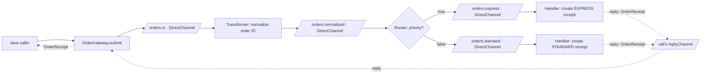
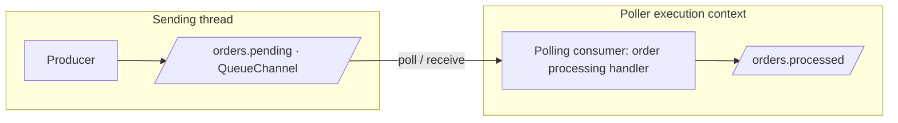
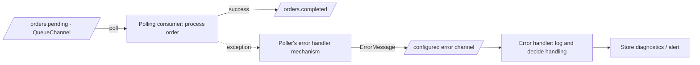

# Diagramming an integration flow

## 1. Objectives and how to look at an integration flow

In Spring Integration Core, an integration flow is the path messages take across channels and endpoints to perform a piece of work. A good diagram must help readers answer: where does a message enter, what data does it carry, where is it processed, which branches can it take, where do replies return, and what happens when a step fails.

The **Message flow model** chapter focuses on how components coordinate. This lesson guides turning a business requirement into a diagram and mapping that diagram to Java DSL. Transformers, routers, filters, and aggregators appear as roles in the flow; the emphasis is representing the relationships among them accurately.

After this lesson, you can:

- Distinguish messages, channels, and endpoints when drawing a diagram.
- Represent request paths, reply paths, routing branches, and error paths.
- Identify synchronous and asynchronous execution boundaries and where pollers belong.
- Map a diagram to named components in Java DSL.
- Use the diagram to identify behaviors that need testing.

An integration flow is a directed graph, yet each arrow also carries meaning about data contracts and work handoff. A diagram with only "receive → process → save" boxes is rarely sufficient to implement or evaluate the behavior of a Spring Integration application.

## 2. Identifying the right elements to draw

### 2.1. A message is the moving data

`Message<T>` contains two main parts:

- `payload`: business data, such as `OrderRequest` or `OrderReceipt`.
- `headers`: information supporting transport and message processing, such as routing, correlation, replying, or error handling.

Messages are usually labeled on the edges connecting components. There is no need to create an endpoint named "Message" just to depict data moving through the system.

At the conceptual level:

```text
Message<OrderRequest>
├── payload: OrderRequest(orderId="ORD-42", priority=true)
└── headers
    ├── replyChannel: reply destination for this call
    └── other technical headers
```

`replyChannel` does not have to be the name of an application-declared channel bean. A gateway can set up a temporary reply channel for the invocation. When drawing, distinguish application-named channels from framework-managed reply channels.

If a transformer changes `OrderRequest` into another type, the diagram should note the new type on the outgoing edge. Keeping the same business label on every arrow can hide an important contract change.

### 2.2. A channel is a message handoff point

`MessageChannel` is where producers send messages and consumers receive them according to that channel's mechanics. A channel does not perform business work itself, such as normalizing orders or calculating totals.

Several channel types should be shown clearly on diagrams:

| Channel | Meaning when reading a diagram | Design consequence |
|---|---|---|
| `DirectChannel` | Delivers message directly to one selected subscriber | With synchronous handlers, execution continues on the sender thread; no queue buffer |
| `QueueChannel` | Message is placed into a queue for a consumer to pull | Requires a polling mechanism; storage configuration determines survival across restarts |
| `ExecutorChannel` | Hands off work through a `TaskExecutor` | Can offload processing threads; do not assume a hard async boundary without checking the executor and execution policy |
| `PublishSubscribeChannel` | Distributes messages to active subscribers via publish-subscribe | Performs fan-out; does not automatically run in parallel or aggregate results |

For example, two handlers subscribed to the same `DirectChannel` do not mean both process every message. If the requirement is sending to both business processing and audit, the diagram must explicitly show an appropriate fan-out mechanism.

### 2.3. An endpoint is where behavior lives

Endpoints connect processing behavior to messaging infrastructure. When reading a diagram, box labels should describe the role and specific task.

| Role | Label you can use on a diagram | What to show |
|---|---|---|
| Transformer | `Normalize order ID` | Payload before and after transformation |
| Router | `Route by priority` | Each condition and target channel |
| Filter | `Accept valid orders only` | Acceptance path and how discarded messages are handled |
| Service activator | `Create processing receipt` | Business task and whether a reply is produced |
| Splitter | `Split line items` | One input message produces multiple output messages |
| Aggregator | `Aggregate line-item results` | Correlation key, release condition, and timeout policy |
| Gateway | `OrderGateway.submit` | Call boundary from Java into messaging or a subflow |
| Channel adapter | `Receive data from source` | Boundary with an external system and data transfer direction |

Not every DSL step is a standalone business endpoint. The DSL can generate internal connecting channels; how much detail to show for beans, endpoints, and channels depends on the diagram's purpose.

## 3. Choosing levels and conventions before drawing

Separate two levels that serve different purposes:

1. **Business diagram:** input sources, core processing steps, success paths, rejection paths, and target systems. Used to align on requirements.
2. **Implementation diagram:** gateways, channel names, channel types, endpoints, pollers, reply paths, and error paths. Used to cross-check configuration and diagnose runtime issues.

A problem may need both diagrams. Do not attach thread, persistence, or retry details to a diagram if configuration does not actually define them.

This lesson uses these conventions:

| Symbol | Meaning |
|---|---|
| Rectangle | Endpoint or behavior-executing component |
| Parallelogram | Channel |
| Diamond | Router or routing decision |
| Solid arrow | Message path along the main flow direction |
| Dashed arrow labeled `reply` | Logical reply path |
| Dashed arrow labeled `exception` | Error-producing relationship; see each diagram's explanation |
| Grouped box with thread note | Explicitly configured execution context |

Dashed lines do not mean "asynchronous." Asynchrony must be determined from channels, executors, or polling mechanics. The diagrams below are intentionally simplified and do not depict every bean Spring creates.

## 4. From business requirement to implementation diagram

### 4.1. Lock down the contract and possible outcomes

Consider an illustrative requirement:

> A Java application sends a request with an order ID and a priority flag. The flow trims whitespace from both ends of the order ID, rejects empty IDs, selects either the priority or standard branch, and returns a receipt to the caller.

This example illustrates only the message flow model. The receipt confirms which branch was chosen; it does not mean the order has been saved to a database or shipped.

Contract:

```text
Input:   OrderRequest(orderId, priority)
Success: OrderReceipt(orderId, route)
Invalid: throws exception
Caller:  waits for result from OrderGateway.submit(...)
```

There are two routing branches, yet each request enters only one branch. There is no need to aggregate results, so the diagram needs no aggregator.

### 4.2. Drawing the main path and reply path



Points to read accurately:

- `orders.in`, `orders.normalized`, `orders.express`, and `orders.standard` are application-named channels.
- The transformer both normalizes the ID and may throw an exception if the normalized ID is empty.
- The router selects one channel based on `priority`. Both branches do not run simultaneously for the same request.
- Handlers return `OrderReceipt`. Without a dedicated output channel configured, the handler's reply mechanism can use `replyChannel` on the message.
- The reply channel in the diagram represents the gateway call's reply mechanism, not a requirement to declare an extra bean named `replyChannel`.
- The entire main path uses `DirectChannel` with synchronous handlers in the example. Having multiple boxes in the diagram does not create extra threads.

### 4.3. Recording data at key checkpoints

There is no need to list every header on every edge. Prioritize information that helps verify contracts between steps.

| Checkpoint | Illustrative payload | What must remain true |
|---|---|---|
| After gateway | `OrderRequest(" ORD-42 ", true)` | Reply path exists for the invocation |
| After transformer | `OrderRequest("ORD-42", true)` | Priority flag is unchanged; headers needed for reply are preserved |
| After router | Still `OrderRequest("ORD-42", true)` | Only `orders.express` is selected |
| After express handler | `OrderReceipt("ORD-42", "EXPRESS")` | Reply type matches gateway contract |
| At caller | `OrderReceipt` object | Caller receives reply payload instead of handling `Message` directly |

If a step builds a new message manually and drops `replyChannel`, the drawing might still look plausible while requests fail to receive replies. When reviewing an implementation diagram, check both headers and payloads.

### 4.4. A repeatable diagramming workflow for other problems

1. Write down the input source and input payload contract.
2. List transformations and business decisions in order.
3. Place channels where naming, branching, or changing delivery semantics is needed.
4. Label conditions on every outgoing edge from a router.
5. For every terminal branch, note its outcome: reply, one-way action, discard, or error.
6. Mark steps that spawn multiple messages or hold messages waiting for a group.
7. Add thread boundaries, polling, and persistence only where backed by configuration.
8. Cross-check diagram names and contracts against the Java DSL.

A diagram is sufficient when someone else can trace a concrete message without guessing how a branch terminates.

## 5. Cross-checking the diagram against Java DSL

The example below uses Spring Integration Core, Spring Context, and Java with `record` support. All sample files live in package `example.integration`; each `public` declaration below belongs in its own similarly named Java file. The application must initialize a Spring application context containing this configuration.

### 5.1. Data contracts and gateway

```java
package example.integration;

public record OrderRequest(String orderId, boolean priority) {
}
```

```java
package example.integration;

public record OrderReceipt(String orderId, String route) {
}
```

```java
package example.integration;

import org.springframework.integration.annotation.MessagingGateway;

@MessagingGateway(defaultRequestChannel = "orders.in")
public interface OrderGateway {
    OrderReceipt submit(OrderRequest request);
}
```

The gateway turns a `submit` call into a request message, sends it to `orders.in`, waits for a reply, and returns the payload as the declared type. In this example, the application uses the Spring-generated gateway proxy without implementing `OrderGateway` manually.

### 5.2. Configuring channels and endpoints

```java
package example.integration;

import org.springframework.context.annotation.Bean;
import org.springframework.context.annotation.Configuration;
import org.springframework.integration.annotation.IntegrationComponentScan;
import org.springframework.integration.channel.DirectChannel;
import org.springframework.integration.config.EnableIntegration;
import org.springframework.integration.dsl.IntegrationFlow;
import org.springframework.messaging.MessageChannel;

@Configuration
@EnableIntegration
@IntegrationComponentScan(basePackageClasses = OrderGateway.class)
public class OrderFlowConfiguration {

    @Bean(name = "orders.in")
    public MessageChannel ordersIn() {
        return new DirectChannel();
    }

    @Bean(name = "orders.normalized")
    public MessageChannel normalizedOrders() {
        return new DirectChannel();
    }

    @Bean(name = "orders.express")
    public MessageChannel expressOrders() {
        return new DirectChannel();
    }

    @Bean(name = "orders.standard")
    public MessageChannel standardOrders() {
        return new DirectChannel();
    }

    @Bean
    public IntegrationFlow orderRoutingFlow() {
        return IntegrationFlow.from("orders.in")
                .<OrderRequest, OrderRequest>transform(this::normalize)
                .channel("orders.normalized")
                .route(OrderRequest.class, OrderRequest::priority,
                        mapping -> mapping
                                .channelMapping(true, "orders.express")
                                .channelMapping(false, "orders.standard"))
                .get();
    }

    @Bean
    public IntegrationFlow expressOrderFlow() {
        return IntegrationFlow.from("orders.express")
                .handle(OrderRequest.class, (order, headers) ->
                        new OrderReceipt(order.orderId(), "EXPRESS"))
                .get();
    }

    @Bean
    public IntegrationFlow standardOrderFlow() {
        return IntegrationFlow.from("orders.standard")
                .handle(OrderRequest.class, (order, headers) ->
                        new OrderReceipt(order.orderId(), "STANDARD"))
                .get();
    }

    private OrderRequest normalize(OrderRequest order) {
        if (order.orderId() == null) {
            throw new IllegalArgumentException("orderId must not be null");
        }
        String normalizedId = order.orderId().trim();
        if (normalizedId.isEmpty()) {
            throw new IllegalArgumentException("orderId must not be blank");
        }
        return new OrderRequest(normalizedId, order.priority());
    }
}
```

In a component receiving `OrderGateway` via dependency injection, an illustrative call is:

```java
OrderReceipt receipt = gateway.submit(
        new OrderRequest(" ORD-42 ", true));

// receipt.orderId() equals "ORD-42"
// receipt.route() equals "EXPRESS"
```

The configuration defines three `IntegrationFlow` beans, whereas the diagram shows one business flow from caller to outcome. Flow bean boundaries do not equate to thread boundaries or transaction boundaries.

The example omits explicit output channels on the two terminal handlers. Each handler's return value becomes a reply message and is sent using the request's existing reply mechanism. Transformers configured in the standard way preserve headers needed for the reply path.

### 5.3. Mapping table between diagram and configuration

| Component on diagram | Component in configuration | Role |
|---|---|---|
| `OrderGateway.submit` | `@MessagingGateway` | Translates Java calls into request/reply messaging |
| `orders.in` | `DirectChannel` bean | Entry point of the routing flow |
| Normalize order ID | `.transform(this::normalize)` | Transforms payload before routing |
| `orders.normalized` | `.channel("orders.normalized")` | Named handoff point after normalization |
| Route by priority | `.route(... OrderRequest::priority ...)` | Selects one of two channels |
| Priority branch | `expressOrderFlow()` | Produces reply payload with route `EXPRESS` |
| Standard branch | `standardOrderFlow()` | Produces reply payload with route `STANDARD` |
| Reply path | Return values from `.handle(...)` and gateway mechanism | Routes result back to the right caller |

If a channel is added to the diagram before existing in configuration, or renamed in code, this table helps spot mismatches. For implementation diagrams, keep identifiers consistent; for business diagrams, descriptive names are fine as long as a corresponding mapping table is kept.

## 6. Representing threads and polling

### 6.1. Direct flow in the example

With the given configuration and synchronous handlers, the thread calling the gateway walks through the transformer, router, and chosen handler. The caller receives the result after processing completes or receives an exception when processing fails.

```text
Caller thread
  submit()
    → orders.in
    → normalize
    → orders.normalized
    → router
    → orders.express or orders.standard
    → create OrderReceipt
  receive result
```

A long-running handler holds this thread longer. Renaming channels or splitting configuration into multiple flow beans does not make work run in the background on its own.

### 6.2. When replacing a handoff point with QueueChannel

Suppose a requirement calls for accepting orders and processing them with a polling worker. The implementation diagram must add the queue and message-pulling mechanism:



`Polling consumer` here is the endpoint consuming from a pollable channel; the poller provides the schedule and execution mechanism. The `poll / receive` arrow shows the direction messages move from queue to endpoint, even though the consumer actively pulls the message.

When cross-checking configuration, answer:

- Is the channel actually a `QueueChannel`, or just a `DirectChannel` with `queue` in its name?
- Does the queue-reading endpoint have an appropriate poller configured?
- Do polling frequency, messages per poll, and processing capacity match traffic?
- Does the queue use memory or a message store; what is the policy when the queue is full?
- Does putting a message in the queue equate to business work being done?

An in-memory `QueueChannel` does not automatically become a durable queue. If a diagram claims "no lost orders on restart," storage and transaction configuration must substantiate that promise.

### 6.3. Internal asynchrony vs. caller contract

If the gateway's entry point is replaced with a queue while the method still returns `OrderReceipt`, the caller may still have to wait for the reply. Running the worker in another execution context does not automatically turn a Java method into a one-way call.

Distinguish three things:

| Question | Deciding component |
|---|---|
| In which context does the handler run? | Channel, poller, and executor |
| Does the caller wait for a result? | Gateway contract, return type, and wait configuration |
| Does the message survive restarts? | Message store, transactions, and infrastructure setup |

Do not infer answers to all three from a single arrow labeled "async." In particular, a reply wait timeout does not guarantee the running task has been cancelled.

## 7. Drawing branches and convergence points accurately

### 7.1. Router: choosing a path

A router decides the destination channel. For our boolean `priority` example, mapping `true` and `false` covers both possible business values.

If switching to a string status such as `EXPRESS`, `STANDARD`, `INTERNATIONAL`, the diagram must specify what happens to unsupported values: routing to a default channel, routing to rejection handling, or throwing an error per configuration. A "default" path on the diagram must also have a corresponding implementation.

Some routers can select multiple channels. Therefore, the label "router" alone does not prove each message enters only one branch; the routing rule itself decides that.

### 7.2. Filter: show the discard path too

A filter decides whether to accept or reject a message. In a request/reply flow, a discarded message with no response can cause the caller to wait until timeout or receive a result that violates the contract.

Example logical diagram:

```text
orders.in
  → Filter: valid quantity?
      ├── accept → process order → success reply
      └── reject → discard flow → create rejection reply
```

If using a discard channel, draw the consumer that handles discarded messages too. Sending to a discard channel does not automatically build a rejection reply; the consumer must create an appropriate result and use the right reply path. Another option is configuring rejection via exception when the contract requires the caller to receive an error.

A filter only states the keep-or-drop decision. The destination and how the call ends must be designed separately.

### 7.3. Publish-subscribe: multiplying delivery

Suppose each order must undergo both business processing and audit logging:

```text
orders.events [PublishSubscribeChannel]
  ├── business processing subscriber
  └── audit logging subscriber
```

This diagram expresses fan-out, yet has not yet specified:

- Whether the two subscribers run sequentially or via an executor.
- How an error in one subscriber affects delivery.
- Which branch is authorized to produce a reply for the initial request.
- Whether results from both subscribers must be awaited.

Avoid letting both subscribers accidentally send replies into the same reply mechanism of a request expecting one result. If the audit branch only receives secondary info, consider a wire tap or an appropriate event-distribution design. The diagram must still specify expectations around waiting for audit, error handling, and durability.

### 7.4. Splitter and aggregator: from one to many and back to one

When an order has multiple line items, you can split the lines for processing and then aggregate the results. This is a stateful convergence, different from two arrows simply pointing into a single service activator.

```mermaid
flowchart LR
    B["Message containing a multi-line order"] --> S["Splitter: split line items"]
    S -->|"n Messages containing LineItem"| IC[/"items.work"/]
    IC --> H["Handler: process one line"]
    H -->|"LineResult and correlation headers"| PC[/"items.processed"/]
    PC --> A["Aggregator: group LineResults of same order"]
    A -->|"one combined result"| R["Create OrderReceipt"]
```



A detailed aggregator diagram should document at least:

| Information | Example | Reason |
|---|---|---|
| Correlation key | `correlationId` per order's line group | Avoid mixing results belonging to different orders |
| Release condition | Expected number of items received | Determine when a combined result can be produced |
| Sequence metadata | `sequenceNumber`, `sequenceSize` when using sequence-based strategy | Know item position and group size |
| Timeout policy | Reject entire order or produce partial result | Handle groups that never complete |
| Group storage | Configured message store | Clarify lifecycle and state recovery capabilities |

If relying on sequence metadata generated by a splitter, preserve correlation headers across every branch. If using a custom correlation strategy by order ID, document that exact strategy rather than assuming the aggregator understands the payload automatically.

An easy-to-miss edge case: the splitter emits three messages, yet a filter drops one before the aggregator. If the release condition still expects three results, the remaining two messages will never release the group. The diagram must show a consistent decision, such as:

- Every line always returns a `LineResult`, including failure outcomes, so the element count stays complete.
- Timeout sends incomplete groups to error handling or an accepted partial result.
- Redesign the release condition to match the business contract.

Similarly, if subscribers of a publish-subscribe flow must be aggregated using sequence metadata, configure sequence metadata emission accordingly or use a dedicated correlation strategy. Do not infer aggregation capability merely from drawing fan-out followed by convergence.

## 8. Drawing error paths as contracted flows

### 8.1. Synchronous exceptions in the Java DSL example

The `OrderGateway` configuration above specifies no custom error channel. When normalizing an empty ID, the exception thrown in the synchronous chain propagates back through the gateway invocation; depending on layers involved, the exception may be wrapped in a messaging exception, requiring inspection of the root cause.

Logical error path:

```text
Caller → gateway → orders.in → normalize
                                  └── exception → gateway call fails
```

There is no need to draw every synchronous error as if it were automatically sent to an `errorChannel` bean. The presence of an error channel in the application context does not prove every exception everywhere is routed into it.

A gateway can be configured with its own error handling. When adding that mechanism, update both the diagram and caller contract to match actual behavior.

### 8.2. Errors across a polling boundary

With a poller or asynchronous execution mechanism, the original calling thread is usually no longer on the error-handling call stack. The framework provides error-publishing mechanisms; the exact path depends on endpoint and error-handler configuration.

An implementation diagram can depict:



The `exception` arrow here depicts an error-raising relationship, not the handler actively sending a business message to a channel named `exception`. It is the corresponding error-handling mechanism that creates or publishes an `ErrorMessage` per configuration.

`ErrorMessage` carries a `Throwable` payload. When the exception is a `MessagingException` holding a `failedMessage`, the error flow can retrieve the failed message for diagnostics. Never assume every `Throwable` has a `failedMessage`.

Specify the actual error channel explicitly: the message's `errorChannel` header, the default error channel when supported by the publishing mechanism, or the destination configured explicitly. Vague labels like "log error" are insufficient to identify which component receives failures.

### 8.3. Error flows and reply flows are separate responsibilities

Logging an error does not automatically create a response for the caller. If the caller is waiting for a result while the error flow only logs, the call can still time out.

For a complete diagram, define a contracted outcome:

- The call fails with an exception via the configured mechanism.
- The error flow builds a rejection result and routes it back along the right reply path.
- The caller receives immediate acknowledgment of intake, then queries processing status via a separate mechanism.

If the gateway returns `OrderReceipt`, an error handler cannot arbitrarily return an incompatible `ErrorResponse` payload and treat the contract as satisfied. You can design a unified result type representing both approval and rejection, or maintain an exception contract.

### 8.4. Representing retries at the right scope

If retries wrap an external service call, annotate that endpoint directly:

```text
Handler calling shipping service
  retry: per configured policy
  retries exhausted: recovery / error flow
```

An arrow looping back to `orders.in` means resending the whole message through multiple steps, which differs from local retry around a single handler. That distinction determines whether earlier side effects are repeated.

The diagram must state retry scope and the post-exhaustion destination. If an operation can run multiple times, clarify idempotency requirements at side-effecting steps such as creating shipments or charging payments.

## 9. Using diagrams to choose test scenarios

A diagram is valuable when every major branch or boundary has verifiable behavior. For the Java DSL example, you can build the following test table:

| Scenario | Outcome to observe | Part of diagram verified |
|---|---|---|
| `orderId=" ORD-42 "`, `priority=true` | Receipt `ORD-42`, route `EXPRESS` | Normalization, router, priority branch, and reply |
| `orderId="ORD-43"`, `priority=false` | Receipt `ORD-43`, route `STANDARD` | Standard branch and reply |
| `orderId="   "` | Call fails; cause indicates invalid ID | Transformer error path |
| `orderId=null` | Call fails per input validation | Input error contract |
| Two sequential or concurrent requests | Each caller receives the receipt matching its own order ID | Request/reply correlation |

For extended diagrams with queues, filters, or aggregators, add corresponding meaningful scenarios:

- Queue holds a message while consumer has not polled yet: proves enqueueing does not equal completion.
- Filter rejects a message: verifies caller receives the rejection result or error per chosen contract.
- One item never reaches the aggregator: verifies timeout and incomplete-group handling.
- Handler throws after leaving the sending thread: verifies the error flow receives the error.
- Retrying a side-effecting handler: verifies no duplicate business outcome per idempotency rules.

Do not use fixed sleeps as sole proof of asynchronous processing. Wait under bounded conditions or receive messages from appropriate test channels. Test wait bounds must be finite so a missing-reply bug does not hang the test suite.

Diagram-driven testing focuses on contracts and observable branches. There is no need to test every internal channel auto-generated by the DSL if they are not interfaces meant to be maintained.

## 10. Diagramming mistakes that lead to flawed implementations

| Misleading representation | Consequence | Fix |
|---|---|---|
| Drawing a channel as an "order processing" step | Unclear which handler holds the logic | Separate transport channels from work-performing endpoints |
| Writing only channel names, omitting channel types | Hard to determine threads, buffering, and polling | Label types wherever they affect behavior |
| Drawing two consumers of a `DirectChannel` as two branches receiving the same message | Confuses point-to-point with fan-out | Show the distribution mechanism matching configuration |
| Router with unlabeled branches | Unclear which input goes where | Document conditions and unmapped-value handling |
| Filter showing only the accept path | Drops rejected requests without replies | Draw discard, rejection, or exception per design |
| Two arrows converging into one handler labeled "aggregate results" | Assumes ordinary handlers hold group state | Use an aggregator when correlation and waiting for completeness are needed |
| Using `PublishSubscribeChannel` and labeling it "parallel" | Ignores executors and execution policies | Label parallel only when configuration truly supports it |
| Adding `QueueChannel` without drawing a polling consumer | Messages sit unprocessed in the queue | Specify the consuming endpoint and poller |
| Writing "persistent" merely because a queue exists | Unsubstantiated recovery claims | Document the message store and actual guarantees |
| Connecting every endpoint to `errorChannel` | Obscures difference between synchronous exceptions and published errors | Show the actual error-catching or publishing mechanism |
| Error flow ending in a log while request still waits | Caller receives no response on failure | Design error result and reply path |
| Drawing a retry loop back to the flow start for all errors | May repeat earlier side effects | Place retry at the exact endpoint or state full-replay scope |

## 11. Exercise: adding an inventory check for priority orders

Extend the example with these requirements:

1. Standard orders still produce a `STANDARD` receipt.
2. Priority orders must check inventory before producing a receipt.
3. If in stock, produce an `EXPRESS` receipt.
4. If out of stock, return a receipt with route `REJECTED_OUT_OF_STOCK`.
5. If the inventory service is unreachable, the call fails with an exception.
6. Each request must yield exactly one successful outcome or terminate with an error.

Draw the diagram before writing DSL, explicitly stating the payload at the output of the inventory-check step. One design is using a `StockCheckResult` holding the original request and stock availability so the order ID needed for the reply is not lost.

Decomposition hint:

```text
OrderRequest
  → normalize
  → router by priority
      ├── false → create OrderReceipt(STANDARD) → reply
      └── true  → check inventory
                    ├── in-stock result
                    │     → create OrderReceipt(EXPRESS) → reply
                    ├── out-of-stock result
                    │     → create OrderReceipt(REJECTED_OUT_OF_STOCK) → reply
                    └── technical error
                          → exception per gateway contract
```

At the implementation level, after the inventory-check endpoint you need a router inspecting the result status to choose between the two business branches. The technical-error branch depicts an endpoint exception; do not turn it into an "out-of-stock" value. Channels between these endpoints should be shown and named if the diagram is used to cross-check DSL.

Self-check your solution:

- Does the standard branch accidentally pass through the inventory service?
- Does the payload after checking inventory still carry enough data to build a receipt?
- Do both in-stock and out-of-stock branches return `OrderReceipt`?
- Are technical errors mistakenly treated as normal business cases?
- Do the diagram and configuration share the same thread, reply, and error mechanics?

## 12. Checklist before turning a diagram into code

- [ ] Input source and input payload contract are defined.
- [ ] Transport channels are distinguished from processing endpoints.
- [ ] Key channel names match the Java DSL.
- [ ] Main edges show payload type changes.
- [ ] Routers have clear conditions and unmapped-value handling.
- [ ] Filters have a defined outcome for discarded messages.
- [ ] Fan-out accurately shows how many branches receive messages and who produces replies.
- [ ] Aggregators define correlation keys, release conditions, and incomplete-group handling.
- [ ] Queues have polling consumers and are not credited with unconfigured persistence guarantees.
- [ ] Threads or executors are noted only when backed by configuration.
- [ ] Every request/reply path has a defined result or error mechanism.
- [ ] Error paths show who publishes errors, who receives them, and the impact on callers.
- [ ] Retries, if present, state scope and post-exhaustion outcomes.
- [ ] Major branches and boundaries have corresponding test scenarios.

An integration flow diagram is a specification you can verify against configuration: which data flows through which channel, which endpoint processes it, and which conditions terminate a request. When that information is explicit, the diagram becomes a tool for designing, communicating, and diagnosing Spring Integration Core behavior.
