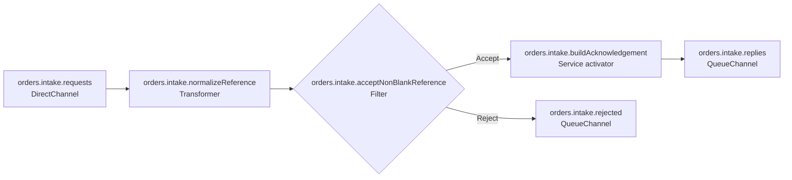

# Naming steps in a flow

**Module:** `SPRING_INTEGRATION_CORE`  
**Chapter:** Message flow model

A flow can work correctly yet remain hard to maintain if its steps are only named `step1`, `transformer2`, or framework-generated names. When a message is rejected, operations need to know which rule rejected it. When an external service must be mocked in tests, the test author needs to locate the right flow component.

Within the scope of Spring Integration's core components, this lesson guides naming flows, `MessageChannel`s, endpoints, handlers, and gateways. Transformers, filters, routers, aggregators, and error-handling flows serve as scenarios to apply the same naming scheme. The goal is to understand a step's responsibility simply by reading its name, while also knowing exactly which Spring object that name refers to.

## 1. What kinds of names does a processing step have?

Consider a simple path:

```text
Message → request-receiving channel → normalization endpoint → result channel
```

The names involved here are not interchangeable:

| Object | Meaning | Example |
| --- | --- | --- |
| `IntegrationFlow` bean | Identifies the entire flow configuration | `ordersIntakeFlow` |
| `MessageChannel` bean | Address for exchanging messages within the application | `orders.intake.requests` |
| Consumer endpoint | Component receiving messages and coordinating handler invocation | `orders.intake.normalizeReference` |
| Message handler | Object executing or delegating message-processing work | Has its own bean name; naming rules depend on configuration |
| Business bean | Java object invoked by the handler | `orderService` |
| Messaging gateway | Java entry point for callers to enter the messaging system | `ordersGateway` |
| `MessageHeaders.ID` | Identifies a specific message instance | A UUID value |
| Business header | Identifies an order, transaction, or request | `orderId`, `requestId` |

For a consuming endpoint, Spring Integration distinguishes the consumer and the message handler as two separate beans. With annotation configuration, `@EndpointId` specifies the consumer name; handler naming rules also depend on whether the method carries `@Bean`. That is why you should avoid saying "step name" without clarifying whether you mean the endpoint or the handler. See [endpoint and handler naming rules](https://docs.spring.io/spring-integration/reference/overview.html#endpoint-bean-names).

For example, `orders.intake.normalizeReference` answers "which step is running?", while `orderId=ORD-42` answers "which order is being processed?". Renaming an endpoint does not change `MessageHeaders.ID` and does not automatically create business headers.

## 2. Building a readable naming convention

The convention below is a design choice for the examples in this lesson, not mandatory Spring Integration syntax:

```text
Endpoint: <business-domain>.<flow>.<verb-and-object>
Channel:  <business-domain>.<flow>.<content-or-state>
Flow:     Java bean name describing a business capability
```

Applied to order intake:

| Role | Suggested name | What does the reader understand? |
| --- | --- | --- |
| Entire flow | `ordersIntakeFlow` | Order intake flow |
| Input channel | `orders.intake.requests` | Requests awaiting processing |
| Transformer | `orders.intake.normalizeReference` | Normalizes reference code |
| Filter | `orders.intake.acceptNonBlankReference` | Lets only non-blank codes proceed |
| Reply-building handler | `orders.intake.buildAcknowledgement` | Builds confirmation result |
| Result channel | `orders.intake.replies` | Holds processing results |
| Rejected channel | `orders.intake.rejected` | Holds messages failing conditions |
| Technical error channel | `orders.intake.errors` | Destination for error messages once configured |

Under this convention, endpoints carry a verb because they perform an action; channels carry a noun or state because messages pass through them. As a result, `normalizeReference` and `normalizedReferences` evoke two distinct roles.

### 2.1. Prioritize business responsibility

| Cryptic name | More meaningful name | Reason |
| --- | --- | --- |
| `step1` | `orders.intake.normalizeReference` | Independent of sequence position |
| `transformer2` | `orders.export.toPartnerDocument` | States target data format |
| `filterOrder` | `orders.intake.acceptPositiveTotal` | States acceptance condition |
| `router` | `orders.fulfillment.routeByDeliveryMethod` | States branching criterion |
| `aggregate` | `orders.fulfillment.assembleShipmentResult` | States the assembled result |
| `callApi` | `orders.payment.authorizePayment` | States the action on the target system |

A name like `validateOrder` can mislead if the step only checks one condition and drops messages. In that case, `acceptPositiveTotal` is more accurate. If the step checks multiple constraints and throws on violation, `validateOrder` can fit as long as that responsibility is documented clearly.

### 2.2. Keep names stable and appropriately specific

Do not embed sequence numbers in operational names. Inserting a validation step before `step3` makes names and positions diverge, or forces renaming multiple related steps.

Do not put `orderId`, timestamps, or retry counts into bean names. That is per-execution data and belongs in headers, logs, or trace metadata. Component names must remain stable across messages so errors can be aggregated and metrics compared.

Use a single language for names in source code. This lesson originally explained concepts in Vietnamese while using English names in Java. Dots separate scopes; the action portion uses camelCase. A team may choose another style, but should apply it consistently.

## 3. Naming with Java DSL

### 3.1. Flow names come from the `IntegrationFlow` bean

```java
@Bean
public IntegrationFlow ordersIntakeFlow() {
    return IntegrationFlow.from("orders.intake.requests")
            .transform(String.class,
                    value -> value.trim(),
                    endpoint -> endpoint.id("orders.intake.normalizeReference"))
            .channel("orders.intake.replies")
            .get();
}
```

If no other name is specified in `@Bean`, the method name becomes the flow's bean name: `ordersIntakeFlow`.

The `endpoint` parameter in the lambda is the endpoint configuration object. Calling `endpoint.id(...)` names the endpoint created for the transformer step. It does not rename the flow and is not a method that adds an `id` header to messages. Java DSL provides `EndpointSpec.id()` to specify an endpoint bean name instead of an auto-generated one. See [endpoint configuration in Java DSL](https://docs.spring.io/spring-integration/reference/dsl/java-endpoints.html).

### 3.2. Channel names are connection addresses

```java
.channel("orders.intake.replies")
```

This call connects the flow to the channel with the corresponding name. If no channel bean exists yet, the DSL can create a `DirectChannel` for that name. For shared channels or channels requiring a specific type such as `QueueChannel`, declare a bean explicitly and reference it by name or object. Do not create two separate channel objects with the same name in two flows. See [how Java DSL creates and references channels](https://docs.spring.io/spring-integration/reference/dsl/java-channels.html).

A name like `orders.intake.replies` does not tell you whether the channel is synchronous or asynchronous, or whether it is durable. Those properties depend on the channel class and actual configuration.

### 3.3. What role do auto-generated names play?

The framework can still connect steps with internal channels and generate names for unnamed components. Names like `ordersIntakeFlow.channel#0` are useful when inspecting application structure, yet should not be treated as stable interfaces for tests or operational tooling. Adding a step can shift the numbering. See [generated component naming model in Java DSL](https://docs.spring.io/spring-integration/docs/6.1.x/reference/html/dsl.html).

Assign explicit names to:

- Steps with business rules that must be identified when errors occur.
- Endpoints that need to be started/stopped or referenced by management tools.
- Channels serving as inputs, outputs, discard branches, or connections between flows.
- Components that must be mocked or intercepted in integration tests.

There is no need to insert a named channel after every DSL line just to label steps. Giving the endpoint an ID suffices in many cases.

## 4. Complete example: ingesting order reference codes

The example uses Java 17 and the Spring Integration 6.x Java DSL API. Standalone configuration needs `spring-integration-core` along with compatible Spring libraries. This is an in-memory processing flow using strings to stay focused on naming.

Processing rules:

1. Receive a reference-code string.
2. Trim whitespace from both ends and convert to uppercase.
3. Route blank strings to a rejected channel.
4. For valid strings, build a reply in the form `ACCEPTED:<code>`.



Create the `OrdersFlowConfig` class in the example's package:

```java
package example.integration;

import java.util.Locale;

import org.springframework.context.annotation.Bean;
import org.springframework.context.annotation.Configuration;
import org.springframework.integration.channel.DirectChannel;
import org.springframework.integration.channel.QueueChannel;
import org.springframework.integration.config.EnableIntegration;
import org.springframework.integration.dsl.IntegrationFlow;

@Configuration
@EnableIntegration
public class OrdersFlowConfig {

    public static final String REQUESTS = "orders.intake.requests";
    public static final String REPLIES = "orders.intake.replies";
    public static final String REJECTED = "orders.intake.rejected";

    public static final String NORMALIZE =
            "orders.intake.normalizeReference";
    public static final String ACCEPT_NON_BLANK =
            "orders.intake.acceptNonBlankReference";
    public static final String BUILD_ACK =
            "orders.intake.buildAcknowledgement";

    @Bean(name = REQUESTS)
    public DirectChannel requestsChannel() {
        return new DirectChannel();
    }

    @Bean(name = REPLIES)
    public QueueChannel repliesChannel() {
        return new QueueChannel();
    }

    @Bean(name = REJECTED)
    public QueueChannel rejectedChannel() {
        return new QueueChannel();
    }

    @Bean
    public IntegrationFlow ordersIntakeFlow() {
        return IntegrationFlow.from(REQUESTS)
                .transform(String.class,
                        value -> value.trim().toUpperCase(Locale.ROOT),
                        endpoint -> endpoint.id(NORMALIZE))
                .filter(String.class,
                        value -> !value.isBlank(),
                        endpoint -> endpoint
                                .id(ACCEPT_NON_BLANK)
                                .discardChannel(REJECTED))
                .handle(String.class,
                        (reference, headers) -> "ACCEPTED:" + reference,
                        endpoint -> endpoint.id(BUILD_ACK))
                .channel(REPLIES)
                .get();
    }
}
```

Constants let configuration and tests share names. You do not have to put every bean name in the application into one giant constants class; keep names belonging to the same flow close to that flow's configuration.

In the example:

- `@Bean(name = REQUESTS)` sets the channel bean name; the bean name is `orders.intake.requests`, not `requestsChannel`.
- `ordersIntakeFlow` is the flow bean name because `@Bean` on this method specifies no other name.
- Three `.id(...)` calls identify three consumer endpoints with distinct responsibilities.
- `.channel(REPLIES)` declares the result destination; it does not rename the reply-building step.
- `REJECTED` holds messages rejected by the filter; by that point the payload has already been normalized by the preceding step.

`discardChannel` is for messages failing the selector. Business-rule rejection is not automatically synonymous with a technical exception. Filters also offer `throwExceptionOnRejection` if the design requires throwing an error. See [Message Filter behavior](https://docs.spring.io/spring-integration/reference/6.3/filter.html).

For payload `"  ord-42  "`, the result channel receives `"ACCEPTED:ORD-42"`. For payload `"   "`, the rejected channel receives an empty string and the result channel receives no message.

## 5. Endpoint, handler, and business POJO

A DSL line like `.handle(orderService, "register", ...)` can involve three objects:

```text
Consumer endpoint → adapted MessageHandler → orderService.register(...)
```

Naming the endpoint `orders.intake.registerOrder` does not rename the `orderService` bean and does not rename the `register` method.

When looking up beans, know your intent:

| Intent | Object typically needed |
| --- | --- |
| Control the lifecycle of a processing step | Endpoint |
| Replace message processing in a test | Handler or corresponding mock mechanism |
| Unit-test business rules independently | Business POJO |
| Send messages into a flow | Channel or messaging gateway |

Do not assume every configuration generates a handler named `<endpoint>.handler`. In particular, a handler declared with `@Bean` has its own name. When looking up a handler, follow the rules of the configuration style in use or inspect actual bean names and types.

### 5.1. Annotation configuration with `@EndpointId`

The snippet below is a separate illustrative option replacing the equivalent DSL step; do not load both configurations with the same endpoint ID simultaneously.

```java
package example.integration;

import java.util.Locale;

import org.springframework.integration.annotation.EndpointId;
import org.springframework.integration.annotation.Transformer;
import org.springframework.stereotype.Component;

@Component
public class ReferenceNormalizer {

    @EndpointId("orders.intake.normalizeReference")
    @Transformer(
            inputChannel = "orders.intake.rawReferences",
            outputChannel = "orders.intake.normalizedReferences")
    public String normalize(String reference) {
        return reference.trim().toUpperCase(Locale.ROOT);
    }
}
```

With a POJO discovered by Spring component scanning and a method without `@Bean`, the corresponding names are:

```text
POJO:      referenceNormalizer
Consumer:  orders.intake.normalizeReference
Handler:   orders.intake.normalizeReference.handler
```

If using a `@Bean` method to return a handler, the handler name follows `@Bean`, while `@EndpointId` names the consumer. Therefore, distinguish the two cases before using names to look up or replace components. See [Javadoc for `@EndpointId`](https://docs.spring.io/spring-integration/api/org/springframework/integration/annotation/EndpointId.html).

## 6. Applying to other processing patterns

### 6.1. Transformers, filters, routers, and aggregators

| Pattern | Question that helps name the endpoint | Example |
| --- | --- | --- |
| Transformer | What form is the input transformed into? | `orders.export.toPartnerDocument` |
| Filter | What condition allows the message to proceed? | `orders.intake.acceptSupportedCurrency` |
| Router | Which criterion decides the branch? | `orders.fulfillment.routeByDeliveryMethod` |
| Aggregator | Into what result are parts assembled? | `orders.fulfillment.assembleShipmentResult` |
| Service activator | Which business operation is invoked? | `orders.payment.authorizePayment` |
| Gateway endpoint calling another flow | Which capability is being requested? | `orders.payment.requestAuthorization` |

For a router, name the branching endpoint and each branch channel separately:

```text
Endpoint: orders.fulfillment.routeByDeliveryMethod
Branch:   orders.fulfillment.homeDelivery
Branch:   orders.fulfillment.storePickup
Fallback: orders.fulfillment.unsupportedDelivery
```

The name `homeDelivery` is a channel name in this lesson's convention. The key value returned by the router could be `HOME`, configured to map to that channel. Renaming a channel does not automatically change the business key inside the payload or header.

For an aggregator, the endpoint name `assembleShipmentResult` describes the aggregation job. The endpoint name is not a correlation key and does not replace a strategy determining which messages belong to the same group. For instance, messages sharing `orderId` can be grouped by correlation configuration; setting an endpoint ID does not create that configuration.

### 6.2. Gateways must distinguish bean name and target channel

A messaging gateway gives Java callers a method to send messages into a flow. A gateway name such as `ordersGateway` identifies the proxy bean; `orders.intake.requests` remains the target channel name. For gateways built from interfaces inside the DSL, the framework has its own gateway identification mechanism. See [gateways in IntegrationFlow definitions](https://docs.spring.io/spring-integration/docs/6.1.x/reference/html/dsl.html#java-dsl-gateway).

If the gateway must return a result, design the corresponding reply path. The example in section 4 explicitly routes results into a named `QueueChannel`. Simply naming a gateway and pointing it at the example's input will not automatically return results sitting in that queue as the gateway method's return value.

### 6.3. Name scope must cover the entire ApplicationContext

Two flows declaring the same endpoint ID `normalizeReference` in the same context can collide. Two different flow bean names do not automatically guarantee that explicit IDs inside them differ.

Scope names explicitly:

```text
orders.intake.normalizeReference
returns.intake.normalizeReference
```

A shared channel should be a single shared bean referenced by multiple flows. Two separately created channel objects that happen to share a name are a configuration bug, not channel sharing.

When registering multiple flow instances at runtime, `IntegrationFlowContext` offers `useFlowIdAsPrefix()` to prepend the flow ID to component names and prevent collisions. This mechanism requires an explicit flow ID; do not assume it is enabled automatically for every `@Bean`-declared flow. See [dynamic flow registration and flow ID prefixes](https://docs.spring.io/spring-integration/reference/dsl/java-runtime-flows.html).

## 7. Using names to troubleshoot and observe flows

Good names connect three pieces of information:

```text
Processing step: orders.intake.normalizeReference
Data:            orderId=ORD-42
Context:         requestId=req-817
```

The endpoint ID identifies the component, while header values identify the execution run. When reading logs, locate the step first, then use business or trace info to follow the message. Do not assume merely setting an ID makes every log automatically print all three pieces; configure logging, tracing, or instrumentation accordingly.

### 7.1. A channel name does not configure error handling on its own

Declaring an `orders.intake.errors` bean only creates a named channel. To receive errors, there must be a corresponding error-routing path, such as an `errorChannel` header and an error-handling mechanism appropriate for where the message executes.

With synchronous calls over `DirectChannel`, exceptions can propagate back to the sender. With asynchronous or polled execution, errors are typically handled via the corresponding infrastructure's `ErrorMessage` publishing mechanism. Therefore, when hunting down errors, inspect both the endpoint name and execution boundaries. See [Spring Integration error handling](https://docs.spring.io/spring-integration/reference/error-handling.html).

In naming design, separate clearly:

| Name | Design meaning |
| --- | --- |
| `orders.intake.rejected` | Messages failing acceptance rules |
| `orders.intake.errors` | Technical error messages once an error path is wired |
| `orders.intake.recordFailure` | Endpoint recording or handling failures |

The name `retryPayment` fits only if that step itself is responsible for retrying. If retry is applied as advice wrapping a service call, the endpoint name can remain `authorizePayment`; there is no need to rename it per attempt count.

## 8. Testing behavior through named channels

Tests should send messages to the flow's real input and inspect results or rejected branches. This simultaneously proves the named channels are wired properly.

The example below uses the configuration from section 4, JUnit Jupiter, and `spring-test`. Run it in a project that already has compatible dependencies; this is not a Spring Boot configuration, so booting a full application is unnecessary.

```java
package example.integration;

import org.junit.jupiter.api.Test;
import org.springframework.beans.factory.annotation.Autowired;
import org.springframework.beans.factory.annotation.Qualifier;
import org.springframework.integration.channel.QueueChannel;
import org.springframework.messaging.Message;
import org.springframework.messaging.MessageChannel;
import org.springframework.messaging.support.MessageBuilder;
import org.springframework.test.context.junit.jupiter.SpringJUnitConfig;

import static org.junit.jupiter.api.Assertions.assertEquals;
import static org.junit.jupiter.api.Assertions.assertNotNull;
import static org.junit.jupiter.api.Assertions.assertNull;
import static org.junit.jupiter.api.Assertions.assertTrue;

@SpringJUnitConfig(OrdersFlowConfig.class)
class OrdersFlowConfigTest {

    @Autowired
    @Qualifier(OrdersFlowConfig.REQUESTS)
    MessageChannel requests;

    @Autowired
    @Qualifier(OrdersFlowConfig.REPLIES)
    QueueChannel replies;

    @Autowired
    @Qualifier(OrdersFlowConfig.REJECTED)
    QueueChannel rejected;

    @Test
    void normalizesReferenceAndBuildsAcknowledgement() {
        Message<String> request = MessageBuilder
                .withPayload("  ord-42  ")
                .setHeader("orderId", "ORD-42")
                .build();

        assertTrue(requests.send(request));

        Message<?> reply = replies.receive(1000);
        assertNotNull(reply);
        assertEquals("ACCEPTED:ORD-42", reply.getPayload());
        assertEquals("ORD-42", reply.getHeaders().get("orderId"));
        assertNull(rejected.receive(0));
    }

    @Test
    void rejectsReferenceThatBecomesBlankAfterNormalization() {
        assertTrue(requests.send(
                MessageBuilder.withPayload("   ").build()));

        Message<?> discarded = rejected.receive(1000);
        assertNotNull(discarded);
        assertEquals("", discarded.getPayload());
        assertNull(replies.receive(0));
    }
}
```

`@Qualifier` looks up the exact bean by name even when the application has multiple channels of the same type. Tests verify payload, headers, and routing direction—not just that a bean exists.

In this example, the input is a `DirectChannel` and both outputs are in-memory queues. When `send` completes, the synchronous processing chain has already sent to the corresponding queue. If switched to an `ExecutorChannel` or an asynchronous boundary is added, waiting for results and checking for absent messages must be adjusted.

When an endpoint integrating with an external system needs mocking, Spring Integration provides `MockIntegrationContext` and handler-replacement APIs. Supply the endpoint name required by that API, not the business service bean name by mistake. See [integration testing support](https://docs.spring.io/spring-integration/reference/testing.html).

## 9. Common naming mistakes

| Mistake | Consequence | Fix |
| --- | --- | --- |
| Using the same name for flow, channel, and endpoint | Hard-to-read config, potential bean collisions | Separate flow name, channel address, and endpoint action |
| Renaming only the Java method | Endpoint may still carry old ID or auto-generated name | Set ID on the endpoint configuration itself |
| Thinking `.channel("normalizeReference")` names the transformer | Creates or references a channel instead of naming the endpoint | Name via configuration lambda `.id(...)` |
| Using `step1`, `step2` as test contracts | Inserting steps breaks name meaning | Use stable business responsibilities |
| Using auto-generated `#0` names in management tools | Structural refactors break references | Assign explicit IDs to managed points |
| Putting order IDs into component names | Difficult to aggregate logs and metrics per step | Keep static names; place order ID in headers |
| Naming a channel `errors` without wiring an error path | Channel does not receive errors as expected | Configure error publishing and a matching consumer |
| Renaming an endpoint ID while missing references | Tests, management config, or monitoring rules break | Search and update all references before deploying |

Renaming a channel bean can alter the address used by gateways, routers, or other flows. Renaming an endpoint ID can affect tests, lifecycle control config, and observability tools. Both kinds of renames must be reviewed against their respective dependents.

## 10. Practicing naming before wiring a flow

For a flow that ingests an order and then sends a payment request, write the list of responsibilities first:

```text
Receive request
→ Normalize data
→ Accept only supported currencies
→ Request payment authorization
→ Build intake acknowledgement
```

A consistent set of names could be:

```text
Flow:      ordersIntakeFlow
Input:     orders.intake.requests
Endpoint:  orders.intake.normalizeOrder
Endpoint:  orders.intake.acceptSupportedCurrency
Endpoint:  orders.payment.requestAuthorization
Endpoint:  orders.intake.buildAcknowledgement
Output:    orders.intake.replies
Rejected:  orders.intake.rejected
Errors:    orders.intake.errors
```

Next, bind each name to the right object: a channel is a message-exchange point, an endpoint is a processing step, and a gateway is an invocation entry point. For each endpoint, also describe its input, output, and failure behavior in one sentence. If you cannot describe it concisely, that step may hold too many responsibilities or the name may be too generic.

When adding routers, aggregators, or error handling, continue using the same scope-and-responsibility convention. A good name lets readers connect Java DSL code, flow diagrams, log messages, and test points without guessing meaning from a step's position.
