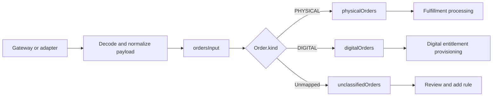

# Payload-based routing

In the **Router** chapter of the **SPRING_INTEGRATION_CORE** module, a payload-based router helps choose the processing flow based on the message's data. For example, an order intake endpoint can send physical orders to a fulfillment flow and digital orders to a download-entitlement flow.

This lesson places the router in relation to the core Spring Integration components: a gateway brings requests into the system, `Message` carries data, `MessageChannel` connects steps, and endpoints carry out each step's decision or work. The focus is on designing routing decisions with Java DSL, handling the no-route case, and testing the results.

## 1. Learning objectives and prerequisites

After this lesson, you will be able to:

- Distinguish routing by **the Java type of the payload** from routing by **values inside the payload**.
- Write a Java DSL flow that maps business keys to target channels.
- Use `PayloadTypeRouter` when different message kinds have distinct Java types.
- Design a default route and distinguish unsupported data from system errors.
- Test payload, headers, and independence between branches.

You should already know `Message<T>`, `DirectChannel`, `QueueChannel`, Spring bean declarations, and the `IntegrationFlow` concept. The examples use Java 17 or later and `spring-integration-core` with Java DSL built in. Library versions follow your project's dependency management configuration. The testing section uses JUnit Jupiter.

## 2. What decision does a router make?

A message can be pictured like this:

```text
Message<Order>
├── payload: Order(id="O-101", kind=PHYSICAL)
└── headers: traceId="trace-101", ...
```

With a payload-based router, the decision function reads `Order` to pick a target:

```text
Order -> routing key -> mapping -> target MessageChannel
```

For example:

```text
Order("O-101", PHYSICAL) -> "PHYSICAL" -> physicalOrders
Order("O-102", DIGITAL)  -> "DIGITAL"  -> digitalOrders
```

**Routing keys and channel names are two separate concepts.** `PHYSICAL` expresses the order type; `physicalOrders` is the bean name of a channel in the integration configuration. Separating these two concepts lets you change how flows are organized without modifying the business data model.

In this lesson, each order picks exactly one target channel. A router in general can be configured to send to multiple targets; a requirement to broadcast the same message to multiple departments calls for a separate design for publishing and coordinating results.

A router does not turn the routing function's return value into the new payload. If the function returns the string `PHYSICAL`, the target channel still receives the message containing `Order`. When you need to turn JSON into a DTO or normalize data, perform that with a transformer at the appropriate step.

Java DSL supports configuring routers with lambdas, expressions, object methods, and specialized routers. With a lambda, explicitly declaring the input type and key type helps readers see the decision contract. [Java DSL Router Reference](https://docs.spring.io/spring-integration/reference/dsl/java-routers.html).

## 3. Two meanings of "by payload"

| Routing approach | Question answered | Input example | Suitable tool |
| --- | --- | --- | --- |
| By payload type | Which object type is the payload? | `PhysicalOrder`, `DigitalOrder` | `PayloadTypeRouter` |
| By value inside payload | What business information does this object carry? | `Order.kind()` is `PHYSICAL` or `DIGITAL` | Lambda, POJO, or expression in `.route(...)` |
| By header | What is the control metadata outside the payload? | `tenantId`, `region` headers | Header-reading router; not the focus of this lesson |

Two orders that are both `Order` instances with different `kind` values cannot be distinguished using `PayloadTypeRouter` alone. Conversely, if messages are modeled as two independent classes, type checking can be the simpler choice.

The type a router observes is the type of the object currently inside the message at that point. A JSON string containing a `kind` field is still a `String` if it has not been decoded yet. A JSON object converted into a `Map` has not become an `Order` either.



The decoding step is only needed when the external source has not yet produced an `Order`. In the Java example below, the sender constructs `Order` directly.

## 4. Complete example: routing by order kind

### 4.1. Routing contract

The system already supports two business branches and reserves one branch for unclassified data:

| `kind` value | Key returned by function | Receiving channel | Policy |
| --- | --- | --- | --- |
| `PHYSICAL` | `PHYSICAL` | `physicalOrders` | Process physical orders |
| `DIGITAL` | `DIGITAL` | `digitalOrders` | Process digital orders |
| `SERVICE` | `SERVICE` | `unclassifiedOrders` | Not yet supported in current flow |
| `null` | `UNKNOWN` | `unclassifiedOrders` | Missing classification data |

Allowing `kind == null` in the example is an intentional business decision to illustrate the default route. A system that requires an order kind can reject this data in an input validation step.

### 4.2. Java configuration

Place the following in `PayloadRoutingConfig.java` in a Java project that already has Spring Integration:

```java
package demo.integration;

import org.springframework.context.annotation.Bean;
import org.springframework.context.annotation.Configuration;
import org.springframework.integration.channel.DirectChannel;
import org.springframework.integration.channel.QueueChannel;
import org.springframework.integration.config.EnableIntegration;
import org.springframework.integration.dsl.IntegrationFlow;
import org.springframework.messaging.MessageChannel;

@Configuration
@EnableIntegration
public class PayloadRoutingConfig {

    public enum OrderKind {
        PHYSICAL, DIGITAL, SERVICE
    }

    public record Order(String id, OrderKind kind) {
    }

    @Bean
    public MessageChannel ordersInput() {
        return new DirectChannel();
    }

    @Bean
    public QueueChannel physicalOrders() {
        return new QueueChannel();
    }

    @Bean
    public QueueChannel digitalOrders() {
        return new QueueChannel();
    }

    @Bean
    public QueueChannel unclassifiedOrders() {
        return new QueueChannel();
    }

    public static String routeKey(Order order) {
        return order.kind() == null
                ? "UNKNOWN"
                : order.kind().name();
    }

    @Bean
    public IntegrationFlow orderRoutingFlow() {
        return IntegrationFlow.from("ordersInput")
                .<Order, String>route(
                        PayloadRoutingConfig::routeKey,
                        router -> router
                                .channelMapping(
                                        "PHYSICAL", "physicalOrders")
                                .channelMapping(
                                        "DIGITAL", "digitalOrders")
                                .channelKeyFallback(false)
                                .resolutionRequired(true)
                                .defaultOutputChannel(
                                        "unclassifiedOrders"))
                .get();
    }
}
```

The `QueueChannel` beans act as target mailboxes for observation or testing; this configuration has not added endpoints that consume those mailboxes. If you connect a consuming flow to a `QueueChannel`, that flow needs an appropriate polling mechanism. Putting a message into a queue and completing business processing are two different milestones.

### 4.3. Reading the configuration along a message's path

With `Order("O-101", PHYSICAL)`:

1. `ordersInput` receives the message on a `DirectChannel`.
2. The router endpoint invokes `routeKey` with an `Order` payload.
3. The function returns the key `PHYSICAL`.
4. `channelMapping` maps that key to the `physicalOrders` bean.
5. The message containing `Order` is placed into that queue.

`<Order, String>` states the payload type the function expects and the key type it returns. It does not replace decoding and data contract validation at the system boundary.

The configuration has three important choices:

- `channelKeyFallback(false)`: an unmapped key is not reused as a channel name.
- `resolutionRequired(true)`: a selected channel name must resolve to a `MessageChannel`; configuration typos must be caught.
- `defaultOutputChannel("unclassifiedOrders")`: when the routing decision yields no target channel, send the message to the designated branch.

Therefore, unmapped `SERVICE` goes into `unclassifiedOrders`. If the `PHYSICAL` mapping mistakenly points to a nonexistent bean, that is a channel resolution error; the configuration above requires an error to be raised.

These mapping and resolution options belong to `AbstractMappingMessageRouter`'s API group. Declaring `channelKeyFallback(false)` explicitly makes the intent to use only mapped keys easy to spot when reading the configuration. [Key-to-channel mapping API](https://docs.spring.io/spring-integration/api/org/springframework/integration/router/AbstractMappingMessageRouter.html).

### 4.4. Test sending and observing the target

The following is a separate demonstration program placed in `PayloadRouterDemo.java` in the same package:

```java
package demo.integration;

import org.springframework.context.annotation.AnnotationConfigApplicationContext;
import org.springframework.integration.channel.QueueChannel;
import org.springframework.messaging.Message;
import org.springframework.messaging.MessageChannel;
import org.springframework.messaging.support.MessageBuilder;

import demo.integration.PayloadRoutingConfig.Order;
import demo.integration.PayloadRoutingConfig.OrderKind;

public class PayloadRouterDemo {

    public static void main(String[] args) {
        try (var context = new AnnotationConfigApplicationContext(
                PayloadRoutingConfig.class)) {

            MessageChannel input = context.getBean(
                    "ordersInput", MessageChannel.class);

            input.send(MessageBuilder
                    .withPayload(new Order("O-101", OrderKind.PHYSICAL))
                    .setHeader("traceId", "trace-101")
                    .build());

            QueueChannel physical = context.getBean(
                    "physicalOrders", QueueChannel.class);
            QueueChannel digital = context.getBean(
                    "digitalOrders", QueueChannel.class);

            Message<?> routed = physical.receive(1000);
            if (routed == null) {
                throw new IllegalStateException(
                        "Physical order not received");
            }

            System.out.println(routed.getPayload());
            System.out.println(routed.getHeaders().get("traceId"));
            System.out.println(digital.receive(0));
        }
    }
}
```

Expected observed output:

```text
Order[id=O-101, kind=PHYSICAL]
trace-101
null
```

`receive(1000)` waits up to 1,000 milliseconds. `receive(0)` checks the other queue immediately. No `Thread.sleep` is needed to wait for this flow: the router runs synchronously when sending to `DirectChannel` and places the result into the queue before the send call completes successfully.

## 5. When should you use PayloadTypeRouter?

Suppose the message contract is designed as separate types:

```java
public record PhysicalOrder(String id) {
}

public record DigitalOrder(String id) {
}
```

Then the router can select the channel from the payload type. To try this approach, add the following import to `PayloadRoutingConfig`:

```java
import org.springframework.integration.router.PayloadTypeRouter;
```

Then add the two records above and the two beans below inside the configuration class. This example uses a separate input channel and reuses the three already declared queues:

```java
@Bean
public MessageChannel typedOrdersInput() {
    return new DirectChannel();
}

@Bean
public IntegrationFlow typedOrderRoutingFlow() {
    PayloadTypeRouter router = new PayloadTypeRouter();
    router.setChannelMapping(
            PhysicalOrder.class.getName(), "physicalOrders");
    router.setChannelMapping(
            DigitalOrder.class.getName(), "digitalOrders");
    router.setChannelKeyFallback(false);
    router.setResolutionRequired(true);
    router.setDefaultOutputChannelName("unclassifiedOrders");

    return IntegrationFlow.from("typedOrdersInput")
            .route(router)
            .get();
}
```

`PayloadTypeRouter` is a specialized router provided by Spring Integration; Java DSL can attach the router object directly into a flow. Using `Class.getName()` to build type keys avoids mistyping fully qualified class names, even when classes are nested inside another class. [Routers provided by Spring Integration](https://docs.spring.io/spring-integration/reference/router/implementations.html).

Expected behavior of the example:

| Payload sent to `typedOrdersInput` | Receiving channel |
| --- | --- |
| `new PhysicalOrder("P-1")` | `physicalOrders` |
| `new DigitalOrder("D-1")` | `digitalOrders` |
| JSON string `{"kind":"PHYSICAL"}` | `unclassifiedOrders` because the payload is still a `String` |
| `new Order("O-1", OrderKind.PHYSICAL)` | `unclassifiedOrders` because `Order` is not mapped |

### 5.1. Inheritance and specificity

`PayloadTypeRouter` can consider the payload type hierarchy when picking a matching mapping. It does not merely do an exact string comparison against `payload.getClass().getName()`. If you use a superclass or shared interface as a key, test representative subclasses and avoid confusing overlapping mappings. [PayloadTypeRouter API](https://docs.spring.io/spring-integration/api/org/springframework/integration/router/PayloadTypeRouter.html).

This differs from writing an `Object::getClass` lambda and mapping each `Class`: that lambda returns the exact runtime class without adding hierarchy-based lookup logic.

Generic element types are also insufficient to distinguish collections after type erasure. For instance, `List<PhysicalOrder>` and `List<DigitalOrder>` may both have a runtime payload of `ArrayList`. If you need to distinguish them, use a business wrapper class or read classification data explicitly defined in the content.

### 5.2. Choosing a model based on the data contract

Use a type-based router when each type has its own meaning and processing structure. Use a field-value router when messages share one model and need branching by status, country, product category, or priority.

You should not create many extra Java classes just to replace a simple classification field. Nor should you force every distinct message kind into `Map<String, Object>` if doing so loses the data contract you need to validate.

## 6. SpEL expressions and business methods

The same decision based on `Order.kind()` can be expressed with SpEL. The following example **replaces** the `orderRoutingFlow` bean in section 4; do not declare both flows consuming `ordersInput` in the same test run:

```java
@Bean
public IntegrationFlow orderRoutingFlow() {
    return IntegrationFlow.from("ordersInput")
            .route(
                    "payload.kind() == null ? 'UNKNOWN' : payload.kind().name()",
                    router -> router
                            .channelMapping("PHYSICAL", "physicalOrders")
                            .channelMapping("DIGITAL", "digitalOrders")
                            .channelKeyFallback(false)
                            .resolutionRequired(true)
                            .defaultOutputChannel("unclassifiedOrders"))
            .get();
}
```

The expression reads `payload`; it does not read headers. The `kind()` call syntax reflects that the model uses a Java record.

A generic router can extract data from the payload to decide the channel name or key. Choosing a lambda or an expression is a matter of how the decision is written, without changing the router's role in the flow diagram. [Generic router configuration](https://docs.spring.io/spring-integration/reference/router/namespace.html).

| Style | When appropriate | Trade-offs to consider |
| --- | --- | --- |
| Short lambda | A single field or clear condition | Keep the lambda body readable |
| Dedicated method | Multiple rules and priority order | Name after business meaning; test the decision standalone |
| SpEL | Small expression in configuration | Misspelled member names in expressions often surface only at runtime |
| `PayloadTypeRouter` | Each branch corresponds to a payload type | Understand type mapping and type hierarchy |

Do not place database updates, payment calls, or email sending inside the route-selection function. When a message is redelivered, the router may be invoked again; side-effect-free decisions make retries and testing more predictable.

If there are multiple conditions, specify their precedence clearly. For example, with the rule "orders missing info go to review; next check customer tier; finally check item category", the decision table must reflect that exact order. An accidental reordering of conditions can send a message to a different branch even when every individual condition is right.

## 7. Default routes and errors are different cases

A default route is a policy for when no target can be determined; it is not a `catch` block wrapping the entire system.

For the configuration in section 4:

| Situation | Expected behavior | Appropriate handling |
| --- | --- | --- |
| `kind == SERVICE` | No mapping; goes to `unclassifiedOrders` | Consider adding support for this order kind |
| `kind == null` | Function returns `UNKNOWN`; goes to `unclassifiedOrders` | Supply missing data or apply rejection policy |
| Key `PHYSICAL` maps to a nonexistent bean name | Channel resolution error due to `resolutionRequired(true)` | Fix configuration and test the context |
| `routeKey` throws an exception | Routing decision fails | Handle via caller or flow error-handling mechanism |
| Sent to branch successfully, but branch handler fails | Processing error after route selection | Handle business error in the appropriate branch |
| Payload does not satisfy `Order` contract | May fail during binding or argument handling | Validate types and decode before the router |

`defaultOutputChannel` is only used when the target lookup yields no channel to send to. `resolutionRequired(false)` allows ignoring an unresolvable channel name; if no targets remain afterward and a default channel exists, the message can go to the default channel. That option does not handle exceptions thrown by business functions or downstream handlers. [Common router parameters](https://docs.spring.io/spring-integration/reference/router/common-parameters.html).

### 7.1. Choosing policy by the nature of the situation

**Valid but unsupported data:** routing to a review queue can make sense. There should be a person or process consuming this queue, along with criteria for reprocessing.

**Data violating the contract:** you can use a validation step or filter to drop it or send it to a rejection branch before the router. There is no need to turn every data error into a new order kind.

**Programming or infrastructure errors:** surface failures through the designed error-handling mechanism. If a misspelled bean name gets treated as "a new order kind", valid messages easily pile up in the review branch without revealing the root cause.

Do not use `nullChannel` as the default destination unless business requirements truly permit dropping messages. An unmonitored queue does not constitute a complete recovery process either.

### 7.2. Why don't all exceptions go to errorChannel?

In the example, sending to `DirectChannel` invokes the router synchronously. Exceptions raised during synchronous processing can propagate back to the caller; simply declaring a bean named `errorChannel` does not mean every `send()` call automatically catches exceptions and sends them to that bean.

When adding a poller, executor, or gateway, consider the corresponding error-handling mechanism and execution thread boundary. Once a message is inside a `QueueChannel`, errors from the subsequent consuming endpoint belong to a different stage than the original send call.

Likewise, a default route is not a retry mechanism. A valid order that encounters a payment error should not automatically be reclassified as "unclassified" just because the payment handler threw an exception.

## 8. Testing routing results

Testing `routeKey()` alone does not prove the flow is wired to the right channel names. Flow-level tests need to verify:

1. The expected channel receives the message.
2. The payload and required business headers are preserved.
3. The other two channels do not receive the same message in a single-target design.
4. Unmapped cases follow the default route.

Place the following class in `PayloadRoutingConfigTest.java`, in the same package as the configuration. Each test creates a fresh context so queues across test methods do not interfere with one another:

```java
package demo.integration;

import java.util.List;

import org.junit.jupiter.api.AfterEach;
import org.junit.jupiter.api.BeforeEach;
import org.junit.jupiter.api.Test;
import org.springframework.context.annotation.AnnotationConfigApplicationContext;
import org.springframework.integration.channel.QueueChannel;
import org.springframework.messaging.Message;
import org.springframework.messaging.MessageChannel;
import org.springframework.messaging.support.MessageBuilder;

import demo.integration.PayloadRoutingConfig.Order;
import demo.integration.PayloadRoutingConfig.OrderKind;

import static org.junit.jupiter.api.Assertions.assertEquals;
import static org.junit.jupiter.api.Assertions.assertNotNull;
import static org.junit.jupiter.api.Assertions.assertNull;
import static org.junit.jupiter.api.Assertions.assertSame;
import static org.junit.jupiter.api.Assertions.assertTrue;

class PayloadRoutingConfigTest {

    private AnnotationConfigApplicationContext context;
    private MessageChannel input;

    @BeforeEach
    void openContext() {
        context = new AnnotationConfigApplicationContext(
                PayloadRoutingConfig.class);
        input = context.getBean("ordersInput", MessageChannel.class);
    }

    @AfterEach
    void closeContext() {
        if (context != null) {
            context.close();
        }
    }

    @Test
    void routesPhysicalOrder() {
        assertRouted(
                new Order("O-101", OrderKind.PHYSICAL),
                "physicalOrders");
    }

    @Test
    void routesDigitalOrder() {
        assertRouted(
                new Order("O-102", OrderKind.DIGITAL),
                "digitalOrders");
    }

    @Test
    void routesUnsupportedKindToDefault() {
        assertRouted(
                new Order("O-103", OrderKind.SERVICE),
                "unclassifiedOrders");
    }

    @Test
    void routesMissingKindToDefault() {
        assertRouted(
                new Order("O-104", null),
                "unclassifiedOrders");
    }

    private void assertRouted(Order order, String expectedChannel) {
        Message<Order> original = MessageBuilder
                .withPayload(order)
                .setHeader("traceId", "trace-test")
                .build();

        assertTrue(input.send(original));

        QueueChannel target = context.getBean(
                expectedChannel, QueueChannel.class);
        Message<?> received = target.receive(1000);

        assertNotNull(received, "Target channel must receive the message");
        assertSame(order, received.getPayload());
        assertEquals("trace-test", received.getHeaders().get("traceId"));
        assertNull(target.receive(0), "Must not have a second copy");

        for (String name : List.of(
                "physicalOrders", "digitalOrders", "unclassifiedOrders")) {
            if (!name.equals(expectedChannel)) {
                QueueChannel other = context.getBean(
                        name, QueueChannel.class);
                assertNull(other.receive(0),
                        "Unselected channel must be empty: " + name);
            }
        }
    }
}
```

These tests demonstrate the flow's contract, including that messages reach the right target and are not misdelivered to another branch. `assertSame` applies because this configuration has no transformer replacing the payload object.

When adding `PayloadTypeRouter`, add tests for `PhysicalOrder`, `DigitalOrder`, and an unmapped type. If relying on inheritance, add concrete subclasses. When adding an asynchronous boundary, the "other queues are empty" check needs a bounded observation window suited to the new execution mechanism.

Configuration error and exception cases should be tested separately according to intent: for instance, a valid key with a misspelled channel name should raise an error under the active resolution policy. They should not be lumped together with the "unsupported order kind" case.

## 9. Common design mistakes

### 9.1. Taking channel names directly from external data

If a payload has a field like `destination`, returning that field verbatim to pick a channel bean couples the business contract to internal application details. Designing with a defined set of keys and explicit mappings keeps allowed targets under control.

In the example, an enum represents the order kind; that data field cannot arbitrarily select any bean in the context. `channelKeyFallback(false)` also reflects that unmapped keys must follow the default policy.

### 9.2. Registering two consumers expecting automatic payload splitting

Two handlers subscribed to the same `DirectChannel` do not automatically create a rule like "handler A receives physical items, handler B receives digital items". You need an actual router that reads the payload and sends to two separate channels.

That is also why the SpEL example replaces the lambda flow instead of being registered in parallel on the same `ordersInput`.

### 9.3. Using the router as a validator and transformer

If data is still a JSON string, decode it before calling `Order.kind()`. If `id` is required or content is invalid, make the validation step explicit. Packing decoding, validation, service calls, and routing into one function makes it hard to attribute an error to the right stage.

### 9.4. Assuming each branch automatically runs on its own thread

The router chooses the channel; the channel type and downstream endpoints decide execution behavior. A branch using `DirectChannel` can continue running on the sender's thread. A `QueueChannel` holds messages for a receiver to pull later; the queue itself does not spawn business-processing workers.

### 9.5. Using a reply-expecting gateway while only putting messages into a queue

A gateway with a request–reply contract needs a complete reply path. The router and queues in the example only prove message routing; they do not yet produce a business reply.

If using a gateway returning `void`, one-way send behavior can be described. If the gateway method returns a result, each branch needs a mechanism to produce and return the reply to the caller according to the system configuration.

### 9.6. Combining mutually exclusive branches with an aggregator

Each order in the example enters only one branch. An aggregator waiting for results from both the physical branch and the digital branch for the same order will never receive both results under this design.

If the requirement changes to sending to multiple departments and then aggregating, redesign publishing, correlation, and completion conditions. That is a different pattern from choosing a single destination by `kind`.

## 10. Extended practice

Extend the example so `SERVICE` orders have their own processing channel while keeping `unclassifiedOrders` for missing classification data.

Proceed in order:

1. Declare a `serviceOrders` queue.
2. Add a mapping from `SERVICE` to that queue.
3. Update tests so `SERVICE` no longer goes to the default branch.
4. Keep the test where `kind == null` goes to `unclassifiedOrders`.
5. Send several orders in sequence and verify each `id` appears in exactly one queue.

Completion criteria:

| Data | Observation to verify |
| --- | --- |
| One order for each enum value | Each business queue receives the corresponding order |
| One order with no `kind` | Only the default queue receives it |
| `traceId` header on every message | Preserved at the target channel |
| Multiple consecutive messages | None are misrouted or duplicated in this flow |

If you want to add priority rules, write a decision table first: which data is inspected first, which conditions can be true simultaneously, and which target wins when multiple conditions match. Only then translate that table into the key-selection function.