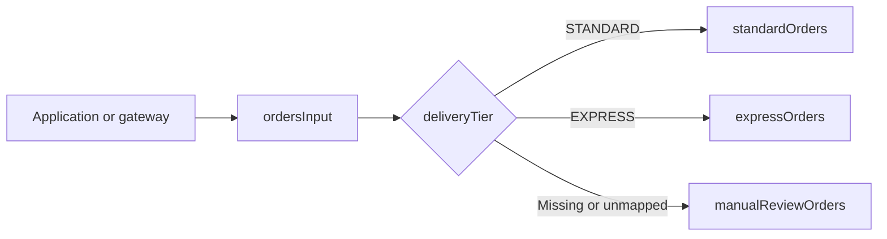

# Header-based routing

## 1. Objectives and context

In the **Router** chapter of **SPRING_INTEGRATION_CORE**, header-based routing lets you select a processing path based on message metadata. For example, the same order payload type can enter either a standard delivery flow or an express delivery flow depending on the `deliveryTier` header value.

This lesson connects the core building blocks of Spring Integration: `Message` carries data, `MessageChannel` connects steps, endpoints receive and process messages, and Java DSL describes how they are wired into a flow. Through an order routing example, you will learn how to:

- Distinguish header names, header values, routing keys, and channel names.
- Configure `HeaderValueRouter` with explicit mappings and Java DSL.
- Choose behavior for missing headers, unknown values, and misconfigured channels.
- Normalize headers with a header enricher, connect to a gateway, and handle errors.
- Write tests proving that messages arrive at the right branch and do not fall into other branches.

The primary scope is routing **by a single header's value**. Transformers, filters, and aggregators are mentioned only when clarifying responsibilities relative to the router.

## 2. What does a router read in a Message?

A `Message<T>` consists of a payload and headers:

```text
Message<ShippingOrder>
├── payload: ShippingOrder(orderId="OD-101", totalVnd=250000)
└── headers
    ├── deliveryTier = "EXPRESS"
    ├── traceId = "trace-101"
    └── framework-managed headers
```

The payload holds the business content. Headers supply supplemental information for processing, such as delivery tier, sender source, or trace ID. Headers are accessed by key name; `deliveryTier` and `DeliveryTier` are two different keys.

`MessageHeaders` exposes a `Map<String, Object>`-like interface, but does not allow modifying its structure directly. To add or change headers, use `MessageBuilder` or a header enricher step. The immutability of the message wrapper does not automatically make every object inside the payload or headers immutable. [Message Documentation](https://docs.spring.io/spring-integration/reference/message.html)

A header-based router decides **where to send the Message**. Under typical configuration, it does not convert `ShippingOrder` into another payload type and does not perform delivery business logic itself. When sequence headers are enabled, the router can produce messages carrying sequence metadata for the branches.

Comparison by responsibility:

| Component | Main question | Example in the order flow |
|---|---|---|
| Transformer | What shape should the data be converted into? | Convert JSON into `ShippingOrder` |
| Header enricher | Which metadata needs to be added or normalized? | Normalize `deliveryTier` |
| Filter | Should the message proceed? | Block invalid orders |
| Router | Which branch does the message enter? | Choose express or standard delivery |
| Service activator | Which action needs to be performed? | Call the shipping service |
| Aggregator | Which messages should be grouped into one batch? | Gather results from split branches |

Header routing fits well when multiple places need to share a classification decision. If the decision depends on multiple rules such as order value, address, and warehouse capacity, a business step can compute the routing key first; the router then simply maps that key to a channel.

## 3. Designing the header contract before configuring

The example throughout this lesson uses the following contract:

| Attribute | Convention |
|---|---|
| Header | `deliveryTier` |
| Data type accepted by the application | A single-valued `String` |
| Valid values | `STANDARD`, `EXPRESS` |
| Case-sensitive | Yes, before normalization |
| Unsupported values | Send to `manualReviewOrders` |
| Missing header | Send to `manualReviewOrders` |
| Internal channel names | Must not be treated as valid business values |
| Valid mapping pointing to nonexistent target channel | Raise configuration error |

Here `EXPRESS` is a **business value**, while `expressOrders` is a **channel bean name**. These two values do not need to match. Explicit mappings allow renaming channels without forcing producers to change the header contract.



The diagram illustrates the single-valued contract of the example. Output channels use queues so results can be observed. In a real application, each branch has a consumer carrying out the corresponding business logic.

## 4. How does HeaderValueRouter resolve targets?

`HeaderValueRouter` takes a header name in its constructor. It reads the value at that header and then uses `AbstractMappingMessageRouter`'s mapping mechanism to find the channel. You can route using business codes with mappings, or use channel names directly as header values when the application intentionally permits it. [Router Implementations](https://docs.spring.io/spring-integration/reference/router/implementations.html)

For a single-valued string header, the process can be pictured in five steps:

1. Read the `deliveryTier` header.
2. Look up the corresponding mapping, e.g. `EXPRESS → expressOrders`.
3. If there is no mapping, check whether the key itself is allowed as a channel name.
4. Resolve the selected channel name to a `MessageChannel`.
5. Send the message to the resolved targets; if there are no targets, check the default channel.

The two behaviors at step 3 and step 5 are different:

- `channelKeyFallback`: controls whether an unmapped key is tried as a channel name.
- `defaultOutputChannel`: where to send the message when no output channel was selected.

For example, with `channelKeyFallback=true`, a header `deliveryTier=expressOrders` can resolve to the `expressOrders` bean even without a mapping for that value. To keep the contract restricted to declared business codes, the example sets `channelKeyFallback=false`. The API also notes this setting helps avoid routing to unintended channels. [AbstractMappingMessageRouter API](https://docs.spring.io/spring-integration/api/org/springframework/integration/router/AbstractMappingMessageRouter.html)

This restricts **string** keys used for routing; validating input types and shapes still needs to be done at the system boundary, as shown in the normalization section below.

## 5. Complete example with Java configuration and Java DSL

### 5.1. Prerequisites for the example

The example uses Java 17 or later for `record` declarations, along with the `IntegrationFlow.from(...)` API and router configuration from Spring Integration 6.x. When applying it to another version line, consult the documentation matching your project's dependencies.

In a Spring Boot project that already has an appropriate parent or BOM managing versions, include the following dependencies:

```xml
<dependencies>
    <dependency>
        <groupId>org.springframework.boot</groupId>
        <artifactId>spring-boot-starter-integration</artifactId>
    </dependency>
    <dependency>
        <groupId>org.springframework.boot</groupId>
        <artifactId>spring-boot-starter-test</artifactId>
        <scope>test</scope>
    </dependency>
</dependencies>
```

The snippet above is a dependency block to add into an already version-managed Boot project, not a standalone `pom.xml`. Do not declare a separate Spring Integration version different from the selected dependency set without checking compatibility. Plain Spring projects can use `spring-integration-core` and JUnit Jupiter with project-managed compatible versions.

### 5.2. Flow configuration

```java
package example.integration;

import org.springframework.beans.factory.annotation.Qualifier;
import org.springframework.context.annotation.Bean;
import org.springframework.context.annotation.Configuration;
import org.springframework.integration.channel.DirectChannel;
import org.springframework.integration.channel.QueueChannel;
import org.springframework.integration.config.EnableIntegration;
import org.springframework.integration.dsl.IntegrationFlow;
import org.springframework.integration.router.HeaderValueRouter;
import org.springframework.messaging.MessageChannel;

@Configuration
@EnableIntegration
public class OrderRoutingConfiguration {

    public static final String DELIVERY_TIER = "deliveryTier";

    public record ShippingOrder(String orderId, long totalVnd) {
    }

    @Bean
    public MessageChannel ordersInput() {
        return new DirectChannel();
    }

    @Bean
    public QueueChannel standardOrders() {
        return new QueueChannel(100);
    }

    @Bean
    public QueueChannel expressOrders() {
        return new QueueChannel(100);
    }

    @Bean
    public QueueChannel manualReviewOrders() {
        return new QueueChannel(100);
    }

    @Bean
    public HeaderValueRouter deliveryTierRouter(
            @Qualifier("manualReviewOrders") QueueChannel reviewChannel) {

        HeaderValueRouter router = new HeaderValueRouter(DELIVERY_TIER);
        router.setChannelMapping("STANDARD", "standardOrders");
        router.setChannelMapping("EXPRESS", "expressOrders");
        router.setDefaultOutputChannel(reviewChannel);
        router.setChannelKeyFallback(false);
        router.setResolutionRequired(true);
        router.setSendTimeout(1_000L);
        return router;
    }

    @Bean
    public IntegrationFlow orderRoutingFlow(
            @Qualifier("ordersInput") MessageChannel input,
            HeaderValueRouter deliveryTierRouter) {

        return IntegrationFlow.from(input)
                .route(deliveryTierRouter)
                .get();
    }
}
```

Key parts of the configuration:

- `@EnableIntegration` registers the Spring Integration infrastructure for the plain Spring context used in the examples and tests.
- `ordersInput` is a `DirectChannel`: the router is invoked on the thread sending to this channel.
- Java DSL creates the endpoint connecting the input to the router. Creating a `HeaderValueRouter` bean alone without wiring it into a flow does not register a consumer on the input.
- Mappings keep business codes independent of channel bean names.
- The default branch receives messages that need review; it does not itself persist data or open a manual workflow.
- `resolutionRequired=true` keeps errors explicit if a mapping points to a nonexistent channel.
- `sendTimeout` bounds the wait time when the router sends to a timeout-capable channel, such as a full queue. It is not a timeout for the entire downstream business process.

The three `QueueChannel(100)` instances are bounded in-memory queues. They do not have workers of their own, do not persist across restarts, and have no consumers in the example. This is intentional so tests can pull messages from each branch. A consumer wired to a `QueueChannel` in a polling model needs a poller configured. [Message Channel Implementations](https://docs.spring.io/spring-integration/reference/channel/implementations.html)

If a branch's consumer is wired via `DirectChannel`, processing on that branch can run right inside the original send call. Thus, seeing `.route(...)` does not mean the flow has become asynchronous.

### 5.3. Sending and observing a message

```java
package example.integration;

import org.springframework.context.annotation.AnnotationConfigApplicationContext;
import org.springframework.integration.channel.QueueChannel;
import org.springframework.messaging.Message;
import org.springframework.messaging.MessageChannel;
import org.springframework.messaging.support.MessageBuilder;

public class HeaderRoutingDemo {

    public static void main(String[] args) {
        try (var context = new AnnotationConfigApplicationContext(
                OrderRoutingConfiguration.class)) {

            MessageChannel input = context.getBean(
                    "ordersInput", MessageChannel.class);
            QueueChannel express = context.getBean(
                    "expressOrders", QueueChannel.class);

            var order = new OrderRoutingConfiguration.ShippingOrder(
                    "OD-101", 250_000L);

            Message<OrderRoutingConfiguration.ShippingOrder> message =
                    MessageBuilder.withPayload(order)
                            .setHeader("deliveryTier", "EXPRESS")
                            .setHeader("traceId", "trace-101")
                            .build();

            if (!input.send(message)) {
                throw new IllegalStateException("Failed to send order");
            }

            Message<?> received = express.receive(1_000);
            if (received == null) {
                throw new IllegalStateException("Not received on EXPRESS branch");
            }

            System.out.println(received.getPayload());
            System.out.println(received.getHeaders().get("traceId"));
        }
    }
}
```

Expected result: the `expressOrders` branch receives order `OD-101`, and the `traceId` header remains `trace-101`. The router does not recalculate order totals and does not replace the payload with the `EXPRESS` value itself.

Completing `send()` in the example proves the message was placed into the target queue. It does not prove delivery succeeded. Knowing whether business processing finished requires a corresponding result or acknowledgment mechanism.

## 6. Java DSL variant reading headers with SpEL

If you want to declare mappings directly in the DSL, you can replace **the `orderRoutingFlow` method** in the example with the following method:

```java
@Bean
public IntegrationFlow orderRoutingFlow(
        @Qualifier("ordersInput") MessageChannel input) {

    return IntegrationFlow.from(input)
            .route("headers['deliveryTier']", router -> router
                    .channelMapping("STANDARD", "standardOrders")
                    .channelMapping("EXPRESS", "expressOrders")
                    .defaultOutputChannel("manualReviewOrders")
                    .channelKeyFallback(false)
                    .resolutionRequired(true)
                    .sendTimeout(1_000L))
            .get();
}
```

Keep the channel beans unchanged. When choosing this approach, you can remove the `deliveryTierRouter` bean because the flow configures its own expression router. The two approaches are alternative implementations for the same contract; do not register two flows consuming `ordersInput` simultaneously and expect both to receive every message.

`headers['deliveryTier']` is evaluated against the message and extracts the needed header. With DSL lambdas, pay attention to whether the overload receives the **payload** or the **Message**: a lambda accepting `ShippingOrder` cannot read headers unless it is given the message. [Message Routers in Java DSL](https://docs.spring.io/spring-integration/reference/dsl/java-routers.html)

This variant uses an expression-evaluating router, not an explicitly instantiated `HeaderValueRouter` object. If you need that specific router type for management or configuration testing, use the approach in section 5.

## 7. Missing headers, unknown values, and mapping errors

### 7.1. Behavior of the example configuration

The table below assumes no normalization step has been added yet and inputs follow the single-valued string type:

| `deliveryTier` header | Result | Explanation |
|---|---|---|
| `STANDARD` | `standardOrders` | Mapping exists |
| `EXPRESS` | `expressOrders` | Mapping exists |
| Missing header | `manualReviewOrders` | No target selected |
| `SAME_DAY` | `manualReviewOrders` | No mapping, does not try channel name |
| `express` | `manualReviewOrders` | Different from `EXPRESS` |
| ` EXPRESS ` | `manualReviewOrders` | This single string has not been trimmed |
| `expressOrders` | `manualReviewOrders` | Bean name exists, but there is no mapping for this key |
| `BROKEN`, if mapped to nonexistent `missingOrders` | Throws `MessagingException` | A channel name was selected but could not be resolved |

The last case shows that **having a default channel does not mean every error goes into that channel**. With `resolutionRequired=true`, failing to resolve a selected channel name is reported as an error.

### 7.2. Three options to understand together

| Option | Meaning | Value in the example |
|---|---|---|
| `channelKeyFallback` | When a mapping is missing, use the string key as a channel name? | `false` |
| `resolutionRequired` | Raise an error if a selected channel name cannot be resolved? | `true` |
| `defaultOutputChannel` | Where to send if no target could be selected? | `manualReviewOrders` |

Since Spring Integration 6.0, setting a default channel also switches `channelKeyFallback` to `false` if that option has not been set explicitly. The example still sets `false` directly to make the contract explicit. A configuration that has a default channel while explicitly setting both `channelKeyFallback=true` and `resolutionRequired=true` is rejected at initialization due to inconsistent semantics. [Common Router Parameters](https://docs.spring.io/spring-integration/reference/router/common-parameters.html)

If you choose `resolutionRequired=false`, unresolvable channel names are ignored; only when no targets remain at the end is the default channel considered. For a multi-target message, a single valid target can be enough to prevent the message from going to the default branch.

Therefore, do not lower `resolutionRequired` just to silence a misspelled bean name error. For this problem, `SAME_DAY` is data requiring review, whereas `EXPRESS → expresOrders` when the real bean is `expressOrders` is a configuration bug to fix.

Having no targets and no default channel can still make the router throw an error; `resolutionRequired=false` is not an instruction to drop messages. If business logic intentionally discards messages, you can configure the default to `nullChannel` while deciding how to track discarded cases. [HeaderValueRouter and no-target behavior](https://docs.spring.io/spring-integration/reference/router/implementations.html)

## 8. Normalizing and controlling input with a header enricher

There are two distinct policies to choose between explicitly:

- Strict contract: accept only exact `STANDARD` or `EXPRESS`.
- Normalized contract: accept surrounding whitespace and lowercase letters, then canonicalize to a standard code.

If you choose the second policy, add a helper method to `OrderRoutingConfiguration`:

```java
private static String canonicalTier(Object raw) {
    if (!(raw instanceof String text)) {
        return "UNSUPPORTED";
    }

    String normalized = text.trim().toUpperCase(java.util.Locale.ROOT);
    return switch (normalized) {
        case "STANDARD", "EXPRESS" -> normalized;
        default -> "UNSUPPORTED";
    };
}
```

Then replace the original flow method with the following version, still using the `deliveryTierRouter` bean:

```java
@Bean
public IntegrationFlow orderRoutingFlow(
        @Qualifier("ordersInput") MessageChannel input,
        HeaderValueRouter deliveryTierRouter) {

    return IntegrationFlow.from(input)
            .enrichHeaders(headers -> headers.headerFunction(
                    DELIVERY_TIER,
                    message -> canonicalTier(
                            message.getHeaders().get(DELIVERY_TIER)),
                    true))
            .route(deliveryTierRouter)
            .get();
}
```

The `true` parameter allows overwriting an existing header. Without overwriting enabled, a value such as `" express "` would remain unchanged, leaving the normalization result unused. This is an option on the header enricher step, independent of channel resolution options. [HeaderEnricherSpec API](https://docs.spring.io/spring-integration/api/org/springframework/integration/dsl/HeaderEnricherSpec.html)

This function restricts the output of the normalization step to three strings: `STANDARD`, `EXPRESS`, `UNSUPPORTED`. Under the chosen policy, a missing header, wrong type, or multi-value string all become `UNSUPPORTED` and go to the manual review branch. `" express "` becomes `EXPRESS`.

A header enricher is suited for creating new metadata before a processing step. Do not use `message.getHeaders().put(...)` to mutate an existing message. [Content Enricher — Header Enricher](https://docs.spring.io/spring-integration/reference/content-enrichment.html)

If you need to inspect the original value for diagnostics, record it at the boundary or store it under a separate header according to the application's data policy. After normalization, `deliveryTier` holds the canonical value and no longer preserves every character of the input string.

At HTTP or message broker boundaries, check explicitly whether the adapter maps external headers into internal headers. Names and data types of HTTP headers, broker properties, and Spring Message headers do not automatically share the same contract. Information used for authorization or tenant selection must be verified from a trusted context before feeding into routing decisions.

## 9. Do not assume HeaderValueRouter always has a single target

A single header name does not imply a single target channel. `HeaderValueRouter` supports comma-separated strings; for example, `STANDARD,EXPRESS` is split into multiple routing keys. This behavior is present in the Spring Integration 6.5.0 source code. [HeaderValueRouter source](https://github.com/spring-projects/spring-integration/blob/v6.5.0/spring-integration-core/src/main/java/org/springframework/integration/router/HeaderValueRouter.java)

With the original configuration in section 5:

```java
MessageBuilder.withPayload(order)
        .setHeader("deliveryTier", "STANDARD,EXPRESS")
        .build();
```

The message can reach both `standardOrders` and `expressOrders`. If changed to `STANDARD,UNKNOWN`, the `STANDARD` key resolves a target, while the unmapped key is skipped because `channelKeyFallback` is disabled; the default branch does not separately receive just the `UNKNOWN` part. The default channel is considered when the entire resolution process yields no targets. [Mapping and channel collection mechanism](https://github.com/spring-projects/spring-integration/blob/main/spring-integration-core/src/main/java/org/springframework/integration/router/AbstractMappingMessageRouter.java)

The mapping base class also supports several key forms beyond strings, including direct channel objects. Thus, `channelKeyFallback=false` does not replace input type validation. If the header is only allowed to be a single business code, restrict its type and allowed values as in the `canonicalTier` step in section 8.

For the order example, entering two fulfillment flows could cause duplicate processing. Normalizing `STANDARD,EXPRESS` to `UNSUPPORTED` preserves the single-route-per-order contract. If the business truly needs multiple targets, design that explicitly and choose an appropriate header name, such as `requestedChecks`.

When multiple branches need to send results to an aggregator, you can consider `applySequence=true` to add sequence order and group size metadata. This option defaults to `false`; it does not create an aggregator, does not gather results on its own, and does not turn sends to multiple channels into an atomic transaction. [apply-sequence parameter](https://docs.spring.io/spring-integration/reference/router/common-parameters.html)

## 10. Default channel vs. error handling

`manualReviewOrders` in the example is a **business routing branch**. It receives the order message itself when no route is selected. It is not `errorChannel`, and its payload does not automatically become an exception.

| Case | What is happening | Appropriate handling |
|---|---|---|
| Header has a new unsupported code | No business route exists yet | Manual review branch or explicit rejection rule |
| Mapping points to a nonexistent bean | Channel configuration error | Fix configuration; tests must catch it |
| Target is a `DirectChannel` with no subscriber | No consumer to receive | Connect an endpoint or check lifecycle |
| Target queue is full | Cannot send within allowed time | Define timeout, backpressure, and recovery mechanism |
| Branch handler throws an exception | Processing error after routing | Handle error according to thread and transaction boundaries |

With a `DirectChannel` input, router errors or errors in a synchronous branch can propagate back to the caller of `send()`. Simply attaching an `errorChannel` header does not automatically turn every exception in a direct send call into an error message.

When a consumer runs through Spring Integration's asynchronous infrastructure, such as a poller or appropriate executor, the error-handling mechanism can publish an `ErrorMessage` to a configured channel. You must configure and test the exact thread handoff point; you cannot infer error behavior from the router name alone. [Error Handling](https://docs.spring.io/spring-integration/reference/error-handling.html)

In the example, a successful enqueue followed later by a consumer failing to process the order are two separate events. A router having chosen the right route can still lead to a downstream business failure. Order state tracking and retries belong in the corresponding processing layer.

`ignoreSendFailures` does not mean trying a fallback route either. Ignoring send failures can leave some branches having received the message while another branch did not; that must be designed and observed explicitly when using multi-target routing.

## 11. Connecting with a messaging gateway

Business application code can use a gateway so it does not have to build a `Message` on every call. Example interface placed in a package scanned by Integration component scan:

```java
package example.integration;

import org.springframework.integration.annotation.MessagingGateway;
import org.springframework.messaging.handler.annotation.Header;
import org.springframework.messaging.handler.annotation.Payload;

@MessagingGateway(defaultRequestChannel = "ordersInput")
public interface ShippingGateway {

    void submit(
            @Payload OrderRoutingConfiguration.ShippingOrder order,
            @Header("deliveryTier") String deliveryTier);
}
```

In plain Spring configuration, add `@IntegrationComponentScan(basePackageClasses = ShippingGateway.class)` with import `org.springframework.integration.annotation.IntegrationComponentScan` so the gateway interface is discovered. Then inject `ShippingGateway` and call `submit(order, "EXPRESS")`.

`@Payload` identifies the main data; `@Header` places the second parameter into metadata. The router still applies the same contract as when sending a `Message` directly. The gateway hides the messaging API behind a business interface. [Messaging Gateways](https://docs.spring.io/spring-integration/reference/gateway.html)

A `void` method suits the example that only sends into a target queue. It does not guarantee the order has already been shipped, nor does it automatically make sending asynchronous. If request/reply is needed, you must design branches that produce replies and define timeouts; changing `void` to a return type without anything producing a reply will not complete that contract.

## 12. Testing routing behavior

The following test suite targets **the original configuration in section 5**, before adding the normalization in section 8. Each test method opens a fresh context so queued messages or altered mappings do not leak between cases.

The JUnit Jupiter libraries, including parameterized tests, are included in the test dependencies listed earlier. No router mocking is needed: the goal is to verify the endpoint, bean resolution, and real in-memory channels together.

```java
package example.integration;

import org.junit.jupiter.api.AfterEach;
import org.junit.jupiter.api.BeforeEach;
import org.junit.jupiter.api.Test;
import org.junit.jupiter.params.ParameterizedTest;
import org.junit.jupiter.params.provider.CsvSource;
import org.junit.jupiter.params.provider.ValueSource;
import org.springframework.context.annotation.AnnotationConfigApplicationContext;
import org.springframework.integration.channel.QueueChannel;
import org.springframework.integration.router.HeaderValueRouter;
import org.springframework.messaging.Message;
import org.springframework.messaging.MessageChannel;
import org.springframework.messaging.MessagingException;
import org.springframework.messaging.support.MessageBuilder;

import static org.junit.jupiter.api.Assertions.*;

class OrderRoutingTest {

    private AnnotationConfigApplicationContext context;
    private MessageChannel input;
    private QueueChannel standard;
    private QueueChannel express;
    private QueueChannel review;

    @BeforeEach
    void setUp() {
        context = new AnnotationConfigApplicationContext(
                OrderRoutingConfiguration.class);
        input = context.getBean("ordersInput", MessageChannel.class);
        standard = context.getBean("standardOrders", QueueChannel.class);
        express = context.getBean("expressOrders", QueueChannel.class);
        review = context.getBean("manualReviewOrders", QueueChannel.class);
    }

    @AfterEach
    void tearDown() {
        if (context != null) {
            context.close();
        }
    }

    @ParameterizedTest
    @CsvSource({
            "STANDARD, standardOrders",
            "EXPRESS, expressOrders"
    })
    void routesMappedValueToExactlyOneChannel(
            String tier, String targetChannelName) {

        Message<?> sent = message(tier);
        assertTrue(input.send(sent));

        QueueChannel target = context.getBean(
                targetChannelName, QueueChannel.class);
        Message<?> received = target.receive(0);

        assertNotNull(received);
        assertEquals(sent.getPayload(), received.getPayload());
        assertEquals("trace-test", received.getHeaders().get("traceId"));
        assertEquals(tier, received.getHeaders().get("deliveryTier"));
        assertAllQueuesEmpty();
    }

    @ParameterizedTest
    @ValueSource(strings = {
            "SAME_DAY", "express", " EXPRESS ", "expressOrders", ""
    })
    void sendsUnmappedValueToReview(String tier) {
        Message<?> sent = message(tier);
        assertTrue(input.send(sent));

        Message<?> received = review.receive(0);
        assertNotNull(received);
        assertEquals(sent.getPayload(), received.getPayload());
        assertAllQueuesEmpty();
    }

    @Test
    void sendsMissingHeaderToReview() {
        var order = new OrderRoutingConfiguration.ShippingOrder(
                "OD-MISSING", 100_000L);

        assertTrue(input.send(MessageBuilder.withPayload(order).build()));

        Message<?> received = review.receive(0);
        assertNotNull(received);
        assertEquals(order, received.getPayload());
        assertAllQueuesEmpty();
    }

    @Test
    void failsWhenMappedChannelDoesNotExist() {
        HeaderValueRouter router = context.getBean(HeaderValueRouter.class);
        router.setChannelMapping("BROKEN", "missingOrders");

        assertThrows(MessagingException.class,
                () -> input.send(message("BROKEN")));

        assertAllQueuesEmpty();
    }

    private Message<?> message(String tier) {
        return MessageBuilder.withPayload(
                        new OrderRoutingConfiguration.ShippingOrder(
                                "OD-TEST", 150_000L))
                .setHeader("deliveryTier", tier)
                .setHeader("traceId", "trace-test")
                .build();
    }

    private void assertAllQueuesEmpty() {
        assertNull(standard.receive(0));
        assertNull(express.receive(0));
        assertNull(review.receive(0));
    }
}
```

`receive(0)` does not wait. It fits here because the input is a `DirectChannel`, so routing and enqueuing complete before `send()` returns. This test avoids `Thread.sleep()` and makes no assumptions about another worker's schedule.

`assertAllQueuesEmpty()` is called **after taking the expected message**. As a result, the test catches both leftover duplicate messages on the right target and messages leaking into another branch. Asserting only that `send()` returns `true` does not prove the chosen route is correct.

When applying the normalization step, update expectations and add corresponding cases:

| Input after choosing the normalization policy | Expectation |
|---|---|
| `" express "` | Only `expressOrders` |
| `"standard"` | Only `standardOrders` |
| Missing header | Only `manualReviewOrders` |
| `"STANDARD,EXPRESS"` | Only `manualReviewOrders` |
| Header is a number or a channel object | Only `manualReviewOrders` |

If you replace the input with an `ExecutorChannel` or add polling before the router, wait for results with a bounded timeout or appropriate synchronization mechanism. Do not keep using an immediate check and conclude routing failed.

## 13. Diagnostics and operations

When a message takes the wrong branch, inspect along the actual chain of facts:

1. Does the header exist right before the router? Record the exact key name and data type.
2. Does the value contain whitespace, different casing, or multiple keys?
3. What are the active mappings? Does the target channel name match the right bean and type?
4. Do `channelKeyFallback` and `resolutionRequired` reflect the intended policy?
5. Did the router send successfully while the downstream consumer hasn't run yet, or did sending actually fail?

For each routing decision, you can log the route code, selected branch, order ID, and `traceId`. When creating metrics, use route codes with a bounded value set; do not use individual `orderId` values or arbitrary unknown header strings as metric labels because label cardinality will grow with data.

The default branch must be operated as a real part of the system: with an appropriate consumer or durable store, a person or process handling it, and backlog metrics. An in-memory `QueueChannel` only lets you observe routing in this lesson; the name `manualReviewOrders` does not create those capabilities by itself.

Do not infinitely retry mapping typos or out-of-contract headers. If there are retries at the shipping service call site, consider idempotency per order or business request to avoid creating duplicate shipments when the outcome of a prior attempt is unclear.

## 14. Key takeaways

Header-based routing separates the path-selection decision from executing the business work in each branch. A stable contract should use codes such as `STANDARD` and `EXPRESS`, then map them to internal channels.

The lesson's configuration lets missing or unsupported values go to a review branch while keeping errors explicit for mappings pointing to wrong channels. Normalizing and restricting input types helps preserve a single-route contract, especially when a router supports multiple keys or direct targets.

What tests must prove is **right destination, no extra destinations, required data preserved, and clear error behavior**. Verifying only that the router received the message or that `send()` succeeded is not enough to conclude the processing flow is correct.

## References

- [HeaderValueRouter API](https://docs.spring.io/spring-integration/api/org/springframework/integration/router/HeaderValueRouter.html): router class specialized in reading headers.
- [AbstractMappingMessageRouter API](https://docs.spring.io/spring-integration/api/org/springframework/integration/router/AbstractMappingMessageRouter.html): mapping, channel resolution, and fallback options.
- [Router Implementations](https://docs.spring.io/spring-integration/reference/router/implementations.html): how to configure the different router types.
- [Common Router Parameters](https://docs.spring.io/spring-integration/reference/router/common-parameters.html): default channel, sequence metadata, and send-error behavior.
- [Java DSL Message Routers](https://docs.spring.io/spring-integration/reference/dsl/java-routers.html): expression routers and DSL configuration.
- [Error Handling](https://docs.spring.io/spring-integration/reference/error-handling.html): synchronous errors and asynchronous error messages.

Unpinned reference/API pages may redirect to newer documentation branches. When bringing examples into a specific project, choose the documentation version matching your project's dependencies.