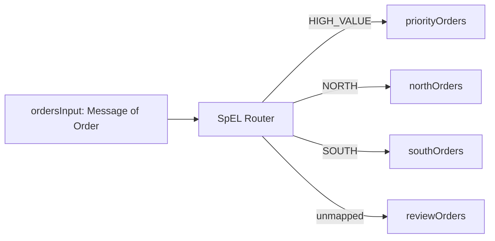

# SpEL-based routing

## 1. Objectives and scope

In the **Router** chapter of the **SPRING_INTEGRATION_CORE** module, this lesson shows how to use Spring Expression Language (SpEL) to decide which channel a message goes to. The content ties into the core building blocks: `Message`, `MessageChannel`, router endpoints, and Java DSL, while placing routing decisions within error handling and testing.

After this lesson, you will be able to:

- Read payload and headers from a router expression.
- Distinguish routing keys, channel names, and channel objects.
- Configure a default branch while still catching misdeclared channels.
- Route a message to one or multiple targets.
- Write tests verifying both the selected branch and the unselected branches.

The main example uses Java 17 or later and Spring Integration 6.5.x APIs. `spring-integration-core` is required; the testing section uses JUnit Jupiter and `spring-test`, or the test dependency set managed by Spring Boot. Use your project's compatible version set; the lesson does not require a specific Spring Boot version.

You should already know how to declare beans, send a `Message` to a channel, and tell `DirectChannel` apart from `QueueChannel`. The Java snippets below are illustrative code to drop into a practice project.

## 2. How does a router evaluate SpEL?

Suppose a system receives orders. High-value orders must go to a priority flow; remaining orders are routed by region. The router performs a decision chain:

```text
Message<Order>
    → evaluate expression
    → obtain routing key
    → look up mapping for key
    → resolve channel name to MessageChannel
    → send Message to target
```

The expression supplies **the result used to pick a target**. That result does not replace the payload as in a transformer. For example, if the expression returns `'NORTH'`, the forwarded payload is still the order object.

In a SpEL router, the root object is `Message`, so `payload` and `headers` can be accessed directly. Bean references use the `@beanName` syntax. This is the evaluation context provided by Spring Integration. [SpEL Context Documentation](https://docs.spring.io/spring-integration/reference/6.5/spel.html)

| Element | Meaning | Example |
| --- | --- | --- |
| `payload` | Input message's payload | `payload.total` |
| `headers` | Input message's headers | `headers['region']` |
| `#root` | Root object being evaluated | `#root.payload.total` |
| `'NORTH'` | String literal in SpEL | Business key `NORTH` |
| `@routingPolicy` | Bean named `routingPolicy` | `@routingPolicy.choose(payload)` |

If the payload is a JavaBean with `getTotal()`, `payload.total` reads the property via its getter. If the payload is a map, you can write `payload['total']` to make key-based lookup explicit.

A payload that is a JSON string does not automatically turn into the example's domain object. Convert JSON into `Order` before the router if you want to use `payload.total` per this lesson's contract.

## 3. Expression syntax to get right

### 3.1. Router expressions and string literals

In Java DSL:

```java
.route("headers['region']")
```

The outer Java string holds the SpEL expression. The inner single quotes denote the header key.

These two expressions have different meanings:

```text
payload.region       → reads the region property of payload
'payload.region'     → returns the literal string payload.region
```

The router's `expression` parameter and the `.route(String expression)` overload already accept a SpEL expression. Write `payload.total` directly; do not wrap it in `#{...}` as in some `@Value` usages.

### 3.2. Conditions and default values

```text
payload.total >= 10000000 ? 'HIGH_VALUE' : 'STANDARD'

headers['region'] ?: 'UNKNOWN'
```

The first expression uses the ternary operator. The second uses Elvis: it returns `'UNKNOWN'` when the header is missing or an empty string. Whitespace-only strings still need separate normalization. [Elvis Operator in SpEL](https://docs.spring.io/spring-framework/reference/core/expressions/language-ref/operator-elvis.html)

### 3.3. Safe navigation

If the contract allows the `region` header to be a string or absent, you can write:

```text
headers['region']?.trim() ?: 'UNKNOWN'
```

With another data model where `customer` and `address` may be absent:

```text
payload.customer?.address?.region ?: 'UNKNOWN'
```

Each step that can be `null` needs appropriate protection. `?.` does not fix misspelled property names and does not convert a wrong payload type into the right one. [Safe Navigation in SpEL](https://docs.spring.io/spring-framework/reference/core/expressions/language-ref/operator-safe-navigation.html)

The expressions above are separate design options. The next main example leaves the header unmodified so the input contract is easy to observe.

## 4. Return a business key or a channel name?

### 4.1. Return a key and map it

```java
.route("headers['region']", r -> r
    .channelMapping("NORTH", "northOrders")
    .channelMapping("SOUTH", "southOrders")
    .channelKeyFallback(false)
    .defaultOutputChannel("reviewOrders"))
```

This snippet assumes the channels are already declared. `NORTH` is a business key; `northOrders` is a channel bean name. Separating the two values allows restructuring the flow without forcing senders to know internal application bean names.

This is the approach the lesson uses for the complete example.

### 4.2. Return a channel name directly

Another router can accept channel names directly:

```java
.route("headers['targetChannel']")
```

With this router's default configuration, if the header is `northOrders`, the router tries to look up the corresponding channel in the application context. It does not create a new channel and does not automatically create a queue on a message broker.

This style fits when target identity is part of a controlled internal contract. If data arrives from external sources, keep a clearly mapped set of business keys.

Spring Integration supports both expressions returning keys to map and expressions returning channel names. [Routers with SpEL](https://docs.spring.io/spring-integration/reference/6.5/router/spel.html)

## 5. Complete example: routing orders

### 5.1. Business rules

The payload is `Order`; `total` represents an integer VND amount as a `long`. The `region` header is a delivery region string.

Apply the rules in order:

1. If `total >= 10_000_000`, pick `HIGH_VALUE`, regardless of region.
2. For remaining orders, use the `region` header.
3. Missing or empty header is represented by the `UNKNOWN` key.
4. Any key without a declared mapping goes to `reviewOrders`.

| Total amount | `region` header | SpEL result | Receiving channel |
| --- | --- | --- | --- |
| 12,000,000 | `NORTH` | `HIGH_VALUE` | `priorityOrders` |
| 10,000,000 | Missing | `HIGH_VALUE` | `priorityOrders` |
| 9,999,999 | `NORTH` | `NORTH` | `northOrders` |
| 500,000 | `SOUTH` | `SOUTH` | `southOrders` |
| 500,000 | `WEST` | `WEST` | `reviewOrders` |
| 500,000 | Missing | `UNKNOWN` | `reviewOrders` |
| 500,000 | Empty string | `UNKNOWN` | `reviewOrders` |
| 500,000 | `priorityOrders` | `priorityOrders` | `reviewOrders` |

The last row intentionally uses a real bean name that is not an allowed key. The result must still go to the review branch.



### 5.2. Java DSL configuration

Place the following class in the `example.integration` package of your practice project:

```java
package example.integration;

import org.springframework.context.annotation.Bean;
import org.springframework.context.annotation.Configuration;
import org.springframework.integration.channel.DirectChannel;
import org.springframework.integration.channel.QueueChannel;
import org.springframework.integration.config.EnableIntegration;
import org.springframework.integration.dsl.IntegrationFlow;

@Configuration
@EnableIntegration
public class SpelOrderRoutingConfiguration {

    @Bean
    public DirectChannel ordersInput() {
        return new DirectChannel();
    }

    @Bean
    public QueueChannel priorityOrders() {
        return new QueueChannel(100);
    }

    @Bean
    public QueueChannel northOrders() {
        return new QueueChannel(100);
    }

    @Bean
    public QueueChannel southOrders() {
        return new QueueChannel(100);
    }

    @Bean
    public QueueChannel reviewOrders() {
        return new QueueChannel(100);
    }

    @Bean
    public IntegrationFlow orderRoutingFlow() {
        String expression =
                "payload.total >= 10000000 ? 'HIGH_VALUE' : "
                + "(headers['region'] ?: 'UNKNOWN')";

        return IntegrationFlow.from("ordersInput")
                .route(expression, r -> r
                        .channelMapping("HIGH_VALUE", "priorityOrders")
                        .channelMapping("NORTH", "northOrders")
                        .channelMapping("SOUTH", "southOrders")
                        .channelKeyFallback(false)
                        .resolutionRequired(true)
                        .defaultOutputChannel("reviewOrders")
                        .sendTimeout(500))
                .get();
    }

    public static final class Order {

        private final String id;
        private final long total;

        public Order(String id, long total) {
            this.id = id;
            this.total = total;
        }

        public String getId() {
            return this.id;
        }

        public long getTotal() {
            return this.total;
        }
    }
}
```

`@EnableIntegration` enables Spring Integration infrastructure in plain Spring configuration. In a Spring Boot application with appropriate auto-configuration, this infrastructure is typically already enabled.

The output channels are `QueueChannel` instances so the exercise can pull messages out and inspect them. They store messages in memory. In a real application, attach consumers or downstream flows; the router succeeding in placing a message into a queue does not prove end-to-end business processing has finished.

`ordersInput` is a `DirectChannel`, so the router runs immediately on the sending thread. No poller is needed for the router in this example. If you change the router's input to a `QueueChannel`, configure a polling mechanism for the endpoint reading from it.

### 5.3. Sending a test message

Inside a method with `MessageChannel ordersInput` and `QueueChannel priorityOrders` injected:

```java
var order = new SpelOrderRoutingConfiguration.Order("OD-1001", 12_000_000L);

var message = org.springframework.integration.support.MessageBuilder
        .withPayload(order)
        .setHeader("region", "NORTH")
        .setHeader("traceId", "trace-1001")
        .build();

ordersInput.send(message);

org.springframework.messaging.Message<?> routed =
        priorityOrders.receive(1_000);
```

`routed` has order `OD-1001` as its payload. The `region=NORTH` header does not send the order to `northOrders`, because the high-value branch is checked first.

If you want to receive a business reply through a messaging gateway, design a processing branch that creates a reply and returns it through the proper reply mechanism. The router only chooses the path; selecting an output queue does not by itself produce a reply for a gateway call.

## 6. Default branch and channel resolution

These three options answer three different questions:

| Option | Question addressed |
| --- | --- |
| `channelKeyFallback` | If a key has no mapping, try using the key itself as a channel name? |
| `resolutionRequired` | If a channel name needs to be looked up and is not found, raise an error? |
| `defaultOutputChannel` | If no normal send target is determined, where should the message go? |

In this lesson's configuration:

- `WEST` has no mapping and `channelKeyFallback(false)`: does not look for a bean named `WEST`; the message goes to `reviewOrders`.
- `NORTH` has a mapping, but the target name is misspelled as `northOrderz`: `resolutionRequired(true)` makes sure the error is caught.
- Expression returns `null` or an empty target collection: there is no normal target, so the default branch is used.
- Expression accesses a nonexistent property: evaluation fails; this is not an unknown key to send to the default branch.

This distinction is based on two separate steps: choosing the target name, then resolving that name. You can examine the logic in [AbstractMappingMessageRouter](https://github.com/spring-projects/spring-integration/blob/v6.5.0/spring-integration-core/src/main/java/org/springframework/integration/router/AbstractMappingMessageRouter.java).

**Version note:** since Spring Integration 6.0, declaring a default output also sets `channelKeyFallback` to `false` if not explicitly configured. The example still declares `false` so the contract is easy to read. If you intentionally enable `channelKeyFallback(true)` alongside a default output, `resolutionRequired(false)` is required; combining a default output with both options set to `true` is rejected at initialization. [Common Router Parameters](https://docs.spring.io/spring-integration/reference/6.5/router/common-parameters.html)

Having no default output and no resolved send target results in a message delivery error. If business logic intentionally drops messages, `nullChannel` can be used; for orders with an unknown region, a review branch is usually more useful because data remains available for handling.

## 7. Configuring with XML or a router bean

### 7.1. Equivalent XML

This is the router definition part, assuming the named channels are already declared:

```xml
<int:router id="orderRouter"
            input-channel="ordersInput"
            expression="payload.total ge 10000000 ? 'HIGH_VALUE' : (headers['region'] ?: 'UNKNOWN')"
            channel-key-fallback="false"
            resolution-required="true"
            default-output-channel="reviewOrders">
    <int:mapping value="HIGH_VALUE" channel="priorityOrders"/>
    <int:mapping value="NORTH" channel="northOrders"/>
    <int:mapping value="SOUTH" channel="southOrders"/>
</int:router>
```

The `int` prefix must be declared for the `http://www.springframework.org/schema/integration` namespace in the XML document containing this snippet. The `ge` operator is equivalent to `>=`; using word operators also avoids XML escaping headaches when expressions contain comparison symbols.

### 7.2. ExpressionEvaluatingRouter

If you want to declare a router bean directly, you can **replace the `orderRoutingFlow` bean** with the following method in the same configuration class:

```java
@Bean
@org.springframework.integration.annotation.Router(inputChannel = "ordersInput")
public org.springframework.integration.router.ExpressionEvaluatingRouter orderRouter() {
    var router = new org.springframework.integration.router.ExpressionEvaluatingRouter(
            "payload.total >= 10000000 ? 'HIGH_VALUE' : "
            + "(headers['region'] ?: 'UNKNOWN')");

    router.setChannelMapping("HIGH_VALUE", "priorityOrders");
    router.setChannelMapping("NORTH", "northOrders");
    router.setChannelMapping("SOUTH", "southOrders");
    router.setChannelKeyFallback(false);
    router.setResolutionRequired(true);
    router.setDefaultOutputChannelName("reviewOrders");
    router.setSendTimeout(500);

    return router;
}
```

These three declaration styles are alternatives. Do not register multiple routers consuming the same `DirectChannel` simultaneously just to try all three syntaxes; that creates multiple subscribers and changes how incoming messages are distributed.

## 8. Returning multiple targets

An expression can return a collection. Suppose another flow already has channels `dispatchInput`, `fulfillmentOrders`, `auditOrders`, and `reviewOrders`:

```java
@Bean
public IntegrationFlow dispatchFlow() {
    return IntegrationFlow.from("dispatchInput")
            .route("headers['routeKeys']", r -> r
                    .channelMapping("FULFILL", "fulfillmentOrders")
                    .channelMapping("AUDIT", "auditOrders")
                    .channelKeyFallback(false)
                    .resolutionRequired(true)
                    .defaultOutputChannel("reviewOrders")
                    .applySequence(true))
            .get();
}
```

The sender sets the header:

```java
.setHeader("routeKeys", java.util.List.of("FULFILL", "AUDIT"))
```

The message is forwarded to both channels. A `List<String>` expresses a set of keys more cleanly than manual string concatenation. Collection return support is described in [Routers with SpEL](https://docs.spring.io/spring-integration/reference/6.5/router/spel.html).

With this configuration snippet:

| `routeKeys` value | Result |
| --- | --- |
| `["FULFILL", "AUDIT"]` | Sent to both mapped channels |
| `["FULFILL", "UNKNOWN"]` | Sent to `fulfillmentOrders`; the unknown key does not trigger an extra default send |
| `["UNKNOWN"]` | Goes to `reviewOrders` |
| Empty list or missing header | Goes to `reviewOrders` |

The default branch is chosen for the whole message when there are no normal targets, not as an extra branch per unknown key.

`applySequence(true)` instructs the router to attach sequence number and group size metadata to the sent messages; this is useful when an aggregator downstream uses its default correlation strategy. It does not create an aggregator or a wait mechanism. [apply-sequence parameter](https://docs.spring.io/spring-integration/reference/6.5/router/common-parameters.html)

Sending to multiple targets does not automatically create parallel processing or guarantee all-or-nothing success. Channel types and downstream configuration decide the execution model. If the payload is mutable, avoid letting branches mutate the same object; the `Order` in this lesson exposes only immutable state.

## 9. Distinguishing expression errors, routing errors, and downstream errors

| Situation | Failure point | How to handle |
| --- | --- | --- |
| Writing `payload.totla` | SpEL evaluation | Fix the expression, add test cases |
| Payload is a string while router expects `Order` | Data contract | Convert or validate type before the router |
| Unsupported region key | Mapping lookup | Route to the designed review branch |
| Mapping points to nonexistent channel | Target resolution | Fix wiring; keep configuration error reporting active |
| Target queue full past send timeout | Message send | Handle delivery error, tune capacity or consumption rate |
| Handler after a `DirectChannel` throws | Downstream execution | Handle at call boundary or flow error mechanism |

Setting `resolutionRequired(false)` does not make a broken expression valid. Setting a default output is not equivalent to `catch (Exception)` either.

`ignoreSendFailures` defaults to `false`. With a multi-target router, one failed send can prevent subsequent sends; enabling ignore-send-failures changes that behavior, but does not provide retries or rollbacks for targets that already received the message. [Behavior on send failure](https://docs.spring.io/spring-integration/reference/6.5/router/common-parameters.html)

In the main example, errors occurring while the router runs on `DirectChannel` propagate back to the `send()` caller. Simply setting an `errorChannel` header does not automatically turn every synchronous error into an error message. For processing via framework-managed executors or pollers, consider `ErrorMessage` publishing and the corresponding error handler. [Error Handling in Spring Integration](https://docs.spring.io/spring-integration/reference/6.5/error-handling.html)

Therefore, the `reviewOrders` branch is for undetermined business decisions, while technical errors need to be observed through the appropriate error-handling mechanism.

## 10. Testing the Java DSL example

Routing tests should verify both sides: the message appears at the right target and does not appear at other targets. Testing only the expression's return value misses broken mappings or miswired channels.

The class below uses the same package as the configuration in section 5. In addition to `spring-test`, JUnit Jupiter and the `junit-jupiter-params` module are needed if not already included in your test suite.

```java
package example.integration;

import java.util.List;
import java.util.stream.Stream;

import org.junit.jupiter.api.BeforeEach;
import org.junit.jupiter.api.Test;
import org.junit.jupiter.params.ParameterizedTest;
import org.junit.jupiter.params.provider.Arguments;
import org.junit.jupiter.params.provider.MethodSource;
import org.springframework.beans.factory.annotation.Autowired;
import org.springframework.beans.factory.annotation.Qualifier;
import org.springframework.integration.channel.QueueChannel;
import org.springframework.integration.support.MessageBuilder;
import org.springframework.messaging.Message;
import org.springframework.messaging.MessageChannel;
import org.springframework.messaging.MessagingException;
import org.springframework.test.context.junit.jupiter.SpringJUnitConfig;

import static org.junit.jupiter.api.Assertions.*;

@SpringJUnitConfig(SpelOrderRoutingConfiguration.class)
class SpelOrderRoutingConfigurationTest {

    @Autowired
    @Qualifier("ordersInput")
    MessageChannel input;

    @Autowired
    @Qualifier("priorityOrders")
    QueueChannel priority;

    @Autowired
    @Qualifier("northOrders")
    QueueChannel north;

    @Autowired
    @Qualifier("southOrders")
    QueueChannel south;

    @Autowired
    @Qualifier("reviewOrders")
    QueueChannel review;

    @BeforeEach
    void drainQueues() {
        for (QueueChannel queue : List.of(priority, north, south, review)) {
            while (queue.receive(0) != null) {
                // Clear any leftover data from the previous test.
            }
        }
    }

    static Stream<Arguments> routes() {
        return Stream.of(
                Arguments.of(12_000_000L, "NORTH", "priority"),
                Arguments.of(10_000_000L, null, "priority"),
                Arguments.of(9_999_999L, "NORTH", "north"),
                Arguments.of(500_000L, "SOUTH", "south"),
                Arguments.of(500_000L, "WEST", "review"),
                Arguments.of(500_000L, null, "review"),
                Arguments.of(500_000L, "", "review"),
                Arguments.of(500_000L, "priorityOrders", "review")
        );
    }

    @ParameterizedTest
    @MethodSource("routes")
    void routesToExactlyOneExpectedChannel(
            long total, String region, String expected) {

        var order = new SpelOrderRoutingConfiguration.Order("OD-test", total);
        var builder = MessageBuilder.withPayload(order)
                .setHeader("traceId", "trace-test");

        if (region != null) {
            builder.setHeader("region", region);
        }

        assertTrue(input.send(builder.build()));

        QueueChannel target = switch (expected) {
            case "priority" -> priority;
            case "north" -> north;
            case "south" -> south;
            case "review" -> review;
            default -> throw new IllegalArgumentException(expected);
        };

        Message<?> received = target.receive(1_000);
        assertNotNull(received);
        assertSame(order, received.getPayload());
        assertEquals("trace-test", received.getHeaders().get("traceId"));
        assertEquals(region, received.getHeaders().get("region"));

        // The receiving target must also have no extra deliveries.
        for (QueueChannel queue : List.of(priority, north, south, review)) {
            assertNull(queue.receive(0));
        }
    }

    @Test
    void rejectsPayloadThatDoesNotMatchTheExpressionContract() {
        Message<String> invalid = MessageBuilder.withPayload("not-an-order")
                .setHeader("region", "NORTH")
                .build();

        assertThrows(MessagingException.class, () -> input.send(invalid));

        for (QueueChannel queue : List.of(priority, north, south, review)) {
            assertNull(queue.receive(0));
        }
    }
}
```

The cases right at the `10_000_000` threshold and immediately below it catch bugs such as using `>` instead of `>=`. The `priorityOrders` case confirms a real bean name cannot bypass the allowed mapping set. The invalid-payload case confirms SpEL errors are not hidden by the default branch.

`receive(1_000)` bounds the test wait time. `receive(0)` checks the current queue state immediately; this check fits the example with a synchronous router. If you add an executor or poller, wait on a bounded condition before concluding a branch has no message.

This is illustrative test code for learners. This lesson does not claim the tests were executed in the current repository.

## 11. When should logic move out of SpEL?

SpEL fits when the rule is short and readable: reading a header, comparing a threshold, picking a key, or calling a policy bean.

When the decision must traverse multiple fields, handle several edge cases, or use nested conditions, the expression can call:

```text
@routingPolicy.choose(payload, headers['region'])
```

Then you must declare a bean named `routingPolicy` with a matching `choose` method. Have the method return a business key like `HIGH_VALUE` and keep the mappings in the flow configuration.

A practical rule of thumb: if you have to read an expression several times to tell which branch has priority, move the decision into a clearly named Java method and unit-test it separately.

Avoid updating databases or sending emails inside a routing decision method. When a flow is retried, branch selection may run again. Side-effect-free business logic keeps endpoints clear when processing and retry contracts are defined.

## 12. Coordinating with other components

| Component | Role in the order flow |
| --- | --- |
| Transformer | Convert JSON to `Order`, normalize data types before reading properties |
| Filter | Drop or reject invalid orders per the input policy |
| SpEL Router | Choose the processing branch based on available data |
| Service activator | Execute business work in each branch |
| Aggregator | Combine correlated results when the flow genuinely needs to wait on multiple branches |
| Messaging gateway | Provide a calling interface into the flow and a reply contract if any |

There is no need to cram every component into every flow. For the rules in this lesson, one router and output channels suffice to demonstrate the routing decision; transformers, filters, or aggregators are added when the business contract requires them.

## 13. Extended practice

Work on the main example:

1. Normalize `region` with `trim()`; specify clearly where whitespace-only strings should go.
2. Add a `CENTRAL → centralOrders` mapping, declare the corresponding channel, and add a test case.
3. Write a case with a high-value order having region `WEST` to verify priority order.
4. In a separate test configuration, point a mapping to a nonexistent channel name; observe the resolution error with `resolutionRequired(true)`.
5. Design a multi-target flow combining order processing and audit; explain what happens if one branch receives successfully while the other fails.

When finished, you should be able to explain why an unknown key can go to the review branch whereas getter errors, payload type errors, and wiring errors must still be caught.

## 14. References

- [Spring Integration 6.5 — Routers with SpEL](https://docs.spring.io/spring-integration/reference/6.5/router/spel.html): expressions, mappings, and multi-target results.
- [Spring Integration 6.5 — SpEL Support](https://docs.spring.io/spring-integration/reference/6.5/spel.html): payload, headers, and bean references.
- [Spring Integration 6.5 — Common Router Parameters](https://docs.spring.io/spring-integration/reference/6.5/router/common-parameters.html): default branch, channel resolution, and sequence metadata.
- [Spring Integration 6.5 — Error Handling](https://docs.spring.io/spring-integration/reference/6.5/error-handling.html): distinguishing synchronous flows and asynchronous error messages.
- [Spring Framework — Elvis](https://docs.spring.io/spring-framework/reference/core/expressions/language-ref/operator-elvis.html) and [safe navigation](https://docs.spring.io/spring-framework/reference/core/expressions/language-ref/operator-safe-navigation.html): syntax lookup; examples in this lesson only use operators already available in the Spring Framework 6.x line.
