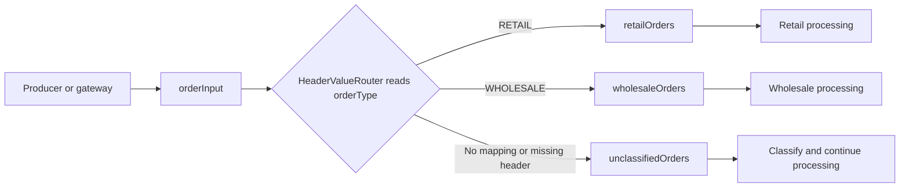

# HeaderValueRouter

## Objectives and scope

In the Router chapter of the SPRING_INTEGRATION_CORE module, this lesson shows how to use `HeaderValueRouter` to choose a processing branch based on the value of a message header. You will build an order flow using `Message`, `MessageChannel`, endpoints, and Java DSL; define the path when a header is missing or invalid; distinguish routing errors from target-branch errors; and write tests observing messages at each channel.

The examples use Java 17 and Spring Integration 6.5 APIs. The project needs the `org.springframework.integration:spring-integration-core` dependency; tests need `org.junit.jupiter:junit-jupiter` and a JUnit Platform runner setup. Use dependency versions aligned with the Spring Boot BOM or Spring Integration BOM already in your project.

Prerequisites: the structure of `Message<T>` consisting of payload and headers, how to declare Spring beans, and the difference between `DirectChannel` and `QueueChannel`. The exercise uses in-memory queues to observe results; no external broker is needed.

## 1. Problem statement: branching orders by metadata

A service receives orders from multiple sources. The payload holds the order ID; the `orderType` header describes the processing group:

| `orderType` value | Meaning in example | Receiving channel |
| --- | --- | --- |
| `RETAIL` | Retail order | `retailOrders` |
| `WHOLESALE` | Wholesale order | `wholesaleOrders` |
| Other value or missing header | Group undetermined | `unclassifiedOrders` |

An input message can be created as follows:

```java
Message<String> order = MessageBuilder.withPayload("ORDER-1001")
        .setHeader("orderType", "RETAIL")
        .setHeader("traceId", "trace-1001")
        .build();
```

`orderType` is a business key. `retailOrders` is a channel bean name in the application. Separating these two kinds of names keeps the sender from needing to know internal flow structure.



In this exercise, the three target channels are queues so learners can pull messages out and inspect them. The business handlers in the diagram are an extension step and are not yet attached to those queues.

## 2. What work does HeaderValueRouter perform?

`HeaderValueRouter` is a `MessageHandler` dedicated to routing. When creating the router, you pass **the name of the header to read**. Each header value is then checked against mappings to determine the target channel name. If configuration permits, the header value itself can also be used as a channel name. These two usages are described in [HeaderValueRouter documentation](https://docs.spring.io/spring-integration/reference/6.5/router/implementations.html#router-implementations-header-value-router).

Configuration example:

```java
HeaderValueRouter router = new HeaderValueRouter("orderType");
router.setChannelMapping("RETAIL", "retailOrders");
router.setChannelMapping("WHOLESALE", "wholesaleOrders");
```

Reading each part:

| Component | Value | Role |
| --- | --- | --- |
| `headerName` | `orderType` | Picks which header to read |
| Mapping key | `RETAIL` | Expected business value in the header |
| Mapping value | `retailOrders` | Channel name to look up in the context |
| Actual channel | Bean `retailOrders` | Object receiving the message |

Do not write `new HeaderValueRouter("RETAIL")` if you want to read the `orderType` header: that tells the router to look for a header named `RETAIL`.

In standard configurations, the router chooses where to send and does not transform the business content of the payload. If metadata normalization is needed, perform it before the routing step. If the payload structure needs changing, use a transformer at the appropriate place in the flow.

### Processing steps for a string header

1. Retrieve the value from `message.getHeaders().get("orderType")`.
2. If the value has a mapping, get the channel name from the mapping.
3. If there is no mapping and `channelKeyFallback=true`, try using that value as a channel name.
4. Resolve the channel name into a `MessageChannel` object.
5. Send the message to the determined targets; when no suitable target exists, handle via the default channel or raise an error.

The resolution mechanism is inherited from `AbstractMappingMessageRouter`; header extraction lives in [HeaderValueRouter 6.5.0 source](https://raw.githubusercontent.com/spring-projects/spring-integration/v6.5.0/spring-integration-core/src/main/java/org/springframework/integration/router/HeaderValueRouter.java).

## 3. Complete example with Java DSL

The configuration below creates an actual `HeaderValueRouter` instance and wires it into the flow via `.route(orderRouter)`. Bean names are explicitly declared so mappings do not depend on Java parameter or method naming nuances.

```java
package example.integration;

import org.springframework.beans.factory.annotation.Qualifier;
import org.springframework.context.annotation.Bean;
import org.springframework.context.annotation.Configuration;
import org.springframework.integration.channel.DirectChannel;
import org.springframework.integration.channel.QueueChannel;
import org.springframework.integration.config.EnableIntegration;
import org.springframework.integration.dsl.IntegrationFlow;
import org.springframework.integration.router.HeaderValueRouter;
import org.springframework.messaging.MessageChannel;

@Configuration(proxyBeanMethods = false)
@EnableIntegration
public class OrderRoutingConfig {

    @Bean
    public MessageChannel orderInput() {
        return new DirectChannel();
    }

    @Bean
    public QueueChannel retailOrders() {
        return new QueueChannel(20);
    }

    @Bean
    public QueueChannel wholesaleOrders() {
        return new QueueChannel(20);
    }

    @Bean
    public QueueChannel unclassifiedOrders() {
        return new QueueChannel(20);
    }

    @Bean
    public HeaderValueRouter orderRouter(
            @Qualifier("unclassifiedOrders") MessageChannel fallback) {
        HeaderValueRouter router = new HeaderValueRouter("orderType");
        router.setChannelMapping("RETAIL", "retailOrders");
        router.setChannelMapping("WHOLESALE", "wholesaleOrders");
        router.setChannelKeyFallback(false);
        router.setResolutionRequired(true);
        router.setDefaultOutputChannel(fallback);
        router.setSendTimeout(1_000);
        return router;
    }

    @Bean
    public IntegrationFlow orderRoutingFlow(
            @Qualifier("orderInput") MessageChannel input,
            HeaderValueRouter orderRouter) {
        return IntegrationFlow.from(input)
                .route(orderRouter)
                .get();
    }
}
```

`@EnableIntegration` registers Spring Integration infrastructure in standalone Java configuration. `IntegrationFlow` creates the endpoint connecting `orderInput` to the router handler. Creating the router object alone without attaching an endpoint does not cause the router to receive messages from the channel.

In the example:

- `channelKeyFallback=false` restricts routing to declared mapped keys.
- `resolutionRequired=true` preserves errors when a mapping points to a nonexistent channel name.
- `unclassifiedOrders` receives unclassified data.
- `sendTimeout` bounds the wait time when sending to a full queue; it does not bound total business processing time.

Passing a dedicated router into `.route(...)` is supported by [Java DSL for message routers](https://docs.spring.io/spring-integration/reference/6.5/dsl/java-routers.html).

### Test sending and reading results

You can use the following `main` class in the same package as the configuration:

```java
package example.integration;

import org.springframework.context.annotation.AnnotationConfigApplicationContext;
import org.springframework.integration.channel.QueueChannel;
import org.springframework.messaging.Message;
import org.springframework.messaging.MessageChannel;
import org.springframework.messaging.support.MessageBuilder;

public class OrderRoutingDemo {

    public static void main(String[] args) {
        try (var context = new AnnotationConfigApplicationContext(
                OrderRoutingConfig.class)) {
            MessageChannel input = context.getBean(
                    "orderInput", MessageChannel.class);
            QueueChannel retail = context.getBean(
                    "retailOrders", QueueChannel.class);
            QueueChannel unclassified = context.getBean(
                    "unclassifiedOrders", QueueChannel.class);

            input.send(MessageBuilder.withPayload("ORDER-1001")
                    .setHeader("orderType", "RETAIL")
                    .setHeader("traceId", "trace-1001")
                    .build());

            input.send(MessageBuilder.withPayload("ORDER-1002")
                    .setHeader("orderType", "PARTNER")
                    .build());

            Message<?> first = retail.receive(1_000);
            Message<?> second = unclassified.receive(1_000);
            if (first == null || second == null) {
                throw new IllegalStateException("Did not receive all messages");
            }

            System.out.println(first.getPayload());
            System.out.println(second.getPayload());
        }
    }
}
```

Expected output:

```text
ORDER-1001
ORDER-1002
```

The first order lands in the retail queue; the second lands in the unclassified queue. The printed output looks like a list of order IDs, but each ID was pulled from a different channel.

`QueueChannel` holds messages when there is no consumer; with the capacity constructor, send operations may wait when the queue is full. By default the queue stores in memory and does not spawn a background worker. See [MessageChannel implementations](https://docs.spring.io/spring-integration/reference/6.5/channel/implementations.html).

## 4. Three options governing behavior when no target is found

### 4.1. channelKeyFallback: use the key as a channel name?

When `channelKeyFallback=true`, an unmapped key can be interpreted as a channel name. For example, header `orderType=retailOrders` could go straight to the bean of the same name if that bean exists.

When `channelKeyFallback=false`, that header is just an unmapped key. The router does not look up the `retailOrders` bean from a value absent from the mappings.

In the order example, the second choice keeps the input contract tied to business codes. If the channel is later renamed to `retailOrdersV2`, senders still use `RETAIL`.

### 4.2. resolutionRequired: must name resolution errors be reported?

`resolutionRequired=true`, which is also the default, requires selected channel names to resolve to real channels. A misspelled mapping `RETAIL -> retialOrders` causes a `MessagingException` when handling a matching message.

`resolutionRequired=false` ignores unresolvable target names. If no targets remain at the end and a default channel is configured, the message can go to the default channel.

This option affects the **name resolution step**. It does not mean ignoring every exception thrown in the flow.

### 4.3. defaultOutputChannel: where to send when there is no target?

The default channel receives the message when no send target is determined from routing results. If there are no targets and no default channel, the router throws `MessageDeliveryException`.

Since Spring Integration 6.0, setting a default channel also sets `channelKeyFallback=false`, unless that option is explicitly specified. A configuration with a default channel alongside both `channelKeyFallback=true` and `resolutionRequired=true` is rejected at initialization. Details are in [Common router parameters](https://docs.spring.io/spring-integration/reference/6.5/router/common-parameters.html).

Thus, the example declares all three options explicitly so readers see the configuration intent. You should not infer that merely adding a default channel turns every router error into a fallback path.

### Outcome table for the main configuration

The table below assumes `channelKeyFallback=false`, `resolutionRequired=true`, and `unclassifiedOrders` configured:

| Situation | Outcome | Cause |
| --- | --- | --- |
| Header `RETAIL`, mapping and channel exist | `retailOrders` receives message | Valid target exists |
| Header `WHOLESALE`, mapping and channel exist | `wholesaleOrders` receives message | Valid target exists |
| Header `PARTNER`, not mapped | `unclassifiedOrders` receives message | Unknown key is not used as bean name |
| Missing `orderType` | `unclassifiedOrders` receives message | No key to choose a target |
| Header `retailOrders`, not mapped for this key | `unclassifiedOrders` receives message | Channel name does not automatically become a valid key |
| Header `retail` | `unclassifiedOrders` receives message | Different from `RETAIL` key |
| Header `RETAIL`, mapping points to nonexistent channel | Throws `MessagingException` | Resolution error must be reported |
| Target channel exists, but send fails | Send error propagates under default config | Target was found; this is a separate stage |

The table is a consequence of the chosen configuration, not a rule for every router. Mapping, resolution, and `null`-key skipping branches can be seen in [AbstractMappingMessageRouter 6.5.0 source](https://raw.githubusercontent.com/spring-projects/spring-integration/v6.5.0/spring-integration-core/src/main/java/org/springframework/integration/router/AbstractMappingMessageRouter.java).

### Two common policies

**Accept new data while catching configuration errors:** keep the main configuration. Unknown values go to the classification branch; wrong target names still surface deployment errors.

**Route resolution errors into the classification branch too:** keep `channelKeyFallback=false` and the default channel, and change to `setResolutionRequired(false)`. This requires monitoring the classification branch because a bean-renaming bug can look like unsupported data.

If you want any invalid header to fail the request, use explicit mappings, `channelKeyFallback=false`, and omit the default channel. `resolutionRequired=false` alone does not ensure a message is dropped when no targets match.

## 5. Equivalent configuration using annotations or expression DSL

### 5.1. Using @ServiceActivator on the router bean

In the main configuration, you can remove the `orderRoutingFlow` bean and add the annotation below onto the `orderRouter(...)` method:

```java
@Bean
@ServiceActivator(inputChannel = "orderInput")
public HeaderValueRouter orderRouter(
        @Qualifier("unclassifiedOrders") MessageChannel fallback) {
    HeaderValueRouter router = new HeaderValueRouter("orderType");
    router.setChannelMapping("RETAIL", "retailOrders");
    router.setChannelMapping("WHOLESALE", "wholesaleOrders");
    router.setChannelKeyFallback(false);
    router.setResolutionRequired(true);
    router.setDefaultOutputChannel(fallback);
    router.setSendTimeout(1_000);
    return router;
}
```

Add an import for `org.springframework.integration.annotation.ServiceActivator`. The annotation creates an endpoint receiving from `orderInput`; the returned bean object is still the router handler. This configuration is an alternative to the DSL flow in the main example. Registering both simultaneously creates an extra consumer on the same input and makes the flow structure differ from what is expected.

### 5.2. Using an expression in Java DSL

If you only need header-based routing behavior, you can declare the expression and mappings directly:

```java
@Bean
public IntegrationFlow orderRoutingFlow() {
    return IntegrationFlow.from("orderInput")
            .route("headers['orderType']", spec -> spec
                    .channelMapping("RETAIL", "retailOrders")
                    .channelMapping("WHOLESALE", "wholesaleOrders")
                    .channelKeyFallback(false)
                    .resolutionRequired(true)
                    .defaultOutputChannel("unclassifiedOrders"))
            .get();
}
```

This variant replaces the router bean and flow of the main example; keep the channel beans. `.route(String, ...)` uses an expression-evaluating router; it does not create a `HeaderValueRouter` just because the expression reads a header. To control the specialized class directly, use `.route(orderRouter)` as shown earlier. Fluent options are described in [RouterSpec 6.5.0 API](https://docs.spring.io/spring-integration/docs/6.5.0/api/org/springframework/integration/dsl/RouterSpec.html).

The `headers['orderType']` expression reads metadata of the whole message. If switching to a lambda, pick an overload accepting `Message` explicitly; a payload-receiving lambda will not have a `getHeaders()` method.

## 6. Designing the header contract

### Normalizing at the intake boundary

For this problem, the recommended contract is an `orderType` of type `String`, uppercase, and without commas. Values `RETAIL`, `retail`, and ` RETAIL ` should not be treated as equivalent unless an application-defined normalization step exists.

Example normalization before building the message:

```java
import java.util.Locale;
import org.springframework.messaging.Message;
import org.springframework.messaging.support.MessageBuilder;

public class OrderMessages {

    public static Message<String> create(String orderId, String rawType) {
        if (rawType == null || rawType.isBlank()) {
            throw new IllegalArgumentException("Missing orderType");
        }

        String orderType = rawType.trim().toUpperCase(Locale.ROOT);
        if (!orderType.matches("[A-Z_]+")) {
            throw new IllegalArgumentException("Invalid orderType format");
        }

        return MessageBuilder.withPayload(orderId)
                .setHeader("orderType", orderType)
                .build();
    }
}
```

This is an additional policy of the intake layer: missing headers are rejected early. The router in the main example still keeps a default branch to serve other producers and codes that are format-valid but unmapped, such as `PARTNER`.

In a flow that has already received a message, you can place a header enricher or equivalent check step before the router. Whether to accept new codes or reject immediately should be decided consistently at the system boundary.

### Do not use routing metadata as authorization proof

If clients send the `orderType` header themselves, a client picking `WHOLESALE` does not prove the client is authorized to create wholesale orders. The intake layer must authenticate and check permissions before attaching or accepting this metadata.

Disabling `channelKeyFallback` restricts interpreting unmapped string keys as channel names. You still need to validate header types and values at the input; that option does not replace a data contract or access control checks.

## 7. One header can lead to multiple targets

In `HeaderValueRouter` 6.5, a comma-containing string is split into multiple keys. For example, `orderType=RETAIL,WHOLESALE` can make the router send to both mapped branches. Therefore, a contract where one order belongs to only one group must strip commas or validate allowed values before the router. String-splitting behavior is visible in [HeaderValueRouter source](https://raw.githubusercontent.com/spring-projects/spring-integration/v6.5.0/spring-integration-core/src/main/java/org/springframework/integration/router/HeaderValueRouter.java).

Sending to multiple targets does not split the payload into separate orders. Branches receive the same business data. If the payload is a mutable object, one branch mutating it can affect the other branch; design immutable payloads or copy when business logic requires.

When you need to fan out to multiple branches and then gather results, you can enable:

```java
router.setApplySequence(true);
```

This option adds correlation and sequence metadata to the messages sent to branches, supporting compatible aggregator strategies. It does not create an aggregator, does not wait for results, and does not turn multi-target sends into an atomic transaction. See [base class AbstractMessageRouter](https://raw.githubusercontent.com/spring-projects/spring-integration/v6.5.0/spring-integration-core/src/main/java/org/springframework/integration/router/AbstractMessageRouter.java).

If the first branch succeeds and the next branch fails, retrying the whole message may repeat side effects in the first branch. For orders, define an idempotency key per order ID or event ID. If the requirement is primarily selecting multiple recipients according to independent conditions, `RecipientListRouter` usually expresses that intent more clearly.

## 8. Distinguishing the default branch from error handling

In the example, `unclassifiedOrders` is the branch receiving the **original business message** when the order type could not be determined. `errorChannel` serves the error flow and typically receives an `ErrorMessage` whose payload is an exception. The two kinds of messages need different handling.

| Situation | Appropriate handling in the example design |
| --- | --- |
| Order has new group code `PARTNER` | `unclassifiedOrders`, enrich info or update rules |
| Mapping misspells bean name | Report configuration error via exception |
| Retail handler fails calling an external service | Retry and recovery policy of the handler/entry point |
| Payload missing required field | Validate data before business processing |
| Classification queue is full | Timeout policy, backpressure, and queue monitoring |

With `DirectChannel`, the handler runs on the sender's thread; errors can propagate back out of the `send` call. Merely adding an `errorChannel` header does not automatically turn every synchronous error into an error message. Only when processing runs via a Spring Integration-managed poller or executor does asynchronous error publishing play its corresponding role. See [Spring Integration error handling](https://docs.spring.io/spring-integration/reference/6.5/error-handling.html).

`ignoreSendFailures` is a different option from `resolutionRequired`. With its default value `false`, send failures are not ignored. Do not turn it on just to make every message look successful; decide explicitly which branches may fail and how the system will recover.

If you expose a gateway for submitting orders while branches only store into queues, you can use a method returning `void`. A gateway returning a result will need an actual reply path from the processing branches; the router and queues do not generate business replies on their own.

## 9. Testing with observable channels

The `OrderRoutingConfig` configuration has a synchronous input and target queues, so routing can be tested without `Thread.sleep`, a broker, or mocking the router. Each test below opens its own context so leftover messages or mapping changes from earlier tests do not linger.

Place the test class in the same package as the main configuration:

```java
package example.integration;

import org.junit.jupiter.api.AfterEach;
import org.junit.jupiter.api.BeforeEach;
import org.junit.jupiter.api.Test;
import org.springframework.context.annotation.AnnotationConfigApplicationContext;
import org.springframework.integration.channel.QueueChannel;
import org.springframework.integration.router.HeaderValueRouter;
import org.springframework.messaging.Message;
import org.springframework.messaging.MessageChannel;
import org.springframework.messaging.MessagingException;
import org.springframework.messaging.support.MessageBuilder;

import static org.junit.jupiter.api.Assertions.*;

class OrderRoutingTest {

    private AnnotationConfigApplicationContext context;
    private MessageChannel input;
    private QueueChannel retail;
    private QueueChannel wholesale;
    private QueueChannel unclassified;
    private HeaderValueRouter router;

    @BeforeEach
    void openContext() {
        context = new AnnotationConfigApplicationContext(OrderRoutingConfig.class);
        input = context.getBean("orderInput", MessageChannel.class);
        retail = context.getBean("retailOrders", QueueChannel.class);
        wholesale = context.getBean("wholesaleOrders", QueueChannel.class);
        unclassified = context.getBean("unclassifiedOrders", QueueChannel.class);
        router = context.getBean("orderRouter", HeaderValueRouter.class);
    }

    @AfterEach
    void closeContext() {
        context.close();
    }

    private Message<String> order(String type) {
        return MessageBuilder.withPayload("ORDER-1001")
                .setHeader("orderType", type)
                .setHeader("traceId", "trace-1001")
                .build();
    }

    @Test
    void routesRetailAndPreservesBusinessData() {
        assertTrue(input.send(order("RETAIL")));

        Message<?> actual = retail.receive(1_000);
        assertNotNull(actual);
        assertEquals("ORDER-1001", actual.getPayload());
        assertEquals("RETAIL", actual.getHeaders().get("orderType"));
        assertEquals("trace-1001", actual.getHeaders().get("traceId"));
        assertNull(wholesale.receive(0));
        assertNull(unclassified.receive(0));
    }

    @Test
    void routesWholesaleOnlyToItsBranch() {
        assertTrue(input.send(order("WHOLESALE")));

        Message<?> actual = wholesale.receive(1_000);
        assertNotNull(actual);
        assertEquals("ORDER-1001", actual.getPayload());
        assertNull(retail.receive(0));
        assertNull(unclassified.receive(0));
    }

    @Test
    void routesUnknownValueToDefault() {
        assertTrue(input.send(order("PARTNER")));

        Message<?> actual = unclassified.receive(1_000);
        assertNotNull(actual);
        assertEquals("PARTNER", actual.getHeaders().get("orderType"));
        assertNull(retail.receive(0));
        assertNull(wholesale.receive(0));
    }

    @Test
    void routesMissingHeaderToDefault() {
        assertTrue(input.send(MessageBuilder.withPayload("ORDER-1002").build()));

        Message<?> actual = unclassified.receive(1_000);
        assertNotNull(actual);
        assertEquals("ORDER-1002", actual.getPayload());
        assertNull(retail.receive(0));
        assertNull(wholesale.receive(0));
    }

    @Test
    void doesNotTreatUnmappedValueAsChannelName() {
        assertTrue(input.send(order("retailOrders")));

        assertNotNull(unclassified.receive(1_000));
        assertNull(retail.receive(0));
        assertNull(wholesale.receive(0));
    }

    @Test
    void reportsMissingMappedChannel() {
        router.setChannelMapping("RETAIL", "missingRetailOrders");

        assertThrows(MessagingException.class,
                () -> input.send(order("RETAIL")));
        assertNull(unclassified.receive(0));
        assertNull(retail.receive(0));
        assertNull(wholesale.receive(0));
    }

    @Test
    void usesDefaultWhenResolutionFailureIsExplicitlyIgnored() {
        router.setChannelMapping("RETAIL", "missingRetailOrders");
        router.setResolutionRequired(false);

        assertTrue(input.send(order("RETAIL")));
        assertNotNull(unclassified.receive(1_000));
        assertNull(retail.receive(0));
        assertNull(wholesale.receive(0));
    }
}
```

These tests observe the flow's contract: the right target receives the message, other targets do not, and business metadata is preserved. The channel error test separates configuration bugs from data with unknown keys. The last test illustrates the policy of ignoring resolution errors via an intentional configuration change.

`receive(0)` returns immediately when a queue has no message. In this configuration, the router step has already finished before `input.send(...)` returns, so the remaining queues can be checked immediately. If you replace the input with an executor-backed channel, tests must wait on a bounded condition instead of keeping synchronous assumptions.

You can add the following cases when extending the exercise:

| Test case | What to verify |
| --- | --- |
| Header `retail` or ` RETAIL ` | Does it pass through a normalization step before routing? |
| Header `RETAIL,WHOLESALE` | Does the single-group contract block choosing multiple targets? |
| Remove default channel, send `PARTNER` | Is the message not silently lost when no target matches? |
| Target channel is a `DirectChannel` without a subscriber | Distinguish finding the channel from sending successfully |
| Target queue is full | Does the timeout match order intake requirements? |

## 10. Common errors and how to diagnose them

| Symptom | What to inspect | How to fix |
| --- | --- | --- |
| All messages go to the default branch | Actual header name, type, and value | Inspect headers at the router input; compare against contract |
| `RETAIL` works, but `retail` does not | Case-normalization rules | Normalize at intake or add mappings per policy |
| Channel resolution failure | Bean names in mapping, prefix/suffix if any | Fix mapping or declare bean with the right name |
| Added fallback, but app fails at startup | Combination of fallback and both flags `true` | Choose a consistent configuration policy |
| Added fallback, yet broken mapping still throws | `resolutionRequired` is `true` | Keep it to catch errors or change policy explicitly |
| Message reaches an unexpected channel | `channelKeyFallback` and header source | Disable using keys as channel names, validate input data |
| Order appears in two branches | Value contains comma or multiple keys | Constrain format if only one group is allowed |
| Send succeeds, but business work hasn't run | Target channel is a queue without a consumer | Attach an endpoint with a poller or suitable consumer |
| Classified orders pile up and vanish on restart | Default queue only stores in memory | Choose durable storage per business requirements |

When investigating, log the message ID or order ID, `traceId`, `orderType` value, branch name, and handling reason. Monitoring the rate of orders going to the unclassified branch and queue depth helps distinguish new business codes from a stopped consumer. Avoid logging full payloads unless needed for diagnostics.

## 11. Extended practice

1. Add an `EXPORT` group and an `exportOrders` queue; keep producers sending business codes instead of bean names. Verify the two existing groups still route to their right branches.
2. Create a message with header `orderType=exportOrders` without a mapping for that key. Under the current policy, the message must go to the unclassified branch.
3. Add a normalization step before the router and verify ` retail ` becomes `RETAIL`. Define clearly whether missing headers are rejected at intake or routed to the default branch.
4. Intentionally misspell the channel for the `EXPORT` group; compare `resolutionRequired=true` vs. `false`. Observe both the exception and the default queue.
5. Attach a consumer to the unclassified branch to record the order ID and the reason extra information is needed. Decide when the order is reclassified and how to avoid duplicate processing.

You have completed the exercise when you can explain the path of every input group, prove unrelated branches receive no messages, and distinguish an unsupported header value from a misconfigured channel name.