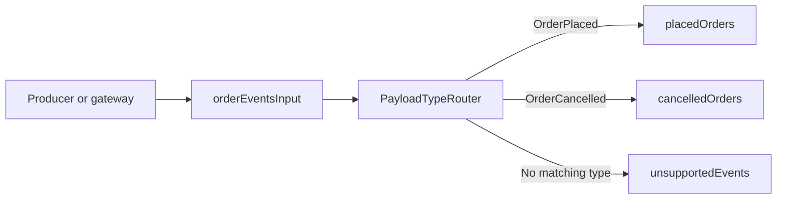
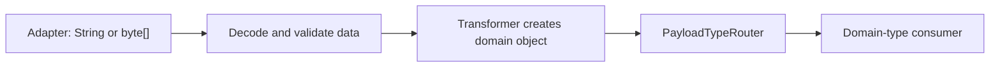

# PayloadTypeRouter

## 1. Objectives and use cases

In the **SPRING_INTEGRATION_CORE** module, this lesson belongs to the **Router** chapter and focuses on choosing a processing branch based on the Java type of the payload. After this lesson, you can configure `PayloadTypeRouter`, wire the router to an endpoint with Java DSL, handle unsupported types, and write tests for routing decisions.

Suppose an application receives order events on the same channel:

- `OrderPlaced`: route to the order recording flow.
- `OrderCancelled`: route to the order cancellation flow.
- Unsupported event type: route to a dedicated intake branch for tracking.

The producer only needs to send `Message<?>` to the input channel. The router's mapping table determines the target channel corresponding to each payload type. When adding an event type, you can add a mapping and a consumer for that branch.



The diagram shows target selection. If a mapping exists but the target channel is misconfigured, the router can raise an error; that situation does not automatically go into `unsupportedEvents`.

## 2. Which part of a Message does the router look at?

A message consists of a payload and headers:

```text
Message<OrderPlaced>
├── payload: OrderPlaced(...)
└── headers: id, timestamp, traceId, ...
```

The object being classified is `message.getPayload()`. The type of the outer wrapper, such as `GenericMessage`, is not the routing key. Business fields such as order total or cancellation reason do not participate in `PayloadTypeRouter`'s decision either.

For example, these two payloads have the same type:

```java
new OrderPlaced("ORD-100", new BigDecimal("120000"));
new OrderPlaced("ORD-101", new BigDecimal("9000000"));
```

They go into the same `OrderPlaced` branch under the same router configuration. To separate high-value and low-value orders, you need a router that evaluates business values, or a classification step before the router.

The core configuration maps **fully qualified Java type name → channel name**:

```java
router.setChannelMapping(
        OrderPlaced.class.getName(),
        "placedOrders");
```

The channel name is used by the channel resolver, typically corresponding to a `MessageChannel` bean in the Spring context. Registering with `setChannelMapping` and attaching a router instance to Java DSL are illustrated in [Spring Integration Router Implementations](https://docs.spring.io/spring-integration/reference/router/implementations.html).

| Component | Responsibility in the flow |
|---|---|
| `Message` | Carries data and processing context |
| Input channel | Receives messages from producers and passes them to the endpoint |
| Endpoint | Connects message reception to the router handler |
| `PayloadTypeRouter` | Chooses targets based on payload type and mapping table |
| Output channel | Delivers messages to consumers or holds them waiting to be received |
| Branch consumer | Executes corresponding business logic |

The router does not automatically deserialize JSON and does not turn a `String` into an event object. If the payload is JSON text, the observed type is still `String`; if an adapter produces `byte[]` or `Map`, the router observes those exact types. A transformer or boundary conversion configuration is needed to build the domain type before routing.

## 3. How a matching type is chosen

### 3.1. Not just exact class matching

`PayloadTypeRouter` takes inheritance and interfaces into account. When multiple mappings can apply, the router finds the closest matching type according to its algorithm.

For example:

| Payload | Active mappings | Result |
|---|---|---|
| `Integer` | `Integer`, `Number` | Selects `Integer` mapping |
| `Integer` | Only `Number` | Selects `Number` mapping |
| `Double` | `Integer`, `Number` | Selects `Number` mapping |
| `String` | `Integer`, `Number` | No matching type mapping found |

Therefore, adding a more specific mapping can shift messages to a new branch even while the superclass mapping remains. Exact-match and superclass-match cases are covered in [the official PayloadTypeRouter test suite, version 6.5.0](https://github.com/spring-projects/spring-integration/blob/v6.5.0/spring-integration-core/src/test/java/org/springframework/integration/router/PayloadTypeRouterTests.java).

### 3.2. Interfaces and ambiguous cases

You should not interpret the algorithm as an absolute rule that "every superclass takes priority over every interface". A directly implemented interface can take precedence over a superclass further up the type hierarchy.

Points to keep in mind when designing mappings:

1. An exact runtime-class mapping has high priority.
2. If there is no exact-class mapping, ancestor types and interfaces can be candidates.
3. If multiple candidates tie for the best match, the router reports an ambiguity error instead of picking by declaration order.

Example of a structure prone to ambiguity:

```java
interface Auditable {}
interface Billable {}

final class InvoiceEvent implements Auditable, Billable {}
```

If both `Auditable` and `Billable` are mapped, an `InvoiceEvent` can match two direct interfaces with equal weight. The clear fix is adding a dedicated mapping for `InvoiceEvent`, or redesigning the branching criteria.

The fitness-scoring, tie-detection, and single-key return algorithm is implemented in [PayloadTypeRouter 6.5.0 source](https://github.com/spring-projects/spring-integration/blob/v6.5.0/spring-integration-core/src/main/java/org/springframework/integration/router/PayloadTypeRouter.java).

### 3.3. One branch is selected, not broadcast to every mapping

A payload `Integer` matching both `Integer` and `Number` does not mean the message is sent to both branches. The router picks the best-matching mapping.

If the requirement is for one event to reach both accounting and auditing simultaneously, design a multi-recipient broadcast step, such as `PublishSubscribeChannel` or `RecipientListRouter`. Do not use overlapping interfaces to simulate multi-branch broadcasting.

## 4. Complete example with Java DSL

The example uses the `IntegrationFlow.from(...)` API, Java 17 or later for `record` types, and compatible Spring dependencies managed by your project's BOM. The application part needs `spring-integration-core` and Spring context. The testing part below also needs `spring-test`, JUnit Jupiter, and the corresponding test engine.

Spring Boot is not required to run this configuration. If your project already uses Boot and `spring-boot-starter-integration`, keep your project's dependency management instead of mixing standalone Spring versions.

### 4.1. Configuration and event types

Save the example in `PayloadTypeRoutingConfig.java`:

```java
package example.integration;

import java.math.BigDecimal;

import org.springframework.beans.factory.annotation.Qualifier;
import org.springframework.context.annotation.Bean;
import org.springframework.context.annotation.Configuration;
import org.springframework.integration.channel.DirectChannel;
import org.springframework.integration.channel.QueueChannel;
import org.springframework.integration.config.EnableIntegration;
import org.springframework.integration.dsl.IntegrationFlow;
import org.springframework.integration.router.PayloadTypeRouter;
import org.springframework.messaging.MessageChannel;

@Configuration
@EnableIntegration
public class PayloadTypeRoutingConfig {

    public record OrderPlaced(String orderId, BigDecimal total) {}

    public record OrderCancelled(String orderId, String reason) {}

    @Bean
    public DirectChannel orderEventsInput() {
        return new DirectChannel();
    }

    @Bean
    public QueueChannel placedOrders() {
        return new QueueChannel(100);
    }

    @Bean
    public QueueChannel cancelledOrders() {
        return new QueueChannel(100);
    }

    @Bean
    public QueueChannel unsupportedEvents() {
        return new QueueChannel(100);
    }

    @Bean
    public PayloadTypeRouter orderEventRouter(
            @Qualifier("unsupportedEvents") MessageChannel unsupported) {

        PayloadTypeRouter router = new PayloadTypeRouter();
        router.setChannelMapping(
                OrderPlaced.class.getName(), "placedOrders");
        router.setChannelMapping(
                OrderCancelled.class.getName(), "cancelledOrders");

        router.setChannelKeyFallback(false);
        router.setResolutionRequired(true);
        router.setDefaultOutputChannel(unsupported);
        router.setSendTimeout(1000);
        return router;
    }

    @Bean
    public IntegrationFlow orderEventRouting(
            @Qualifier("orderEventsInput") MessageChannel input,
            PayloadTypeRouter orderEventRouter) {

        return IntegrationFlow.from(input)
                .route(orderEventRouter)
                .get();
    }
}
```

Decisions in the configuration:

- `@EnableIntegration` provides Spring Integration infrastructure when running plain Spring configuration.
- Input `DirectChannel` delivers messages to the router on the calling thread.
- The three output `QueueChannel` beans let the example observe messages with `receive(...)`.
- `Class.getName()` produces exact keys, even for records nested inside the configuration class.
- `resolutionRequired=true` keeps channel name resolution errors detectable.
- `unsupportedEvents` is the target when no matching type mapping exists.
- `sendTimeout=1000` bounds how long the router waits when sending to a full queue; it does not bound the consumer's business processing time.

The queues in this lesson are result-collection points for practice. To process business work, you need consumers reading from the queues, usually via polling endpoints; messages in a queue are not processed automatically. By default queues store in memory. Characteristics of `QueueChannel` and `DirectChannel` are described in [Message Channel Implementations](https://docs.spring.io/spring-integration/reference/channel/implementations.html).

### 4.2. Sending and receiving a message

The following class uses the exact configuration above:

```java
package example.integration;

import java.math.BigDecimal;
import java.util.Objects;

import org.springframework.context.annotation.AnnotationConfigApplicationContext;
import org.springframework.integration.channel.QueueChannel;
import org.springframework.messaging.MessageChannel;
import org.springframework.messaging.support.MessageBuilder;

import example.integration.PayloadTypeRoutingConfig.OrderPlaced;

public class RoutingDemo {

    public static void main(String[] args) {
        try (var context = new AnnotationConfigApplicationContext(
                PayloadTypeRoutingConfig.class)) {

            MessageChannel input =
                    context.getBean("orderEventsInput", MessageChannel.class);
            QueueChannel placed =
                    context.getBean("placedOrders", QueueChannel.class);

            var event = new OrderPlaced(
                    "ORD-100", new BigDecimal("120000"));

            var message = MessageBuilder.withPayload(event)
                    .setHeader("traceId", "trace-100")
                    .build();

            input.send(message);

            var received = Objects.requireNonNull(placed.receive(0));
            System.out.println(received.getPayload());
            System.out.println(received.getHeaders().get("traceId"));
        }
    }
}
```

Output of the two print statements:

```text
OrderPlaced[orderId=ORD-100, total=120000]
trace-100
```

In this configuration, the router does not enable `applySequence` and has no message transformation step. The payload along with the `traceId` header is forwarded to the target channel. You should not equate that with a guarantee that every component in a flow always preserves the message ID: transformers, interceptors, or constructing a new message can alter that property.

## 5. Unsupported types, wrong channels, and send failures

There are three distinct questions during processing:

1. Is there a mapping matching the payload type?
2. Does the channel name in the mapping resolve to a `MessageChannel`?
3. Is the message sent and processed successfully on the selected channel?

These questions correspond to different error situations. You should not rely on a single property expecting it to govern all of them.

### 5.1. No type mapping found

With the configuration in section 4, sending a `String` payload:

```java
input.send(MessageBuilder.withPayload("unsupported event").build());
```

There is no mapping for `String` or a matching ancestor type, so the message is sent to `unsupportedEvents`.

If you omit the default output channel and still have no matching mapping, the router has nowhere to send and throws `MessageDeliveryException`. Merely setting `resolutionRequired=false` is not an instruction to automatically drop messages when there is no target.

The "fail when no target and no default" contract, as well as using `NullChannel` when intentionally discarding messages, is specified in [AbstractMessageRouter 6.5.0](https://github.com/spring-projects/spring-integration/blob/v6.5.0/spring-integration-core/src/main/java/org/springframework/integration/router/AbstractMessageRouter.java).

### 5.2. Mapping exists, but target channel does not exist

Suppose a configuration mistake was made:

```java
router.setChannelMapping(
        OrderPlaced.class.getName(), "placedOrdersTypo");
```

The router finds the mapping for `OrderPlaced`, but cannot resolve `placedOrdersTypo`.

- With `resolutionRequired=true`: the resolution error is preserved; the default branch does not mask this error.
- With `resolutionRequired=false`: the unresolvable target is skipped; if no targets remain and a default output channel is configured, the message can go to the default branch.

Thus, in the main example, new unsupported payloads are captured separately while misspelled channel names are surfaced. These two situations have different operational meanings.

### 5.3. Channel exists, but sending fails

A `DirectChannel` with no subscriber, a queue full past the send timeout, or a consumer throwing an exception are issues at the send/processing stage.

`resolutionRequired` does not handle these errors. Nor does the router automatically move a message to the default output channel just because the consumer on the selected target threw an error.

The `ignoreSendFailures` property relates to send errors, but enabling it can hide failures and is not a business recovery mechanism. Keep the default and design an explicit error flow before considering ignoring send failures.

### 5.4. Outcome table for common configurations

The table assumes the default channel, when present, exists and can receive messages.

| Situation | `resolutionRequired` | Default | Behavior |
|---|---|---|---|
| Mapping and channel valid | `true` or `false` | Present or absent | Sent to mapped channel |
| No matching type mapping | Any | Present | Sent to default |
| No matching type mapping | Any | Absent | No target, raises error |
| Mapping exists, wrong channel name | `true` | Present or absent | Raises resolution error |
| Mapping exists, wrong channel name | `false` | Present | Drops invalid target, sends to default |
| Mapping exists, wrong channel name | `false` | Absent | No target remains, raises error |
| Target selected, but consumer errors | Any | Present or absent | Follows endpoint/channel error mechanism; does not fall back to default |

The mapping resolution mechanism and `resolutionRequired` live in [AbstractMappingMessageRouter 6.5.0](https://github.com/spring-projects/spring-integration/blob/v6.5.0/spring-integration-core/src/main/java/org/springframework/integration/router/AbstractMappingMessageRouter.java).

### 5.5. Understanding channelKeyFallback properly

`channelKeyFallback` is a common option of mapping routers: when an unmapped key appears, the base class can use that key as a channel name.

Specifically for `PayloadTypeRouter`, type lookup primarily relies on the types registered in the mapping table. You should not infer that merely creating a channel bean named `java.lang.String` will make the router automatically route every `String` payload there when no type mapping exists.

The main example explicitly turns off `channelKeyFallback` to show the intent of using the mapping table. In APIs since Spring Integration 6.0, configuring a default output channel also interacts with this option; when fallback is not explicitly set, setting a default disables key fallback. Do not intentionally enable a default output channel together with both `channelKeyFallback=true` and `resolutionRequired=true`: that combination is rejected at initialization. See [AbstractMappingMessageRouter API](https://docs.spring.io/spring-integration/api/org/springframework/integration/router/AbstractMappingMessageRouter.html).

## 6. Attaching a router with annotations

The Java DSL in section 4 registers an endpoint to receive messages from `orderEventsInput`. Annotations can be used to do the same thing.

If choosing the annotation approach, remove the `orderEventRouting` bean in section 4 and replace the router-creating method with the one below. Keep the channel beans and event types unchanged:

```java
@Bean
@ServiceActivator(inputChannel = "orderEventsInput")
public PayloadTypeRouter orderEventRouter(
        @Qualifier("unsupportedEvents") MessageChannel unsupported) {

    PayloadTypeRouter router = new PayloadTypeRouter();
    router.setChannelMapping(
            OrderPlaced.class.getName(), "placedOrders");
    router.setChannelMapping(
            OrderCancelled.class.getName(), "cancelledOrders");
    router.setChannelKeyFallback(false);
    router.setResolutionRequired(true);
    router.setDefaultOutputChannel(unsupported);
    router.setSendTimeout(1000);
    return router;
}
```

Add the import:

```java
import org.springframework.integration.annotation.ServiceActivator;
```

`@ServiceActivator` here binds an existing handler bean to the input channel. Declaring `@Bean PayloadTypeRouter` alone without an endpoint or DSL consuming from the channel will not cause the router to pull messages from the channel.

Use one endpoint registration style for the same purpose. Keeping both DSL and annotation on the same `DirectChannel` creates competing consumers and makes the flow structure differ from the single-input-router example.

## 7. Limitations to anticipate

### 7.1. JSON must be converted to a domain type first

Consider an external message with the content:

```json
{
  "type": "OrderPlaced",
  "orderId": "ORD-100",
  "total": 120000
}
```

The `type` field in JSON does not automatically become the Java type of the payload. If the payload is `String`, the `OrderPlaced.class.getName()` mapping does not match.

A sensible flow is:



If branching on the `type` field right on parsed data, use a content-evaluating router. If the application has already normalized data into `OrderPlaced` and `OrderCancelled`, type-based routing is cleaner.

### 7.2. Generics cannot be distinguished by type arguments

Two variables declared as `List<OrderPlaced>` and `List<OrderCancelled>` can both hold payloads whose runtime class is `ArrayList`. Because of type erasure, the router cannot use source-code generic type arguments to tell the two cases apart.

Design options:

- Create two distinct wrapper types, such as `PlacedOrderBatch` and `CancelledOrderBatch`.
- Put classification metadata in a header and use `HeaderValueRouter`.
- Use a splitter before the router if each element needs independent routing.

The router does not inspect elements inside a collection to determine the inner event type.

### 7.3. Proxies and inheritance structure affect matching

Because target selection relies on runtime types and type hierarchies, library-generated proxies or subclasses can change how matching behaves. Mapping via a stable interface can help, provided you avoid overlapping general interfaces and add tests for actual runtime types at application boundaries.

Refactoring classes, changing packages, or altering interfaces can also change what a mapping table means. Prefer `Class.getName()` in Java configuration and re-verify string-based mappings in external configuration.

## 8. Synchronous vs. asynchronous errors

With a `DirectChannel` input and an `input.send(message)` call as in the example, errors in the router propagate back to the calling thread. Attaching an `errorChannel` header does not turn this synchronous call into a general error-catching mechanism.

When a flow moves to asynchronous processing via an executor or polling endpoint, errors must be captured by the corresponding execution mechanism. Spring Integration infrastructure can build an `ErrorMessage` and send it to the channel specified in the `errorChannel` header or the global error channel, depending on the component and configuration.

A gateway also has its own error propagation policy; read the gateway configuration when producers call through a gateway rather than calling `send` directly. Rules regarding calling threads and error channels are described in [Error Handling](https://docs.spring.io/spring-integration/reference/error-handling.html).

The `unsupportedEvents` branch in this lesson receives original messages whose types had no matching mapping. It is not an error channel and does not automatically receive exceptions from downstream consumers.

When adding real consumers, distinguish between:

| Observed event | Meaning |
|---|---|
| Message arrives at `unsupportedEvents` | Data has a type not yet supported by the router |
| Channel resolution exception | Mapping table or Spring context has a configuration error |
| Exception in business consumer | Target was selected, but business processing failed |
| Enqueue to queue succeeds | Message has been accepted into the queue; business work may not have run yet |

The router does not provide exactly-once processing guarantees for the entire flow. If retries or redeliveries come from an external source, consumers need a deduplication strategy suited to the business logic.

## 9. Testing routing decisions

What must be verified is that **the message actually arrives at the right channel**, while unselected branches receive no message. Checking only the return value of `send(...)` is not enough to confirm the router's decision.

The test class below uses the Java DSL configuration from section 4. Place it in the same package `example.integration`:

```java
package example.integration;

import java.math.BigDecimal;

import org.junit.jupiter.api.BeforeEach;
import org.junit.jupiter.api.Test;

import org.springframework.beans.factory.annotation.Autowired;
import org.springframework.beans.factory.annotation.Qualifier;
import org.springframework.beans.factory.support.DefaultListableBeanFactory;
import org.springframework.integration.channel.QueueChannel;
import org.springframework.integration.router.PayloadTypeRouter;
import org.springframework.messaging.Message;
import org.springframework.messaging.MessageChannel;
import org.springframework.messaging.MessagingException;
import org.springframework.messaging.support.MessageBuilder;
import org.springframework.test.context.junit.jupiter.SpringJUnitConfig;

import example.integration.PayloadTypeRoutingConfig.OrderCancelled;
import example.integration.PayloadTypeRoutingConfig.OrderPlaced;

import static org.junit.jupiter.api.Assertions.*;

@SpringJUnitConfig(PayloadTypeRoutingConfig.class)
class PayloadTypeRoutingTest {

    @Autowired
    @Qualifier("orderEventsInput")
    MessageChannel input;

    @Autowired
    @Qualifier("placedOrders")
    QueueChannel placed;

    @Autowired
    @Qualifier("cancelledOrders")
    QueueChannel cancelled;

    @Autowired
    @Qualifier("unsupportedEvents")
    QueueChannel unsupported;

    @BeforeEach
    void clearOutputs() {
        drain(placed);
        drain(cancelled);
        drain(unsupported);
    }

    private static void drain(QueueChannel channel) {
        while (channel.receive(0) != null) {
            // Clear remaining results so each test is independent.
        }
    }

    @Test
    void placedEventGoesOnlyToPlacedChannel() {
        var payload = new OrderPlaced(
                "ORD-100", new BigDecimal("120000"));
        Message<?> message = MessageBuilder.withPayload(payload)
                .setHeader("traceId", "trace-100")
                .build();

        assertTrue(input.send(message));

        Message<?> result = placed.receive(0);
        assertNotNull(result);
        assertEquals(payload, result.getPayload());
        assertEquals("trace-100", result.getHeaders().get("traceId"));
        assertNull(cancelled.receive(0));
        assertNull(unsupported.receive(0));
    }

    @Test
    void cancelledEventGoesOnlyToCancelledChannel() {
        var payload = new OrderCancelled(
                "ORD-101", "Customer requested");
        input.send(MessageBuilder.withPayload(payload).build());

        Message<?> result = cancelled.receive(0);
        assertNotNull(result);
        assertEquals(payload, result.getPayload());
        assertNull(placed.receive(0));
        assertNull(unsupported.receive(0));
    }

    @Test
    void unknownTypeGoesToDefaultChannel() {
        var payload = "undecoded event";
        input.send(MessageBuilder.withPayload(payload).build());

        Message<?> result = unsupported.receive(0);
        assertNotNull(result);
        assertEquals(payload, result.getPayload());
        assertNull(placed.receive(0));
        assertNull(cancelled.receive(0));
    }

    @Test
    void exactTypeWinsAndSuperclassRemainsFallback() {
        var numberOutput = new QueueChannel(10);
        var integerOutput = new QueueChannel(10);
        var beanFactory = new DefaultListableBeanFactory();
        beanFactory.registerSingleton("numbers", numberOutput);
        beanFactory.registerSingleton("integers", integerOutput);

        var router = new PayloadTypeRouter();
        router.setBeanFactory(beanFactory);
        router.setChannelMapping(
                Number.class.getName(), "numbers");
        router.setChannelMapping(
                Integer.class.getName(), "integers");
        router.afterPropertiesSet();

        router.handleMessage(
                MessageBuilder.withPayload(42).build());

        Message<?> integerResult = integerOutput.receive(0);
        assertNotNull(integerResult);
        assertEquals(42, integerResult.getPayload());
        assertNull(numberOutput.receive(0));

        router.handleMessage(
                MessageBuilder.withPayload(2.5d).build());

        Message<?> numberResult = numberOutput.receive(0);
        assertNotNull(numberResult);
        assertEquals(2.5d, numberResult.getPayload());
        assertNull(integerOutput.receive(0));
    }

    @Test
    void missingMappedChannelFailsEvenWithDefault() {
        var fallback = new QueueChannel(10);
        var router = new PayloadTypeRouter();
        router.setBeanFactory(new DefaultListableBeanFactory());
        router.setChannelMapping(
                OrderPlaced.class.getName(), "missingPlacedChannel");
        router.setChannelKeyFallback(false);
        router.setResolutionRequired(true);
        router.setDefaultOutputChannel(fallback);
        router.afterPropertiesSet();

        var message = MessageBuilder.withPayload(
                new OrderPlaced("ORD-102", BigDecimal.TEN))
                .build();

        assertThrows(
                MessagingException.class,
                () -> router.handleMessage(message));

        assertNull(fallback.receive(0));
    }
}
```

The first three tests run through the endpoint registered in the Spring context. The last two tests construct standalone routers to observe type-selection rules and channel-resolution policy without changing the main flow's configuration.

Using `receive(0)` fits this example: the input is a `DirectChannel`, the router delivers to the queues before the synchronous call completes, and the output queues have no competing consumers. If you add an executor or polling consumer, you need a bounded wait and an appropriate observation point; you cannot assume the immediate check remains valid.

Cases to add when extending the application:

| Case | What to verify |
|---|---|
| Two direct interfaces with equal fitness | Reports ambiguity; does not randomly pick one branch |
| Adding a specific mapping alongside a superclass mapping | Only the specific type shifts to the new branch |
| Payload is a JSON `String` | Does not accidentally match a domain-object mapping |
| No mapping and no default | Reports no target |
| Channel exists by name, but has no consumer | Surfaces send error appropriate for the channel type |
| Switching to an executor or poller | Errors are observed via the configured asynchronous mechanism |

This is test code for learners to bring into a practice project; presenting the code does not mean these tests were run in your project environment.

## 10. Choosing a router by requirement

| Requirement | Suitable component / approach |
|---|---|
| `OrderPlaced` and `OrderCancelled` have separate processing flows | `PayloadTypeRouter` |
| Same `OrderPlaced` type, branching by total amount | Router using an expression or business method |
| Branching by `eventType` header | `HeaderValueRouter` |
| One event needs to reach multiple branches | `RecipientListRouter` or `PublishSubscribeChannel`, depending on how recipients are chosen |
| Let only valid messages proceed | Filter |
| Convert JSON into a domain type | Transformer or adapter conversion |
| Split a list, then route each element | Splitter followed by router |
| Combine messages by business group | Aggregator with appropriate correlation and release strategies |

In Java DSL, a lambda returning `payload.getClass()` can handle branching by exact class. However, do not assume every lambda-based router shares the same implementation as `PayloadTypeRouter`. If you need closest-type selection across an inheritance hierarchy, use `PayloadTypeRouter` directly as shown here and test the desired rules.

Similarly, `PayloadTypeRouter` does not gather results from branches. If the problem requires combining multiple replies, design a multi-branch dispatch step and an aggregator with appropriate correlation headers.

## 11. Quick diagnostics

| Symptom | What to check first |
|---|---|
| Every message lands on the default branch | Actual runtime type of payload; whether mapping table uses exact fully qualified names |
| JSON has `type=OrderPlaced` but misses the order branch | Whether payload is already `OrderPlaced` or still `String`, `Map`, `byte[]` |
| Messages start failing after adding an interface | Whether two mappings have equal fitness weight |
| Router bean exists, but messages bypass it | Whether the DSL or annotation endpoint registered on the right input channel |
| Messages occasionally bypass the expected router | Whether there is a competing consumer on the input `DirectChannel` |
| Default does not receive messages when a channel name is misspelled | Whether `resolutionRequired` is `true` |
| Enqueue succeeds, but business logic has not run | Whether a consumer or polling endpoint is pulling from the queue |
| Exception propagates to producer despite `errorChannel` | Whether calling synchronously via `DirectChannel` or through error-publishing infrastructure |
| Package rename broke mappings | Whether string-based config keys still match the class names |

When observing, log the payload type name and the message correlation ID. Only log payload contents when there is a business reason and data is appropriately sanitized. The rate of messages reaching the unsupported branch is also a useful signal for catching data contract mismatches between producer and consumer.

## 12. Practice exercises

1. Add an `OrderPaid(String orderId, String paymentId)` record, a `paidOrders` channel, and the corresponding mapping. Verify the new event goes only to the payment branch.
2. Remove the `OrderCancelled` mapping. Keep the default output channel and verify cancellation messages go to `unsupportedEvents`.
3. Restore the mapping, then change the target channel name to an unregistered name. Verify the synchronous call fails when `resolutionRequired=true`.
4. Switch `resolutionRequired` to `false` in step 3's scenario. Verify the default branch receives the message and explain why this can hide configuration errors.
5. Use `Number` and `Integer` to test that the specific mapping takes precedence. Then send a `Double` and verify the superclass mapping still takes effect.
6. Create a class implementing two marker interfaces directly, map both interfaces, and observe the ambiguity error. Add an exact-class mapping to resolve it.
7. Send a JSON string describing `OrderPlaced`. Compare against sending an `OrderPlaced` instance to verify the router looks at the actual Java type.

The completion criterion is being able to explain why each target received its message, why each error occurred, and why the remaining branches received nothing. When deploying in an application, keep routing decisions separate from business processing so mapping tables remain easy to test and evolve.