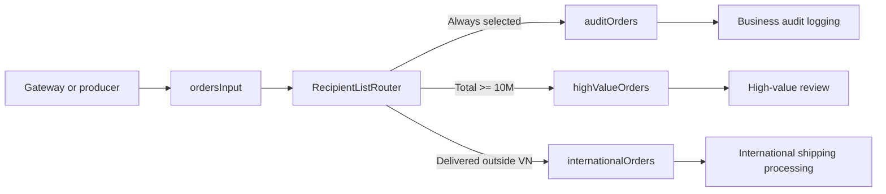

# RecipientListRouter

## 1. Problem statement: one message needs to reach multiple matching branches

In the Router chapter of **SPRING_INTEGRATION_CORE**, `RecipientListRouter` solves the problem of selecting a list of recipients for each message. This is an implementation of the **Recipient List** integration pattern: a single event may concern multiple departments, and each department only receives events meeting its own condition.

For example, when receiving an order:

- Every order must go to the business audit logging branch.
- Orders with a total of 10 million VND or more must go to the high-value review branch.
- Orders delivered outside Vietnam must go to the international processing branch.

An order that is both high-value and international must be forwarded to all three branches. If the system only picked the first matching target, it would miss the work of the remaining branches.

After this lesson, you will be able to:

- Explain how `RecipientListRouter` combines recipients and selectors.
- Build a Java DSL flow that sends the same message to multiple `MessageChannel`s.
- Determine behavior when no recipient matches or when sending to one branch fails.
- Use `applySequence` appropriately when results need to be aggregated later.
- Test the selected branch set, boundary conditions, and impact of individual branch failures.

## 2. How do recipients and selectors work?

A **recipient** is a destination configured on the router, optionally paired with a `MessageSelector`. The selector inspects the message and returns `true` or `false`.

For an incoming message, picture the router building the list as follows:

```text
configured recipients
    -> evaluate each recipient's condition
    -> collect targets whose condition is true
    -> send message to selected targets
```

A recipient without a selector is always selected. The router evaluates conditions independently; one matching condition does not stop other recipients from being evaluated.

| Recipient | Condition | Meaning |
|---|---|---|
| `auditOrders` | No selector | Receives every order |
| `highValueOrders` | `total >= 10_000_000` | Receives high-value orders |
| `internationalOrders` | `destinationCountry != VN` | Receives international orders |

A recipient is a destination configuration, not necessarily corresponding to a user or an external application. The target is typically a `MessageChannel`; behind the channel can be a transformer, service activator, outbound adapter, or another integration flow.

### Distinguishing from similar options

| Component | How targets are determined | When appropriate |
|---|---|---|
| Key-to-channel mapping router | One value determines the target, such as order type | Classifying an order into one specific processing route |
| `RecipientListRouter` | A list of recipients with independent conditions | One message needs to reach multiple branches based on content or headers |
| `PublishSubscribeChannel` | Sends to registered subscribers | Subscribers all need to receive every message entering the channel |
| Filter | Decides whether a message proceeds or is dropped | Only an accept/drop decision on one route is needed |
| Splitter | Splits one message into multiple parts | Payload holds a collection of items needing separate processing |

Another router can also return multiple targets. The defining trait of `RecipientListRouter` is configuring a list of recipients directly, where each recipient can own its own selector.

`RecipientListRouter` does not split a list of items inside a payload. If the payload is an order with 20 line items, the branches still receive that order unless a splitter or another transformer splits or converts it.

## 3. Where the router sits in the message flow



A gateway is just one way to bring messages into the flow. A producer can also call `MessageChannel.send(...)` directly. The router receives `Message<?>`, evaluates payload or headers, and forwards the message to matching channels.

The router decides **send targets**, not the entire execution model of the branches:

- `DirectChannel` typically delegates processing to the subscriber immediately on the sending thread.
- `QueueChannel` places the message into a queue; a consumer must pull it out, usually via a polling endpoint.
- `ExecutorChannel` hands work off to an executor per configuration.

Therefore, fanning out to three channels does not mean three tasks automatically run in parallel. If all three are `DirectChannel`s, downstream work can run sequentially on the same thread, and one slow branch slows down the call into the flow.

## 4. Complete example with Java DSL

The example uses Java 17 or later for `record` declarations, Spring Integration Java DSL, and in-memory channels. Spring libraries must be managed by a compatible version set in your project; do not mix arbitrary Spring Framework and Spring Integration versions.

Required classes live in `spring-integration-core`. The test section below needs JUnit Jupiter and Spring Test. If your project uses Spring Boot, you can use the corresponding starters managed by your project.

Place the class below in package `example.integration`:

```java
package example.integration;

import java.math.BigDecimal;
import java.util.Locale;
import java.util.Objects;

import org.springframework.context.annotation.Bean;
import org.springframework.context.annotation.Configuration;
import org.springframework.integration.channel.DirectChannel;
import org.springframework.integration.channel.QueueChannel;
import org.springframework.integration.config.EnableIntegration;
import org.springframework.integration.dsl.IntegrationFlow;

@Configuration
@EnableIntegration
public class OrderRoutingConfig {

    private static final BigDecimal HIGH_VALUE_THRESHOLD =
            new BigDecimal("10000000");

    public record Order(
            String id,
            BigDecimal total,
            String destinationCountry) {

        public Order {
            Objects.requireNonNull(id, "id is required");
            Objects.requireNonNull(total, "total is required");
            destinationCountry = Objects.requireNonNull(
                    destinationCountry,
                    "destinationCountry is required")
                    .trim()
                    .toUpperCase(Locale.ROOT);

            if (total.signum() < 0) {
                throw new IllegalArgumentException("total must be non-negative");
            }
            if (destinationCountry.isEmpty()) {
                throw new IllegalArgumentException(
                        "destinationCountry must not be empty");
            }
        }
    }

    @Bean
    public DirectChannel ordersInput() {
        return new DirectChannel();
    }

    @Bean
    public QueueChannel auditOrders() {
        return new QueueChannel();
    }

    @Bean
    public QueueChannel highValueOrders() {
        return new QueueChannel();
    }

    @Bean
    public QueueChannel internationalOrders() {
        return new QueueChannel();
    }

    @Bean
    public IntegrationFlow orderRoutingFlow() {
        return IntegrationFlow.from(ordersInput())
                .routeToRecipients(recipients -> recipients
                        .recipient("auditOrders")
                        .recipient("highValueOrders", message -> {
                            Order order = (Order) message.getPayload();
                            return order.total()
                                    .compareTo(HIGH_VALUE_THRESHOLD) >= 0;
                        })
                        .recipient("internationalOrders", message -> {
                            Order order = (Order) message.getPayload();
                            return !"VN".equals(order.destinationCountry());
                        })
                        .ignoreSendFailures(false))
                .get();
    }
}
```

### Explaining the configuration decisions

`routeToRecipients(...)` builds a recipient-list router in Java DSL. The strings `auditOrders`, `highValueOrders`, and `internationalOrders` are channel bean names to be resolved in the application context.

The selector lambdas receive the message, so they can read both payload and headers. The example casts to `Order` per the flow's contract. Producers must send payloads of the right type; mistyped messages must be validated or converted before the router if input sources do not guarantee this contract.

`BigDecimal.compareTo(...)` expresses the threshold condition accurately. Do not convert monetary amounts to `double` for routing decisions, and do not use `BigDecimal.equals(...)` for greater-than-or-equal comparisons.

The targets use `QueueChannel` so messages can be inspected directly in the exercise. These queues live in memory and do not provide durability when the application stops. In a real application, configure consumers or pollers for each branch.

`ignoreSendFailures(false)` explicitly expresses the intent to surface send failures. This is not a transaction configuration spanning three branches and does not guarantee all downstream effects have completed.

### Expected routing results

| Total | Country | `auditOrders` | `highValueOrders` | `internationalOrders` |
|---|---|---|---|---|
| 2,000,000 | VN | Yes | No | No |
| 10,000,000 | VN | Yes | Yes | No |
| 2,000,000 | JP | Yes | No | Yes |
| 15,000,000 | JP | Yes | Yes | Yes |

The last row is the key scenario: both selectors evaluate to `true`, so both conditional branches are chosen. The `auditOrders` branch also receives the message because it has no selector.

## 5. Testing recipient count and identity

Router tests need to prove both directions: matching branches receive the message and non-matching branches do not.

The class below uses the same package as the configuration above. Tests run in JUnit's default sequential mode; each test clears the queues before sending a new message.

```java
package example.integration;

import java.math.BigDecimal;

import org.junit.jupiter.api.BeforeEach;
import org.junit.jupiter.api.Test;
import org.springframework.beans.factory.annotation.Autowired;
import org.springframework.beans.factory.annotation.Qualifier;
import org.springframework.integration.channel.DirectChannel;
import org.springframework.integration.channel.QueueChannel;
import org.springframework.messaging.Message;
import org.springframework.messaging.support.MessageBuilder;
import org.springframework.test.context.junit.jupiter.SpringJUnitConfig;

import static org.junit.jupiter.api.Assertions.assertNotNull;
import static org.junit.jupiter.api.Assertions.assertNull;
import static org.junit.jupiter.api.Assertions.assertSame;
import static org.junit.jupiter.api.Assertions.assertTrue;

@SpringJUnitConfig(OrderRoutingConfig.class)
class OrderRoutingTest {

    @Autowired
    @Qualifier("ordersInput")
    private DirectChannel input;

    @Autowired
    @Qualifier("auditOrders")
    private QueueChannel audit;

    @Autowired
    @Qualifier("highValueOrders")
    private QueueChannel highValue;

    @Autowired
    @Qualifier("internationalOrders")
    private QueueChannel international;

    @BeforeEach
    void clearQueues() {
        drain(audit);
        drain(highValue);
        drain(international);
    }

    @Test
    void highValueInternationalOrderReachesAllRecipients() {
        var order = new OrderRoutingConfig.Order(
                "O-100", new BigDecimal("15000000"), "JP");

        assertTrue(input.send(MessageBuilder.withPayload(order).build()));

        assertReceivedExactlyOnce(audit, order);
        assertReceivedExactlyOnce(highValue, order);
        assertReceivedExactlyOnce(international, order);
    }

    @Test
    void smallDomesticOrderReachesOnlyAudit() {
        var order = new OrderRoutingConfig.Order(
                "O-101", new BigDecimal("2000000"), "VN");

        assertTrue(input.send(MessageBuilder.withPayload(order).build()));

        assertReceivedExactlyOnce(audit, order);
        assertNull(highValue.receive(0));
        assertNull(international.receive(0));
    }

    @Test
    void exactThresholdIsIncludedInHighValueBranch() {
        var order = new OrderRoutingConfig.Order(
                "O-102", new BigDecimal("10000000"), "VN");

        assertTrue(input.send(MessageBuilder.withPayload(order).build()));

        assertReceivedExactlyOnce(audit, order);
        assertReceivedExactlyOnce(highValue, order);
        assertNull(international.receive(0));
    }

    private static void assertReceivedExactlyOnce(
            QueueChannel channel,
            OrderRoutingConfig.Order expected) {

        Message<?> received = channel.receive(0);
        assertNotNull(received);
        assertSame(expected, received.getPayload());
        assertNull(channel.receive(0));
    }

    private static void drain(QueueChannel channel) {
        while (channel.receive(0) != null) {
            // Only clears data for the in-memory test example.
        }
    }
}
```

In this configuration, the input is a `DirectChannel` and the router delivers directly to the queues before the `send(...)` call returns. Therefore, `receive(0)` can inspect immediately without `Thread.sleep(...)`.

If you replace the path with an executor-backed channel or a broker, tests must use a bounded wait matching the asynchronous nature of the flow. Do not keep the assumption that the target queue already contains the message right after `send(...)`.

`assertSame(...)` illustrates that the router preserves the payload reference in this configuration. Each recipient receiving exactly one message is only the outcome of the single send under test; it does not prove the system has exactly-once semantics across retries, restarts, or brokers.

## 6. Selectors by payload, header, and SpEL

### By payload

Business conditions should use already normalized data. In the example, `destinationCountry` is uppercased when creating `Order`, preventing `vn` from being treated as a different country from `VN`.

Selectors should be short, easy to test, and free of side effects. If a condition is complex, it can call a route-decision method:

```java
.recipient("highValueOrders", message ->
        routingPolicy.requiresHighValueReview(
                (OrderRoutingConfig.Order) message.getPayload()))
```

This is an illustrative snippet: `routingPolicy` is a dependency you need to declare and provide to the configuration yourself. It should return a stable decision from the input data rather than both deciding routes and updating order state.

### By header

Example selecting a manual review branch using a Boolean header:

```java
.recipient("manualReviewOrders", message ->
        Boolean.TRUE.equals(message.getHeaders().get("manualReview")))
```

You need to declare the `manualReviewOrders` channel before using this snippet. The producer sets the header with `MessageBuilder`:

```java
Message<?> message = MessageBuilder.withPayload(order)
        .setHeader("manualReview", true)
        .build();
```

`Boolean.TRUE.equals(...)` treats a missing header as not selecting the branch. That is a specific policy of the example. If the header is mandatory, validate it at the start of the flow and raise an error when missing, rather than silently treating it as `false`.

### By SpEL expression

Java DSL also supports selectors via expressions, such as:

```java
.recipient("manualReviewOrders", "headers['manualReview'] == true")
```

The expression above is evaluated with the message as context to access `headers` and `payload`. Only use expression configuration controlled by the application; data received from users must never automatically become executable expressions.

A selector returning `false` is a normal routing outcome. A selector throwing an exception is a processing error. Do not catch all exceptions and return `false`, because doing so can turn invalid data or programming bugs into a silently skipped business branch.

## 7. When no recipient matches

In the main example, the `auditOrders` recipient is always selected, so every valid `Order` has at least one target. Configuring `defaultOutputChannel` on that same flow will not surface cases that matched none of the conditional branches: audit is already a matching recipient.

If business logic wants orders matching no condition to go to a pending classification queue, use a router with only conditional recipients. You can add the following independent configuration into the same `OrderRoutingConfig` class to practice:

```java
@Bean
public QueueChannel unclassifiedOrders() {
    return new QueueChannel();
}

@Bean
public IntegrationFlow conditionalRoutingFlow() {
    return IntegrationFlow.from("conditionalOrdersInput")
            .routeToRecipients(recipients -> recipients
                    .recipient("highValueOrders", message -> {
                        Order order = (Order) message.getPayload();
                        return order.total()
                                .compareTo(HIGH_VALUE_THRESHOLD) >= 0;
                    })
                    .recipient("internationalOrders", message -> {
                        Order order = (Order) message.getPayload();
                        return !"VN".equals(order.destinationCountry());
                    })
                    .defaultOutputChannel("unclassifiedOrders"))
            .get();
}
```

`conditionalOrdersInput` is an input channel created by the DSL by name for the additional flow. Sending a small domestic order into this input will send it to `unclassifiedOrders`. Sending a high-value international order selects both conditional recipients and does not need the default branch.

When no recipient is selected and there is no default target, the router raises a routing error. If business logic permits dropping messages, you can explicitly configure the default target as `nullChannel`; in that case, discarding messages must be an accepted decision with appropriate observability.

Do not use the default target as a compensating mechanism for side effects that already occurred in other branches. Branch selection, message delivery, and error recovery are responsibilities that must be designed separately.

## 8. Sending to multiple branches does not create a shared transaction

Consider the recipient order in the example:

```text
1. auditOrders
2. highValueOrders
3. internationalOrders
```

Suppose the message has already entered `auditOrders`, but sending to `highValueOrders` fails. With send-failure ignoring disabled, the flow can stop and report an error before sending to `internationalOrders`.

The message already placed into the audit queue does not vanish just because the router hit an error on a later send. If the producer retries the entire message, the audit branch may receive another copy.

| Situation | What to understand |
|---|---|
| Sent successfully to a few branches, next branch fails | Partial success can occur |
| `ignoreSendFailures(false)` | Send errors are not intentionally ignored; caller or error infrastructure can detect failure |
| `ignoreSendFailures(true)` | Allows the router to ignore send errors belonging to this mechanism and continue; must accept risk of missing some recipients |
| Selector throws an exception | Must be treated as a condition-evaluation error, not automatically treated as an ignored send failure |
| A queue's consumer fails after the router finished sending | The router already finished enqueuing; downstream errors belong to a later processing stage |

Do not interpret `ignoreSendFailures(true)` as ignoring every kind of exception across the whole flow. Configuration resolution errors, selector errors, and asynchronous processing errors may occur outside the send operation the router is currently executing.

### Implications for retries and idempotency

Each branch with external side effects should have an appropriate deduplication strategy. For instance, the high-value review branch can record processing markers using a key consisting of `orderId`, task type, and event version.

Do not use `orderId` alone if one order can emit multiple valid events at different times. The idempotency key must represent the exact unit of work that the branch needs to execute once.

If branches have different delivery requirements, place retries, durable queues, or recovery mechanisms at each branch's boundary. A transaction can only roll back resources that actually participate in that transaction; an HTTP call or an already sent email is not automatically undone by the router.

### Error channel and caller

With a synchronous path through `DirectChannel`, exceptions can typically propagate back to the send call or gateway. Do not assume every error will automatically appear on the global `errorChannel` bean.

With a polling endpoint, executor, or adapter, creating an `ErrorMessage` and choosing an error channel depend on the receiving component, error handler, and flow configuration. Design error reception according to the real execution boundaries of the system.

## 9. `applySequence` when results need to be aggregated

The router can attach sequence headers when configured:

```java
.routeToRecipients(recipients -> recipients
        .applySequence(true)
        .recipient("auditOrders")
        .recipient("highValueOrders", message -> {
            Order order = (Order) message.getPayload();
            return order.total()
                    .compareTo(HIGH_VALUE_THRESHOLD) >= 0;
        })
        .recipient("internationalOrders", message -> {
            Order order = (Order) message.getPayload();
            return !"VN".equals(order.destinationCountry());
        }))
```

This replaces the `routeToRecipients(...)` part of the main example, rather than adding a second router after the old one. `applySequence` is disabled by default on routers; enable it only when message parts truly need correlation later.

Notable headers:

| Header | Role |
|---|---|
| `correlationId` | Links parts belonging to the same message fan-out |
| `sequenceNumber` | Position of the part within the selected target set |
| `sequenceSize` | Expected count of parts in the selected target set |

For a high-value international order, the example selects three recipients, so parts have `sequenceSize` equal to 3. For a small domestic order, only audit is selected, so the size is 1. Do not hardcode the group size to the total number of declared recipients, because each message can select a different set of targets.

For an aggregator to gather results properly, design it so that:

1. Each waited-for branch produces a result following an agreed contract.
2. Results preserve the necessary correlation metadata.
3. Results are routed back to the same aggregator input.
4. The release strategy and timeout handle cases where a branch fails or returns no result.

`applySequence(true)` only supplies metadata; it does not create an aggregator and does not wait for branches.

A common trap is selecting three recipients while only two branches return results to the aggregator. If the aggregator waits for full `sequenceSize`, the group may never be released. Likewise, a selected recipient whose send fails will not magically make its result appear in the group.

An audit branch is often fire-and-forget for recording and does not need to participate in result waiting. In that case, separate audit logging from the processing group that needs aggregation, or explicitly define an acknowledgment result for audit. Do not enable sequence headers for all branches and assume the aggregator will know which branches are optional.

## 10. Shared payload and immutability

In the example's default configuration, the router forwards the existing payload. When sequence headers need to be added, the outgoing messages may be new messages carrying those headers; the payload is not deep-copied because of that.

This matters if the payload contains mutable objects:

```text
One branch mutates the shared Order object
    -> another branch may observe mutated state
    -> outcome depends on execution timing and processing order
```

The main example uses `record`, `String`, and `BigDecimal`, so order data is modeled with immutable values. A `record` by itself does not make everything inside it immutable: if a record holds a mutable `List`, you still need to copy or wrap the list appropriately.

If each branch needs its own data shape, put a transformer at the start of the branch to build the appropriate DTO. Do not mutate the original payload as a way of passing information between recipients.

## 11. Observability and operational limits

Useful metrics include:

- Number of messages entering the router.
- Number of messages selected for each recipient.
- Send successes or failures per target channel.
- Number of messages going to the default branch.
- Latency, backlog, and consumer errors in each branch.

The number of input messages does not have to equal the sum of messages across all outputs. One input selecting three recipients produces three forwards. When building dashboards, distinguish business event counts from per-branch message delivery counts.

`send(...)` returning success when the router delivers to a `QueueChannel` does not prove the consumer finished business processing. To know a task completed, require a result, confirmation event, or processing status from that branch.

Selectors should not call a slow remote service per recipient without an explicit timeout and fault-tolerance design. A more controllable approach is enriching needed data before the router, then picking branches using data already on the message.

When logging, favor event ID, order ID, selected recipients, and failure reason. Avoid logging the entire payload if it contains sensitive data or is large.

## 12. Common pitfalls

| Symptom | Possible cause | How to fix |
|---|---|---|
| High-value international order goes to only one branch | Used single-route logic or wrote mutually exclusive conditions | Test scenarios where multiple selectors are true simultaneously |
| No messages appear on the default branch | An unconditional recipient is always selected | Separate the audit policy from unmatched-case detection |
| Error routing to a channel name | Typo in bean name, unregistered channel, or mismatched configuration | Check channel declarations and names in the application context |
| Sending to `DirectChannel` reports no subscribers | Branch has no receiving endpoint yet | Add a consumer, or pick the channel type matching desired execution |
| Messages sit forever in `QueueChannel` | No active consumer or poller | Check endpoint, polling schedule, and application state |
| Aggregator never releases the group | Missing result from one recipient or lost correlation headers | Check result contract, sequence headers, timeout, and release strategy |
| Audit receives duplicates after retry | Some recipients succeeded before the router reported an error | Apply idempotency and pick appropriate retry boundaries |
| Fan-out enabled, yet still slow sequentially | Branches run synchronously or selectors are expensive | Check channel types, execution threads, and selector evaluation time |

## 13. Extended practice

Starting from the main configuration, make the following changes:

1. Add `manualReviewOrders`, receiving messages only when header `manualReview = true`.
2. Send a small domestic order with this header. Verify audit and manual review receive the message; the other two branches do not.
3. Send an order with value `9999999.99` and one with `10000000.00` to check the comparison boundary.
4. Try `conditionalRoutingFlow` with a small domestic order. Verify only the default branch receives the message.
5. Create a synchronous branch that intentionally throws an exception. Observe which side effects occurred before the error and which branches were not executed.
6. Design a retry approach that prevents a branch with external side effects from repeating work.
7. If an aggregator is needed, specify clearly which branches must return results and how to handle a missing result.

Self-check questions:

- Why does a recipient without a selector prevent the "no matching recipient" case in the main example?
- Why does `ignoreSendFailures(true)` not replace retries or deduplication?
- Why do three messages in three queues not yet prove three business tasks have completed?
- Why is enabling `applySequence` not enough by itself to gather results?

## 14. Key takeaways

`RecipientListRouter` fits when one message can belong to multiple business routes simultaneously. Each recipient has an independent condition; all matching recipients are selected together.

A sound design clarifies the target set, selection conditions, unmatched-message policy, send-failure behavior, and how each branch is observed. Requirements such as parallel execution, durable delivery, result aggregation, and duplicate prevention must be met using the corresponding channels, endpoints, and integration components.