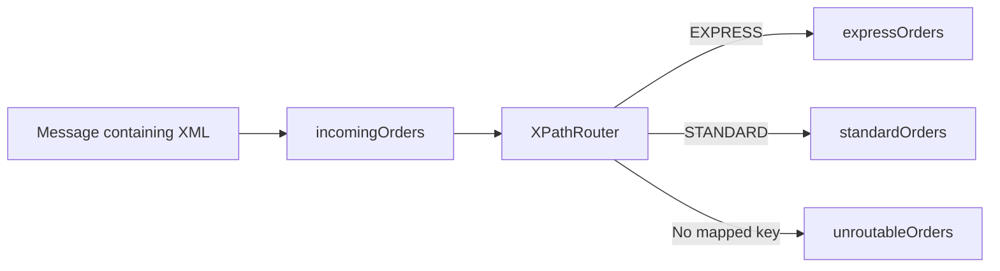

# XPathRouter

## 1. Objectives and problem statement

In the **Router** chapter of the **SPRING_INTEGRATION_CORE** module, `XPathRouter` helps choose a processing branch from the XML content of a `Message`. This component fits integration flows receiving orders, documents, or business notifications whose data contract is already XML.

After this lesson, you will be able to:

- Explain the relationship between XML payload, XPath result, routing key, and `MessageChannel`.
- Configure `XPathRouter` with Java DSL and the XML namespace.
- Choose NODESET or String mode, declare namespaces, and handle missing values.
- Design a default branch and distinguish XML parsing errors from message send errors.
- Test the selected branch as well as preservation of payload and headers.

Suppose the system receives orders according to the following contract:

```xml
<order xmlns="urn:example:orders" id="ORD-1042">
    <type> EXPRESS </type>
    <amount currency="VND">1250000</amount>
</order>
```

Rules of the example:

| `type` value after whitespace normalization | Target channel | Meaning |
| --- | --- | --- |
| `EXPRESS` | `expressOrders` | Express delivery processing |
| `STANDARD` | `standardOrders` | Standard processing |
| Other value or missing | `unroutableOrders` | Store for business review |

The Java examples use Spring Integration 6.x APIs as a baseline, cross-referenced against 6.5.1 source, and require Java 17 or later. Actual library versions must follow your application's BOM or dependency management; do not assume the `current` docs version matches your project.

## 2. Routing mechanism

`XPathRouter` is an implementation of a Content-Based Router: it decides the route from data inside the message. It extends `AbstractMappingMessageRouter`, so it can map business values to channel names.



A single routing pass consists of these steps:

1. Extract the payload and convert it into the XML form used by the XPath evaluator.
2. Evaluate the expression to obtain one or more keys.
3. Look up the mapping table to find a channel name for each key.
4. Resolve channel names to `MessageChannel` beans in the Spring context.
5. Send the message to the determined channels, or use the default channel when no targets match.

For example: `EXPRESS` is a business key; `expressOrders` is a channel bean name. These two values do not need to match. Renaming a channel only requires updating the mapping without forcing senders to change their XML. NODESET mode and mapping are described in [XML routing with XPath documentation](https://docs.spring.io/spring-integration/reference/xml/xpath-routing.html).

The router uses the XPath result to select targets; the forwarded payload remains the original payload. If the input was a `String`, downstream still receives that XML string. To extract `<amount>` into a new payload, a separate transformer is needed. That is why you must distinguish **data used to decide the path** from **data being forwarded**. You can see how the router extracts keys from the payload in [XPathRouter 6.5.1 source](https://github.com/spring-projects/spring-integration/blob/v6.5.1/spring-integration-xml/src/main/java/org/springframework/integration/xml/router/XPathRouter.java).

## 3. NODESET and String: picking the right result type

### 3.1. Default NODESET mode

By default, `evaluateAsString` is `false`. The expression is evaluated in node-set selection mode; the text content of each node becomes a routing key.

Example without namespaces:

```xml
<dispatch>
    <target>WAREHOUSE</target>
    <target>BILLING</target>
</dispatch>
```

Expression:

```xpath
/dispatch/target
```

Corresponding configuration:

```java
XPathRouter router = new XPathRouter("/dispatch/target");
router.setChannelMapping("WAREHOUSE", "warehouseRequests");
router.setChannelMapping("BILLING", "billingRequests");
router.setChannelKeyFallback(false);
```

With those target channels registered, the message is sent to both `warehouseRequests` and `billingRequests`. Each branch receives the entire `<dispatch>...</dispatch>` payload, not just its own `<target>` node. If each XML fragment needs to be processed as a separate message, consider a splitter.

Select the exact leaf node or attribute holding the key. Given the data above, `/dispatch` selects the parent node; the parent node's text concatenates the content of its child elements rather than producing two separate `WAREHOUSE` and `BILLING` keys.

### 3.2. String mode

Expressions like `normalize-space(...)`, `string(...)`, or `local-name(/*)` return scalar values. String mode must be enabled:

```java
XPathRouter router =
        new XPathRouter("normalize-space(/order/type)");
router.setEvaluateAsString(true);
```

This example is for XML **without namespaces**. The practice section below adds a namespace for the order contract.

| Expression | Appropriate mode | Meaning |
| --- | --- | --- |
| `/order/type` | NODESET | Gets text of `type` nodes |
| `/order/@type` | NODESET | Gets value of `type` attribute |
| `normalize-space(/order/type)` | String | Produces a single key and normalizes whitespace |
| `local-name(/*)` | String | Uses the root element's local name as key |
| `count(/order/item)` | String if using count as a string key | Needs matching mappings such as `"0"` |
| `boolean(/order/priority)` | String if routing by `"true"`/`"false"` | Checks node existence |

String mode does not preserve a list of nodes: when converting a node-set to a string per XPath 1.0, only the string-value of the first node in document order is used. Therefore, enabling String mode on `/dispatch/target` will not produce two branches like the NODESET example. Conversion rules are in the [W3C XPath 1.0 specification](https://www.w3.org/TR/1999/REC-xpath-19991116/#section-String-Functions).

`normalize-space()` strips leading/trailing whitespace and collapses internal whitespace runs. It does not convert `express` to `EXPRESS`. If the contract requires uppercase, validate or normalize intentionally before the router.

The expression `boolean(/order/priority)` also does not read a boolean value inside the element: `<priority>false</priority>` still makes this expression return `true`, because the node exists. To inspect content, use an explicit condition like `normalize-space(/order/priority) = 'true'`.

## 4. Namespaces in XML and in XPath

The order XML uses the default namespace `urn:example:orders`. In XPath 1.0, `/order/type` does not automatically inherit that default namespace. You must declare a prefix in the XPath context:

```java
Map<String, String> namespaces =
        Map.of("o", "urn:example:orders");

XPathRouter router = new XPathRouter(
        "normalize-space(/o:order/o:type)", namespaces);
router.setEvaluateAsString(true);
```

The prefix `o` is chosen by the application. Incoming XML can use a default namespace as above or a different prefix:

```xml
<x:order xmlns:x="urn:example:orders" id="ORD-1043">
    <x:type>STANDARD</x:type>
</x:order>
```

Both documents match `/o:order/o:type`, because the namespace URI and local name determine which elements match. Ways to declare a map or prefix/URI pairs are covered in [Spring Integration Namespace Support](https://docs.spring.io/spring-integration/reference/xml/xpath-namespace-support.html).

Unprefixed attributes normally do not belong to the default namespace. For `id="ORD-1042"`, the path is `/o:order/@id`, not `/o:order/@o:id`.

You can use `local-name()` when you need to ignore prefixes, but skipping namespace URI checks altogether can allow messages from a different contract to match too. When the contract's namespace is known, explicit namespace declarations help catch data mismatches earlier.

## 5. Practice with Java DSL

### 5.1. Dependencies

If the application already manages versions via a Spring Boot parent or a compatible BOM, add the following dependencies:

```xml
<dependency>
    <groupId>org.springframework.integration</groupId>
    <artifactId>spring-integration-core</artifactId>
</dependency>
<dependency>
    <groupId>org.springframework.integration</groupId>
    <artifactId>spring-integration-xml</artifactId>
</dependency>
```

`XPathRouter` resides in the XML module. Test dependencies used below are `spring-test`, `junit-jupiter`, and `assertj-core`, with scope `test` and versions managed by the project.

### 5.2. Complete flow configuration

```java
import java.util.Map;

import org.springframework.context.annotation.Bean;
import org.springframework.context.annotation.Configuration;
import org.springframework.integration.channel.DirectChannel;
import org.springframework.integration.channel.QueueChannel;
import org.springframework.integration.config.EnableIntegration;
import org.springframework.integration.dsl.IntegrationFlow;
import org.springframework.integration.xml.router.XPathRouter;

@Configuration
@EnableIntegration
public class OrderRoutingConfiguration {

    @Bean
    public DirectChannel incomingOrders() {
        return new DirectChannel();
    }

    @Bean
    public QueueChannel expressOrders() {
        return new QueueChannel(100);
    }

    @Bean
    public QueueChannel standardOrders() {
        return new QueueChannel(100);
    }

    @Bean
    public QueueChannel unroutableOrders() {
        return new QueueChannel(100);
    }

    @Bean
    public XPathRouter orderTypeRouter() {
        XPathRouter router = new XPathRouter(
                "normalize-space(/o:order/o:type)",
                Map.of("o", "urn:example:orders"));

        router.setEvaluateAsString(true);
        router.setChannelMapping("EXPRESS", "expressOrders");
        router.setChannelMapping("STANDARD", "standardOrders");

        router.setChannelKeyFallback(false);
        router.setResolutionRequired(true);
        router.setDefaultOutputChannelName("unroutableOrders");
        router.setIgnoreSendFailures(false);
        router.setSendTimeout(1_000);
        return router;
    }

    @Bean
    public IntegrationFlow orderRoutingFlow(
            DirectChannel incomingOrders,
            XPathRouter orderTypeRouter) {

        return IntegrationFlow.from(incomingOrders)
                .route(orderTypeRouter)
                .get();
    }
}
```

Java DSL attaches the router instance to the endpoint receiving from `incomingOrders`; the overload accepting `AbstractMessageRouter` is described in [BaseIntegrationFlowDefinition API](https://docs.spring.io/spring-integration/docs/6.5.1/api/org/springframework/integration/dsl/BaseIntegrationFlowDefinition.html).

Meaning of the choices in the example:

- `DirectChannel` makes the routing operation run on the sending thread.
- The `QueueChannel`s have a capacity of 100 messages, allowing output observation without writing consumers yet.
- `setChannelKeyFallback(false)` allows only mapped keys to identify targets; XML values are never used directly as channel names.
- `setResolutionRequired(true)` preserves errors when a mapping points to a nonexistent channel.
- `unroutableOrders` receives messages that produce no target from mappings.
- Send timeout is 1,000 ms; with a full queue, sending can fail after the wait. This does not bound the execution time of a handler behind a `DirectChannel`.

These queues store in memory. A successful send confirms the message entered the queue, not that business processing has finished. For production operation, you need consumers, capacity policies, and appropriate durability requirements.

### 5.3. Why keep `resolutionRequired=true`?

These two cases need different behavior:

| Situation | Behavior of the configuration above |
| --- | --- |
| XML contains `SAME_DAY`, no mapping | Produces no target; sends to `unroutableOrders` |
| XML missing `type` or `type` is whitespace-only | Empty string key, no mapping; sends to `unroutableOrders` |
| `EXPRESS` mapping accidentally points to nonexistent bean name | Channel resolution error |
| Malformed XML syntax | Parse error before target selection |

`channelKeyFallback=false` prevents trying to resolve an unmapped key. That is why unknown keys can go to the default branch even when `resolutionRequired=true`. When a mapping exists but the corresponding channel is missing, resolution must still succeed. This distinction is implemented in [AbstractMappingMessageRouter 6.5.1](https://github.com/spring-projects/spring-integration/blob/v6.5.1/spring-integration-core/src/main/java/org/springframework/integration/router/AbstractMappingMessageRouter.java).

If you set `resolutionRequired=false`, unresolvable channel names can be skipped. Do not use that option just to mask configuration errors.

Since Spring Integration 6.0, setting a default output channel also sets `channelKeyFallback=false` if you haven't set this flag explicitly. The Java example still sets the flag explicitly to show the policy. A configuration with a default channel that also explicitly sets both `channelKeyFallback=true` and `resolutionRequired=true` is rejected at initialization. See [Common Router Parameters](https://docs.spring.io/spring-integration/reference/router/common-parameters.html).

## 6. Equivalent configuration using XML namespace

This is an alternative configuration choice to the Java class above. Choose one style for the same flow to avoid registering duplicate bean names.

```xml
<?xml version="1.0" encoding="UTF-8"?>
<beans xmlns="http://www.springframework.org/schema/beans"
       xmlns:xsi="http://www.w3.org/2001/XMLSchema-instance"
       xmlns:int="http://www.springframework.org/schema/integration"
       xmlns:int-xml="http://www.springframework.org/schema/integration/xml"
       xsi:schemaLocation="
         http://www.springframework.org/schema/beans
         https://www.springframework.org/schema/beans/spring-beans.xsd
         http://www.springframework.org/schema/integration
         https://www.springframework.org/schema/integration/spring-integration.xsd
         http://www.springframework.org/schema/integration/xml
         https://www.springframework.org/schema/integration/xml/spring-integration-xml.xsd">

    <int:channel id="incomingOrders"/>

    <int:channel id="expressOrders">
        <int:queue capacity="100"/>
    </int:channel>
    <int:channel id="standardOrders">
        <int:queue capacity="100"/>
    </int:channel>
    <int:channel id="unroutableOrders">
        <int:queue capacity="100"/>
    </int:channel>

    <int-xml:xpath-router id="orderTypeRouter"
                          input-channel="incomingOrders"
                          evaluate-as-string="true"
                          resolution-required="true"
                          default-output-channel="unroutableOrders"
                          ignore-send-failures="false"
                          timeout="1000">
        <int-xml:xpath-expression
                expression="normalize-space(/o:order/o:type)"
                ns-prefix="o"
                ns-uri="urn:example:orders"/>
        <int-xml:mapping value="EXPRESS" channel="expressOrders"/>
        <int-xml:mapping value="STANDARD" channel="standardOrders"/>
    </int-xml:xpath-router>

</beans>
```

The XML example relies on behavior since version 6.0: `default-output-channel` disables using unmapped keys as channel names when the fallback flag is not explicitly set. Declaring `xmlns:o` on `<beans>` does not replace `ns-prefix` and `ns-uri` in the XPath evaluation context.

## 7. Payload converter and boundary with transformer

`XPathRouter` uses `DefaultXmlPayloadConverter` by default. In the 6.5.1 source, common input forms include `String`, DOM `Document`/`Node`, `DOMSource`, `File`, `InputStream`, and `byte[]`; `Source` handling depends on the specific `Source` type. Do not assume every custom `Source` works. You can check the conversion branches in [DefaultXmlPayloadConverter 6.5.1](https://github.com/spring-projects/spring-integration/blob/v6.5.1/spring-integration-xml/src/main/java/org/springframework/integration/xml/DefaultXmlPayloadConverter.java).

Several design choices:

| Input and need | How to organize |
| --- | --- |
| Small XML string, routing only | Pass directly to XPathRouter |
| POJO or JSON | Convert to XML contract with a transformer, or pick a router suited to the existing data |
| Multiple endpoints read the same XML document | Consider parsing once into a `Document` early in the flow |
| Stream needs to be read again after the router | Convert to a repeatable form before routing |
| Converter must handle a specialized payload form | Consider `setConverter(XmlPayloadConverter)` with clear conversion responsibility |

The internal converter serves XPath evaluation and does not replace the message payload. In particular, the router may drain an `InputStream` while parsing yet still forward the original stream payload. Therefore, downstream should not expect to read that stream from the beginning again.

If you intentionally add a `String`-to-`Document` transformer, downstream will receive a `Document`: that change comes from the transformer and must be reflected in the contract between endpoints.

## 8. Multiple targets, sequences, and aggregators

NODESET lets the same message go to multiple channels when the expression selects multiple keys. This is data-driven fan-out; the router does not create parallel execution on its own. If a target is a `DirectChannel`, the handler may run immediately on the current thread; queues or executors create different processing boundaries.

If you need to gather results from branches, you can enable:

```java
router.setApplySequence(true);
```

Correlation/sequence headers help a downstream aggregator. By default this flag is off; nor does the router register an aggregator itself. The contract of the sequence option is stated in [AbstractMessageRouter 6.5.1](https://github.com/spring-projects/spring-integration/blob/v6.5.1/spring-integration-core/src/main/java/org/springframework/integration/router/AbstractMessageRouter.java).

When designing a result-gathering branch, determine:

- Exactly how many results each branch returns and whether correlation headers are preserved.
- When a branch errors or a filter drops a message, the aggregator may be missing a result; timeout and group-release policies are needed.
- If one send succeeded and the next send fails, the earlier send is not automatically rolled back just because a router was used.
- Retrying the entire message may cause one branch to receive the work again; business logic needs idempotency by request ID.

The default branch is used when no target was selected, not as an extra delivery for each unmapped key when a valid target already exists. For example, a NODESET containing `WAREHOUSE` and an unknown key, with fallback off, can still send to the warehouse without sending to the default branch. If the requirement is that every key must be valid, validate the entire list before the router.

## 9. Default branch and error handling

`unroutableOrders` is the branch for business cases that lack a matching route. It is not a mechanism to catch every exception.

| Issue | Where it occurs | How to handle |
| --- | --- | --- |
| Unsupported `type` | Mapping table yields no target | Default branch, monitor frequency and update contract |
| Unclosed XML tag | Payload parsing | Error handling, record invalid data |
| Invalid XPath syntax | Usually when creating the router | Fix configuration before serving traffic |
| Function returns String while still in NODESET mode | XPath evaluation | Enable String mode or change expression |
| Mapping points to wrong channel | Channel name resolution | Fix bean/mapping; keep configuration errors visible |
| Target queue full | Message sending | Timeout, load shedding, or controlled retry |
| Handler after DirectChannel throws | Downstream execution on same thread | Catch at call site or appropriate error flow |

With `incomingOrders` configured as a `DirectChannel`, errors during parsing or routing are thrown back to the `send(...)` caller. Adding an `errorChannel` header does not automatically redirect every synchronous error of a direct send call to that channel.

With polled endpoints or framework-managed executors, errors are typically turned into `ErrorMessage`s via the corresponding error-handling mechanism. Inspect the error handler at the asynchronous boundary and the `errorChannel` header; see [Spring Integration Error Handling](https://docs.spring.io/spring-integration/reference/error-handling.html).

If a messaging gateway sits in front of the flow, decide clearly whether the caller needs send confirmation or a business result. The queues in the example do not generate replies, so a gateway requiring request/reply will need consumers and a reply path; the router does not generate responses on its own.

## 10. Testing routing behavior

Tests should observe both the selected channel and unselected channels. With the configuration above, you can use real in-memory queues to receive results without mocking the router or running external services.

The class below uses JUnit Jupiter, Spring Test, and AssertJ; place it in the same package as `OrderRoutingConfiguration` or add corresponding imports.

```java
import org.junit.jupiter.api.BeforeEach;
import org.junit.jupiter.api.Test;
import org.springframework.beans.factory.annotation.Autowired;
import org.springframework.beans.factory.annotation.Qualifier;
import org.springframework.integration.channel.DirectChannel;
import org.springframework.integration.channel.QueueChannel;
import org.springframework.messaging.Message;
import org.springframework.messaging.MessagingException;
import org.springframework.messaging.support.MessageBuilder;
import org.springframework.test.context.junit.jupiter.SpringJUnitConfig;

import static org.assertj.core.api.Assertions.assertThat;
import static org.assertj.core.api.Assertions.assertThatThrownBy;

@SpringJUnitConfig(OrderRoutingConfiguration.class)
class OrderRoutingTest {

    @Autowired
    @Qualifier("incomingOrders")
    DirectChannel incomingOrders;

    @Autowired
    @Qualifier("expressOrders")
    QueueChannel expressOrders;

    @Autowired
    @Qualifier("standardOrders")
    QueueChannel standardOrders;

    @Autowired
    @Qualifier("unroutableOrders")
    QueueChannel unroutableOrders;

    @BeforeEach
    void clearQueues() {
        expressOrders.clear();
        standardOrders.clear();
        unroutableOrders.clear();
    }

    @Test
    void routesExpressAndPreservesPayloadAndHeader() {
        String xml = order(" EXPRESS ");
        Message<String> input = MessageBuilder.withPayload(xml)
                .setHeader("requestId", "REQ-1042")
                .build();

        assertThat(incomingOrders.send(input)).isTrue();

        Message<?> output = expressOrders.receive(0);
        assertThat(output).isNotNull();
        assertThat(output.getPayload()).isEqualTo(xml);
        assertThat(output.getHeaders().get("requestId"))
                .isEqualTo("REQ-1042");
        assertThat(standardOrders.receive(0)).isNull();
        assertThat(unroutableOrders.receive(0)).isNull();
    }

    @Test
    void routesStandardWithADifferentDocumentPrefix() {
        String xml = """
                <x:order xmlns:x="urn:example:orders">
                    <x:type>STANDARD</x:type>
                </x:order>
                """;

        incomingOrders.send(MessageBuilder.withPayload(xml).build());

        assertThat(standardOrders.receive(0)).isNotNull();
        assertThat(expressOrders.receive(0)).isNull();
        assertThat(unroutableOrders.receive(0)).isNull();
    }

    @Test
    void unknownKeyCannotBecomeAnInternalChannelName() {
        // This is the name of a real channel in the context, but without a mapping.
        String xml = order("incomingOrders");

        incomingOrders.send(MessageBuilder.withPayload(xml).build());

        assertThat(unroutableOrders.receive(0)).isNotNull();
        assertThat(expressOrders.receive(0)).isNull();
        assertThat(standardOrders.receive(0)).isNull();
    }

    @Test
    void missingTypeUsesDefaultChannel() {
        String xml = "<order xmlns='urn:example:orders'/>";

        incomingOrders.send(MessageBuilder.withPayload(xml).build());

        assertThat(unroutableOrders.receive(0)).isNotNull();
        assertThat(expressOrders.receive(0)).isNull();
        assertThat(standardOrders.receive(0)).isNull();
    }

    @Test
    void malformedXmlRaisesAnErrorInsteadOfUsingDefaultChannel() {
        String xml = "<order xmlns='urn:example:orders'><type>EXPRESS";

        assertThatThrownBy(() -> incomingOrders.send(
                MessageBuilder.withPayload(xml).build()))
                .isInstanceOf(MessagingException.class);

        assertThat(unroutableOrders.receive(0)).isNull();
        assertThat(expressOrders.receive(0)).isNull();
        assertThat(standardOrders.receive(0)).isNull();
    }

    private static String order(String type) {
        // Fixed test data; do not use this formatting approach for arbitrary input.
        return """
                <order xmlns="urn:example:orders" id="ORD-1042">
                    <type>%s</type>
                </order>
                """.formatted(type);
    }
}
```

`receive(0)` is appropriate here because sending through `DirectChannel` finishes placing the message into the queue before returning. If you replace the input with an executor or poller, wait for results with a finite timeout instead of assuming immediate availability. Tests sharing queues should run sequentially or use separate contexts when parallel testing is enabled.

Scenarios to add when extending the contract:

| Data or change | What to assert |
| --- | --- |
| `type` contains only whitespace | Goes to default branch |
| `type` is `express` | Does not automatically match `EXPRESS` |
| XML uses a different namespace URI | Not routed as under the current contract |
| Two `type` elements present | Decide clearly whether to accept the first node or reject via validation |
| NODESET selects two valid targets | Both targets receive the full payload |
| Mapping points to nonexistent channel | Raises resolution error, not masked by default branch |
| Target queue full | Send fails according to timeout/error policy |

## 11. Design and operational choices

### 11.1. When to use XPathRouter?

| Need | Suitable component |
| --- | --- |
| Pick channel from XML content | XPathRouter |
| Business key already in a header | HeaderValueRouter |
| Pick branch by payload class | PayloadTypeRouter |
| Keep or drop message by condition | Filter, optionally with an XPath selector |
| Build a new payload from XML | Transformer |
| Split multiple XML elements into multiple messages | Splitter |
| Multiple independent conditions to pick recipients | Recipient List Router or branches with selectors |

Keep XPath expressions focused on reading keys. If a rule needs to call services, query data, or run complex business calculations, put that work in a separate step and route on the computed result. Organizing this way makes each responsibility easier to test and observe.

### 11.2. Data trustworthiness and parser safety

Parseable XML does not mean contract-compliant XML. For example, `normalize-space(/o:order/o:type)` still yields one key when a document contains multiple `type` elements. If the contract requires exactly one element, use XML Schema or validation before the router to check cardinality.

For external XML, parsers at the start of the flow need policies for DTDs, external entities, external resource access, and size limits. If providing your own `DocumentBuilderFactory`, verify hardening settings appropriate to the XML provider in use. A DOM parsed upstream does not become safe merely by passing through a router later.

Do not concatenate user-supplied values into XPath expressions. Expressions should be application-managed configuration; incoming data is the data being evaluated.

### 11.3. Performance and observability

Create the router as a Spring bean to reuse configuration; avoid instantiating a new router per message. For large documents, DOM parsing and memory cost can exceed mapping lookup cost. Measure with realistic payload sizes and concurrency before optimizing.

Prefer contract-anchored paths like `/o:order/o:type` over `//o:type`: overly broad paths easily match an unintended element of the same name elsewhere. If multiple endpoints need XPath on the same message, consider parsing once while ensuring branches do not arbitrarily mutate the DOM.

Track message counts per branch, messages going to `unroutableOrders`, parse errors, resolution errors, and queue depth. Attach request IDs or order IDs for tracing; avoid logging full XML when payloads contain sensitive data. A rising rate on the default branch can signal that a sender changed its contract or a new business category has appeared.

## 12. Practice exercises

1. Add a `PICKUP` key mapped to a `pickupOrders` channel while keeping the default branch for unsupported keys. Write a test asserting that the two existing branches do not receive copies of `PICKUP` orders.
2. Change the contract so `type` is an unprefixed attribute on the root element. Adjust the XPath and verify with XML still using the default namespace.
3. Build a separate flow using NODESET with two `<target>` elements, `WAREHOUSE` and `BILLING`. Verify both branches receive the full document, then switch String mode on to observe the difference.
4. Add validation rejecting documents with two `type` elements. Verify validation errors remain distinct from missing business mappings.
5. Add a consumer for each queue and a gateway with an explicit reply contract. Define the response when an order goes to the default branch and when a branch fails processing.

When finished, you should be able to explain the four decisions of the flow: which data XPath selects, what result type is evaluated, which channel a key maps to, and where the message goes when there is no route or when an error occurs.