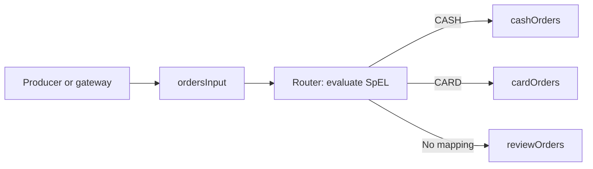

# Router expressions

## 1. Objectives and lesson scope

In the **Router** chapter of the **SPRING_INTEGRATION_CORE** module, a router expression uses Spring Expression Language (SpEL) to compute a routing decision from a message. The lesson focuses on the relationship between `Message`, the expression, the routing key, and `MessageChannel`; from there, you will build an endpoint with Java DSL, define a default branch, and test unroutable cases.

After this lesson, you will be able to:

- Read data from payload and headers in the router's SpEL context.
- Distinguish an expression result that is a business key from one that is a channel name.
- Configure `channelMapping`, `channelKeyFallback`, `resolutionRequired`, and `defaultOutputChannel` according to an explicit policy.
- Write single-target or multi-target routing flows and recognize limitations when combining with an aggregator.
- Distinguish expression evaluation errors, channel resolution errors, and target-branch processing errors.
- Test routing behavior using in-memory channels.

Examples use **Java 17, Spring Integration 6.5.x, and JUnit 5**. This is the API baseline for the lesson; when using Spring Boot, let Boot's BOM manage compatible Spring versions. Java DSL is in `spring-integration-core`; the testing section below also needs `spring-test` and `junit-jupiter`. No message broker is required to practice.

## 2. What problem does a router expression solve?

Suppose a system receives orders with the payload:

```json
{
  "orderId": "ORD-101",
  "paymentMethod": "CARD",
  "amountVnd": 850000
}
```

Routing requirements:

| Business data | Receiving branch |
| --- | --- |
| `paymentMethod = CASH` | Cash collection processing |
| `paymentMethod = CARD` | Card payment processing |
| Missing method or unsupported value | Pending manual review |

The producer simply sends a `Message` to `ordersInput`. The producer does not have to call the cash collection service or the card payment service directly. The router reads the needed data, computes the key, and forwards the message to the appropriate channel.



A router expression fits short decisions, such as reading a property, using a header, or choosing among a few keys conditionally. Spring Integration supports configuring expressions directly on the router and in `IntegrationFlow.route(...)`. [Router with SpEL documentation](https://docs.spring.io/spring-integration/reference/6.5/router/spel.html).

In this design, the router decides **where to go**. A transformer before the router can convert JSON into an object or Map; a filter can block invalid data; endpoints in target branches perform the business work. A gateway provides an entry point into the flow if the application needs to interact through an interface.

## 3. Execution model: an expression is not a channel

Read the routing process as steps:

1. The endpoint receives a `Message<?>` from the input channel.
2. The expression is evaluated on that message.
3. The result is interpreted as one or more routing keys.
4. The router uses mappings or name resolution to locate channels.
5. The message is sent to the selected channels; if no target is chosen, the default policy applies or an exception is raised.

For example:

```text
Expression                        Result     Mapping                Target channel
payload['paymentMethod']          CARD       CARD -> cardOrders     bean cardOrders
```

`CARD` is a business key. `cardOrders` is a channel bean name. These two values do not mean the same thing.

An expression can also return a channel name directly:

```java
.route("headers['targetChannel']")
```

That syntax only makes sense when the header value is permitted to act as a channel name and the router is configured to allow resolving keys as names. It does not create a channel, does not create a consumer, and does not guarantee any given channel can accept messages.

For flows with external input, a well-controlled design choice is returning **a finite set of business keys**, declaring explicit mappings, and disabling `channelKeyFallback`. For example, `CARD` stays unchanged even when internal channel names are renamed.

## 4. The router's SpEL context

### 4.1. The root object is Message

Inside a router expression, you typically access directly:

- `payload`: the message content.
- `headers`: the header map.
- `#root`: the message itself being evaluated.
- `@beanName`: a bean in the application context, if key computation needs delegation.

This access relies on the evaluation context provided by Spring Integration. A standalone `SpelExpressionParser` created in a unit test does not automatically have the same bean resolver and property accessors as that context. [SpEL in Spring Integration](https://docs.spring.io/spring-integration/reference/6.5/spel.html).

| Purpose | Expression | Assumption |
| --- | --- | --- |
| Read Map entry | `payload['paymentMethod']` | Payload is already a Map |
| Read JavaBean property | `payload.paymentMethod` | Suitable getter exists |
| Read header | `headers['customerTier']` | Header obeys the data contract |
| Pick key by amount | `payload['amountVnd'] >= 5000000 ? 'HIGH' : 'NORMAL'` | Value exists and is numeric |
| Combine header and payload | `headers['customerTier'] == 'VIP' and payload['amountVnd'] >= 5000000 ? 'PRIORITY' : 'STANDARD'` | Data types are validated |
| Delegate to a bean | `@paymentRoutingPolicy.classify(payload)` | Bean exists and method returns suitable result |

A payload that is a JSON string does not automatically become a Map just because the expression uses `payload['paymentMethod']`. For the lesson's main example, place a JSON-to-Map conversion step before the router if actual input arrives as a string.

### 4.2. Do not wrap route expressions in `#{...}`

Java DSL:

```java
.route("payload['paymentMethod']")
```

The string above is already interpreted by the `route` API as a SpEL expression. Do not write:

```java
// Do not use @Value template syntax for this parameter.
.route("#{payload['paymentMethod']}")
```

`'CARD'` inside the expression is a SpEL string literal; the outer `"` quotes are Java string delimiters. Therefore:

```java
.route("'CARD'")                    // Always returns the string CARD.
.route("payload['paymentMethod']")  // Reads the value from the payload.
```

The DSL also has overloads accepting a lambda or a router object; a Java lambda and a SpEL string are two different configuration styles. [Message Routers in Java DSL](https://docs.spring.io/spring-integration/reference/6.5/dsl/java-routers.html).

### 4.3. Missing data, empty strings, and mistyped values

The following expression assigns a fallback key when the value is `null` or an empty string:

```spel
payload['paymentMethod'] ?: 'UNKNOWN'
```

SpEL's Elvis operator also treats an empty string as falsy. However, a whitespace-only string like `"   "` is not automatically normalized to `UNKNOWN`. Trimming, uppercasing, or validating method codes belongs in the input contract or a normalization step. [Elvis Operator](https://docs.spring.io/spring-framework/reference/6.2/core/expressions/language-ref/operator-elvis.html).

With a JavaBean containing nested objects:

```spel
payload.customer?.address?.country ?: 'UNKNOWN'
```

The `?.` operator guards against traversing a `null` value at that position. It does not fix wrong property names, does not convert a JSON string into an object, and does not replace data type validation. Access chains with multiple nullable links need protection at each appropriate link. [Safe Navigation Operator](https://docs.spring.io/spring-framework/reference/6.2/core/expressions/language-ref/operator-safe-navigation.html).

If a numeric field holds the string `"unknown"`, do not expect the default branch to automatically handle every comparison failure. An exception during expression evaluation is different from an unmapped key result.

## 5. Complete Java DSL example

### 5.1. Example contract

The payload is `Map<String, Object>`, which can contain:

- `orderId`: order ID, for tracing.
- `paymentMethod`: `CASH`, `CARD`, another value, or missing.
- `amountVnd`: numeric amount; the current router does not use this field.

The router has only two supported mappings. Unmapped values go to `reviewOrders`. An internal channel name supplied by a sender in the `paymentMethod` field must not be used to select a channel directly either.

### 5.2. Configuration

```java
package example.integration;

import org.springframework.context.annotation.Bean;
import org.springframework.context.annotation.Configuration;
import org.springframework.integration.channel.DirectChannel;
import org.springframework.integration.channel.QueueChannel;
import org.springframework.integration.config.EnableIntegration;
import org.springframework.integration.dsl.IntegrationFlow;

@Configuration
@EnableIntegration
public class PaymentRoutingConfig {

    @Bean
    public DirectChannel ordersInput() {
        return new DirectChannel();
    }

    @Bean
    public QueueChannel cashOrders() {
        return new QueueChannel(100);
    }

    @Bean
    public QueueChannel cardOrders() {
        return new QueueChannel(100);
    }

    @Bean
    public QueueChannel reviewOrders() {
        return new QueueChannel(100);
    }

    @Bean
    public IntegrationFlow paymentRoutingFlow() {
        return IntegrationFlow.from("ordersInput")
                .route("payload['paymentMethod'] ?: 'UNKNOWN'", router -> router
                        .channelMapping("CASH", "cashOrders")
                        .channelMapping("CARD", "cardOrders")
                        .channelKeyFallback(false)
                        .resolutionRequired(true)
                        .defaultOutputChannel("reviewOrders"))
                .get();
    }
}
```

In this configuration:

- `ordersInput` is a `DirectChannel`, so invoking the router occurs on the sending thread.
- The three `QueueChannel` beans hold results for observation or testing; each queue has capacity 100 messages.
- `channelMapping` separates business keys from channel names.
- `channelKeyFallback(false)` prevents unmapped keys from being used as channel names.
- `resolutionRequired(true)` keeps error detection active when a selected channel name cannot be resolved.
- `defaultOutputChannel` handles cases where no target could be determined.

`QueueChannel` in the example is an in-memory queue, not a durable broker queue. A real application needs consumers for each queue and a policy for full queues, rather than letting results pile up forever.

### 5.3. Sending and receiving a message

The following program uses the same package as the configuration:

```java
package example.integration;

import java.util.Map;

import org.springframework.context.annotation.AnnotationConfigApplicationContext;
import org.springframework.integration.channel.QueueChannel;
import org.springframework.messaging.Message;
import org.springframework.messaging.MessageChannel;
import org.springframework.messaging.support.MessageBuilder;

public class RouterDemo {

    public static void main(String[] args) {
        try (var context =
                     new AnnotationConfigApplicationContext(PaymentRoutingConfig.class)) {

            MessageChannel input =
                    context.getBean("ordersInput", MessageChannel.class);
            QueueChannel cards =
                    context.getBean("cardOrders", QueueChannel.class);

            Message<Map<String, Object>> order = MessageBuilder
                    .withPayload(Map.<String, Object>of(
                            "orderId", "ORD-101",
                            "paymentMethod", "CARD",
                            "amountVnd", 850_000L))
                    .setHeader("traceId", "trace-101")
                    .build();

            boolean accepted = input.send(order, 1_000);
            Message<?> routed = cards.receive(1_000);

            System.out.println("accepted = " + accepted);
            System.out.println("payload = "
                    + (routed == null ? "<no message>" : routed.getPayload()));
        }
    }
}
```

The expected result is `accepted = true` and the order payload sitting in `cardOrders`. The display order of Map entries is not part of the example's contract.

A successful send to the queue indicates the message was accepted at that boundary. It does not prove payment business processing has finished.

## 6. Understanding mapping, fallback, and default branch properly

### 6.1. Two different meanings of "not found"

**No mapping for the key:**

```text
Expression -> BANK_TRANSFER
Mapping only has CASH and CARD
channelKeyFallback = false
No target selected -> reviewOrders
```

**Mapping exists, but channel name is wrong:**

```text
Expression -> CARD
Mapping CARD -> cardOrderz
No channel bean named cardOrderz
resolutionRequired = true -> exception
```

The second case is normally a configuration bug. Keeping it clearly visible avoids turning a deployment bug into an order waiting for manual handling.

`channelKeyFallback` controls whether an unmapped key can be interpreted as a channel name. `resolutionRequired` governs what happens when resolving a channel name fails. The Javadoc also notes the rationale for restricting fallback when data might steer messages to unintended channels. [AbstractMappingMessageRouter API](https://docs.spring.io/spring-integration/docs/6.5.0/api/org/springframework/integration/router/AbstractMappingMessageRouter.html).

### 6.2. Behavior table for the main example

The table below assumes declared channels exist and can receive messages:

| Situation | Expression result | Behavior |
| --- | --- | --- |
| `paymentMethod = CASH` | `CASH` | Sent to `cashOrders` |
| `paymentMethod = CARD` | `CARD` | Sent to `cardOrders` |
| Missing `paymentMethod` key | `UNKNOWN` | Sent to `reviewOrders` |
| `paymentMethod = ""` | `UNKNOWN` | Sent to `reviewOrders` |
| `paymentMethod = BANK_TRANSFER` | `BANK_TRANSFER` | Sent to `reviewOrders` |
| `paymentMethod = cashOrders` | `cashOrders` | Sent to `reviewOrders`, because fallback is disabled |
| `CARD` mapping points to wrong bean name | `CARD` | Exception due to unresolvable channel |
| Payload has incompatible type causing expression failure | Evaluation fails | Exception; does not automatically fall back to default branch |
| Selected channel fails to receive message | Key and target computed | Send failure; does not use default as a catch-all rescue mechanism |

If you remove the default branch and no channel is selected, the router does not silently treat the message as handled. If intentionally dropping unroutable messages, you can configure the default to `nullChannel`, while verifying whether dropping meets business requirements.

### 6.3. Version note and error policy

Since Spring Integration 6.0, when configuring a default output channel, `channelKeyFallback` is set to `false` unless explicitly configured per the router's mechanism. Therefore the example still writes `false` explicitly to show policy. Configuring a default output channel together with both `channelKeyFallback = true` and `resolutionRequired = true` is rejected at initialization as ambiguous. [Common Router Parameters](https://docs.spring.io/spring-integration/reference/6.5/router/common-parameters.html).

If you intentionally want unresolvable channel names to go to the default branch, you can pick `resolutionRequired(false)`. That is a change in error-handling policy; consider that a typo in a mapping could also become a message routed to the fallback branch.

Do not apply a blanket rule that "with a default, every error goes to default". The default is for when no target is determined per routing configuration, not a substitute for error handling.

## 7. Common expression variants

The snippets below are configuration variants, not flows to enable simultaneously with the main example on the same input channel.

### 7.1. Routing by header

When a previous endpoint has normalized the method into a header:

```java
.route("headers['paymentMethod'] ?: 'UNKNOWN'", router -> router
        .channelMapping("CASH", "cashOrders")
        .channelMapping("CARD", "cardOrders")
        .channelKeyFallback(false)
        .resolutionRequired(true)
        .defaultOutputChannel("reviewOrders"))
```

This keeps the router decoupled from deep payload structure. However, you must define which endpoint owns the header and its data type. If you only need to map a single header, `HeaderValueRouter` is also a direct choice. [Available routers](https://docs.spring.io/spring-integration/reference/6.5/router/implementations.html).

### 7.2. Conditional routing

Suppose `amountVnd` has been validated as a non-negative number:

```spel
payload['amountVnd'] >= 5000000 ? 'HIGH_VALUE' : 'NORMAL_VALUE'
```

You still need mappings for the two keys, e.g. `HIGH_VALUE -> approvalOrders` and `NORMAL_VALUE -> normalOrders`, along with the corresponding channels.

The `5000000` boundary must be tested. If the requirement is "5 million VND or more", the right operator is `>=`; using `>` sends an order of exactly 5 million to the wrong branch.

Do not compare monetary amounts as strings. For example, `"900000"` and `"5000000"` under string comparison behave differently from monetary order. Use an integer currency-unit contract or appropriate money type and normalize before the router.

### 7.3. Classify first, route later

When a rule needs many fields or the classification result is reused downstream, an earlier endpoint can compute a header like `routeKey` and let the router read it:

```java
.route("headers['routeKey']", router -> router
        .channelMapping("HIGH_VALUE", "approvalOrders")
        .channelMapping("NORMAL_VALUE", "normalOrders")
        .channelKeyFallback(false)
        .defaultOutputChannel("reviewOrders"))
```

This example requires `approvalOrders`, `normalOrders`, and `reviewOrders` channels to be declared. The advantage of splitting steps is observing the classification result without re-evaluating the expression in a logging endpoint.

## 8. Routing one message to multiple targets

An expression result can be a collection or array. When there are multiple target values, the router can forward the message to each corresponding channel. The `ExpressionEvaluatingRouter` class documents these common result shapes in its API. [ExpressionEvaluatingRouter API](https://docs.spring.io/spring-integration/docs/6.5.0/api/org/springframework/integration/router/ExpressionEvaluatingRouter.html).

Example of a separate flow needing both order processing and audit logging:

```java
@Bean
public IntegrationFlow auditedOrderFlow() {
    return IntegrationFlow.from("auditedOrdersInput")
            .route(
                    "headers['auditRequired'] == true"
                            + " ? {'PROCESS', 'AUDIT'} : {'PROCESS'}",
                    router -> router
                            .channelMapping("PROCESS", "processingOrders")
                            .channelMapping("AUDIT", "auditOrders")
                            .channelKeyFallback(false)
                            .resolutionRequired(true)
                            .applySequence(true))
            .get();
}
```

This configuration snippet needs `auditedOrdersInput`, `processingOrders`, and `auditOrders` channels. The `auditRequired` header is defined by convention as Boolean.

Several design implications to remember:

- This sends the entire message to targets, not splitting payload items like a splitter.
- Do not assume branches run in parallel. Channel types decide thread boundaries.
- Do not assume payloads can be mutated independently in each branch. Prefer immutable payloads or deliberate copying.
- A successful send on one branch does not guarantee another branch succeeds or rolls back.
- `applySequence(true)` adds sequence metadata to help coordinate branches; it does not create an aggregator and does not gather results on its own.

If feeding results from two branches into an aggregator, ensure each branch actually produces a result to gather, preserves the relevant headers, and has a policy for failed branches or missing results. An audit branch that merely logs and terminates will not produce a reply item for the aggregator by itself.

In the DSL, `channelMapping` and `subFlowMapping` are options linking keys to targets or subflows. Returning to the parent flow must be designed per the corresponding API; do not assume every router branch automatically rejoins a common next step. [RouterSpec API](https://docs.spring.io/spring-integration/docs/6.5.0/api/org/springframework/integration/dsl/RouterSpec.html).

## 9. Equivalent XML configuration

If the application uses XML, you can express the same baseline policy as follows. This is an alternative configuration option; do not register an additional XML router processing `ordersInput` if the Java DSL flow is already enabled.

```xml
<?xml version="1.0" encoding="UTF-8"?>
<beans xmlns="http://www.springframework.org/schema/beans"
       xmlns:xsi="http://www.w3.org/2001/XMLSchema-instance"
       xmlns:int="http://www.springframework.org/schema/integration"
       xsi:schemaLocation="
           http://www.springframework.org/schema/beans
           https://www.springframework.org/schema/beans/spring-beans.xsd
           http://www.springframework.org/schema/integration
           https://www.springframework.org/schema/integration/spring-integration.xsd">

    <int:channel id="ordersInput"/>

    <int:channel id="cashOrders">
        <int:queue capacity="100"/>
    </int:channel>

    <int:channel id="cardOrders">
        <int:queue capacity="100"/>
    </int:channel>

    <int:channel id="reviewOrders">
        <int:queue capacity="100"/>
    </int:channel>

    <int:router id="paymentRouter"
                input-channel="ordersInput"
                expression="payload['paymentMethod'] ?: 'UNKNOWN'"
                resolution-required="true"
                default-output-channel="reviewOrders">
        <int:mapping value="CASH" channel="cashOrders"/>
        <int:mapping value="CARD" channel="cardOrders"/>
    </int:router>
</beans>
```

At this lesson's Spring Integration 6.5.x baseline, declaring a default output channel switches the fallback mechanism to the policy explained above. When reading configuration from an older version, re-verify this rule before concluding two configurations are equivalent.

## 10. Testing routing behavior

### 10.1. What needs to be proven

A test asserting only that `send()` returns `true` is not enough. You need to prove:

1. The right branch receives the message.
2. The other branches do not receive it unexpectedly.
3. Payload and required business headers remain intact.
4. Missing, empty, and unsupported values obey the policy.
5. A value matching an internal channel name cannot bypass the mappings.

The tests below use `QueueChannel` to inspect results at the end of the flow, without mocking the router and without a broker.

### 10.2. Tests with JUnit 5 and Spring Test

Place the test in the same package as `PaymentRoutingConfig`:

```java
package example.integration;

import java.util.Map;

import org.junit.jupiter.api.BeforeEach;
import org.junit.jupiter.api.Test;
import org.junit.jupiter.api.extension.ExtendWith;
import org.springframework.beans.factory.annotation.Autowired;
import org.springframework.beans.factory.annotation.Qualifier;
import org.springframework.integration.channel.QueueChannel;
import org.springframework.messaging.Message;
import org.springframework.messaging.MessageChannel;
import org.springframework.messaging.support.MessageBuilder;
import org.springframework.test.context.ContextConfiguration;
import org.springframework.test.context.junit.jupiter.SpringExtension;

import static org.junit.jupiter.api.Assertions.*;

@ExtendWith(SpringExtension.class)
@ContextConfiguration(classes = PaymentRoutingConfig.class)
class PaymentRoutingTest {

    @Autowired
    @Qualifier("ordersInput")
    MessageChannel input;

    @Autowired
    @Qualifier("cashOrders")
    QueueChannel cash;

    @Autowired
    @Qualifier("cardOrders")
    QueueChannel card;

    @Autowired
    @Qualifier("reviewOrders")
    QueueChannel review;

    @BeforeEach
    void clearQueues() {
        cash.clear();
        card.clear();
        review.clear();
    }

    @Test
    void routesCardAndPreservesBusinessData() {
        Message<?> sent = orderWith("CARD");

        assertTrue(input.send(sent, 1_000));

        Message<?> received = card.receive(1_000);
        assertNotNull(received);
        assertEquals(sent.getPayload(), received.getPayload());
        assertEquals("trace-test",
                received.getHeaders().get("traceId"));
        assertNull(cash.receive(0));
        assertNull(review.receive(0));
    }

    @Test
    void routesCashOnlyToCashChannel() {
        assertTrue(input.send(orderWith("CASH"), 1_000));

        assertNotNull(cash.receive(1_000));
        assertNull(card.receive(0));
        assertNull(review.receive(0));
    }

    @Test
    void routesUnsupportedMethodToReview() {
        assertTrue(input.send(orderWith("BANK_TRANSFER"), 1_000));

        assertNotNull(review.receive(1_000));
        assertNull(cash.receive(0));
        assertNull(card.receive(0));
    }

    @Test
    void routesMissingMethodToReview() {
        Message<?> sent = MessageBuilder
                .withPayload(Map.<String, Object>of(
                        "orderId", "ORD-MISSING"))
                .build();

        assertTrue(input.send(sent, 1_000));

        assertNotNull(review.receive(1_000));
        assertNull(cash.receive(0));
        assertNull(card.receive(0));
    }

    @Test
    void routesEmptyMethodToReview() {
        assertTrue(input.send(orderWith(""), 1_000));

        assertNotNull(review.receive(1_000));
        assertNull(cash.receive(0));
        assertNull(card.receive(0));
    }

    @Test
    void doesNotTreatAnUnmappedValueAsAChannelName() {
        assertTrue(input.send(orderWith("cashOrders"), 1_000));

        assertNotNull(review.receive(1_000));
        assertNull(cash.receive(0));
        assertNull(card.receive(0));
    }

    private static Message<Map<String, Object>> orderWith(String method) {
        return MessageBuilder
                .withPayload(Map.<String, Object>of(
                        "orderId", "ORD-TEST",
                        "paymentMethod", method,
                        "amountVnd", 850_000L))
                .setHeader("traceId", "trace-test")
                .build();
    }
}
```

Input is a `DirectChannel`, so when `send()` returns in this configuration, the router has already delivered to the target queue. Thus, `receive(0)` checks on unexpected branches are valid immediately after the send call. If you add an asynchronous channel before the router, adjust the wait mechanism and absence checks accordingly.

`clearQueues()` prevents data from an earlier test from affecting a subsequent test when the context is reused. The example assumes these tests run sequentially with no other consumers reading from the queues.

### 10.3. Extended tests

When extending the exercise, add the following cases matching the modified configuration:

| Change | Cases to test |
| --- | --- |
| Using amount condition | Just below threshold, at threshold, just above threshold |
| Using code normalization | Lowercase, whitespace, unsupported codes |
| Reading nested JavaBeans | Property exists, but has a null value |
| Adding a new mapping | Target channel exists and receives the message |
| Enabling fan-out | Each target receives exactly one message; sequence headers are appropriate |
| Adding asynchronous processing | Errors follow the right error flow and are not lost |
| Adding request-reply gateway | Selected branch produces a reply or exhibits expected timeout behavior |

A separate test for a mapping with a misspelled channel name should prove an exception is raised, rather than altering the normal runtime configuration so all errors get pushed to review.

## 11. Default branch and error flow are two different mechanisms

In the example, unsupported `BANK_TRANSFER` is a valid classification outcome: the order goes to review. By contrast, failing to evaluate the expression or failing to send to a channel is a technical error.

With `DirectChannel`, synchronous processing errors can propagate back to the `send()` caller. Simply adding an `errorChannel` header does not automatically redirect every synchronous exception to an error channel.

When a poller or Spring Integration-managed asynchronous component is present, errors can be published as `ErrorMessage`s. In that case, check the error handler configuration, `errorChannel` header, and global error channel. A custom executor also needs a compatible error-handling mechanism integrated. [Error Handling](https://docs.spring.io/spring-integration/reference/6.5/error-handling.html).

Responsibilities in the design can be divided as follows:

| Situation | How to handle |
| --- | --- |
| New unsupported method code | Review to decide business handling |
| Payload violates contract | Validation or a branch for invalid data |
| Misconfigured channel name | Keep error visible; fix configuration |
| Downstream branch service temporarily unreachable | Error flow, retry, or recovery per execution boundary |
| Same order redelivered | Idempotency mechanism where side effects occur |

The router does not provide cross-branch transactions or exactly-once processing guarantees on its own. If a retry sends the message through the router again, a branch that succeeded earlier may be invoked again. That is why idempotency must be considered at the payment endpoint.

A request-reply gateway needs additional design: the main example only puts messages into queues and has no consumers creating replies. Changing the entry point to a gateway with a return value does not make queues generate replies by themselves.

## 12. When to move from SpEL to Java?

The following expression is easy to read:

```spel
payload['paymentMethod'] ?: 'UNKNOWN'
```

If the expression has to handle many exceptions, multiple priority levels, or call external services, consider moving key computation into a clearly named bean.

Equivalent Java policy example for the two supported codes:

```java
package example.integration;

import java.util.Map;

public class PaymentRoutingPolicy {

    public String classify(Map<String, Object> order) {
        Object value = order.get("paymentMethod");

        if (!(value instanceof String method)) {
            return "UNKNOWN";
        }

        return switch (method) {
            case "CASH" -> "CASH";
            case "CARD" -> "CARD";
            default -> "UNKNOWN";
        };
    }
}
```

Register the bean in the configuration:

```java
@Bean
public PaymentRoutingPolicy paymentRoutingPolicy() {
    return new PaymentRoutingPolicy();
}
```

Then replace the router's expression while keeping the mappings and channel policies:

```java
.route("@paymentRoutingPolicy.classify(payload)", router -> router
        .channelMapping("CASH", "cashOrders")
        .channelMapping("CARD", "cardOrders")
        .channelKeyFallback(false)
        .resolutionRequired(true)
        .defaultOutputChannel("reviewOrders"))
```

Another option is using an overload accepting a typed lambda. A bean or lambda makes it easy to unit-test the algorithm in Java; flow tests are still necessary to verify wiring, mappings, and the default branch.

Keep key computation as close to a pure classification function as possible: the same business payload and headers yield the same result, without creating payments or writing to a database just to pick a branch. Place side effects in endpoints after the router so error boundaries stay clear.

## 13. Common mistakes and how to recognize them

| Symptom | Possible cause | How to fix |
| --- | --- | --- |
| Cannot read `paymentMethod` | Payload is still a JSON String or wrong type | Check conversion step before the router |
| Key present, but misses expected branch | Case mismatch, whitespace, wrong mapping | Inspect actual value; normalize intentionally |
| Unknown value reaches internal channel | Keys allowed to act as channel names | Disable fallback and use finite mappings |
| Default set, yet still throws exception | Evaluation error, required resolution error, or send error | Identify which stage failed |
| Gateway call hangs or times out | Branch only receives messages without creating replies | Design consumer and reply contract |
| One branch succeeds while the other fails | Fan-out has no shared atomic guarantee | Design recovery and idempotency |
| Aggregator never completes | Missing branch result or missing aggregation metadata | Check branch contracts and timeouts |
| Tests intermittently get wrong messages | Queue has leftover data or competing consumers | Isolate tests and control queue reading |
| Messages loop through router repeatedly | Mapping points back to an upstream channel | Review topology and allowed keys |

When diagnosing, observe at least the order ID, correlation or trace ID, endpoint name, and selected branch. You do not need to log full payment data to see where a message went. If observability data is recorded after the classification step, you can reuse the computed key so logs and the router never disagree.

## 14. Practice exercises

Proceed sequentially on the main example:

1. Add the `BANK_TRANSFER` method, a new channel, and a test proving orders go exclusively to that channel.
2. Omit the `paymentMethod` key; verify the order goes to review.
3. Send the value `cashOrders`; verify it is not interpreted as a channel name.
4. In a separate test configuration, change the `CARD` mapping to a nonexistent channel name; observe the exception with `resolutionRequired(true)`.
5. Move the condition to a normalized header; keep outcomes unchanged for supported codes.
6. Design a multi-target flow for processing and auditing; specify clearly whether each branch returns a result for aggregation.

The outcome you should be able to explain is: **what the expression evaluates to, what the mapping selects, which channel receives the message, and if it fails, at which stage the failure occurs**. When those four answers are clear, a router expression becomes an observable and testable part of your integration flow.
