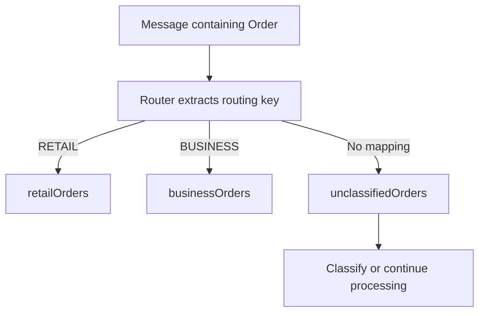

# Default output channel — The Router's default output channel

In Spring Integration Core, a router decides which `MessageChannel` a message goes to. When a system adds a new request type, incoming data may be structurally valid yet still lack a corresponding processing route. A **default output channel** lets you declare an explicit path for cases where no target could be determined.

This lesson belongs to the **Router** chapter and focuses on designing a default branch in a message flow: holding the message for reclassification, continuing into a general workflow, or intentionally dropping it per business requirements. The examples connect `Message`, channels, endpoints, and Java DSL; the test section shows how to verify both known and unknown routes.

## 1. Objectives and background knowledge

After this lesson, you will be able to:

- Distinguish routing keys, channel mappings, and the default output channel.
- Explain the relationship between `defaultOutputChannel`, `channelKeyFallback`, and `resolutionRequired`.
- Configure a default branch using Java DSL, Java configuration, and XML.
- Choose among a dedicated channel, default subflow, continuing the parent flow, and `nullChannel`.
- Test unknown data types and mappings pointing to nonexistent channels.

You should know the structure of `Message<T>`, payloads, headers, and how to declare Spring beans. The main example uses Java 17 and Spring Integration 6.x APIs with `IntegrationFlow.from(...)`. In a Spring Boot project, use the version set managed by Boot; if using standalone Spring, manage compatible dependencies accordingly.

Dependencies for the example include `spring-integration-core`; the testing section uses `spring-test` and JUnit Jupiter. No message broker, database, or `spring-integration-test` is needed for the channel checks in this lesson.

## 2. Role of the default branch

Suppose an application receives orders with a `kind` field:

| Routing key | Declared target |
| --- | --- |
| `RETAIL` | `retailOrders` |
| `BUSINESS` | `businessOrders` |
| Other value or missing | `unclassifiedOrders` |

`RETAIL` is a **business key**; `retailOrders` is a **channel bean name**. Mappings connect those two concepts. The default channel `unclassifiedOrders` receives unclassified orders so another step can decide what to do next.

A router can determine multiple targets. The default output channel is not a copy sent alongside every message. The common contract is to use it when the router determines no channels; if there are no targets and no default output channel, the router raises an error. [Common Router Parameters](https://docs.spring.io/spring-integration/reference/6.5/router/common-parameters.html).



The diagram depicts a policy that uses explicit mappings and disables treating keys as channel names. If channel-name routing is enabled, you must also consider the name-resolution step before concluding a message takes the default branch.

For orders, name the channel after its responsibility, such as `unclassifiedOrders` or `manualReviewOrders`. Names like `otherChannel` do not tell readers how messages will be handled.

## 3. Three settings to understand together

### 3.1. `defaultOutputChannel`: choosing the default destination

In Java DSL, you can specify a bean name or a channel object:

```java
.defaultOutputChannel("unclassifiedOrders")
```

```java
.defaultOutputChannel(unclassifiedOrders())
```

Pick one declaration style per router. The default destination is still an ordinary `MessageChannel`: it must be properly declared, able to accept messages, and have an appropriate way to consume them. The DSL provides both overloads in [AbstractRouterSpec](https://docs.spring.io/spring-integration/api/org/springframework/integration/dsl/AbstractRouterSpec.html).

### 3.2. `channelKeyFallback`: try treating the key as a channel name?

For routers that support mapping, if a key is not in the mapping table:

- `channelKeyFallback(true)`: try using the key itself to resolve a channel name.
- `channelKeyFallback(false)`: use only declared mappings; do not treat unknown keys as channel names.

For example, suppose the key is `retailOrders`, while the mapping table only contains `RETAIL` and `BUSINESS`. If this option is enabled, the router can find the `retailOrders` bean even though the key is not a registered order kind. Turning it off preserves the boundary between business values and infrastructure names. [RouterSpec.channelKeyFallback](https://docs.spring.io/spring-integration/api/org/springframework/integration/dsl/RouterSpec.html).

Since Spring Integration 6.0, configuring a default output channel on a router in the `AbstractMappingMessageRouter` family defaults `channelKeyFallback` to `false` if you haven't set it explicitly. This lesson still writes `.channelKeyFallback(false)` to show the policy right in the configuration. [Changes since version 6.0](https://docs.spring.io/spring-integration/reference/6.5/router/common-parameters.html).

### 3.3. `resolutionRequired`: must the target name resolve?

This setting applies once the router has a channel name to resolve:

- `true`: failing to resolve a target name raises an error; this is the default.
- `false`: skip unresolvable names and consider any remaining targets.

Two situations to distinguish:

1. Key `WHOLESALE` has no mapping, `channelKeyFallback(false)`: there is no target name to resolve; the message can go to default even with `resolutionRequired(true)`.
2. Key `RETAIL` maps to `retialOrders`, but that bean does not exist: this is a target-name resolution error; with `resolutionRequired(true)`, the error happens before the default branch.

This distinction follows the order of key extraction, mapping lookup, and channel resolution in [AbstractMappingMessageRouter](https://github.com/spring-projects/spring-integration/blob/6.5.x/spring-integration-core/src/main/java/org/springframework/integration/router/AbstractMappingMessageRouter.java).

With a fixed set of order kinds, you can disable `channelKeyFallback`, keep strict resolution requirements, and declare a default output channel. Unrouted data is captured separately while misspelled channel names are still caught.

### 3.4. Behavior table

The table applies to a mapping router, assuming the default output channel is valid and there are no message send failures.

| Situation | `channelKeyFallback` | `resolutionRequired` | Has default? | Outcome |
| --- | --- | --- | --- | --- |
| Mapped key, channel exists | `false` | `true` | Yes | Sent to mapped channel |
| Unmapped key | `false` | `true` | Yes | Sent to default |
| Mapped key, channel does not exist | `false` | `true` | Yes | Channel resolution error |
| Mapped key, channel does not exist | `false` | `false` | Yes | Bad target skipped; uses default if no targets remain |
| Unmapped key matching an existing channel name | `true` | `false` | Yes | Resolves key as channel and sends |
| Unmapped key, cannot resolve to channel | `true` | `false` | Yes | Uses default if no targets remain |
| Unmapped key | `false` | `false` | No | No targets; `MessageDeliveryException` |

In Spring Integration 6.x, the combination **default output channel + `channelKeyFallback(true)` + `resolutionRequired(true)`** is rejected when initializing `AbstractMappingMessageRouter`. [Router configuration constraints](https://docs.spring.io/spring-integration/reference/6.5/router/common-parameters.html).

Mapping rules do not apply identically to every router. A recipient list, for example, chooses recipients via conditions; you must understand how a specific router determines its target set.

## 4. Complete Java DSL example: classifying orders

The configuration has one input `DirectChannel` and three output `QueueChannel`s. The queues are for observing results and testing, with no business consumers attached yet.

```java
package vn.learning.integration.router;

import org.springframework.context.annotation.Bean;
import org.springframework.context.annotation.Configuration;
import org.springframework.integration.channel.DirectChannel;
import org.springframework.integration.channel.QueueChannel;
import org.springframework.integration.config.EnableIntegration;
import org.springframework.integration.dsl.IntegrationFlow;

@Configuration
@EnableIntegration
public class DefaultOutputChannelConfig {

    public record Order(String id, String kind) {
    }

    @Bean
    public DirectChannel ordersIn() {
        return new DirectChannel();
    }

    @Bean
    public QueueChannel retailOrders() {
        return new QueueChannel(20);
    }

    @Bean
    public QueueChannel businessOrders() {
        return new QueueChannel(20);
    }

    @Bean
    public QueueChannel unclassifiedOrders() {
        return new QueueChannel(20);
    }

    @Bean
    public IntegrationFlow orderRoutingFlow() {
        return IntegrationFlow.from(ordersIn())
                .<Order, String>route(
                        order -> routingKey(order.kind()),
                        router -> router
                                .channelMapping("RETAIL", "retailOrders")
                                .channelMapping("BUSINESS", "businessOrders")
                                .channelKeyFallback(false)
                                .resolutionRequired(true)
                                .defaultOutputChannel("unclassifiedOrders")
                                .sendTimeout(1_000))
                .get();
    }

    static String routingKey(String kind) {
        return kind == null || kind.isBlank() ? "UNKNOWN" : kind.trim();
    }
}
```

The `routingKey` function implements this example's specific policy: missing or blank values become `UNKNOWN`; other values only have leading/trailing whitespace trimmed. The function does not uppercase lowercase strings, so `retail` differs from `RETAIL`.

The value returned by the lambda is the **routing key**, not a replacement payload. An `Order` taking the default branch still keeps its original `id` and `kind`. Routing does not turn the payload into an error message. Lambda syntax and mappings are covered in [Java DSL Message Routers](https://docs.spring.io/spring-integration/reference/dsl/java-routers.html).

### 4.1. Sending and observing a message

In an application or test that already has a Spring context, you can send a message and then read from the default queue:

```java
import org.springframework.context.ApplicationContext;
import org.springframework.integration.channel.QueueChannel;
import org.springframework.messaging.Message;
import org.springframework.messaging.MessageChannel;
import org.springframework.messaging.support.MessageBuilder;
import vn.learning.integration.router.DefaultOutputChannelConfig.Order;

public final class RoutingDemo {

    private RoutingDemo() {
    }

    public static Message<?> sendUnknownOrder(ApplicationContext context) {
        MessageChannel input = context.getBean("ordersIn", MessageChannel.class);
        QueueChannel fallback = context.getBean(
                "unclassifiedOrders", QueueChannel.class);

        Order order = new Order("O-103", "WHOLESALE");
        Message<Order> request = MessageBuilder.withPayload(order)
                .setHeader("traceId", "trace-103")
                .build();

        input.send(request);
        return fallback.receive(1_000);
    }
}
```

The expected result contains `Order("O-103", "WHOLESALE")` and header `traceId=trace-103`. The router does not rewrite `kind` to `UNKNOWN`; normalization serves only the routing decision.

| Input payload | Computed key | Receiving channel |
| --- | --- | --- |
| `Order("O-101", "RETAIL")` | `RETAIL` | `retailOrders` |
| `Order("O-102", "BUSINESS")` | `BUSINESS` | `businessOrders` |
| `Order("O-103", "WHOLESALE")` | `WHOLESALE` | `unclassifiedOrders` |
| `Order("O-104", null)` | `UNKNOWN` | `unclassifiedOrders` |
| `Order("O-105", "  ")` | `UNKNOWN` | `unclassifiedOrders` |
| `Order("O-106", "retailOrders")` | `retailOrders` | `unclassifiedOrders` |

The last row verifies the policy of not using bean names as hidden routes. Even though `retailOrders` is a real bean, the application only accepts mapped business keys.

### 4.2. What do the queues mean in the example?

`QueueChannel` holds messages in a queue. Succeeding in sending to the queue does not mean business work is finished; a consumer needs to receive messages via a poller or suitable consumption mechanism. These queues store in memory and do not guarantee persistence across application restarts.

`sendTimeout(1_000)` bounds how long the router waits when sending to a wait-capable channel, such as a full queue. It does not bound the execution time of a synchronous handler behind a `DirectChannel`. [MessageChannel implementations](https://docs.spring.io/spring-integration/reference/channel/implementations.html).

If the requirement is never to lose unclassified orders, design durable storage and reprocessing. The name `unclassifiedOrders` only identifies the responsibility; it does not yet provide those operational guarantees.

## 5. Java configuration and XML

### 5.1. Java configuration with `HeaderValueRouter`

When the order kind sits in an `orderKind` header, a specialized router can be used. The following bean replaces `orderRoutingFlow`, reusing the channels from the main configuration:

```java
import org.springframework.context.annotation.Bean;
import org.springframework.integration.annotation.ServiceActivator;
import org.springframework.integration.router.HeaderValueRouter;

@Bean
@ServiceActivator(inputChannel = "ordersIn")
public HeaderValueRouter orderKindRouter() {
    HeaderValueRouter router = new HeaderValueRouter("orderKind");
    router.setChannelMapping("RETAIL", "retailOrders");
    router.setChannelMapping("BUSINESS", "businessOrders");
    router.setChannelKeyFallback(false);
    router.setResolutionRequired(true);
    router.setDefaultOutputChannelName("unclassifiedOrders");
    router.setSendTimeout(1_000);
    return router;
}
```

Place the method in a configuration class annotated with `@EnableIntegration`. Choose only one router for `ordersIn` when practicing. If you register both the bean above and the earlier DSL flow together, the input has two subscribers, so results will no longer reflect a single router.

Messages sent into this configuration use the `orderKind` header to pick a known route. The `kind` field inside the payload does not automatically become the routing key. [HeaderValueRouter configuration](https://docs.spring.io/spring-integration/reference/6.5/router/implementations.html).

### 5.2. XML with `header-value-router`

This is a standalone XML approach based on headers; do not load it together with the Java configuration above:

```xml
<?xml version="1.0" encoding="UTF-8"?>
<beans xmlns="http://www.springframework.org/schema/beans"
       xmlns:xsi="http://www.w3.org/2001/XMLSchema-instance"
       xmlns:int="http://www.springframework.org/schema/integration"
       xsi:schemaLocation="
           http://www.springframework.org/schema/beans
           https://www.springframework.org/schema/beans/spring-beans.xsd
           http://www.springframework.org/schema/integration
           https://www.springframework.org/schema/integration/spring-integration.xsd">

    <int:channel id="ordersIn"/>

    <int:channel id="retailOrders">
        <int:queue capacity="20"/>
    </int:channel>

    <int:channel id="businessOrders">
        <int:queue capacity="20"/>
    </int:channel>

    <int:channel id="unclassifiedOrders">
        <int:queue capacity="20"/>
    </int:channel>

    <int:header-value-router input-channel="ordersIn"
                             header-name="orderKind"
                             channel-key-fallback="false"
                             resolution-required="true"
                             default-output-channel="unclassifiedOrders"
                             timeout="1000">
        <int:mapping value="RETAIL" channel="retailOrders"/>
        <int:mapping value="BUSINESS" channel="businessOrders"/>
    </int:header-value-router>
</beans>
```

Attribute and method names vary by configuration style: XML uses `default-output-channel`; Java bean uses `setDefaultOutputChannelName(...)`; DSL uses `defaultOutputChannel(...)`.

## 6. Options for the default branch in Java DSL

The snippets below are **alternative variants**, reusing `Order`, `routingKey`, and the channel beans from the main configuration. Replace the corresponding flow method when practicing to avoid multiple subscribers on the input.

### 6.1. Using a dedicated channel

```java
.defaultOutputChannel("unclassifiedOrders")
```

This suits cases where multiple flows send unclassified requests to a shared destination. Consumers and persistence can be deployed independently of the router.

### 6.2. Using `defaultSubFlowMapping(...)`

If metadata needs to be added before putting the message into the queue:

```java
@Bean
public IntegrationFlow orderRoutingFlow() {
    return IntegrationFlow.from(ordersIn())
            .<Order, String>route(
                    order -> routingKey(order.kind()),
                    router -> router
                            .channelMapping("RETAIL", "retailOrders")
                            .channelMapping("BUSINESS", "businessOrders")
                            .channelKeyFallback(false)
                            .resolutionRequired(true)
                            .defaultSubFlowMapping(fallback -> fallback
                                    .enrichHeaders(headers -> headers
                                            .header("routingReason", "UNCLASSIFIED"))
                                    .channel("unclassifiedOrders")))
            .get();
}
```

`routingReason` is an application header added by a header enricher. A default output channel does not generate a reason on its own. The DSL uses the subflow's input as the router's default target. [AbstractRouterSpec](https://github.com/spring-projects/spring-integration/blob/6.5.x/spring-integration-core/src/main/java/org/springframework/integration/dsl/AbstractRouterSpec.java).

To distinguish "missing kind" from "unsupported kind", compute the reason from the message or run a normalization step before the router. A single generic `UNCLASSIFIED` label does not provide that distinction.

### 6.3. Using `defaultOutputToParentFlow()`

When you want messages matching no mapping to continue to the step right after the router in the parent flow:

```java
@Bean
public IntegrationFlow orderRoutingFlow() {
    return IntegrationFlow.from(ordersIn())
            .<Order, String>route(
                    order -> routingKey(order.kind()),
                    router -> router
                            .channelMapping("RETAIL", "retailOrders")
                            .channelMapping("BUSINESS", "businessOrders")
                            .resolutionRequired(true)
                            .defaultOutputToParentFlow())
            .channel("unclassifiedOrders")
            .get();
}
```

In the example, `RETAIL` and `BUSINESS` go to their mapped channels; only unmatched messages continue to `unclassifiedOrders`. The line after `.route(...)` does not automatically become a shared step for every branch. In Spring Integration 6.x, this `RouterSpec` method also disables `channelKeyFallback`. [RouterSpec](https://github.com/spring-projects/spring-integration/blob/6.5.x/spring-integration-core/src/main/java/org/springframework/integration/dsl/RouterSpec.java).

If you want all branches to converge at one step, design a convergence point or a subflow reply mechanism. The default output channel does not replace an aggregator's gathering function.

### 6.4. Dropping messages with `nullChannel`

When business logic permits dropping unrouted messages:

```java
.channelKeyFallback(false)
.defaultOutputChannel("nullChannel")
```

`nullChannel` is provided by Spring Integration to accept and discard messages. It does not store requests for reprocessing. [Configuring nullChannel](https://docs.spring.io/spring-integration/reference/router/common-parameters.html).

An auxiliary analytics flow might accept dropping out-of-scope events. For orders that must be tracked, a branch storing unclassified orders is usually more appropriate. The decision must stem from business requirements.

## 7. Relationship with error handling

### 7.1. No route vs. execution error

| Event | Meaning in example | Expected handling |
| --- | --- | --- |
| Unmapped `WHOLESALE` | No business route yet | Route to `unclassifiedOrders` |
| Mapping points to wrong bean name | Broken configuration | Catch via error and tests |
| Key-extraction function throws | Cannot compute routing decision | Handle exception at call boundary |
| Order-handling handler throws | Business execution failed | Error flow, retry, or recovery per design |
| Output queue full | Target cannot accept in time | Handle delivery error and load pressure |

By default `ignoreSendFailures` is `false`: errors sending to a selected route are thrown. Do not expect the router to automatically move that order into the unclassified group.

There is a subtlety when enabling `ignoreSendFailures(true)`: in `AbstractMessageRouter` on the 6.5.x branch, the router ignores `MessagingException`s when sending to normal targets. If no target send succeeds, it can try the default output channel. Thus, "default only appears when there is no mapping" does not cover that configuration. This follows from [AbstractMessageRouter's send-handling code](https://github.com/spring-projects/spring-integration/blob/6.5.x/spring-integration-core/src/main/java/org/springframework/integration/router/AbstractMessageRouter.java).

That mechanism does not provide general retries. If a synchronous handler already produced side effects before throwing, shifting to another branch could cause business logic to execute a second time. The main example keeps the default `ignoreSendFailures(false)` to separate execution failures from unclassified orders.

### 7.2. `errorChannel` has a separate role

The default output channel receives the message currently being routed. The error flow mechanism can receive an `ErrorMessage` wrapping an exception. With a synchronous flow over `DirectChannel`, exceptions typically propagate to the caller; simply adding an `errorChannel` header does not automatically turn every synchronous error into an error message.

With framework-managed asynchronous tasks or pollers, error publishing can send an `ErrorMessage` to the channel named in the `errorChannel` header, or the corresponding global error channel. Gateways also have their own error-handling policies. [Error Handling](https://docs.spring.io/spring-integration/reference/error-handling.html).

If a gateway expects a reply, the default branch must fulfill that contract. Sending a request into a queue or `nullChannel` does not create a response on its own. You can choose a "pending classification" result, an explicit rejection response, or a one-way send interface depending on application requirements.

## 8. Testing with Spring Test and JUnit 5

### 8.1. Testing the main DSL configuration

Place the class below in the same package as the configuration. Tests verify the target recipient, payload, trace header, and absence of stray messages in other queues.

```java
package vn.learning.integration.router;

import org.junit.jupiter.api.BeforeEach;
import org.junit.jupiter.api.Test;
import org.springframework.beans.factory.annotation.Autowired;
import org.springframework.beans.factory.annotation.Qualifier;
import org.springframework.integration.channel.QueueChannel;
import org.springframework.messaging.Message;
import org.springframework.messaging.MessageChannel;
import org.springframework.messaging.support.MessageBuilder;
import org.springframework.test.context.junit.jupiter.SpringJUnitConfig;

import vn.learning.integration.router.DefaultOutputChannelConfig.Order;

import static org.junit.jupiter.api.Assertions.assertEquals;
import static org.junit.jupiter.api.Assertions.assertNotNull;
import static org.junit.jupiter.api.Assertions.assertNull;
import static org.junit.jupiter.api.Assertions.assertTrue;

@SpringJUnitConfig(DefaultOutputChannelConfig.class)
class DefaultOutputChannelTest {

    @Autowired
    @Qualifier("ordersIn")
    MessageChannel input;

    @Autowired
    @Qualifier("retailOrders")
    QueueChannel retail;

    @Autowired
    @Qualifier("businessOrders")
    QueueChannel business;

    @Autowired
    @Qualifier("unclassifiedOrders")
    QueueChannel unclassified;

    @BeforeEach
    void drainQueues() {
        for (QueueChannel channel : new QueueChannel[] {
                retail, business, unclassified}) {
            while (channel.receive(0) != null) {
                // Clear remaining data between tests sharing the context.
            }
        }
    }

    @Test
    void routesKnownKinds() {
        assertOnlyDestination(new Order("O-101", "RETAIL"), retail);
        assertOnlyDestination(new Order("O-102", "BUSINESS"), business);
    }

    @Test
    void routesUnknownKindToDefault() {
        assertOnlyDestination(new Order("O-103", "WHOLESALE"), unclassified);
    }

    @Test
    void routesMissingOrBlankKindToDefault() {
        assertOnlyDestination(new Order("O-104", null), unclassified);
        assertOnlyDestination(new Order("O-105", "  "), unclassified);
    }

    @Test
    void doesNotUseUnknownKeyAsChannelBeanName() {
        assertOnlyDestination(new Order("O-106", "retailOrders"), unclassified);
    }

    private void assertOnlyDestination(Order order, QueueChannel expected) {
        Message<Order> request = MessageBuilder.withPayload(order)
                .setHeader("traceId", "trace-" + order.id())
                .build();

        assertTrue(input.send(request));

        Message<?> result = expected.receive(1_000);
        assertNotNull(result);
        assertEquals(order, result.getPayload());
        assertEquals(request.getHeaders().get("traceId"),
                result.getHeaders().get("traceId"));

        assertNull(retail.receive(0));
        assertNull(business.receive(0));
        assertNull(unclassified.receive(0));
    }
}
```

The tests assume sequential execution and no other consumers reading from the three queues. `ordersIn` is a `DirectChannel`, so the router puts the message into the queue before `send` returns. No `Thread.sleep(...)` is needed to wait for background tasks in this configuration.

Checking payload and `traceId` confirms the default branch preserves trace metadata. Checking the remaining queues catches configurations that accidentally send multiple copies.

### 8.2. Testing a broken mapping

You can test the strict resolution policy with a standalone router. Add the required imports and members below to the test class above:

```java
import org.springframework.context.ApplicationContext;
import org.springframework.integration.router.HeaderValueRouter;
import org.springframework.messaging.MessagingException;

import static org.junit.jupiter.api.Assertions.assertThrows;

@Autowired
ApplicationContext context;

@Test
void failsWhenExplicitMappingPointsToMissingChannel() {
    QueueChannel isolatedFallback = new QueueChannel();
    HeaderValueRouter router = new HeaderValueRouter("orderKind");
    router.setBeanFactory(context);
    router.setChannelMapping("RETAIL", "channelThatDoesNotExistForThisTest");
    router.setChannelKeyFallback(false);
    router.setResolutionRequired(true);
    router.setDefaultOutputChannel(isolatedFallback);
    router.afterPropertiesSet();

    Message<Order> request = MessageBuilder
            .withPayload(new Order("O-107", "RETAIL"))
            .setHeader("orderKind", "RETAIL")
            .build();

    assertThrows(MessagingException.class, () -> router.handleMessage(request));
    assertNull(isolatedFallback.receive(0));
}
```

The nonexistent channel name is an intentional test input; the fallback uses an isolated queue to avoid affecting the active flow. The test expresses the requirement: a key mapped to broken infrastructure must be caught, even when a default target exists.

The test code in this lesson is intended to run in a project with compatible dependencies. Writing this lesson does not imply a build or application test run was executed here.

### 8.3. Scenarios to verify in real applications

| Situation | What to verify |
| --- | --- |
| No default and no target | Raises an error, does not silently lose the message |
| Key-as-channel-name routing enabled | Keys matching beans obey the selected policy |
| `resolutionRequired` disabled | Bad targets are skipped; fallback receives only when no valid targets remain |
| Synchronous handler throws | Default configuration propagates error, does not send to fallback instead |
| Default queue full | Finite wait time, appropriate failure outcome |
| Reply-expecting gateway | Default branch satisfies the reply contract |
| Multi-target router | No extra copy sent to default when at least one normal target succeeded |

## 9. Designing the default branch to be operable

Define who resolves an order landing in `unclassifiedOrders` and within what timeframe. You can store pending records containing the order ID, computed key, reason, receipt timestamp, and trace ID. Once a mapping is added, reprocessing must recognize already-completed orders to avoid duplicate side effects.

Useful metrics for the order example:

- Number of orders entering the default branch and its ratio to total input.
- Number of pending orders and maximum wait age.
- Number of failures in the default branch's consumer.
- Breakdown by stable reason groups, such as missing order kind or unsupported kind.

Do not use arbitrary `kind` values as metric labels. Detailed values belong in controlled trace logs; metrics should use bounded categories. If the unclassified rate spikes after a deployment, check the data contract and mapping table before scaling consumers.

If multiple consecutive routers each have a default branch, make clear which classification stage a message is in. Routing back to the input without changing data or policy can trap an order in an infinite loop. Reprocessing flows should have a terminal state and retry limit.

## 10. Connections to other components

In a complete flow, a transformer can normalize data before the router; a filter drops requests failing intake criteria; the router classifies accepted messages; endpoints execute business work in each branch. When multiple results must be merged, an aggregator handles grouping and completion logic according to its own design.

The default output channel defines the remaining path of a routing decision. It does not by itself provide error storage, result aggregation, or gateway replies. When choosing a default branch, state clearly whether messages are held, processed further, or discarded; then verify with concrete inputs like the tests in this lesson.