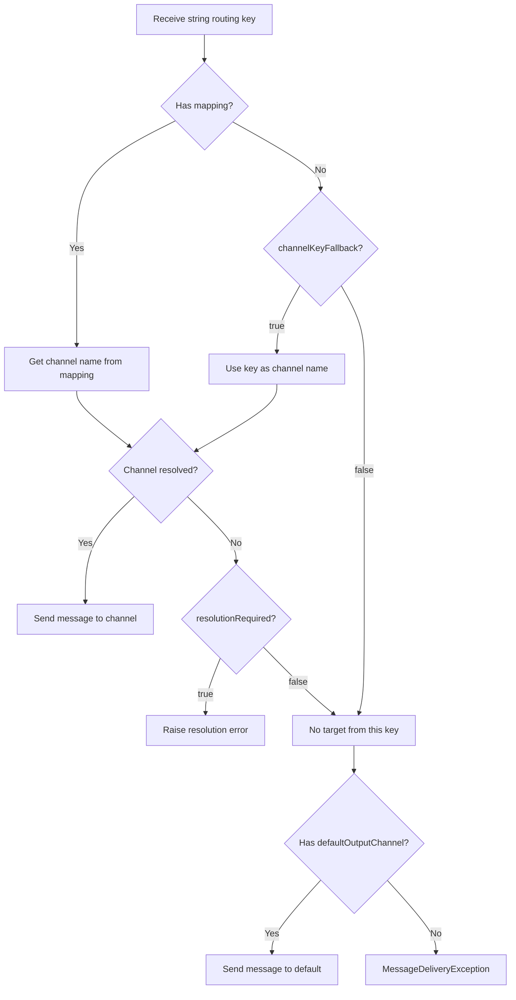

# Resolution required in Spring Integration Router

## 1. Objectives and context

In the Router chapter of `SPRING_INTEGRATION_CORE`, `resolutionRequired` decides how a router reacts when a channel name cannot be resolved to a `MessageChannel` object. Understanding this property helps you design message flows with clear behavior when routing data or configuration is wrong.

For example, a system receives orders with an `orderType` header:

- `ONLINE` goes to `onlineOrders`.
- `STORE` goes to `storeOrders`.
- Unsupported order types go to `unroutableOrders` for review.

Two situations must be handled intentionally: a partner sends a new order type `PARTNER`, and a developer mistypes a channel name as `onlienOrders`. The first situation may be business data needing separate intake; the second is a configuration error that should surface early when a flow uses that mapping.

After this lesson, you will be able to:

- Distinguish routing keys, channel mappings, channel resolution, and message sending.
- Choose `resolutionRequired(true)` or `false` per the flow's contract.
- Combine this property with `channelKeyFallback` and `defaultOutputChannel`.
- Write Java DSL configuration, read equivalent XML configuration, and test failure branches.

The lesson uses Spring Integration 6.x APIs, taking the 6.5 branch as the baseline for examples. Default rules that changed since 6.0 are called out explicitly; do not infer older project behavior from property names alone.

## 2. Which steps does a router perform?

A mapping-based router typically goes through these steps:

```text
Message(payload, headers)
    -> extract routing key
    -> look up channel mapping or use key as channel name if permitted
    -> resolve name to MessageChannel
    -> send message to channel
```

With input:

```java
Message<String> message = MessageBuilder.withPayload("ORDER-1001")
        .setHeader("orderType", "ONLINE")
        .build();
```

and mapping:

```text
ONLINE -> onlineOrders
```

each part plays a different role:

| Component | Value in example | Meaning |
| --- | --- | --- |
| Payload | `ORDER-1001` | Business data being forwarded |
| Routing header | `orderType` | Where the router reads info to decide the path |
| Routing key | `ONLINE` | Key used to look up the mapping |
| Channel name after mapping | `onlineOrders` | Name for the resolver to look up |
| Actual channel | `QueueChannel` or `DirectChannel` bean | Target on which the router calls `send(...)` |

In a typical Spring application, the resolver looks up channels by bean name. A mapping existing does not guarantee the target channel exists. Conversely, a channel existing does not guarantee there is a consumer or that the consumer processes successfully.

`resolutionRequired` affects the **channel name resolution** step. It does not validate all business data and does not confirm downstream processing succeeded. Mapping header values to channel names is described in [Router Implementations — HeaderValueRouter](https://docs.spring.io/spring-integration/reference/6.5/router/implementations.html#router-implementations-headervalue-router).

## 3. Meaning of `resolutionRequired`

### 3.1. When `true`

The default value of `resolutionRequired` is `true`. If the router needs to resolve a channel name and fails, the router throws `MessagingException`; the underlying cause may be `DestinationResolutionException`.

For example:

```text
orderType = ONLINE
mapping: ONLINE -> onlienOrders
actual bean: onlineOrders
```

The router found the mapping, but the name `onlienOrders` cannot be resolved. With `resolutionRequired(true)`, this error is raised for the flow's error-handling mechanism to receive.

### 3.2. When `false`

When set to `resolutionRequired(false)`, unresolvable channel names are skipped while determining targets. The router still needs somewhere to deliver the message: another valid target or the default channel.

The [Common Router Parameters](https://docs.spring.io/spring-integration/reference/6.5/router/common-parameters.html) documentation defines this property at the name-resolution level. Therefore, do not interpret `false` as "all router errors are ignored".

Three cases to keep separate:

| After skipping invalid names | Outcome when sending to remaining target succeeds |
| --- | --- |
| At least one valid channel remains | Sent to valid channels |
| No channel remains, valid `defaultOutputChannel` exists | Message sent to default channel |
| No channel remains, no default channel exists | Throws `MessageDeliveryException` |

The rule for no targets and no default channel is presented in the [HeaderValueRouter section](https://docs.spring.io/spring-integration/reference/6.5/router/implementations.html#router-implementations-headervalue-router). `false` does not mean automatically discarding the message.

## 4. Three properties to read together

| Property | Question the property answers |
| --- | --- |
| `channelKeyFallback` | When a key is missing from mappings, try using the key itself as a channel name? |
| `resolutionRequired` | When a channel name needs resolution and the resolver fails, raise an error immediately? |
| `defaultOutputChannel` | When the message cannot be sent to a normal target per router policy, what is the default channel? |

### 4.1. No mapping vs. mapping resolution failure

Suppose:

```text
mapping: ONLINE -> onlineOrders
channelKeyFallback = false
resolutionRequired = true
defaultOutputChannel = unroutableOrders
```

- Key `PARTNER` has no mapping. Because key fallback is disabled, the router does not look for a bean named `PARTNER`; the message can go to the default channel.
- Key `ONLINE` has a mapping. The router still has to resolve `onlineOrders`; if that channel is missing, `resolutionRequired(true)` causes an error.

This is a useful configuration when you want new order types accepted into a separate holding queue while still catching misconfigured target names.

### 4.2. Changes since Spring Integration 6.0

Since 6.0, configuring a default channel turns `channelKeyFallback` to `false` if you have not explicitly set that property. If you explicitly specified `channelKeyFallback(true)`, that setting is respected. To make intent immediately clear to readers, the main examples still write `channelKeyFallback(false)` explicitly.

The combination of a default channel with `channelKeyFallback(true)` and `resolutionRequired(true)` is rejected when initializing the router. Choose a consistent policy instead of treating the default channel as a place to catch every error. See [AbstractMappingMessageRouter API](https://docs.spring.io/spring-integration/docs/6.3.x/api/org/springframework/integration/router/AbstractMappingMessageRouter.html).

If you need to attempt dynamic routing by name and send nonexistent names to a fallback, a valid configuration is:

```java
.route("headers['targetChannel']", router -> router
        .channelKeyFallback(true)
        .resolutionRequired(false)
        .defaultOutputChannel("unroutableOrders"))
```

This is an illustrative DSL snippet for placing inside an `IntegrationFlow`; by itself it is not a complete application configuration. Only use this routing style when the source supplying target names is controlled.

### 4.3. Behavior table for a single routing key

Assume there is a single string key, fallback channels exist, and sending to valid channels succeeds. The values below are the **effective** configuration after initialization.

| Key/mapping state | `channelKeyFallback` | `resolutionRequired` | Has default? | Behavior |
| --- | --- | --- | --- | --- |
| Mapped, target channel exists | `false` | `true` or `false` | Yes or no | Sent to mapped channel |
| Mapped, target channel missing | `false` | `true` | Yes or no | Raises resolution error |
| Mapped, target channel missing | `false` | `false` | Yes | Sent to default |
| Mapped, target channel missing | `false` | `false` | No | No targets; throws `MessageDeliveryException` |
| Unmapped | `false` | `true` or `false` | Yes | Does not try key as channel; sends to default |
| Unmapped | `false` | `true` or `false` | No | No targets; throws `MessageDeliveryException` |
| Unmapped, key is an existing channel name | `true` | `true` or `false` | No | Sent to channel named by key |
| Unmapped, key is a missing channel name | `true` | `true` | No | Raises resolution error |
| Unmapped, key is a missing channel name | `true` | `false` | Yes | Skips missing name and sends to default |
| Any key | `true` | `true` | Yes | Configuration combination rejected at initialization |

The table applies the policy to sample scenarios, based on [AbstractMappingMessageRouter's mapping logic](https://github.com/spring-projects/spring-integration/blob/v6.5.0/spring-integration-core/src/main/java/org/springframework/integration/router/AbstractMappingMessageRouter.java).

## 5. Decision flowchart

This diagram describes a single string key and assumes sending succeeds. It does not depict send failures or all router types.



If the router returns no key, such as when the header to look up is missing, the flow goes straight to the no-target branch. Specify clearly whether a missing header is data to place into a separate holding queue or input to reject before the router.

## 6. Complete example with Java DSL

### 6.1. Prerequisites

The example uses Java 17 or later, Spring Integration 6.5.x, and compatible Spring Context. It requires `org.springframework.integration:spring-integration-core`; in Spring Boot you can use `spring-boot-starter-integration` and let Boot's dependency management handle versions.

The configuration uses a `DirectChannel` on the input and `QueueChannel`s on the outputs for easy observation. The queues in the example are in-process memory; in deployment, choose suitable persistence if orders must survive restarts.

### 6.2. Order flow configuration

```java
import org.springframework.context.annotation.Bean;
import org.springframework.context.annotation.Configuration;
import org.springframework.integration.channel.DirectChannel;
import org.springframework.integration.channel.QueueChannel;
import org.springframework.integration.config.EnableIntegration;
import org.springframework.integration.dsl.IntegrationFlow;

@Configuration
@EnableIntegration
public class OrderRoutingConfiguration {

    @Bean
    public DirectChannel orderInput() {
        return new DirectChannel();
    }

    @Bean
    public QueueChannel onlineOrders() {
        return new QueueChannel();
    }

    @Bean
    public QueueChannel storeOrders() {
        return new QueueChannel();
    }

    @Bean
    public QueueChannel unroutableOrders() {
        return new QueueChannel();
    }

    @Bean
    public IntegrationFlow orderRoutingFlow() {
        return IntegrationFlow.from(orderInput())
                .route("headers['orderType']", router -> router
                        .channelMapping("ONLINE", "onlineOrders")
                        .channelMapping("STORE", "storeOrders")
                        .channelKeyFallback(false)
                        .resolutionRequired(true)
                        .defaultOutputChannel("unroutableOrders"))
                .get();
    }
}
```

Here, a router endpoint registers to receive messages from `orderInput`. The SpEL expression reads the header to produce a key; mappings state the routing contract. Corresponding DSL methods are listed in [RouterSpec](https://docs.spring.io/spring-integration/api/org/springframework/integration/dsl/RouterSpec.html), and expression usage in `.route(...)` is in [Message Routers — Java DSL](https://docs.spring.io/spring-integration/reference/dsl/java-routers.html).

The configuration selects this policy:

- Valid mapping forwards the order to the corresponding branch.
- No mapping keeps the order in `unroutableOrders`.
- Mapping exists, but target name fails to resolve raises an error.

### 6.3. Sending and observing messages

The following class uses the same `OrderRoutingConfiguration` in a standard Java application:

```java
import org.springframework.context.annotation.AnnotationConfigApplicationContext;
import org.springframework.integration.channel.QueueChannel;
import org.springframework.messaging.Message;
import org.springframework.messaging.MessageChannel;
import org.springframework.messaging.support.MessageBuilder;

public class OrderRoutingDemo {

    public static void main(String[] args) {
        try (var context = new AnnotationConfigApplicationContext(
                OrderRoutingConfiguration.class)) {

            MessageChannel input = context.getBean(
                    "orderInput", MessageChannel.class);
            QueueChannel online = context.getBean(
                    "onlineOrders", QueueChannel.class);
            QueueChannel fallback = context.getBean(
                    "unroutableOrders", QueueChannel.class);

            input.send(MessageBuilder.withPayload("ORDER-1001")
                    .setHeader("orderType", "ONLINE")
                    .build());

            input.send(MessageBuilder.withPayload("ORDER-1002")
                    .setHeader("orderType", "PARTNER")
                    .build());

            Message<?> onlineMessage = online.receive(1000);
            Message<?> fallbackMessage = fallback.receive(1000);

            System.out.println(onlineMessage == null
                    ? "No online order"
                    : onlineMessage.getPayload());
            System.out.println(fallbackMessage == null
                    ? "No order for review"
                    : fallbackMessage.getPayload());
        }
    }
}
```

Expected output when run:

```text
ORDER-1001
ORDER-1002
```

With this configuration, `PARTNER` reaches the fallback even though `resolutionRequired` is still `true`: there is no resolution step for the name `PARTNER` because key fallback is disabled. To observe the configuration-error branch, temporarily change the `ONLINE` mapping to `onlienOrders` in your practice copy; when sending an `ONLINE` order, the resolution error is thrown back to the synchronous `send(...)` call.

### 6.4. When business logic accepts skipping unresolvable targets

If the contract allows missing configured targets to fall back to the holding queue as well, replace `resolutionRequired(true)` with `resolutionRequired(false)` in the configuration above. Document the reason and set up operational alerts, because a typo in a mapping can now look like an unsupported order type.

The example design chooses `true` to preserve that distinction. Using `false` should stem from a concrete processing requirement, such as an optional branch enabled per environment with a standing destination for unforwarded messages.

## 7. Equivalent XML configuration

For systems using Spring Integration's XML namespace, the attribute name is `resolution-required`.

```xml
<?xml version="1.0" encoding="UTF-8"?>
<beans xmlns="http://www.springframework.org/schema/beans"
       xmlns:xsi="http://www.w3.org/2001/XMLSchema-instance"
       xmlns:int="http://www.springframework.org/schema/integration"
       xsi:schemaLocation="
           http://www.springframework.org/schema/beans
           https://www.springframework.org/schema/beans/spring-beans.xsd
           http://www.springframework.org/schema/integration
           https://www.springframework.org/schema/integration/spring-integration.xsd">

    <int:channel id="orderInput"/>

    <int:channel id="onlineOrders">
        <int:queue/>
    </int:channel>

    <int:channel id="storeOrders">
        <int:queue/>
    </int:channel>

    <int:channel id="unroutableOrders">
        <int:queue/>
    </int:channel>

    <int:header-value-router input-channel="orderInput"
                             header-name="orderType"
                             channel-key-fallback="false"
                             resolution-required="true"
                             default-output-channel="unroutableOrders">
        <int:mapping value="ONLINE" channel="onlineOrders"/>
        <int:mapping value="STORE" channel="storeOrders"/>
    </int:header-value-router>
</beans>
```

XML and the Java DSL configuration above are two alternative declarations for the same policy. When practicing, choose one to avoid creating two consumers competing on the input.

On plain Java beans, the corresponding setter APIs are `setResolutionRequired(boolean)`, `setChannelKeyFallback(boolean)`, and `setDefaultOutputChannel(...)` or `setDefaultOutputChannelName(...)`.

## 8. Multiple targets: skipping one name does not mean dropping the whole message

A router supporting multiple keys can return a list such as:

```text
["onlineOrders", "optionalAuditOrders"]
```

Suppose channel names are used directly, key fallback is enabled, `onlineOrders` exists, and `optionalAuditOrders` is missing:

- With `resolutionRequired(false)`, the router can skip the missing name and send to `onlineOrders`.
- With `resolutionRequired(true)`, resolution fails. In a standard mapping router, the target list is resolved before the send loop, so this resolution error should not be assumed to mean "the first target definitely already received it".

The resolve-list-then-send structure is visible in [AbstractMessageRouter](https://github.com/spring-projects/spring-integration/blob/v6.5.0/spring-integration-core/src/main/java/org/springframework/integration/router/AbstractMessageRouter.java). This is also why resolution-error tests should be separated from send-error tests.

In the order system, if audit is mandatory, skipping the audit branch violates the contract even though the order proceeds to main processing. If audit is optional, design dedicated monitoring for that branch rather than treating success on one target as complete success of the entire workflow.

## 9. Distinguishing resolution errors, send errors, and business errors

| Stage | Example | Mechanism to examine |
| --- | --- | --- |
| Key selection | Header has wrong type; routing function throws | Input validation, routing function, error flow |
| Channel resolution | Mapping points to misspelled bean name | `resolutionRequired` |
| Channel send | `DirectChannel` has no subscriber; bounded queue is full | Channel type, timeout, `ignoreSendFailures`, error flow |
| Downstream processing | Service activator fails calling an external service | Retry, transaction, compensation, error-handling policies |

`ignoreSendFailures` governs errors during the send stage, not `resolutionRequired`. With `DirectChannel`, the downstream handler runs on the same thread, so errors from the handler can surface as send failures on that branch. The [Common Router Parameters — ignore-send-failures](https://docs.spring.io/spring-integration/reference/router/common-parameters.html) documentation explains this channel-type dependency.

When sending directly into a synchronous flow via `DirectChannel`, exceptions propagate to the caller. Merely adding an `errorChannel` header does not turn every synchronous exception into an `ErrorMessage`. With a framework-managed poller or asynchronous processing, the error-handling mechanism can publish an `ErrorMessage`; in that case check the error handler configuration and error channel. See [Error Handling](https://docs.spring.io/spring-integration/reference/error-handling.html).

If using a messaging gateway, also read the gateway's reply and error-propagation policies. Putting a request into a fallback queue does not automatically generate a reply for a request-reply call; the fallback branch needs reply or timeout behavior matching the gateway contract.

## 10. Testing the routing policy

The tests below test the router standalone with JUnit Jupiter. They use a stub resolver providing only two intentional channels, making valid names vs. missing names easy to distinguish without application startup overhead.

You need `spring-integration-core` and JUnit Jupiter on the test classpath. The code below is an example for learners to drop into a practice project; this lesson does not claim the tests were run in the repository.

```java
import org.junit.jupiter.api.Test;
import org.springframework.integration.channel.QueueChannel;
import org.springframework.integration.router.HeaderValueRouter;
import org.springframework.messaging.Message;
import org.springframework.messaging.MessageDeliveryException;
import org.springframework.messaging.MessagingException;
import org.springframework.messaging.core.DestinationResolutionException;
import org.springframework.messaging.support.MessageBuilder;

import static org.junit.jupiter.api.Assertions.assertDoesNotThrow;
import static org.junit.jupiter.api.Assertions.assertNotNull;
import static org.junit.jupiter.api.Assertions.assertNull;
import static org.junit.jupiter.api.Assertions.assertSame;
import static org.junit.jupiter.api.Assertions.assertThrows;

class ResolutionRequiredTest {

    private final QueueChannel online = new QueueChannel();
    private final QueueChannel fallback = new QueueChannel();

    private HeaderValueRouter configuredRouter(
            boolean required, boolean withDefault) {

        HeaderValueRouter router = new HeaderValueRouter("orderType");
        router.setChannelMapping("ONLINE", "onlineOrders");
        router.setChannelMapping("BROKEN", "missingOrders");
        router.setChannelKeyFallback(false);
        router.setResolutionRequired(required);

        router.setChannelResolver(name -> {
            if ("onlineOrders".equals(name)) {
                return online;
            }
            if ("unroutableOrders".equals(name)) {
                return fallback;
            }
            throw new DestinationResolutionException(
                    "Unregistered channel: " + name);
        });

        if (withDefault) {
            router.setDefaultOutputChannel(fallback);
        }

        router.afterPropertiesSet();
        return router;
    }

    private Message<String> order(String type) {
        return MessageBuilder.withPayload("ORDER-TEST")
                .setHeader("orderType", type)
                .build();
    }

    @Test
    void validMappingRoutesToBusinessChannel() {
        HeaderValueRouter router = configuredRouter(true, true);
        Message<String> message = order("ONLINE");

        router.handleMessage(message);

        assertSame(message, online.receive(0));
        assertNull(fallback.receive(0));
    }

    @Test
    void unknownKeyUsesDefaultEvenWhenResolutionIsRequired() {
        HeaderValueRouter router = configuredRouter(true, true);
        Message<String> message = order("PARTNER");

        router.handleMessage(message);

        assertSame(message, fallback.receive(0));
        assertNull(online.receive(0));
    }

    @Test
    void missingMappedChannelThrowsWhenResolutionIsRequired() {
        HeaderValueRouter router = configuredRouter(true, true);

        MessagingException error = assertThrows(MessagingException.class,
                () -> router.handleMessage(order("BROKEN")));

        assertNotNull(error.getFailedMessage());
        assertNull(fallback.receive(0));
        assertNull(online.receive(0));
    }

    @Test
    void missingMappedChannelUsesDefaultWhenResolutionIsOptional() {
        HeaderValueRouter router = configuredRouter(false, true);
        Message<String> message = order("BROKEN");

        assertDoesNotThrow(() -> router.handleMessage(message));

        assertSame(message, fallback.receive(0));
        assertNull(online.receive(0));
    }

    @Test
    void optionalResolutionWithoutAnyDestinationStillThrows() {
        HeaderValueRouter router = configuredRouter(false, false);

        assertThrows(MessageDeliveryException.class,
                () -> router.handleMessage(order("BROKEN")));
    }

    @Test
    void ambiguousDefaultConfigurationIsRejectedAtInitialization() {
        HeaderValueRouter router = new HeaderValueRouter("orderType");
        router.setChannelKeyFallback(true);
        router.setResolutionRequired(true);
        router.setDefaultOutputChannel(fallback);

        assertThrows(IllegalStateException.class, router::afterPropertiesSet);
    }
}
```

`receive(0)` does not wait for a message. Because the test calls `handleMessage(...)` synchronously and targets are queues, results can be observed immediately after the call completes. `assertSame(...)` fits examples that do not enable sequence headers or message history, which would make the router construct a new message.

After standalone tests, include tests with a real Spring context to catch misspelled bean names and unregistered DSL configurations. The test above intentionally uses a stub resolver, so it does not prove the application's `onlineOrders` bean exists. Separately test missing headers, multiple targets, and send failures if the flow contract uses those cases.

## 11. Choosing a policy according to business requirements

### 11.1. New data is retained, misconfiguration must fail

This is the policy of the order example:

```text
channelKeyFallback = false
resolutionRequired = true
defaultOutputChannel = queue for receiving unclassified orders
```

Define who or which service processes the queue, the maximum allowed wait time, and how messages are replayed once mappings are added. The default channel name is only part of the solution; there must be a consumer or data-reprocessing workflow.

### 11.2. Dynamic targets might not exist yet

If a controlled component supplies target names and the flow permits falling back when a target does not exist yet, you can use `channelKeyFallback(true)` combined with `resolutionRequired(false)` and a default channel.

Do not accept bean names directly from external requests and treat every channel name in the context as a valid destination. Mapping allowed business keys keeps routing paths constrained. The [setChannelKeyFallback](https://docs.spring.io/spring-integration/docs/6.3.x/api/org/springframework/integration/router/AbstractMappingMessageRouter.html#setChannelKeyFallback(boolean)) API also warns against keys becoming unintended channel names.

### 11.3. Intentionally discarding messages

If business requirements allow dropping certain messages, you can use `nullChannel` as the default channel. Set the resolution policy appropriately so messages actually reach the default; `nullChannel` does not catch an exception already thrown during the resolution step.

For orders needing reconciliation, a review queue is usually better than dropping. If the criterion is purely accepting or rejecting a message, consider a filter with an explicit discard branch; a router fits when selecting a path among processing branches.

## 12. Operational observability and diagnostics

When a message does not reach the expected branch, inspect along the decision chain:

1. Determine the actual routing key, including casing, whitespace, and header data type.
2. Check whether a mapping matches the key and whether the mapped channel name is exact.
3. Check the effective values of `channelKeyFallback`, `resolutionRequired`, and the default channel, especially after upgrading from an older version.
4. Confirm the target channel exists, then inspect its subscribers or consumers.
5. Determine whether the error occurred during resolution, sending, or in a downstream handler.
6. Check the synchronous caller or corresponding asynchronous error flow for the failed message.

For the order example, you can design application metrics such as `orders_routed_total`, `orders_unroutable_total`, and `orders_resolution_failed_total`. These are suggested application names, not default Spring Integration metric names.

When putting a message into the review queue, keep the order identifier, correlation ID, routing key, and receipt timestamp. If the reason must be recorded, enrich metadata at an appropriate step; the router does not automatically add a header explaining every reason a message entered the default branch. Avoid dumping full sensitive payloads into logs just to trace routing paths.

Do not infinitely retry a misspelled bean name. Retries only make sense when the root cause can change during the retry window; fixed mapping bugs must be fixed and redeployed or updated via a controlled configuration mechanism.

## 13. Common misconceptions

| Claim | Accurate understanding |
| --- | --- |
| "`resolutionRequired(false)` makes the router always succeed." | The router can still have no targets, fail to send, or fail inside the routing function. |
| "With a default, every error goes to default." | Default does not catch every exception; resolution errors with `true` still halt the flow. |
| "`true` forces every key to be in the mapping table." | Unmapped keys depend on key fallback; when key fallback is off, they can go to default without a name-resolution step. |
| "Channel resolved means business work is done." | That only identifies the target; sending and downstream processing have separate contracts. |
| "Setting an `errorChannel` header stops synchronous callers from receiving errors." | Error propagation depends on threads, endpoints, gateways, and error handlers. |
| "Skipping a missing branch in a multi-target router has no business impact." | You must assess whether that branch is mandatory for completing the workflow. |

When designing a flow, write down expectations upfront for three inputs: a valid key, an unsupported key, and a mapping pointing to a nonexistent channel name. Then choose configuration and write tests so all three cases match the agreed contract.