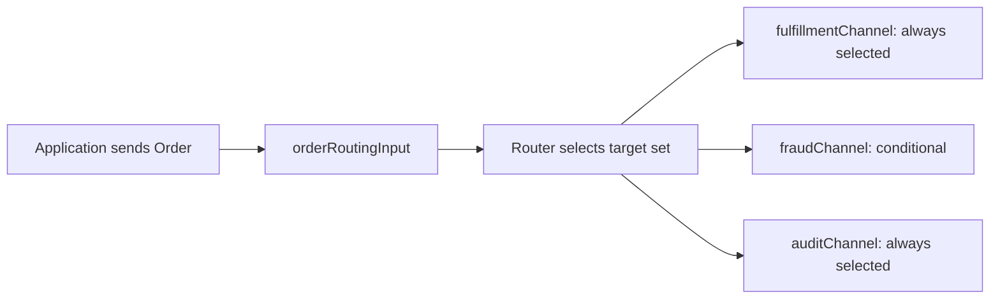
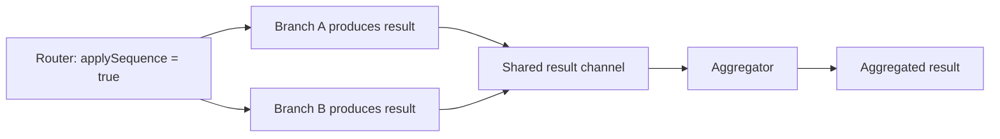

# Multi-output routers

## Objectives and context

In the **Router** chapter of the **SPRING_INTEGRATION_CORE** module, this lesson shows how to deliver one `Message` to multiple `MessageChannel`s according to rules that can be satisfied simultaneously. The content connects routing decisions to Java DSL endpoints, application invocation, error handling, and message flow testing.

After this lesson, you will be able to:

- Distinguish selecting a single target from selecting multiple targets for the same message.
- Write a routing function returning a list of keys and map each key to a channel.
- Use `routeToRecipients()` when each recipient has its own condition.
- Decide when sequence headers are needed to combine results with an aggregator.
- Recognize partial send success and design retries that do not duplicate business side effects.

Examples use Java 17 or later and Spring Integration 6.x APIs. Use dependency versions aligned with your project's BOM; Java DSL is in `spring-integration-core`. If using Spring Boot, you can pull the required components via `spring-boot-starter-integration`; test code uses JUnit Jupiter. The Java filenames below describe how to lay out the examples in a practice project.

## 1. One message may need multiple recipients

Suppose a system receives an already validated order. The order must be forwarded to:

1. Fulfillment department: always receives.
2. Risk control department: receives if the order is international or has a total of 10 million VND or more.
3. Audit department: always receives.

A single order can satisfy all three conditions. If you wrote `if ... else if ...` to pick strictly one branch, the system would leave out other recipients.

| Order ID | Total amount | Overseas | Required targets |
| --- | ---: | --- | --- |
| O-101 | 2,000,000 VND | No | fulfillment, audit |
| O-102 | 10,000,000 VND | No | fulfillment, fraud, audit |
| O-103 | 2,000,000 VND | Yes | fulfillment, fraud, audit |



In this lesson, a **router output** is a selected target channel. The routing function returns target information; the router uses that information to forward the message currently being handled. The target list does not become the business payload sent down the branches. The multi-target contract is described in [AbstractMessageRouter API](https://docs.spring.io/spring-integration/api/org/springframework/integration/router/AbstractMessageRouter.html).

## 2. Distinguishing similar mechanisms

| Mechanism | Main decision | Example |
| --- | --- | --- |
| Single-target router | Which branch does this message go to? | Choose North warehouse or South warehouse |
| Multi-output router | Which branches should this message go to? | Fulfillment, audit, possibly risk control |
| `PublishSubscribeChannel` | Broadcasts to the channel's subscribers | Processors all interested in one event |
| Splitter | Which elements should the payload be split into? | One order into multiple line items |
| Aggregator | When is enough info available to build a combined result? | Combine results of verification steps |

A `DirectChannel` with multiple subscribers typically delivers each message to one consumer, following its dispatching/failover strategy. To have all processors receive the message, you need an appropriate multi-recipient broadcasting structure. Characteristics of direct channels and publish-subscribe channels are presented in [Message Channel Implementations](https://docs.spring.io/spring-integration/reference/channel/implementations.html).

For the order example, a multi-target router fits because recipient membership varies with order content. A splitter would only be needed if each line item had to become its own separate message.

## 3. Two stages: target selection and message sending

Separate these two steps when reading or designing a router:

```text
Order
  -> function determines business keys
  -> map keys to channel names
  -> resolve names to MessageChannel
  -> send message sequentially to determined channels
```

For example:

```text
["FULFILLMENT", "FRAUD", "AUDIT"]
        |             |        |
        v             v        v
fulfillmentChannel fraudChannel auditChannel
```

Business keys keep recipient-selection rules decoupled from bean names. Java DSL supports a routing function and `channelMapping()`; see [Message Routers in Java DSL](https://docs.spring.io/spring-integration/reference/dsl/java-routers.html).

There are two distinct kinds of failure:

- **Target resolution failure:** a channel name exists, but no matching channel can be found.
- **Send failure:** the channel was found, but the channel rejects delivery, times out, or a synchronous processing path throws an exception.

Distinguishing them avoids using an error-handling option intended for the wrong stage.

## 4. Complete example: function returning multiple keys

### 4.1. Java DSL configuration

The example uses a `DirectChannel` on the input and three `QueueChannel`s on the outputs. Queues make it easy to observe where the router delivered messages without connecting real fulfillment, anti-fraud, or audit systems yet.

```java
package learning.integration.router;

import java.util.ArrayList;
import java.util.List;

import org.springframework.context.annotation.Bean;
import org.springframework.context.annotation.Configuration;
import org.springframework.integration.channel.DirectChannel;
import org.springframework.integration.channel.QueueChannel;
import org.springframework.integration.config.EnableIntegration;
import org.springframework.integration.dsl.IntegrationFlow;
import org.springframework.messaging.MessageChannel;

@Configuration
@EnableIntegration
public class OrderRoutingConfig {

    public record Order(
            String orderId,
            long totalVnd,
            boolean overseas) {
    }

    public static List<String> targetKeys(Order order) {
        List<String> keys = new ArrayList<>();
        keys.add("FULFILLMENT");

        if (order.overseas() || order.totalVnd() >= 10_000_000L) {
            keys.add("FRAUD");
        }

        keys.add("AUDIT");
        return List.copyOf(keys);
    }

    @Bean
    public MessageChannel orderRoutingInput() {
        return new DirectChannel();
    }

    @Bean
    public QueueChannel fulfillmentChannel() {
        return new QueueChannel(100);
    }

    @Bean
    public QueueChannel fraudChannel() {
        return new QueueChannel(100);
    }

    @Bean
    public QueueChannel auditChannel() {
        return new QueueChannel(100);
    }

    @Bean
    public IntegrationFlow orderRoutingFlow() {
        return IntegrationFlow.from("orderRoutingInput")
                .<Order, Object>route(
                        Order.class,
                        OrderRoutingConfig::targetKeys,
                        router -> router
                                .channelMapping(
                                        "FULFILLMENT",
                                        "fulfillmentChannel")
                                .channelMapping(
                                        "FRAUD",
                                        "fraudChannel")
                                .channelMapping(
                                        "AUDIT",
                                        "auditChannel")
                                .channelKeyFallback(false)
                                .resolutionRequired(true)
                                .ignoreSendFailures(false)
                                .applySequence(false)
                                .sendTimeout(500))
                .get();
    }
}
```

`Order` is the payload, `orderRoutingInput` is the input channel, and `orderRoutingFlow` registers the router endpoint. `targetKeys()` can be unit-tested independently because it only reads data and returns a key list without calling external services.

In this DSL overload, the function's return type and the configured key type share `RouterSpec`'s type parameter. Declaring `<Order, Object>` lets the function return `List<String>` while each mapping still uses `String` keys. The overload contract is in [BaseIntegrationFlowDefinition of Spring Integration 6.5](https://raw.githubusercontent.com/spring-projects/spring-integration/v6.5.10/spring-integration-core/src/main/java/org/springframework/integration/dsl/BaseIntegrationFlowDefinition.java).

### 4.2. Explaining configuration choices

In the example, the mappings form the list of targets intentionally permitted by the application. `channelKeyFallback(false)` prevents an unmapped key from being used as a channel name. `resolutionRequired(true)` requires resolved channel names to exist. The two settings govern different steps; see [RouterSpec API](https://docs.spring.io/spring-integration/api/org/springframework/integration/dsl/RouterSpec.html).

Specifically, an unmapped key when fallback is disabled may simply contribute no target; do not treat `resolutionRequired(true)` as a validator for every business key. If you must catch any invalid key, validate inside the target-selection function or test completeness of the mapping table. This mechanism appears in [AbstractMappingMessageRouter](https://raw.githubusercontent.com/spring-projects/spring-integration/v6.5.10/spring-integration-core/src/main/java/org/springframework/integration/router/AbstractMappingMessageRouter.java).

`sendTimeout(500)` sets the send wait timeout per channel in milliseconds, useful when a queue has bounded capacity. It is not the maximum duration for completing business work at the recipient. `QueueChannel` in the example only holds messages in memory; an appropriate consumer or poller is needed when turning the example into a real processing flow.

The function always adds `FULFILLMENT` and `AUDIT`; the risk condition only adds `FRAUD`. The list contains no duplicate targets. When combining multiple rule groups yourself, produce a unique target set, such as using a `LinkedHashSet`, before returning the result.

## 5. Sending messages into the flow and reading outputs

With `AnnotationConfigApplicationContext`, you can run a direct test as follows:

```java
package learning.integration.router;

import org.springframework.context.annotation.AnnotationConfigApplicationContext;
import org.springframework.integration.channel.QueueChannel;
import org.springframework.messaging.MessageChannel;
import org.springframework.messaging.support.MessageBuilder;

public class RouterDemo {

    public static void main(String[] args) {
        try (var context =
                new AnnotationConfigApplicationContext(OrderRoutingConfig.class)) {

            MessageChannel input =
                    context.getBean("orderRoutingInput", MessageChannel.class);

            var order = new OrderRoutingConfig.Order(
                    "O-102", 10_000_000L, false);

            boolean accepted = input.send(
                    MessageBuilder.withPayload(order)
                            .setHeader("traceId", "trace-O-102")
                            .build(),
                    1_000);

            System.out.println("accepted = " + accepted);

            for (String name : new String[] {
                    "fulfillmentChannel", "fraudChannel", "auditChannel"}) {
                QueueChannel output =
                        context.getBean(name, QueueChannel.class);
                System.out.println(name + " -> " + output.receive(0));
            }
        }
    }
}
```

All three queues contain one message carrying order O-102. If you change the amount to `2_000_000L` while keeping `overseas=false`, `fraudChannel.receive(0)` returns `null`.

The 10-million threshold was chosen to make the `>=` condition clear: an order right on the threshold also reaches fraud. The `traceId` header helps trace a single dispatch across branches.

A successful send to a queue only indicates the message was accepted at that boundary. To confirm order completion, the application needs an explicit result message or separate business status mechanism.

### Placing a gateway at the application boundary

The application can use an interface instead of looking up the channel manually:

```java
package learning.integration.router;

import org.springframework.integration.annotation.MessagingGateway;

@MessagingGateway(defaultRequestChannel = "orderRoutingInput")
public interface OrderGateway {
    void submit(OrderRoutingConfig.Order order);
}
```

Add `@IntegrationComponentScan(basePackageClasses = OrderGateway.class)` to the configuration class, importing `org.springframework.integration.annotation.IntegrationComponentScan`, then inject `OrderGateway` at the call site. The gateway is the entry point; target selection logic still lives in the router. Registering gateway interfaces is described in [Messaging Gateways](https://docs.spring.io/spring-integration/reference/gateway.html).

A `void` return type fits when the contract is submitting an order into the flow. It does not mean running automatically on another thread. If you want to return an aggregated result to the caller, design a reply path and an aggregation step; declaring multiple outputs does not create that contract on its own.

## 6. Equivalent style using a recipient list

When rules map directly to individual recipients, `routeToRecipients()` is often easier to read. **Replace** the `orderRoutingFlow()` bean in the main example with the following bean, keeping the model and channels unchanged:

```java
@Bean
public IntegrationFlow orderRoutingFlow() {
    return IntegrationFlow.from("orderRoutingInput")
            .routeToRecipients(recipients -> recipients
                    .recipient("fulfillmentChannel")
                    .<Order>recipient(
                            "fraudChannel",
                            order -> order.overseas()
                                    || order.totalVnd() >= 10_000_000L)
                    .recipient("auditChannel")
                    .applySequence(false)
                    .ignoreSendFailures(false))
            .get();
}
```

All recipients with matching selectors are chosen. The two recipients without selectors are always chosen. Conditions are non-exclusive and do not stop after the first matching recipient. The DSL provides both payload-based selectors and `recipientMessageSelector()` for the whole message; see [RecipientListRouterSpec API](https://docs.spring.io/spring-integration/api/org/springframework/integration/dsl/RecipientListRouterSpec.html).

This alternative example preserves the same target-selection rules, though it omits the explicit send timeout of the first version. When bringing it into an application, align timeouts with the endpoint/channel configuration in use.

Do not register both flow versions at the same time on one input `DirectChannel` to "compare" them. They will become competing consumers and alter the experiment's topology.

| When to choose | Style to consider |
| --- | --- |
| Have a policy returning business keys reused in multiple places | Function returning key list + `channelMapping()` |
| Each recipient has a simple condition | `routeToRecipients()` |
| Decision depends on both headers and payload | Selector taking `Message<?>` or policy taking message |
| Subscribers need to all receive one event | Publish-subscribe structure and subscriber-side rules if needed |

## 7. How is the message shared across branches?

In the main example, the router forwards the same order content to the queues. There is no deep clone of `Order`. Records keep the model free of setters, yet a record containing a mutable collection can still share mutable data.

With `applySequence(false)`, do not write logic relying on branches receiving the exact same `Message` instance by reference identity. What matters is the data and header contract. When sequence headers are enabled, the router creates a message with distinct headers per target; the payload is still not deep-copied. You can inspect message construction in [AbstractMessageRouter of Spring Integration 6.5](https://raw.githubusercontent.com/spring-projects/spring-integration/v6.5.10/spring-integration-core/src/main/java/org/springframework/integration/router/AbstractMessageRouter.java).

Example to avoid:

```java
// Assume payload is a mutable Map shared across branches.
payload.put("fraudStatus", "APPROVED");
```

The audit branch might observe the data before or after mutation, depending on execution order. A cleaner design is creating a branch-specific result, such as `FraudResult(orderId, status)`, and sending that result wherever needed.

The order of targets in the policy is not a contract for business completion order either. With queues, the router merely puts messages into each queue; each queue's consumer has its own pace. If audit must record the risk-control outcome, route the fraud result event to audit instead.

## 8. Sequence headers and the aggregator join point

To observe sequence headers, change `.applySequence(false)` in the main example to `.applySequence(true)`. The router adds metadata to distinguish deliveries belonging to the same fan-out. When an order selects all three targets, you can picture it as:

| Target | `correlationId` | `sequenceNumber` | `sequenceSize` |
| --- | --- | ---: | ---: |
| fulfillment | Same value for this fan-out | 1 | 3 |
| fraud | Same value for this fan-out | 2 | 3 |
| audit | Same value for this fan-out | 3 | 3 |

If only fulfillment and audit are selected, the corresponding sequence size is 2. This is the count of selected targets, not the count of steps that succeeded. The meaning and default value of `applySequence` are documented in the [Router annotation](https://docs.spring.io/spring-integration/docs/current/api/org/springframework/integration/annotation/Router.html).

Sequences only help an aggregator when the design guarantees related results actually arrive at one join point with the required correlation headers intact.



For instance, if audit is a log-only branch that returns no message, an aggregator waiting for all three results may never complete. When designing the join step, define:

- Which branches must contribute results and how many messages each branch contributes.
- How results are represented when a branch is filtered out or fails processing.
- Release conditions, timeouts, and handling of incomplete groups.

These questions belong to the aggregation contract. Enabling sequence headers does not create an aggregator, add replies, or guarantee complete groups on its own.

## 9. No targets, missing channels, and send failures

Options must be set according to the business contract:

| Option | Effect to understand |
| --- | --- |
| `resolutionRequired(true)` | Raises an error when a target name needing resolution cannot find a channel |
| `resolutionRequired(false)` | Allows skipping unresolvable channel names |
| `ignoreSendFailures(false)` | One failed send stops sending to subsequent targets |
| `ignoreSendFailures(true)` | Allows continuing remaining sends after a router-handled send failure |
| `defaultOutputChannel(...)` | Provides a default path when routing yields no usable output |
| `nullChannel` as default output | Intentionally discards the message; must be deliberate |

These parameters are explained in [Common Router Parameters](https://docs.spring.io/spring-integration/reference/router/common-parameters.html).

For example, a policy returning an empty list can mean "no matching recipients". In that case you might choose a queue for manual review. If the configuration ignores a misspelled channel name while another target still resolves, the missing target can be hard to spot; tests must verify the full expected target set.

The default output is not a list of branches whose sends failed, and it does not supply missing recipients automatically. Design error flows/retries for specific failures.

### 9.1. Partial send success

Consider the policy's order in the example:

```text
1. fulfillmentChannel receives successfully
2. fraudChannel is full, send waits 500 ms then fails
3. auditChannel is not sent to because ignoreSendFailures=false
```

At the moment the caller receives the exception, the fulfillment message is still in its queue. The router does not roll back that send. The example configures neither a transaction nor a durable message store.

If the caller resends order O-102, fulfillment may receive it a second time. Therefore, the system must define "already processed" using a business key, such as:

```text
(orderId, operation name, event version)
("O-102", "FULFILLMENT", 1)
("O-102", "AUDIT", 1)
```

For an operation that creates a shipment order, the consumer can use a unique constraint on the processing key to prevent creating two shipments. Recording the key and applying the business change must live in a consistent design; marking success first and then calling an external service can lose the operation if the process crashes.

Prefer retrying only the failed branch if per-branch status can be identified cleanly. When delivery guarantees across process crashes are needed, add durable storage and appropriate delivery mechanisms, such as an outbox or a broker with acknowledgments; an in-memory router does not provide those guarantees.

### 9.2. Synchronous errors and errors beyond an asynchronous boundary

With `DirectChannel`, errors from processing running on the same thread can return to the caller. If the router puts a message into a queue successfully and the queue's consumer fails later, that error happens in a separate execution. A poller/executor error handler can publish an `ErrorMessage`; configure it per execution boundary. See [Error Handling](https://docs.spring.io/spring-integration/reference/error-handling.html).

Accordingly, the router's `ignoreSendFailures` does not control errors occurring later inside consumers. In the test example, the full-queue error happens right when the router sends, so the synchronous caller observes it directly.

## 10. Testing multi-output flows

Tests must prove both **the targets that must receive** and **the targets that must not receive**. Checking only that fulfillment received a message misses bugs like forgetting to send to audit or wrongly sending to fraud.

The class below uses the main configuration from section 4, with sequence disabled and without switching to recipient list. Each test creates its own context, with no background consumers pulling messages from the queues. This is practice code for learners to run in a project with JUnit Jupiter.

```java
package learning.integration.router;

import java.util.List;

import org.junit.jupiter.api.Test;
import org.springframework.context.annotation.AnnotationConfigApplicationContext;
import org.springframework.integration.channel.QueueChannel;
import org.springframework.messaging.Message;
import org.springframework.messaging.MessageChannel;
import org.springframework.messaging.MessagingException;
import org.springframework.messaging.support.MessageBuilder;

import static org.junit.jupiter.api.Assertions.*;

class OrderRoutingTest {

    @Test
    void sendsToAllAndOnlySelectedChannels() {
        try (var context =
                new AnnotationConfigApplicationContext(OrderRoutingConfig.class)) {

            MessageChannel input =
                    context.getBean("orderRoutingInput", MessageChannel.class);
            QueueChannel fulfillment =
                    context.getBean("fulfillmentChannel", QueueChannel.class);
            QueueChannel fraud =
                    context.getBean("fraudChannel", QueueChannel.class);
            QueueChannel audit =
                    context.getBean("auditChannel", QueueChannel.class);

            List<OrderRoutingConfig.Order> orders = List.of(
                    new OrderRoutingConfig.Order("O-101", 2_000_000L, false),
                    new OrderRoutingConfig.Order("O-102", 10_000_000L, false),
                    new OrderRoutingConfig.Order("O-103", 2_000_000L, true));

            for (var order : orders) {
                String traceId = "trace-" + order.orderId();
                Message<?> message = MessageBuilder.withPayload(order)
                        .setHeader("traceId", traceId)
                        .build();

                assertTrue(input.send(message, 1_000));

                assertOrder(fulfillment.receive(0), order, traceId);
                assertOrder(audit.receive(0), order, traceId);

                boolean requiresFraud =
                        order.overseas() || order.totalVnd() >= 10_000_000L;
                if (requiresFraud) {
                    assertOrder(fraud.receive(0), order, traceId);
                } else {
                    assertNull(fraud.receive(0));
                }

                assertNull(fulfillment.receive(0));
                assertNull(fraud.receive(0));
                assertNull(audit.receive(0));
            }
        }
    }

    @Test
    void keepsEarlierDeliveryWhenALaterQueueIsFull() {
        try (var context =
                new AnnotationConfigApplicationContext(OrderRoutingConfig.class)) {

            MessageChannel input =
                    context.getBean("orderRoutingInput", MessageChannel.class);
            QueueChannel fulfillment =
                    context.getBean("fulfillmentChannel", QueueChannel.class);
            QueueChannel fraud =
                    context.getBean("fraudChannel", QueueChannel.class);
            QueueChannel audit =
                    context.getBean("auditChannel", QueueChannel.class);

            var blocker = MessageBuilder.withPayload(
                    new OrderRoutingConfig.Order("BLOCKER", 0L, false))
                    .build();

            // Capacity of fraudChannel in the main configuration is 100.
            for (int i = 0; i < 100; i++) {
                assertTrue(fraud.send(blocker, 0));
            }

            var order =
                    new OrderRoutingConfig.Order("O-104", 20_000_000L, false);
            var message = MessageBuilder.withPayload(order).build();

            assertThrows(
                    MessagingException.class,
                    () -> input.send(message, 1_000));

            Message<?> delivered = fulfillment.receive(0);
            assertNotNull(delivered);
            assertEquals(order, delivered.getPayload());

            // Third target was not sent to after the error at the second target.
            assertNull(audit.receive(0));
            assertNull(fulfillment.receive(0));
        }
    }

    private static void assertOrder(
            Message<?> message,
            OrderRoutingConfig.Order expected,
            String traceId) {

        assertNotNull(message);
        assertEquals(expected, message.getPayload());
        assertEquals(traceId, message.getHeaders().get("traceId"));
    }
}
```

The first test checks the standard case, exact threshold, and independent overseas condition. The `receive(0)` calls at the end of the loop catch extra deliveries after a single send.

The second test intentionally fills the middle queue in the list. It demonstrates the behavior that business logic must handle: one failed call does not mean none of the targets received the message.

When practicing with `applySequence(true)` enabled, you can add the following assertions in a separate test:

- Messages from the same fan-out share the same `correlationId`.
- `sequenceSize` is 2 or 3 according to the order's recipient set.
- The `sequenceNumber` values span 1 through `sequenceSize`.
- Payload and business headers remain intact.

Use `IntegrationMessageHeaderAccessor.CORRELATION_ID`, `SEQUENCE_NUMBER`, and `SEQUENCE_SIZE` from package `org.springframework.integration` when accessing these headers.

## 11. Common design mistakes

| Symptom | Possible cause | Fix in the order example |
| --- | --- | --- |
| Only one processor receives the order | Using one direct channel with multiple competing consumers | Pick multiple target channels or a publish-subscribe design |
| Risky order reaches fraud, but misses audit | Writing single-target selection with `else if` | Build recipient list from independent conditions |
| Caller gets error, yet warehouse still receives order | One target received before a later target failed | Track per-operation state and prevent duplicate processing |
| Logs show payload mutating between branches | Sharing mutable data | Create immutable models or new result messages |
| Aggregator waits forever | Actual result count differs from group contract | Define contributing branches, release, and timeout |
| Queue send succeeds, yet business work fails later | Equating acceptance with completion | Monitor consumer processing outcomes |
| A wrong key is silently ignored | Fallback disabled without policy/mapping checks | Test the key set and targets required by business rules |

## 12. Extended practice

1. Add `notificationChannel` when an order requests notification. Verify fulfillment, fraud, and audit targets are still selected under the original rules.
2. Add a domestic order case with value `9_999_999L`, then compare against `10_000_000L` to verify the condition boundary.
3. Switch to recipient list and re-run the recipient-set tests. Set appropriate timeouts before repeating the full-queue experiment.
4. Create two verification branches that return results, enable sequences, and feed results into an aggregator. Have one branch return no result, then define a timeout and incomplete-group handling path.
5. Simulate resending the same order after an error. Design a deduplication key for fulfillment so the order still creates only one shipment.

For the aggregator exercise, refer to the correlation and release contracts in [Aggregator](https://docs.spring.io/spring-integration/reference/aggregator.html). Separate "send to multiple independent recipients" from "need one combined result" right at the business requirement stage.