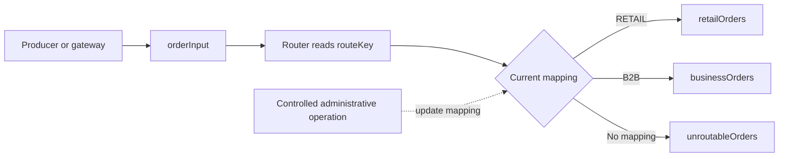

# Routers and dynamic destinations

> Part of the **Router** chapter in the **SPRING_INTEGRATION_CORE** module. This lesson focuses on selecting message destinations at runtime, resolving `MessageChannel`s, and changing mappings in a Spring Integration flow.

## 1. Problem statement: same entry point, changeable target

A system receives orders through the `orderInput` channel. Orders in the `RETAIL` group go to the retail flow; `B2B` orders go to the business flow. When the retail flow is upgraded, the system needs to shift new orders to a standby flow while producers continue sending to the existing entry point.

The router is responsible for selecting the target channel from the contents of `Message<?>`. The endpoint wrapping the router receives messages on the input channel, invokes the routing logic, and forwards the message to the target. Producers only need to know the input contract, such as the order payload and the `routeKey` header.

After this lesson, you will be able to:

- Distinguish routing keys, channel names, `MessageChannel` objects, and destinations in external systems.
- Configure a router using Java DSL or a Spring-managed `HeaderValueRouter`.
- Update mappings while the application is running and understand the boundaries of rerouting.
- Choose policies for unknown targets, resolution errors, and send errors.
- Design tests that observe messages at the right destinations.

The Java examples use Java 17 and Spring Integration 6.x APIs with `IntegrationFlow.from(...)`. A practice project needs `spring-integration-core`, compatible Spring dependencies, and JUnit Jupiter to run the test class. If using Spring Boot, let Boot's BOM manage Spring versions; do not mix standalone versions arbitrarily. The examples require no broker and do not declare a full Boot application.

## 2. What can "dynamic destination" mean?

### 2.1. Selecting targets per message

Suppose `RETAIL → retailOrders` and `B2B → businessOrders` are configured at startup. Each message can go to a different target, while the rule table remains fixed. This is data-driven routing per message.

### 2.2. Changing rules while the application is running

Still using the `RETAIL` key, an operator switches the mapping from `retailOrders` to `retailStandbyOrders`. Subsequent routing lookups using the new mapping can change destinations without modifying producers or restarting the whole application. This is the ability to update routing configuration at runtime, often referred to when talking about Dynamic Routers. Spring Integration separately describes changing key-computation and channel-resolution steps in [Dynamic Routers](https://docs.spring.io/spring-integration/reference/router/dynamic-routers.html).

### 2.3. Creating additional channels or flows at runtime

Adding a mapping does not simultaneously create a new channel. If a new tenant needs its own channel, endpoints, and adapters, the application must manage the lifecycle of those components. `IntegrationFlowContext` is the API for registering and managing flows at runtime; registrations can be removed when no longer needed. See [Dynamic and Runtime Integration Flows](https://docs.spring.io/spring-integration/reference/dsl/java-runtime-flows.html).

### 2.4. Destinations outside the application

`retailOrders` in this lesson is the name of a Spring `MessageChannel`. A JMS queue, Kafka topic, AMQP exchange, or HTTP URL belongs to the external integration layer. A router can select a channel wired to the corresponding outbound adapter; a string returned by a router does not by itself make the framework create a queue, topic, or connect to that URL.

| Need | Component to change | What does NOT happen automatically |
|---|---|---|
| Each order follows its business group | Key-computation function or message header | Mapping table is not updated automatically |
| Reroute during maintenance | Router mapping | Messages already in the old target are not moved |
| Add an entire pipeline for a tenant | Register channels, flows, and related resources | Adding a mapping entry does not create a pipeline |
| Send to an external system | Channel wired to an outbound adapter or gateway | Channel name does not become a broker destination |

Which form to choose depends on what needs to vary: per-message data, routing policy, or pipeline topology.

## 3. From Message to target channel

For a mapping router, the process can be pictured in three steps:

1. **Compute the routing key:** read the `routeKey` header, inspect the payload, or call a business function.
2. **Look up the channel name:** use the key to find a name in the mapping table; some configurations permit using the key itself as a channel name.
3. **Resolve and send:** find the corresponding `MessageChannel` and send the message.

For example:

```text
Message(payload=Order(...), headers.routeKey=RETAIL)
    → routing key: RETAIL
    → channel name: retailOrders
    → MessageChannel bean named retailOrders
    → send message
```



In the default resolver backed by Spring's `BeanFactory`, the channel name must identify a matching bean. The router does not send messages to an arbitrary bean just because its bean name happens to match. If logic returns a `MessageChannel` object directly, name lookup and mapping can be bypassed. That fits when the application already holds channel references, though it makes name-based mapping tables less useful for rerouting.

Separating a business key like `RETAIL` from a technical name like `retailStandbyOrders` keeps producers decoupled from internal structure. Producers keep the same contract even when operators change target channels.

## 4. Complete configuration with HeaderValueRouter and Java DSL

The example below has one input `DirectChannel` and four output `QueueChannel`s. The queues have bounded capacity so the example does not create unbounded buffers. They let you observe results with `receive()` without building order-processing consumers yet.

Save the practice code in `OrderRoutingConfig` inside a separate Java project if you want to run it. The snippet here is part of the lesson material.

```java
package example.routing;

import org.springframework.context.annotation.Bean;
import org.springframework.context.annotation.Configuration;
import org.springframework.integration.channel.DirectChannel;
import org.springframework.integration.channel.QueueChannel;
import org.springframework.integration.config.EnableIntegration;
import org.springframework.integration.dsl.IntegrationFlow;
import org.springframework.integration.router.HeaderValueRouter;

@Configuration
@EnableIntegration
public class OrderRoutingConfig {

    @Bean
    public DirectChannel orderInput() {
        return new DirectChannel();
    }

    @Bean
    public QueueChannel retailOrders() {
        return new QueueChannel(100);
    }

    @Bean
    public QueueChannel businessOrders() {
        return new QueueChannel(100);
    }

    @Bean
    public QueueChannel retailStandbyOrders() {
        return new QueueChannel(100);
    }

    @Bean
    public QueueChannel unroutableOrders() {
        return new QueueChannel(100);
    }

    @Bean
    public HeaderValueRouter orderRouter() {
        HeaderValueRouter router = new HeaderValueRouter("routeKey");
        router.setChannelMapping("RETAIL", "retailOrders");
        router.setChannelMapping("B2B", "businessOrders");
        router.setChannelKeyFallback(false);
        router.setResolutionRequired(true);
        router.setDefaultOutputChannelName("unroutableOrders");
        router.setSendTimeout(1_000);
        return router;
    }

    @Bean
    public IntegrationFlow orderRoutingFlow(HeaderValueRouter orderRouter) {
        return IntegrationFlow.from("orderInput")
                .route(orderRouter)
                .get();
    }
}
```

`HeaderValueRouter` takes the `routeKey` header value as the key. The DSL attaches the router to an endpoint consuming from `orderInput`. The router is a separate bean so administrative code can obtain a direct reference and update mappings. You can pass a router implementation into `.route(...)` per [Router Implementations](https://docs.spring.io/spring-integration/reference/router/implementations.html).

Three configuration choices define the example's policy:

- `channelKeyFallback=false`: unmapped keys are not used as channel names.
- `resolutionRequired=true`: a selected channel name that fails to resolve causes an error.
- `defaultOutputChannelName=unroutableOrders`: when no channel is selected, messages go to the manual review branch.

Thus, `UNKNOWN` is an unsupported input type and goes to the fallback branch, whereas a `RETAIL → channelDoesNotExist` mapping is a configuration bug and must be caught. These two situations intentionally have different policies.

### Sending a message

In the snippet below, `context` is an `ApplicationContext` loaded with the configuration above:

```java
var input = context.getBean("orderInput",
        org.springframework.messaging.MessageChannel.class);

var order = org.springframework.messaging.support.MessageBuilder
        .withPayload("order-1001")
        .setHeader("routeKey", "RETAIL")
        .setHeader("businessId", "order-1001")
        .build();

input.send(order);
```

A string payload keeps the example short; a real application can use an order DTO. The router does not need to transform the payload to change routes. When data normalization or deriving headers from the payload is needed, place a transformer or header enricher before the router.

`QueueChannel` keeps data in memory by default without a durable message store. A successful `send()` only confirms the message entered the queue, not that business work finished. To deploy a consumer for an output queue, you need an endpoint with an appropriate poller. See [Message Channel Configuration](https://docs.spring.io/spring-integration/reference/channel/configuration.html).

### Pure-DSL variant

If you do not need a separate router bean for administration, you can replace the `orderRoutingFlow` method with:

```java
@Bean
public IntegrationFlow orderRoutingFlow() {
    return IntegrationFlow.from("orderInput")
            .route("headers['routeKey']", r -> r
                    .channelMapping("RETAIL", "retailOrders")
                    .channelMapping("B2B", "businessOrders")
                    .channelKeyFallback(false)
                    .resolutionRequired(true)
                    .defaultOutputChannel("unroutableOrders")
                    .sendTimeout(1_000))
            .get();
}
```

This is an alternative approach; configure only one routing flow in the exercise. Registering both flows consuming `orderInput` creates multiple subscribers on `DirectChannel` and alters message distribution. `route(...)` supports SpEL, lambdas, or router implementations as described in [Message Routers in Java DSL](https://docs.spring.io/spring-integration/reference/dsl/java-routers.html).

The SpEL expression in the example is a fixed string supplied by the developer. Never take an arbitrary routing expression from a client request and execute it.

## 5. Changing destinations at runtime

### 5.1. Switching a key to an existing destination

With the complete configuration in section 4, administrative code can retrieve the router bean and run:

```java
HeaderValueRouter router = context.getBean(
        "orderRouter", HeaderValueRouter.class);

// Prepare the standby target before switching traffic to it.
router.setChannelMapping("RETAIL", "retailStandbyOrders");

// After maintenance completes, route subsequent lookups back to the old target.
router.setChannelMapping("RETAIL", "retailOrders");
```

The two statements illustrate two different administrative moments; there is no reason to call them back-to-back in real deployment. The API also provides `removeChannelMapping(key)` and `setChannelMappings(map)` for managing configuration. These operations belong to the mapping router's management capabilities. See [AbstractMappingMessageRouter API](https://docs.spring.io/spring-integration/api/org/springframework/integration/router/AbstractMappingMessageRouter.html).

`setChannelMapping` only changes the association between a key and a channel name. The target channel must already exist and the downstream pipeline must be ready per business requirements. A queue can accept messages even without a consumer, yet that does not prove the processing flow is healthy.

### 5.2. Removing a mapping and replacing the whole table

```java
router.removeChannelMapping("RETAIL");
// Under the lesson's policy, RETAIL now goes to unroutableOrders.

router.setChannelMappings(java.util.Map.of(
        "RETAIL", "retailStandbyOrders",
        "B2B", "businessOrders"
));
```

`setChannelMappings(...)` means supplying the entire new table. If you pass only `RETAIL`, do not expect the `B2B` mapping to be preserved automatically. Before replacing the whole table, compare old and new key lists, verify target channels exist, and publish a controlled configuration version.

### 5.3. Boundaries of rerouting

Consider the following sequence of events:

```text
t0: order-A was already sent to retailOrders
t1: RETAIL is switched to retailStandbyOrders
t2: order-B is routed using the new mapping
```

`order-A` stays in the old destination. Updating mappings does not recall messages, does not undo side effects that already happened, and does not migrate backlog between two queues. Messages in flight concurrently with the update may have already selected a destination before the new configuration took effect.

If order A must finish processing before order B, switching destinations needs an added procedure to pause intake or buffer inputs, drain the old destination, and decide when to open the new destination. For messages that might be redelivered, consumers should have deduplication keyed by business ID.

The administrative examples here assume a coordinated single source of configuration updates. Do not infer that concurrent mapping edits from multiple threads or multiple nodes form a shared transaction. In a multi-instance system, each router holds state in its own instance; the application must distribute configuration versions across instances and track rollout.

## 6. Choosing policies when a message fails to reach a destination

### 6.1. Three stages that can fail

| Stage | Example | Policy in sample config |
|---|---|---|
| Cannot obtain a matching key | Missing `routeKey`, or key `UNKNOWN` | No target selected; sends message to `unroutableOrders` |
| Cannot resolve channel name | `RETAIL` mapped to nonexistent name | Throws `MessagingException` because `resolutionRequired=true` |
| Resolved, but cannot send | Queue full, or `DirectChannel` has no subscriber | Reports send error; default channel does not act as failover |
| Sent, but business processing fails | Consumer rejects order or external API fails | Handle errors at the consumer/gateway/adapter execution boundary |

Do not lump all cases together as "the router could not find a target". Pinpointing the stage tells operations whether to fix data, configuration, or the receiving system.

### 6.2. Relationship among the three key options

`channelKeyFallback` decides whether an unmapped key counts as a channel name. `resolutionRequired` applies once there is a channel name to resolve. `defaultOutputChannel` is used when the router obtains no target channels under its resolution policy, rather than catching every exception.

Since Spring Integration 6.0, setting a default output channel disables channel key fallback if fallback has not been explicitly set. Configuring a default channel together with `channelKeyFallback=true` and `resolutionRequired=true` is rejected at initialization. This lesson sets the values explicitly so readers see the policy. See [Common Router Parameters](https://docs.spring.io/spring-integration/reference/router/common-parameters.html).

| Configuration | Unmapped key | Selected target name does not exist |
|---|---|---|
| Fallback `false`, resolution `true`, has default | Goes to default because key produces no target name | Raises resolution error |
| Fallback `false`, resolution `false`, has default | Goes to default | Skips unresolvable target; goes to default if no target remains |
| Fallback `true`, resolution `false`, has default | Tries using key as channel name | Goes to default if no valid channel remains |

When choosing `resolutionRequired=false`, decide whether you accept misspelled channel names silently routing to the fallback branch. For critical orders, that branch must be monitored and processed; naming it quarantine or unroutable does not automatically create durable storage, alerting, or replay.

If there is no valid channel and no default output channel either, the router raises an error instead of silently dropping the message. Using `nullChannel` as the default is an intentional choice to drop messages. Only apply it when losing that data fits business requirements.

### 6.3. Send errors vs. business errors

`ignoreSendFailures` relates to send failures, not `resolutionRequired`. Enabling it can cause send errors to be skipped; it does not retry, does not create a shared transaction across targets, and does not automatically route messages to the default channel.

With direct calls to `orderInput` as a `DirectChannel`, errors occurring right in the router can propagate to the caller. Merely adding an `errorChannel` header does not automatically turn every synchronous error into an `ErrorMessage`. At an asynchronous boundary with a Spring Integration error handler, errors can be published as `ErrorMessage`s to the corresponding error channel. Gateways also have their own error-handling configuration. See [Error Handling](https://docs.spring.io/spring-integration/reference/error-handling.html).

The full-queue case in the sample config is governed by the send timeout set on the router with `setSendTimeout(1_000)`. If a consumer reads the queue on another thread and fails later, that is an error of a subsequent processing pass; producers cannot infer business outcomes solely from the initial send.

## 7. When the routing key itself is the channel name

A concise Java DSL variant is:

```java
return IntegrationFlow.from("orderInput")
        .route("headers['destinationChannel']")
        .get();
```

This variant fits when `destinationChannel` is produced by a trusted internal component and the value is a valid channel name. A producer or an earlier step before the router can pick `retailOrders` or `businessOrders` per message without a business mapping table.

In return, whoever sets the header must know technical channel names. If an external client is allowed to fill in destination names freely, it could steer messages to an unintended channel, or even back to the input creating a loop. With untrusted inputs, translate validated input into business keys and keep mappings under application control. That is also why the main configuration sets `channelKeyFallback=false`.

An allowlist of permitted destination names must be paired with authorization checks on each key. For instance, tenant A must not be able to choose tenant B's key just because that key exists in the mapping table. Channel allowlisting and data access control are two different security layers.

Do not treat prefix or suffix concatenation as an authorization mechanism. Prefixes/suffixes keep channel naming consistent, while routing permissions must be checked against identity and business context.

## 8. Testing routing behavior

Router tests should observe messages at the receiving channel, check the remaining targets, and verify errors when needed. The tests below use the complete configuration in section 4, not the alternative DSL variant. Each test opens a fresh context so runtime updates in one test do not affect another.

```java
package example.routing;

import org.junit.jupiter.api.Test;
import org.springframework.context.annotation.AnnotationConfigApplicationContext;
import org.springframework.integration.channel.QueueChannel;
import org.springframework.integration.router.HeaderValueRouter;
import org.springframework.messaging.Message;
import org.springframework.messaging.MessageChannel;
import org.springframework.messaging.MessagingException;
import org.springframework.messaging.support.MessageBuilder;

import static org.junit.jupiter.api.Assertions.*;

class OrderRoutingTest {

    private static Message<String> order(String id, String routeKey) {
        return MessageBuilder.withPayload(id)
                .setHeader("routeKey", routeKey)
                .setHeader("businessId", id)
                .build();
    }

    private static QueueChannel queue(
            AnnotationConfigApplicationContext context, String name) {
        return context.getBean(name, QueueChannel.class);
    }

    @Test
    void routesRetailToOnlyItsMappedChannel() {
        try (var context = new AnnotationConfigApplicationContext(
                OrderRoutingConfig.class)) {
            var input = context.getBean("orderInput", MessageChannel.class);
            assertTrue(input.send(order("order-1", "RETAIL")));

            Message<?> received = queue(context, "retailOrders").receive(0);
            assertNotNull(received);
            assertEquals("order-1", received.getPayload());
            assertEquals("RETAIL", received.getHeaders().get("routeKey"));
            assertNull(queue(context, "businessOrders").receive(0));
            assertNull(queue(context, "retailStandbyOrders").receive(0));
            assertNull(queue(context, "unroutableOrders").receive(0));
        }
    }

    @Test
    void sendsAnUnmappedKeyToDefaultEvenIfItNamesAnExistingChannel() {
        try (var context = new AnnotationConfigApplicationContext(
                OrderRoutingConfig.class)) {
            var input = context.getBean("orderInput", MessageChannel.class);
            assertTrue(input.send(order("order-2", "businessOrders")));

            Message<?> received = queue(context, "unroutableOrders").receive(0);
            assertNotNull(received);
            assertEquals("order-2", received.getPayload());
            assertNull(queue(context, "businessOrders").receive(0));
        }
    }

    @Test
    void changesTheTargetForSubsequentMessages() {
        try (var context = new AnnotationConfigApplicationContext(
                OrderRoutingConfig.class)) {
            var input = context.getBean("orderInput", MessageChannel.class);
            var router = context.getBean("orderRouter", HeaderValueRouter.class);

            input.send(order("before-change", "RETAIL"));
            router.setChannelMapping("RETAIL", "retailStandbyOrders");
            input.send(order("after-change", "RETAIL"));

            Message<?> oldTarget = queue(context, "retailOrders").receive(0);
            Message<?> newTarget = queue(context, "retailStandbyOrders").receive(0);
            assertNotNull(oldTarget);
            assertNotNull(newTarget);
            assertEquals("before-change", oldTarget.getPayload());
            assertEquals("after-change", newTarget.getPayload());
            assertNull(queue(context, "retailOrders").receive(0));
            assertNull(queue(context, "unroutableOrders").receive(0));
        }
    }

    @Test
    void failsWhenAnExplicitMappingNamesAMissingChannel() {
        try (var context = new AnnotationConfigApplicationContext(
                OrderRoutingConfig.class)) {
            var input = context.getBean("orderInput", MessageChannel.class);
            var router = context.getBean("orderRouter", HeaderValueRouter.class);
            router.setChannelMapping("RETAIL", "channelDoesNotExist");

            assertThrows(MessagingException.class,
                    () -> input.send(order("order-3", "RETAIL")));
            assertNull(queue(context, "unroutableOrders").receive(0));
        }
    }
}
```

`receive(0)` is appropriate here because `DirectChannel` executes the router on the same thread; by the time `send()` returns successfully, the message is already in the output queue. If the input uses an executor or asynchronous steps, tests must wait on a condition with a finite timeout. Avoid fixed `Thread.sleep(...)` calls, which slow tests down and stay flaky when environments vary.

The mapping-change test leaves the `before-change` message in the old queue to illustrate that rerouting does not move existing backlog. The `businessOrders`-key test proves disabling fallback works even when a key happens to match an existing channel name.

You can expand the test suite in a practice project with these scenarios:

| Scenario | What to assert |
|---|---|
| Missing `routeKey` header | Message goes to the default branch of the sample configuration |
| Removing `RETAIL` mapping | Subsequent messages for that key no longer reach the old target |
| Switching `resolutionRequired` to `false` before sending | Mapping pointing to a missing channel can go to default when no valid target remains |
| Output queue full | Send ends on timeout and reports appropriate error |
| Tenant uses unauthorized key | Validation step rejects before router sends |
| Reloading configuration after restart | Mapping table matches the persisted version |

## 9. Operational design for a changeable router

In the retail example, a rerouting procedure might include:

1. Verify `retailStandbyOrders` and its downstream consumers are ready; verify capacity to handle traffic.
2. Record the active mapping version and the requester of the change.
3. Apply the new mapping via an authenticated administrative operation.
4. Monitor traffic, unroutable message counts, and errors at the new destination.
5. Wait for the old destination to drain if business rules require; only then stop old resources.
6. When rolling back, reapply the old mapping and assess separately any messages that already went to the new destination.

Rolling back the mapping table only affects subsequent routing lookups using that configuration. If the new destination already wrote bad data, the application still needs data repair or business compensation.

Log the business ID, routing key, selected target, configuration version, and send outcome. If `HeaderValueRouter` does not expose all needed observability fields in one place directly, add instrumentation through an appropriate business component or interceptor. Avoid using `businessId` or unbounded tenant IDs as metric labels because they can create excessive time-series cardinality.

Mapping updates can be exposed by the application through an administrative service or supported management mechanism. Never expose administrative command execution on the same data stream where untrusted clients can send arbitrary messages. Updating via Java APIs as in this lesson keeps the example independent of Control Bus syntax differences across versions.

When new flows must be created with `IntegrationFlowContext`, the rollout order should be preparing resources, registering the flow, and verifying targets before adding the mapping. When tearing down, reroute or pause traffic first, drain remaining data, and only then remove the registration. Bound the number of flows/channels with a resource management policy rather than spawning a new flow for every header value.

## 10. Misconceptions to avoid

| Misconception | Accurate understanding for design |
|---|---|
| Returning a channel name creates the channel | The resolver must find a configured channel; creating channels/flows is separate work |
| Having a default channel routes all errors there | Default handles obtaining no targets, not catching all resolution or send errors |
| `resolutionRequired=false` means messages are dropped | Other valid targets and the default channel still apply; having no targets can still fail |
| Changing a mapping moves queued messages too | Messages already in the old target must be managed separately |
| A destination-name header is an access control mechanism | Headers must be validated and checked against business permissions |
| `send()` returning true means order processing finished | A queue target only confirms intake; business results need a reply contract or separate tracking |
| Editing a mapping on one instance updates the whole cluster | Configuration, versioning, and rollout confirmation must be distributed across instances |
| Multi-target routers create an atomic transaction | Retries, transactions, and deduplication require separate design |

A router can select multiple channels, but receiving enough replies for an aggregator depends on the actual branch count, correlation metadata, and completion policy. When topology changes, do not assume every message always takes the same number of branches. This must be solved alongside scatter-gather design and aggregator timeout handling.

`dynamicChannelLimit` on mapping routers is also easily misunderstood. It limits the list of dynamically resolved channels retained for reporting/metrics purposes, not a quota of allowed destinations and not a replacement for an allowlist. Details are noted in the [Javadoc for setDynamicChannelLimit](https://docs.spring.io/spring-integration/api/org/springframework/integration/router/AbstractMappingMessageRouter.html#setDynamicChannelLimit(int)).

## 11. Practice: controlled rerouting

Using the configuration in section 4, simulate a maintenance window on the retail flow:

1. Send two `RETAIL` messages and one `B2B` message; verify each queue receives the right group.
2. Switch `RETAIL` to `retailStandbyOrders`, then send another message with the same key.
3. Verify the old queue still holds messages received before rerouting and the standby queue holds the new message.
4. Remove the `RETAIL` mapping; verify new messages arrive at `unroutableOrders`.
5. Restore the mapping, then test pointing to a nonexistent channel name; note the difference compared to an unmapped key.
6. Propose how to persist configuration versions, recover across restarts, and protect administrative actions in a multi-instance system.

Your practice results should provide evidence of the receiving channels, behavior on the default branch, and the boundaries of changing mappings. When designing real flows, define clearly who is allowed to choose keys, who can update mappings, which messages have already passed the rerouting point, and how business completion is confirmed at the destination.