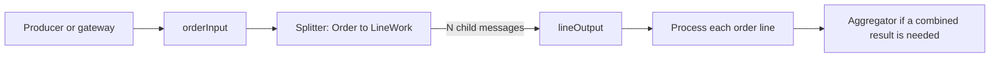

# What Is a Message Splitter

## 1. From One Order to Multiple Processing Units

An order management system receives an order consisting of three product lines. The inventory reservation service, however, processes each line individually: determining the SKU, quantity, and fulfillment warehouse. If the entire order is always passed along, every downstream component must know how to iterate over the list and preserve the order context.

A **message splitter** is an endpoint that implements the **Splitter** integration pattern: it receives a single message, splits its data into parts, and emits each part as an individual message for independent processing. It is a component of Spring Integration Core within the Enterprise Integration Patterns group. See the definition at [Spring Integration — Splitter](https://docs.spring.io/spring-integration/reference/splitter.html).

Business example used in this lesson:

```text
Message<Order>
└── orderId: ORD-1001
    ├── lineId: L1, sku: BOOK,     quantity: 2
    ├── lineId: L2, sku: KEYBOARD, quantity: 1
    └── lineId: L3, sku: MOUSE,    quantity: 1

                   Splitter
                       ↓

Message<LineWork>   Message<LineWork>   Message<LineWork>
ORD-1001 / L1       ORD-1001 / L2       ORD-1001 / L3
BOOK × 2           KEYBOARD × 1        MOUSE × 1
```

In this example, **the unit of splitting is the order line**. The BOOK line with quantity 2 still produces a single message. Only when the business contract requires processing each physical item separately does this line need to be split into two work items.

After this lesson, you should be able to design the input and output of a splitter, read the headers that correlate child messages, write a flow using the Java DSL, and recognize scenarios that require additional orchestration, error handling, or result aggregation.

## 2. Where Does a Splitter Sit in a Message Flow?

In the Spring Integration model, a `Message` carries a payload and headers; a `MessageChannel` moves messages between components; and an endpoint handles a specific responsibility in the flow. A splitter is an endpoint that changes the **granularity of work** from a collection to individual elements.



The diagram above illustrates one design option for orders. Child messages can flow through the same output channel; there is no need to create a separate channel for each order line.

Separate three design decisions clearly:

1. **What parts should be split out?** For example: order lines, invoices in a batch, or records in a file.
2. **How is each part processed?** For example: transforming data, routing by warehouse, or calling an inventory reservation service.
3. **Do we need to wait for a combined result?** For example: emitting each line result immediately, or returning a report only when the entire order completes.

In this lesson, the splitter addresses the first decision. Subsequent sections show how the other two decisions impact the flow contract.

## 3. Distinguishing a Splitter from Easily Confused Components

The table below uses the same order example to distinguish design purposes:

| Component | Question to solve | Example in the order flow |
|---|---|---|
| Splitter | What sub-tasks make up this dataset? | One order into three line-processing tasks |
| Transformer | How should the data be represented? | One order line into an inventory reservation request |
| Router | Where should this message go? | Forwarding the work item to the appropriate warehouse |
| Filter | Does the message qualify to continue? | Accepting or discarding a work item |
| Publish-subscribe channel | Which subscribers need to receive the message? | Notifying both the warehouse and audit system of an event |
| Aggregator | Which related results are sufficient to form a combined result? | Line reservation results into an order report |

A transformer that returns `List<LineWork>` still produces **a single message whose payload is a list**. When you want each element to become its own message traveling downstream, express that step with a splitter. A transformer focuses on converting data representation; see [Spring Integration — Transformer](https://docs.spring.io/spring-integration/reference/transformer.html).

Similarly, broadcasting an order to two subscribers serves the purpose of notifying two destinations; splitting an order into three lines serves the purpose of dividing work. The number of subscribers and the number of elements in an order are two different quantities.

If a business method only needs to iterate over three lines to compute a total amount in memory, a Java loop may already be sufficient. A splitter is useful when each part needs to become an independent unit of work in a message flow with dedicated endpoints.

## 4. Headers That Identify Child Messages

### 4.1. Three Headers of a Sequence

Spring Integration declares sequence-related header constants in `IntegrationMessageHeaderAccessor`:

| Java Constant | Header Name | Interpretation in this lesson |
|---|---|---|
| `CORRELATION_ID` | `correlationId` | Identifies the group of related messages |
| `SEQUENCE_NUMBER` | `sequenceNumber` | Position of the element in the sequence |
| `SEQUENCE_SIZE` | `sequenceSize` | Size of the sequence when known |

You can use the accessor to read these values instead of manually casting each header. See [IntegrationMessageHeaderAccessor API](https://docs.spring.io/spring-integration/api/org/springframework/integration/IntegrationMessageHeaderAccessor.html).

For a simple, non-nested split with default sequencing configuration and an input message whose ID is denoted `M0`, we expect:

| Child message payload | Own ID, denoted | `correlationId` | `sequenceNumber` | `sequenceSize` |
|---|---|---|---:|---:|
| Work for L1 | M1 | M0 | 1 | 3 |
| Work for L2 | M2 | M0 | 2 | 3 |
| Work for L3 | M3 | M0 | 3 | 3 |

The symbols M0–M3 help make the example readable; a real program uses ID values generated by the messaging infrastructure. Sequence positions start at 1. The table describes splitting from a list of payloads, not every custom case that returns pre-built `Message` instances.

### 4.2. Technical IDs and Business Keys Have Different Roles

In this lesson's application:

- `orderId = ORD-1001` identifies the order.
- `lineId = L2` identifies a specific line.
- `requestId = REQ-01` tracks the request across steps.
- `correlationId` and sequence numbers serve to correlate the message sequence.

Resending the same order can create a new input message. Therefore, for inventory reservation operations, design an idempotency key from business data, such as `orderId + lineId + operation`. Do not treat two messages having different technical IDs as proof that they represent two different business requests.

### 4.3. Sequencing Is Configurable

`AbstractMessageSplitter` has `applySequence` set to `true` by default; it can be disabled if the flow has its own grouping contract. When disabled, the splitter does not apply a new set of sequence headers; this does not mean removing any pre-existing correlation headers. The API also supports a discard channel for empty split results. See [AbstractMessageSplitter API](https://docs.spring.io/spring-integration/api/org/springframework/integration/splitter/AbstractMessageSplitter.html).

For an introductory lesson, keep sequencing enabled and inspect the headers directly before adding complex handling.

## 5. Designing the Split Function and Data Types

An order-splitting function has a clear contract:

```text
Order(orderId, List<OrderLine>)
          ↓ splitOrder
List<LineWork(orderId, OrderLine)>
          ↓ splitter emits each element
N Message<LineWork>
```

This design proactively embeds `orderId` inside each `LineWork`. A downstream handler only needs its own work item to know which order it is processing; it does not have to maintain a shared variable pointing back to the preceding order.

With the Java DSL, `.split()` uses the default splitter for collection-like payloads. You can pass a split function, expression, or custom splitter implementation. Sources such as `Iterable`, `Iterator`, arrays, `Stream`, and reactive `Publisher` are supported in the DSL model. See [Spring Integration — Java DSL Splitters](https://docs.spring.io/spring-integration/reference/dsl/java-splitters.html).

When choosing the contract for an example, distinguish among the following:

| Split function result | Contract that should be expressed |
|---|---|
| List of `LineWork` | Each element is a child work item |
| List of `Message<LineWork>` | Each part can carry its own additional headers |
| Single object | Only one result; multiple parts cannot be inferred by default |
| Empty list | No child work items |
| `null` | Terminates the flow according to handler rules; not an empty work item |

A `null` element is also not the way to represent a failed order line. Use a result object with an explicit status such as `SUCCESS`, `REJECTED`, or `FAILED`.

A string containing JSON does not automatically become a list of orders just by passing it into a splitter. Parse and validate the structure first, or write a split function tailored to that format.

## 6. Complete Example with Java DSL

### 6.1. Prerequisites

The main example uses Java 17 and Spring Integration 6.x, with `spring-integration-core` and compatible Spring dependencies. In a Spring Boot project with managed dependencies, you can use `spring-boot-starter-integration`.

The example uses `AnnotationConfigApplicationContext` to observe the flow without needing HTTP, a database, or a broker. The configuration class, data model, and `main` method are placed together so they are easy to copy into a learning project.

### 6.2. Configuring and Sending an Order

```java
import java.util.List;
import java.util.Objects;

import org.springframework.context.annotation.Bean;
import org.springframework.context.annotation.Configuration;
import org.springframework.context.annotation.AnnotationConfigApplicationContext;
import org.springframework.integration.IntegrationMessageHeaderAccessor;
import org.springframework.integration.channel.DirectChannel;
import org.springframework.integration.channel.QueueChannel;
import org.springframework.integration.config.EnableIntegration;
import org.springframework.integration.dsl.IntegrationFlow;
import org.springframework.messaging.Message;
import org.springframework.messaging.support.MessageBuilder;

@Configuration
@EnableIntegration
public class SplitterLessonConfig {

    public record OrderLine(String lineId, String sku, int quantity) {
        public OrderLine {
            Objects.requireNonNull(lineId, "lineId");
            Objects.requireNonNull(sku, "sku");
            if (quantity <= 0) {
                throw new IllegalArgumentException("quantity must be positive");
            }
        }
    }

    public record Order(String orderId, List<OrderLine> lines) {
        public Order {
            Objects.requireNonNull(orderId, "orderId");
            lines = List.copyOf(lines);
        }
    }

    public record LineWork(String orderId, OrderLine line) {
    }

    @Bean
    public DirectChannel orderInput() {
        return new DirectChannel();
    }

    @Bean
    public QueueChannel lineOutput() {
        return new QueueChannel();
    }

    public static List<LineWork> splitOrder(Order order) {
        return order.lines().stream()
                .map(line -> new LineWork(order.orderId(), line))
                .toList();
    }

    @Bean
    public IntegrationFlow orderSplitFlow() {
        return IntegrationFlow.from("orderInput")
                .split(Order.class, SplitterLessonConfig::splitOrder)
                .channel("lineOutput")
                .get();
    }

    public static void main(String[] args) {
        try (var context =
                new AnnotationConfigApplicationContext(SplitterLessonConfig.class)) {

            var order = new Order("ORD-1001", List.of(
                    new OrderLine("L1", "BOOK", 2),
                    new OrderLine("L2", "KEYBOARD", 1),
                    new OrderLine("L3", "MOUSE", 1)));

            Message<Order> original = MessageBuilder.withPayload(order)
                    .setHeader("requestId", "REQ-01")
                    .build();

            var input = context.getBean("orderInput", DirectChannel.class);
            var output = context.getBean("lineOutput", QueueChannel.class);

            if (!input.send(original)) {
                throw new IllegalStateException("Order was not accepted");
            }

            System.out.println("Parent message id: " + original.getHeaders().getId());

            for (int i = 0; i < order.lines().size(); i++) {
                Message<?> child = output.receive(1000);
                if (child == null) {
                    throw new IllegalStateException("Missing child message");
                }

                var headers = new IntegrationMessageHeaderAccessor(child);
                System.out.printf(
                        "%s | correlation=%s | sequence=%d/%d | requestId=%s%n",
                        child.getPayload(),
                        headers.getCorrelationId(),
                        headers.getSequenceNumber(),
                        headers.getSequenceSize(),
                        child.getHeaders().get("requestId"));
            }
        }
    }
}
```

The overload `split(Class<P>, Function<P, ?>)` explicitly specifies the input type of the split function; `channel("lineOutput")` sets the destination for child messages. See the signature at [BaseIntegrationFlowDefinition API](https://docs.spring.io/spring-integration/api/org/springframework/integration/dsl/BaseIntegrationFlowDefinition.html).

Expected output, with abbreviated record formatting and IDs:

```text
Parent message id: M0
ORD-1001 / L1 / BOOK / 2     | correlation=M0 | sequence=1/3 | requestId=REQ-01
ORD-1001 / L2 / KEYBOARD / 1 | correlation=M0 | sequence=2/3 | requestId=REQ-01
ORD-1001 / L3 / MOUSE / 1    | correlation=M0 | sequence=3/3 | requestId=REQ-01
```

This is the expected output to compare against when running the example, not an attached log from a specific execution.

### 6.3. Reading the Flow Step by Step

For the three order lines above, processing should be understood as follows:

1. The producer builds a `Message<Order>` and attaches `requestId`.
2. `orderInput` delivers the message to the splitter endpoint.
3. `splitOrder` creates three `LineWork` instances, each holding the order ID and one order line.
4. The splitter emits three messages carrying those payloads.
5. `lineOutput` buffers them for `main` to receive and inspect.

The `.stream().map(...).toList()` call in the split function has already collected the data into a `List`. Therefore, the splitter receives a collection of known size. This is not an example of feeding an unbounded or unknown-size stream directly into a splitter.

`QueueChannel` in this lesson acts as an in-memory buffer for observing results. Its default configuration has a very large capacity, so it is only suitable for a small example here. In a real flow, choose queue limits and consumption strategies that match the producer rate. See queue and channel behavior at [Spring Integration — Message Channel Implementations](https://docs.spring.io/spring-integration/reference/channel/implementations.html).

### 6.4. Do Not Mutate Shared Headers or Payloads in Place

`MessageHeaders` is immutable with respect to update operations via the map API; use a builder or header enricher endpoint when constructing a new message. See [Spring Framework — MessageHeaders](https://docs.spring.io/spring-framework/docs/current/javadoc-api/org/springframework/messaging/MessageHeaders.html).

The immutability of the message envelope does not guarantee that an arbitrary payload is also immutable. In the example, records containing strings, integers, and a copied list help prevent downstream handlers from accidentally modifying the order's line list.

If a real-world model uses `OrderLine` with mutable properties, decide explicitly whether to share objects or create copies. Do not assume that the split step automatically deep-copies all business data.

## 7. Alternative Configuration Approaches

### 7.1. Input Payload Is Already a List

If the producer sends `Message<List<LineWork>>`, you can use the default splitter:

```java
@Bean
public IntegrationFlow collectionSplitFlow() {
    return IntegrationFlow.from("workListInput")
            .split()
            .channel("lineOutput")
            .get();
}
```

In this approach, the producer is responsible for creating `LineWork` objects with full context. Do not replace `Order` with a list of lines just for shorter code if doing so loses the required order ID.

### 7.2. Simple Delimited Strings

As of Spring Integration 6.2, the DSL provides `splitWith` and `SplitterSpec` for direct configuration. The following example assumes the input consists only of simple SKU codes:

```java
@Bean
public IntegrationFlow skuSplitFlow() {
    return IntegrationFlow.from("skuTextInput")
            .splitWith(spec -> spec.delimiters(","))
            .channel("skuOutput")
            .get();
}
```

With payload `"BOOK,KEYBOARD,MOUSE"`, each token becomes an emitted part. The `delimiters` property is intended for tokenizing strings; see [DefaultMessageSplitter API](https://docs.spring.io/spring-integration/api/org/springframework/integration/splitter/DefaultMessageSplitter.html).

If the data is CSV containing delimiters inside quotes, multi-line fields, or escape rules, use a proper parser to build records before splitting. The SKU token example does not represent a full CSV reader.

### 7.3. Using an Annotation on a Bean

Another approach for the order-splitting function:

```java
import java.util.List;

import org.springframework.integration.annotation.Splitter;
import org.springframework.stereotype.Component;

@Component
public class OrderSplitter {

    @Splitter(inputChannel = "orderInput", outputChannel = "lineOutput")
    public List<SplitterLessonConfig.LineWork> split(
            SplitterLessonConfig.Order order) {

        return SplitterLessonConfig.splitOrder(order);
    }
}
```

This class must be registered as a bean, such as via component scanning. It is an alternative to the example's DSL endpoint, not a second endpoint to be registered simultaneously on `orderInput`. See annotation configuration at [@Splitter API](https://docs.spring.io/spring-integration/api/org/springframework/integration/annotation/Splitter.html).

## 8. Combining Transformer, Router, Filter, Aggregator, and Gateway

Suppose the inventory service returns a `LineResult` for each `LineWork`. A design might look like:

```text
Gateway receives Order
    → Splitter creates LineWork
    → Transformer creates inventory reservation request
    → Router selects target warehouse
    → Handler produces LineResult
    → Aggregator produces OrderResult, if a combined response is needed
```

Here, the result contract must answer: is an out-of-stock line a `REJECTED` business result, or a message filtered out of the flow?

By default, an aggregator groups based on `correlationId` and uses the sequence size to decide when a group is complete. If a filter drops messages before aggregation, you must redesign the completion condition or produce a compensating result for the dropped item. See [Spring Integration — Aggregator](https://docs.spring.io/spring-integration/reference/aggregator.html).

Applying this to the three-line order:

- If L1 and L3 succeed while L2 is out of stock, the order report may need all three results: two `SUCCESS` and one `REJECTED`.
- If L2 is dropped without a replacement result, the aggregator sees only two results even though the original contract had three lines.
- If the business allows partial results after a timeout, clearly document what missing results mean to the customer.

When the gateway is designed to return a single `OrderResult`, the flow must have a path that constructs that exact combined result. Splitting an order into multiple messages does not automatically establish how a single representative response is chosen for the entire order.

If each line is processed and notified independently, an aggregator may not be needed. This choice depends on the business contract, not on whether the flow already contains a splitter.

## 9. Empty Lists and Unknown-Size Sources

### 9.1. Orders Without Lines

The `Order` model in the example allows an empty list so this behavior can be observed. When the split function returns an empty collection, there are no elements to emit to the output. `AbstractMessageSplitter` can send the input message to a discard channel if configured; by default, it is dropped at this step. A `null` return means terminating the flow and is not the same as discarding an empty container. See [AbstractMessageSplitter API](https://docs.spring.io/spring-integration/api/org/springframework/integration/splitter/AbstractMessageSplitter.html).

A controlled approach for a list payload is:

```java
@Bean
public IntegrationFlow guardedCollectionSplitFlow() {
    return IntegrationFlow.from("workListInput")
            .splitWith(spec -> spec.discardChannel("emptyWorkInput"))
            .channel("lineOutput")
            .get();
}
```

In the application, you must provide the `emptyWorkInput` channel and a consumer to handle it. That consumer receives the discarded input message; it needs to understand the original payload contract.

The options to declare `discardChannel`, `applySequence`, and others are described at [SplitterSpec API](https://docs.spring.io/spring-integration/api/org/springframework/integration/dsl/SplitterSpec.html).

For a typical order-creation API, a simpler choice is to reject empty orders during validation. If an empty order is valid, the application must explicitly define the response; a downstream aggregator receives no messages to start a group.

### 9.2. Iterators or Streams Without a Known Total Count

Streaming/chunked sources avoid loading all data into a collection. However, if the splitter cannot determine the element count, `sequenceSize` may be `0`, meaning **total size unknown**, not "a group with zero elements." Aggregation strategies based on sequence size cannot use this value to know when the source has finished. See the Iterators section at [Spring Integration — Splitter](https://docs.spring.io/spring-integration/reference/splitter.html).

For a large file or multi-record query, before choosing an incremental source, determine:

1. Will results be processed independently or do they need to be aggregated?
2. If aggregation is needed, how does the system know reading has finished—total count, end-of-stream signal, or another contract?
3. Who is responsible for closing the stream or database resource?
4. If an error occurs midway through reading, which work items have already been emitted and how will processing resume?

Do not use a period of silence as the sole proof that every record has been processed successfully.

## 10. Ordering, Parallelism, and Errors

### 10.1. Sequence Numbers Do Not Control Execution Flow

In the main example, lines L1–L3 are iterated and placed into the queue in order. When changing the architecture—for example, adding an executor or multiple workers—the completion order may become L3, L1, then L2.

`DirectChannel` invokes the handler on the sender's thread. `ExecutorChannel` hands work to an executor, enabling execution on another thread. The choice of channel and executor determines execution characteristics; the splitter itself does not configure a thread pool. See [Spring Integration — Message Channel Implementations](https://docs.spring.io/spring-integration/reference/channel/implementations.html).

For the business domain, distinguish among:

- The order of elements in the original order.
- The order in which work items are dispatched.
- The order in which work items actually complete.
- The order to display in the final report.

If the report requires L1–L3 ordering, retain the order data and design the report-building step to use it. Do not infer from `sequenceNumber = 1` that that work item always finishes first.

### 10.2. One Failed Line Does Not Automatically Roll Back the Whole Order

With a synchronous path through `DirectChannel`, exceptions can propagate back to the sender. When processing asynchronously, errors cannot return on the same call stack; Spring Integration provides an `ErrorMessage` mechanism, routed via the message's `errorChannel` or the configured global error channel. See [Spring Integration — Error Handling](https://docs.spring.io/spring-integration/reference/error-handling.html).

Suppose an actual inventory reservation flow processes L1 successfully and then L2 fails. Design questions to resolve include:

- Has L1 already written changes to a database or called an external API?
- Will the sender resend the entire order or only L2?
- If the entire order is resent, what key prevents reserving inventory for L1 twice?
- Does the final result need to include the failure status of L2?
- Does the business require releasing the inventory already reserved for L1?

A splitter does not automatically answer these questions. A call to an external service that has already succeeded is not automatically compensated just because a later step throws an exception. Transactions, retries, idempotency, and compensation must be designed around the actual side effects of each step.

If you want per-line retries, place the retry policy around each line's operation. Retrying the entire order after some lines have already had side effects can cause duplicate operations.

## 11. Testing the Splitting Contract

### 11.1. What to Verify

For the order example, useful tests should verify:

| Scenario | What to observe |
|---|---|
| Three order lines | Exactly three child messages, each containing the right line and order ID |
| BOOK with quantity 2 | Still only one work item for the BOOK line |
| Tracking header | `requestId` remains on the child messages |
| Sequence correlation | Same correlation for the split, positions 1–3, size 3 |
| Child message IDs | Each message is distinguishable in the list payload example |
| Empty order | No child messages; rejection or discard policy must be tested separately |
| Resending the same order | Idempotency behavior is defined in the business contract |

Do not test only `splitOrder(order).size()`: that check does not observe the actual endpoint or the headers produced by the flow.

### 11.2. JUnit 5 Example for the Main Flow

Place the test in the same package as `SplitterLessonConfig`, with JUnit Jupiter available in the project:

```java
import java.util.HashSet;
import java.util.List;
import java.util.Set;
import java.util.UUID;

import org.junit.jupiter.api.Test;
import org.springframework.context.annotation.AnnotationConfigApplicationContext;
import org.springframework.integration.IntegrationMessageHeaderAccessor;
import org.springframework.integration.channel.DirectChannel;
import org.springframework.integration.channel.QueueChannel;
import org.springframework.messaging.Message;
import org.springframework.messaging.support.MessageBuilder;

import static org.junit.jupiter.api.Assertions.*;

class SplitterLessonTest {

    @Test
    void splitsEachOrderLineAndPreservesItsContext() {
        try (var context =
                new AnnotationConfigApplicationContext(SplitterLessonConfig.class)) {

            var order = new SplitterLessonConfig.Order("ORD-1001", List.of(
                    new SplitterLessonConfig.OrderLine("L1", "BOOK", 2),
                    new SplitterLessonConfig.OrderLine("L2", "KEYBOARD", 1),
                    new SplitterLessonConfig.OrderLine("L3", "MOUSE", 1)));

            Message<?> original = MessageBuilder.withPayload(order)
                    .setHeader("requestId", "REQ-01")
                    .build();

            var input = context.getBean("orderInput", DirectChannel.class);
            var output = context.getBean("lineOutput", QueueChannel.class);
            Set<UUID> childIds = new HashSet<>();

            assertTrue(input.send(original));

            for (int i = 0; i < order.lines().size(); i++) {
                Message<?> child = output.receive(1000);
                assertNotNull(child);

                var work = assertInstanceOf(
                        SplitterLessonConfig.LineWork.class, child.getPayload());
                var headers = new IntegrationMessageHeaderAccessor(child);

                assertEquals(order.orderId(), work.orderId());
                assertEquals(order.lines().get(i), work.line());
                assertEquals("REQ-01", child.getHeaders().get("requestId"));
                assertEquals(original.getHeaders().getId(),
                        headers.getCorrelationId());
                assertEquals(i + 1, headers.getSequenceNumber());
                assertEquals(3, headers.getSequenceSize());
                assertNotNull(child.getHeaders().getId());
                assertTrue(childIds.add(child.getHeaders().getId()));
                assertNotEquals(original.getHeaders().getId(),
                        child.getHeaders().getId());
            }

            assertNull(output.receive(0));
        }
    }

    @Test
    void emptyOrderProducesNoChildMessages() {
        try (var context =
                new AnnotationConfigApplicationContext(SplitterLessonConfig.class)) {

            var input = context.getBean("orderInput", DirectChannel.class);
            var output = context.getBean("lineOutput", QueueChannel.class);
            var emptyOrder =
                    new SplitterLessonConfig.Order("ORD-EMPTY", List.of());

            assertTrue(input.send(MessageBuilder.withPayload(emptyOrder).build()));
            assertNull(output.receive(0));
        }
    }
}
```

The second test only verifies that the demonstration flow emits no child messages for an empty order. It does not verify that empty orders are accepted by the business, audited, or given a response to the customer.

The checks above rely on the synchronous flow of the example. When adding an executor, tests must wait conditionally with an appropriate timeout; do not assume that returning from `send` means all child work items have finished.

## 12. Applying to a Real-World Scenario

A batch ingestion system of 500 invoices needs to send each invoice to a reconciliation service. The design can map the example's contract as follows:

| Order example | Invoice ingestion flow |
|---|---|
| `Order` | `InvoiceBatch` |
| `orderId` | `batchId` |
| `OrderLine` | `Invoice` |
| `LineWork` | `InvoiceWork(batchId, invoice)` |
| Line inventory reservation result | Invoice reconciliation result |
| Order report | Batch report |

If each invoice is reconciled independently, a splitter turns each invoice into a work item that can be routed and processed separately. If the batch caller requires a combined report, you must define when the batch completes, how failed invoices are represented, and whether resending a batch causes duplicate reconciliation.

Before introducing a splitter into a flow, finalize the unit of splitting, the context data each part must carry, the completion condition, and the policy for empty or failed parts. A splitter with a clear contract ensures downstream endpoints receive the exact work they need to process.
