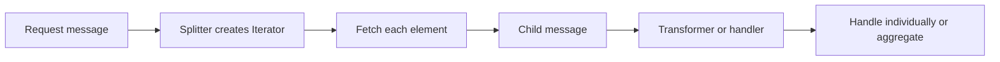
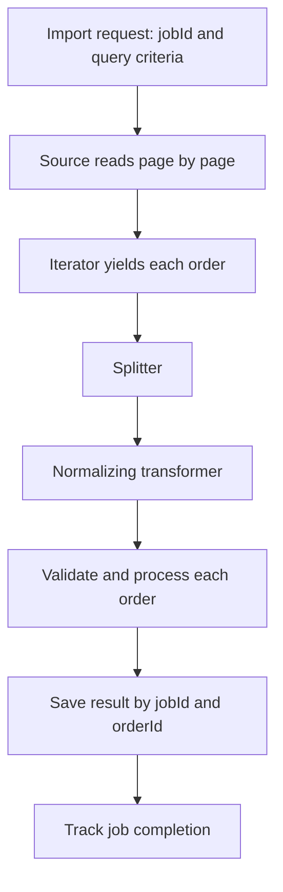

# Splitting Iterators

In the **SPRING_INTEGRATION_CORE** module, a splitter is an endpoint that turns one input message into multiple child messages so downstream steps process each part individually. This lesson belongs to the **Splitter** chapter and focuses on returning an `Iterator` to traverse data incrementally, coordinating with `MessageChannel`, transformers, error handling, and aggregators.

The illustrative scenario is a job that needs to process numeric codes within a given range. Instead of pre-building a list of all codes, we generate each value on demand when the splitter requests it. This structure also helps visualize paginated or cursor-based sources, though sources backed by external resources also require their own lifecycle design.

After this lesson, you will be able to:

- Distinguish `Iterator`, `Iterable`, and collections when used as splitter output.
- Write a Java DSL flow that splits each element and preserves relevant headers.
- Explain the `sequenceSize = 0` case.
- Choose how to determine completion, control buffered data volume, and handle interrupted iteration.
- Write tests that observe payloads, correlation, and sequence headers.

## 1. Where Does Iterator Fit into a Splitter?

There are two common usage patterns:

1. The input payload is already an iterable object; the split function returns its iterator.
2. The input payload is a business request; the split function opens or creates a source and returns an iterator.

In both cases, what the split function returns is what the endpoint uses to construct child messages. If the iterator yields business objects, each object becomes the payload of a message. If it yields `Message<?>` instances, the splitter works with those messages and adds sequence metadata when enabled. [Splitter Programming Model](https://docs.spring.io/spring-integration/reference/6.5/splitter.html).



One way to picture the algorithm is:

```java
// Pseudocode illustrating the concept, not framework source code.
Iterator<?> iterator = createIterator(request);

while (iterator.hasNext()) {
    Object item = iterator.next();
    sendChildMessage(item);
}
```

A splitter creates and sends multiple messages; it does not automatically spawn a thread per element. When handlers run and how much parallelism occurs depend on the channel configuration of the flow.

### 1.1. How Does Iterator Differ from Iterable?

| Type | Role | Considerations when putting into a flow |
| --- | --- | --- |
| `Collection<T>` | A collection of elements with a `size()` operation | May already hold all data in memory |
| `Iterable<T>` | Provides the `iterator()` method | Re-iterability depends on the implementation |
| `Iterator<T>` | Holds the position of a single traversal | Once elements are consumed, the traversal position advances |
| `Stream<T>` | Data processing pipeline | Must also consider stream lifecycle and underlying resources |

Per the Java contract, `hasNext()` indicates whether more elements exist; `next()` retrieves the next element and must throw `NoSuchElementException` when exhausted. `Iterator` does not provide `size()` or a rewind operation. [Java Iterator API](https://docs.oracle.com/en/java/javase/17/docs/api/java.base/java/util/Iterator.html).

Do not share a single mutable-position iterator across multiple requests. For retryable requests, keep a description of the source, such as a code range or query token, and create a fresh traversal.

### 1.2. Having an Iterator Does Not Guarantee Memory Savings

The following two ways of creating a source have different costs:

```java
// All data is already loaded before the iterator is created.
List<Order> orders = repository.loadAllOrders();
return orders.iterator();

// Conceptual incremental source; requires designing cursor open/close lifecycle.
return repository.openOrderCursor(query);
```

These are two business sketches, not built-in Spring Integration APIs.

In the first approach, calling `iterator()` does not free the list's memory. In the second approach, benefits materialize only if the cursor genuinely reads incrementally and downstream steps do not retain all results. Treat an iterator as a traversal mechanism; how the source feeds data and where data is buffered determine the real cost.

## 2. Complete Example: Incrementally Generated Number Source

The examples use Java 17 and the Spring Integration 6.5 Java DSL. They require `spring-integration-core` and corresponding Spring libraries; tests use JUnit Jupiter. Dependency versions should be selected by the application's dependency management configuration.

The example consists of two production classes in the same `example.splitter` package. The number source opens no files or database connections, making it easy to observe iterator behavior in isolation.

### 2.1. Creating a Source with Per-Traversal State

```java
package example.splitter;

import java.util.Iterator;
import java.util.NoSuchElementException;

public record NumberRange(int startInclusive, int endExclusive)
        implements Iterable<Integer> {

    public NumberRange {
        if (endExclusive < startInclusive) {
            throw new IllegalArgumentException(
                    "endExclusive must be >= startInclusive");
        }
    }

    @Override
    public Iterator<Integer> iterator() {
        return new Iterator<>() {
            private int current = startInclusive;

            @Override
            public boolean hasNext() {
                return current < endExclusive;
            }

            @Override
            public Integer next() {
                if (!hasNext()) {
                    throw new NoSuchElementException();
                }
                return current++;
            }
        };
    }
}
```

`new NumberRange(10, 14)` describes four values: `10, 11, 12, 13`. The object stores only the two bounds. Each call to `iterator()` creates its own `current` position, so one traversal does not exhaust another.

Creating `NumberRange` does not allocate a list of numbers. Each value appears only when `next()` is called. This is a suitable mock source to demonstrate incremental generation without mixing in read-ahead behavior from external drivers or APIs.

### 2.2. Declaring Channels and IntegrationFlow

```java
package example.splitter;

import org.springframework.context.annotation.Bean;
import org.springframework.context.annotation.Configuration;
import org.springframework.integration.channel.DirectChannel;
import org.springframework.integration.channel.QueueChannel;
import org.springframework.integration.config.EnableIntegration;
import org.springframework.integration.dsl.IntegrationFlow;

@Configuration
@EnableIntegration
public class IteratorSplitterConfiguration {

    @Bean
    public DirectChannel rangeInput() {
        return new DirectChannel();
    }

    @Bean
    public QueueChannel rangeResults() {
        return new QueueChannel(16);
    }

    @Bean
    public IntegrationFlow iteratorRangeFlow() {
        return IntegrationFlow.from(rangeInput())
                .split(NumberRange.class, NumberRange::iterator)
                .transform(Integer.class, value -> "item-" + value)
                .channel(rangeResults())
                .get();
    }
}
```

`split(NumberRange.class, NumberRange::iterator)` declares the input payload type and the function that creates the iterator. The subsequent transformer receives each `Integer`, so it is invoked four times for the range `[10, 14)`. The DSL overload taking an input class and a `Function` is described in [BaseIntegrationFlowDefinition API](https://docs.spring.io/spring-integration/api/org/springframework/integration/dsl/BaseIntegrationFlowDefinition.html).

In the example, `rangeInput` is a `DirectChannel`, so sending a message executes the splitter and transformer on the caller's thread. `rangeResults` holds the results for test code to retrieve later. No poller is needed just to call `receive()` directly from tests.

**Limitation of this demonstration setup:** the queue holds at most 16 messages. The tests below send at most four items before reading results. If a large range is sent on the same thread without an independent consumer draining the queue, the send call can block once the queue fills. To handle large datasets, design consumers, send timeouts, and buffer capacities together. [MessageChannel Implementations](https://docs.spring.io/spring-integration/reference/6.5/channel/implementations.html).

### 2.3. Sending a Request

The snippet below assumes `context` is an application context with the configuration above registered:

```java
MessageChannel input =
        context.getBean("rangeInput", MessageChannel.class);

Message<NumberRange> request = MessageBuilder
        .withPayload(new NumberRange(10, 14))
        .setHeader("jobId", "import-42")
        .build();

input.send(request);
```

The types in this snippet reside in `org.springframework.messaging`; `MessageBuilder` resides in `org.springframework.messaging.support`.

The four payloads on the result channel are `item-10`, `item-11`, `item-12`, and `item-13`. The business header `jobId` travels with each element, helping correlate logs for a job even when downstream steps transform the payload.

To hide messaging details from business code, the application can place a messaging gateway in front of `rangeInput`. For a flow that emits multiple elements without a reply-aggregation step, choose a one-way send contract or explicitly design how the overall job result is returned.

## 3. Sequence Headers: Order Is Known, Total Size May Be Unknown

The splitter enables `applySequence` by default. For a normal split, the important headers are:

| Header | Meaning in the example |
| --- | --- |
| `correlationId` | Links child messages to the request message |
| `sequenceNumber` | Element position, starting from 1 |
| `sequenceSize` | Total count if determinable; `0` when unknown |

For a standard iterator in the example, the observed data is:

| Payload after transformer | `sequenceNumber` | `sequenceSize` |
| --- | --- | --- |
| `item-10` | 1 | 0 |
| `item-11` | 2 | 0 |
| `item-12` | 3 | 0 |
| `item-13` | 4 | 0 |

**A value of `0` indicates that the total count is undetermined; it does not mean the split produced zero elements.** A standard iterator does not tell the splitter beforehand how many elements remain. Even after sending the last element, there is no mechanism to go back and patch headers on messages already sent.

The `AbstractMessageSplitter` API has two extension methods: `obtainSizeIfPossible(Iterable<?>)` and `obtainSizeIfPossible(Iterator<?>)`. The `Iterable` branch can retrieve the size when the source is a `Collection`; the `Iterator` branch returns `0` by default. Therefore, do not conclude that every `Iterable` has size `0`. [AbstractMessageSplitter API](https://docs.spring.io/spring-integration/api/org/springframework/integration/splitter/AbstractMessageSplitter.html).

In `NumberRange`, a human can subtract the two bounds. However, the split function returns an anonymous iterator, and the default splitter does not inspect bounds to infer a count.

If you write a custom splitter, supply a size only from reliable metadata and without mutating the traversal. Draining an iterator beforehand just to count elements both consumes the source and defeats early per-element emission.

## 4. Aggregating Downstream Requires a Completion Contract

Correlation answers the question "which job do these elements belong to?" The release strategy answers "are conditions met to emit the result?" These two questions must be solved separately.

By default, an aggregator relies on sequence size to determine a complete group. When an iterator produces `sequenceSize = 0`, simply appending `.aggregate()` does not automatically establish a completion condition. The group may keep waiting even after the splitter finishes iterating the source. [Aggregator: Correlation and Release](https://docs.spring.io/spring-integration/reference/6.5/aggregator.html).

### 4.1. Three Design Options

| Business need | How completion is determined | What must be specified |
| --- | --- | --- |
| Process each element independently | No aggregator needed | Track job status via a separate mechanism if required |
| Exact total-count metadata is available | Release strategy compares against expected element count | How to handle duplicates, missing items, and filtered items |
| Total count is unknown upfront | End-of-stream message plus count, or expiration policy | Meaning of complete versus partial results |

For example, an ingestion job with a manifest `expectedCount = 4` can attach that header to every child message. An illustrative release strategy is:

```java
package example.splitter;

import org.springframework.integration.aggregator.ReleaseStrategy;
import org.springframework.integration.store.MessageGroup;

public final class ExpectedCountReleaseStrategy
        implements ReleaseStrategy {

    @Override
    public boolean canRelease(MessageGroup group) {
        if (group.size() == 0) {
            return false;
        }

        Integer expected = group.getOne()
                .getHeaders()
                .get("expectedCount", Integer.class);

        return expected != null
                && expected > 0
                && group.size() == expected;
    }
}
```

This is a standalone example illustrating a count-based contract and is not wired into `iteratorRangeFlow`. It assumes all messages in the group share the same `expectedCount`, each element arrives only once, and each element produces exactly one result.

Test breaking each assumption:

- If a filter drops one element while the expected total remains 4, the group receives only three messages and keeps waiting.
- If a retry duplicates one result, the message count can reach 4 even though another element is missing.
- If total-count metadata is read from a mutating dataset, that number may diverge from the actual traversal.

In flows with redelivery, deduplicate by element key before using counts as a completion condition. If invalid elements must also be accounted for, emit a status result per element instead of silently dropping them.

### 4.2. End-of-Stream Messages and Timeouts

Suppose the source emits an additional `End(jobId, emittedCount)` after finishing data. If downstream processing is concurrent, the end signal may arrive at the aggregator before some item results. Therefore, the completion condition should be "end signal received AND all expected results present," while accounting for duplicates.

A source-exhausted signal must also be distinguished from a signal that all child tasks succeeded. When the source fails midway, do not emit a successful completion signal as if the data were complete.

Another option is configuring `groupTimeout` and deciding whether to emit partial results via `sendPartialResultOnExpiry`. Timing out is an operational policy; it does not prove all data was received. Results should carry an appropriate status so consumers know whether the group completed or is incomplete. [Aggregator and Group Timeout](https://docs.spring.io/spring-integration/reference/6.5/aggregator.html#agg-and-group-timeout).

## 5. Lazy Traversal, Memory, and Downstream Pressure

An iterator avoids allocating an intermediate collection, yet the entire data path must still be evaluated.

As a practical estimation model:

```text
Flow memory ≈ source buffer
            + in-flight data being processed
            + messages queued in channels or executors
            + unreleased aggregator group state
```

This is a model for spotting accumulation points, not an exact heap-sizing formula.

For instance, suppose each payload averages 2 KiB and there are one million elements. Raw data alone is roughly 2 GiB, excluding object, message, and header overhead. A small iterator at the front of the flow will not prevent a downstream queue or aggregator from retaining that entire volume.

Useful design questions include:

- How many elements does the source prefetch at once?
- How long does a consumer take on average per element?
- How many elements can be queued or executing concurrently?
- When buffers fill up, how long does the producer wait and where are errors handled?
- When a job is canceled, who stops reading and releases resources?

`DirectChannel` keeps handler execution on the sending thread; `ExecutorChannel` hands processing to an executor. Adding an executor changes waiting points and error propagation paths, and also requires sizing queue capacities and worker counts. [Channel Type Behavior](https://docs.spring.io/spring-integration/reference/6.5/channel/implementations.html).

In a simple synchronous design, a slow handler slows down the send call. If switching to parallel processing, bound the number of in-flight or queued items. An on-demand iterator does not automatically turn the entire flow into a reactive system with backpressure.

## 6. Source Lifecycle: An Iterator Does Not Fully Represent a Resource

`NumberRange` requires no closing. Iterators backed by files, database cursors, or network responses can depend on open resources.

The following example closes the stream before the receiver even begins iterating:

```java
// Incorrect resource lifecycle example.
public Iterator<String> unsafeLines(Path path) throws IOException {
    try (Stream<String> lines =
            Files.lines(path, StandardCharsets.UTF_8)) {
        return lines.iterator();
    }
}
```

`Files.lines()` reads lazily and the returned stream keeps the file open; closing the stream closes the file. Thus, returning the iterator out of that block does not safely transfer file ownership. [Java Files.lines API](https://docs.oracle.com/en/java/javase/17/docs/api/java.base/java/nio/file/Files.html#lines(java.nio.file.Path,java.nio.charset.Charset)).

Opening the stream and returning its iterator without retaining a close path also causes problems. The `Iterator` interface has no `close()` method.

A resource-management contract should specify:

1. Which component opens the source.
2. Which component actually traverses the source.
3. How closing works on normal completion, read errors, message-send errors, or cancellation.
4. Whether an asynchronous boundary precedes traversal and causes the resource scope to exit early.

If the caller manages resources with `try-with-resources`, that scope must encompass the actual traversal. Verify the flow structure to confirm the splitter finishes traversing before leaving the scope. Emitted items should be detached from the cursor if they continue being processed after the cursor closes.

When implementing real external sources, use an adapter or specialized splitter with a suitable lifecycle contract, or create a source-manager class responsible for closing along every exit path. Do not infer resource closure merely because the returned object has type `Iterator`.

## 7. Empty Iterators and Mid-Stream Failures

### 7.1. Empty Iterators

`new NumberRange(10, 10)` produces a traversal with zero elements. The flow does not create a child message to represent a count of zero.

This affects jobs expecting an overall result: if no messages reach the aggregator, no new group is created to wait or expire. Handle empty requests at the job level, such as returning a completed status with an item count of 0.

The splitter also supports `discardChannel` for requests whose split result is an empty container. A `null` split result is a separate flow-termination case, so do not use these two cases interchangeably when designing business semantics. [Splitter Configuration](https://docs.spring.io/spring-integration/reference/6.5/splitter.html).

### 7.2. Failures After Sending Some Elements

Suppose a source is meant to yield `A, B, C, D`, but reading `C` throws an exception. At that moment, `A` and `B` may already have been sent and even persisted to another system.

Do not treat a single parent message send as guaranteeing atomic side effects across all child messages. Atomicity depends on actual transactions and participating resources.

Distinguish two failure locations:

| Failure location | Example | Information to record for recovery |
| --- | --- | --- |
| During source read | Cursor loses connection in `hasNext()` or `next()` | Query key, checkpoint, count of emitted items |
| During element processing | Writing data for `B` fails | Element key, processing status, attempt count |

In a synchronous flow over `DirectChannel`, exceptions can propagate to the caller. Past an asynchronous boundary, errors must be handled via endpoint, executor, or poller mechanisms—typically using `ErrorMessage` and an appropriate error channel. Simply setting an `errorChannel` header does not turn every synchronous exception into an error message. [Error Handling](https://docs.spring.io/spring-integration/reference/6.5/error-handling.html).

### 7.3. Retries Require a Clear Replayable Source

An iterator holds the state of one traversal. Retrying on the exact same partially read object does not guarantee restarting from the beginning, nor is it guaranteed safe after an error.

Retain a request capable of recreating the source, then choose a business policy:

- Rerun from the source description and skip already-processed items using a stable key.
- Resume from a confirmed checkpoint.
- Retry only the failed element once that element has been materialized independently of the source.

For ingestion, a key like `(jobId, recordId)` is usually more useful than relying solely on message UUIDs to detect duplicates. A re-submitted job can generate new message IDs even when processing the same record.

## 8. Testing the Demonstration Flow's Behavior

The following test class uses the two production classes from Section 2. It creates a real application context, sends a message, and verifies child messages. Each test uses its own context so queues and state do not leak between tests.

```java
package example.splitter;

import org.junit.jupiter.api.Test;
import org.springframework.context.annotation.AnnotationConfigApplicationContext;
import org.springframework.integration.IntegrationMessageHeaderAccessor;
import org.springframework.integration.channel.QueueChannel;
import org.springframework.messaging.Message;
import org.springframework.messaging.MessageChannel;
import org.springframework.messaging.support.MessageBuilder;

import static org.junit.jupiter.api.Assertions.*;

class IteratorSplitterTest {

    @Test
    void splitsIteratorAndPreservesCorrelationHeaders() {
        try (var context = new AnnotationConfigApplicationContext(
                IteratorSplitterConfiguration.class)) {

            MessageChannel input =
                    context.getBean("rangeInput", MessageChannel.class);
            QueueChannel output =
                    context.getBean("rangeResults", QueueChannel.class);

            Message<NumberRange> request = MessageBuilder
                    .withPayload(new NumberRange(10, 14))
                    .setHeader("jobId", "import-42")
                    .build();

            assertTrue(input.send(request));

            for (int index = 0; index < 4; index++) {
                Message<?> child = output.receive(1000);

                assertNotNull(child);
                assertEquals("item-" + (10 + index), child.getPayload());
                assertEquals("import-42",
                        child.getHeaders().get("jobId"));
                assertEquals(request.getHeaders().getId(),
                        child.getHeaders().get(
                                IntegrationMessageHeaderAccessor.CORRELATION_ID));
                assertEquals(Integer.valueOf(index + 1),
                        child.getHeaders().get(
                                IntegrationMessageHeaderAccessor.SEQUENCE_NUMBER,
                                Integer.class));
                assertEquals(Integer.valueOf(0),
                        child.getHeaders().get(
                                IntegrationMessageHeaderAccessor.SEQUENCE_SIZE,
                                Integer.class));
            }

            assertNull(output.receive(0));
        }
    }

    @Test
    void emptyIteratorProducesNoChildMessages() {
        try (var context = new AnnotationConfigApplicationContext(
                IteratorSplitterConfiguration.class)) {

            MessageChannel input =
                    context.getBean("rangeInput", MessageChannel.class);
            QueueChannel output =
                    context.getBean("rangeResults", QueueChannel.class);

            assertTrue(input.send(MessageBuilder
                    .withPayload(new NumberRange(10, 10))
                    .build()));

            assertNull(output.receive(0));
        }
    }
}
```

The first test simultaneously verifies transformation results, message count, observed ordering in the current configuration, and headers needed for tracking or aggregation. The second test verifies that a successful `send` does not guarantee at least one child message is produced.

The test snippets are illustrative code for learners to run in a configured environment. With real sources, add tests tailored to the source contract rather than inferring I/O behavior from this arithmetic example.

Valuable extended test scenarios include:

| Scenario | What to verify |
| --- | --- |
| Two separate requests | Correlation groups do not mix |
| Source throws after two elements | Emitted data can be identified and the source is closed |
| Full queue | Blocking or timeout behavior matches configuration |
| Executor processes out of order | Dispatch order is not conflated with completion order |
| Duplicate result received | Group is not considered complete merely because message count increased |
| Zero elements | Overall job still has an explicit terminal status |

## 9. Applying This to an Order Ingestion Job

Suppose an application needs to import orders page by page from an external system. The flow can be organized as follows:



In this design, the iterator should retain only the current page and cursor info to fetch the next page. Each yielded order must be an independent object, not mutated into the next record's contents after being emitted.

Before implementation, establish pagination stability. If orders can be inserted or change status during reads, offset-based pagination may produce duplicates or skips depending on the API. Tokens, snapshots, or stable query watermarks may be required per the source contract.

One concrete operational pattern is storing progress by job, recording per-`orderId` results with duplicate detection, and marking the job complete only once the source finishes and all expected results are accounted for. If the business only needs to persist each order independently, there is no need to gather all orders into one large payload just to confirm success.

If a router separates valid and invalid orders, both branches must participate in computing job status. If a filter drops elements, decide whether "dropped" counts as processed or as a reportable error. That decision must align with the chosen completion condition.

## 10. Key Takeaways

- `Iterator` lets a splitter fetch elements one by one without building an intermediate collection.
- Memory efficiency depends on the source, queues, executors, and result storage combined.
- `sequenceNumber` gives emission position; `sequenceSize = 0` means the total count is unknown.
- Aggregators need a dedicated completion condition when sequence size is unavailable.
- Exhausting iteration, finishing all element processing, and job success are distinct milestones.
- Resource-backed sources must explicitly define who closes them and when.
- A consumed iterator is not a replay mechanism; retries require a source descriptor or checkpoint.