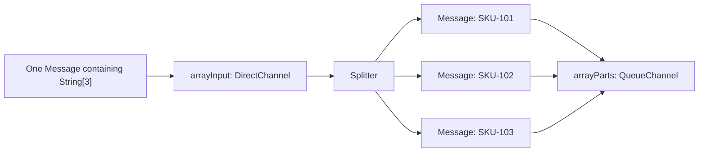

# Splitting Arrays

## 1. Objectives and Use Cases

In the **Splitter** chapter of **SPRING_INTEGRATION_CORE**, splitting an array means converting a message containing an array into multiple messages, each carrying one element. This acts as the bridge between batch-oriented inputs and endpoints that process individual business units.

For example, a warehouse system receives an array of product SKUs:

```java
String[] skus = {"SKU-101", "SKU-102", "SKU-103"};
```

The system needs to check inventory for each SKU, route by product category, and potentially aggregate results for the entire batch. Instead of forcing the inventory-check endpoint to understand arrays, we place a splitter in front of that endpoint.

After this lesson, you should be able to:

- Design a flow from `Message<T[]>` to messages with payloads of type `T`.
- Configure a splitter using the Java DSL and observe data through `MessageChannel`.
- Properly read correlation and sequence headers.
- Distinguish object arrays, primitive arrays, multidimensional arrays, and binary data.
- Decide how to handle empty arrays, `null` elements, mid-batch errors, and results that need aggregation.
- Write tests for child message counts, payload types, contents, and headers.

The examples use Java 17 and Spring Integration 6.2 or later; configurations follow APIs available in the 6.5 branch. The project requires the `org.springframework.integration:spring-integration-core` dependency; test examples require JUnit Jupiter. If using Spring Boot, let the Boot version's BOM manage compatible Spring versions. `splitWith(...)` has been available since Spring Integration 6.2. [Java DSL API Source](https://github.com/spring-projects/spring-integration/blob/v6.5.0/spring-integration-core/src/main/java/org/springframework/integration/dsl/BaseIntegrationFlowDefinition.java)

## 2. One Message Containing an Array Differs from Multiple Messages

The splitter's input is still **one message**:

```text
Message
  payload = ["SKU-101", "SKU-102", "SKU-103"]
  headers = { batchId = "B-2026-001", ... }
```

The output consists of three messages:

```text
Message(payload = "SKU-101", headers = { batchId = "B-2026-001", ... })
Message(payload = "SKU-102", headers = { batchId = "B-2026-001", ... })
Message(payload = "SKU-103", headers = { batchId = "B-2026-001", ... })
```



For an array with `n` valid elements, successful completion emits `n` messages. The default splitter supports arrays directly; you do not need to convert an array to a `List` before splitting. [DefaultMessageSplitter](https://docs.spring.io/spring-integration/api/org/springframework/integration/splitter/DefaultMessageSplitter.html)

Distinguish three operations:

| Component | What it does in the example |
| --- | --- |
| Transformer | Converts `String[]` into another object or structure within a single message |
| Splitter | Turns one message containing `String[]` into multiple messages containing individual `String`s |
| Router | Chooses the destination path for each message after splitting |

Merely returning an array from a transformer does not express the split-into-multiple-messages contract as clearly as a splitter. When designing flows, choose endpoints by operational intent rather than solely by return value type.

## 3. Complete Java DSL Configuration

The example below includes an input channel, a channel holding split elements, and a channel receiving empty batches.

```java
package example.splitter;

import org.springframework.context.annotation.Bean;
import org.springframework.context.annotation.Configuration;
import org.springframework.integration.channel.DirectChannel;
import org.springframework.integration.channel.QueueChannel;
import org.springframework.integration.config.EnableIntegration;
import org.springframework.integration.dsl.IntegrationFlow;

@Configuration
@EnableIntegration
public class ArraySplitterConfig {

    @Bean
    public DirectChannel arrayInput() {
        return new DirectChannel();
    }

    @Bean
    public QueueChannel arrayParts() {
        return new QueueChannel();
    }

    @Bean
    public QueueChannel emptyArrays() {
        return new QueueChannel();
    }

    @Bean
    public IntegrationFlow splitArrayFlow() {
        return IntegrationFlow.from("arrayInput")
                .splitWith(spec -> spec
                        .applySequence(true)
                        .discardChannel("emptyArrays"))
                .channel("arrayParts")
                .get();
    }
}
```

In this configuration:

1. The producer sends a message to `arrayInput`.
2. The splitter extracts the array from the payload and creates a message per element.
3. Child messages are sent to `arrayParts`.
4. If the array is empty, the input message is sent to `emptyArrays`.

`applySequence(true)` is written explicitly to clarify the intent of generating sequence metadata; this is also the splitter's default. `discardChannel` configures where empty split results go. [SplitterSpec in Spring Integration 6.5](https://github.com/spring-projects/spring-integration/blob/v6.5.0/spring-integration-core/src/main/java/org/springframework/integration/dsl/SplitterSpec.java)

If no extra configuration is needed, the core part can be written concisely:

```java
return IntegrationFlow.from("arrayInput")
        .split()
        .channel("arrayParts")
        .get();
```

This is an **alternative** to the `splitArrayFlow` bean, not a second flow to register on the same `arrayInput`. The short form does not declare a channel for empty batches.

In the example, `QueueChannel` is read actively via `receive(...)`, so no poller is needed. If you want an endpoint to automatically consume a queue in an application, configure a poller for that endpoint. Unbounded queues here are for observation; real applications must decide capacity, send timeouts, and consumption rates.

## 4. Sending an Array and Reading Child Messages

The following snippet uses the configuration from the previous section:

```java
package example.splitter;

import org.springframework.context.annotation.AnnotationConfigApplicationContext;
import org.springframework.integration.channel.QueueChannel;
import org.springframework.messaging.Message;
import org.springframework.messaging.MessageChannel;
import org.springframework.messaging.support.MessageBuilder;

public class ArraySplitterDemo {

    public static void main(String[] args) {
        try (var context = new AnnotationConfigApplicationContext(
                ArraySplitterConfig.class)) {

            MessageChannel input =
                    context.getBean("arrayInput", MessageChannel.class);
            QueueChannel output =
                    context.getBean("arrayParts", QueueChannel.class);

            Message<String[]> request = MessageBuilder
                    .withPayload(new String[]{
                            "SKU-101", "SKU-102", "SKU-103"
                    })
                    .setHeader("batchId", "B-2026-001")
                    .build();

            if (!input.send(request)) {
                throw new IllegalStateException("Failed to send batch");
            }

            for (int i = 0; i < 3; i++) {
                Message<?> part = output.receive(1_000);
                if (part == null) {
                    throw new IllegalStateException(
                            "Missing message at index " + i);
                }
                System.out.println(part.getPayload());
            }
        }
    }
}
```

Expected output in the configuration above:

```text
SKU-101
SKU-102
SKU-103
```

The payload on `arrayInput` is `String[]`; the payload on `arrayParts` is each individual `String`. An endpoint placed after the splitter must therefore be designed to receive a single element—such as processing one SKU—rather than continuing to expect `String[]`.

A gateway method used to submit a batch must also have a suitable contract. If it only accepts a batch for processing, a `void` return method can be used. If the caller needs an aggregated result for the whole array, there must be a design to gather results and reply; a splitter alone does not provide that contract.

## 5. Correlation and Sequence Headers

With an array input and `applySequence=true`, the splitter knows the element count directly from `array.length`. In this single-level split example, child messages contain:

| Header | Meaning | Example value |
| --- | --- | --- |
| `correlationId` | Identifies the group of messages produced by a single split | ID of the input message |
| `sequenceNumber` | Position in the sequence, starting from 1 | `1`, `2`, `3` |
| `sequenceSize` | Number of elements in the split result | `3` |
| `batchId` | Business header propagated from the parent message | `B-2026-001` |

The splitter enables sequencing by default, uses the input message's ID as the split correlation, and starts sequence numbering at 1. Business headers are copied to child messages as appropriate; if an element is itself already a `Message`, that element's own headers also participate in building the output message. [AbstractMessageSplitter Source](https://github.com/spring-projects/spring-integration/blob/main/spring-integration-core/src/main/java/org/springframework/integration/splitter/AbstractMessageSplitter.java)

You can read these headers using constants:

```java
import org.springframework.integration.IntegrationMessageHeaderAccessor;

Object correlationId = part.getHeaders().get(
        IntegrationMessageHeaderAccessor.CORRELATION_ID);

Integer number = part.getHeaders().get(
        IntegrationMessageHeaderAccessor.SEQUENCE_NUMBER,
        Integer.class);

Integer size = part.getHeaders().get(
        IntegrationMessageHeaderAccessor.SEQUENCE_SIZE,
        Integer.class);
```

Here, `part` is a received child message.

Do not use the default `correlationId` as a long-lived business key. Resending the same batch in a new message produces a different message ID. Use a header like `batchId`, combined with an element identifier or position within the batch, for tracing and deduplication.

When multiple splitters are nested, a sequence may carry multiple layers of sequence metadata. Inspect the exact layer being aggregated rather than mechanically assuming only one split occurred.

## 6. Types of Arrays to Distinguish

### 6.1. Object Arrays

```java
String[] names = {"Alice", "Bob"};
Integer[] quantities = {2, 5};
```

Each element becomes the payload of one message. With an array of business objects such as `OrderLine[]`, the endpoint after the splitter receives each `OrderLine`.

The splitter does not automatically deep-copy each object. If an element is a mutable object, references still holding that object can observe mutations. Avoid mutating arrays or objects after sending them into a flow; prefer immutable data or copy at appropriate ownership boundaries.

### 6.2. Primitive Arrays

```java
int[] quantities = {2, 5, 8};
```

This array can be sent directly into the flow from Section 3. The result is three messages carrying payloads `Integer(2)`, `Integer(5)`, and `Integer(8)`. Because a message payload is an object, primitive values are boxed.

The array-splitting mechanism uses `ObjectUtils.toObjectArray(...)`, which supports primitive arrays. This is why you should not cast an `int[]` to `Object[]`. [Array handling in AbstractMessageSplitter 6.5](https://github.com/spring-projects/spring-integration/blob/v6.5.0/spring-integration-core/src/main/java/org/springframework/integration/splitter/AbstractMessageSplitter.java), [ObjectUtils.toObjectArray](https://docs.spring.io/spring-framework/docs/current/javadoc-api/org/springframework/util/ObjectUtils.html#toObjectArray(java.lang.Object))

A common Java pitfall when preparing data:

```java
int[] quantities = {2, 5, 8};

java.util.List<int[]> wrapped =
        java.util.Arrays.asList(quantities);

System.out.println(wrapped.size()); // 1
```

`Arrays.asList` accepts reference-type varargs; with `int[]`, the single element placed into the list is the entire array. Consequently, splitting this list once produces one message containing `int[]` rather than three messages containing `Integer`. This is a consequence of Java's type system and single-level splitting. [Arrays.asList](https://docs.oracle.com/en/java/javase/17/docs/api/java.base/java/util/Arrays.html#asList(T...))

The simplest approach in this lesson is to send `int[]` directly. If another API requires `List<Integer>`, box explicitly:

```java
java.util.List<Integer> values =
        java.util.Arrays.stream(quantities)
                .boxed()
                .toList();
```

### 6.3. Multidimensional Arrays

```java
String[][] groups = {
        {"SKU-101", "SKU-102"},
        {"SKU-201"}
};
```

A default splitter splits **one level**. The result of splitting the array above is two messages, each with a `String[]` payload. It does not recurse automatically to produce three `String` messages.

If the business requirement is a flat sequence of SKUs and sub-groups do not need to be preserved, you can flatten the array inside the split function:

```java
return IntegrationFlow.from("matrixInput")
        .split(String[][].class, matrix ->
                java.util.Arrays.stream(matrix)
                        .flatMap(java.util.Arrays::stream)
                        .toArray(String[]::new))
        .channel("skuOutput")
        .get();
```

This is a standalone illustrative snippet; the corresponding channels must be declared. It assumes all rows and elements are valid. If sub-groups carry business meaning, design a multi-stage split flow and per-group aggregation instead of flattening immediately.

### 6.4. Byte Arrays and Message Arrays

| Input payload | After a single split | Decision to make |
| --- | --- | --- |
| `byte[]{10, 20}` | Two `Byte` payloads | Do you really want to process individual bytes? |
| `Message<?>[]` | Each element is treated as an output message | Are per-element custom headers needed? |
| `Object[]{new int[]{1, 2}, "A"}` | One `int[]` payload, one `String` payload | Do downstream endpoints accept mixed types? |

A `byte[]` usually represents an entire file, image, or network payload. Splitting byte-by-byte rarely matches the intended business unit. If you want to split a file into `byte[]` chunks, build an algorithm that produces chunks first; each chunk becomes an output element.

With an array of `Message` instances, the framework uses each element as a message while adding sequence metadata if enabled. This is useful when different metadata is needed per part, though it couples the split function more tightly to messaging APIs than returning a business object array. [Splitter Programming Model](https://docs.spring.io/spring-integration/reference/splitter.html)

## 7. Splitting an Array Inside a Business Object

In real applications, the payload is often a batch containing a batch ID and an array of lines:

```java
package example.splitter;

import java.util.Objects;
import org.springframework.integration.dsl.IntegrationFlow;

public final class OrderArrayExample {

    public record OrderLine(String sku, int quantity) {
    }

    public record OrderBatch(String batchId, OrderLine[] lines) {
    }

    public static OrderLine[] validatedLines(OrderBatch batch) {
        Objects.requireNonNull(batch, "batch must not be null");

        OrderLine[] lines = Objects.requireNonNull(
                batch.lines(), "lines must not be null");

        for (int i = 0; i < lines.length; i++) {
            Objects.requireNonNull(
                    lines[i], "lines[" + i + "] must not be null");
        }

        return lines;
    }

    public static IntegrationFlow flow() {
        return IntegrationFlow.from("orderBatchInput")
                .enrichHeaders(headers -> headers
                        .headerExpression("batchId", "payload.batchId()"))
                .split(OrderBatch.class, OrderArrayExample::validatedLines)
                .channel("orderLineOutput")
                .get();
    }
}
```

To use this example, register `OrderArrayExample.flow()` as an `IntegrationFlow` bean in a `@EnableIntegration` configuration, and declare the `orderBatchInput` and `orderLineOutput` channels.

`validatedLines` returns `OrderLine[]`; the splitter handles turning that array into child messages. It does not require you to write a message-sending loop yourself.

The `batchId` header is added to the message **before** the payload changes from `OrderBatch` to `OrderLine`. As a result, endpoints processing individual lines can still trace back to the originating batch.

Checking all elements before returning the array catches nulls before the splitter emits any lines. This is an example design choice; add SKU, quantity, or other validations per your business contract. A record does not make its inner array immutable; the producer must still follow the rule of not mutating data after sending.

## 8. Empty Arrays, Nulls, and Contract Violations

### 8.1. Empty Arrays

```java
String[] empty = {};
```

An empty array produces no child messages. In the Section 3 configuration, the splitter sends the **input message** to `emptyArrays`. Without a discard channel configured, there is no output for this case. Discard support for empty split results has been available since version 5.2. [Empty Result Behavior](https://docs.spring.io/spring-integration/reference/splitter.html)

This channel can be used to record zero-element batches or generate a dedicated business result. Sending to `emptyArrays` does not automatically generate a reply to the caller.

If an aggregator sits downstream, an empty batch creates no group for the aggregator to receive and count. Therefore, the flow needs explicit empty-batch handling whenever the contract requires a result for every batch.

### 8.2. Null Elements Differ from an Empty Array

```java
String[] invalid = {"SKU-101", null, "SKU-103"};
```

This array has length 3, yet one element is invalid as a message payload. Standard Spring messages do not allow `null` payloads. Do not treat `null` as an element that will be skipped automatically. [GenericMessage and Payload Constraints](https://github.com/spring-projects/spring-framework/blob/v6.2.0/spring-messaging/src/main/java/org/springframework/messaging/support/GenericMessage.java)

In a synchronous flow, valid preceding elements may already have been sent before encountering `null`. If you want to reject the entire batch before emitting anything, validate the whole array upfront, as in `validatedLines`.

If the business allows filtering out nulls, do so intentionally before the splitter determines the items to emit:

```java
.split(String[].class, values ->
        java.util.Arrays.stream(values)
                .filter(java.util.Objects::nonNull)
                .toArray(String[]::new))
```

This example changes the output element count: a three-slot array with one `null` produces two messages with a sequence size of 2. Do not use this if every input slot must receive a corresponding result.

### 8.3. Null Payload vs. Null Split Result

These three cases have distinct meanings:

| Case | Meaning |
| --- | --- |
| `MessageBuilder.withPayload(null)` | Invalid because a message payload cannot be `null` |
| Split function returns an empty array | No elements; can send the request to a discard channel |
| Split function returns `null` | Produces no output; distinct from the empty-container discard branch |

With default configuration, a `null` split result signals termination of the processing branch; it should not be used to replace a mandatory business result. [Splitter Result Rules](https://docs.spring.io/spring-integration/reference/splitter.html)

### 8.4. Non-Array Payloads

`.split()` is a general-purpose splitter, not an array type checker. If a channel's contract allows only `OrderLine[]`, add an input validation step or use a typed split function. Letting non-conforming data continue as a single message does not prove the flow processed the batch correctly.

## 9. Ordering, Errors, and Result Aggregation

### 9.1. Splitting an Array Does Not Create Parallel Processing

The Section 3 flow sends input over a `DirectChannel`; splitting and placing items into the queue happen on the calling thread. The order observed in the example is the array order.

If you add an executor or multiple workers after the splitter, completion times may differ from the original order. `sequenceNumber` describes the position in the split, not a requirement for workers to finish in that order. When results must be returned in input order, use sequence metadata in the aggregation or resequencing design.

### 9.2. Failures Can Occur After Some Parts Have Been Processed

Suppose a business endpoint sits right after the splitter and runs synchronously:

```text
Element 1 -> data persisted successfully
Element 2 -> throws exception
Element 3 -> may not have been sent because the call failed
```

In this purely synchronous example, an unhandled exception propagates back to the caller; elements past the failure point are not emitted. The splitter does not automatically undo the side effects of Element 1.

With `DirectChannel`, exceptions can propagate to the `send(...)` caller. Merely adding an `errorChannel` header does not turn every synchronous error into an error message. When moving to asynchronous processing, configure proper error handling for the executor or poller and the error-receiving path. [Error Handling](https://docs.spring.io/spring-integration/reference/error-handling.html)

If the caller resends the whole batch after a failure, already-processed elements may execute again. Define business idempotency keys and necessary transaction boundaries. Sequence and correlation serve flow structure; they do not automatically guarantee exactly-once processing.

### 9.3. Conditions for an Aggregator to Complete

A common flow:

```text
Array -> Splitter -> Process each part -> Aggregator -> Batch result
```

By default, an aggregator uses correlation to group messages and sequence size to determine when a group is complete. Intermediate steps must therefore preserve the relevant headers. [Aggregator Correlation and Release Mechanism](https://docs.spring.io/spring-integration/reference/aggregator.html)

Consider an array with 5 elements. The splitter sets sequence size to 5. If a downstream filter drops one element, the aggregator receives only 4 results and may wait forever without an appropriate expiration or release policy.

Three design directions apply depending on the contract:

- Filter data before splitting so the sequence size reflects the set of elements actually requiring processing.
- Keep a corresponding result for every element, including rejections or business errors.
- Design a custom release strategy and timeout if the business accepts partial results.

Similarly, if a router splits a group across multiple branches, define where results converge. Do not expect an aggregator that sees only part of a group to somehow know that missing results took another branch.

## 10. Testing with JUnit Jupiter

The following tests use `ArraySplitterConfig` from Section 3. Each test creates its own context so one run's queue does not retain data from another run. They demonstrate testing the flow contract rather than merely checking that `send` does not throw.

```java
package example.splitter;

import org.junit.jupiter.api.Test;
import org.springframework.context.annotation.AnnotationConfigApplicationContext;
import org.springframework.integration.channel.QueueChannel;
import org.springframework.messaging.Message;
import org.springframework.messaging.MessageChannel;
import org.springframework.messaging.support.MessageBuilder;

import static org.junit.jupiter.api.Assertions.*;
import static org.springframework.integration.IntegrationMessageHeaderAccessor.*;

class ArraySplitterConfigTest {

    @Test
    void splitsObjectArrayAndKeepsSequenceHeaders() {
        try (var context = new AnnotationConfigApplicationContext(
                ArraySplitterConfig.class)) {

            MessageChannel input =
                    context.getBean("arrayInput", MessageChannel.class);
            QueueChannel output =
                    context.getBean("arrayParts", QueueChannel.class);

            String[] expected = {"SKU-101", "SKU-102", "SKU-103"};
            Message<String[]> request = MessageBuilder
                    .withPayload(expected)
                    .setHeader("batchId", "B-2026-001")
                    .build();

            assertTrue(input.send(request));

            for (int i = 0; i < expected.length; i++) {
                Message<?> part = output.receive(1_000);

                assertNotNull(part);
                assertInstanceOf(String.class, part.getPayload());
                assertEquals(expected[i], part.getPayload());
                assertEquals("B-2026-001",
                        part.getHeaders().get("batchId"));
                assertEquals(request.getHeaders().getId(),
                        part.getHeaders().get(CORRELATION_ID));
                assertEquals(Integer.valueOf(i + 1),
                        part.getHeaders().get(
                                SEQUENCE_NUMBER, Integer.class));
                assertEquals(Integer.valueOf(expected.length),
                        part.getHeaders().get(
                                SEQUENCE_SIZE, Integer.class));
            }

            assertNull(output.receive(0));
        }
    }

    @Test
    void splitsPrimitiveArrayIntoBoxedPayloads() {
        try (var context = new AnnotationConfigApplicationContext(
                ArraySplitterConfig.class)) {

            MessageChannel input =
                    context.getBean("arrayInput", MessageChannel.class);
            QueueChannel output =
                    context.getBean("arrayParts", QueueChannel.class);

            assertTrue(input.send(MessageBuilder
                    .withPayload(new int[]{2, 5, 8})
                    .build()));

            for (int expected : new int[]{2, 5, 8}) {
                Message<?> part = output.receive(1_000);

                assertNotNull(part);
                assertInstanceOf(Integer.class, part.getPayload());
                assertEquals(Integer.valueOf(expected), part.getPayload());
            }

            assertNull(output.receive(0));
        }
    }

    @Test
    void sendsEmptyArrayRequestToDiscardChannel() {
        try (var context = new AnnotationConfigApplicationContext(
                ArraySplitterConfig.class)) {

            MessageChannel input =
                    context.getBean("arrayInput", MessageChannel.class);
            QueueChannel output =
                    context.getBean("arrayParts", QueueChannel.class);
            QueueChannel discarded =
                    context.getBean("emptyArrays", QueueChannel.class);

            Message<String[]> request = MessageBuilder
                    .withPayload(new String[0])
                    .setHeader("batchId", "B-EMPTY")
                    .build();

            assertTrue(input.send(request));
            assertNull(output.receive(0));

            Message<?> rejected = discarded.receive(1_000);
            assertNotNull(rejected);
            assertEquals(request.getHeaders().getId(),
                    rejected.getHeaders().getId());
            assertEquals("B-EMPTY",
                    rejected.getHeaders().get("batchId"));
            assertArrayEquals(new String[0],
                    assertInstanceOf(String[].class, rejected.getPayload()));
            assertNull(discarded.receive(0));
        }
    }

    @Test
    void splitsOnlyOuterDimension() {
        try (var context = new AnnotationConfigApplicationContext(
                ArraySplitterConfig.class)) {

            MessageChannel input =
                    context.getBean("arrayInput", MessageChannel.class);
            QueueChannel output =
                    context.getBean("arrayParts", QueueChannel.class);

            String[][] matrix = {
                    {"SKU-101", "SKU-102"},
                    {"SKU-201"}
            };

            assertTrue(input.send(MessageBuilder
                    .withPayload(matrix)
                    .build()));

            for (int i = 0; i < matrix.length; i++) {
                Message<?> part = output.receive(1_000);

                assertNotNull(part);
                String[] row = assertInstanceOf(
                        String[].class, part.getPayload());
                assertArrayEquals(matrix[i], row);
                assertEquals(Integer.valueOf(matrix.length),
                        part.getHeaders().get(
                                SEQUENCE_SIZE, Integer.class));
            }

            assertNull(output.receive(0));
        }
    }
}
```

`receive(0)` verifies immediately that no leftover messages remain in the queue. In this flow, once `send` returns `true`, placing elements into the queue has completed synchronously. In flows with an executor, use a bounded wait-for-completion mechanism before concluding messages are missing or extra.

When extending this practice, add tests for rejecting `null` before splitting, two consecutive batches with separate correlations, and a single-element failure when an aggregator sits downstream. Each test should explicitly state the expected business policy.

## 11. Decisions to Finalize When Applying

| Question | Design impact |
| --- | --- |
| Is one array element truly the unit to process independently? | Determines whether to split here or build another unit first |
| Is a result for the entire batch needed? | Determines gateway contract and aggregation point |
| Are empty batches accepted or rejected? | Determines empty-handling branch and caller response |
| Should a failed element stop the batch or produce its own error result? | Determines validation, error routing, and group completion |
| Is processing concurrent? | Determines executor, ordering, queue capacity, and data mutability rules |
| Can batches be resent? | Determines idempotency keys and transaction scope |

For very large arrays, all input data is already in memory, and the splitter creates additional messages and corresponding metadata. If holding the entire batch in memory is not required, consider paginated or streaming sources in the overall design. Converting an existing array into an iterator does not eliminate the memory cost of holding the initial array.

## 12. Practice Exercise

Create an `OrderLine[]` batch with four lines and a `batchId` header. Build a flow that validates each line and returns a result containing the SKU and status.

Completion criteria:

1. Each valid line produces exactly one message after the splitter.
2. Child messages retain the batch ID and have sequence numbers from 1 to 4.
3. An empty batch is recorded through an observable branch.
4. `null` values are detected according to the chosen policy, not silently ignored.
5. If aggregating results, both success and business-error cases have a way to complete the group.
6. Tests verify payload types, element counts, and headers; when an executor is added, tests wait conditionally with a timeout.

Before running, predict the outcome if a filter drops the second line after the splitter. Then adjust the design so the aggregator still completes according to the batch contract.