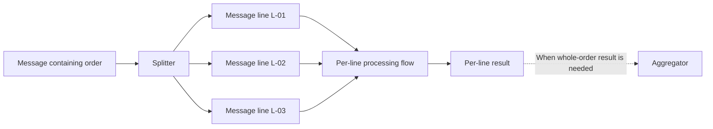

# Splitting Composite Messages

In the **SPRING_INTEGRATION_CORE** module, **Splitter** chapter, this lesson explains how to feed a message containing multiple business parts into a Spring Integration flow so each part is processed as a separate message. The focus is on designing child payloads, preserving context, and understanding the contract between the splitter and downstream endpoints—especially when an aggregator is needed to combine results.

After this lesson, you will be able to build a splitter using a POJO and the Java DSL, verify output messages, and explain what happens when the input is empty, one part fails, or an order is resent.

## 1. What Is a Composite Message?

A **composite message** is a message whose payload contains multiple parts that each have distinct processing semantics. For instance, an order containing multiple order lines; a data import request containing multiple records; or a document containing multiple line items.

Having multiple fields in a payload is not enough on its own to decide that splitting is needed. What matters is identifying which units of work need to travel through separate processing paths. In an order, `orderId` and `tenantId` describe shared context, while each element in `lines` is a candidate for splitting.

A splitter implements a **one-input → many-outputs** relationship, where each output carries data for one part of the composite. This is the core idea of the [Splitter pattern in Enterprise Integration Patterns](https://www.enterpriseintegrationpatterns.com/patterns/messaging/Sequencer.html).

Business example used in this lesson:

```json
{
  "orderId": "ORD-2048",
  "tenantId": "TENANT-A",
  "lines": [
    { "lineId": "L-01", "sku": "BOOK-JAVA", "quantity": 2 },
    { "lineId": "L-02", "sku": "KEYBOARD", "quantity": 1 },
    { "lineId": "L-03", "sku": "MOUSE", "quantity": 3 }
  ]
}
```

Suppose the system needs to check inventory and create a reservation request for each line. A splitter produces three task messages instead of forcing a single handler to process the entire order inside an internal loop.



The diagram depicts the relationship among messages. It does not imply that lines execute concurrently or that each line gets its own thread.

## 2. Choosing the Right Split Unit and Output Contract

For the example above, the desired contract is:

```text
Message<OrderBatch>
        |
        v
3 x Message<LineTask>
```

Output payloads need enough information for a consumer to process them without holding a reference to the parent message:

| Child message | orderId | tenantId | lineId | sku | quantity |
|---|---|---|---|---|---|
| 1 | ORD-2048 | TENANT-A | L-01 | BOOK-JAVA | 2 |
| 2 | ORD-2048 | TENANT-A | L-02 | KEYBOARD | 1 |
| 3 | ORD-2048 | TENANT-A | L-03 | MOUSE | 3 |

This design puts business identifiers in the payload while operational metadata such as `traceId` lives in headers. If a router routes using headers, corresponding business headers can be added via a header enricher; you still need to agree on the authoritative source of truth when both payload and headers carry the same field.

Three key decisions before writing code:

1. **Unit of work:** split by order line, by SKU, or by batch? Two lines with the same SKU can still differ in `lineId`, pricing, or promotion. Merging them immediately during splitting can lose business semantics.
2. **Context to carry along:** the consumer needs to know which order and tenant own the line. Sending only `sku` and `quantity` will not suffice for tracing or deduplication.
3. **Expected outcome:** does each line require a final result, or is one-way dispatch enough? This decision directly affects whether an aggregator is needed.

One splitter handles one structural level of your choosing. For `Order → Shipment → Line`, decide whether to create one message per shipment or go straight to each line. If splitting across two levels, each level needs its own contract for context and results; do not assume two splits will automatically reconstruct the original business hierarchy.

## 3. Distinguishing Splitting from Neighboring Steps

In the Java DSL, `split`, `transform`, `filter`, `route`, and `aggregate` represent their respective endpoints. How you compose them defines the processing flow; see [Spring Integration DSL Basics](https://docs.spring.io/spring-integration/reference/dsl/java-basics.html).

In the order problem, responsibilities can be assigned as follows:

| Need | Suitable component in this design |
|---|---|
| Convert a JSON string to `OrderBatch` | Transformer or conversion step at the inbound boundary |
| Produce multiple `LineTask` items from one `OrderBatch` | Splitter |
| Select a processing route based on line type | Router |
| Accept or discard a task based on a condition | Filter |
| Call the inventory reservation service for one task | Service activator |
| Gather results from one order execution | Aggregator |

A transformer returning `List<LineTask>` still produces **one message containing a list**. To explicitly emit each part as an independent message, configure a splitter endpoint at the split point.

Similarly, delivering the same message to multiple consumers for different purposes is a distribution requirement distinct from dividing a payload into parts. When designing, state clearly whether you want multiple pieces of data or multiple recipients of data.

## 4. Headers of Child Messages

When `applySequence` is enabled, the splitter adds metadata for the resulting sequence. The following table describes splitting a parent message into a three-part list:

| Header | Role | Example |
|---|---|---|
| `id` | Identifier of each individual message, not a business key | Child messages have distinct IDs |
| `correlationId` | Links parts of the same split | ID of the message entering the splitter directly |
| `sequenceNumber` | Position of the part within the split | `1`, `2`, `3` |
| `sequenceSize` | Number of parts when size is known | `3` |
| `traceId` | Custom application header | `trace-2048` |

Constant names such as `CORRELATION_ID`, `SEQUENCE_NUMBER`, and `SEQUENCE_SIZE` belong to `IntegrationMessageHeaderAccessor`. `MessageHeaders` provides standard headers such as `id`. See [Message Model and Headers](https://docs.spring.io/spring-integration/reference/message.html).

`correlationId` serves the current execution; `orderId` serves as the business identifier. If the same order is resent in a new message, the new split typically gets a different correlation ID. Deduplication must therefore rely on an appropriate business key.

Pay attention to splitter placement: if an upstream endpoint constructed a new message, the ID of the initial message sent by the caller may no longer be the ID used for correlation. The example below places the splitter directly after the input channel, so no intermediate message creation occurs.

Sequence headers also do not guarantee task completion order. The third line may finish before the first when asynchronous processing happens downstream. If the overall order output requires stable ordering, define sorting by line position or line ID rather than inferring order from arrival times.

## 5. Writing a POJO Splitter

The example uses Java 17 and Java DSL APIs available in Spring Integration 6.x. Classes belong to the `example.splitter` package. The filenames below are suggested names when bringing the example into your own project; this lesson does not require changing an existing project's structure.

### 5.1. Data Model and Split Function

`CompositeOrderSplitter.java` contains nested records so the example stays concise and self-contained:

```java
package example.splitter;

import java.util.HashSet;
import java.util.List;
import java.util.Objects;
import java.util.Set;

public class CompositeOrderSplitter {

    public record OrderLine(String lineId, String sku, int quantity) {
        public OrderLine {
            requireText(lineId, "lineId");
            requireText(sku, "sku");
            if (quantity <= 0) {
                throw new IllegalArgumentException("quantity must be positive");
            }
        }
    }

    public record OrderBatch(
            String orderId,
            String tenantId,
            List<OrderLine> lines) {

        public OrderBatch {
            requireText(orderId, "orderId");
            requireText(tenantId, "tenantId");
            Objects.requireNonNull(lines, "lines");
            lines = List.copyOf(lines);
        }
    }

    public record LineTask(
            String orderId,
            String tenantId,
            String lineId,
            String sku,
            int quantity) {
    }

    public List<LineTask> split(OrderBatch order) {
        Objects.requireNonNull(order, "order");

        Set<String> lineIds = new HashSet<>();
        for (OrderLine line : order.lines()) {
            if (!lineIds.add(line.lineId())) {
                throw new IllegalArgumentException(
                        "Duplicate lineId: " + line.lineId());
            }
        }

        return order.lines().stream()
                .map(line -> new LineTask(
                        order.orderId(),
                        order.tenantId(),
                        line.lineId(),
                        line.sku(),
                        line.quantity()))
                .toList();
    }

    private static void requireText(String value, String field) {
        if (value == null || value.isBlank()) {
            throw new IllegalArgumentException(field + " must not be blank");
        }
    }
}
```

The split function returns only business data. The Spring Integration endpoint wraps each `LineTask` into a message. Writing it as a POJO keeps splitting decisions independent of `MessageChannel` or Spring lifecycle; this is also the programming style introduced in the [Splitter documentation](https://docs.spring.io/spring-integration/reference/splitter.html).

The example intentionally enforces these rules:

- `orderId`, `tenantId`, `lineId`, and `sku` must be non-blank, and quantity must be positive.
- `List.copyOf` snapshots the input list and rejects `null` elements. The elements here are records holding only strings and numbers, making immutable data sharing straightforward.
- `lineId` must be unique within an order. Checking the full list before returning catches duplicates before the endpoint begins emitting parts.
- An empty list is allowed to reach the splitter to illustrate the `discardChannel` branch in the configuration section.

These are rules for the illustrative problem. In real projects, validation can live at the ingestion boundary or in domain classes, as long as the flow maintains a consistent contract for valid input.

### 5.2. Registering the Endpoint with Java DSL

`OrderSplitFlow.java`:

```java
package example.splitter;

import org.springframework.context.annotation.Bean;
import org.springframework.context.annotation.Configuration;
import org.springframework.integration.channel.DirectChannel;
import org.springframework.integration.channel.QueueChannel;
import org.springframework.integration.config.EnableIntegration;
import org.springframework.integration.dsl.IntegrationFlow;

import example.splitter.CompositeOrderSplitter.OrderBatch;

@Configuration
@EnableIntegration
public class OrderSplitFlow {

    @Bean
    public CompositeOrderSplitter compositeOrderSplitter() {
        return new CompositeOrderSplitter();
    }

    @Bean
    public DirectChannel ordersIn() {
        return new DirectChannel();
    }

    @Bean
    public QueueChannel lineTasks() {
        return new QueueChannel(100);
    }

    @Bean
    public QueueChannel emptyOrders() {
        return new QueueChannel(10);
    }

    @Bean
    public IntegrationFlow orderSplitFlow(
            CompositeOrderSplitter splitter) {

        return IntegrationFlow.from("ordersIn")
                .split(OrderBatch.class, splitter::split,
                        spec -> spec.applySequence(true)
                                .discardChannel("emptyOrders"))
                .channel("lineTasks")
                .get();
    }
}
```

Three components have distinct roles:

- `ordersIn` receives a `Message<OrderBatch>` and hands it immediately to the splitter on the sending thread.
- The `.split(...)` endpoint invokes the POJO method, creating and emitting each child message. `applySequence(true)` states the intent to attach sequence metadata.
- `lineTasks` holds output messages for the example and tests to read. For empty lists, the splitter's input message goes to `emptyOrders`.

The `applySequence` and `discardChannel` options are described in [SplitterSpec API](https://docs.spring.io/spring-integration/docs/6.2.5/api/org/springframework/integration/dsl/SplitterSpec.html). The configuration above uses the Java DSL `split(expectedType, function, endpointConfigurer)` overload.

`QueueChannel` in the example has bounded capacity and resides in memory. Without a consumer, sending beyond capacity can block the sending thread waiting for space. Thus, this pattern fits observing a small order; in production, configure consumers, input size limits, and waiting policies appropriately. These characteristics are explained in [Message Channel Implementations](https://docs.spring.io/spring-integration/reference/channel/implementations.html).

No poller is required for sending results into the queue. If you attach another Spring Integration endpoint to automatically consume `lineTasks`, the endpoint reading from that pollable channel must have an appropriate poller configuration. In the tests, test code itself calls `receive(...)`.

### 5.3. Sending an Input Message

The snippet below runs once the configuration beans are registered and the context has started. The `ordersIn` variable is the injected `DirectChannel` bean:

```java
var order = new CompositeOrderSplitter.OrderBatch(
        "ORD-2048",
        "TENANT-A",
        java.util.List.of(
                new CompositeOrderSplitter.OrderLine(
                        "L-01", "BOOK-JAVA", 2),
                new CompositeOrderSplitter.OrderLine(
                        "L-02", "KEYBOARD", 1),
                new CompositeOrderSplitter.OrderLine(
                        "L-03", "MOUSE", 3)));

var request = org.springframework.messaging.support.MessageBuilder
        .withPayload(order)
        .setHeader("traceId", "trace-2048")
        .build();

boolean accepted = ordersIn.send(request);
```

With space available in the queues and no errors, `accepted` is `true` and `lineTasks` holds three messages. This value confirms delivery through the configured flow; it does not confirm that the warehouse system reserved inventory, because the example stops at creating tasks.

In this default configuration, the custom header `traceId` is propagated to child messages. If a subsequent step constructs a brand-new message or configures header removal, re-verify the metadata propagation contract at that step.

## 6. Testing the Message-Splitting Contract

The test sample below requires `spring-integration-core`, `spring-test`, and JUnit Jupiter, with compatible versions managed by the project's BOM or dependency management. The two classes from the previous section must reside in the example's source tree.

Testing does more than count payloads. It verifies tenant context, sequence metadata, and empty-input handling.

`OrderSplitFlowTest.java`:

```java
package example.splitter;

import java.util.HashSet;
import java.util.List;
import java.util.Set;

import org.junit.jupiter.api.BeforeEach;
import org.junit.jupiter.api.Test;
import org.springframework.beans.factory.annotation.Autowired;
import org.springframework.beans.factory.annotation.Qualifier;
import org.springframework.integration.IntegrationMessageHeaderAccessor;
import org.springframework.integration.channel.DirectChannel;
import org.springframework.integration.channel.QueueChannel;
import org.springframework.messaging.Message;
import org.springframework.messaging.MessagingException;
import org.springframework.messaging.support.MessageBuilder;
import org.springframework.test.context.junit.jupiter.SpringJUnitConfig;

import example.splitter.CompositeOrderSplitter.LineTask;
import example.splitter.CompositeOrderSplitter.OrderBatch;
import example.splitter.CompositeOrderSplitter.OrderLine;

import static org.junit.jupiter.api.Assertions.*;

@SpringJUnitConfig(OrderSplitFlow.class)
class OrderSplitFlowTest {

    @Autowired
    @Qualifier("ordersIn")
    DirectChannel ordersIn;

    @Autowired
    @Qualifier("lineTasks")
    QueueChannel lineTasks;

    @Autowired
    @Qualifier("emptyOrders")
    QueueChannel emptyOrders;

    @BeforeEach
    void clearQueues() {
        while (lineTasks.receive(0) != null) {
            // Drain the example queue before each test.
        }
        while (emptyOrders.receive(0) != null) {
            // No background consumer in the test configuration.
        }
    }

    @Test
    void splitsOrderAndPreservesContext() {
        OrderBatch order = new OrderBatch(
                "ORD-2048", "TENANT-A", List.of(
                        new OrderLine("L-01", "BOOK-JAVA", 2),
                        new OrderLine("L-02", "KEYBOARD", 1),
                        new OrderLine("L-03", "MOUSE", 3)));

        Message<OrderBatch> request = MessageBuilder.withPayload(order)
                .setHeader("traceId", "trace-2048")
                .build();

        assertTrue(ordersIn.send(request));
        Set<Object> outputIds = new HashSet<>();

        for (int index = 0; index < order.lines().size(); index++) {
            Message<?> part = lineTasks.receive(1000);
            assertNotNull(part);
            LineTask task = assertInstanceOf(LineTask.class, part.getPayload());
            OrderLine source = order.lines().get(index);

            assertEquals(order.orderId(), task.orderId());
            assertEquals(order.tenantId(), task.tenantId());
            assertEquals(source.lineId(), task.lineId());
            assertEquals(source.sku(), task.sku());
            assertEquals(source.quantity(), task.quantity());
            assertEquals("trace-2048", part.getHeaders().get("traceId"));

            assertEquals(request.getHeaders().getId(), part.getHeaders().get(
                    IntegrationMessageHeaderAccessor.CORRELATION_ID));
            assertEquals(Integer.valueOf(index + 1), part.getHeaders().get(
                    IntegrationMessageHeaderAccessor.SEQUENCE_NUMBER,
                    Integer.class));
            assertEquals(Integer.valueOf(3), part.getHeaders().get(
                    IntegrationMessageHeaderAccessor.SEQUENCE_SIZE,
                    Integer.class));

            assertNotEquals(request.getHeaders().getId(),
                    part.getHeaders().getId());
            outputIds.add(part.getHeaders().getId());
        }

        assertEquals(3, outputIds.size());
        assertNull(lineTasks.receive(0));
        assertNull(emptyOrders.receive(0));
    }

    @Test
    void sendsEmptyOrderToDiscardChannel() {
        OrderBatch order = new OrderBatch("ORD-EMPTY", "TENANT-A", List.of());
        Message<OrderBatch> request = MessageBuilder.withPayload(order)
                .setHeader("traceId", "trace-empty")
                .build();

        assertTrue(ordersIn.send(request));
        assertNull(lineTasks.receive(0));

        Message<?> discarded = emptyOrders.receive(1000);
        assertNotNull(discarded);
        assertEquals(order, discarded.getPayload());
        assertEquals("trace-empty", discarded.getHeaders().get("traceId"));
        assertNull(emptyOrders.receive(0));
    }

    @Test
    void rejectsDuplicateLineIdBeforeEmittingParts() {
        OrderBatch order = new OrderBatch(
                "ORD-DUP", "TENANT-A", List.of(
                        new OrderLine("L-01", "BOOK-JAVA", 2),
                        new OrderLine("L-01", "MOUSE", 1)));

        Message<OrderBatch> request = MessageBuilder.withPayload(order).build();

        assertThrows(MessagingException.class, () -> ordersIn.send(request));
        assertNull(lineTasks.receive(0));
        assertNull(emptyOrders.receive(0));
    }
}
```

The ordering check in the first test relies on the specific configuration: an ordered list, a synchronous splitter, and an output queue with no background consumer. When switching to concurrent processing, verify the result set by `lineId` and corresponding metadata, and test ordering requirements separately if applicable.

The third test only confirms that duplicate IDs are detected before producing outputs in this example. It does not prove that every error during splitter emission or every consumer failure shares that same atomicity.

## 7. Empty Inputs, Nulls, and Contract Violations

Do not lump all "no result" cases into a single business state:

| Case | Policy in the example |
|---|---|
| `lines` has three valid elements | Emits three tasks |
| `lines` has only one element | Emits one task with sequence size `1` |
| `lines` is an empty list | No tasks; sends request to `emptyOrders` |
| `lines == null` or contains `null` | Rejected when constructing `OrderBatch` |
| Line has non-positive quantity | Rejected when constructing `OrderLine` |
| Duplicate `lineId` in an order | Split function throws before returning list |
| Split function returns `null` | With default configuration, terminates flow at splitter |

Empty containers and `null` results are handled differently: the splitter's `discardChannel` applies to empty iterable results, not as a catch-all branch for errors or `null` returns. See [AbstractMessageSplitter API](https://docs.spring.io/spring-integration/api/org/springframework/integration/splitter/AbstractMessageSplitter.html).

In a flow with a gateway waiting for a reply, "no child messages emitted" needs an explicit contract for the initial request. If an empty order is considered valid, build a completed response with an empty result list right on that branch. If considered invalid, return an appropriate business error. Do not leave the gateway waiting on an aggregator that never received any messages for this order.

With JSON or XML data, clearly distinguish whether input has already been parsed or is still a character string. A string containing a `lines` array is still a string to a step expecting a string payload. Parse and select the right substructure with appropriate logic; do not assume `.split()` automatically understands business schemas or locates a `lines` field.

For `List<List<OrderLine>>`, a single outer split yields parts that are the inner lists. If every output must be a single order line, the split logic must explicitly flatten or use an intentional second processing stage.

## 8. Aggregating Results After Splitting Composites

Not every flow needs aggregation. If each line simply fires an independent request and the sender only needs acknowledgment of receipt, the flow can finish after dispatching or processing tasks.

If a response is needed for the entire order, design per-task outputs, such as:

```text
LineResult(
    orderId,
    tenantId,
    lineId,
    status,
    reason
)
```

Each task produces a terminal outcome: success or failure expressed as data. In this design, you must not silently drop a result and still ask the aggregator to reply that the whole order completed.

By default, an aggregator groups by correlation ID and determines group completion using sequence size. This component is stateful and stores message groups while waiting. See [Aggregator in Spring Integration](https://docs.spring.io/spring-integration/reference/aggregator.html).

For example, after splitting three lines:

```text
L-01 -> LineResult(SUCCESS)
L-02 -> LineResult(REJECTED, "Insufficient inventory")
L-03 -> LineResult(SUCCESS)
```

If all three results preserve required metadata and reach the same aggregator, the group can complete with an overall status decided by the application. "All results arrived" does not automatically equate to "all lines succeeded."

Conversely, if a filter completely drops `L-02` after the splitter created a sequence of size `3`, the aggregator sees only two results. Three design approaches are commonly used:

1. Produce a rejection result for the dropped line and route that result into the same aggregation flow.
2. If eligibility criteria are known prior to splitting, filter data while preparing the output list so the part count reflects actual work selected. Business policy must still account for dropped lines.
3. Build a custom completion condition, timeout, and representation for missing results if the business accepts partial completion.

In all three approaches, test the whole-order reply, not just the results of remaining lines. A timeout is a decision point; it does not prove missing tasks succeeded or stopped running.

If switching the example from `List<LineTask>` to an `Iterator` or lazy data source where the splitter cannot determine the total count, `sequenceSize` may be `0`. In that case, design another completion condition; do not reuse the "count N parts" assumption from the list example. Iterator handling is covered in the [Splitter programming reference](https://docs.spring.io/spring-integration/reference/splitter.html#_iterators).

## 9. Composite-Level vs. Element-Level Failures

Distinguishing the two failure points helps choose the right retry location.

### 9.1. Failures Before Emitting Parts

Errors like duplicate `lineId` in the example cause the split function to fail before the endpoint receives a result list. With the configured `DirectChannel` flow, the exception propagates back to the `send(...)` caller, typically wrapped in a framework messaging exception.

In synchronous processing, merely setting an `errorChannel` header does not automatically turn every exception into an error message. Error reporting also depends on the executing component and gateway, poller, or executor configuration. See [Error Handling](https://docs.spring.io/spring-integration/reference/error-handling.html).

### 9.2. Failures While Emitting or Processing a Part

Suppose the splitter has sent lines one and two, and then sending line three fails. Resending the entire composite may cause the first two lines to be processed a second time. Validating data before splitting does not eliminate send failures like this.

If lines are processed synchronously right after the splitter, an error on one line can fail the initial send call after earlier lines have already caused side effects. If lines cross an asynchronous boundary, the sender may even have completed ingestion before the line-processing failure occurs.

Therefore, specify:

- Whether retries happen at the whole-order level or per individual line.
- Whether consumers can tolerate receiving the same task again.
- How failures occurring after inventory reservation are compensated or reconciled.
- Whether a line's failure result enters the aggregator or goes to a separate handling flow.

An idempotency key could be the tuple `(tenantId, orderId, lineId, operation)`. If the same line may be modified and reprocessed under a new version, include the version or business request identifier. Key selection must reflect "the same task" semantically, not merely identical input fields.

Do not use `MessageHeaders.ID` as a cross-retry idempotency key: a new message gets a new ID. Nor should you use `sequenceNumber` alone, since many orders have parts `1`, `2`, and `3`.

A splitter does not create a transaction spanning all side effects. To enforce commit/rollback semantics, examine participating resources, transaction managers, and thread boundaries. In problems spanning multiple independent warehouse services, per-part outcomes, compensation, or reconciliation may be needed instead of assuming a single split guarantees all-or-nothing success.

## 10. Composite Size and Runtime Cost

An input with `N` parts creates roughly `N` downstream processing units. If the composite ingestion rate is `R` per second and average part count is `N`, consumer capacity must be sized for roughly `R × N` tasks per second, plus retries and any extra branches.

For example, `20` orders per second with `50` lines each corresponds to about `1,000` line tasks per second. A dashboard counting only inbound orders can obscure actual load on the inventory service.

In the POJO example, the result list is constructed in full, requiring memory proportional to the task count. At the same time, the output queue may buffer tasks not yet consumed. Evaluate prepared data, queued data, and results awaiting aggregation together.

Decisions to include in operational design:

| Concern | Concrete requirement to set |
|---|---|
| Oversized composite | Cap line count or request size at the inbound boundary |
| Full queue | Define capacity, send timeouts, and overload signaling |
| Slow tasks | Monitor queue depth and per-line wait times |
| Missing results | Monitor incomplete groups and timeout policies |
| Crash replay | Enforce business identifiers and deduplication policies |
| Storing parent message | Pass only needed references; avoid copying the entire large composite into every task |

If every task embeds the whole original order and sending over a broker serializes the entire order repeatedly, transmitted payload volume can grow sharply with line count. In the example, `LineTask` contains only data needed for one line plus essential identifiers, avoiding repeating the full list.

Using an iterator can reduce pre-allocating the result list, but it does not solve downstream load, aggregation conditions, or reader resource lifecycles on its own. When switching to a lazy source, redesign the corresponding assumptions rather than merely changing a return type.

## 11. Common Design Pitfalls

| Symptom | Cause to check | Remedy |
|---|---|---|
| Consumer receives the whole list | Flow only transformed payload, missing a split step at the desired point | Place a splitter and verify each output payload |
| Unknown which tenant owns a line | Splitting stripped composite context | Include tenant identifier in the task contract |
| Lines interfere with each other's data | Shared mutable payload or child objects | Use immutable data or copy at required boundaries |
| Aggregator waits forever | A branch dropped a result or completion condition is wrong | Track every line and define terminal outcomes |
| Empty order gets no reply | No parts ever started the aggregation flow | Handle empty requests with a dedicated reply branch |
| Duplicate reservations on order resend | Whole-composite retry while consumer lacks deduplication | Define task keys and retry boundaries |
| Whole-order result is out of order | Order inferred from completion time | Sort by agreed position or identifier |
| Sending thread blocks too long | Bounded queue filled up without fast enough consumption | Provision consumers, bound input sizes, and configure wait policies |

When applying this to a new composite, specify concretely with data: what gets split, what context each task carries, how many results are expected, and what condition allows declaring the entire request complete. That contract lets the splitter, channels, routers, filters, gateways, and aggregator operate consistently within one message flow.