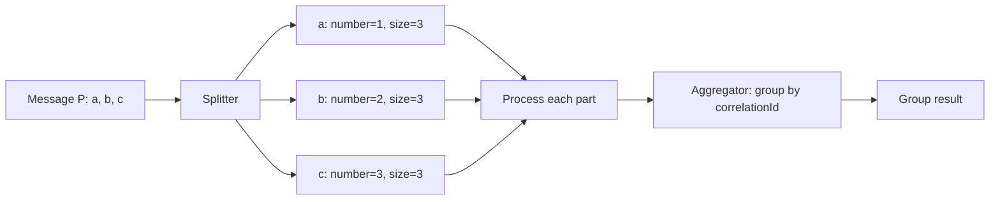

# sequenceSize and sequenceNumber

In the **Splitter** chapter of `SPRING_INTEGRATION_CORE`, the two headers `sequenceNumber` and `sequenceSize` describe the position and count of messages in a single split. They connect the data-splitting step to per-part processing, resequencing, or result aggregation.

One distinction to make right away: **an element's position, the order in which elements arrive at the destination, and the condition for a group being complete are three different concepts**. Understanding this difference lets you design flows with transformers, routers, filters, and aggregators without accidentally dropping results or waiting forever.

## 1. From One Message to a Sequence of Messages

Suppose a request carries a payload of three product codes:

```text
Original message
  id      = P
  payload = ["a", "b", "c"]
```

With a standard splitter and `applySequence = true`, the output model is:

| Child payload | correlationId | sequenceNumber | sequenceSize |
| --- | --- | ---: | ---: |
| `"a"` | `P` | 1 | 3 |
| `"b"` | `P` | 2 | 3 |
| `"c"` | `P` | 3 | 3 |

`P` in the table denotes the ID of the message entering the splitter, not a string you must name that way. Each child message has its own ID; they are linked via `correlationId`. The standard splitter uses the input message's ID as the split correlation and starts numbering from 1. [AbstractMessageSplitter Source](https://github.com/spring-projects/spring-integration/blob/main/spring-integration-core/src/main/java/org/springframework/integration/splitter/AbstractMessageSplitter.java).



The diagram depicts three messages that are independent at the messaging level. It does not claim the three messages execute on three threads; execution semantics depend on channel and endpoint types.

## 2. Meaning and Scope of Each Header

| Header | Typical value type | Question answered |
| --- | --- | --- |
| `correlationId` | `Object`; standard splitters typically use the parent message's UUID | Which split does this message belong to? |
| `sequenceNumber` | `Integer` | Which ordinal part of the split is this? |
| `sequenceSize` | `Integer` | How many total parts is the split expected to have? |

In Java, use the constants `CORRELATION_ID`, `SEQUENCE_NUMBER`, and `SEQUENCE_SIZE` from `IntegrationMessageHeaderAccessor` to avoid typos. [IntegrationMessageHeaderAccessor API](https://docs.spring.io/spring-integration/api/org/springframework/integration/IntegrationMessageHeaderAccessor.html).

### 2.1. sequenceNumber Is a Local Position

For an input with a defined order, `sequenceNumber` reflects the position as the splitter iterates through the split results:

```text
Split P: a -> 1, b -> 2, c -> 3
Split Q: x -> 1, y -> 2
```

Because sequence numbering restarts with each split, `sequenceNumber = 1` is not a globally unique identifier. When identifying a part of a split, evaluate it alongside its correlation and corresponding split level.

Position also depends on the data's iteration order. If the input is a collection with no stable business ordering, seeing numbers `1, 2, 3` does not turn that traversal order into a business order. Sort data before splitting if you need ordering by date, SKU, or priority.

### 2.2. sequenceSize Is the Total of That Split

In the three-element example, all three messages have `sequenceSize = 3`. This value does not count down as `3, 2, 1` as elements are sent.

Nor is it:

- The number of messages currently sitting in `QueueChannel`.
- The number of messages processed successfully so far.
- The number of messages still missing at the aggregator.
- The total number of elements across all in-flight requests.

If the aggregator has received two distinct parts of a three-part group, the group currently holds two messages and lacks one part per the original contract. Each message's header still carries a total of `3`.

### 2.3. Invariants When Size Is Known Upfront

For a non-empty split with known size `N` and standard sequencing, expected data satisfies:

```text
sequenceSize = N > 0
1 <= sequenceNumber <= N
same correlationId at the same split level
each position from 1 to N appears exactly once
```

This is a contract for designing the flow. It does not mean every downstream endpoint automatically validates all four conditions. An application that builds headers manually or sends duplicate messages can still violate the contract.

## 3. Do Not Equate the Last Element with a Complete Group

Suppose three parts are processed with different durations. Completion order is `c`, `a`, `b`, corresponding to `3 → 1 → 2`.

| Arrival at aggregator | Arriving sequenceNumber | Positions received so far | All three parts present? |
| --- | ---: | --- | --- |
| 1 | 3 | `{3}` | No |
| 2 | 1 | `{1, 3}` | No |
| 3 | 2 | `{1, 2, 3}` | Yes, if data is valid and non-duplicate |

Even on the very first arrival, `sequenceNumber == sequenceSize` holds. That only tells you the arriving message carries the last position of the split; messages 1 and 2 may still be in flight.

Therefore, the following condition is **insufficient** to prove all results have arrived:

```text
message.headers.sequenceNumber == message.headers.sequenceSize
```

Distinguish the responsibilities of three components:

| Component | Role in the example |
| --- | --- |
| Splitter | Creates three messages and attaches split metadata |
| Aggregator | Holds related messages and decides when to combine them into one result |
| Resequencer | Releases individual messages in sequence-number order |

A resequencer uses sequence metadata to emit messages in order; it does not combine payloads into a single result like an aggregator. [Resequencer Documentation](https://docs.spring.io/spring-integration/reference/resequencer.html).

If the goal is simply to build an ordered list of results, sorting can happen inside the aggregation function. If each message must pass through a downstream endpoint in order before aggregation, evaluate a resequencer along with how execution behaves after it.

## 4. Configuring and Observing with Java DSL

The following example creates two flow segments:

```text
batchInput -> splitter -> parts
processedParts -> aggregator -> batchResults
```

The two segments are connected by test code later to deliberately send results in `3 → 1 → 2` order. In a real application, a transformer or service activator would receive each part and forward results to `processedParts`.

The code uses the Java DSL with `splitWith(...)`; it requires `spring-integration-core` and compatible Spring dependencies managed by the project. Tests require JUnit Jupiter. You can place the two classes below in the same package to practice. [Configuring Splitters with Java DSL](https://docs.spring.io/spring-integration/reference/dsl/java-splitters.html).

```java
import java.util.Comparator;
import java.util.stream.Collectors;

import org.springframework.context.annotation.Bean;
import org.springframework.context.annotation.Configuration;
import org.springframework.integration.channel.DirectChannel;
import org.springframework.integration.channel.QueueChannel;
import org.springframework.integration.config.EnableIntegration;
import org.springframework.integration.dsl.IntegrationFlow;
import org.springframework.messaging.Message;

import static org.springframework.integration.IntegrationMessageHeaderAccessor.SEQUENCE_NUMBER;

@Configuration
@EnableIntegration
public class SequenceHeadersConfig {

    @Bean
    public DirectChannel batchInput() {
        return new DirectChannel();
    }

    @Bean
    public QueueChannel parts() {
        return new QueueChannel();
    }

    @Bean
    public DirectChannel processedParts() {
        return new DirectChannel();
    }

    @Bean
    public QueueChannel batchResults() {
        return new QueueChannel();
    }

    @Bean
    public IntegrationFlow splitFlow() {
        return IntegrationFlow.from(batchInput())
                .splitWith(s -> s.applySequence(true))
                .channel(parts())
                .get();
    }

    @Bean
    public IntegrationFlow aggregateFlow() {
        return IntegrationFlow.from(processedParts())
                .aggregate(a -> a.outputProcessor(group ->
                        group.getMessages().stream()
                                .sorted(Comparator.comparingInt(
                                        SequenceHeadersConfig::sequenceNumber))
                                .map(message -> (String) message.getPayload())
                                .collect(Collectors.joining("|"))))
                .channel(batchResults())
                .get();
    }

    private static int sequenceNumber(Message<?> message) {
        Integer value = message.getHeaders().get(SEQUENCE_NUMBER, Integer.class);
        if (value == null) {
            throw new IllegalArgumentException("Missing sequenceNumber");
        }
        return value;
    }
}
```

`applySequence(true)` is written explicitly to highlight the topic. Standard splitters enable this flag by default. The flag controls attaching sequence metadata for the current split; disabling it does not remove pre-existing sequence headers from the input. [How Splitters Create and Copy Headers](https://github.com/spring-projects/spring-integration/blob/main/spring-integration-core/src/main/java/org/springframework/integration/splitter/AbstractMessageSplitter.java).

In the aggregator section, no custom correlation strategy or release strategy is configured: the example relies on the default sequence contract. The `outputProcessor` function only decides how to build the result once the group is eligible for release; it sorts by sequence number and joins payloads into a string. Choosing groups and deciding when to release them are separate responsibilities from building the output payload. [Java DSL for Aggregators](https://docs.spring.io/spring-integration/reference/dsl/java-aggregators.html).

The example does not leave a `QueueChannel` in the middle without a consumer: test code actively pulls messages from `parts` and sends them onward. If using this configuration in an application, add a consumer or a poller-driven flow for `parts` so data keeps moving.

## 5. Reading Headers and Preserving Them When Building Results

You can read headers with explicit types:

```java
import org.springframework.integration.IntegrationMessageHeaderAccessor;
import org.springframework.messaging.Message;

public static void printSequence(Message<?> message) {
    Object correlationId = message.getHeaders().get(
            IntegrationMessageHeaderAccessor.CORRELATION_ID);
    Integer number = message.getHeaders().get(
            IntegrationMessageHeaderAccessor.SEQUENCE_NUMBER, Integer.class);
    Integer size = message.getHeaders().get(
            IntegrationMessageHeaderAccessor.SEQUENCE_SIZE, Integer.class);

    System.out.printf("correlation=%s, number=%s, size=%s%n",
            correlationId, number, size);
}
```

Reading directly as `Integer` distinguishes an absent header (`null`) from a header with value `0`. Do not coerce `sequenceSize` into a `String` merely because it is formatted as text in logs.

In a business callback receiving `Message<?>`, if you manually build a return message to forward, proactively preserve required headers:

```java
import java.util.Locale;

import org.springframework.messaging.Message;
import org.springframework.messaging.support.MessageBuilder;

public static Message<String> processPart(Message<?> part) {
    String result = ((String) part.getPayload()).toUpperCase(Locale.ROOT);

    return MessageBuilder.withPayload(result)
            .copyHeaders(part.getHeaders())
            .build();
}
```

`copyHeaders(...)` in `org.springframework.messaging.support.MessageBuilder` copies application headers; `id` and `timestamp` are not overwritten from the source map. Thus, the resulting message gets a new ID while keeping the correlation and sequence of the part being processed. [Spring Messaging MessageBuilder API](https://docs.spring.io/spring-framework/docs/current/javadoc-api/org/springframework/messaging/support/MessageBuilder.html).

The snippet above illustrates manual message construction. With a transformer returning only a payload, the framework normally handles building the message and forwarding headers. When crossing adapters or out-of-process systems, inspect actual header mappings rather than assuming these three headers always pass through intact.

## 6. Testing Key Sequence Properties

The class below directly tests the Section 4 configuration with JUnit Jupiter, without needing Spring Test. Each test opens its own context so groups and queues do not affect one another.

```java
import java.util.List;
import java.util.Locale;

import org.junit.jupiter.api.Test;
import org.springframework.context.annotation.AnnotationConfigApplicationContext;
import org.springframework.integration.channel.DirectChannel;
import org.springframework.integration.channel.QueueChannel;
import org.springframework.messaging.Message;
import org.springframework.messaging.support.GenericMessage;
import org.springframework.messaging.support.MessageBuilder;

import static org.junit.jupiter.api.Assertions.*;
import static org.springframework.integration.IntegrationMessageHeaderAccessor.CORRELATION_ID;
import static org.springframework.integration.IntegrationMessageHeaderAccessor.SEQUENCE_NUMBER;
import static org.springframework.integration.IntegrationMessageHeaderAccessor.SEQUENCE_SIZE;

class SequenceHeadersTest {

    @Test
    void assignsPositionSizeAndCorrelationForEachBatch() {
        try (var context = new AnnotationConfigApplicationContext(
                SequenceHeadersConfig.class)) {
            DirectChannel input = context.getBean("batchInput", DirectChannel.class);
            QueueChannel parts = context.getBean("parts", QueueChannel.class);

            Message<List<String>> first = MessageBuilder
                    .withPayload(List.of("a", "b", "c"))
                    .setHeader("batchId", "B-007")
                    .build();

            assertTrue(input.send(first));

            for (int index = 0; index < 3; index++) {
                Message<?> part = take(parts);
                assertEquals(first.getPayload().get(index), part.getPayload());
                assertEquals(Integer.valueOf(index + 1),
                        part.getHeaders().get(SEQUENCE_NUMBER, Integer.class));
                assertEquals(Integer.valueOf(3),
                        part.getHeaders().get(SEQUENCE_SIZE, Integer.class));
                assertEquals(first.getHeaders().getId(),
                        part.getHeaders().get(CORRELATION_ID));
                assertEquals("B-007", part.getHeaders().get("batchId"));
                assertNotEquals(first.getHeaders().getId(), part.getHeaders().getId());
            }
            assertNull(parts.receive(0));

            Message<List<String>> second = new GenericMessage<>(List.of("x"));
            assertTrue(input.send(second));

            Message<?> next = take(parts);
            assertEquals(Integer.valueOf(1),
                    next.getHeaders().get(SEQUENCE_NUMBER, Integer.class));
            assertEquals(Integer.valueOf(1),
                    next.getHeaders().get(SEQUENCE_SIZE, Integer.class));
            assertEquals(second.getHeaders().getId(),
                    next.getHeaders().get(CORRELATION_ID));
            assertNotEquals(first.getHeaders().getId(),
                    next.getHeaders().get(CORRELATION_ID));
            assertNull(parts.receive(0));
        }
    }

    @Test
    void waitsForAllPartsWhenTheLastPositionArrivesFirst() {
        try (var context = new AnnotationConfigApplicationContext(
                SequenceHeadersConfig.class)) {
            DirectChannel input = context.getBean("batchInput", DirectChannel.class);
            QueueChannel parts = context.getBean("parts", QueueChannel.class);
            DirectChannel processedParts = context.getBean(
                    "processedParts", DirectChannel.class);
            QueueChannel results = context.getBean("batchResults", QueueChannel.class);

            assertTrue(input.send(new GenericMessage<>(List.of("a", "b", "c"))));
            Message<?> first = take(parts);
            Message<?> second = take(parts);
            Message<?> third = take(parts);

            assertTrue(processedParts.send(process(third)));
            assertNull(results.receive(0));

            assertTrue(processedParts.send(process(first)));
            assertNull(results.receive(0));

            assertTrue(processedParts.send(process(second)));
            Message<?> result = take(results);
            assertEquals("A|B|C", result.getPayload());
            assertNull(results.receive(0));
        }
    }

    @Test
    void usesUnknownSizeForAnOrdinaryIterator() {
        try (var context = new AnnotationConfigApplicationContext(
                SequenceHeadersConfig.class)) {
            DirectChannel input = context.getBean("batchInput", DirectChannel.class);
            QueueChannel parts = context.getBean("parts", QueueChannel.class);

            Message<?> parent = new GenericMessage<>(List.of("x", "y").iterator());
            assertTrue(input.send(parent));

            for (int number = 1; number <= 2; number++) {
                Message<?> part = take(parts);
                assertEquals(Integer.valueOf(number),
                        part.getHeaders().get(SEQUENCE_NUMBER, Integer.class));
                assertEquals(Integer.valueOf(0),
                        part.getHeaders().get(SEQUENCE_SIZE, Integer.class));
                assertEquals(parent.getHeaders().getId(),
                        part.getHeaders().get(CORRELATION_ID));
            }
            assertNull(parts.receive(0));
        }
    }

    private static Message<String> process(Message<?> part) {
        String value = ((String) part.getPayload()).toUpperCase(Locale.ROOT);
        return MessageBuilder.withPayload(value)
                .copyHeaders(part.getHeaders())
                .build();
    }

    private static Message<?> take(QueueChannel channel) {
        Message<?> message = channel.receive(1_000);
        assertNotNull(message, "Expected an output message");
        return message;
    }
}
```

Meaning of the three tests:

- The first test verifies that positions start at 1, total size remains constant, correlation matches the parent message, and the next split starts back at 1.
- The second test proves that the part with the final sequence number arriving first does not release the group prematurely. It also confirms the aggregation function builds the output in original position order.
- The third test verifies that a standard `Iterator` still receives incrementing sequence numbers even when total size is unknown upfront.

`receive(0)` checks the queue immediately at the moment of invocation. In this example, `processedParts` is a `DirectChannel`, so sending and aggregator processing happen synchronously before checking the queue. For flows using executors or brokers, use an appropriate bounded wait mechanism; do not apply this test's synchronous assumption to every channel type.

This is practice code for learners to place into a project and run. Having test examples in the lesson does not imply those tests were executed in the project's environment.

## 7. sequenceSize Equal to 0: Unknown Total, Not an Empty Group

When the split result is a `Collection` or array, the splitter usually knows the element count before emitting. With a standard `Iterator`, or an `Iterable` whose size cannot be determined, the total is usually unknown and the header gets `0`. Certain specialized splitters can determine size via `obtainSizeIfPossible(...)`. [Splitter Documentation, Iterators Section](https://docs.spring.io/spring-integration/api/org/springframework/integration/splitter/AbstractMessageSplitter.html).

Examples of the same data supplied in different forms:

| Result given to splitter | `sequenceNumber` of parts | Typical `sequenceSize` |
| --- | --- | --- |
| `List.of("x", "y")` | `1, 2` | `2` |
| `new String[] {"x", "y"}` | `1, 2` | `2` |
| `List.of("x", "y").iterator()` | `1, 2` | `0` |
| `Stream.of("x", "y")` | `1, 2` | `0` when total is not known upfront |

Do not assume that because calling code knows the iterator came from a two-element list, the splitter must know it too. The object the splitter receives is an iterator; it does not necessarily have access to the backing list.

After the last part is emitted, messages sent earlier do not have their headers retroactively updated to the final total. If the receiver needs to know the total, the flow must communicate it via an explicit contract.

### 7.1. Why Can an Aggregator Wait Forever?

For a non-empty group with `sequenceSize = 0`, a strategy waiting for a count matching the sequence total has no positive target total to reach. Receiving more parts does not turn `0` into an actual total. The splitter documentation requires choosing an appropriate release strategy or handling expiration when total size is unknown upfront. [Guide to Aggregating Output from Iterators](https://docs.spring.io/spring-integration/reference/splitter.html).

Common design approaches:

| Handling approach | Applicable conditions | Tradeoffs to understand |
| --- | --- | --- |
| Materialize data into a collection before splitting | Data is finite and small enough to fit in memory | Knows total upfront, at the cost of memory and delay before first emission |
| Pass expected total via metadata and use a matching release strategy | Source knows a reliable total for that exact group | Must ensure total matches data and shares the correlation scope |
| Use an end-of-stream signal along with processed-part count | Source has an explicit end protocol | End signal may arrive before in-flight results |
| Expire the group and handle incomplete results | Business tolerates missing items, or moves failed groups aside | Expiration does not prove data was complete |

These are design options, not instructions to replace `sequenceSize = 0` with an arbitrary number. Setting a fake total can cause groups to release early and drop results.

If using an end-of-stream signal, one condition worth considering is: final total information received **and** all corresponding parts processed. Checking only for an `END` marker is insufficient when asynchronous processing branches can finish after the marker.

### 7.2. Empty Input Is a Different Case

An empty collection has no elements to emit as child messages. Therefore, do not expect a data message with `sequenceNumber = 0, sequenceSize = 0` to automatically represent an empty result. The splitter can configure `discardChannel` to handle input messages whose split result is empty. [Empty Split Result Behavior](https://docs.spring.io/spring-integration/reference/splitter.html).

If a business gateway always requires a reply, explicitly define the result for empty inputs—such as a result object with an empty list—before letting the flow enter a split-and-aggregate cycle.

## 8. Operations That Break the Count Contract

### 8.1. A Filter Drops an Element After the Splitter

Consider a request with three order lines, each initially carrying `sequenceSize = 3`:

```text
splitter -> line 1 -> processed successfully -> aggregator
         -> line 2 -> dropped by filter
         -> line 3 -> processed successfully -> aggregator
```

The group only receives results for line 1 and line 3. The total in headers remains three because it describes the original split. If the completion policy still waits for three messages, the group will be missing one result. The aggregator documentation notes changing the release strategy or using compensating messages when a filter drops sequence members. [Filter Before Aggregator](https://docs.spring.io/spring-integration/reference/aggregator.html).

Choose a fix based on business semantics:

- If excluded lines are outside the processing scope, filter the collection before passing it to the splitter so the total is computed on the filtered set.
- If every line must have a final outcome, convert the dropped branch into a result like `SKIPPED`, keeping the correlation and position of that exact line.
- If the business accepts a subset, redefine the completion condition and representation of missing parts, along with an expiration policy.

Do not lower `sequenceSize` to `2` on only the remaining two messages without a group-wide coordination mechanism. When multiple branches independently decide totals, they can emit conflicting numbers or decide after the group has already released.

### 8.2. A Router Splits Across Different Destinations

Suppose lines 1 and 3 are routed to warehouse A, and line 2 to warehouse B. If each warehouse has its own aggregator still waiting for the original total of three, warehouse A sees only two results and warehouse B sees only one.

Clarify whether the desired group is a whole-request result or per-warehouse results. For whole-request results, branch results must converge back to a suitable aggregation point. For per-warehouse results, design sub-groups with totals and correlations matching each warehouse's dataset.

Changing a message's destination does not automatically redefine the member count expected at each aggregator.

### 8.3. One Part Fails Processing

Suppose line 2 fails calling an external service. An error message entering `errorChannel` does not automatically become the second valid result of the business group.

Explicitly decide whether line 2 is retried, emits a `FAILED` result, or causes the entire group to transition to failure handling. If converting the error into a per-part result, copy the correlation and sequence from the failing message so the group knows which part it replaces.

For flows requiring full counts, a business result type might look like:

```text
PartResult(
    itemId = "line-2",
    outcome = FAILED,
    reason = "inventory service unavailable"
)
```

The payload above merely illustrates a data model. It must be wrapped in a message preserving part 2's headers, and must not coexist with another success result for that same part without deduplication.

### 8.4. Duplicate Messages Can Satisfy the Count While Missing a Position

`SimpleSequenceSizeReleaseStrategy` compares group size against sequence size and does not check for duplicate sequence numbers. Therefore, do not treat this strategy as a check that every position appeared exactly once. [SimpleSequenceSizeReleaseStrategy API](https://docs.spring.io/spring-integration/api/org/springframework/integration/aggregator/SimpleSequenceSizeReleaseStrategy.html).

For example, three messages with different IDs carrying positions `1, 1, 3` all record a total of `3`. The group can reach count three even without position `2`. When sources can redeliver, choose deduplication, group-contract checks, or a release strategy matching your requirements.

This does not mean every redelivery increases group size: the message store and message identity also affect storage. What must be controlled here is a business position reappearing under a new message.

Moreover, a correlation-and-position pair identifies a single split. If replay creates a new parent message, the default correlation is also new. To prevent duplicate processing across runs, design a stable business key—for example `batchId + lineId + operation`—rather than relying solely on sequence numbers.

## 9. Sequences in Nested Splits

A request may be split by order, and then each order split further by order line:

```text
Batch P
  -> Order A: sequenceNumber=1, sequenceSize=2
      -> Line A1: sequenceNumber=1, sequenceSize=3
      -> Line A2: sequenceNumber=2, sequenceSize=3
      -> Line A3: sequenceNumber=3, sequenceSize=3
  -> Order B: sequenceNumber=2, sequenceSize=2
      -> Line B1: sequenceNumber=1, sequenceSize=1
```

Line A1's `1/3` describes its position within Order A, not Order A's position within Batch P. The lines' current correlation belongs to the corresponding order split.

Spring Integration supports preserving outer context in `sequenceDetails` and restoring information after aggregation via the `popSequence` mechanism. In standard splitter–aggregator flows, this enables aggregating lines into orders and then orders into a batch; exact behavior also depends on the aggregator's output type and `popSequence` configuration. [Nested Sequences in Aggregator](https://docs.spring.io/spring-integration/reference/aggregator.html).

Implications for design and debugging:

- Read the current `sequenceNumber` relative to the split level being processed.
- Pair splitters and aggregators by level: aggregate lines before aggregating orders.
- When building messages manually, avoid dropping `sequenceDetails` if returning to an outer level is still required.
- Keep business codes such as `batchId`, `orderId`, and `lineId` in dedicated headers or payloads to trace across all levels.

Do not overwrite the current correlation with `orderId` just to make logs easier to read without examining the correlation strategy and nesting mechanism. You can add dedicated business headers for observability instead.

## 10. Reading Logs and Diagnosing Within the Right Scope

A useful log line right before the aggregator might contain:

```text
stage=beforeAggregate batchId=B-007 correlation=P number=3 size=3 outcome=SUCCESS
stage=beforeAggregate batchId=B-007 correlation=P number=1 size=3 outcome=SUCCESS
stage=beforeAggregate batchId=B-007 correlation=P number=2 size=3 outcome=SUCCESS
```

From these lines, you can see arrival order differs from sequence order. To conclude a group is complete, you still must inspect group state and release policy; three independent log lines do not replace state verification at the aggregator.

| Symptom | Possibilities to check | Next investigation step |
| --- | --- | --- |
| Part with `number=3, size=3` arrived, but no result yet | Part 1 or 2 has not arrived yet | Match by same correlation and same split level |
| Data exists, but `size=0` | Total unknown upfront | Check split result type and active release strategy |
| Group stalls at 2 while total is 3 | Filter, router, or error dropped a part | Trace each position through discard and error branches |
| Count met, yet one business line missing | Duplicate message or mixed groups | Compare positions, line IDs, and message IDs |
| Parts of the same request land in multiple groups | Correlation changed or lost | Check manual message construction and header mapping |
| Group receives data from different requests | Grouping key is too broad | Inspect correlation strategy, especially custom keys |
| Results complete, but order mismatches requirement | Completion order used as business order | Sort by sequence or appropriate business key |
| Sequence numbers seem to reset to 1 mid-flow | A new split or nested split level occurred | Inspect splitter boundaries and outer-level context |

When logging, keep technical message IDs, split correlation, and business identifiers separate. Those three pieces of information explain different kinds of relationships.

## 11. Extended Practice

After running the examples, vary one factor at a time to observe the impact:

1. Change the payload from a list to an iterator and verify that only `sequenceSize` switches from a known total to `0`, while `sequenceNumber` still increments.
2. Insert a filter dropping part #2 after the splitter; confirm remaining parts still carry the original total, then choose a business-appropriate way to handle the dropped part.
3. Create two distinct three-element batches and interleave their results; verify they are grouped separately by correlation.
4. Simulate one position being resent under a new message ID to evaluate your deduplication policy.
5. Split an order into order lines across two levels and inspect headers before and after each aggregator.

The core goal is to read `sequenceNumber` as a part's position, read `sequenceSize` as the expected total of that exact split, and use `correlationId` to identify groups. Whenever a flow changes counts, ordering, or split levels, completion conditions must remain aligned with the actual data contract.