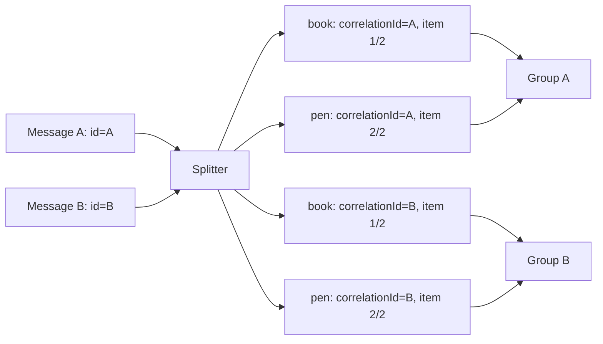

# correlationId Created by a Splitter

In the **Splitter** chapter of the **SPRING_INTEGRATION_CORE** module, this lesson explains how child messages preserve their relationship to a single split. This is the foundation for designing `Message → MessageChannel → endpoint → aggregator` flows, observing failures, and testing with the Java DSL.

Key point to grasp: when `applySequence` is enabled by default, the splitter uses the **ID of the message arriving directly at the splitter input** as the `correlationId` for all child messages. Children from the same split share this key; each child still gets its own ID. You can cross-check that rule in the [AbstractMessageSplitter 6.5.0 source](https://github.com/spring-projects/spring-integration/blob/v6.5.0/spring-integration-core/src/main/java/org/springframework/integration/splitter/AbstractMessageSplitter.java).

Examples in this lesson use Java 17, Spring Integration Core 6.5.x, and JUnit Jupiter 5. Spring libraries must have mutually compatible versions, typically managed by a BOM or Spring Boot. The lesson requires no broker or external services.

## 1. Why Do We Need to Know Which Split Child Messages Belong To?

Suppose the system receives two requests to process product code lists:

```text
Request A: ["book", "pen"]
Request B: ["book", "pen"]
```

The payloads are identical, yet these are two independent executions. After the splitter, four messages travel along one channel. Looking solely at payload `"book"`, a consumer cannot tell whether it belongs to Request A or B.

We need a group key for each split:



The symbols `A` and `B` in the diagram stand in for actual IDs. They are not bean names, channel names, or values derived by the splitter from list contents.

In a concurrent pipeline, B's children may arrive before A's children. Therefore, assuming "two consecutive messages belong to one group" cannot replace a correlation key.

## 2. Distinguishing ID, correlationId, and Sequence Headers

Spring Integration declares correlation and sequence headers in `IntegrationMessageHeaderAccessor`. The message ID itself belongs to `MessageHeaders`. See [IntegrationMessageHeaderAccessor API](https://docs.spring.io/spring-integration/api/org/springframework/integration/IntegrationMessageHeaderAccessor.html).

| Header | Java Constant | Question it answers |
| --- | --- | --- |
| `id` | `MessageHeaders.ID` | Which individual message is this? |
| `correlationId` | `IntegrationMessageHeaderAccessor.CORRELATION_ID` | Which correlation group does this message belong to? |
| `sequenceNumber` | `IntegrationMessageHeaderAccessor.SEQUENCE_NUMBER` | Which ordinal element in the sequence is this? |
| `sequenceSize` | `IntegrationMessageHeaderAccessor.SEQUENCE_SIZE` | How many elements is the sequence expected to have? |
| `sequenceDetails` | `IntegrationMessageHeaderAccessor.SEQUENCE_DETAILS` | Is there an outer sequence context to restore? |

For a parent message with `id=P` and payload `List.of("book", "pen", "bag")`, the typical split output is:

| Child payload | Child ID | correlationId | sequenceNumber | sequenceSize |
| --- | --- | --- | --- | --- |
| `book` | `C1` | `P` | `1` | `3` |
| `pen` | `C2` | `P` | `2` | `3` |
| `bag` | `C3` | `P` | `3` | `3` |

IDs `C1`, `C2`, and `C3` distinguish individual messages. Key `P` links them to the same split. Do not check `child.id == parent.id` to determine parent–child relationships; the relationship to check is `child.correlationId == parent.id`.

The value the splitter takes from the message ID is typically a `UUID` under the default ID generator. However, the correlation API uses `Object`: a custom correlation strategy may use another key type. When testing splitter behavior, comparing against `parent.getHeaders().getId()` avoids depending on a hardcoded UUID string.

## 3. What Does "Created by the Splitter" Mean Precisely?

A conceptual model for splitting a finite list is:

```text
group_key := ID of the message received at the splitter
total_count := number of elements in the split result

for each element, starting at position 1:
    create child message carrying the element payload
    inherit appropriate headers
    if applySequence is enabled:
        set new sequence context:
            correlationId := group_key
            sequenceNumber := element position
            sequenceSize := total_count
    send child message onward
```

This is pseudocode for reading the flow, not implementation code replacing the framework. For splitters returning pre-built `Message` instances, header copying and precedence also depend on the returned messages; enabling `applySequence` still applies the new sequence context.

Three practical consequences of this rule:

1. The splitter does not need to generate a separate UUID as a group key; the input message's ID already supplies that key.
2. Two new input messages with identical payloads normally produce two distinct groups because they have distinct IDs.
3. Resending the exact same `Message` instance through the same splitter keeps the same input ID, so the group key stays the same. Handling redeliveries must therefore account for aggregator state and deduplication.

"Input message" here means the message **arriving immediately before the splitter**. If an upstream gateway or transformer constructed a new `Message`, the ID used is that new message's ID, not necessarily the ID seen at request entry.

### Is a Pre-Existing Correlation Header Kept as the Active Key?

Suppose before the splitter we have:

```text
id = P
correlationId = "purchase-2026-041"
```

With `applySequence=true`, children receive `correlationId=P` at the new sequence level. Do not assume they keep `correlationId="purchase-2026-041"`.

If you need to retain the purchase code across the business flow, place it in a separate header such as `purchaseId`. Framework correlation headers and business identifiers have different lifecycles.

## 4. Observing Directly with the Java DSL

To clearly inspect headers right after the splitter, use a `DirectChannel` for input and a `QueueChannel` to collect children. The trailing queue only serves to read results; the example attaches no poller-driven consumer to that queue.

The configuration below defines two independent flows: the first observes headers, while the second illustrates split, transform, and aggregate.

```java
import java.util.Locale;

import org.springframework.context.annotation.Bean;
import org.springframework.context.annotation.Configuration;
import org.springframework.integration.channel.DirectChannel;
import org.springframework.integration.channel.QueueChannel;
import org.springframework.integration.config.EnableIntegration;
import org.springframework.integration.dsl.IntegrationFlow;

@Configuration
@EnableIntegration
public class SplitterCorrelationConfig {

    @Bean
    public DirectChannel splitInput() {
        return new DirectChannel();
    }

    @Bean
    public QueueChannel parts() {
        return new QueueChannel();
    }

    @Bean
    public IntegrationFlow observeSplitHeaders() {
        return IntegrationFlow.from("splitInput")
                .split()
                .channel("parts")
                .get();
    }

    @Bean
    public DirectChannel processBatchInput() {
        return new DirectChannel();
    }

    @Bean
    public QueueChannel completedBatches() {
        return new QueueChannel();
    }

    @Bean
    public IntegrationFlow processBatch() {
        return IntegrationFlow.from("processBatchInput")
                .split()
                .<String, String>transform(
                        item -> item.toUpperCase(Locale.ROOT))
                .aggregate()
                .channel("completedBatches")
                .get();
    }
}
```

`.split()` uses the default splitter, which fits the list payload in the example. DSL configuration variants are described in [BaseIntegrationFlowDefinition 6.5.0 API](https://docs.spring.io/spring-integration/docs/6.5.0/api/org/springframework/integration/dsl/BaseIntegrationFlowDefinition.html).

You can test reading a single split in code running on the same classpath as the configuration above:

```java
import java.util.List;

import org.springframework.context.annotation.AnnotationConfigApplicationContext;
import org.springframework.integration.IntegrationMessageHeaderAccessor;
import org.springframework.integration.channel.DirectChannel;
import org.springframework.integration.channel.QueueChannel;
import org.springframework.integration.support.MessageBuilder;
import org.springframework.messaging.Message;

try (var context = new AnnotationConfigApplicationContext(
        SplitterCorrelationConfig.class)) {

    DirectChannel input = context.getBean("splitInput", DirectChannel.class);
    QueueChannel output = context.getBean("parts", QueueChannel.class);

    Message<List<String>> parent = MessageBuilder
            .withPayload(List.of("book", "pen"))
            .setHeader("purchaseId", "PUR-041")
            .build();

    input.send(parent);

    for (int index = 0; index < 2; index++) {
        Message<?> child = output.receive(1000);
        if (child == null) {
            throw new IllegalStateException("Missing child message");
        }

        var headers = new IntegrationMessageHeaderAccessor(child);
        System.out.printf(
                "payload=%s, id=%s, correlationId=%s, sequence=%d/%d%n",
                child.getPayload(), child.getHeaders().getId(),
                headers.getCorrelationId(), headers.getSequenceNumber(),
                headers.getSequenceSize());
    }
}
```

Place the `try` block inside a method, such as `main`, if using a standard Java file. Expected output has two payloads, two distinct child IDs, one shared `correlationId` equal to `parent`'s ID, and positions `1/2` and `2/2` respectively.

## 5. How Does an Aggregator Use correlationId?

In the default aggregator configuration, the group key comes from the `correlationId` header. See [Aggregator: Correlation and Release](https://docs.spring.io/spring-integration/reference/aggregator.html).

With the data from the opening example, you can picture in-flight state as:

```text
group A: [book(A, 1/2), pen(A, 2/2)]
group B: [book(B, 1/2), pen(B, 2/2)]
```

Separate two decisions:

| Decision | Data to inspect in a typical flow |
| --- | --- |
| Which group to add to? | Correlation key |
| Is the group ready to release a result? | Release policy and expected size |

Having the right group key does not guarantee the group has all elements. For instance, for a group expecting three results, receiving two results with the same `correlationId` is not yet enough.

`SimpleSequenceSizeReleaseStrategy` compares the number of messages in the group against the expected sequence size; it does not check for duplicate `sequenceNumber` values. Therefore, do not treat the presence of `correlationId` as an exactly-once guarantee. This detail is noted in [SimpleSequenceSizeReleaseStrategy 6.5.0 API](https://docs.spring.io/spring-integration/docs/6.5.0/api/org/springframework/integration/aggregator/SimpleSequenceSizeReleaseStrategy.html).

For example, if the first result is resent as a new message, a two-element group might receive two copies of position `1`. With a count-only policy, an additional mechanism is needed to avoid treating those as two distinct business results.

`sequenceNumber` also does not make workers finish in order. When output requires ordering, explicitly test the aggregation step's ordering contract or add an appropriate resequencer step.

## 6. When Disabling applySequence

If you do not want the splitter to apply a new set of sequence headers, you can configure:

```java
return IntegrationFlow.from("splitInput")
        .split(spec -> spec.applySequence(false))
        .channel("parts")
        .get();
```

This is an **alternative** configuration for the observation flow in Section 4—do not register a second competing consumer on the same `splitInput` to test both configurations at once.

`applySequence(false)` means the splitter does not establish a new correlation and sequence context. It is not an operation that strips all pre-existing correlation headers. Inherited headers may still appear. The default and semantics of this flag are described in [@Splitter API](https://docs.spring.io/spring-integration/api/org/springframework/integration/annotation/Splitter.html).

Before disabling the flag, answer:

- Is there a downstream aggregator or resequencer depending on the sequence headers?
- If old headers are retained, do they accurately represent the group and size of the new children?
- If using a custom business key, what determines when that group is complete?

Disabling the flag merely to keep a tidy, human-readable `correlationId` can leave groups carrying the `sequenceSize` of a different processing level. Model the group contract before changing the setting.

## 7. Nested Splitters and sequenceDetails

Consider an order containing two packages. Each package is further split into items:

```text
order
  → outer splitter: package 1, package 2
      → inner splitter: items of each package
      → inner aggregator: one result per package
  → outer aggregator: one result for the order
```

Suppose the order message has ID `ORDER-MSG`, and the package 1 message has ID `PACKAGE-MSG-1`:

| Position | Active correlationId | Meaning |
| --- | --- | --- |
| Package 1 after outer splitter | `ORDER-MSG` | Package belongs to the order's sequence |
| Items after inner splitter of package 1 | `PACKAGE-MSG-1` | Items belong to package 1's sequence |
| Package result after proper inner aggregation | Restores outer sequence context | Package result rejoins the order group |

Spring Integration provides a sequence-details push/pop mechanism to support these levels. See the corresponding methods in [MessageBuilder API](https://docs.spring.io/spring-integration/api/org/springframework/integration/support/MessageBuilder.html).

In standard splitter–aggregator flows, the aggregator provides `popSequence` to restore outer context. Avoid manually overwriting each item's `correlationId` with the order ID: doing so risks mixing items from multiple packages into the same group before package aggregation finishes.

When replacing the aggregator's output processor or returning custom `Message` instances, explicitly verify header restoration. This lesson uses ordinary payload results; do not assume every custom result type is handled identically.

Hence, a system should track two kinds of observability fields: the active-level group key and an end-to-end business code like `purchaseId`. The business code finds the entire order even as group keys change across split levels.

## 8. Preserving Correlation Across Transformers and Custom Endpoints

In the Section 4 flow, the transformer returns only the uppercased string payload. The framework handles creating the output message and propagating appropriate headers. Business authors do not have to rebuild the header set at every payload transformation. Sequence header propagation across endpoints is explained in the [Splitter reference](https://docs.spring.io/spring-integration/reference/splitter.html).

Risk arises when application code directly constructs and sends a brand-new `Message` with only a payload:

```java
Message<String> detached = MessageBuilder
        .withPayload("BOOK")
        .build();
```

`detached` carries none of the old message's group metadata. Sending it directly into a default aggregator breaks the correlation contract.

When custom code genuinely needs to build a new message, you can use a helper like:

```java
static Message<String> uppercaseKeepingHeaders(Message<String> source) {
    return MessageBuilder
            .withPayload(source.getPayload().toUpperCase(Locale.ROOT))
            .copyHeaders(source.getHeaders())
            .build();
}
```

This method uses the same `Message`, `MessageBuilder`, and `Locale` imports as Section 4. `copyHeaders` does not overwrite the default read-only headers `id` and `timestamp`; the new message still receives its own identifier. See [BaseMessageBuilder 6.5.0 implementation](https://github.com/spring-projects/spring-integration/blob/v6.5.0/spring-integration-core/src/main/java/org/springframework/integration/support/BaseMessageBuilder.java).

This is an in-process example. When crossing HTTP, Kafka, or AMQP, also test the header-mapping contract of the active adapter—especially the data type of the group key on both sides. Seeing the same UUID printed in logs on both sides does not prove both sides use the same key type when comparing.

## 9. Business Keys and Custom Correlation Strategies

Suppose `purchaseId=PUR-041` undergoes three independent update runs. Choosing `purchaseId` as the group key across all three runs could mix results from different runs.

A viable design can use:

```text
purchaseId = PUR-041           # long-lived business identifier
batchId = PUR-041:attempt-3    # identifier of a single processing run
correlationId = parent UUID    # sequence context applied by the splitter
```

Only when the contract requires grouping by `batchId` should you change the aggregator's strategy, as in this DSL snippet:

```java
.aggregate(spec -> spec
        .correlationStrategy(message ->
                message.getHeaders().get("batchId")))
```

This changes only the **group key**; it does not alter the message's `correlationId` header. Every message must carry a valid `batchId`, and the release policy must match the entire new group. If one business group contains results from multiple splits, you cannot blindly use a single split's `sequenceSize` to determine completion.

Design example: a sync run needs results from two sources, each splitting three items. `batchId` may match across all six results, yet each source's `sequenceSize=3` does not describe the total of six items. That case needs a dedicated counting model or completion signal rather than just renaming the key.

## 10. Right Correlation, Yet the Group Still Does Not Complete

### 10.1. Unknown Sequence Size Upfront

With an `Iterator`, an `Iterable` of unknown size, or a stream source, the splitter may use `sequenceSize=0` to represent an unknown total. Do not interpret this value as "no children." The framework exposes extension points to determine size when possible; see [Splitter 6.5: Iterators and Streams](https://docs.spring.io/spring-integration/reference/6.5/splitter.html).

The design must choose an appropriate completion approach: knowing the expected result count, having an end-of-stream signal, or accepting partial results on timeout. `correlationId` remains useful for grouping data, yet on its own carries no flow-completion signal.

### 10.2. Filter or Router Drops a Result Branch

For example, the splitter produces three children with `sequenceSize=3`, and then a filter drops one child. The aggregator branch receives only two results:

```text
same correlationId=P
received: position 1, position 3
expected: 3 results
```

One design option is converting the filtered-out case into a business result with status `SKIPPED` and still sending it to the aggregator. Another option is filtering the list before splitting so sequence size reflects the actual subset requiring processing. Either way, explicitly define how dropped items are represented in the final result.

With a router, verify return paths: does every branch return exactly one result for each child? A branch that terminates silently can leave the group waiting forever even though headers were never altered.

### 10.3. Empty Input

Zero elements means no normal child messages go to the aggregator. If a caller invokes a gateway expecting a reply, the application must define an empty-list response or branch off empty-input handling. Do not rely on an aggregator spontaneously recognizing a group that never received any messages.

## 11. Errors, Resends, and System Observability

In a flow using `DirectChannel`, errors can propagate back to the caller. When an asynchronous boundary or poller is present, inspect `ErrorMessage` publication and error channels. These two models are distinguished in the [Error Handling reference](https://docs.spring.io/spring-integration/reference/error-handling.html).

Suppose the second child fails calling an external service. Even though the other two children succeeded, the group still needs a decision for the failed item: retry, record failure as a result, or terminate the group per policy. An `ErrorMessage` holding an exception does not automatically become a valid result for the second item.

When turning a failure into a business result for aggregation, preserve the group key, item position, and expected count from the failed message. The result must also clearly indicate an error status so the aggregator does not treat it as success.

When retrying, distinguish two situations:

| Situation | What to design |
| --- | --- |
| Retry a single already-split item | Keep the existing group; prevent the same result from being recorded multiple times |
| Rerun the entire request with a new parent message | Decide whether this is a new batch or the same business batch |

A useful set of log fields is:

```text
endpoint, messageId, correlationId, sequenceNumber,
sequenceSize, purchaseId, batchId, outcome
```

When investigating errors, start from a business code, identify related executions, and inspect each group key to see which positions lack results. Do not use a single child's ID to search for all its siblings.

## 12. Testing Key Invariants

Checking only payloads after the splitter is insufficient: code might produce the right elements while losing the group key. The following tests run against `SplitterCorrelationConfig` from Section 4, placed in the same package or with appropriate imports added.

```java
import java.util.HashSet;
import java.util.List;
import java.util.Set;

import org.junit.jupiter.api.AfterEach;
import org.junit.jupiter.api.BeforeEach;
import org.junit.jupiter.api.Test;
import org.springframework.context.annotation.AnnotationConfigApplicationContext;
import org.springframework.integration.IntegrationMessageHeaderAccessor;
import org.springframework.integration.channel.DirectChannel;
import org.springframework.integration.channel.QueueChannel;
import org.springframework.integration.support.MessageBuilder;
import org.springframework.messaging.Message;

import static org.junit.jupiter.api.Assertions.*;

class SplitterCorrelationTest {

    private AnnotationConfigApplicationContext context;
    private DirectChannel input;
    private QueueChannel parts;

    @BeforeEach
    void start() {
        context = new AnnotationConfigApplicationContext(
                SplitterCorrelationConfig.class);
        input = context.getBean("splitInput", DirectChannel.class);
        parts = context.getBean("parts", QueueChannel.class);
    }

    @AfterEach
    void stop() {
        context.close();
    }

    @Test
    void childrenUseParentIdAndKeepTheirOwnIds() {
        Message<List<String>> parent = MessageBuilder
                .withPayload(List.of("book", "pen"))
                .setHeader("purchaseId", "PUR-041")
                .build();

        assertTrue(input.send(parent));

        Message<?> first = take(parts);
        Message<?> second = take(parts);
        assertEquals("book", first.getPayload());
        assertEquals("pen", second.getPayload());

        var firstHeaders = new IntegrationMessageHeaderAccessor(first);
        var secondHeaders = new IntegrationMessageHeaderAccessor(second);
        Object parentId = parent.getHeaders().getId();

        assertEquals(parentId, firstHeaders.getCorrelationId());
        assertEquals(parentId, secondHeaders.getCorrelationId());
        assertNotEquals(parentId, first.getHeaders().getId());
        assertNotEquals(first.getHeaders().getId(), second.getHeaders().getId());
        assertEquals(1, firstHeaders.getSequenceNumber());
        assertEquals(2, secondHeaders.getSequenceNumber());
        assertEquals(2, firstHeaders.getSequenceSize());
        assertEquals(2, secondHeaders.getSequenceSize());
        assertEquals("PUR-041", first.getHeaders().get("purchaseId"));
        assertEquals("PUR-041", second.getHeaders().get("purchaseId"));
        assertNull(parts.receive(0));
    }

    @Test
    void equalPayloadsInNewParentsProduceDifferentGroups() {
        Message<List<String>> firstParent = MessageBuilder
                .withPayload(List.of("book"))
                .build();
        Message<List<String>> secondParent = MessageBuilder
                .withPayload(List.of("book"))
                .build();

        assertTrue(input.send(firstParent));
        assertTrue(input.send(secondParent));

        Object firstKey = correlationOf(take(parts));
        Object secondKey = correlationOf(take(parts));
        assertEquals(firstParent.getHeaders().getId(), firstKey);
        assertEquals(secondParent.getHeaders().getId(), secondKey);
        assertNotEquals(firstKey, secondKey);
    }

    @Test
    void splitLevelUsesParentIdInsteadOfAnExistingBusinessCorrelation() {
        Message<List<String>> parent = MessageBuilder
                .withPayload(List.of("book"))
                .setHeader(IntegrationMessageHeaderAccessor.CORRELATION_ID,
                        "purchase-2026-041")
                .build();

        assertTrue(input.send(parent));

        Object childKey = correlationOf(take(parts));
        assertEquals(parent.getHeaders().getId(), childKey);
        assertNotEquals("purchase-2026-041", childKey);
    }

    @Test
    void transformedChildrenReturnAsSeparateCompletedBatches() {
        DirectChannel batchInput = context.getBean(
                "processBatchInput", DirectChannel.class);
        QueueChannel completed = context.getBean(
                "completedBatches", QueueChannel.class);

        assertTrue(batchInput.send(MessageBuilder
                .withPayload(List.of("book", "pen")).build()));
        assertTrue(batchInput.send(MessageBuilder
                .withPayload(List.of("bag", "cup")).build()));

        List<?> firstBatch = assertInstanceOf(
                List.class, take(completed).getPayload());
        List<?> secondBatch = assertInstanceOf(
                List.class, take(completed).getPayload());

        assertEquals(Set.of("BOOK", "PEN"), new HashSet<>(firstBatch));
        assertEquals(Set.of("BAG", "CUP"), new HashSet<>(secondBatch));
        assertNull(completed.receive(0));
    }

    private static Message<?> take(QueueChannel channel) {
        Message<?> result = channel.receive(1000);
        assertNotNull(result, "Did not receive message within timeout");
        return result;
    }

    private static Object correlationOf(Message<?> message) {
        return message.getHeaders().get(
                IntegrationMessageHeaderAccessor.CORRELATION_ID);
    }
}
```

Each test creates a fresh context so queues and aggregation groups retain no state from previous tests. Sequential receiving in the first two tests relies on the example's synchronous `DirectChannel` flow. If switching to parallel processing, match by group key and sequence position instead of global receive order.

The last test compares payload sets because the focus here is group correlation, not ordering contracts. The test dataset has no duplicate elements; in domains allowing duplicate payloads, compare occurrence counts as well.

Cases worth adding when a real application uses the corresponding features: disabling `applySequence`, two-level splitter–aggregator, a filtered-out item, retry after partial success, and header propagation over a broker.

## 13. Quick Diagnostic Table

| Symptom | Where to check |
| --- | --- |
| Every child has a different group key | Did an endpoint overwrite correlation with each child's ID? |
| Multiple business requests get merged together | Is an overly broad business key being used across multiple runs? |
| Aggregator cannot find the group key | Check `applySequence`, manual message creation, and header mapping steps |
| Keys look identical in logs, yet do not group together | Check both the value and the Java type of the key |
| Group has the right key, yet never releases | Check result count, filters, router branches, and unhandled errors |
| `sequenceSize` is 0 even though data exists | Check whether source size is known and choose a group completion strategy |
| Inner aggregation finishes, but outer aggregation hangs | Check outer sequence context and `sequenceDetails` restoration |
| Resending the same message behaves unexpectedly | Check preserved ID, completed group state, and deduplication policy |

## 14. Principles to Apply

- With a default splitter, verify `child.correlationId` equals the ID of the message received at the splitter.
- Keep separate business codes when tracing a transaction across multiple processing levels.
- Preserve group metadata when manually constructing and sending new messages.
- Design group keys, completion conditions, and redelivery handling as three distinct decisions.
- Test both headers and group completion; correct payloads alone do not prove the integration flow is correct.