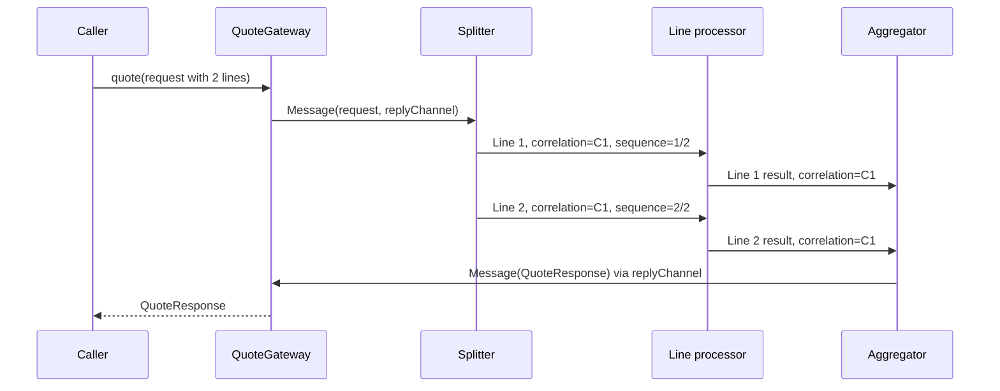

# Splitter in Request-Reply

## 1. The Problem: One Request, Multiple Work Items, One Reply

In the `SPRING_INTEGRATION_CORE` module, a splitter is an endpoint that turns one input message into multiple child messages. For request-reply flows, an additional design concern is how to bring the results of those work items back into the original invocation.

Suppose an application receives a pricing request for a shopping cart containing two lines. Each line must be priced individually; the caller expects a single `QuoteResponse` containing both line results and the grand total. The external contract remains:

```java
QuoteResponse quote(QuoteRequest request);
```

Internally, the appropriate model is:

```text
1 request -> N child messages -> N results -> 1 response
```

The splitter handles the `1 -> N` step. The aggregator handles the `N -> 1` step. The gateway bridges the caller's Java method to the message flow. Emitting multiple messages from a splitter does not make the gateway automatically collect them into a list. This is how the Splitter–Aggregator pattern is applied within a request-reply contract. [Reference on the splitter's role](https://docs.spring.io/spring-integration/reference/6.5/splitter.html).

After this lesson, you will be able to build a complete Java DSL flow, explain the reply path, maintain proper result grouping and ordering, and identify scenarios that cause callers to time out.

## 2. Defining the Reply Contract Before Writing the Flow

Not every flow with a splitter needs an aggregator. The decision depends on what result the caller actually needs.

| Caller need | Appropriate design |
| --- | --- |
| Receive results for all elements in a single response | Splitter → per-part processing → aggregator → reply |
| Only need acknowledgment that the request was accepted | Return an acknowledgment per a dedicated contract; process results later |
| Observe each result as it arrives | Design a stream, event, or callback accordingly |
| Simply return a computed list in one step | Can use a transformer/service activator returning a `List`; no need to split into multiple messages |

A return type of `List<LineQuote>` on a gateway only describes the expected payload of a single reply. It is not an instruction for the gateway to collect multiple independent replies.

In this lesson's example, the contract is: the input has at least one valid order line; the response succeeds only when results for all lines are present; and response ordering matches input ordering. Empty lists are rejected when constructing the request. This decision keeps the example free of a branch waiting on a result that can never arrive.

## 3. Lifecycle of a Request-Reply Invocation



The diagram depicts the synchronous processing version. If an executor is added after the splitter, the two lines can process and finish in a different order.

A gateway typically creates a temporary reply channel for the invocation and places it in the request's `replyChannel` header. Child messages must preserve this return path. The final reply-producing endpoint uses that header when no dedicated output channel is configured. There is no need to declare a shared reply channel just to connect the gateway and aggregator. [Gateway Reply Channel Mechanism](https://docs.spring.io/spring-integration/reference/6.5/gateway.html).

If you omit the aggregator and let each child result go straight back to the gateway, a call could receive the wrong payload type or encounter multiple replies racing on the same reply channel. Do not rely on "taking the first result" to satisfy a contract requiring all results.

## 4. Headers Connecting Work Items Back to the Initial Call

| Header | Meaning in the example |
| --- | --- |
| `replyChannel` | Path to send the response back to the waiting gateway call |
| `errorChannel` | Error path when the execution mechanism uses this header |
| `correlationId` | Identifies the group of child messages to aggregate |
| `sequenceNumber` | Position of the element in the sequence, starting from 1 |
| `sequenceSize` | Number of elements the group expects to receive |
| `requestId` | Application-added business header to carry the request ID into the response |

With a standard splitter having `applySequence` enabled by default, child messages of a single split share the same `correlationId`; for a single-level split, this value is based on the ID of the splitter's input message. Splitting a two-element `List` gives the two messages sequence numbers `1` and `2` and the same size `2`. If you disable sequencing while still using the default aggregator, you must provide alternative grouping and group-completion mechanisms.

`requestId` and `correlationId` serve different purposes. A business ID can be reused when a user re-prices a cart. Each invocation still needs its own processing group. The example keeps default correlation and uses `requestId` only for business identification; it does not configure grouping by cart ID.

A `Message` contains a payload and headers. When manually building a new message inside a handler, preserve the headers used for grouping and replying; do not copy only `requestId`. With a transformer returning a payload as in the example below, the framework builds the output message and forwards required headers. [Message Model and Headers](https://docs.spring.io/spring-integration/reference/6.5/message.html).

## 5. Complete Example with Java DSL

The example uses Java 17 and Spring Integration 6.5.x APIs. The classes below belong to package `example.quote`; filenames correspond to public class names. This is an in-memory flow without HTTP, database, or external pricing service calls.

### 5.1. Dependencies

If the project uses Spring Boot with a BOM managing compatible versions, add these dependencies to Maven's `dependencies` section:

```xml
<dependency>
    <groupId>org.springframework.boot</groupId>
    <artifactId>spring-boot-starter-integration</artifactId>
</dependency>
<dependency>
    <groupId>org.springframework.boot</groupId>
    <artifactId>spring-boot-starter-test</artifactId>
    <scope>test</scope>
</dependency>
```

Without Boot, manage compatible versions for `spring-integration-core`, Spring Test, and JUnit Jupiter. Do not force an arbitrary Spring Integration version into a project that already has a dependency-management BOM.

### 5.2. Business Data Model

```java
package example.quote;

import java.math.BigDecimal;
import java.util.List;
import java.util.Objects;

public final class QuoteModel {

    private QuoteModel() {
    }

    public record QuoteRequest(String requestId, List<QuoteLine> lines) {
        public QuoteRequest {
            Objects.requireNonNull(requestId, "requestId");
            lines = List.copyOf(Objects.requireNonNull(lines, "lines"));
            if (lines.isEmpty()) {
                throw new IllegalArgumentException("At least one line is required");
            }
        }
    }

    public record QuoteLine(String sku, int quantity, BigDecimal unitPrice) {
        public QuoteLine {
            Objects.requireNonNull(sku, "sku");
            Objects.requireNonNull(unitPrice, "unitPrice");
            if (quantity <= 0 || unitPrice.signum() < 0) {
                throw new IllegalArgumentException("Invalid quantity or unitPrice");
            }
        }
    }

    public record LineQuote(String sku, int quantity, BigDecimal amount) {
    }

    public record QuoteResponse(
            String requestId,
            List<LineQuote> lines,
            BigDecimal total) {
        public QuoteResponse {
            lines = List.copyOf(lines);
        }
    }
}
```

Prices use `BigDecimal` and are assumed to share the same currency. The example only multiplies unit price by quantity; production systems should add domain rounding, tax, or discount policies. `List.copyOf` keeps the list structure stable during processing; child records also have no mutable fields in this example.

### 5.3. Gateway Returning One Result

```java
package example.quote;

import org.springframework.integration.annotation.MessagingGateway;

import static example.quote.QuoteModel.*;

@MessagingGateway(
        defaultRequestChannel = "quoteRequests",
        defaultRequestTimeout = "1000",
        defaultReplyTimeout = "3000",
        errorOnTimeout = true)
public interface QuoteGateway {

    QuoteResponse quote(QuoteRequest request);
}
```

`errorOnTimeout = true` instructs the gateway to throw an error on timeout instead of returning `null`. The example configures no dedicated `errorChannel` on the gateway, so errors propagate to the caller via gateway semantics. This option has been available since Spring Integration 6.2. [`MessagingGateway` API](https://docs.spring.io/spring-integration/docs/6.5.0/api/org/springframework/integration/annotation/MessagingGateway.html).

The `1,000` ms value applies to sending the request when the send operation might block. The `3,000` ms value is the reply timeout; a later section explains why it is not a hard cap on total execution time.

### 5.4. Configuring Splitter, Transformer, and Aggregator

```java
package example.quote;

import java.math.BigDecimal;
import java.util.ArrayList;
import java.util.Comparator;
import java.util.List;
import java.util.Objects;

import org.springframework.context.annotation.Bean;
import org.springframework.context.annotation.Configuration;
import org.springframework.integration.IntegrationMessageHeaderAccessor;
import org.springframework.integration.annotation.IntegrationComponentScan;
import org.springframework.integration.config.EnableIntegration;
import org.springframework.integration.dsl.IntegrationFlow;
import org.springframework.integration.store.MessageGroup;
import org.springframework.messaging.Message;

import static example.quote.QuoteModel.*;

@Configuration
@EnableIntegration
@IntegrationComponentScan(basePackageClasses = QuoteGateway.class)
public class QuoteFlowConfiguration {

    @Bean
    IntegrationFlow quoteFlow() {
        return IntegrationFlow.from("quoteRequests")
                .enrichHeaders(h -> h.headerExpression(
                        "requestId", "payload.requestId()"))
                .split(QuoteRequest.class, QuoteRequest::lines)
                .<QuoteLine, LineQuote>transform(QuoteFlowConfiguration::price)
                .aggregate(a -> a.outputProcessor(QuoteFlowConfiguration::merge))
                .get();
    }

    private static LineQuote price(QuoteLine line) {
        BigDecimal amount = line.unitPrice()
                .multiply(BigDecimal.valueOf(line.quantity()));
        return new LineQuote(line.sku(), line.quantity(), amount);
    }

    private static QuoteResponse merge(MessageGroup group) {
        List<Message<?>> messages = new ArrayList<>(group.getMessages());
        messages.sort(Comparator.comparingInt(
                QuoteFlowConfiguration::sequenceNumber));

        List<LineQuote> lines = messages.stream()
                .map(message -> (LineQuote) message.getPayload())
                .toList();

        BigDecimal total = lines.stream()
                .map(LineQuote::amount)
                .reduce(BigDecimal.ZERO, BigDecimal::add);

        String requestId = Objects.requireNonNull(
                messages.get(0).getHeaders().get("requestId", String.class),
                "requestId header");

        return new QuoteResponse(requestId, lines, total);
    }

    private static int sequenceNumber(Message<?> message) {
        return Objects.requireNonNull(message.getHeaders().get(
                IntegrationMessageHeaderAccessor.SEQUENCE_NUMBER,
                Integer.class), "sequenceNumber header");
    }
}
```

`@EnableIntegration` registers Spring Integration infrastructure in a direct configuration context. `@IntegrationComponentScan` discovers the gateway interface in `QuoteGateway`'s package; ordinary component scanning alone does not pick up gateway interfaces.

The flow executes these steps:

1. Receives a `QuoteRequest` payload on `quoteRequests`. With this DSL configuration, the input channel is created by name and default connections run synchronously.
2. Copies `requestId` into a header before the request payload is split into individual `QuoteLine` items.
3. The splitter emits one message per order line, with sequence metadata.
4. The transformer computes one `LineQuote` for each child message.
5. The aggregator collects messages sharing correlation, waits for the full sequence, and calls `merge`.
6. `merge` builds exactly one `QuoteResponse`. The aggregator sends the result message along `replyChannel`, because the example specifies no dedicated output channel at the end of the flow.

By default, the aggregator uses the correlation header to select groups and sequence size to determine completeness. `outputProcessor` only customizes the reply content; it does not change the release condition on its own. [Correlation and Release Mechanism](https://docs.spring.io/spring-integration/reference/6.5/aggregator.html), [Aggregator Configuration API](https://docs.spring.io/spring-integration/docs/6.5.0/api/org/springframework/integration/dsl/AggregatorSpec.html).

Do not configure release using a fixed count such as `group.size() == 2`: the same flow must handle carts with one, two, or many lines. Nor should you treat `sequenceNumber == sequenceSize` on a single message as proof that every element has arrived; under parallel processing, the last element can finish first.

`merge` sorts by `sequenceNumber` because the contract requires preserving input order. Do not use result arrival order to represent business order. `requestId` is read from the group of messages belonging to the same request; every line in the group carries the same value because it was enriched before splitting.

### 5.5. Sample Input and Expected Output

```java
QuoteRequest request = new QuoteRequest("REQ-100", List.of(
        new QuoteLine("BOOK", 2, new BigDecimal("120000.00")),
        new QuoteLine("PEN", 1, new BigDecimal("35000.00"))));

QuoteResponse response = quoteGateway.quote(request);
```

Expected output:

```text
requestId = REQ-100
lines[0] = BOOK, quantity=2, amount=240000.00
lines[1] = PEN,  quantity=1, amount=35000.00
total = 275000.00
```

Here there are two child messages and one final reply. `QuoteGateway` is a Spring-injected bean; do not manually instantiate a gateway implementation with `new`.

## 6. Synchronous, Parallel, and Subflow Gateway Calls

A splitter splits messages; it does not automatically spawn a processing thread per element. With a chain of `DirectChannel`s, the caller's thread runs through all steps; the first line finishes processing before the splitter dispatches the second line.

To process each line on an executor, add these two beans to the configuration class. Additional imports are `ExecutorChannel`, `MessageChannel`, and `ThreadPoolTaskExecutor` from the packages shown in the snippet:

```java
@Bean
org.springframework.scheduling.concurrent.ThreadPoolTaskExecutor lineExecutor() {
    var executor = new org.springframework.scheduling.concurrent.ThreadPoolTaskExecutor();
    executor.setCorePoolSize(4);
    executor.setMaxPoolSize(4);
    executor.setQueueCapacity(100);
    executor.setThreadNamePrefix("quote-line-");
    return executor;
}

@Bean
org.springframework.messaging.MessageChannel quoteWork(
        org.springframework.scheduling.concurrent.ThreadPoolTaskExecutor lineExecutor) {
    return new org.springframework.integration.channel.ExecutorChannel(lineExecutor);
}
```

In `quoteFlow`, insert `.channel("quoteWork")` right after `.split(...)` and before `.transform(...)`. This is an optional modification to the example, not a second flow registered simultaneously on `quoteRequests`.

An executor allows results to reach the aggregator out of order. Bound the number of lines per request and handle full executor queues; worker count alone does not limit total accepted work. Switching threads also changes transaction boundaries and how errors return to the caller. [`DirectChannel` and `ExecutorChannel` Characteristics](https://docs.spring.io/spring-integration/reference/6.5/channel/implementations.html).

If each line must be sent to another pricing flow and await a result, you can use the `.gateway("linePricingRequests")` operator after the splitter. That introduces two contracts: the inner gateway must return exactly one result per line, while the outer gateway replies only after the aggregator step. The `.gateway(...)` operator is a request-reply call to another flow; `.channel(...)` simply forwards the message to a channel and does not create the same call boundary. [`gateway()` Operator in Java DSL](https://docs.spring.io/spring-integration/reference/6.5/dsl/java-gateway.html).

## 7. Scenarios That Lose Replies or Leave Groups Incomplete

### 7.1. Splitter Returns an Empty List or `null`

An empty list produces zero child messages, so the aggregator receives no data to start a group and produce a reply. A `null` split result also terminates the processing branch. While the splitter supports a discard channel for empty containers, routing the request to a discard channel does not guarantee a response back to the gateway.

The example blocks empty inputs in the constructor. If the business accepts empty carts, branch before the splitter: build an empty `QuoteResponse` with a zero total immediately on that branch, while non-empty carts proceed through split–aggregate. Both branches must fulfill the request's reply contract.

### 7.2. Filter or Router Drops Elements

Suppose the splitter emits three messages with `sequenceSize = 3`. If a filter drops one message, the aggregator receives only two and keeps waiting for the third. The filter's discard channel does not automatically decrement sequence size. [Filter Message Discard Behavior](https://docs.spring.io/spring-integration/reference/6.5/filter.html).

Choose one of these business policies:

- Filter data before splitting so the count announced by the splitter reflects the subset actually needing processing; handle empty post-filter sets separately.
- For each rejected item, emit a result with a status such as `REJECTED`; the aggregator still receives one terminal result per original line.
- Use a custom release rule based on explicit metadata stating how many final results are required.

Similarly, when a router sends different line types down multiple branches, every branch must return a result to the same aggregation point. A branch that merely logs and terminates leaves the request short of results. If one child message is fanned out into multiple results, adjust counting rules as well; the aggregator does not infer business intent automatically.

### 7.3. Split Source Has Unknown Size Upfront

With an `Iterator` or an iterable whose element count cannot be determined, the splitter may set `sequenceSize = 0`. This indicates unknown size, not an assertion that the group is complete. Do not expect the default release strategy to know automatically when iteration finishes.

For small requests, materialize into a `List` before splitting to obtain a known size. For large sources, carry expected-count metadata or an end-of-stream signal and write a matching release strategy. Materializing very large datasets to serve a single synchronous call must also be evaluated for memory and latency.

### 7.4. Handler Builds a New Message and Drops Headers

A service might calculate the right amount yet return a `Message<LineQuote>` containing only the payload and custom headers. Without correlation or reply channel headers, the computed price still cannot become a complete response.

If manual header control is unnecessary, have the handler return a plain payload. When returning a `Message` is required, build it from the incoming headers using builder APIs and modify only intended headers. With nested splitters, preserve the framework's sequence mechanism and aggregate level by level, avoiding manually overwriting outer-level headers.

## 8. Timeouts: Distinguishing Reply Wait, Group Wait, and Business Deadlines

| Limit type | What it controls | What it does NOT do automatically |
| --- | --- | --- |
| Gateway request timeout | Wait duration when sending to a channel whose send blocks | Interrupt a handler running on a `DirectChannel` |
| Gateway reply timeout | Wait duration for a reply after sending returns control to the gateway | Cancel already-dispatched work |
| Aggregator group timeout | How long a group waits before timeout handling triggers | Guarantee incomplete results are treated as success |
| Pricing service timeout | Bounds an external resource call | Automatically release the entire request's group |
| Business deadline | Time budget propagated and enforced by the application | Take effect if components do not check it |

A common pitfall in synchronous flows: if a handler runs directly inside `send()` and blocks for 10 seconds, configuring a 3-second reply timeout does not interrupt the handler after 3 seconds. The reply wait timer starts when the thread returns to the gateway after the send step. [`requestTimeout` and `replyTimeout` in `Gateway` API](https://docs.spring.io/spring-integration/docs/6.5.0/api/org/springframework/integration/annotation/Gateway.html).

In asynchronous flows, the gateway may already have timed out while order lines are still being processed. If those lines cause side effects, retrying the entire request can duplicate those side effects. Implement per-request/execution and per-element idempotency policies rather than treating timeout as a rollback.

In the aggregator, a duration-based `groupTimeout` resets as new messages arrive while the group remains unreleased. It is not by default an absolute deadline measured from when the gateway received the request. If a fixed deadline is needed, pass the deadline and use a suitable expression/policy, while also setting timeouts on child service calls.

When emitting partial results upon expiration, the response should clearly state `complete = false`, expected count, received count, and which lines lack results. Do not apply partial-result emission to the example's `QuoteResponse` and still present it as a complete quote.

Gateway expiration does not automatically clean up aggregator state. In production, configure timeouts/reapers and an expired-group handling path; also decide how long to retain completed-group metadata to catch late messages. `expireGroupsUponCompletion(true)` deletes the group upon completion, yet a duplicate message arriving later can open a new group. Choose memory-cleanup policies alongside deduplication policies. [Correlation and Expiry Management API](https://docs.spring.io/spring-integration/docs/6.5.0/api/org/springframework/integration/dsl/CorrelationHandlerSpec.html).

## 9. Per-Element Failures and Whole-Request Outcome

In a flow using `DirectChannel`, an exception thrown in a step running on the same call stack can propagate back to the gateway caller. Messages that already entered the aggregator before the error still need handling under group-lifecycle policies; throwing an exception does not automatically purge already-created state.

When an `ExecutorChannel` or a consumer on another thread is present, you cannot rely on a worker's Java exception unwinding onto the caller's stack. Errors are handled via the flow's error message/error channel mechanism. Merely logging an `ErrorMessage` and stopping typically leaves the gateway waiting for a reply that is never produced. [Synchronous and Asynchronous Error Handling](https://docs.spring.io/spring-integration/reference/6.5/error-handling.html).

For the quoting problem, explicitly choose one of these contracts:

| Policy | Desired behavior |
| --- | --- |
| All-or-nothing success | One failed line fails the request; prevent late success replies and clean up remaining work/state |
| Collect per-line outcomes | Each line emits one terminal success or error outcome; aggregator builds a response with all statuses |
| Accept partial results on timeout | Response clearly describes unfinished parts and does not present a subtotal as the final total |

Under the collect-per-line policy, design a payload such as `LineOutcome(index, sku, status, amount, errorCode)`. When a pricing call fails, the error branch creates a failed `LineOutcome` preserving the original line's correlation and sequence. Do not send an `ErrorMessage` directly into an aggregator that casts payloads to `LineQuote`.

If retrying a single line, feed only that line's final outcome into the group; do not count each attempt as a new element. Nor should the last line by sequence gain special permission to complete the request while earlier lines lack final outcomes.

## 10. Testing the Request-Reply Contract

Testing the whole flow through the gateway lets you observe what the caller actually receives: a response of the right type, with complete results, for the right request. The example below uses JUnit Jupiter and Spring Test; no web server or sleep calls are needed for synchronous flow tests.

```java
package example.quote;

import java.math.BigDecimal;
import java.util.List;
import java.util.concurrent.ExecutorService;
import java.util.concurrent.Executors;
import java.util.concurrent.Future;
import java.util.concurrent.TimeUnit;

import org.junit.jupiter.api.Test;
import org.springframework.beans.factory.annotation.Autowired;
import org.springframework.test.context.junit.jupiter.SpringJUnitConfig;

import static example.quote.QuoteModel.*;
import static org.junit.jupiter.api.Assertions.*;

@SpringJUnitConfig(QuoteFlowConfiguration.class)
class QuoteFlowTest {

    @Autowired
    QuoteGateway gateway;

    @Test
    void returnsOneCompleteQuoteInInputOrder() {
        var request = new QuoteRequest("REQ-100", List.of(
                new QuoteLine("BOOK", 2, new BigDecimal("120000.00")),
                new QuoteLine("PEN", 1, new BigDecimal("35000.00"))));

        QuoteResponse response = gateway.quote(request);

        assertEquals("REQ-100", response.requestId());
        assertEquals(List.of("BOOK", "PEN"), response.lines().stream()
                .map(LineQuote::sku).toList());
        assertEquals(new BigDecimal("240000.00"),
                response.lines().get(0).amount());
        assertEquals(new BigDecimal("275000.00"), response.total());
    }

    @Test
    void keepsSeparateInvocationsEvenWhenBusinessIdIsReused() throws Exception {
        ExecutorService callers = Executors.newFixedThreadPool(2);
        try {
            Future<QuoteResponse> first = callers.submit(() -> gateway.quote(
                    twoLines("REUSED-ID", "A", "100.00")));
            Future<QuoteResponse> second = callers.submit(() -> gateway.quote(
                    twoLines("REUSED-ID", "B", "200.00")));

            QuoteResponse a = first.get(5, TimeUnit.SECONDS);
            QuoteResponse b = second.get(5, TimeUnit.SECONDS);

            assertEquals(new BigDecimal("200.00"), a.total());
            assertEquals(new BigDecimal("400.00"), b.total());
            assertEquals(List.of("A-1", "A-2"), a.lines().stream()
                    .map(LineQuote::sku).toList());
            assertEquals(List.of("B-1", "B-2"), b.lines().stream()
                    .map(LineQuote::sku).toList());
        }
        finally {
            callers.shutdownNow();
        }
    }

    @Test
    void rejectsEmptyRequestBeforeEnteringTheFlow() {
        assertThrows(IllegalArgumentException.class,
                () -> new QuoteRequest("EMPTY", List.of()));
    }

    private static QuoteRequest twoLines(
            String requestId, String skuPrefix, String unitPrice) {
        BigDecimal price = new BigDecimal(unitPrice);
        return new QuoteRequest(requestId, List.of(
                new QuoteLine(skuPrefix + "-1", 1, price),
                new QuoteLine(skuPrefix + "-2", 1, price)));
    }
}
```

The second test verifies that two concurrent calls sharing the same business ID remain independent. It does not prove out-of-order completion in an executor variant. When adding parallel processing, coordinate workers with a latch or stub so the second line finishes first, then verify the response still preserves input order.

Extended scenarios to test according to your chosen contract:

| Scenario | What to verify |
| --- | --- |
| Single-line request | Exactly one result and accurate total |
| One line fails | Request reports error or carries error outcome per policy |
| Filter drops a line | Does not silently wait forever expecting the old sequence count |
| Gateway times out | Caller receives expected error; remaining work/state is handled |
| Late or duplicate results | No extra unexpected success response is emitted |
| Multiple interleaved requests | Order lines never mix across invocations |

When isolating endpoints or stubbing handlers with mocks, you can add `spring-integration-test`. The tests above require only Spring Context and JUnit. [Spring Integration Testing Support](https://docs.spring.io/spring-integration/reference/6.5/testing.html).

## 11. Diagnosing When the Gateway Receives No Result

| Symptom | First place to check |
| --- | --- |
| Times out on empty input | Is there a reply-building branch before the splitter, or are 0 messages emitted? |
| Only some requests hang | Did a filter, router, or handler return `null` or fail and drop one result? |
| All items computed, yet group never releases | Were correlation and sequence lost or overwritten? Is size determinable? |
| Response is out of order | Are results sorted by sequence or business index rather than arrival time? |
| Response contains lines from another call | Was a reusable business ID used as correlation? |
| Errors logged, yet caller only sees timeout | Does the error flow return an appropriate reply/exception to the caller? |
| Timeout fails to stop a slow handler | Is the handler running synchronously on the caller's thread? |
| Memory grows over time | Are incomplete groups or completed-group metadata left uncollected? |

When observing the flow, log `requestId`, `correlationId`, `sequenceNumber`, `sequenceSize`, and endpoint name together at split, processing, and aggregation points. Tracking incomplete group counts, expired group counts, and end-to-end request latency helps distinguish a single line's problem from a call-wide problem.