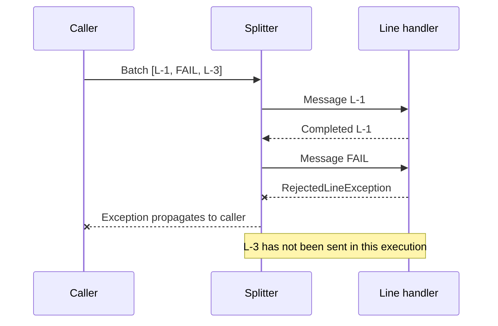

# Splitter Exception

## 1. The Problem to Solve

In an order-ingestion flow, a single message contains a batch of multiple lines. The splitter creates a message for each line, and downstream endpoints check inventory, compute prices, or persist data. When an exception occurs, you must determine: whether the error happened before or after emitting child messages, who receives the error, which lines were already processed, and which unit is safe to retry.

This lesson belongs to the **Splitter** chapter of the **SPRING_INTEGRATION_CORE** module, focusing on coordination among `Message`, `MessageChannel`, endpoints, gateways, and the Java DSL when a message-splitting flow encounters an exception. After this lesson, you will be able to design error paths, choose retry scopes, and explain why a failed batch can still have produced results for some lines.

Examples use **Java 17+, Spring Integration 6.5.x**, and the `splitWith` API. Retry examples additionally use Spring Retry. Versions are chosen so the snippets share one API baseline; this is not a claim about the latest available version. The illustrative configuration uses plain Spring with `@EnableIntegration`; if running inside a Spring Boot project, use the compatible dependency set managed by the project. No compilation or test execution was run on the code snippets in this lesson.

## 2. Identifying Where the Failure Occurs

A splitter does more than call a function that returns a list. Processing can be divided into four points to observe:

| Failure point | Example | Data that may already have proceeded |
| --- | --- | --- |
| Inside the split function, before returning | Malformed batch; missing required field | No child messages emitted from this invocation's return |
| While iterating a lazy result | `Iterator.next()` or a `Stream` `map` step throws on line 2 | Preceding child messages may already have been emitted |
| While sending child messages to output channel | No subscribers; queue send times out | Preceding child messages may already have been accepted |
| Inside a downstream endpoint | Inventory service rejects line 2 | Depending on channels, earlier lines processed and later lines may be queued or unsent |

This assumes the split function only constructs data and does not call external services or send messages itself. If the function both validates and writes external data, an exception before returning can still leave side effects from that function itself.

With a synchronous flow, a single subscriber on each `DirectChannel`, and no recovery configured to swallow errors:



In this scenario, an error in the handler interrupts the child-message emission loop. The splitter does not automatically roll back L-1's results and does not automatically continue from L-3. This follows from iterating and sending each result on the same call stack, as seen in [`AbstractMessageProducingHandler` 6.5.0 source](https://github.com/spring-projects/spring-integration/blob/v6.5.0/spring-integration-core/src/main/java/org/springframework/integration/handler/AbstractMessageProducingHandler.java).

If an `ExecutorChannel` follows the splitter, line L-3 may already have been handed to the executor before the error on FAIL is detected. Therefore, describe failure behavior together with the flow's execution boundaries.

## 3. Who Receives the Exception?

| How the flow is triggered | Where the exception is handled | Meaning of a successful send |
| --- | --- | --- |
| Caller sends into a `DirectChannel` chain | Exception can propagate back to caller | Synchronous endpoints were invoked; side effects still depend on business design |
| Caller sends to `QueueChannel`, a poller pulls messages | Poller handles errors via its error handler mechanism | Queue accepted the message; does not prove business completion |
| Flow crosses an `ExecutorChannel` using an async executor | Task errors are handled in the task execution context | Work was accepted for execution; caller learns nothing about business outcome from `send` return |
| Caller invokes a messaging gateway | Gateway applies its exception contract or configured error flow | Must be interpreted per gateway contract and return type |

Under the standard error-publishing mechanism, an `ErrorMessage` carries the exception in its payload; the request's `errorChannel` header takes precedence over the global `errorChannel`. However, **adding this header to a message sent directly through a `DirectChannel` does not create a catch block automatically**. A component that actively catches and publishes errors—such as a configured poller or gateway—must be present. See [Error Handling](https://docs.spring.io/spring-integration/reference/6.5/error-handling.html).

Asynchronous boundaries depend on the actual executor. For instance, an executor may run tasks directly on the calling thread under certain execution policies; do not draw absolute conclusions solely from channel names.

A gateway can also unwrap `MessagingException` and rethrow the business exception. When declaring an `errorChannel` on a gateway, the error flow must match the call contract: a method expecting a reply must receive a correctly typed result or follow an explicit error policy. An error flow that only logs does not spontaneously produce a business result. See [Messaging Gateways — Error Handling](https://docs.spring.io/spring-integration/reference/6.5/gateway.html#error-handling).

## 4. Java DSL Example: Validating the Whole Batch Before Emitting

The following example splits a `Batch` into `Line` items. The `splitBatch` method fully validates data before returning a `List`. The downstream handler intentionally rejects a line with ID `FAIL` to demonstrate downstream failure.

The primary dependency is `org.springframework.integration:spring-integration-core`. The tests in the next section require JUnit Jupiter and `spring-test` at compatible versions. Queues in the example only hold data in memory for observing outcomes.

```java
package demo;

import java.util.ArrayList;
import java.util.List;
import java.util.Map;

import org.springframework.context.annotation.Bean;
import org.springframework.context.annotation.Configuration;
import org.springframework.integration.channel.DirectChannel;
import org.springframework.integration.channel.QueueChannel;
import org.springframework.integration.config.EnableIntegration;
import org.springframework.integration.dsl.IntegrationFlow;

@Configuration
@EnableIntegration
public class SplitterExceptionExample {

    public record Line(String lineId, int quantity) {}

    public record Batch(String batchId, List<Line> lines) {}

    public static class InvalidBatchException extends RuntimeException {
        public InvalidBatchException(String message) {
            super(message);
        }
    }

    public static class RejectedLineException extends RuntimeException {
        public RejectedLineException(String message) {
            super(message);
        }
    }

    @Bean
    public DirectChannel batchInput() {
        return new DirectChannel();
    }

    @Bean
    public DirectChannel lineInput() {
        return new DirectChannel();
    }

    @Bean
    public QueueChannel processedLines() {
        return new QueueChannel(100);
    }

    @Bean
    public QueueChannel batchErrors() {
        return new QueueChannel(100);
    }

    @Bean
    public IntegrationFlow batchFlow() {
        return IntegrationFlow.from(batchInput())
                .splitWith(s -> s
                        .expectedType(Batch.class)
                        .function((Batch batch) -> splitBatch(batch))
                        .id("batchSplitter"))
                .channel(lineInput())
                .get();
    }

    @Bean
    public IntegrationFlow lineFlow() {
        return IntegrationFlow.from(lineInput())
                .handle(Line.class, this::processLine,
                        e -> e.id("lineProcessor"))
                .channel(processedLines())
                .get();
    }

    public List<Line> splitBatch(Batch batch) {
        if (batch.batchId() == null || batch.batchId().isBlank()) {
            throw new InvalidBatchException("Missing batchId");
        }
        if (batch.lines() == null || batch.lines().isEmpty()) {
            throw new InvalidBatchException("Batch must have at least one line");
        }

        List<Line> snapshot = new ArrayList<>(batch.lines());
        for (int i = 0; i < snapshot.size(); i++) {
            Line line = snapshot.get(i);
            if (line == null || line.lineId() == null
                    || line.lineId().isBlank() || line.quantity() <= 0) {
                throw new InvalidBatchException(
                        "Invalid line at position " + (i + 1));
            }
        }
        return List.copyOf(snapshot);
    }

    public Line processLine(Line line, Map<String, Object> headers) {
        if ("FAIL".equals(line.lineId())) {
            throw new RejectedLineException("Rejected line: " + line.lineId());
        }
        return line;
    }
}
```

Here, `batchFlow` and `lineFlow` separate configuration yet still connect via a `DirectChannel`, so both run on the calling thread. Splitting into two flow beans does not by itself introduce an asynchronous boundary.

`List.copyOf` creates a fixed result after validation; `Line` records have immutable fields in this example. The sender must still stop modifying the input list while the message is being processed. Copying a collection is not a synchronization mechanism for data being mutated by another thread.

Two outcomes to distinguish:

- Batch `[L-1 quantity=1, L-2 quantity=0, L-3 quantity=1]`: `splitBatch` throws before returning, so no lines reach `lineInput`.
- Batch `[L-1 quantity=1, FAIL quantity=1, L-3 quantity=1]`: structural validation succeeds; L-1 reaches `processedLines`, FAIL throws an error, and L-3 is never emitted.

The `expectedType`, `function`, `id`, and endpoint options appear in [SplitterSpec 6.5.0](https://docs.spring.io/spring-integration/docs/6.5.0/api/org/springframework/integration/dsl/SplitterSpec.html).

## 5. Testing the Synchronous Boundary

The following test uses the exact configuration from Section 4. The `batchId` header is a business key added by the example. The `errorChannel` header is deliberately attached to demonstrate that it does not automatically turn synchronous errors into error messages.

```java
package demo;

import java.util.List;

import org.junit.jupiter.api.BeforeEach;
import org.junit.jupiter.api.Test;
import org.springframework.beans.factory.annotation.Autowired;
import org.springframework.beans.factory.annotation.Qualifier;
import org.springframework.integration.channel.QueueChannel;
import org.springframework.messaging.Message;
import org.springframework.messaging.MessageChannel;
import org.springframework.messaging.MessagingException;
import org.springframework.messaging.support.ErrorMessage;
import org.springframework.messaging.support.MessageBuilder;
import org.springframework.test.context.junit.jupiter.SpringJUnitConfig;

import static demo.SplitterExceptionExample.*;
import static org.junit.jupiter.api.Assertions.*;

@SpringJUnitConfig(SplitterExceptionExample.class)
class SplitterExceptionExampleTest {

    @Autowired
    @Qualifier("batchInput")
    MessageChannel input;

    @Autowired
    @Qualifier("processedLines")
    QueueChannel processed;

    @Autowired
    @Qualifier("batchErrors")
    QueueChannel errors;

    @BeforeEach
    void drainQueues() {
        while (processed.receive(0) != null) { }
        while (errors.receive(0) != null) { }
    }

    private static Message<Batch> request(Batch batch) {
        return MessageBuilder.withPayload(batch)
                .setHeader("batchId", batch.batchId())
                .setErrorChannelName("batchErrors")
                .build();
    }

    @Test
    void invalidBatchProducesNoChildMessage() {
        Batch batch = new Batch("B-01", List.of(
                new Line("L-1", 1),
                new Line("L-2", 0),
                new Line("L-3", 1)));

        MessagingException failure = assertThrows(
                MessagingException.class, () -> input.send(request(batch)));

        assertInstanceOf(InvalidBatchException.class,
                failure.getMostSpecificCause());
        assertNull(processed.receive(0));
        assertNull(errors.receive(0));
    }

    @Test
    void downstreamFailureLeavesEarlierResult() {
        Batch batch = new Batch("B-02", List.of(
                new Line("L-1", 1),
                new Line("FAIL", 1),
                new Line("L-3", 1)));

        MessagingException failure = assertThrows(
                MessagingException.class, () -> input.send(request(batch)));

        assertInstanceOf(RejectedLineException.class,
                failure.getMostSpecificCause());
        Message<?> first = processed.receive(0);
        assertNotNull(first);
        assertEquals(new Line("L-1", 1), first.getPayload());
        assertNull(processed.receive(0));
        assertNull(errors.receive(0));
    }
}
```

`processed` holds observable results and does not represent a database transaction. If replacing the handler with real persistence operations, also verify committed data and external system side effects.

The tests assert on the cause type rather than pinning the full wrapper message text. This clarifies the business contract without coupling to framework diagnostic wording.

## 6. Using QueueChannel and a Poller to Receive ErrorMessage

To accept batches on a queue and process them with a poller, add the following import and two beans to `SplitterExceptionExample`:

```java
import org.springframework.integration.dsl.Pollers;
```

```java
@Bean
public QueueChannel queuedBatches() {
    return new QueueChannel(100);
}

@Bean
public IntegrationFlow queuedBatchFlow() {
    return IntegrationFlow.from(queuedBatches())
            .bridge(e -> e.poller(Pollers.fixedDelay(100)
                    .maxMessagesPerPoll(1)
                    .errorChannel("batchErrors")))
            .channel(batchInput())
            .get();
}
```

`bridge` is a polled consumer because its input is a `QueueChannel`. Once the poller pulls a message, `batchInput -> splitter -> lineInput -> lineProcessor` still runs synchronously on the poller's thread. The caller sending into `queuedBatches` is decoupled from that thread.

The `errorChannel` option here belongs to the **poller**, not a global property that automatically catches every splitter failure. See [PollerSpec 6.5.0](https://docs.spring.io/spring-integration/docs/6.5.0/api/org/springframework/integration/dsl/PollerSpec.html).

After adding the two beans, you can add this test to the test class above:

```java
@Test
void queuedFailureIsPublishedAsErrorMessage(
        @Autowired @Qualifier("queuedBatches") QueueChannel queuedBatches) {

    Batch batch = new Batch("B-03", List.of(
            new Line("L-1", 1),
            new Line("FAIL", 1),
            new Line("L-3", 1)));

    assertTrue(queuedBatches.send(request(batch), 1000));

    Message<?> received = errors.receive(3000);
    ErrorMessage error = assertInstanceOf(ErrorMessage.class, received);
    MessagingException failure = assertInstanceOf(
            MessagingException.class, error.getPayload());
    assertInstanceOf(RejectedLineException.class,
            failure.getMostSpecificCause());

    Message<?> first = processed.receive(0);
    assertNotNull(first);
    assertEquals(new Line("L-1", 1), first.getPayload());
    assertNull(processed.receive(0));
}
```

The test waits for the error message using a timed receive, without needing `Thread.sleep`. By the time the error arrives on the error queue, this batch's synchronous run has already processed L-1 and stopped at FAIL.

The configuration above has no transaction or request re-queuing mechanism. An in-memory `QueueChannel` does not automatically put a consumed batch back into the queue after an error. Reprocessing requires an explicit replay path, or a redelivery-capable source with corresponding configuration. The illustrative error queue also needs a consumer in a long-running application.

## 7. Reading Error Context Without Confusing Parent and Child Messages

A log message saying "splitter failed" is not enough to conclude which data was bad. The payload of an `ErrorMessage` is a `Throwable`. If the cause chain contains a `MessagingException`, use `getFailedMessage()` to retrieve the message associated with the failure; this value may be absent. See [MessagingException Javadoc](https://docs.spring.io/spring-framework/docs/6.2.x/javadoc-api/org/springframework/messaging/MessagingException.html).

The standalone helper below picks the failed message from the deepest cause, falling back to `originalMessage`:

```java
import org.springframework.messaging.Message;
import org.springframework.messaging.MessagingException;
import org.springframework.messaging.support.ErrorMessage;

public final class FailureContext {

    private FailureContext() { }

    public static Message<?> findFailedMessage(ErrorMessage error) {
        Message<?> failed = null;
        for (Throwable current = error.getPayload();
                current != null; current = current.getCause()) {
            if (current instanceof MessagingException messaging
                    && messaging.getFailedMessage() != null) {
                failed = messaging.getFailedMessage();
            }
        }
        return failed != null ? failed : error.getOriginalMessage();
    }
}
```

Interpret the result according to the failure location:

| Scenario | Context to look for | Meaning for replay |
| --- | --- | --- |
| `splitBatch` rejects batch | Message containing `Batch` | Fix input or decide to resend the entire batch |
| `lineProcessor` rejects line | Message containing `Line`, plus related headers | Can recover the individual line if the business contract allows |
| Iterator fails before building next line's message | Only batch context may remain | Need a checkpoint or position info recorded by the application |
| Delivery infrastructure error | Message attached to the delivery point | Determine whether accepted, executed, or unknown outcome |

Do not blindly cast every `failedMessage.getPayload()` to `Line`. Nor is `originalMessage` guaranteed to be a child message: its meaning depends on the component creating the error message and the error-wrapping strategy.

When recording recovery logs, capture `batchId`, `lineId` if present, failing endpoint, cause type, and attempt number. Technical headers such as `correlationId`, `sequenceNumber`, and `sequenceSize` aid tracing, while business keys must be kept separately to identify a line across multiple resends.

## 8. Empty Results, Nulls, and Lazy Failures

### 8.1. Do Not Use Empty Results to Hide Exceptions

In the standard splitter model, an empty collection creates no child messages; a `discardChannel` can be configured to receive requests with zero elements. A `null` result signals flow termination. This is a result contract, not an automatic exception-catching mechanism. See [Splitter](https://docs.spring.io/spring-integration/reference/6.5/splitter.html).

The following example drops business error signals:

```java
try {
    return splitBatch(batch);
}
catch (InvalidBatchException ex) {
    return List.of(); // Caller no longer receives this exception.
}
```

If the contract specifies that batches must not be empty, validate and throw an explicit exception as in Section 4. If empty batches are valid, decide whether the caller needs a "no data" result or the request goes to a discard flow.

With a synchronous handler and `requiresReply(true)`, producing no reply can trigger `ReplyRequiredException`; this option does not replace business validation. In the 6.5.0 implementation, reply checking happens after the advised handler invocation. See [`AbstractReplyProducingMessageHandler` source](https://github.com/spring-projects/spring-integration/blob/v6.5.0/spring-integration-core/src/main/java/org/springframework/integration/handler/AbstractReplyProducingMessageHandler.java).

### 8.2. Returning a Stream Delays Validation Checks

The DSL snippet below illustrates a lazy split; it replaces the corresponding splitter configuration rather than adding a second splitter to the flow:

```java
.splitWith(s -> s.expectedType(Batch.class)
        .function((Batch batch) -> batch.lines().stream().map(line -> {
            if (line.quantity() <= 0) {
                throw new InvalidBatchException(
                        "Invalid quantity: " + line.lineId());
            }
            return line;
        })))
```

The outer lambda returns a `Stream` before the checks inside `map` have run across all elements. Suppose L-1 is valid and L-2 has quantity 0: the error can occur while the framework is fetching L-2, after L-1 has already been sent. A `try/catch` wrapping only stream creation will not catch exceptions thrown during later iteration.

To ensure structural errors are caught before emitting any line, the example chooses to validate everything upfront and return a list. For datasets too large to hold in memory, consider checkpoints, chunking, and recovery policies for already-processed portions. Iterator creation and initial element checks can be inspected in [`AbstractMessageSplitter` 6.5.0 source](https://github.com/spring-projects/spring-integration/blob/v6.5.0/spring-integration-core/src/main/java/org/springframework/integration/splitter/AbstractMessageSplitter.java).

## 9. Placing Retries on the Right Unit of Work

Before adding retries, classify failure causes and choose a scope that is safe to repeat:

| Cause | Appropriate policy in the example | Unit of recovery |
| --- | --- | --- |
| Missing line ID; zero quantity | Reject and log reason for data correction | Batch or input data |
| External service temporarily unavailable | Bounded retry with backoff | Single-line processing call |
| Line rejected by business rules | Convert to failure result or route to separate handling path | Rejected line |
| Timeout after side-effecting operation | Query by business key before deciding to retry | Operation with uncertain outcome |

### 9.1. Advice on the Splitter Does Not Cover Every Batch Failure

`RequestHandlerRetryAdvice` placed on a splitter wraps the endpoint's own request-handling work. Forwarding child results onward happens outside that call. Therefore, do not expect this advice to retry downstream handler failures or an entire lazy traversal. Failures during initial element checks can occur earlier; verify which point actually throws the exception.

Conversely, wrapping the entire batch send or synchronous call stack in retry can re-run L-1 when FAIL throws. If L-1 already decremented inventory, a rerun can decrement it a second time. Endpoint advice boundaries are described at [Adding Behavior to Endpoints](https://docs.spring.io/spring-integration/reference/6.5/handler-advice.html).

This is also why request-handler advice must be distinguished from advice wrapping `handleMessage`. A broader scope must be evaluated alongside side effects of every endpoint it invokes synchronously.

### 9.2. Illustrating Retry on lineProcessor

If a real deployment encounters a specific transient error, add the following exception class, imports, and bean to the configuration. The example uses `org.springframework.retry:spring-retry`; the business error `RejectedLineException` from Section 4 remains excluded from retries.

```java
import org.springframework.integration.handler.advice.RequestHandlerRetryAdvice;
import org.springframework.retry.backoff.FixedBackOffPolicy;
import org.springframework.retry.policy.SimpleRetryPolicy;
import org.springframework.retry.support.RetryTemplate;
```

```java
public static class TransientLineException extends RuntimeException {
    public TransientLineException(String message) {
        super(message);
    }
}

@Bean
public RequestHandlerRetryAdvice lineRetryAdvice() {
    SimpleRetryPolicy retryPolicy = new SimpleRetryPolicy(
            3, Map.of(TransientLineException.class, true), true);

    FixedBackOffPolicy backOff = new FixedBackOffPolicy();
    backOff.setBackOffPeriod(200);

    RetryTemplate template = new RetryTemplate();
    template.setRetryPolicy(retryPolicy);
    template.setBackOffPolicy(backOff);

    RequestHandlerRetryAdvice advice = new RequestHandlerRetryAdvice();
    advice.setRetryTemplate(template);
    return advice;
}
```

Replace the handler declaration in `lineFlow` with:

```java
.handle(Line.class, this::processLine,
        e -> e.id("lineProcessor").advice(lineRetryAdvice()))
```

`maxAttempts = 3` includes the initial attempt. The final argument to `SimpleRetryPolicy` enables traversing the cause chain, which is useful when business errors are wrapped inside messaging exceptions. Without a recovery callback, once retries are exhausted the exception continues along the configured synchronous or poller boundary. Backoff in the example blocks the thread while waiting, so account for thread occupation as traffic grows. See [Provided Advice Classes — Retry Advice](https://docs.spring.io/spring-integration/reference/6.5/handler-advice/classes.html#retry-advice).

In this extension, `processLine` must throw `TransientLineException` when encountering an actual transient failure from an external service; the initial simulation throws only `RejectedLineException` so rejection behavior remains deterministic.

### 9.3. Deduplicating on Rerun

One idempotency key design is `(batchId, lineId, operation)`. The handler records processing state and checks the key before repeating side effects. If multiple workers can process the same key, recording the key requires appropriate concurrency control, such as a unique constraint inside a transaction for internal operations.

Do not use an in-memory `Set` variable as an idempotency guarantee in a multi-instance system. For external services, prefer an idempotency key or status-lookup API if the service provides one. When a timeout leaves uncertain whether an operation completed, blindly retrying because "no response was received" can create duplicate outcomes.

If resending the entire batch in a new message, technical metadata of the split run can change. Business keys let you recognize L-1 of the same job even across separate submissions.

## 10. When Remaining Lines Must Continue and Results Must Be Aggregated

Some business domains accept processing every line and reporting per-line success or failure. In that case, known business errors can be converted into a result payload at the line-processing endpoint. This is an intentional contract change: rejection errors are now represented as data.

Add the following record to the configuration and replace the corresponding handler in `lineFlow` with the illustrative snippet:

```java
public record LineResult(String lineId, boolean success, String reason) {}
```

```java
.handle(Line.class, (line, headers) -> {
    try {
        processLine(line, headers);
        return new LineResult(line.lineId(), true, null);
    }
    catch (RejectedLineException ex) {
        return new LineResult(line.lineId(), false, ex.getMessage());
    }
})
```

With batch `[L-1, FAIL, L-3]`, this variant produces three `LineResult` objects. The `processedLines` queue now holds per-line results instead of `Line` objects, so assertions from the earlier variant must update to match the new contract. Other exceptions still propagate outward; do not use `catch (Exception)` and report success or swallow unexpected faults.

If an aggregator follows this step, having one final result per line makes batch completion cleaner to define. Preserve sequence headers when transformers or handlers replace payloads. By default, the aggregator correlates by `correlationId` and checks sequence completeness to release; a missing result can prevent the group from completing. See [Aggregator](https://docs.spring.io/spring-integration/reference/6.5/aggregator.html).

Three choices typically need to be settled at the business level:

- **Wait for a final result for every line:** rejected lines still contribute a failed `LineResult`; the batch report reflects all lines.
- **Accept partial results:** set a deadline and format for reporting missing items; distinguish partial results from full completion.
- **Mark the entire batch failed:** record the status and a plan to compensate already-completed operations.

If an iterator or stream cannot determine total element count, `sequenceSize` is typically `0`. You then cannot rely solely on counting sequence entries up to total lines; define an appropriate termination condition or release strategy. An `ErrorMessage` routed to an error flow does not automatically become a result for an aggregator group.

Merely enabling a timeout on a gateway does not stop workers, roll back already-processed results, or define a terminal state for groups. Those decisions belong in the batch-processing contract.

## 11. Transactions and Operational Observability

A splitter does not create a transaction spanning the entire batch. If multiple database operations must roll back together, determine where the transaction starts, which operations share the same transaction manager, and whether exceptions propagate across that boundary or are converted into data by recovery.

In a synchronous flow, a properly configured transaction can span multiple endpoints sharing the same transactional resource. When handing off to asynchronous workers, a transaction bound to the calling thread does not automatically become the worker's transaction. HTTP calls that already produced side effects also need idempotency or compensation rather than assuming database rollback covers them.

In operations, track both batch status and per-line status:

| Information | Purpose |
| --- | --- |
| `batchId`, `lineId`, operation code | Identify work items and prevent duplicates |
| Endpoint and cause category | Distinguish validation, business logic, external service, or delivery errors |
| Expected, completed, rejected, and unknown line counts | Detect partially completed batches |
| Attempt count and last attempt timestamp | Prevent unbounded replay and aid investigation |
| Error publishing and recovery-record status | Separate original business errors from errors in the error-handling path itself |

An error flow needs a well-defined terminal destination: replying to the caller, persisting a recovery record, routing for manual handling, or triggering a specific retry policy. Avoid wiring an error flow directly back to batch input without a stopping condition, as malformed batches could loop indefinitely.

Test scenarios to cover before running a flow on real data:

| Scenario | What to verify |
| --- | --- |
| Invalid batch data before split function returns | No child messages emitted from that invocation |
| Second handler fails in synchronous flow | First line's result persists; third line is not emitted |
| Poller processes failing batch | Caller sends successfully; error flow receives proper context |
| Error during lazy traversal | Identify already-emitted items and recovery position |
| Transient error needing retry | Call count matches limit; already-completed unrelated lines are not retried |
| Replay after ambiguous timeout | Side effects do not duplicate thanks to business keys |
| Aggregator receives missing or late results | Group state, timeout, and partial report follow contract |

The key design principle is defining the **unit of failure**, **unit of retry**, and **completion condition**. These three units can differ: the batch is the input, a single line is the retry unit, and the final report is produced only once every line has a result or a partial policy permits finishing.