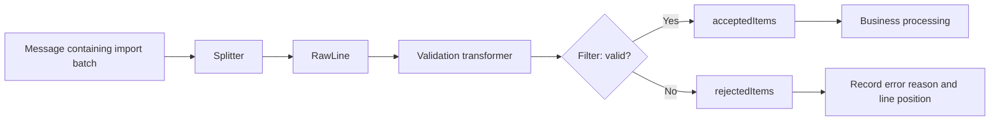
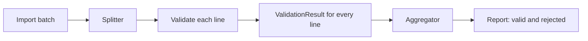

# Handling Invalid Elements

In the **Splitter** chapter of the **SPRING_INTEGRATION_CORE** module, this lesson addresses the scenario where a single message contains multiple elements, yet only some satisfy business rules. The goal is to design a flow using `Message`, `MessageChannel`, transformers, filters, routers, and the Java DSL so that invalid elements produce clear outcomes, valid elements proceed according to the chosen policy, and downstream aggregation never hangs waiting on missing messages.

The running example ingests a batch of order lines formatted as `sku,quantity`. This is a simple two-field format for illustration; if production data is CSV containing embedded commas or quotes, use a proper CSV parsing library instead of `String.split()`.

## 1. Defining What Counts as Invalid

An import batch might contain data like this:

| Original position | Content | Verdict under the example contract |
| --- | --- | --- |
| 1 | `BOOK-01,2` | Valid |
| 2 | `BOOK-02,-1` | Quantity must be greater than 0 |
| 3 | `BOOK-03,abc` | Quantity cannot be parsed as an `int` |
| 4 | `BOOK-04,1` | Valid |

Separate three categories of problems because they lead to different handling:

| Problem category | Example | Handling direction |
| --- | --- | --- |
| Whole-batch structural error | Missing batch ID, `null` input list, unauthenticated sender | Reject the batch at the ingestion boundary |
| Single-element data error | Empty line, missing SKU, negative quantity | Record line error; continue or stop per business contract |
| Technical processing error | Database connection lost, target service timed out | Route to error handling and bounded retry when appropriate |

A negative quantity will not magically become valid after three retries. Conversely, labeling a connection drop as "invalid data" masks an infrastructure incident that needs fixing.

In this lesson, line validity means only **qualifying to proceed under the active rules**. It does not yet mean inventory was checked, database records were written, or a transaction completed.

## 2. Choosing a Policy Before Writing the Flow

Three common policies exist:

| Policy | When an invalid element is encountered | Suitable for |
| --- | --- | --- |
| Fail fast | Report error and halt the active processing path | Requests that must not proceed once bad data is found |
| Partial acceptance | Route invalid element to a separate branch; valid elements proceed | Catalog imports or independent per-line ingestion |
| Collect all results | Every element yields a success or rejected result; then aggregate | Reporting full per-line status across a batch |

"Fail fast" and "all-or-nothing" are two different guarantees. Stopping on line 2 does not automatically undo side effects already applied for line 1. If business requirements demand the entire batch succeed or fail atomically, design whole-batch validation and matching transaction boundaries before executing business side effects.

This lesson's main example uses **partial acceptance**. A later section presents the **collect all results** variant, suited for pairing a splitter with an aggregator or returning one report via a gateway.

## 3. Placing Validation After the Splitter



The splitter defines the processing unit as a single line. The transformer turns a raw line into a validation result. The filter only decides whether the result continues down the main branch. As a result, parsing, validation rules, and channel-routing policy each have separate responsibilities.

Validation output should retain the original data, position, and error reason. Returning only `true` or `false` forces the error branch to re-inspect the input to learn why it failed.

### 3.1. Distinguishing the Two Kinds of Discard Channels

A **filter**'s `discardChannel` receives messages that fail the selector condition. A **splitter**'s `discardChannel` applies when the split result is an empty container so no child elements exist to emit; the message sent there is the input request. These two configuration points serve two different situations. See [Filter](https://docs.spring.io/spring-integration/reference/filter.html) and [Splitter](https://docs.spring.io/spring-integration/reference/splitter.html).

You cannot just set `discardChannel` on the splitter and expect lines with invalid quantities to end up there. Handling invalid lines requires a line-validation endpoint.

### 3.2. Keeping `null` Elements Inside a Wrapper Object

A source line may be `null`, yet you cannot use `null` as a message payload. The example constructs a `RawLine` that is always non-null, while its inner `raw` property is permitted to be `null`. That lets missing-data lines be recorded at their exact position. Payload constraints are documented at [GenericMessage](https://docs.spring.io/spring-framework/docs/current/javadoc-api/org/springframework/messaging/support/GenericMessage.html).

Also note that `List.of(...)` and `List.copyOf(...)` cannot construct test lists containing `null` elements. In the model below, the input list copy is built using an `ArrayList` wrapped as unmodifiable so missing-data elements can still be preserved for validation.

## 4. Java DSL Example: Routing Invalid Elements to a Separate Channel

The example uses Java 17 syntax and `IntegrationFlow.from(...)`, applicable to Spring Integration 6.x on Java 17. When using another framework version, choose a JDK matching that version's requirements. Required dependencies are `spring-integration-core`, Spring Context, and JUnit Jupiter for tests; dependency versions should come from your project's BOM.

This is a complete configuration for the demonstration flow. The two output `QueueChannel` beans make it easy to observe and test results via `receive()`. They do not yet have business consumers or durable persistence.

```java
package example.integration;

import java.util.ArrayList;
import java.util.Collections;
import java.util.List;
import java.util.Objects;
import java.util.stream.IntStream;

import org.springframework.context.annotation.Bean;
import org.springframework.context.annotation.Configuration;
import org.springframework.integration.channel.DirectChannel;
import org.springframework.integration.channel.QueueChannel;
import org.springframework.integration.config.EnableIntegration;
import org.springframework.integration.dsl.IntegrationFlow;
import org.springframework.messaging.MessageChannel;

@Configuration
@EnableIntegration
public class InvalidItemFlowConfiguration {

    public record ImportBatch(String batchId, List<String> lines) {
        public ImportBatch {
            if (batchId == null || batchId.isBlank()) {
                throw new IllegalArgumentException("batchId is required");
            }
            Objects.requireNonNull(lines, "lines is required");
            // Preserve null elements so the validator records the line error.
            lines = Collections.unmodifiableList(new ArrayList<>(lines));
        }

        public List<RawLine> items() {
            return IntStream.range(0, lines.size())
                    .mapToObj(index -> new RawLine(
                            batchId, index + 1, lines.get(index)))
                    .toList();
        }
    }

    public record RawLine(String batchId, int lineNumber, String raw) {
    }

    public record OrderLine(String sku, int quantity) {
    }

    public record ValidationResult(
            RawLine source,
            OrderLine value,
            List<String> errors) {

        public ValidationResult {
            Objects.requireNonNull(source, "source is required");
            errors = List.copyOf(errors);
            if (errors.isEmpty() != (value != null)) {
                throw new IllegalArgumentException(
                        "Valid result requires a value and no errors");
            }
        }

        public boolean valid() {
            return errors.isEmpty();
        }

        public static ValidationResult accepted(
                RawLine source, OrderLine value) {
            return new ValidationResult(source, value, List.of());
        }

        public static ValidationResult rejected(
                RawLine source, String reason) {
            return new ValidationResult(source, null, List.of(reason));
        }
    }

    public static class LineValidator {
        public ValidationResult validate(RawLine line) {
            String raw = line.raw();
            if (raw == null || raw.isBlank()) {
                return ValidationResult.rejected(line, "EMPTY_LINE");
            }

            String[] fields = raw.split(",", -1);
            if (fields.length != 2) {
                return ValidationResult.rejected(line, "FIELD_COUNT");
            }

            String sku = fields[0].trim();
            if (sku.isBlank()) {
                return ValidationResult.rejected(line, "SKU_REQUIRED");
            }

            final int quantity;
            try {
                quantity = Integer.parseInt(fields[1].trim());
            }
            catch (NumberFormatException exception) {
                return ValidationResult.rejected(
                        line, "QUANTITY_INTEGER_REQUIRED");
            }

            if (quantity <= 0) {
                return ValidationResult.rejected(
                        line, "QUANTITY_MUST_BE_POSITIVE");
            }

            return ValidationResult.accepted(
                    line, new OrderLine(sku, quantity));
        }
    }

    @Bean
    public LineValidator lineValidator() {
        return new LineValidator();
    }

    @Bean
    public MessageChannel batchInput() {
        return new DirectChannel();
    }

    @Bean
    public QueueChannel acceptedItems() {
        return new QueueChannel();
    }

    @Bean
    public QueueChannel rejectedItems() {
        return new QueueChannel();
    }

    @Bean
    public IntegrationFlow importFlow(LineValidator validator) {
        return IntegrationFlow.from("batchInput")
                .split(ImportBatch.class, ImportBatch::items)
                .transform(RawLine.class, validator::validate)
                .filter(ValidationResult.class, ValidationResult::valid,
                        endpoint -> endpoint
                                .discardChannel("rejectedItems")
                                .throwExceptionOnRejection(false))
                .channel("acceptedItems")
                .get();
    }
}
```

### 4.1. Tracing a Single Submission

When receiving batch `B-100` with the four lines from the start of the lesson:

1. `ImportBatch.items()` builds four `RawLine` instances, keeping `batchId` and original line numbers 1 through 4.
2. The splitter emits each object as a child message.
3. `LineValidator` produces one `ValidationResult` per line.
4. The filter sends valid results to `acceptedItems`.
5. Invalid results are routed to `rejectedItems` without proceeding down the main branch.

Expected output:

```text
acceptedItems:
  B-100 / line 1 / OrderLine[sku=BOOK-01, quantity=2]
  B-100 / line 4 / OrderLine[sku=BOOK-04, quantity=1]

rejectedItems:
  B-100 / line 2 / QUANTITY_MUST_BE_POSITIVE
  B-100 / line 3 / QUANTITY_INTEGER_REQUIRED
```

The payload on **both channels** remains `ValidationResult`, not `OrderLine` and not `ErrorMessage`. Business consumers extract `value()` only after confirming the result is valid. The rejected branch uses `source()` and `errors()` to build reports.

The example records only the first error per line. If a UI requires listing multiple errors at once, the validator can accumulate multiple error codes before creating `ValidationResult`, while still ensuring `value()` is never accessed when invalid.

### 4.2. Why Not Return `null` When Validation Fails?

The validator's contract is:

```text
One RawLine input -> one ValidationResult output
```

Returning `null` obscures the line's outcome: downstream steps no longer have an object to store the reason, count rejected lines, or compile a report. An explicit status result lets callers distinguish "line was validated and rejected" from "line has no result yet."

`NumberFormatException` is converted into an error code because it represents an anticipated possibility for text input. The validator does not catch all `Exception`s; programming bugs or unexpected infrastructure failures must enter technical error handling.

### 4.3. Choosing Filter vs. Router

A filter fits when there is one acceptance condition and one discarded branch. When the contract expands to multiple outcomes such as `ACCEPTED`, `REJECTED`, and `MANUAL_REVIEW`, use a status-based router so each channel clearly expresses the work to perform.

Avoid stuffing decisions into repeated parsing expressions inside routers or filters. Validate once, produce a strongly typed result, and route based on that result.

## 5. Understanding `throwExceptionOnRejection`

For a filter, two properties must be decided together:

| `discardChannel` | `throwExceptionOnRejection` | Behavior when selector returns `false` |
| --- | --- | --- |
| Not configured | `false` | Does not forward on main branch |
| Configured | `false` | Sends to discard channel, then ends main branch |
| Not configured | `true` | Throws `MessageRejectedException` |
| Configured | `true` | Sends to discard, then still throws exception if the send completes |

Setting both a discard channel and the throw-exception flag does not create a fallback mechanism. Both actions are executed. See [FilterEndpointSpec](https://docs.spring.io/spring-integration/api/org/springframework/integration/dsl/FilterEndpointSpec.html).

A fail-fast variant replaces the filter configuration in the example with:

```java
.filter(ValidationResult.class, ValidationResult::valid,
        endpoint -> endpoint.throwExceptionOnRejection(true))
```

In the example's sequential path, an unhandled exception on line 2 unwinds back to the send call and aborts further emission; line 4 may never be sent. Line 1 has already been placed into `acceptedItems`. Hence, this flag does not provide batch-wide atomicity.

If the discard branch itself fails—for example, a consumer on a `DirectChannel` throws while saving the rejected record—the flow can still abort even with `throwExceptionOnRejection(false)`. Setting `false` only tells the filter not to throw **due to the rejection condition**; it does not swallow exceptions raised while delivering or handling the message.

When retries wrap a section that both writes to discard and throws an exception, a retry attempt may record the same line again. Scope retries around the operation that actually needs retrying and design idempotency keys for result records.

## 6. Distinguishing the Invalid-Data Branch from `errorChannel`

```text
Invalid data per business rules:
  Message<ValidationResult> -> rejectedItems

Technical exception published by error handling:
  ErrorMessage with Throwable payload -> error channel
```

When sending directly into a `DirectChannel`, handlers run on the caller's thread and exceptions typically propagate back to the caller. You cannot simply set an `errorChannel` header and assume every synchronous exception will automatically be sent there. Gateways or advice may have their own error-handling configuration. See [Error Handling](https://docs.spring.io/spring-integration/reference/error-handling.html).

With asynchronous processing via an executor or poller, the caller cannot catch consumer-time failures merely by wrapping `send()` in `try/catch`. Configure the executing component's error-publishing mechanism; standard mechanisms can use the `errorChannel` header or the global channel of the same name when no matching header exists. Whenever swapping executors or error handlers, check that configuration's actual policy.

A message successfully enqueued confirms acceptance only at that boundary. It does not guarantee the line passed business processing. In the example, a successful `send()` and results in `acceptedItems` prove only that lines passed validation and routing.

## 7. Impact on Sequences and Aggregators

When splitting a finite list with sequencing enabled, the splitter provides headers for grouping and positioning. In the four-line example:

| Header | Meaning |
| --- | --- |
| `correlationId` | Identifies child messages belonging to the same split |
| `sequenceNumber` | Position in the sequence generated by that split |
| `sequenceSize` | Total elements in the sequence, here 4 |

These headers are for message coordination; they do not replace domain batch IDs and line numbers. A source might skip a header row or combine multiple files, causing business line numbers to differ from sequence positions. See [AbstractMessageSplitter](https://docs.spring.io/spring-integration/api/org/springframework/integration/splitter/AbstractMessageSplitter.html).

### 7.1. Design Flaw: Filtering Items Then Aggregating with Defaults

```text
Splitter: 4 elements
    -> Filter: keeps lines 1 and 4
    -> Aggregator: receives 2 messages, sequenceSize is still 4
```

The filter does not recalculate sequence length for remaining elements. With a release strategy based on sequence size, the aggregator never satisfies group completion in this case. See [SimpleSequenceSizeReleaseStrategy](https://docs.spring.io/spring-integration/api/org/springframework/integration/aggregator/SimpleSequenceSizeReleaseStrategy.html).

Do not mutate `sequenceSize` on individual messages to a constant or to the count of messages seen so far. In a parallel flow, the current count does not indicate the final count. Arbitrary header mutation also easily breaks nested splitter–aggregator flows.

### 7.2. First Approach: Keep One Result per Element

If the goal is reporting the whole batch, keep both valid and invalid results on the path to the aggregator:



In the example configuration, **replace** the `importFlow` bean with the following bean and add the two output channel beans. Do not register both variants consuming `batchInput` simultaneously: a `DirectChannel` with multiple subscribers does not duplicate batches across variants.

```java
@Bean
public QueueChannel batchResults() {
    return new QueueChannel();
}

@Bean
public QueueChannel incompleteBatches() {
    return new QueueChannel();
}

@Bean
public IntegrationFlow importFlow(LineValidator validator) {
    return IntegrationFlow.from("batchInput")
            .split(ImportBatch.class, ImportBatch::items)
            .transform(RawLine.class, validator::validate)
            // Do not filter out ValidationResult before aggregating.
            .aggregate(aggregator -> aggregator
                    .groupTimeout(10_000L)
                    .sendPartialResultOnExpiry(false)
                    .discardChannel("incompleteBatches"))
            .channel("batchResults")
            .get();
}
```

With a four-line input and no technical errors, all four `ValidationResult` instances reach the aggregator. The aggregated result contains two valid items and two rejected items. In this variant, `acceptedItems` and `rejectedItems` from the old configuration are no longer used.

`groupTimeout(10_000L)` is an idle timeout without new messages for an incomplete group, not an absolute ten-second deadline from when the caller sent the batch. Under the policy above, incomplete groups are not published as full reports; existing messages go to the discard branch when the group expires. Consumers must synthesize an `INCOMPLETE` status if the reporting contract requires one. See [Aggregator](https://docs.spring.io/spring-integration/reference/aggregator.html).

If steps after validation perform writes or external calls, convert each line's actual processing outcome into a corresponding result object before aggregating. `ValidationResult` in this lesson models only the validation step.

### 7.3. Second Approach: Validate Everything Before Splitting Accepted Items

Another option is producing an object with two lists upfront: a valid list and a rejected list. Persist the error report, then feed only the valid list into a new split. When the splitter splits the selected list, the sequence length matches that list.

This works well for small batches already held entirely in memory when the contract only needs to aggregate accepted items. In return, preserve mappings back to original line numbers and handle the case where zero valid lines remain.

Do not apply this mechanically to huge or unknown-length streams. When a splitter cannot determine the size of an iterator or stream, `sequenceSize` may be `0`. In that case, supply another completion criterion, such as an end-of-stream marker message or a source-contract release strategy. See [Splitter](https://docs.spring.io/spring-integration/reference/splitter.html).

## 8. Empty Batches, All-Rejected Batches, and Gateway Calls

These three cases should be defined explicitly:

| Case | Example filter flow | Collect-all-results flow |
| --- | --- | --- |
| Batch with valid and invalid lines | Routed to two channels | One result group containing both types |
| Batch with lines, all invalid | All go to `rejectedItems` | Still has a result for every line and can complete the group |
| Empty line list | Zero child messages | No result group created from lines |

For empty batches, choose an explicit behavior: return an empty report, reject the batch with code `EMPTY_BATCH`, or route the input request to a dedicated handling branch. You can check at the input before the splitter; if using the splitter's discard channel, that consumer receives the entire batch rather than `RawLine`.

If the external API is a gateway requiring one reply per batch, the two queues `acceptedItems` and `rejectedItems` do not satisfy that contract. The filter branch can end without producing a reply, and an empty batch creates no aggregator group. Construct a unified reply output for all committed outcomes and configure appropriate timeouts. See [Messaging Gateways](https://docs.spring.io/spring-integration/reference/gateway.html).

Do not treat the arrival of one valid line as a "batch done" signal. That is only one element's outcome, not confirmation that every element has reached a conclusion.

## 9. Testing the Splitter–Filter Boundary Properly

The test snippet below targets **the filter configuration in Section 4**, using JUnit Jupiter. It verifies result counts, rejection reasons, original positions, sequence headers, and that valid lines following invalid lines are still emitted.

```java
package example.integration;

import java.util.Arrays;
import java.util.List;

import org.junit.jupiter.api.Test;
import org.springframework.context.annotation.AnnotationConfigApplicationContext;
import org.springframework.integration.IntegrationMessageHeaderAccessor;
import org.springframework.integration.channel.QueueChannel;
import org.springframework.messaging.Message;
import org.springframework.messaging.MessageChannel;
import org.springframework.messaging.support.MessageBuilder;

import example.integration.InvalidItemFlowConfiguration.ImportBatch;
import example.integration.InvalidItemFlowConfiguration.ValidationResult;

import static org.junit.jupiter.api.Assertions.*;

class InvalidItemFlowTest {

    @Test
    void routesInvalidItemsAndContinuesWithLaterValidItems() {
        try (var context = new AnnotationConfigApplicationContext(
                InvalidItemFlowConfiguration.class)) {
            MessageChannel input = context.getBean(
                    "batchInput", MessageChannel.class);
            QueueChannel accepted = context.getBean(
                    "acceptedItems", QueueChannel.class);
            QueueChannel rejected = context.getBean(
                    "rejectedItems", QueueChannel.class);

            var batch = new ImportBatch("B-100", List.of(
                    "BOOK-01,2", "BOOK-02,-1",
                    "BOOK-03,abc", "BOOK-04,1"));
            assertTrue(input.send(MessageBuilder.withPayload(batch).build()));

            Message<?> first = accepted.receive(1_000);
            Message<?> fourth = accepted.receive(1_000);
            Message<?> second = rejected.receive(1_000);
            Message<?> third = rejected.receive(1_000);
            assertNotNull(first);
            assertNotNull(fourth);
            assertNotNull(second);
            assertNotNull(third);

            var firstResult = (ValidationResult) first.getPayload();
            var fourthResult = (ValidationResult) fourth.getPayload();
            var secondResult = (ValidationResult) second.getPayload();
            var thirdResult = (ValidationResult) third.getPayload();

            assertTrue(firstResult.valid());
            assertEquals(1, firstResult.source().lineNumber());
            assertEquals("BOOK-01", firstResult.value().sku());
            assertEquals(4, fourthResult.source().lineNumber());
            assertTrue(fourthResult.valid());
            assertEquals("BOOK-04", fourthResult.value().sku());

            assertFalse(secondResult.valid());
            assertEquals(2, secondResult.source().lineNumber());
            assertEquals(List.of("QUANTITY_MUST_BE_POSITIVE"),
                    secondResult.errors());
            assertEquals(List.of("QUANTITY_INTEGER_REQUIRED"),
                    thirdResult.errors());
            assertEquals("B-100", thirdResult.source().batchId());

            Object correlationId = first.getHeaders().get(
                    IntegrationMessageHeaderAccessor.CORRELATION_ID);
            assertNotNull(correlationId);
            for (Message<?> message : List.of(first, second, third, fourth)) {
                assertEquals(correlationId, message.getHeaders().get(
                        IntegrationMessageHeaderAccessor.CORRELATION_ID));
                assertEquals(Integer.valueOf(4), message.getHeaders().get(
                        IntegrationMessageHeaderAccessor.SEQUENCE_SIZE,
                        Integer.class));
            }
            assertEquals(Integer.valueOf(4), fourth.getHeaders().get(
                    IntegrationMessageHeaderAccessor.SEQUENCE_NUMBER,
                    Integer.class));

            assertNull(accepted.receive(0));
            assertNull(rejected.receive(0));
        }
    }

    @Test
    void preservesThePositionOfANullSourceLine() {
        try (var context = new AnnotationConfigApplicationContext(
                InvalidItemFlowConfiguration.class)) {
            MessageChannel input = context.getBean(
                    "batchInput", MessageChannel.class);
            QueueChannel accepted = context.getBean(
                    "acceptedItems", QueueChannel.class);
            QueueChannel rejected = context.getBean(
                    "rejectedItems", QueueChannel.class);

            var batch = new ImportBatch("B-NULL",
                    Arrays.asList(null, "BOOK-01,1"));
            assertTrue(input.send(MessageBuilder.withPayload(batch).build()));

            Message<?> rejectedMessage = rejected.receive(1_000);
            assertNotNull(rejectedMessage);
            var result = (ValidationResult) rejectedMessage.getPayload();
            assertEquals(1, result.source().lineNumber());
            assertNull(result.source().raw());
            assertEquals(List.of("EMPTY_LINE"), result.errors());

            Message<?> acceptedMessage = accepted.receive(1_000);
            assertNotNull(acceptedMessage);
            assertEquals(2, ((ValidationResult) acceptedMessage.getPayload())
                    .source().lineNumber());
            assertNull(accepted.receive(0));
            assertNull(rejected.receive(0));
        }
    }
}
```

Receive order within each queue in this test relies on the demonstration configuration's sequential path. When introducing an executor for parallel processing, assert by `batchId` and `lineNumber` rather than assuming results arrive in input order.

Cases to add as the application grows:

| Test case | What to verify |
| --- | --- |
| All lines valid | Zero rejected results |
| All lines invalid | Every line has a reason; zero accepted results |
| Numeric string overflows `int` | Receives `QUANTITY_INTEGER_REQUIRED` without aborting batch |
| Line missing comma or extra fields | Receives `FIELD_COUNT` |
| Blank SKU | Receives `SKU_REQUIRED` |
| Empty batch | Matches chosen `EMPTY_BATCH` or empty-report contract |
| Persisting rejected result fails | Technical error is observed and recovered per policy |
| Aggregator variant receives all results | Result count equals source line count; rejected lines not missing |
| Aggregator variant misses one result | Triggers incomplete-group policy |
| Resending a batch | No duplicate business side effects when deduplication is promised |

These are test snippets and test plans for project integration; presenting them in this lesson does not mean they have been compiled or executed in a specific application environment.

## 10. Tracing and Operating the Ingestion Flow

A rejected record should answer: which batch, which line, why invalid, and what the user can fix. For this example, minimal data might be:

```json
{
  "batchId": "B-100",
  "lineNumber": 2,
  "status": "REJECTED",
  "reasonCodes": ["QUANTITY_MUST_BE_POSITIVE"],
  "validationVersion": "order-line-v1"
}
```

`validationVersion` is an illustrative field for the business rule version, not the Spring Integration version. It helps explain why the same data may be evaluated differently after rules change.

A key such as `(batchId, lineNumber, validationVersion)` can prevent duplicate validation-result writes if `batchId` immutably identifies a batch's contents. If edits under the same batch ID are allowed, add a revision or ingestion-run ID. Report deduplication and business-operation deduplication are two separate responsibilities.

Useful counters include lines validated, valid, rejected, technical errors, and pending results. In a batch completely validated under the example's policy:

```text
source line count = valid result count + rejected result count
```

While lines remain unprocessed due to technical errors or an interrupted batch, do not publish that equation as a completion signal. Keep an in-progress or incomplete status to reflect reality accurately.

`QueueChannel` in the example is in-memory, and its no-arg constructor creates a queue with very large capacity. In a long-running system, configure consumers and appropriate capacity policies; if results must survive restarts, use corresponding durable storage mechanisms. Refer to [Message Channel Implementations](https://docs.spring.io/spring-integration/reference/channel/implementations.html).

If a consumer pulls from `QueueChannel` via a Spring Integration endpoint, configure a poller on that endpoint. If changing `rejectedItems` to a `DirectChannel`, attach an actual subscriber; a channel name alone does not create error-persistence work.

## 11. Common Implementation Mistakes

| Mistake | Consequence | Appropriate design |
| --- | --- | --- |
| Parsing inside the splitter and throwing on one line | Data errors can abort the whole split | Split into raw line objects and validate in the next step |
| Returning `null` instead of a rejected result | No object left for reporting and line counting | Always produce a result with explicit status |
| Using the splitter's discard for invalid lines | Confuses empty-batch and rejected-item contracts | Use a filter or router after the validation step |
| Filter drops lines before a default aggregator | Group may wait forever for initial sequence size | Keep a result for every line, or compute valid list before a new split |
| Throwing on rejection while expecting later lines to run | Synchronous flow can abort at the failing line | Choose partial acceptance with a handled discard branch |
| Retrying whole batch after some lines had side effects | Can repeat business side effects | Scope retries and idempotency mechanisms appropriately |
| Catching all exceptions and marking them invalid | Infrastructure failures become disguised as data errors | Convert only expected input errors into rejection results |
| Gateway always expects a reply while a branch ends early | Caller times out or violates reply contract | Design replies for failed, empty, and incomplete batches |

In a splitter flow that handles invalid elements, a complete design explicitly specifies the unit of validation, the continuation policy, where error reasons go, and the batch completion condition. When those four points align, filters and routers become clear routing steps, and the aggregator has enough data to reach a conclusion instead of waiting on an element dropped from the path.