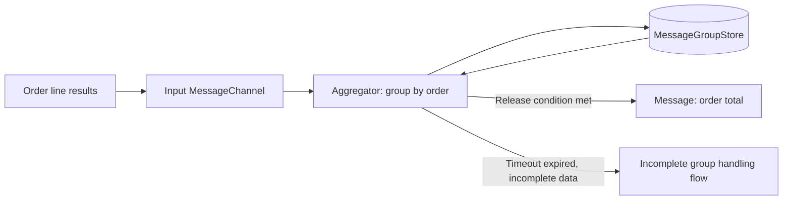

# What Is a Message Aggregator

## Lesson Objectives

In the `SPRING_INTEGRATION_CORE` module, an aggregator is an endpoint that combines individual processing results into a single business-meaningful outcome. This lesson belongs to the **Aggregator** chapter and focuses on how to design and configure message flows using core Spring Integration components.

After this lesson, you can:

- Explain why an aggregator must maintain state across multiple message arrivals.
- Distinguish between the grouping key, completeness condition, and aggregation algorithm.
- Read headers related to correlation and sequence.
- Build a Java DSL flow that receives multiple `Message` instances and emits one aggregated result.
- Identify indefinitely waiting groups, duplicate messages, late-arriving messages, and errors during aggregation.

## 1. The Problem: Individual Results Are Not Enough to Decide

Suppose an order-processing system calculates prices for each line of an order. Order `A-101` has three lines, with results `100.00`, `40.00`, and `60.00`, respectively. Tasks may finish out of their original order, and results from other orders may interleave.

| Time | Incoming Message | Related Group | Can Total Be Emitted Yet? |
| --- | --- | --- | --- |
| T1 | Line 3 of `A-101`: `60.00` | `A-101` | Not yet, only 1/3 lines |
| T2 | Line 1 of `B-202`: `15.00` | `B-202` | Depends on expected line count of `B-202` |
| T3 | Line 1 of `A-101`: `100.00` | `A-101` | Not yet, only 2/3 lines |
| T4 | Line 2 of `A-101`: `40.00` | `A-101` | Yes, total is `200.00` |

If a transformer adds amounts immediately as each message arrives, it only knows the value of the current line. The system needs a place to remember arrived results, isolate each order, and decide when the total amount has sufficient basis to be used.

That is the problem solved by a **message aggregator**: collecting related messages, waiting until a completion condition is met, and producing an aggregated message. This is a pattern from Enterprise Integration Patterns. [Source: Aggregator pattern](https://www.enterpriseintegrationpatterns.com/patterns/messaging/Aggregator.html).



An aggregator does not have to sit behind a splitter. It can also receive replies from multiple services, as long as those replies carry enough information to identify which request they belong to.

## 2. Three Independent Decisions of an Aggregator

Designing an aggregator starts with three questions. The Aggregator pattern calls them correlation, completeness condition, and aggregation algorithm. [Source: Enterprise Integration Patterns](https://www.enterpriseintegrationpatterns.com/patterns/messaging/Aggregator.html).

| Question | Spring Integration Component | Order Example |
| --- | --- | --- |
| Which group does this message belong to? | `CorrelationStrategy` | Belongs to order `A-101` |
| Is the group ready to be processed? | `ReleaseStrategy` | All three results have arrived |
| What result should the group be transformed into? | `MessageGroupProcessor`, configured via `outputProcessor` | Create `OrderTotal` with amount `200.00` |

These three decisions solve three different concerns. For instance, changing the sum calculation to selecting the highest-value line only changes the aggregation algorithm. The system still has to group by the right order and determine the right moment to emit the result.

A good grouping key alone does not guarantee completeness. If every message belongs to `A-101` accurately but line 2 is missing, the group still lacks enough data to issue an invoice.

### What State Does an Aggregator Hold?

Conceptually, the state of each group can be pictured as follows:

```text
groupKey = A-101
received = [line-3, line-1]
expected = 3
status = waiting
```

Once the remaining line arrives, the aggregator produces the result and updates group state according to the completion policy. In Spring Integration, `AggregatingMessageHandler` coordinates grouping, group storage, and result emission; strategies are supplied to customize each decision. [Source: Aggregator in Spring Integration](https://docs.spring.io/spring-integration/reference/aggregator.html).

## 3. Distinguishing an Aggregator from Similar Components

| Component | Input → Output Example | Purpose in the Order Scenario |
| --- | --- | --- |
| Transformer | One order line → one priced line | Changes the representation or content of each individual message |
| Filter | One result → forwarded or dropped | Blocks invalid results |
| Router | One result → chosen channel | Chooses where to process based on order type or status |
| Splitter | One multi-line order → multiple line messages | Splits work into separate parts |
| Resequencer | Lines `3, 1, 2` → messages ordered `1, 2, 3` | Restores sequence order |
| Aggregator | Multiple line results → one `OrderTotal` | Combines information for order-level processing |

A resequencer replays messages in `sequenceNumber` order, whereas an aggregator computes one result from the entire group. If you only need to sum amounts, addition order does not change the result, so adding a resequencer is usually unnecessary. [Source: Resequencer](https://docs.spring.io/spring-integration/reference/resequencer.html).

Similarly, a `QueueChannel` can hold multiple messages, but buffering in a queue does not by itself define a rule saying "these three results belong to the same order and must be summed into one total." Distinguish a message-transport buffer from the group state of an aggregator.

## 4. Messages, Headers, and Identifying a Group

A `Message<T>` consists of a payload and headers. In the pricing example:

```text
payload:
  orderId = A-101
  lineNo = 3
  amount = 60.00

headers:
  correlationId = A-101
  sequenceNumber = 3
  sequenceSize = 3
```

### 4.1. Common Headers

| Constant | Meaning |
| --- | --- |
| `IntegrationMessageHeaderAccessor.CORRELATION_ID` | Identifies messages in the same group under default correlation |
| `IntegrationMessageHeaderAccessor.SEQUENCE_NUMBER` | Position of a part within a sequence |
| `IntegrationMessageHeaderAccessor.SEQUENCE_SIZE` | Total expected number of parts in the sequence |

Default correlation reads the `correlationId` header. Having an `orderId` field in the payload does not automatically make the aggregator group by that field; to use a business field, you must configure the corresponding strategy. [Source: Correlation in Aggregator](https://docs.spring.io/spring-integration/reference/aggregator.html).

Do not confuse `MessageHeaders.ID` with the group key. Each message has its own unique ID; three results for the same order are still three distinct messages. The group key expresses the relationship between them.

### 4.2. Scoping the Key to a Single Aggregation Run

In the lab exercise, using `orderId` makes observation straightforward. For business processes that recalculate an order multiple times, a more suitable design might be:

```text
tenantId + orderId + pricingAttemptId
```

For example, results from pricing run `attempt-1` and `attempt-2` should not be summed together. Using the same key `A-101` could mix data between two runs or cause results from the newer run to be treated as late messages from the old one.

You can configure correlation explicitly in Java DSL:

```java
.aggregate(a -> a
    .correlationStrategy(message ->
        message.getHeaders().get("pricingAttemptId"))
    // Release and output configurations are added here.
)
```

This configuration snippet is illustrative, assuming a prior step validated and attached a valid `pricingAttemptId`. Do not fall back to a shared default value such as `UNKNOWN` for messages missing the key, because they would all be lumped into the same group. Java DSL lets you specify correlation, release, and message store independently. [Source: Aggregators and Resequencers in Java DSL](https://docs.spring.io/spring-integration/reference/dsl/java-aggregators.html).

## 5. "Enough Received" Must Be Defined by a Data Contract

### 5.1. Default Release Based on Sequence Size

`SimpleSequenceSizeReleaseStrategy` compares the number of messages in the group against the expected `sequenceSize`. This strategy does not check for duplicate sequence numbers on its own and does not support emitting subsets of a sequence. [Source: SimpleSequenceSizeReleaseStrategy](https://docs.spring.io/spring-integration/api/org/springframework/integration/aggregator/SimpleSequenceSizeReleaseStrategy.html).

This fits input data with a clear contract: one result per line, a consistent declaration of total line count, and no business-level redeliveries.

Suppose, however, that line 1 is resent as a new `Message`:

```text
Messages received: line-1, line-1, line-3
Message count:     3
Distinct lines:    2
Missing line:      line-2
```

Counting three messages does not mean three distinct results have arrived. Therefore, do not assume from `sequenceNumber` that the default mechanism guarantees business-level deduplication.

### 5.2. Releasing by Required Part Identity

Suppose a request requires exact results from `STOCK`, `PAYMENT`, and `SHIPPING`. A business condition can check the set of result types:

```java
// Snippet replacing releaseStrategy in a flow processing ServiceReply.
// ServiceReply is an application DTO with a source() method.
Set<String> required = Set.of("STOCK", "PAYMENT", "SHIPPING");

// Inside aggregator configuration:
.releaseStrategy(group -> {
    Set<String> received = group.getMessages().stream()
        .map(message -> (ServiceReply) message.getPayload())
        .map(ServiceReply::source)
        .collect(Collectors.toSet());

    return received.containsAll(required);
})
```

This snippet requires `java.util.Set`, `java.util.stream.Collectors`, and the `ServiceReply` DTO. It illustrates the completion condition rather than a standalone Java class.

If `STOCK` arrives twice, the `received` set still holds only one `STOCK` element. However, the duplicate messages may still reside in the group. The output processor must also decide whether to take the first entry, the latest entry, the one with the highest version, or reject conflicting data. The release condition and duplicate handling policy are both parts of the business contract.

You must also decide whether a failure reply counts as "responded." For example, `PAYMENT = REJECTED` might complete the collection of replies while the final order outcome is not confirmed.

## 6. Java DSL Practice: Aggregating Three Lines into an Order Total

### 6.1. Example Assumptions

The example below uses Java 17 and the Spring Integration 6.x Java DSL API. The classpath needs `org.springframework.integration:spring-integration-core` along with compatible Spring dependencies. If the project uses Spring Boot, inherit versions from the project's dependency management; do not mix incompatible Spring Framework and Spring Integration versions manually.

The example instantiates a Spring context directly, so a Spring Boot application is not required to understand or run the demonstration class.

Input contract for the exercise:

- Each order has a fixed number of lines and at least one line.
- Each line emits only one result; all messages for the same order carry a consistent `sequenceSize`.
- `correlationId` equals the order ID; the example performs only one aggregation per order ID.
- Payloads and headers are validated at the system ingress boundary.
- Emit the total only when all data is present; incomplete groups are routed to a discard channel upon timeout.

### 6.2. Complete Demonstration Class

```java
import java.math.BigDecimal;
import java.util.List;

import org.springframework.context.annotation.AnnotationConfigApplicationContext;
import org.springframework.context.annotation.Bean;
import org.springframework.context.annotation.Configuration;
import org.springframework.integration.channel.DirectChannel;
import org.springframework.integration.channel.QueueChannel;
import org.springframework.integration.config.EnableIntegration;
import org.springframework.integration.dsl.IntegrationFlow;
import org.springframework.integration.store.MessageGroup;
import org.springframework.messaging.Message;
import org.springframework.messaging.support.MessageBuilder;

import static org.springframework.integration.IntegrationMessageHeaderAccessor
    .CORRELATION_ID;
import static org.springframework.integration.IntegrationMessageHeaderAccessor
    .SEQUENCE_NUMBER;
import static org.springframework.integration.IntegrationMessageHeaderAccessor
    .SEQUENCE_SIZE;

@Configuration
@EnableIntegration
public class OrderAggregationExample {

    public record LineResult(
        String orderId,
        int lineNo,
        BigDecimal amount
    ) {}

    public record OrderTotal(
        String orderId,
        int receivedLines,
        BigDecimal amount
    ) {}

    @Bean
    public DirectChannel lineResultInput() {
        return new DirectChannel();
    }

    @Bean
    public QueueChannel orderTotals() {
        return new QueueChannel(100);
    }

    @Bean
    public QueueChannel discardedLineResults() {
        return new QueueChannel(100);
    }

    @Bean
    public IntegrationFlow orderAggregationFlow() {
        return IntegrationFlow.from(lineResultInput())
            .aggregate(a -> a
                // Keep the default correlation and release strategies.
                .outputProcessor(OrderAggregationExample::total)
                .groupTimeout(5_000)
                .sendPartialResultOnExpiry(false)
                .expireGroupsUponCompletion(false)
                .expireGroupsUponTimeout(false)
                .discardChannel(discardedLineResults()))
            .channel(orderTotals())
            .get();
    }

    private static OrderTotal total(MessageGroup group) {
        List<LineResult> lines = group.getMessages().stream()
            .map(message -> (LineResult) message.getPayload())
            .toList();

        String orderId = lines.get(0).orderId();

        boolean mixedOrders = lines.stream()
            .anyMatch(line -> !orderId.equals(line.orderId()));
        if (mixedOrders) {
            throw new IllegalArgumentException(
                "A group must not contain multiple orders");
        }

        BigDecimal amount = lines.stream()
            .map(LineResult::amount)
            .reduce(BigDecimal.ZERO, BigDecimal::add);

        return new OrderTotal(orderId, lines.size(), amount);
    }

    public static Message<LineResult> lineMessage(
        String orderId,
        int lineNo,
        int expectedLines,
        String amount
    ) {
        if (expectedLines < 1 || lineNo < 1 || lineNo > expectedLines) {
            throw new IllegalArgumentException("Invalid sequence");
        }
        if (orderId == null || orderId.isBlank()) {
            throw new IllegalArgumentException("Missing orderId");
        }

        LineResult payload = new LineResult(
            orderId, lineNo, new BigDecimal(amount));

        return MessageBuilder.withPayload(payload)
            .setHeader(CORRELATION_ID, orderId)
            .setHeader(SEQUENCE_NUMBER, lineNo)
            .setHeader(SEQUENCE_SIZE, expectedLines)
            .build();
    }

    public static void main(String[] args) {
        try (var context = new AnnotationConfigApplicationContext(
                OrderAggregationExample.class)) {

            DirectChannel input = context.getBean(
                "lineResultInput", DirectChannel.class);
            QueueChannel output = context.getBean(
                "orderTotals", QueueChannel.class);

            input.send(lineMessage("A-101", 3, 3, "60.00"));
            if (output.receive(0) != null) {
                throw new AssertionError("Group does not have three lines yet");
            }

            input.send(lineMessage("A-101", 1, 3, "100.00"));
            if (output.receive(0) != null) {
                throw new AssertionError("Group only has two lines so far");
            }

            input.send(lineMessage("A-101", 2, 3, "40.00"));
            Message<?> result = output.receive(0);
            if (result == null) {
                throw new AssertionError("Missing aggregated result");
            }

            System.out.println(result.getPayload());
        }
    }
}
```

Expected output:

```text
OrderTotal[orderId=A-101, receivedLines=3, amount=200.00]
```

The example uses `BigDecimal` to represent monetary amounts, constructed from decimal strings. Aggregation does not depend on line arrival order, so sorting the group before summing is unnecessary.

### 6.3. Reading the Flow Step by Step

1. `lineResultInput` delivers each result to the aggregator endpoint.
2. Default correlation places messages with `correlationId = A-101` into the same group.
3. After line 3 and line 1, the message count is still less than `sequenceSize = 3`, so no total is emitted yet.
4. Line 2 causes the group to satisfy the release condition.
5. `total(...)` reads the entire group and creates an `OrderTotal` DTO.
6. The result goes to `orderTotals`; the program reads it with `receive(0)`.

`outputProcessor` receives a `MessageGroup`, not a single payload. Options such as `outputProcessor` and `expireGroupsUponCompletion` are provided by `AggregatorSpec`. [Source: AggregatorSpec API](https://docs.spring.io/spring-integration/api/org/springframework/integration/dsl/AggregatorSpec.html).

The example's release condition is still sequence-size based. The `mixedOrders` check detects payloads that conflict with the grouping strategy, but it does not replace checking for duplicate or missing lines. When the input contract changes, the validation and strategies must change accordingly.

`DirectChannel` executes on the sender's thread, so in this demonstration flow the result is already in the queue when the last `send` returns. If you add an `ExecutorChannel` or an asynchronous step, you must wait for the result with an appropriate timeout instead of `receive(0)`. [Source: Threading model and errors](https://docs.spring.io/spring-integration/reference/error-handling.html).

## 7. Combining a Splitter, Per-Part Processing, and an Aggregator

A common flow pattern is:

```text
Message<List<OrderLine>>
    -> splitter
    -> Message<OrderLine> for each line
    -> process or price each line
    -> Message<LineResult>
    -> aggregator
    -> Message<OrderTotal>
```

A splitter typically supplies correlation and sequence headers so downstream steps can track the split parts. When the split result is a collection with a known size, the aggregator can use that part count as the basis for completion. For an iterator whose size cannot be determined, `sequenceSize` may be `0`; in that case, a different release contract is required. [Source: Splitter](https://docs.spring.io/spring-integration/reference/splitter.html).

A Java DSL skeleton reusing the example's output processor is:

```java
// Illustrative skeleton in the same configuration class.
// priceLine is the application's OrderLine -> LineResult business method.
return IntegrationFlow.from("ordersInput")
    .split()
    .<OrderLine, LineResult>transform(this::priceLine)
    .aggregate(a -> a
        .outputProcessor(OrderAggregationExample::total))
    .channel("orderTotals")
    .get();
```

This skeleton requires adding the `OrderLine` DTO and `priceLine` method; it illustrates endpoint composition and does not replace the full demonstration class in section 6. Java DSL directly supports chaining `split()` followed by `aggregate()`. [Source: Java DSL](https://docs.spring.io/spring-integration/reference/dsl/java-aggregators.html).

### Pitfall When Adding a Filter Mid-Flow

Suppose a splitter produces three parts, and then a filter drops one part. If the remaining parts still declare `sequenceSize = 3`, the aggregator will receive only two messages and keep waiting.

When designing this flow, you can choose one of the following approaches depending on business requirements:

- Filter the list before splitting so the sequence size reflects the dataset that actually needs processing.
- Represent the skipped line with an explicit status result so collection still knows that line was handled.
- Use a release strategy based on a required set of parts or a completion signal with a concrete contract.

Do not simply patch `sequenceSize` on an arbitrary message. Every participant must agree on what "enough data" means.

With a publish-subscribe channel or recipient list router used to fan out and then aggregate, consider enabling `applySequence`; do not assume every branching mechanism automatically attaches headers like a splitter. [Source: Headers for aggregation](https://docs.spring.io/spring-integration/reference/aggregator.html).

## 8. Incomplete Groups and Timeouts

### 8.1. What Question Does Timeout Answer?

Suppose `A-101` receives only two lines. A retry fails or one processing branch sends no result. A release strategy waiting for three parts will not make the missing part appear on its own.

In the example, `groupTimeout(5_000)` sets a 5,000-millisecond wait interval when the group has not been released yet. With this fixed timeout value, the wait schedule is reset whenever a new message arrives; it measures idle time without new parts, not an absolute deadline from the first part. [Source: Aggregator and Group Timeout](https://docs.spring.io/spring-integration/reference/aggregator.html).

Illustrative timeline:

```text
t = 0s:  line 1 arrives -> waiting starts
t = 4s:  line 3 arrives -> timeout schedule resets
t ≈ 9s:  line 2 still missing -> timeout handling
```

Execution timing also depends on the scheduler. If the contract requires finishing within 5 seconds from receiving the first part, you need to calculate a deadline from the start timestamp and configure the timeout accordingly.

### 8.2. Should Incomplete Results Be Emitted?

Two notable options are `groupTimeout(...)` and `sendPartialResultOnExpiry(...)`. The configuration API also provides `discardChannel(...)` to specify where dropped data goes. [Source: CorrelationHandlerSpec API](https://docs.spring.io/spring-integration/api/org/springframework/integration/dsl/CorrelationHandlerSpec.html).

| Business Case | Example Policy | Meaning of Result |
| --- | --- | --- |
| Invoicing requires all lines | Do not emit partial total; send data to discard flow | Avoids creating a total mistaken as complete |
| Comparing supplier quotes | Can aggregate quotes received so far | Result must indicate scope of replies received |
| Temporary dashboard | Can accept incomplete data | Must explicitly represent incomplete status |

Enabling `sendPartialResultOnExpiry(true)` does not automatically tag an `OrderTotal` DTO as "incomplete data." If partial results are allowed, design the DTO with fields such as `expectedCount`, `receivedCount`, `missingParts`, and `complete`.

Timeout also does not automatically throw an exception. In the demonstration flow, the incomplete group moves to `discardedLineResults` because partial emission was disabled. This queue is for observation in the lesson; a real system needs a consumer to record incidents, investigate, or coordinate follow-up handling. A bounded queue will fill up if never consumed.

### 8.3. Reaper and Groups Never Created

`MessageGroupStoreReaper` is a mechanism that actively requests expiration of old groups in the store; calling `run()` must be scheduled appropriately. It can serve group lifecycle management instead of relying solely on a new message arriving. [Source: MessageGroupStoreReaper API](https://docs.spring.io/spring-integration/api/org/springframework/integration/store/MessageGroupStoreReaper.html).

If no replies arrive at all for a request, the aggregator may not even have a group to time out. For example, sending requests to three services where all three fail to respond means no input message ever creates a group. The deadline of the original request must therefore be managed at the request originator or in a separate orchestrator.

## 9. Group Completion, Deletion, and Late Arrivals

After the total `A-101 = 200.00` has been emitted, a duplicate of line 2 might arrive late. The design must decide whether to accept or reject it.

`expireGroupsUponCompletion(false)` retains a trace of completed groups; setting `true` removes the group and allows a message with the same key to start a new group. [Source: expireGroupsUponCompletion](https://docs.spring.io/spring-integration/api/org/springframework/integration/dsl/AggregatorSpec.html).

`expireGroupsUponTimeout(false)` in the example reflects keeping a trace after timeout; if timeout state is deleted, a late-arriving part can start a new group. [Source: expireGroupsUponTimeout](https://docs.spring.io/spring-integration/api/org/springframework/integration/dsl/CorrelationHandlerSpec.html).

| Design Choice | Consequence to Consider |
| --- | --- |
| Keep trace of closed groups | Provides a basis to identify and discard late messages with the same key |
| Delete group completely | A late-arriving part can reopen a group under the old key |
| Use a new key per aggregation run | Distinguishes a recalculation from late data of a previous run |

Keeping traces forever accumulates state. Deleting too early strips the system of the basis to distinguish old groups. Choose a retention period aligned with retry windows and maximum business-acceptable delay, and schedule cleanup of closed groups.

The demonstration class exists only for a short single-run session. When used as a long-running service, you must add a state-cleanup policy; the two `false` values in the example are not an unbounded retention configuration to copy verbatim into production.

## 10. MessageGroupStore and Multi-Instance Operation

An aggregator needs to store pending parts. `SimpleMessageStore` is an in-memory option; to preserve pending data across restarts, consider a persistent store such as JDBC. An aggregator's store must support group storage, i.e., `MessageGroupStore`; a queue-only store cannot implicitly replace it. When persisting, you must also verify serializability of payloads and headers. [Source: Message Store](https://docs.spring.io/spring-integration/reference/message-store.html).

In the example, if the process stops after receiving two lines, in-memory pending state is lost. Resending those two lines, re-waiting for the whole batch, or canceling the pricing run must be decided at the system level.

Operations updating a group need synchronization. `LockRegistry` provides per-group locking; when multiple instances share a store, the locking mechanism must also coordinate across instances. [Source: Aggregator Lock Registry](https://docs.spring.io/spring-integration/reference/aggregator.html).

Three design questions for a multi-instance deployment are:

1. Are parts of the same request routed to the same processing node or not?
2. If multiple instances can update the same group, are the store and lock consistent?
3. If a process crashes after producing a result but before recording delivery success, who is responsible for redelivery and preventing duplicate side effects?

Do not infer from "using a persistent store" that "every result is guaranteed to cause side effects only once." For instance, an invoice-creating consumer can use the pricing-attempt key as an idempotency key so a redelivered result does not create an extra invoice.

An initial capacity estimate for the order scenario is:

```text
Pending data
  ≈ open groups × average parts per group × size per part
```

This formula only estimates payload data, excluding metadata and storage overhead. Also monitor open group count, oldest group age, timeout rate, discard rate, and emitted result count. Many small incomplete groups can still hold a significant amount of state.

## 11. Distinguishing Processing Errors from Discards

The exercise involves two distinct situations:

| Situation | Example | Interpretation |
| --- | --- | --- |
| Incomplete group times out | Only two of three lines received | Handled per timeout and discard/partial-result policy |
| Aggregation code throws an exception | Payloads from multiple orders grouped together, or wrong data type | Error during message processing |

With `DirectChannel`, handler exceptions propagate back to the sending thread. Simply setting the `errorChannel` header does not automatically redirect all synchronous errors to that channel. For asynchronous tasks or framework-managed scheduler tasks, the error-handling mechanism can send an `ErrorMessage` to the corresponding error channel. [Source: Error Handling](https://docs.spring.io/spring-integration/reference/error-handling.html).

Therefore, the consumer of the discard channel and the consumer of the error channel have different responsibilities. One handles data discontinued under group policy; the other handles execution failures. Operations may surface both as incidents to monitor, but must preserve root-cause details.

When logging incidents in the example, useful fields include the aggregation run key, order ID, expected part count, received lines, and timestamp of the last arrived data. Avoid logging just "aggregation failed," since that message does not tell whether lines are missing or the calculation itself threw an error.

## 12. Testing Flow Behavior

Testing an aggregator requires observing both **not yet emitted** and **emitted** results. Testing only the addition in `total(...)` does not prove correlation or release is configured properly.

### 12.1. A Flow Test with Out-of-Order Data

The following example uses JUnit 5 and the `OrderAggregationExample` class from section 6. There is no need to mock the output channel because `QueueChannel` allows direct observation of results.

```java
import java.math.BigDecimal;

import org.junit.jupiter.api.Test;
import org.springframework.context.annotation.AnnotationConfigApplicationContext;
import org.springframework.integration.channel.DirectChannel;
import org.springframework.integration.channel.QueueChannel;
import org.springframework.messaging.Message;

import static org.junit.jupiter.api.Assertions.*;

class OrderAggregationExampleTest {

    @Test
    void releasesOnlyAfterAllThreeLinesArrive() {
        try (var context = new AnnotationConfigApplicationContext(
                OrderAggregationExample.class)) {

            DirectChannel input = context.getBean(
                "lineResultInput", DirectChannel.class);
            QueueChannel output = context.getBean(
                "orderTotals", QueueChannel.class);

            input.send(OrderAggregationExample.lineMessage(
                "A-101", 3, 3, "60.00"));
            input.send(OrderAggregationExample.lineMessage(
                "A-101", 1, 3, "100.00"));
            assertNull(output.receive(0));

            input.send(OrderAggregationExample.lineMessage(
                "A-101", 2, 3, "40.00"));

            Message<?> message = output.receive(0);
            assertNotNull(message);

            var total = assertInstanceOf(
                OrderAggregationExample.OrderTotal.class,
                message.getPayload());

            assertEquals("A-101", total.orderId());
            assertEquals(3, total.receivedLines());
            assertEquals(0,
                new BigDecimal("200.00").compareTo(total.amount()));
            assertNull(output.receive(0));
        }
    }
}
```

This test verifies a specific behavior: two parts do not emit a result; the third part emits exactly one total for the group. `compareTo` is used when the goal is comparing monetary value without forcing identical scale representation.

### 12.2. Scenarios to Expand When Contracts Change

| Scenario | Expected Observation |
| --- | --- |
| Results for two orders interleave | Each order's total contains only lines belonging to that order |
| One part is missing | Complete total is not emitted; after timeout, data is observed on the discard flow |
| One line is resent | Business deduplication policy executes correctly |
| Part arrives after group completion | Handled according to the chosen late-arrival policy |
| Payload has an orderId different from correlation | Does not silently emit a mixed-order result |
| Filter drops a part in the sequence | Flow has an appropriate completion mechanism and does not wait indefinitely |
| Restart while aggregation is in progress | Behavior matches the chosen in-memory or persistent store |

For timeout tests, use a bounded wait with scheduler headroom; avoid relying on a single `Thread.sleep` equal to the exact timeout and expecting the task to run at that exact millisecond. For asynchronous flows, verifying that no trailing result arrives also requires a reasonable observation window.

The Java snippets are practice examples for learners to run in a project with compatible dependencies. Presenting code in the lesson does not imply the code was executed in the learner's environment.

## 13. Designing an Aggregator Before Writing DSL

Describe the contract for a processing run using verifiable statements:

1. **What is a group?** Example: pricing results for one order within a single request attempt.
2. **Which parts must appear?** Example: lines whose IDs belong to the initial line list.
3. **When may a result be emitted?** Example: every line has a success or failure result per convention.
4. **What does the result represent?** Example: a complete aggregation or only provisional data.
5. **How long to wait?** Distinguish idle time without new parts from the overall request deadline.
6. **What if data arrives again?** Specify rules for duplicates, newer versions, and late parts.
7. **Where does state live, and for how long?** Choose the store, synchronization mechanism, and group-cleanup schedule.

For order `A-101`, saying "add three numbers" only describes the algorithm. A complete aggregator design must also explain why those three numbers belong to the same pricing run, why enough data has arrived, and how the outcome is handled when a part never arrives.

When reading `.aggregate(...)` in a flow, look for three things first: **group key**, **release condition**, and **output processor**. Then check **timeout** and **group lifecycle** to see how the flow behaves when data does not arrive as expected.
