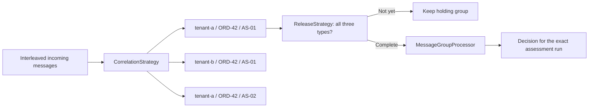

# CorrelationStrategy

In the Aggregator chapter of the **SPRING_INTEGRATION_CORE** module, `CorrelationStrategy` determines which group a message belongs to before the aggregator combines results. Choosing the right group key lets the integration flow pair replies belonging to the same request, even when messages arrive interleaved, out of order, or redelivered.

This lesson uses `Message`, `MessageChannel`, the aggregator endpoint, and Java DSL to build an order-checking flow. Learners should know how to build a `Message`, declare an `IntegrationFlow`, and understand the basic role of an aggregator. Examples use Java 17+ syntax and the Spring Integration Java DSL API; library versions should be managed consistently via the project's BOM.

## 1. The Problem: Interleaved Replies Must Still Be Paired to the Right Request

Suppose each order requires three check results:

- `INVENTORY`: whether stock is sufficient.
- `PAYMENT`: whether payment is valid.
- `FRAUD`: whether the fraud check accepts the order.

Two orders from two different tenants may share the code `ORD-42`. An order can also be reassessed when payment details change. Therefore, using only `orderId` is not enough to identify a single aggregation run.

In this example, the business contract specifies:

```text
Group key = (tenantId, orderId, assessmentId)

A group is complete when all are received:
INVENTORY + PAYMENT + FRAUD
```

`assessmentId` is generated once when starting an assessment run and propagated to all branches. Redelivering messages from the same run must keep this value unchanged. A new assessment run receives a new `assessmentId`.

| Message | Tenant | Order | Assessment Run | Check Type | Group |
|---|---|---|---|---|---|
| M1 | tenant-a | ORD-42 | AS-01 | INVENTORY | A |
| M2 | tenant-b | ORD-42 | AS-01 | PAYMENT | B |
| M3 | tenant-a | ORD-42 | AS-02 | FRAUD | C |
| M4 | tenant-a | ORD-42 | AS-01 | PAYMENT | A |
| M5 | tenant-a | ORD-42 | AS-01 | FRAUD | A |

M1, M4, and M5 must be aggregated together. M2 and M3 belong to different groups despite sharing the same order ID.



The diagram shows responsibilities conceptually; groups are managed inside the aggregator's message group store.

## 2. The CorrelationStrategy Contract

The interface resides in package `org.springframework.integration.aggregator` and has one primary method:

```java
import org.springframework.messaging.Message;

public interface CorrelationStrategy {
    Object getCorrelationKey(Message<?> message);
}
```

The input is **a single message**, so the strategy can derive the key from the payload, headers, or a combination of both. The return value is the object representing the group. Because it is a functional interface, it can be implemented with a lambda or method reference. If a valid key cannot be determined, the strategy should throw an exception rather than returning `null`. See [CorrelationStrategy API](https://docs.spring.io/spring-integration/api/org/springframework/integration/aggregator/CorrelationStrategy.html).

Short example with a business header:

```java
CorrelationStrategy strategy = message -> {
    String key = message.getHeaders().get("assessmentKey", String.class);

    if (key == null || key.isBlank()) {
        throw new IllegalArgumentException("Missing assessmentKey");
    }

    return key;
};
```

This snippet assumes `CorrelationStrategy` is imported from the aggregator package. It only identifies the group; it does not check whether the group has enough messages or combine payloads.

You can think of the strategy as a function:

```text
keyOf(message) -> group key

keyOf(M1) equals keyOf(M2)
    => M1 and M2 belong to the same group
       within the same aggregator storage scope.
```

The key must remain stable throughout the group's lifecycle. When using a Java object as the key, implement `equals()` and `hashCode()` properly. Never use an object whose identifying fields are mutated after a message has been placed into a group.

## 3. Distinguishing the Three Aggregator Decisions

| Component | Question Answered | Primary Input | Output |
|---|---|---|---|
| `CorrelationStrategy` | Which group does this message belong to? | One `Message<?>` | Group key |
| `ReleaseStrategy` | Is this group ready to be released? | One `MessageGroup` | `boolean` |
| `MessageGroupProcessor` | How should the messages be combined into a result? | Processed group | Aggregated result |

In the order problem:

```text
Correlation:
    (tenant-a, ORD-42, AS-01)

Release:
    received INVENTORY, PAYMENT, FRAUD

Aggregation:
    create OrderDecision with the check results
```

If `tenantId` is missing from the key, a group can hold replies from multiple tenants. A release strategy might still receive all three check types and return `true`, yet the produced decision would be business-wise wrong.

If the key is right but one branch never replies, the group still lacks data. Changing the key does not solve that situation; you need policies for timeout, errors, or partial results.

Java DSL lets you configure correlation, release, and the output processor separately. See [Aggregators and Resequencers in Java DSL](https://docs.spring.io/spring-integration/reference/dsl/java-aggregators.html).

## 4. Default Mechanism and Sequence Headers

If no custom strategy is configured, the aggregator uses `HeaderAttributeCorrelationStrategy` based on the `IntegrationMessageHeaderAccessor.CORRELATION_ID` header. Two messages sharing this header value are placed in the same group. Splitters normally supply sequence headers to support reassembling split parts. See [Aggregator Reference](https://docs.spring.io/spring-integration/reference/aggregator.html).

| Header | Role |
|---|---|
| `CORRELATION_ID` | Identifies parts belonging to the same split |
| `SEQUENCE_NUMBER` | Position of the part in the sequence |
| `SEQUENCE_SIZE` | Expected number of parts in the sequence |

Example of a two-part sequence:

```java
import org.springframework.integration.IntegrationMessageHeaderAccessor;
import org.springframework.messaging.Message;
import org.springframework.messaging.support.MessageBuilder;

Message<String> first = MessageBuilder.withPayload("inventory-ok")
        .setHeader(IntegrationMessageHeaderAccessor.CORRELATION_ID, "request-17")
        .setHeader(IntegrationMessageHeaderAccessor.SEQUENCE_NUMBER, 1)
        .setHeader(IntegrationMessageHeaderAccessor.SEQUENCE_SIZE, 2)
        .build();

Message<String> second = MessageBuilder.withPayload("payment-ok")
        .setHeader(IntegrationMessageHeaderAccessor.CORRELATION_ID, "request-17")
        .setHeader(IntegrationMessageHeaderAccessor.SEQUENCE_NUMBER, 2)
        .setHeader(IntegrationMessageHeaderAccessor.SEQUENCE_SIZE, 2)
        .build();
```

Both messages share a group because they have the same `CORRELATION_ID`; `SEQUENCE_NUMBER` is not the group key.

The typical default release strategy is `SimpleSequenceSizeReleaseStrategy`. It relies on sequence size and does not check for duplicate sequence numbers. Therefore, do not assume sequence headers automatically provide full duplicate-handling protection. See [SimpleSequenceSizeReleaseStrategy API](https://docs.spring.io/spring-integration/api/org/springframework/integration/aggregator/SimpleSequenceSizeReleaseStrategy.html).

When using a publish-subscribe channel or recipient list router to fan out and then aggregate, explicitly enable `applySequence` if you intend to rely on sequence headers. This is not enabled by default on those two components. If a filter drops one part of a sequence, the condition waiting for the initial part count must also be revisited. See [Aggregator and Sequence Guide](https://docs.spring.io/spring-integration/reference/aggregator.html).

The hands-on example in section 7 uses a business key and business release strategy, so the three replies do not need sequence headers.

## 5. Ways to Configure the Group Key

### 5.1. Using HeaderAttributeCorrelationStrategy

If the sender already provides a consistent header, use the built-in implementation:

```java
import org.springframework.integration.aggregator.HeaderAttributeCorrelationStrategy;

// Inside an IntegrationFlow:
.aggregate(a -> a
        .correlationStrategy(
                new HeaderAttributeCorrelationStrategy("assessmentKey"))
        .releaseStrategy(group -> group.size() == 3))
```

`HeaderAttributeCorrelationStrategy` uses the value of the header named in its constructor as the key. It does not itself validate that the value is a complete business key. See [HeaderAttributeCorrelationStrategy API](https://docs.spring.io/spring-integration/api/org/springframework/integration/aggregator/HeaderAttributeCorrelationStrategy.html).

The `group.size() == 3` condition here only illustrates syntax. In a problem with redelivered messages, three replies could belong to the same check type. Section 7 uses a stronger condition.

If blank strings must also be rejected, validate before the aggregator or use a validating lambda as in section 2. Never replace a missing header with a constant like `"UNKNOWN"`: failing requests would all pile into the same group.

### 5.2. Using SpEL

If the rule simply reads a straightforward field, an expression can be used:

```java
// Header has been validated at ingress.
.aggregate(a -> a
        .correlationExpression("headers['assessmentKey']")
        .releaseStrategy(group -> group.size() == 3))
```

The root object of the correlation expression is the message, so both `headers` and `payload` are accessible. When multiple validation branches or composite key construction are needed, a Java class is usually easier to read and test.

### 5.3. Using an Object with a Handler Method

Java DSL also supports passing an object and method name:

```java
import org.springframework.messaging.Message;

public class AssessmentKeyResolver {

    public String resolve(Message<?> message) {
        String key = message.getHeaders()
                .get("assessmentKey", String.class);

        if (key == null || key.isBlank()) {
            throw new IllegalArgumentException("Missing assessmentKey");
        }

        return key;
    }
}

// Inside an IntegrationFlow:
// .aggregate(a -> a.correlationStrategy(resolver, "resolve") ...)
```

The three configuration styles above are alternatives. Choose one source of truth for the key per aggregator so the rule is not scattered. The `correlationStrategy(...)` and `correlationExpression(...)` overloads are documented in [CorrelationHandlerSpec API](https://docs.spring.io/spring-integration/api/org/springframework/integration/dsl/CorrelationHandlerSpec.html).

### 5.4. Distinguishing the Interface and Annotation of the Same Name

Spring Integration has both:

- `org.springframework.integration.aggregator.CorrelationStrategy`: interface to implement directly.
- `org.springframework.integration.annotation.CorrelationStrategy`: annotation marking a POJO method that determines the key.

The annotation describes a method's capability; merely adding the annotation does not create an aggregator endpoint. You still need to configure the endpoint or register the object with the corresponding handler mechanism. See [CorrelationStrategy Annotation API](https://docs.spring.io/spring-integration/api/org/springframework/integration/annotation/CorrelationStrategy.html).

The complete examples below use the interface to keep the contract explicit.

## 6. Designing Keys Around Business Boundaries

### 6.1. Key Fields Must Jointly Describe One Aggregation Run

| Information | Include in Key? | Reason in the Example |
|---|---|---|
| `tenantId` | Yes | The same order ID can appear across multiple tenants |
| `orderId` | Yes | Distinguishes orders within a tenant |
| `assessmentId` | Yes | Distinguishes independent assessment runs |
| Check type | No | INVENTORY, PAYMENT, FRAUD must meet together |
| Message ID | No | Each reply may have its own ID |
| Redelivery count | No | Redelivering the same reply must stay in the same group |
| Arrival timestamp | No | Branches arriving at different times still belong to the same run |

This is the decision for the illustrative problem. In another domain, the key might be `shipmentId`, `batchId`, or a unique conversation ID assigned by the system.

You do not necessarily have to put every identifier into the key. If `assessmentId` is guaranteed globally unique and every branch carries it, using only that identifier can also be valid. What must be verified is the uniqueness scope in the data contract.

### 6.2. Keys That Are Too Broad vs. Too Narrow

A key that is too broad merges multiple requests into one group:

```text
key = tenantId
=> multiple orders from the same tenant get mixed
```

A key that is too narrow splits parts that belong together:

```text
key = (tenantId, orderId, assessmentId, check)
=> INVENTORY, PAYMENT, FRAUD land in three separate groups
```

Generating a new UUID inside `getCorrelationKey()` also assigns every call to a different group. If a UUID is needed for an assessment run, issue it once at the start of the flow and propagate that exact value down to all branches.

### 6.3. Composite Keys Should Have Clear Structure

String concatenation without encoding rules can cause ambiguity:

```text
("a:b", "c") -> "a:b:c"
("a", "b:c") -> "a:b:c"
```

In a Java application, an immutable record is a readable choice:

```java
public record OrderKey(
        String tenantId,
        String orderId,
        String assessmentId) {
}
```

A record generates `equals()` and `hashCode()` based on its components. With `String` components, two instances with the same tuple of values represent the same key.

If the key crosses JSON or a broker, agree on the schema, data types, and normalization rules. String `"42"` and number `42` should not be treated as arbitrary interchangeable representations of the same identifier. Only change casing, trim whitespace, or strip leading zeros when the business contract permits; normalization can make two distinct valid identifiers collide.

### 6.4. Do Not Depend on Implicit Execution State

The strategy should compute the key from data present in the message, not from a local counter, a user in `ThreadLocal`, the current clock, or a query that may return different results across redeliveries.

When using an executor or asynchronous adapter, branches may execute on different threads. Passing `tenantId` and `assessmentId` explicitly keeps the key meaningful across those boundaries.

## 7. Complete Java DSL Example

The following example declares:

- A `DirectChannel` receiving replies.
- A correlation strategy reading identifiers from the payload.
- An aggregator waiting for all three check types.
- A `QueueChannel` holding decisions for observation or testing.
- A `QueueChannel` receiving replies discarded when a group expires or has already completed.

The project needs `spring-integration-core` and a compatible Spring Context. If using Spring Boot, these components can be obtained via the integration starter and Boot BOM. No broker is needed to run this in-memory flow.

```java
package example.integration;

import java.io.Serializable;
import java.util.EnumMap;
import java.util.EnumSet;
import java.util.Map;
import java.util.Objects;
import java.util.Set;
import java.util.stream.Collectors;

import org.springframework.beans.factory.annotation.Qualifier;
import org.springframework.context.annotation.Bean;
import org.springframework.context.annotation.Configuration;
import org.springframework.integration.aggregator.CorrelationStrategy;
import org.springframework.integration.channel.DirectChannel;
import org.springframework.integration.channel.QueueChannel;
import org.springframework.integration.config.EnableIntegration;
import org.springframework.integration.dsl.IntegrationFlow;
import org.springframework.integration.store.MessageGroup;
import org.springframework.messaging.Message;
import org.springframework.messaging.MessageChannel;

@Configuration
@EnableIntegration
public class OrderAggregationConfiguration {

    public enum Check {
        INVENTORY, PAYMENT, FRAUD
    }

    public record CheckResult(
            String tenantId,
            String orderId,
            String assessmentId,
            Check check,
            boolean accepted) implements Serializable {

        public CheckResult {
            Objects.requireNonNull(check, "check");
        }
    }

    public record OrderKey(
            String tenantId,
            String orderId,
            String assessmentId) implements Serializable {

        public OrderKey {
            requireText(tenantId, "tenantId");
            requireText(orderId, "orderId");
            requireText(assessmentId, "assessmentId");
        }
    }

    public record OrderDecision(
            OrderKey key,
            boolean accepted,
            Map<Check, Boolean> checks) {

        public OrderDecision {
            checks = Map.copyOf(checks);
        }
    }

    @Bean
    public DirectChannel checkResults() {
        return new DirectChannel();
    }

    @Bean
    public QueueChannel orderDecisions() {
        return new QueueChannel();
    }

    @Bean
    public QueueChannel rejectedCheckResults() {
        return new QueueChannel();
    }

    @Bean
    public CorrelationStrategy orderCorrelationStrategy() {
        return message -> {
            if (!(message.getPayload() instanceof CheckResult result)) {
                throw new IllegalArgumentException(
                        "Expected CheckResult payload");
            }

            return keyOf(result);
        };
    }

    @Bean
    public IntegrationFlow orderAggregationFlow(
            @Qualifier("checkResults") MessageChannel input,
            @Qualifier("orderDecisions") MessageChannel output,
            @Qualifier("rejectedCheckResults") MessageChannel rejected,
            @Qualifier("orderCorrelationStrategy")
            CorrelationStrategy correlationStrategy) {

        return IntegrationFlow.from(input)
                .aggregate(a -> a
                        .correlationStrategy(correlationStrategy)
                        .releaseStrategy(
                                OrderAggregationConfiguration::hasAllChecks)
                        .outputProcessor(
                                OrderAggregationConfiguration::toDecision)
                        .expireGroupsUponCompletion(false)
                        .groupTimeout(30_000L)
                        .expireGroupsUponTimeout(false)
                        .sendPartialResultOnExpiry(false)
                        .discardChannel(rejected))
                .channel(output)
                .get();
    }

    private static boolean hasAllChecks(MessageGroup group) {
        Set<Check> received = group.getMessages().stream()
                .map(Message::getPayload)
                .map(CheckResult.class::cast)
                .map(CheckResult::check)
                .collect(Collectors.toSet());

        return received.containsAll(EnumSet.allOf(Check.class));
    }

    private static OrderDecision toDecision(MessageGroup group) {
        Map<Check, Boolean> checks = new EnumMap<>(Check.class);
        CheckResult first = null;

        for (Message<?> message : group.getMessages()) {
            CheckResult result = (CheckResult) message.getPayload();

            if (first == null) {
                first = result;
            }

            checks.merge(
                    result.check(),
                    result.accepted(),
                    (left, right) -> left && right);
        }

        if (first == null) {
            throw new IllegalStateException("Cannot aggregate empty group");
        }

        boolean accepted = checks.values().stream()
                .allMatch(Boolean::booleanValue);

        return new OrderDecision(keyOf(first), accepted, checks);
    }

    private static OrderKey keyOf(CheckResult result) {
        return new OrderKey(
                result.tenantId(),
                result.orderId(),
                result.assessmentId());
    }

    private static void requireText(String value, String field) {
        if (value == null || value.isBlank()) {
            throw new IllegalArgumentException(
                    "Missing correlation field: " + field);
        }
    }
}
```

Timeout and store configuration methods belong to [CorrelationHandlerSpec](https://docs.spring.io/spring-integration/api/org/springframework/integration/dsl/CorrelationHandlerSpec.html); the output processor and group completion options belong to [AggregatorSpec](https://docs.spring.io/spring-integration/api/org/springframework/integration/dsl/AggregatorSpec.html).

### 7.1. Why Not Use group.size() == 3?

Consider the incoming sequence:

```text
INVENTORY accepted=true
INVENTORY accepted=true  // redelivered as a new Message
PAYMENT   accepted=true
```

There are three messages, yet `FRAUD` is still missing. `hasAllChecks()` checks the set of reply types, so the group keeps waiting. Two `INVENTORY` replies do not substitute for the missing check type.

`toDecision()` merges replies of the same type using logical AND. If both `PAYMENT=true` and `PAYMENT=false` were received before release, the result for PAYMENT is `false`. This policy is chosen specifically for this example and does not depend on arrival order.

This policy applies only to replies already in the group at release time. If the business allows updating a result after all three types are already present, you must introduce reply versioning or a decision-amendment workflow. The aggregator in this example releases once per assessment run.

### 7.2. Meaning of the Lifecycle Options

`expireGroupsUponCompletion(false)` keeps information about completed groups so late replies with the same key can be discarded instead of starting a new group. Tracking completed groups is described in [Aggregator Reference](https://docs.spring.io/spring-integration/reference/aggregator.html).

The example sets a 30-second timeout and disables sending incomplete results. `expireGroupsUponTimeout(false)` keeps completed-status tracking after a group ends by timeout, while `discardChannel` receives dropped data. This configuration prioritizes preventing a late reply from reopening the same assessment run. Group timeout handling can be inspected in [AbstractCorrelatingMessageHandler](https://github.com/spring-projects/spring-integration/blob/main/spring-integration-core/src/main/java/org/springframework/integration/aggregator/AbstractCorrelatingMessageHandler.java).

Group timeout serves pending-group cleanup; it is not an SLA guarantee for the entire business operation. With a constant group timeout, receiving another message can push back the expiration schedule. If a hard deadline measured from assessment start is required, propagate the business deadline and design the timing policy accordingly.

The illustrative configuration retains markers of completed groups. In a long-running application, add a metadata cleanup policy aligned with the window during which late replies are accepted. The `QueueChannel` instances for decisions and discarded messages also need consumers or must be drained in tests.

### 7.3. Why Derive the Output Identifier from the Payload?

`toDecision()` reconstructs `OrderKey` from a `CheckResult` rather than assuming every message store implementation returns the exact business key type via `group.getGroupId()`.

This also makes the output contract explicit: `OrderDecision.key()` carries the tenant, order, and assessment run. Downstream handlers do not have to infer the key from sequence headers or from the result's message ID.

All elements in the group have already passed through the same correlation strategy. Thus, the grouping rule guarantees they share the same business identifier.

## 8. Testing Key Boundaries and Flow Behavior

Two kinds of tests deliver direct value:

1. Testing the correlation strategy to prove which fields change the group.
2. Testing the flow with interleaved and redelivered messages to prove the aggregator neither mixes data nor releases early.

The example below uses JUnit Jupiter and Spring Test. Required test dependencies can come from the project's test dependency bundle. Place the test class in the same `example.integration` package as the configuration in section 7.

```java
package example.integration;

import org.junit.jupiter.api.Test;
import org.springframework.beans.factory.annotation.Autowired;
import org.springframework.beans.factory.annotation.Qualifier;
import org.springframework.integration.aggregator.CorrelationStrategy;
import org.springframework.integration.channel.QueueChannel;
import org.springframework.messaging.Message;
import org.springframework.messaging.MessageChannel;
import org.springframework.messaging.support.MessageBuilder;
import org.springframework.test.context.junit.jupiter.SpringJUnitConfig;

import example.integration.OrderAggregationConfiguration.Check;
import example.integration.OrderAggregationConfiguration.CheckResult;
import example.integration.OrderAggregationConfiguration.OrderDecision;

import static org.junit.jupiter.api.Assertions.*;

@SpringJUnitConfig(OrderAggregationConfiguration.class)
class OrderCorrelationTest {

    @Autowired
    @Qualifier("checkResults")
    MessageChannel input;

    @Autowired
    @Qualifier("orderDecisions")
    QueueChannel output;

    @Autowired
    @Qualifier("rejectedCheckResults")
    QueueChannel rejected;

    @Autowired
    @Qualifier("orderCorrelationStrategy")
    CorrelationStrategy strategy;

    @Test
    void keyUsesTenantOrderAndAssessmentButNotCheckType() {
        Object key = strategy.getCorrelationKey(
                part("tenant-a", "ORD-42", "AS-key",
                        Check.INVENTORY, true));

        assertEquals(key, strategy.getCorrelationKey(
                part("tenant-a", "ORD-42", "AS-key",
                        Check.PAYMENT, true)));

        assertNotEquals(key, strategy.getCorrelationKey(
                part("tenant-b", "ORD-42", "AS-key",
                        Check.INVENTORY, true)));

        assertNotEquals(key, strategy.getCorrelationKey(
                part("tenant-a", "ORD-99", "AS-key",
                        Check.INVENTORY, true)));

        assertNotEquals(key, strategy.getCorrelationKey(
                part("tenant-a", "ORD-42", "AS-other",
                        Check.INVENTORY, true)));
    }

    @Test
    void missingAssessmentIdIsRejectedByStrategy() {
        assertThrows(IllegalArgumentException.class,
                () -> strategy.getCorrelationKey(
                        part("tenant-a", "ORD-42", "",
                                Check.INVENTORY, true)));
    }

    @Test
    void interleavedGroupsAndDuplicatesRemainIndependent() {
        assertTrue(input.send(part("tenant-a", "ORD-42", "AS-flow",
                Check.INVENTORY, true)));
        assertTrue(input.send(part("tenant-b", "ORD-42", "AS-flow",
                Check.INVENTORY, true)));
        assertTrue(input.send(part("tenant-a", "ORD-42", "AS-flow",
                Check.INVENTORY, true)));
        assertTrue(input.send(part("tenant-a", "ORD-42", "AS-flow",
                Check.PAYMENT, true)));

        // Four messages in total, yet neither group has all three check types.
        assertNull(output.receive(0));

        assertTrue(input.send(part("tenant-a", "ORD-42", "AS-flow",
                Check.FRAUD, true)));

        OrderDecision decisionA = takeDecision();
        assertEquals("tenant-a", decisionA.key().tenantId());
        assertEquals("ORD-42", decisionA.key().orderId());
        assertEquals("AS-flow", decisionA.key().assessmentId());
        assertTrue(decisionA.accepted());
        assertEquals(3, decisionA.checks().size());
        assertNull(output.receive(0));

        // Late reply does not reopen the already completed group A.
        assertTrue(input.send(part("tenant-a", "ORD-42", "AS-flow",
                Check.PAYMENT, true)));

        Message<?> late = rejected.receive(1000);
        assertNotNull(late);
        CheckResult lateResult =
                assertInstanceOf(CheckResult.class, late.getPayload());
        assertEquals("tenant-a", lateResult.tenantId());
        assertNull(output.receive(0));

        // Group B is still waiting for tenant-b's own replies.
        assertTrue(input.send(part("tenant-b", "ORD-42", "AS-flow",
                Check.PAYMENT, true)));
        assertNull(output.receive(0));

        assertTrue(input.send(part("tenant-b", "ORD-42", "AS-flow",
                Check.FRAUD, false)));

        OrderDecision decisionB = takeDecision();
        assertEquals("tenant-b", decisionB.key().tenantId());
        assertFalse(decisionB.accepted());
        assertEquals(Boolean.FALSE,
                decisionB.checks().get(Check.FRAUD));
        assertNull(output.receive(0));
    }

    private OrderDecision takeDecision() {
        Message<?> message = output.receive(1000);
        assertNotNull(message);
        return assertInstanceOf(OrderDecision.class, message.getPayload());
    }

    private static Message<CheckResult> part(
            String tenantId,
            String orderId,
            String assessmentId,
            Check check,
            boolean accepted) {

        return MessageBuilder.withPayload(new CheckResult(
                tenantId, orderId, assessmentId, check, accepted))
                .build();
    }
}
```

`DirectChannel` processes synchronously in this illustrative flow, so checking `receive(0)` after sending is appropriate. With an executor, broker, or background processing, wait for results using a finite timeout and test synchronization rather than concluding nothing was emitted just from an immediate queue poll.

In subsequent flow test runs, use different identifiers or create a fresh context/store. This configuration retains markers of completed groups; resending the exact key from a previous run into the same store tests late-message behavior, not a new group.

The test snippets are lesson practice code; adding them to a project and running them is part of the exercise, not a claim that they were executed while authoring this document.

## 9. Correlation Does Not Provide Full Idempotency

Two messages sharing a key only means they are evaluated within the same group. It does not guarantee they are two distinct replies, nor that business side effects happen only once.

Distinguish the identifiers:

| Identifier | Scope of Meaning in the Problem |
|---|---|
| Message ID | One message instance |
| Correlation key | One aggregation run |
| Event ID | One business event used to detect redeliveries |
| Check type | One mandatory branch in the assessment run |
| Trace ID | Execution tracing, potentially spanning multiple operations |

An event wrapped into a new `Message` may receive a new message ID. Comparing only message IDs can miss that it is the same event being redelivered.

The example in section 7 prevents duplicates from inflating the count of **check types** and avoids summing the same type multiple times. It does not yet provide idempotency for downstream side effects after the aggregator, such as calling an order-acceptance API or posting accounting entries. The side-effecting consumer still needs an idempotency key or appropriate business constraint.

When designing redelivery, clarify:

- Redelivering the same event: preserve correlation key and event ID.
- Re-running an independent assessment: generate a new `assessmentId`.
- Amending a reply before decision: requires explicit versioning or merge rules.

Do not add the retry count to the key just to avoid seeing duplicates. That splits one assessment run into multiple groups that will never complete.

## 10. Correlation Errors, Discards, and Missing Replies

### 10.1. A Missing Key Is an Input Error

If `assessmentId` is blank, the example intentionally throws an exception before storing the message in a group.

With `DirectChannel`, processing errors propagate along the send call; Spring may wrap the root cause in a messaging exception. When testing through a channel, inspect the cause as well when verifying validation errors.

In asynchronous flows, configure an error-handling path appropriate for the endpoint, poller, or adapter in use. Do not assume that merely having an `errorChannel` bean causes every exception from every channel to route there automatically.

The aggregator's `discardChannel` is responsible for receiving messages dropped by group lifecycle rules. It does not automatically become a sink for exceptions thrown by the correlation strategy.

### 10.2. Do Not Assign a Shared Fallback Key

Example to avoid:

```java
// Wrong for independent requests missing an identifier:
return key == null ? "DEFAULT" : key;
```

All requests missing a key would collide in the same group. Rejecting the data or routing it to an error-remediation flow preserves boundaries between requests.

If you want to isolate individual invalid messages, design a validation flow before the aggregator and store error details separately. Do not treat each invalid message as a new valid group merely to keep processing going.

### 10.3. One Branch Fails to Reply

In the example, having only INVENTORY and PAYMENT does not satisfy the release condition. A timeout does not turn two replies into a complete three-check result.

The development team must explicitly decide the business outcome when a branch is missing: fail the whole run, mark as incomplete, request a retry, or allow a provisional decision type. If choosing a provisional decision, the output processor must also represent which checks are missing.

The missing-reply policy must align with upstream filters. A filter dropping a reply without sending a substitute message can cause the aggregator to wait until expiry.

## 11. MessageGroupStore, Multiple Instances, and Key Scope

### 11.1. A Right Key with Local Stores Can Still Split Data

By default, the illustrative flow uses in-memory storage. If three replies with the same key are distributed across two instances with two separate stores, each instance only sees part of the group.

Therefore, in multi-instance deployments, either route parts of the same group to the same node or use a shared message group store compatible with the coordination mechanism. Changing the correlation strategy does not magically create shared storage.

Spring Integration provides persistent store implementations; payloads and headers must be compatible with the serialization mechanism of the chosen store. The `OrderKey` and `CheckResult` records in the example implement `Serializable`, yet you still must verify the full store contract and actual data. There is no rule that merely adding `implements Serializable` completes all persistence configuration. See [Message Store](https://docs.spring.io/spring-integration/reference/message-store.html).

For JDBC, the component for aggregators is `JdbcMessageStore`; `JdbcChannelMessageStore` is for channel message persistence and is not an equivalent substitute. See [JDBC Message Store](https://docs.spring.io/spring-integration/reference/jdbc/message-store.html).

### 11.2. Shared Stores Need Synchronized Group Operations

If multiple instances mutate the same group in a shared store, an appropriate shared lock registry is required. A local lock only coordinates threads within one process, not operations across processes.

The group key also affects lock contention: accidentally returning a constant for all messages can funnel every request onto one group and one lock domain. Thus, correlation bugs often simultaneously corrupt data and degrade concurrency. See [Aggregator Lock Registry](https://docs.spring.io/spring-integration/reference/aggregator.html#_lock_registry).

### 11.3. Same Store Does Not Mean Same Business Flow

If two distinct business aggregators share one storage scope and both return key `"ORD-42"`, their groups can collide. Use separate stores or storage regions, or include the flow's namespace in the key:

```text
("order-assessment", tenantId, orderId, assessmentId)
("shipment-confirmation", tenantId, orderId, shipmentId)
```

The namespace is also part of the group contract. Verify how the store maps keys, regions, and tables; do not assume the aggregator bean name automatically becomes a storage namespace.

The source of [AbstractCorrelatingMessageHandler](https://github.com/spring-projects/spring-integration/blob/main/spring-integration-core/src/main/java/org/springframework/integration/aggregator/AbstractCorrelatingMessageHandler.java) notes the importance of ensuring keys do not collide when multiple handlers share a message store.

### 11.4. Key Changes During Application Upgrades

Suppose the old version used `(tenantId, orderId)` while the new version uses `(tenantId, orderId, assessmentId)`. Unfinished groups in the old store will not automatically migrate to the new key contract.

Before changing the format, plan how to drain or handle open groups, maintain compatibility during rolling upgrades, or separate namespaces by flow version. This is a change to state identity, not just swapping a lambda.

## 12. Late Messages and Key Reuse

After a group has completed, a message arriving with the same key could be:

1. A redelivery of an old reply.
2. A delayed reply belonging to the run that just finished.
3. Data for a new run where the sender reused the key.

The first two cases call for a late-reply policy. The third case indicates the identity contract fails to separate lifecycles.

In the order example:

```text
First run:
(tenant-a, ORD-42, AS-01)

Reassessment run:
(tenant-a, ORD-42, AS-02)
```

There is no need to delete the AS-01 group marker just to allow AS-02 to run. Using a new run identifier directly expresses the business intent.

Once completed-group markers are purged from the store, a very late message could recreate the group unless rejected at another layer. Therefore, metadata retention duration should match the redelivery and late-reply window the system accepts. Retaining completion markers forever also needs evaluation because group count grows over time.

## 13. Diagnosing Issues by Symptom

| Symptom | Possible Correlation-Related Cause | Where to Check |
|---|---|---|
| Result contains data from another tenant | Key omits tenant or namespace | Compare key components against source messages |
| Group always has only one message | Using message ID or generating a new UUID per reply | Compare keys across branches of the same run |
| Three messages arrived yet a check type is missing | Release only counts size and duplicates exist | Inspect the set of reply types and event IDs |
| Group never completes despite all branches replying | Mismatched key types, different assessment IDs, or lost headers | Observe computed key right before the aggregator |
| One instance sees the reply while another sees nothing | Local stores paired with inconsistent reply distribution | Check store architecture and routing |
| Resubmitted order goes straight to discard | New run reuses the key of a completed group | Verify the assessment ID contract |
| Open group count grows rapidly | Key is too narrow or a branch is not replying | Check group count, group age, and expiration policy |
| Old groups cannot match after an app upgrade | Key format or serialization changed | Check open groups and migration plan |

When logging, useful fields include flow name, tenant, order ID, assessment ID, reply type, and computed group key. Group keys usually have high cardinality, so do not put raw keys into metric labels unless the monitoring system is designed for that cardinality.

To validate a correlation design, check both directions: messages that must be combined must produce equal keys; independent aggregation runs must produce distinct keys. Then verify the release condition and group lifecycle separately. Only when these three decisions work together does the aggregator flow match the business contract.
