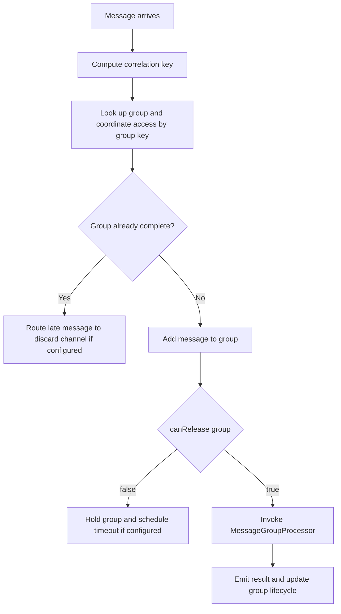

# ReleaseStrategy: Deciding When the Aggregator Emits a Result

In a Spring Integration flow, related messages often arrive at different times. The aggregator stores them in groups, but it needs a rule to know when it can combine them. `ReleaseStrategy` expresses that rule.

This lesson belongs to the **Aggregator** chapter of the `SPRING_INTEGRATION_CORE` module and focuses on designing group release conditions, configuring them via Java DSL, coordinating with timeouts, and testing behavior when messages are missing or duplicated. Examples use Java 17 and the Spring Integration 6.x API; the application needs `spring-integration-core`, Spring Context, and JUnit Jupiter for testing. If using Spring Boot, integration components can be brought in via `spring-boot-starter-integration`, letting the project's dependency management choose compatible versions.

## 1. Starting from a Concrete Business Rule

An order-processing system needs to collect replies from three services:

- `inventory`: checks stock availability.
- `pricing`: confirms pricing.
- `fraud`: evaluates fraud risk.

Each order check run has its own `requestKey`, such as `tenant-1:order-42:attempt-1`. The group release rule is: **at least one reply has been received from every required service**.

| Replies Currently in Group | Aggregated? | Explanation |
| --- | --- | --- |
| `inventory` | No | Missing `pricing`, `fraud` |
| `inventory`, `pricing` | No | Missing `fraud` |
| `inventory`, `inventory`, `pricing` | No | Three messages, but only two distinct services |
| `fraud`, `inventory`, `pricing` | Yes | All three services present, regardless of arrival order |
| `inventory=true`, `pricing=true`, `fraud=false` | Yes | Enough replies; the business decision is rejected |

The last point is crucial: **being eligible for aggregation does not mean business success**. A rejection reply is still a valid reply. Counting only successful replies could leave the group waiting forever for a result that a service has already officially rejected.

## 2. The ReleaseStrategy Contract

The interface resides in package `org.springframework.integration.aggregator`:

```java
public interface ReleaseStrategy {
    boolean canRelease(MessageGroup group);
}
```

`canRelease()` takes a `MessageGroup` and returns the decision:

- `true`: the group qualifies to run the aggregation step.
- `false`: keep holding the group and wait for additional messages or expiration.

Because it is a functional interface, it can be implemented as a class, lambda, or method reference. See [ReleaseStrategy API](https://docs.spring.io/spring-integration/docs/6.3.2/api/org/springframework/integration/aggregator/ReleaseStrategy.html).

Distinguish the three responsibilities inside an Aggregator:

| Component | Question to Answer | Example |
| --- | --- | --- |
| `CorrelationStrategy` | Which group does the message belong to? | Read `requestKey` from header |
| `ReleaseStrategy` | Is the current group ready? | All required services received |
| `MessageGroupProcessor` | What result should be created from the group? | Produce an order approval or rejection decision |

`ReleaseStrategy` makes a decision for the entire group; it does not pick a single message to send, is not a per-message filter, and is not responsible for constructing the output payload. This separation of duties is described in [Spring Integration Aggregator documentation](https://docs.spring.io/spring-integration/reference/aggregator.html#aggregator-functionality).

### Data Readable from MessageGroup

| API | Meaning When Designing Conditions |
| --- | --- |
| `getGroupId()` | Key correlating the group's messages |
| `size()` | Current number of messages in the group |
| `getMessages()` | Currently held messages for reading payloads or headers |
| `getSequenceSize()` | Expected sequence size; `0` when unknown |
| `getTimestamp()` | Group creation timestamp, in milliseconds since epoch |
| `getLastModified()` | Timestamp when the group was last updated |
| `isComplete()` | Status indicating whether the group is already marked complete |

`size()` is not the number of customers, order lines, or distinct services. To count business entities, identify the business key and compute the corresponding set of keys. Method details are in [MessageGroup API](https://docs.spring.io/spring-integration/api/org/springframework/integration/store/MessageGroup.html).

## 3. How the Decision Fits into the Group Lifecycle

The normal processing flow can be pictured as follows:



The diagram omits transaction details and output sending mechanics to focus on the release condition. On the normal path, the strategy sees the group after the new message is added. During expiration handling, the framework may also re-query the strategy. Therefore, do not assume `canRelease()` is called only once per group. You can verify the call flow in [AbstractCorrelatingMessageHandler source](https://raw.githubusercontent.com/spring-projects/spring-integration/v6.3.2/spring-integration-core/src/main/java/org/springframework/integration/aggregator/AbstractCorrelatingMessageHandler.java).

A well-behaved strategy should have these characteristics:

1. Read group state and compute a decision without removing or adding messages.
2. Not change its outcome merely from being called again with the same data, unless intentionally designing a time-dependent condition.
3. Not send output messages, update orders, or call payment services inside `canRelease()`.
4. Not store a counter shared across groups in a field of a singleton bean.

The following example is wrong because the counter is not scoped to a group and invocation count does not equal valid reply count:

```java
// Do not use this approach for the group completion condition.
private final AtomicInteger invocations = new AtomicInteger();

public boolean canRelease(MessageGroup group) {
    return invocations.incrementAndGet() >= 3;
}
```

Instead, compute the condition from `group`, or use deliberately managed and persisted group metadata.

## 4. Choosing a Group Release Condition Type

### 4.1. Enough Messages in a Sequence

`SimpleSequenceSizeReleaseStrategy` compares the current message count against the expected sequence size. This is the typical default strategy of an Aggregator when partial sequence release is not configured. It does not check for duplicate `sequenceNumber` values and does not support releasing partial sequences. See [SimpleSequenceSizeReleaseStrategy API](https://docs.spring.io/spring-integration/api/org/springframework/integration/aggregator/SimpleSequenceSizeReleaseStrategy.html).

The condition in the implementation is an equality comparison between `group.getSequenceSize()` and `group.size()`. See [strategy source code](https://raw.githubusercontent.com/spring-projects/spring-integration/v6.3.2/spring-integration-core/src/main/java/org/springframework/integration/aggregator/SimpleSequenceSizeReleaseStrategy.java).

This design fits when upstream creates a sequence of known size and preserves the sequence contract along the path. Reconsider it if:

- A filter drops an element while `sequenceSize` retains the original value.
- A branch never sends a reply.
- An element is redelivered as a new message carrying the same business position.
- Upstream emits streaming data whose total count is not yet known.

For example: the expected sequence has three elements, but only elements 1 and 3 pass a filter. If still waiting for three, the group can never complete normally. You can change the completion rule, or represent the filtered-out element with an explicit status reply to preserve the "every branch yields a result" contract.

A sequence with positions `1, 1, 3` likewise does not prove position `2` was received. When business rules require all distinct positions, simply counting messages is insufficient.

### 4.2. Reaching a Fixed Threshold

The following Java DSL snippet only illustrates the Aggregator configuration portion and must be placed inside an `IntegrationFlow`:

```java
.aggregate(spec -> spec
    .correlationExpression("headers['batchId']")
    .releaseStrategy(group -> group.size() >= 10)
    .outputExpression("messages.![payload]"))
```

This condition fits a batch with a clear termination rule at threshold 10. It does not automatically create rolling windows for an unbounded data stream. If you want a result every 10 events, you must design both the batch key and how processing advances to the next batch.

`>=` expresses the intent "threshold reached," while `==` expresses "exact size." However, changing the operator does not solve duplicate replies, mis-correlated keys, or missing data.

### 4.3. Complete Business Identities or a Quorum

For the three-service problem, the appropriate condition is:

```text
requiredServices ⊆ servicesPresentInGroup
```

For a quorum, count distinct participants satisfying the criterion. For example, "at least two of three suppliers confirm" must count two suppliers, not two messages from the same supplier.

Also define cases where quorum can no longer be reached. If all suppliers have replied and only one approved, the system should emit a failure decision rather than waiting for a nonexistent fourth reply.

### 4.4. Encountering a Sentinel End Message

An `END` marker is only sufficient to terminate if the delivery contract guarantees all required data arrives before the marker. When multiple branches run concurrently, the marker can overtake in-flight data elements.

A safer protocol has the marker carry `expectedCount`, and releases only once the marker is seen and enough distinct business elements have arrived. The output payload must also handle the marker explicitly to avoid leaking it into user data lists.

## 5. Complete Example: Waiting for All Three Services

The example below provides an input channel receiving replies, an output channel holding decisions, and a discard channel receiving late messages. Place the code in a Java file matching the class name within the application's package.

```java
package example.integration;

import java.util.HashMap;
import java.util.HashSet;
import java.util.Map;
import java.util.Set;

import org.springframework.context.annotation.Bean;
import org.springframework.context.annotation.Configuration;
import org.springframework.integration.aggregator.ReleaseStrategy;
import org.springframework.integration.channel.DirectChannel;
import org.springframework.integration.channel.QueueChannel;
import org.springframework.integration.config.EnableIntegration;
import org.springframework.integration.dsl.IntegrationFlow;
import org.springframework.integration.store.MessageGroup;
import org.springframework.messaging.Message;
import org.springframework.messaging.MessageChannel;
import org.springframework.messaging.PollableChannel;

@Configuration(proxyBeanMethods = false)
@EnableIntegration
public class ReleaseStrategyExample {

    private static final Set<String> REQUIRED_SERVICES =
            Set.of("inventory", "pricing", "fraud");

    public record ServiceReply(String service, boolean success) {
        public ServiceReply {
            if (service == null || service.isBlank()) {
                throw new IllegalArgumentException("service must not be blank");
            }
        }
    }

    public record OrderDecision(
            String requestKey,
            boolean complete,
            boolean approved,
            Set<String> missingServices,
            Map<String, Boolean> replies) {
    }

    public static final class RequiredServicesReleaseStrategy
            implements ReleaseStrategy {

        private final Set<String> requiredServices;

        public RequiredServicesReleaseStrategy(Set<String> requiredServices) {
            if (requiredServices == null || requiredServices.isEmpty()) {
                throw new IllegalArgumentException(
                        "requiredServices must not be empty");
            }
            this.requiredServices = Set.copyOf(requiredServices);
        }

        @Override
        public boolean canRelease(MessageGroup group) {
            Set<String> responders = new HashSet<>();

            for (Message<?> message : group.getMessages()) {
                if (!(message.getPayload() instanceof ServiceReply reply)) {
                    throw new IllegalArgumentException(
                            "Expected ServiceReply payload");
                }
                responders.add(reply.service());
            }

            return responders.containsAll(this.requiredServices);
        }
    }

    @Bean
    public MessageChannel serviceReplies() {
        return new DirectChannel();
    }

    @Bean
    public PollableChannel orderDecisions() {
        return new QueueChannel();
    }

    @Bean
    public PollableChannel discardedReplies() {
        return new QueueChannel();
    }

    @Bean
    public ReleaseStrategy releaseWhenAllServicesReply() {
        return new RequiredServicesReleaseStrategy(REQUIRED_SERVICES);
    }

    @Bean
    public IntegrationFlow orderDecisionFlow(
            ReleaseStrategy releaseWhenAllServicesReply) {

        return IntegrationFlow.from("serviceReplies")
                .aggregate(spec -> spec
                        .correlationExpression("headers['requestKey']")
                        .releaseStrategy(releaseWhenAllServicesReply)
                        .outputProcessor(ReleaseStrategyExample::toDecision)
                        .groupTimeout(5_000)
                        .sendPartialResultOnExpiry(true)
                        .expireGroupsUponCompletion(false)
                        .expireGroupsUponTimeout(false)
                        .discardChannel("discardedReplies"))
                .channel("orderDecisions")
                .get();
    }

    private static OrderDecision toDecision(MessageGroup group) {
        Map<String, Boolean> replies = new HashMap<>();

        for (Message<?> message : group.getMessages()) {
            ServiceReply reply = (ServiceReply) message.getPayload();
            if (REQUIRED_SERVICES.contains(reply.service())) {
                replies.merge(reply.service(), reply.success(),
                        (left, right) -> left && right);
            }
        }

        Set<String> missing = new HashSet<>(REQUIRED_SERVICES);
        missing.removeAll(replies.keySet());

        boolean complete = missing.isEmpty();
        boolean approved = complete
                && replies.values().stream().allMatch(Boolean.TRUE::equals);

        return new OrderDecision(
                group.getGroupId().toString(),
                complete,
                approved,
                Set.copyOf(missing),
                Map.copyOf(replies));
    }
}
```

Methods such as `releaseStrategy`, `releaseExpression`, `groupTimeout`, and `discardChannel` belong to the correlating handler specification in Java DSL; `outputProcessor` configures the Aggregator's output builder. Signatures can be checked in [CorrelationHandlerSpec API](https://docs.spring.io/spring-integration/docs/6.3.2/api/org/springframework/integration/dsl/CorrelationHandlerSpec.html) and [AggregatorSpec API](https://docs.spring.io/spring-integration/api/org/springframework/integration/dsl/AggregatorSpec.html).

### Contracts Assumed by the Example

**Correlation key must be present.** The sender must attach a valid `requestKey` header to every message. In multi-tenant or multi-attempt systems, the key must distinguish both tenant and attempt. Never use a shared default value for all messages missing a key.

**The strategy only verifies all required responders.** A reply from a service outside the required list cannot substitute for a missing service. The example assumes a fixed service set; if the required set varies per request, attach the policy version or required set to the group context. Do not mutate a shared configuration set while groups are collecting without defining how changes are handled.

**A rejection result still completes the group.** `fraud=false` makes `approved=false`, but does not prevent the group from completing once all services are present.

**Duplicate replies do not inflate the service count.** The strategy uses a `Set`. The processor also merges results by service name so it never emits multiple entries for the same responder.

**Conflicts are resolved intentionally.** In the example, if a service sends both `true` and `false` before group release, `false` wins. The `left && right` operation does not depend on collection iteration order. This is an illustrative policy; an application may use authoritative versions or timestamps if it wants the newest reply.

**Emitted decisions are not silently mutated.** Another reply arriving after group completion follows the late-message policy. If the business allows revising decisions afterward, introduce an amendment workflow or a new check run with its own key.

**Wrong payload type is a contract error.** The strategy throws an exception instead of turning bad data into an infinite wait. Validate data at ingress and design the flow's error-handling path; `discardChannel` does not replace error handling.

**The example uses in-memory storage.** It is suitable for learning and testing behavior. Durability across restarts, queue capacity limits, and metadata cleanup must be designed additionally for production applications.

## 6. Lambda, SpEL, and POJO: Three Alternative Configuration Styles

The snippets below are standalone alternatives for the `.releaseStrategy(...)` section; do not combine all of them on the same Aggregator.

### Lambda

```java
.releaseStrategy(group -> group.size() >= 3)
```

A lambda is readable when the condition is short and message count is genuinely the business metric being counted. For service sets, deduplication, and complex rules, a clearly named class expresses intent better.

### SpEL Expression

```java
.releaseExpression("size() >= 3")
```

With `releaseExpression`, the root object of the expression is the `MessageGroup`; hence `size()` here is the group size. This configuration option is provided by [CorrelationHandlerSpec API](https://docs.spring.io/spring-integration/docs/6.3.2/api/org/springframework/integration/dsl/CorrelationHandlerSpec.html#releaseExpression(java.lang.String)).

Do not use "received the message with the last sequence number" as a substitute for "received all positions" if messages can arrive out of order. Element 3 can arrive before element 2.

### Method on a POJO

```java
import java.util.List;

import org.springframework.messaging.Message;

public class ThreeReplyPolicy {

    public boolean ready(List<Message<?>> messages) {
        return messages.size() >= 3;
    }
}
```

Reference the object and method name in DSL:

```java
.releaseStrategy(new ThreeReplyPolicy(), "ready")
```

The framework provides `MethodInvokingReleaseStrategy` to invoke a POJO method; see [MethodInvokingReleaseStrategy API](https://docs.spring.io/spring-integration/docs/6.3.2/api/org/springframework/integration/aggregator/MethodInvokingReleaseStrategy.html).

You can use the `org.springframework.integration.annotation.ReleaseStrategy` annotation when choosing annotation-based configuration. Distinguish this annotation from the interface of the same name in the `aggregator` package; see [ReleaseStrategy annotation definition](https://raw.githubusercontent.com/spring-projects/spring-integration/v6.3.2/spring-integration-core/src/main/java/org/springframework/integration/annotation/ReleaseStrategy.java). In the POJO example above, DSL already specifies the method name explicitly, so the annotation is unnecessary.

## 7. Timeout: Waiting for Enough Data and Time Limits Are Two Coordinated Decisions

### 7.1. A Time Expression Does Not Schedule Re-evaluation by Itself

The following strategy only answers the question when something calls it:

```java
public boolean canRelease(MessageGroup group) {
    return System.currentTimeMillis() - group.getTimestamp() >= 5_000;
}
```

Suppose the last message arrives at second 1 and no further messages arrive. Even after the clock passes second 5, that code does not run by itself. You need an execution trigger such as `groupTimeout` or a scheduled reaper.

In the complete example, `.groupTimeout(5_000)` configures the idle wait time without a new message arriving for the group. If the group keeps receiving messages while the strategy still says not ready, the wait schedule resets. When a fixed deadline from group creation is required, replace that line with:

```java
// Replaces .groupTimeout(5_000); do not configure both at the same time.
.groupTimeout(group -> new java.util.Date(group.getTimestamp() + 5_000L))
```

A group receiving data at `t=0`, `t=3s`, `t=6s` illustrates the difference: a 5-second idle timeout can shift out to roughly `t=11s`; a deadline from group creation remains around `t=5s`. Execution may still lag due to scheduler load or lock contention, so this is not a hard real-time guarantee. Timeout behavior and `Date` return types are documented in [Aggregator and Group Timeout](https://docs.spring.io/spring-integration/reference/aggregator.html#aggregator-and-group-timeout).

A deadline from group creation is also not necessarily the deadline from when the user started the request. If an end-to-end SLA is needed, carry a business deadline on the messages and enforce the same deadline across related steps.

### 7.2. Output on Expiry Must Reflect Incomplete Data

The example configured:

```java
.sendPartialResultOnExpiry(true)
```

If `fraud` still has not replied at expiry, the processor can be called with the incomplete group. Accordingly, `toDecision()` computes `missingServices` from the current group and returns `complete=false`, `approved=false`.

If `sendPartialResultOnExpiry(false)` is chosen and the strategy still refuses release at expiry, messages are routed along the discard path instead of producing an aggregated result. Timeout logic gives the strategy one more chance to decide before applying the expiry branch; see [forceComplete source](https://raw.githubusercontent.com/spring-projects/spring-integration/v6.3.2/spring-integration-core/src/main/java/org/springframework/integration/aggregator/AbstractCorrelatingMessageHandler.java).

A processor that only works when all three services are present will not fit partial-result-on-expiry configuration. For instance, accessing `replies.get("fraud")` directly and unboxing to `boolean` will fail when that service is absent.

In a real API, you can route results further based on `complete` or business status. Never send an incomplete-data decision down the same order-approval branch.

### 7.3. Reaper and Restarts

`MessageGroupStoreReaper` provides an expiration sweep over groups in the store; the application must ensure it is invoked on a suitable schedule. It is useful when you need to clean up stalled groups. See [MessageGroupStoreReaper API](https://docs.spring.io/spring-integration/docs/6.3.2/api/org/springframework/integration/store/MessageGroupStoreReaper.html).

Storing groups in a database does not automatically turn in-memory scheduled tasks into persistent schedules. When designing restart recovery, verify how old groups are discovered, expired, and cleaned up. This is a separate requirement beyond persisting payloads.

## 8. Group Completion, Deletion, and Late Messages

You must decide whether the system needs to remember a completed `requestKey`.

| Normal Completion Configuration | Design Consequence |
| --- | --- |
| `expireGroupsUponCompletion(false)` | Retains completion metadata; late messages with the same key are dropped per discard policy |
| `expireGroupsUponCompletion(true)` | Deletes group; subsequent messages with the same key can open a new group |

`AggregatingMessageHandler` manages the post-release step and deletes the entire group only when the corresponding option is set; see [AggregatingMessageHandler source](https://raw.githubusercontent.com/spring-projects/spring-integration/v6.3.2/spring-integration-core/src/main/java/org/springframework/integration/aggregator/AggregatingMessageHandler.java).

Timeouts have their own option, `expireGroupsUponTimeout`. The example sets both options to `false` to preserve completion markers after both normal completion and partial-result timeout. Do not set only the normal completion option and assume timeouts behave identically; see [expireGroupsUponTimeout API](https://docs.spring.io/spring-integration/docs/6.3.2/api/org/springframework/integration/dsl/CorrelationHandlerSpec.html#expireGroupsUponTimeout(boolean)).

Retaining metadata enables late-message detection, but grows state with the number of completed requests. Establish an appropriate retention and purge policy. Once metadata is purged or lost due to an in-memory store restart, memory of old keys is also lost.

For business flows requiring deduplicated outcomes across restarts or multiple attempts, add idempotency where the result is applied. `canRelease()` returning `true` does not by itself guarantee a single business side effect across all redeliveries, output errors, and restarts.

## 9. Testing the True Meaning of the Release Condition

Separate tests of the `canRelease()` rule from tests of message routing. The rule might be right while the flow still fails due to correlation keys, output configuration, or late-message policy.

`SimpleMessageGroup` supports creating a keyed group and adding messages, making it suitable for building test data for strategies; see [SimpleMessageGroup API](https://docs.spring.io/spring-integration/docs/6.3.2/api/org/springframework/integration/store/SimpleMessageGroup.html).

The JUnit Jupiter example below reuses the class from section 5:

```java
package example.integration;

import java.util.Set;

import org.junit.jupiter.api.Test;
import org.springframework.context.annotation.AnnotationConfigApplicationContext;
import org.springframework.integration.aggregator.ReleaseStrategy;
import org.springframework.integration.store.SimpleMessageGroup;
import org.springframework.messaging.Message;
import org.springframework.messaging.MessageChannel;
import org.springframework.messaging.PollableChannel;
import org.springframework.messaging.support.MessageBuilder;

import example.integration.ReleaseStrategyExample.OrderDecision;
import example.integration.ReleaseStrategyExample.RequiredServicesReleaseStrategy;
import example.integration.ReleaseStrategyExample.ServiceReply;

import static org.junit.jupiter.api.Assertions.*;

class ReleaseStrategyExampleTest {

    @Test
    void duplicateRepliesDoNotReplaceAMissingService() {
        ReleaseStrategy strategy = new RequiredServicesReleaseStrategy(
                Set.of("inventory", "pricing", "fraud"));
        SimpleMessageGroup group = new SimpleMessageGroup("attempt-1");

        assertFalse(strategy.canRelease(group));

        group.add(reply("attempt-1", "inventory", true));
        group.add(reply("attempt-1", "inventory", true));
        group.add(reply("attempt-1", "pricing", true));

        assertEquals(3, group.size());
        assertFalse(strategy.canRelease(group));
        assertFalse(strategy.canRelease(group));

        group.add(reply("attempt-1", "fraud", false));

        assertTrue(strategy.canRelease(group));
        assertTrue(strategy.canRelease(group));
    }

    @Test
    void flowEmitsARejectionAfterAllServicesReply() {
        try (var context = new AnnotationConfigApplicationContext(
                ReleaseStrategyExample.class)) {

            MessageChannel input = context.getBean(
                    "serviceReplies", MessageChannel.class);
            PollableChannel output = context.getBean(
                    "orderDecisions", PollableChannel.class);
            PollableChannel discarded = context.getBean(
                    "discardedReplies", PollableChannel.class);

            String key = "tenant-1:order-42:attempt-1";
            input.send(reply(key, "inventory", true));
            input.send(reply(key, "inventory", true));
            input.send(reply(key, "pricing", true));

            assertNull(output.receive(0));

            input.send(reply(key, "fraud", false));
            Message<?> result = output.receive(1_000);

            assertNotNull(result);
            OrderDecision decision = assertInstanceOf(
                    OrderDecision.class, result.getPayload());
            assertEquals(key, decision.requestKey());
            assertTrue(decision.complete());
            assertFalse(decision.approved());
            assertTrue(decision.missingServices().isEmpty());
            assertEquals(3, decision.replies().size());

            input.send(reply(key, "fraud", true));

            assertNotNull(discarded.receive(1_000));
            assertNull(output.receive(0));
        }
    }

    private static Message<ServiceReply> reply(
            String requestKey, String service, boolean success) {

        return MessageBuilder.withPayload(new ServiceReply(service, success))
                .setHeader("requestKey", requestKey)
                .build();
    }
}
```

The two `inventory` messages in the test are constructed separately, so they have distinct message IDs. This proves the strategy prevents double-counting **service identity**, rather than merely relying on the store detecting the exact same message object.

Repeatedly calling `canRelease()` on the same group also catches bugs where invocation count is used as the completion condition.

### Additional Scenarios to Cover in a Project

| Scenario | Outcome to Verify |
| --- | --- |
| Replies arrive in every valid order | Releases only when all required services are present |
| Two `requestKey` values interleave | Each group produces its own decision without borrowing replies |
| Reply from a non-required service arrives | Does not substitute for a missing service |
| `fraud` missing at expiry | Produces `complete=false`, missing `fraud`, not approved |
| One service sends conflicting results before release | Applies the `false`-wins rule in the sample processor |
| Late message after timeout | Follows the configured completed-group policy |
| Missing correlation key or wrong payload type | Detected and enters the chosen error-handling path |
| Restart with persistent store | Unfinished groups are recovered and can either continue or expire |

In timeout tests, receive from the output channel with a finite timeout and assert on the payload; avoid merely calling `Thread.sleep()` and treating no thrown exception as success. For complex time-dependent deadline tests, inject a clock or scheduler as a dependency so it can be controlled in tests.

## 10. Performance and Concurrency

### Group Re-Scanning Cost

The strategy in the example iterates over messages to build the set of services. For small groups, this is clear and easy to verify. For a group with `n` messages re-scanned on every addition, total element inspections can approach:

```text
1 + 2 + ... + n = n × (n + 1) / 2
```

For example, a group of 10,000 messages can cause roughly 50 million element checks. That estimates only the re-scanning algorithm, excluding store reads or collection allocations.

When groups are large, evaluate whether the condition can be expressed using smaller metadata: expected size, normalized key set, or consistently updated group state. Do not optimize with a local in-memory `Map` while neglecting restarts, multiple instances, and cleanup.

### Do Not Hold Processing Under the Group Key Lock

The strategy should avoid HTTP calls, slow queries, or waiting on locks in another system. One group waiting on an external resource can block other messages targeting the same group.

When multiple instances share one store, coordinate locks across instances and understand the consistency guarantees of the chosen store. `LockRegistry` is part of the correlation configuration; distributed lock configuration must match the deployment topology. See [lockRegistry API](https://docs.spring.io/spring-integration/docs/6.3.2/api/org/springframework/integration/dsl/CorrelationHandlerSpec.html#lockRegistry(org.springframework.integration.support.locks.LockRegistry)).

A pure strategy without mutable singleton state avoids many concurrency bugs; it still needs to run within a sound store and locking design.

## 11. Diagnosing Common Issues

| Symptom | Cause to Investigate | Remediation |
| --- | --- | --- |
| Group never releases | Waiting for a sequence missing an element, or strategy counts only success replies | Redefine completion condition and failure-reply rules |
| Releases early with a missing service | Counting messages instead of service identities | Use a set of business keys or deduplicate before counting |
| Only random orders complete | Orders share a correlation key or a singleton counter | Fix group keys and remove shared state from strategy |
| Enough time passed with no output | Only checked elapsed time inside `canRelease()` | Configure timeout mechanism or scheduled expiration |
| Group stays alive long past timeout | Idle timeout keeps resetting on new messages | Re-evaluate idle timeout vs. fixed deadline |
| Processor fails at expiry | Processor assumes the group is always complete | Handle missing data or disable partial results |
| Multiple decisions for the same order | Group was deleted, key reused, or output side effect re-executed | Scope keys per attempt, tune metadata retention, and add idempotency |
| Memory or store grows endlessly | Incomplete groups have no timeout, or completion metadata is never purged | Configure appropriate expiration and retention policies |

When observing a group, log the correlation key, message count, set of responders received, set missing, group age, and release reason. Distinguishing "complete data" from "expired" helps explain partial results and identify services that consistently reply late.

## 12. Hands-On Practice

1. Change the send order to `fraud`, `pricing`, `inventory`. Confirm the group still releases only after all three services arrive.
2. Send multiple `inventory` replies before sending `fraud`. Confirm message count increases while the all-services condition remains unmet.
3. Send only `inventory` and `pricing`. Observe the expired result, then inspect `missingServices` and `approved`.
4. Interleave replies for two different attempts. Verify they do not merge into a single shared decision.
5. Change the policy to "at least two services approve or all three have replied." Before writing code, determine the output when only two replies arrive, both rejecting, and the third has not arrived yet.

Across these exercises, always articulate three things separately: **which key identifies a group, what condition permits completion, and how the business outcome is computed**. When those three decisions are clear, `ReleaseStrategy` usually becomes a small, readable, easily testable function.
