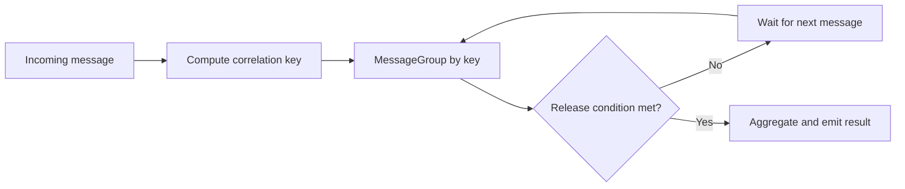

# Correlation Key

## 1. What Question Does a Correlation Key Answer?

In the **Aggregator** chapter of the **SPRING_INTEGRATION_CORE** module, a correlation key identifies which messages belong to the same group to be aggregated. Designing the key properly lets the message flow pair parts of a business operation accurately, even when messages arrive interleaved, cross multiple channels, or run on different threads.

Suppose the system receives parts of orders:

| Message | Tenant | Order | Processing Batch | Data Part |
| --- | --- | --- | --- | --- |
| M1 | shop-a | O-101 | B-1 | P-1 |
| M2 | shop-a | O-202 | B-1 | P-1 |
| M3 | shop-a | O-101 | B-1 | P-2 |
| M4 | shop-b | O-101 | B-1 | P-1 |

M1 and M3 must go into the same group. M2 belongs to a different order. M4 shares the same order ID as M1 but belongs to a different tenant, so it must be placed in a separate group.

An appropriate key for this situation is the triple:

```text
K(message) = (tenantId, orderId, batchId)
```

`batchId` represents a single business aggregation run. If order O-101 is recalculated in batch B-2, the new result must be isolated from B-1.

After this lesson, you should be able to choose a key matching the business scope, configure the strategy in Java DSL, preserve the key across endpoints, and diagnose why groups get mixed or fail to complete.

## 2. Separating Correlation, Release, and Aggregation

Three decisions often sit side by side in aggregator configuration but carry distinct responsibilities:

| Decision | Question | Example |
| --- | --- | --- |
| Correlation | Which group does the message belong to? | Same tenant, order, and processing batch |
| Release | Is the group ready to emit a result? | Both valid parts received |
| Aggregation | What result should be created from the group? | Sum the amounts of the parts |

Mental model:



A good release strategy cannot fix cross-tenant mixing caused by an overly broad key. Conversely, an exact key does not guarantee group release if data is missing or the completion condition is wrong.

This is the division of responsibilities for aggregators in [Spring Integration documentation](https://docs.spring.io/spring-integration/reference/aggregator.html).

### Two Properties to Check When Designing a Key

For key function `K`:

1. Messages belonging to the same aggregation run must yield equal keys.
2. Messages belonging to two independent aggregation runs must yield different keys within the storage scope in use.

For instance, adding `partId` to the key violates the first property: P-1 and P-2 get split into different groups. Using only `orderId` in a multi-tenant system violates the second property.

Both directions must be evaluated. Proving only that "two messages of the same order have the same key" is not enough.

## 3. IDs and Headers Frequently Confused

### 3.1. `id` Is Not the Default Correlation Key

`MessageHeaders.ID` identifies a single message. Different parts are typically different messages, so using each part's individual ID as the key creates many single-element groups.

Wrong example for aggregating parts of the same order:

```java
.aggregate(a -> a
    .correlationStrategy(message -> message.getHeaders().getId())
    .releaseStrategy(group -> group.size() == 2))
```

In this model, there is no reason for two independent parts to share a message ID; groups may wait forever.

### 3.2. The `correlationId` Header

When no custom strategy is provided, the aggregator uses the value of the `IntegrationMessageHeaderAccessor.CORRELATION_ID` header, named `correlationId`, to identify the group. Spring Integration supplies `HeaderAttributeCorrelationStrategy` for deriving keys from a header. See [Aggregator default mechanism](https://docs.spring.io/spring-integration/reference/aggregator.html) and [HeaderAttributeCorrelationStrategy API](https://docs.spring.io/spring-integration/api/org/springframework/integration/aggregator/HeaderAttributeCorrelationStrategy.html).

Example building a message with an explicit group key:

```java
import org.springframework.integration.IntegrationMessageHeaderAccessor;
import org.springframework.messaging.Message;
import org.springframework.messaging.support.MessageBuilder;

Message<String> part = MessageBuilder.withPayload("part-1")
    .setHeader(IntegrationMessageHeaderAccessor.CORRELATION_ID,
        "order-v1:shop-a:O-101:B-1")
    .setHeader(IntegrationMessageHeaderAccessor.SEQUENCE_NUMBER, 1)
    .setHeader(IntegrationMessageHeaderAccessor.SEQUENCE_SIZE, 2)
    .build();
```

The second message must carry the same `correlationId`, `sequenceNumber` equal to 2, and `sequenceSize` equal to 2. In this example, the string components are already constrained not to contain the delimiter.

### 3.3. Fields with Different Meanings

| Field | Role | Suitable as a Group Key? |
| --- | --- | --- |
| `MessageHeaders.ID` | Identifies a single message | Usually unsuitable for multiple independent parts |
| `correlationId` | Standard header for linking messages | Suitable if the value accurately represents the aggregation run |
| `sequenceNumber` | Position of the part within a sequence | Cannot distinguish groups on its own |
| `sequenceSize` | Expected part count of the sequence | Data for release, does not identify the group |
| `orderId` | Order identifier | Must also consider tenant and processing batch |
| `eventId` or `partId` | Event or data-part identifier | Usually for duplicate control |
| Trace ID | Links operations for observability | Suitable only if it aligns with the designed business scope |

Do not assume one trace always corresponds to one group: a single request may spawn multiple groups, and messages in the same group may originate from multiple requests.

## 4. The `CorrelationStrategy` Contract

The strategy takes a `Message<?>` and supplies the key via `getCorrelationKey`. Because it is a functional interface, it can be implemented with a lambda. If a key cannot be determined, throw a meaningful exception; do not return `null`. This contract is described in [CorrelationStrategy API](https://docs.spring.io/spring-integration/api/org/springframework/integration/aggregator/CorrelationStrategy.html).

A strategy reading a header with type validation:

```java
import org.springframework.integration.aggregator.CorrelationStrategy;

CorrelationStrategy byBatchHeader = message -> {
    String key = message.getHeaders().get("aggregationKey", String.class);
    if (key == null || key.isBlank()) {
        throw new IllegalArgumentException("Missing aggregationKey");
    }
    return key;
};
```

Beyond existing, the key must have consistent equality semantics. Design the key as an immutable value with aligned `equals()` and `hashCode()`. Never use an object with mutable fields as a key and then mutate those fields after the message has been received.

Simple choices are typically `String`, `UUID`, or an immutable value object. For custom types, also check how the intended message store represents keys.

### Dangerous Fallbacks

```java
// Business logic error: lumps all messages missing a key into the same group.
return key == null ? "UNKNOWN" : key;
```

```java
// Business logic error: same group gets a new key on every call.
return java.util.UUID.randomUUID();
```

If using a UUID, generate it once at the start of the processing batch and propagate that exact value to every part and every retry of that batch. The strategy should only read or recompute the key from stable data.

## 5. Choosing Composite Keys by Business Scope

### 5.1. Add Tenant and Processing Batch When Needed

Compare options for the order aggregation flow:

| Option | Potential Consequence |
| --- | --- |
| `orderId` | Two tenants may be merged together |
| `(tenantId, orderId)` | Two recalculation runs for the same order may be merged together |
| `(tenantId, orderId, batchId)` | Isolates tenants and isolates aggregation batches |
| `(tenantId, orderId, batchId, partId)` | Each part is split into its own group |

`batchId` must be the stable identifier of the business run. Network-error retries still belong to the old run. An explicit user recalculation request can start a new run if that is the system's contract.

Do not include every available field in the key. Processing status, arrival time, retry count, hostname, and thread name routinely vary across parts of the same group.

### 5.2. Use a Value Object to Avoid Concatenation Ambiguity

Concatenating two components directly can yield the same representation:

```text
("ab", "c") -> "abc"
("a", "bc") -> "abc"
```

Even inserting `:` remains ambiguous if fields are allowed to contain that character. You can use an escaping encoder, length-prefixed encoding, or a value object:

```java
public record OrderBatchKey(
    String tenantId,
    String orderId,
    String batchId
) implements java.io.Serializable {
}
```

With immutable `String` fields, a record provides value-based equality suitable for the example. Avoid using arrays as key fields if you need content equality without defining custom comparison.

`Serializable` is only an option serving the corresponding storage mechanism. It does not prove every store persists and restores this key type in the exact same way.

### 5.3. Normalize at a Clear Boundary

If the system receives `orderId` from multiple sources, agree upfront:

- Are leading/trailing spaces valid?
- Are IDs case-sensitive?
- Does `00101` differ from `101`?
- Is the internal tenant code or display name the canonical value?

Do not blindly lowercase all IDs just to "make grouping easier." Normalization must preserve domain identity semantics and be applied consistently by all producers.

## 6. Configuration Options in Java DSL

The following snippets are alternative configurations on the aggregator endpoint, not options to chain together sequentially.

### 6.1. Using the Default Header

```java
.aggregate(a -> a
    .releaseStrategy(group -> group.size() == 2))
```

This keeps the default correlation strategy and replaces the release strategy. Counting two messages is appropriate only when input guarantees each part appears exactly once.

### 6.2. Using a Custom Header

```java
.aggregate(a -> a
    .correlationStrategy(
        new org.springframework.integration.aggregator
            .HeaderAttributeCorrelationStrategy("aggregationKey"))
    .releaseStrategy(group -> group.size() == 2))
```

A custom header is useful when you need to preserve `correlationId` for another sequence. Validate the header before the aggregator if you want clear error messages and handling policies.

### 6.3. Using SpEL

```java
.aggregate(a -> a
    .correlationExpression("headers['aggregationKey']")
    .releaseStrategy(group -> group.size() == 2))
```

An expression is concise for a single normalized field. When the key has multiple components and complex validation rules, a Java strategy is usually easier to test. The `correlationExpression`, `correlationStrategy`, and `releaseStrategy` options are documented in [Java DSL API](https://docs.spring.io/spring-integration/api/org/springframework/integration/dsl/CorrelationHandlerSpec.html).

### 6.4. Computing from the Payload

```java
.aggregate(a -> a
    .correlationStrategy(message -> {
        OrderPart part = (OrderPart) message.getPayload();
        return new OrderBatchKey(
            part.tenantId(), part.orderId(), part.batchId());
    })
    .releaseStrategy(group -> group.size() == 2))
```

Here `OrderPart` and `OrderBatchKey` are domain types defined in the full example below. When a transformer changes the payload type, any downstream strategy must read the new structure accordingly.

## 7. Complete Example: Aggregating Two Parts of an Order

### 7.1. Input Contract

The example uses Java 17 and Spring Integration 6.x Java DSL, with `spring-integration-core` and matching Spring dependencies on the classpath.

Contract of the illustrative flow:

- Each `(tenantId, orderId, batchId)` run has exactly two parts, with two distinct `partId` values.
- Input has already been deduplicated before entering this flow.
- Parts may arrive interleaved across orders or tenants.
- The key is extracted from the payload and validated before adding the message to a group.

The two-message count condition here relies on that contract. It does not perform deduplication or verify expected part IDs on its own.

### 7.2. Flow Configuration

```java
import java.io.Serializable;
import java.math.BigDecimal;
import java.util.List;
import java.util.Objects;

import org.springframework.context.annotation.Bean;
import org.springframework.context.annotation.Configuration;
import org.springframework.integration.channel.DirectChannel;
import org.springframework.integration.channel.QueueChannel;
import org.springframework.integration.config.EnableIntegration;
import org.springframework.integration.dsl.IntegrationFlow;
import org.springframework.integration.store.MessageGroup;
import org.springframework.messaging.Message;
import org.springframework.messaging.MessageChannel;

@Configuration
@EnableIntegration
public class CorrelationKeyFlowConfig {

    public record OrderPart(
        String tenantId,
        String orderId,
        String batchId,
        String partId,
        BigDecimal amount
    ) implements Serializable {
    }

    public record OrderBatchKey(
        String tenantId,
        String orderId,
        String batchId
    ) implements Serializable {
    }

    public record OrderTotal(
        OrderBatchKey key,
        BigDecimal amount
    ) implements Serializable {
    }

    @Bean
    public MessageChannel orderParts() {
        return new DirectChannel();
    }

    @Bean
    public QueueChannel completedOrders() {
        return new QueueChannel();
    }

    @Bean
    public QueueChannel lateOrExpiredParts() {
        return new QueueChannel();
    }

    @Bean
    public IntegrationFlow orderAggregationFlow() {
        return IntegrationFlow.from("orderParts")
            .transform(OrderPart.class, CorrelationKeyFlowConfig::validate)
            .aggregate(a -> a
                .correlationStrategy(CorrelationKeyFlowConfig::keyOf)
                .releaseStrategy(group -> group.size() == 2)
                .outputProcessor(CorrelationKeyFlowConfig::toTotal)
                .expireGroupsUponCompletion(false)
                .groupTimeout(30_000L)
                .sendPartialResultOnExpiry(false)
                .discardChannel("lateOrExpiredParts"))
            .channel("completedOrders")
            .get();
    }

    private static OrderPart validate(OrderPart part) {
        requireText(part.tenantId(), "tenantId");
        requireText(part.orderId(), "orderId");
        requireText(part.batchId(), "batchId");
        requireText(part.partId(), "partId");
        Objects.requireNonNull(part.amount(), "amount");
        return part;
    }

    private static void requireText(String value, String field) {
        if (value == null || value.isBlank()) {
            throw new IllegalArgumentException("Missing " + field);
        }
    }

    public static OrderBatchKey keyOf(Message<?> message) {
        OrderPart part = validate((OrderPart) message.getPayload());
        return new OrderBatchKey(
            part.tenantId(), part.orderId(), part.batchId());
    }

    private static OrderTotal toTotal(MessageGroup group) {
        List<OrderPart> parts = group.getMessages().stream()
            .map(message -> (OrderPart) message.getPayload())
            .toList();

        OrderPart first = parts.get(0);
        OrderBatchKey key = new OrderBatchKey(
            first.tenantId(), first.orderId(), first.batchId());

        BigDecimal total = parts.stream()
            .map(OrderPart::amount)
            .reduce(BigDecimal.ZERO, BigDecimal::add);

        return new OrderTotal(key, total);
    }
}
```

`orderParts` is a `DirectChannel`, so processing in the example runs synchronously on the sender's thread. `completedOrders` holds results for a consumer to receive later. There is no gateway waiting for an individual reply per part; a result appears only when the group releases.

`toTotal` takes the key from any part because the strategy already guarantees the key components of all messages in the group are equal. Addition does not depend on message ordering inside the group.

Customizing correlation and release is directly supported in [Aggregators and Resequencers in Java DSL](https://docs.spring.io/spring-integration/reference/dsl/java-aggregators.html). The domain classes and two-part rule in the example are illustrative lesson designs.

### 7.3. Progression When Messages Arrive Interleaved

```text
Receive shop-a / O-101 / B-1 / P-1 / 100
  -> Group (shop-a, O-101, B-1): 1 part -> wait

Receive shop-b / O-101 / B-1 / P-1 / 500
  -> Group (shop-b, O-101, B-1): 1 part -> wait

Receive shop-a / O-101 / B-1 / P-2 / 200
  -> Group (shop-a, O-101, B-1): 2 parts -> emit total 300

Receive shop-b / O-101 / B-1 / P-2 / 700
  -> Group (shop-b, O-101, B-1): 2 parts -> emit total 1200
```

If tenant is omitted from the key, the first two messages can get aggregated into 600. The flow still emits output without necessarily throwing an exception, yet the result is business-wise wrong. Therefore, checking only "output was produced" is insufficient to verify correlation.

## 8. Testing Key Correctness and Group Isolation

### 8.1. Testing the Strategy

A useful test suite should cover these relationships:

| Two Messages | Expected Key Relationship |
| --- | --- |
| Same tenant, order, batch; different part | Equal |
| Different tenant; same order and batch | Different |
| Same tenant and order; different batch | Different |
| Same tenant and batch; different order | Different |
| Missing tenant or batch | Rejected |

Testing `keyOf` directly catches field-selection mistakes without running the entire flow. However, it does not prove the endpoint configuration is actually using that strategy, so real group behavior still needs flow testing.

### 8.2. Testing the Flow with Interleaved Messages

Place the following class in the same package as the configuration above. The example uses JUnit Jupiter and does not require starting a Spring Boot application:

```java
import java.math.BigDecimal;

import org.junit.jupiter.api.Test;
import org.springframework.context.annotation.AnnotationConfigApplicationContext;
import org.springframework.integration.channel.QueueChannel;
import org.springframework.messaging.Message;
import org.springframework.messaging.MessageChannel;
import org.springframework.messaging.support.MessageBuilder;

import static org.junit.jupiter.api.Assertions.*;

class CorrelationKeyFlowTest {

    @Test
    void keepsTenantsAndBatchesSeparate() {
        try (var context = new AnnotationConfigApplicationContext(
                CorrelationKeyFlowConfig.class)) {

            MessageChannel input = context.getBean(
                "orderParts", MessageChannel.class);
            QueueChannel output = context.getBean(
                "completedOrders", QueueChannel.class);

            assertTrue(input.send(part("shop-a", "B-1", "P-1", "100")));
            assertTrue(input.send(part("shop-b", "B-1", "P-1", "500")));
            assertTrue(input.send(part("shop-a", "B-2", "P-1", "900")));
            assertNull(output.receive(0));

            assertTrue(input.send(part("shop-a", "B-1", "P-2", "200")));
            var first = total(output);
            assertEquals(new CorrelationKeyFlowConfig.OrderBatchKey(
                "shop-a", "O-101", "B-1"), first.key());
            assertEquals(new BigDecimal("300"), first.amount());
            assertNull(output.receive(0));

            assertTrue(input.send(part("shop-b", "B-1", "P-2", "700")));
            var second = total(output);
            assertEquals(new CorrelationKeyFlowConfig.OrderBatchKey(
                "shop-b", "O-101", "B-1"), second.key());
            assertEquals(new BigDecimal("1200"), second.amount());

            assertTrue(input.send(part("shop-a", "B-2", "P-2", "100")));
            var third = total(output);
            assertEquals(new CorrelationKeyFlowConfig.OrderBatchKey(
                "shop-a", "O-101", "B-2"), third.key());
            assertEquals(new BigDecimal("1000"), third.amount());
            assertNull(output.receive(0));
        }
    }

    private static Message<?> part(
            String tenant, String batch, String partId, String amount) {
        return MessageBuilder.withPayload(
            new CorrelationKeyFlowConfig.OrderPart(
                tenant, "O-101", batch, partId, new BigDecimal(amount)))
            .build();
    }

    private static CorrelationKeyFlowConfig.OrderTotal total(
            QueueChannel output) {
        Message<?> message = output.receive(1_000);
        assertNotNull(message);
        return assertInstanceOf(
            CorrelationKeyFlowConfig.OrderTotal.class, message.getPayload());
    }
}
```

Checking that no output exists after the first three messages is critical: those three belong to three different groups. If correlation is configured too broadly, the test catches premature aggregation before even checking total values.

The test snippets in the lesson are practice code for learners to run in a matching project; including test code in the documentation does not imply it was executed in your environment.

## 9. Preserving Keys Across Splitters, Transformers, and Transport Boundaries

### 9.1. Flowing from Splitter to Aggregator

A splitter can set correlation and sequence headers to link the split parts. Thus, the splitter-then-aggregator pattern often leverages existing sequence metadata. See [Splitter guide](https://docs.spring.io/spring-integration/reference/splitter.html).

Still, choose the unit of aggregation explicitly:

- Combining parts generated from a single split: sequence correlation is usually appropriate.
- Combining independent events from multiple producers for an order batch: requires a shared business key understood by all producers.

When multiple split levels exist, do not overwrite one level's correlation header just to add a business key. Use a dedicated header such as `orderAggregationKey` and configure the corresponding aggregator to read that header.

### 9.2. When a Transformer Builds a New Message

If the key resides in a header, a step that manually constructs a new message copying only the payload can drop the key. When explicitly creating a new message, copy from the original message:

```java
Message<String> changed = MessageBuilder.fromMessage(part)
    .setPayload(part.getPayload().toUpperCase(java.util.Locale.ROOT))
    .build();
```

Here `part` is the `Message<String>` from the earlier header example. This keeps relevant headers from the input message. If the strategy reads the payload, preserve the identifying fields in the transformed DTO.

### 9.3. Across a Broker or HTTP

A Java header does not automatically become metadata with the same name and type on the receiving side. The messaging contract must specify where the key is carried, its data types, mapping rules, and validation on receipt.

Example convention for a JSON event:

```json
{
  "tenantId": "shop-a",
  "orderId": "O-101",
  "batchId": "B-1",
  "partId": "P-1",
  "amount": 100
}
```

The receiver reconstructs the exact same business key tuple from this data. There is no need to rely on passing a custom Java object verbatim across every transport.

## 10. Retries, Duplicate Messages, and Late Arrivals

### 10.1. Correlation Does Not Replace Deduplication

Two messages with the same key enter the same group, yet they may carry the same `partId`. For example:

```text
P-1 arrives first       -> group has 1 message
P-1 is redelivered      -> group can have 2 messages
P-2 has not arrived yet -> group.size() == 2 can still be satisfied
```

Therefore, distinguish:

```text
Group key: (tenantId, orderId, batchId)
Part key:  (tenantId, orderId, batchId, partId)
```

The part key serves duplicate detection. The group key serves combining distinct parts. Using the part key as the correlation key fragments groups.

Depending on business rules, you can deduplicate upstream, use an idempotency store, or release by the expected set of `partId` values. If the output processor still sums duplicates, changing only the release strategy to count distinct `partId` values does not finish solving duplicate summation.

### 10.2. Retries Preserve the Identity of the Aggregation Run

Suppose P-2 is resent because the producer did not receive an acknowledgement. The redelivery still needs `(shop-a, O-101, B-1)`. If the producer generates a new `batchId` on each retry, P-1 and P-2 can land in two groups that never complete.

Conversely, when a user explicitly requests recalculating an order, reusing B-1 can mix data from two calculations. The contract must distinguish a technical retry from a new business run.

### 10.3. Group Lifecycle Affects Key Reuse

For completed groups, `expireGroupsUponCompletion(false)` retains the group marker so late messages with the same key are routed to the discard channel. Setting `true` removes the group and lets a message with the same key start a new group. This mechanism is described in [Aggregator completed-groups documentation](https://docs.spring.io/spring-integration/reference/aggregator.html).

Choosing `false` in the illustrative configuration helps observe late messages, though group markers still require an appropriate cleanup policy. Once markers are purged, do not expect the aggregator to remember that run indefinitely.

Do not flip to `true` merely so an order can be recalculated. First determine whether the new calculation requires a new `batchId`.

### 10.4. Timeout and Key Errors Are Two Separate Branches

`groupTimeout(30_000L)` configures the group's wait duration; when a new message is added, the wait schedule may reset. Do not treat it as an absolute 30-second deadline from the first part. With `sendPartialResultOnExpiry(false)`, incomplete groups are not emitted as partial results; dropped messages go through the configured discard channel. See [Timeout and discard configuration API](https://docs.spring.io/spring-integration/api/org/springframework/integration/aggregator/AbstractCorrelatingMessageHandler.html).

Missing `tenantId` or `batchId` is an input contract error. In the example, the validator throws an exception before the aggregator; that error does not automatically turn into a message on `lateOrExpiredParts`. On a synchronous entry path, the `send` caller receives the processing error. To route it to a business-error branch, configure error handling at the appropriate ingress boundary.

In addition, deleting groups on timeout and retaining completed groups are two separate policies. Do not assume `expireGroupsUponCompletion(false)` retains timed-out groups in the same way.

## 11. Keys in Persistent Storage and Multi-Instance Environments

### 11.1. Identical Keys Are Not Enough to Share State

If instances A and B maintain separate in-memory stores, the same key K on two instances still maps to two independent state buckets:

```text
Instance A receives P-1 -> Store A: K has P-1
Instance B receives P-2 -> Store B: K has P-2
```

Neither has enough data. Design how parts are routed to the same processing node or how a shared store and coordinated updates work across instances.

The default store keeps data in memory. When using a persistent store, examine serialization of payloads, headers, and key representations rather than just swapping a bean definition. These constraints are described in [Message Store guide](https://docs.spring.io/spring-integration/reference/message-store.html).

### 11.2. Synchronization and Hot Keys

Updates to the same group must be coordinated. When sharing a store across instances, use a lock mechanism appropriate for the deployment; see [Aggregator Lock Registry rules](https://docs.spring.io/spring-integration/reference/aggregator.html).

An overly broad key such as `tenantId` alone can funnel thousands of orders into one processing point. Design consequences can include huge groups, long waits, and update contention. An overly granular key like adding arrival timestamp creates many small incomplete groups.

Key granularity must come from the business unit of aggregation. Do not invent random key components to reduce contention if doing so splits parts that belong together.

### 11.3. Separating Scope Across Flows

An order-total aggregation flow and a shipment-check aggregation flow may both encounter `(shop-a, O-101, B-1)` yet must not share business groups. When multiple endpoints share the same storage infrastructure, design separate data scopes per endpoint or include an explicit namespace in the key representation; also verify store limits and expiry callbacks.

A string convention might look like:

```text
order-total:v1:<tenant>:<order>:<batch>
shipment-check:v1:<tenant>:<order>:<batch>
```

This is an application convention, not a framework-mandated syntax. When migrating from v1 to v2, plan for messages still waiting under old keys; changing the key schema mid-run can split groups.

## 12. Diagnosing Issues by Symptom

| Symptom | Key-Related Hypothesis | How to Verify |
| --- | --- | --- |
| Total contains data from another tenant | Key omits tenant | Compare computed key and parts' tenants |
| Many single-message groups | Key includes message ID, part ID, or timestamp | Check which components differ between two parts |
| Retries prevent group completion | A new batch ID is generated on each resend | Compare batch ID between original and retry |
| Recalculated order gets discarded | Reusing the key of a completed group | Inspect batch ID and prior group status |
| All parts arrived yet instances still wait | Parts with the same key landed in separate stores | Check receiving instance and store scope |
| Header exists yet aggregator reports missing key | Wrong header name read or header stripped at an endpoint | Inspect message right before the aggregator |
| Group emits before enough business parts arrive | Redelivery counted as a new part | Compare `partId`, not just message count |
| Only one tenant suffers very high latency | Key groups too many business items together | Measure part count and order count per group |

When logging for diagnostics, log the flow name, normalized key components, `partId`, release decision, and handling instance. Avoid logging the entire payload just to inspect the key.

For metrics, avoid using every `orderId` or `batchId` as a label: cardinality can grow unboundedly. More useful aggregate metrics are pending group count, missing-key message count, timed-out group count, and discarded message count.

## 13. Design Checklist for a New Flow

1. **Name the unit of aggregation.** Example: "Two parts of one order, for one tenant and one pricing batch."
2. **List messages that must share a group.** Use interleaved examples to avoid order assumptions.
3. **List messages that must stay in separate groups.** Prioritize different tenants, different runs, and different business types.
4. **Pick stable data for the key.** Independent of arrival time, thread, or retry count.
5. **Choose where the key travels.** Payload or header both work, provided the contract across endpoints and transports is explicit.
6. **Define completion separately.** Part count, expected part set, and duplicates belong to release and idempotency.
7. **Specify lifecycle rules.** Clarify retries, late arrivals, timeouts, recalculations, and group-marker retention.
8. **Verify isolation with interleaved data.** Check keys, output timing, and output contents.

A sound correlation design expresses the identity of an aggregation run using stable business data. Once that identity is clear, wiring `Message`, `MessageChannel`, endpoints, and Java DSL into an integration flow becomes far easier to explain and verify.
